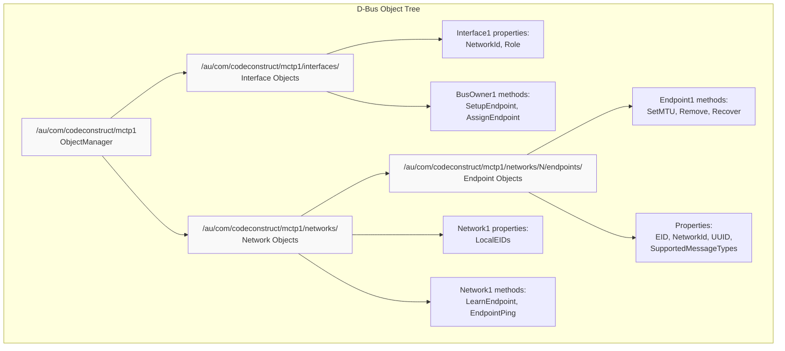
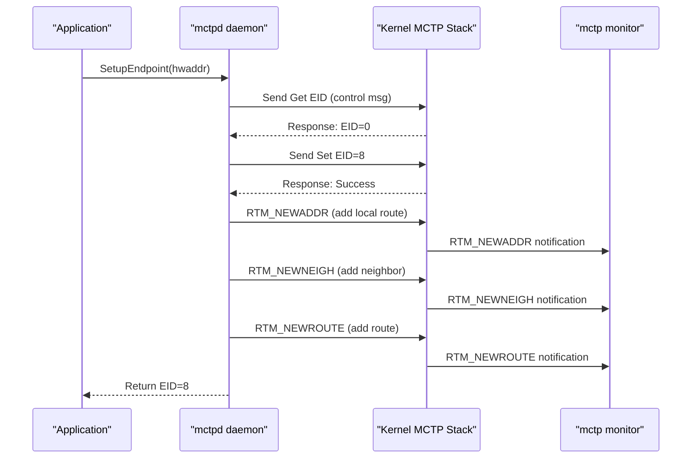
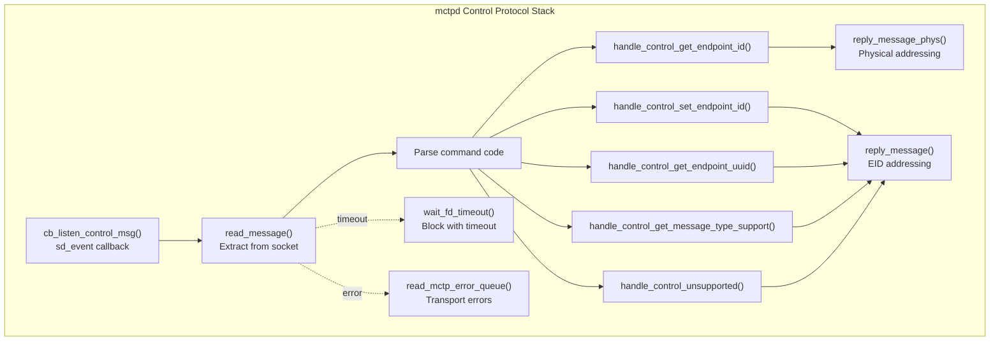
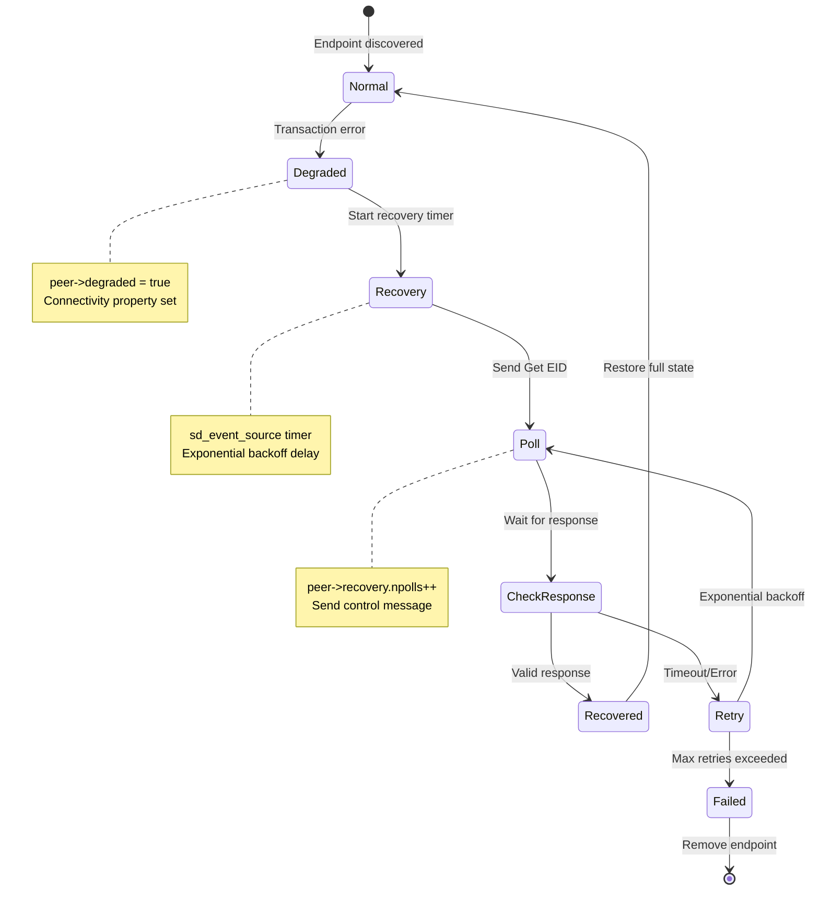

<!-- source: DeepWiki mcp.deepwiki.com · repo NVIDIA/mctp · page 8 Troubleshooting and Debugging · fetched 2026-10-26 -->

# Troubleshooting and Debugging

<details>
<summary>Relevant source files</summary>

The following files were used as context for generating this wiki page:

- [conf/mctpd.conf](conf/mctpd.conf)
- [docs/mctpd.md](docs/mctpd.md)
- [src/mctp.c](src/mctp.c)
- [src/mctpd-util.h](src/mctpd-util.h)
- [src/mctpd.c](src/mctpd.c)

</details>


## Purpose and Scope

This document provides guidance for diagnosing and resolving issues in the MCTP system. It covers diagnostic tools, inspection methods, common failure scenarios, and systematic debugging approaches for both the `mctpd` daemon and the `mctp` CLI utility.

For information about the internal error handling architecture and recovery mechanisms, see [Error Handling and Recovery](#7.2). For details on writing tests that simulate failure scenarios, see [Writing Tests](#6.3).

---

## Diagnostic Output and Logging

### Enabling Verbose Mode in mctpd

The `mctpd` daemon supports verbose logging to help diagnose operational issues. Enable it by passing the `--verbose` or `-v` flag at startup:

```bash
mctpd --verbose
```

When verbose mode is enabled, `mctpd` outputs detailed information about:
- Incoming control protocol messages with source address details
- Netlink events (interface changes, route updates, neighbor modifications)
- D-Bus method calls and their parameters
- Internal state transitions and peer management operations

**Sources:** [src/mctpd.c:256](), [src/mctpd.c:631-638](), [src/mctpd.c:1123-1127]()

### Enabling Verbose Mode in mctp Utility

The `mctp` command-line utility also supports verbose output for inspecting kernel responses:

```bash
mctp -v link show
mctp -v route show
mctp -v address show
```

In verbose mode, `mctp` displays:
- Raw Netlink message headers and payloads
- Hexadecimal dumps of response data
- Attribute parsing details

The verbose output shows both the structured display output and the underlying kernel data structures.

**Sources:** [src/mctp.c:40](), [src/mctp.c:476-480](), [src/mctp.c:1399]()

### Interpreting Log Output

Key patterns to look for in verbose logs:

| Log Pattern | Meaning | Location |
|------------|---------|----------|
| `"read_message returned error"` | Socket read failure | [src/mctpd.c:631-638]() |
| `"short <message> message"` | Malformed control protocol message | [src/mctpd.c:768](), [src/mctpd.c:957]() |
| `"BUG:"` prefix | Internal assertion failure | [src/mctpd.c:317-332]() |
| `"Rejected set EID"` | EID assignment refused | [src/mctpd.c:795-799]() |
| `"Received Discovery Notify"` | Endpoint announced presence | [src/mctpd.c:1123-1127]() |

---

## Inspecting System State via D-Bus

### Basic D-Bus Introspection

The `mctpd` daemon exposes its complete state through D-Bus. Use `busctl` to inspect:

```bash
# List all MCTP objects
busctl tree au.com.codeconstruct.MCTP1

# Introspect a specific endpoint
busctl introspect au.com.codeconstruct.MCTP1 \
    /au/com/codeconstruct/mctp1/networks/1/endpoints/10

# Get all properties of an endpoint
busctl get-property au.com.codeconstruct.MCTP1 \
    /au/com/codeconstruct/mctp1/networks/1/endpoints/10 \
    xyz.openbmc_project.MCTP.Endpoint EID
```

### Key D-Bus Paths for Inspection



**Sources:** [docs/mctpd.md:1-23](), [docs/mctpd.md:37-88](), [docs/mctpd.md:235-264]()

### Checking Interface Configuration

Verify interface role and network assignment:

```bash
# Check interface role
busctl get-property au.com.codeconstruct.MCTP1 \
    /au/com/codeconstruct/mctp1/interfaces/mctpi2c6 \
    au.com.codeconstruct.MCTP.Interface1 Role

# Check network ID
busctl get-property au.com.codeconstruct.MCTP1 \
    /au/com/codeconstruct/mctp1/interfaces/mctpi2c6 \
    au.com.codeconstruct.MCTP.Interface1 NetworkId
```

Common role values and their meanings:

| Role Value | Behavior | BusOwner1 Interface |
|-----------|----------|-------------------|
| `"BusOwner"` | Assigns EIDs to endpoints | Present |
| `"Endpoint"` | Accepts EID assignments | Absent |
| `"Unknown"` | Not yet configured | Absent |

**Sources:** [docs/mctpd.md:52-63](), [src/mctpd.c:103-131]()

### Examining Endpoint State

Check endpoint properties to verify discovery and configuration:

```bash
# List all endpoints
busctl call au.com.codeconstruct.MCTP1 \
    /au/com/codeconstruct/mctp1 \
    org.freedesktop.DBus.ObjectManager GetManagedObjects

# Check endpoint UUID
busctl get-property au.com.codeconstruct.MCTP1 \
    /au/com/codeconstruct/mctp1/networks/1/endpoints/10 \
    xyz.openbmc_project.Common.UUID UUID

# Check supported message types
busctl get-property au.com.codeconstruct.MCTP1 \
    /au/com/codeconstruct/mctp1/networks/1/endpoints/10 \
    xyz.openbmc_project.MCTP.Endpoint SupportedMessageTypes
```

**Sources:** [docs/mctpd.md:235-264](), [src/mctpd.c:172-177]()

---

## Monitoring Kernel Events

### Using the mctp monitor Command

The `mctp monitor` command displays real-time Netlink events from the kernel MCTP stack:

```bash
mctp monitor
```

This shows all kernel MCTP events including:
- `RTM_NEWLINK` / `RTM_DELLINK`: Interface creation and removal
- `RTM_NEWADDR` / `RTM_DELADDR`: Local EID assignments
- `RTM_NEWROUTE` / `RTM_DELROUTE`: Route table changes
- `RTM_NEWNEIGH` / `RTM_DELNEIGH`: Neighbor table updates

### Event Flow Diagram



**Sources:** [src/mctp.c:1297-1327](), [src/mctpd.c:754-943]()

### Verbose Monitor Output

Combine verbose mode with monitor for detailed inspection:

```bash
mctp -v monitor
```

This displays the complete Netlink message structure including:
- Message headers (type, flags, sequence number)
- All attributes with their types
- Hexadecimal dumps of attribute payloads

**Sources:** [src/mctp.c:420-469]()

---

## Debugging Control Protocol Issues

### Control Message Flow and Failure Points



**Sources:** [src/mctpd.c:576-639](), [src/mctpd.c:641-663](), [src/mctpd.c:665-694](), [src/mctpd.c:754-943](), [src/mctpd.c:988-1015]()

### Common Control Protocol Failures

#### Short Message Errors

**Symptom:** Log messages like `"short Get Endpoint ID message"` or `"short Set Endpoint ID message"`

**Cause:** Received MCTP control message has insufficient bytes for the expected structure.

**Diagnosis:**
```bash
# Check for malformed messages in logs
journalctl -u mctpd | grep "short"
```

**Resolution:**
- Verify the remote endpoint implements the control protocol correctly
- Check for transmission errors or MTU issues truncating messages
- Inspect physical layer (I2C, USB) for communication problems

**Sources:** [src/mctpd.c:768](), [src/mctpd.c:957](), [src/mctpd.c:996](), [src/mctpd.c:1025]()

#### Timeout Issues

**Symptom:** Operations hang or return `-ETIMEDOUT` errors

**Cause:** No response received within `message_timeout_ms` configuration value.

**Configuration Check:**
```bash
# Check configured timeout
cat /etc/mctpd.conf | grep message_timeout_ms
```

**Default timeout:** 250ms (can be adjusted in `/etc/mctpd.conf`)

**Diagnosis:**
1. Verify the remote endpoint is responsive
2. Check physical layer connectivity
3. Use `mctp monitor` to see if any Netlink events occur
4. Enable verbose mode to see exact timeout location

**Resolution:**
- Increase `message_timeout_ms` for slow endpoints
- Check physical layer signal quality
- Verify remote endpoint is not in a hung state

**Sources:** [src/mctpd.c:522-548](), [conf/mctpd.conf:6](), [docs/mctpd.md:314-323]()

#### EID Assignment Rejection

**Symptom:** `"Rejected set EID %d request"` in logs

**Cause:** The daemon received a Set EID request but is configured as a bus owner.

**Expected Behavior:**
- Bus owners do NOT accept Set EID commands from other devices
- Endpoints DO accept Set EID commands from bus owners

**Resolution:**
1. Verify interface role configuration:
   ```bash
   busctl get-property au.com.codeconstruct.MCTP1 \
       /au/com/codeconstruct/mctp1/interfaces/mctpi2c6 \
       au.com.codeconstruct.MCTP.Interface1 Role
   ```
2. If the role is incorrect, check `/etc/mctpd.conf` mode setting
3. Restart `mctpd` after configuration changes

**Sources:** [src/mctpd.c:794-800](), [conf/mctpd.conf:2](), [docs/mctpd.md:298-307]()

### Control Protocol Command Reference

| Command | Handler Function | Response Type | Common Issues |
|---------|-----------------|---------------|---------------|
| Get Endpoint ID (0x02) | `handle_control_get_endpoint_id()` | Physical addressing | None - simple query |
| Set Endpoint ID (0x01) | `handle_control_set_endpoint_id()` | EID or physical | Role conflicts, invalid EID |
| Get Endpoint UUID (0x03) | `handle_control_get_endpoint_uuid()` | EID addressing | Requires prior EID assignment |
| Get Message Type Support (0x05) | `handle_control_get_message_type_support()` | EID addressing | None - always returns control type |
| Get Version Support (0x04) | `handle_control_get_version_support()` | EID addressing | Unsupported type number |

**Sources:** [src/mctpd.c:754-943](), [src/mctpd.c:945-986](), [src/mctpd.c:988-1015](), [src/mctpd.c:1017-1034](), [src/mctpd.c:1036-1060]()

---

## Transport Error Monitoring

### MCTP Error Queue

The kernel MCTP stack maintains an error queue for transport-level failures. The `mctpd` daemon can enable and monitor this queue.

### Error Structure

```c
struct mctp_error {
    uint32_t error_code;      // Transport error code
    uint8_t direction;        // MCTP_DIR_TX or MCTP_DIR_RX
    uint8_t binding;          // Physical binding type
    uint16_t reserved1;
    uint8_t src_eid;          // Source EID
    uint8_t dest_eid;         // Destination EID
    uint8_t tag;              // MCTP tag
    uint8_t msg_type;         // MCTP message type
    uint64_t timestamp_ns;    // Error timestamp
    uint16_t payload_len;     // Length of captured payload
    uint16_t reserved2;
    uint8_t payload[64];      // First 64 bytes of message
};
```

**Sources:** [src/mctpd-util.h:100-113]()

### Monitoring Transport Errors via D-Bus

The `mctpd` daemon emits `TransportError` signals when transport errors occur:

```bash
# Monitor transport errors in real-time
busctl monitor au.com.codeconstruct.MCTP1 \
    --match "type='signal',interface='au.com.codeconstruct.MCTP.BusOwner1',member='TransportError'"
```

### Signal Parameters

| Parameter | Type | Description |
|-----------|------|-------------|
| `error_code` | `uint32` | Kernel error code (errno value) |
| `direction` | `byte` | 0=RX (receive), 1=TX (transmit) |
| `binding` | `byte` | Transport type (0x01=SMBus, 0x02=PCIe, 0x03=USB) |
| `src_eid` | `byte` | Source endpoint ID |
| `dest_eid` | `byte` | Destination endpoint ID |
| `tag` | `byte` | MCTP message tag |
| `msg_type` | `byte` | MCTP message type |
| `command_code` | `byte` | Control command code (if applicable) |
| `interface` | `string` | Interface name (e.g., "mctpi2c6") |

**Sources:** [docs/mctpd.md:164-184](), [src/mctpd-util.h:82-98]()

### Reading the Error Queue

The function `read_mctp_error_queue()` extracts errors from the socket:

```c
// Enable error queue on socket
int enable = 1;
setsockopt(sd, SOL_MCTP, MCTP_OPT_ENABLE_ERRQUEUE, 
           &enable, sizeof(enable));

// Read errors with MSG_ERRQUEUE flag
struct msghdr msg;
msg.msg_flags |= MSG_ERRQUEUE;
recvmsg(sd, &msg, MSG_ERRQUEUE);
```

**Sources:** [src/mctpd.c:347](), [src/mctpd-util.h:70-76]()

---

## Endpoint Recovery Mechanisms

### Recovery System Architecture



**Sources:** [src/mctpd.c:203-222](), [src/mctpd.c:2287-2434]()

### Checking Endpoint Connectivity State

Query the degraded state via D-Bus:

```bash
# Check if endpoint is degraded
busctl get-property au.com.codeconstruct.MCTP1 \
    /au/com/codeconstruct/mctp1/networks/1/endpoints/10 \
    xyz.openbmc_project.MCTP.Endpoint Connectivity
```

Possible values:
- `"Available"`: Endpoint is responsive
- `"Degraded"`: Endpoint failed recent transaction, recovery in progress

**Sources:** [src/mctpd.c:203]()

### Manual Recovery Trigger

Force an endpoint recovery attempt:

```bash
# Trigger recovery for an endpoint
busctl call au.com.codeconstruct.MCTP1 \
    /au/com/codeconstruct/mctp1/networks/1/endpoints/10 \
    au.com.codeconstruct.MCTP.Endpoint1 Recover
```

This initiates the recovery state machine immediately, bypassing the automatic timer.

**Sources:** [src/mctpd.c:2436-2491]()

### Recovery Timer Parameters

The recovery system uses exponential backoff with these characteristics:

| Attempt | Delay Calculation | Typical Delay |
|---------|------------------|---------------|
| 1 | `1 << 0` seconds | 1 second |
| 2 | `1 << 1` seconds | 2 seconds |
| 3 | `1 << 2` seconds | 4 seconds |
| 4 | `1 << 3` seconds | 8 seconds |
| Max | Capped at implementation limit | ~60 seconds |

After multiple failures, endpoints are removed from the system.

**Sources:** [src/mctpd.c:2381-2386]()

---

## Common Troubleshooting Scenarios

### Scenario 1: Endpoint Not Discovered

**Symptoms:**
- `SetupEndpoint` or `AssignEndpoint` call returns error
- No endpoint object appears in D-Bus tree
- Verbose logs show timeout or no response

**Diagnostic Steps:**

1. **Verify physical connectivity:**
   ```bash
   # For I2C: Check device is present
   i2cdetect -y <bus_number>
   ```

2. **Check interface is up:**
   ```bash
   mctp link show
   # Should show interface in "up" state
   ```

3. **Monitor Netlink events:**
   ```bash
   # In one terminal
   mctp monitor
   
   # In another terminal, retry setup
   busctl call au.com.codeconstruct.MCTP1 \
       /au/com/codeconstruct/mctp1/interfaces/mctpi2c6 \
       au.com.codeconstruct.MCTP.BusOwner1 \
       SetupEndpoint ay 1 0x1d
   ```

4. **Check for transport errors:**
   ```bash
   busctl monitor au.com.codeconstruct.MCTP1 \
       --match "type='signal',member='TransportError'"
   ```

**Common Causes:**
- Wrong hardware address (I2C slave address)
- Remote device not powered or in reset
- Kernel MCTP module not loaded
- Interface on wrong network

**Sources:** [docs/mctpd.md:91-122](), [src/mctpd.c:2493-2625]()

### Scenario 2: Route Not Working

**Symptoms:**
- Endpoint discovered but cannot communicate
- Messages timeout when sending to endpoint
- `EndpointPing` fails

**Diagnostic Steps:**

1. **Check route table:**
   ```bash
   mctp route show
   # Look for route to endpoint EID
   ```

2. **Check neighbor table:**
   ```bash
   mctp neigh show
   # Verify physical address mapping exists
   ```

3. **Verify MTU settings:**
   ```bash
   # Check interface MTU
   mctp link show mctpi2c6
   
   # Check route-specific MTU (if set)
   mctp -v route show | grep "eid.*<target_eid>"
   ```

4. **Test with explicit route/neighbor add:**
   ```bash
   # Add route manually
   mctp route add <eid> via <interface>
   
   # Add neighbor manually
   mctp neigh add <eid> dev <interface> lladdr <hwaddr>
   ```

**Common Causes:**
- Route/neighbor not created during endpoint setup
- MTU too large for transport
- Network ID mismatch
- Gateway EID incorrect for bridged networks

**Sources:** [src/mctpd.c:1619-1663](), [src/mctpd.c:1665-1698]()

### Scenario 3: EID Conflicts

**Symptoms:**
- `AssignEndpointStatic` returns error
- Log messages about EID already assigned
- Multiple endpoints report same EID

**Diagnostic Steps:**

1. **List all assigned EIDs:**
   ```bash
   mctp address show
   busctl call au.com.codeconstruct.MCTP1 \
       /au/com/codeconstruct/mctp1 \
       org.freedesktop.DBus.ObjectManager GetManagedObjects | \
       grep -i "eid"
   ```

2. **Check EID allocation range:**
   ```bash
   grep dynamic_eid_range /etc/mctpd.conf
   ```

3. **Examine peer state:**
   ```bash
   # Check if peer already has different EID
   journalctl -u mctpd | grep "peer"
   ```

**Resolution:**
- Use different static EID not in use
- Increase `dynamic_eid_range` if pool exhausted
- Remove conflicting endpoint with `.Remove` method before reassigning

**Sources:** [src/mctpd.c:1865-1936](), [docs/mctpd.md:347-358]()

### Scenario 4: Bridge Configuration Issues

**Symptoms:**
- Bridge endpoint discovered but downstream endpoints not visible
- Routing table queries fail or return empty
- Pool allocation not reflected in Bridge1 interface

**Diagnostic Steps:**

1. **Verify bridge endpoint properties:**
   ```bash
   # Check if pool was allocated
   busctl introspect au.com.codeconstruct.MCTP1 \
       /au/com/codeconstruct/mctp1/networks/1/endpoints/<bridge_eid>
   
   # Look for Bridge1 interface with PoolStart/PoolEnd
   ```

2. **Check routing table query:**
   ```bash
   # Should see routing table entries for bridged endpoints
   journalctl -u mctpd | grep "routing table"
   ```

3. **Monitor bridge settle timer:**
   ```bash
   # Bridged endpoints populate after BRIDGE_SETTLE_DELAY_SEC (4 seconds)
   # Check logs for "bridge settle timer fired"
   ```

4. **Verify ignore_eids configuration:**
   ```bash
   # If using AssignEndpointStatic, check ignore_eids array
   # Ignored EIDs won't appear as downstream endpoints
   ```

**Common Causes:**
- `max_pool_size` configuration too small
- Bridge not responding to Get Routing Table command
- Routing table entries have invalid format
- EIDs in ignore_eids array

**Sources:** [src/mctpd.c:59](), [src/mctpd.c:1770-1859](), [src/mctpd.c:2078-2278](), [docs/mctpd.md:270-284](), [docs/mctpd.md:361-368]()

---

## Advanced Debugging Techniques

### Packet Capture at Control Protocol Level

For deep debugging, you can inspect raw MCTP control messages by examining socket operations:

```bash
# Use strace to see socket system calls
strace -e trace=sendto,recvfrom -s 200 -p $(pidof mctpd)
```

This shows the actual bytes sent and received on MCTP sockets, useful for protocol-level debugging.

### D-Bus Method Call Tracing

Monitor all D-Bus method calls to mctpd:

```bash
busctl monitor au.com.codeconstruct.MCTP1
```

This shows:
- Method calls with arguments
- Method return values
- Signal emissions
- Property changes

### Netlink Message Decoding

For verbose Netlink message inspection:

```bash
# Dump raw Netlink messages with attributes
mctp -v link show
mctp -v route show
mctp -v neigh show
```

The verbose output includes:
- Attribute names (IFLA_*, IFA_*, NDA_*, RTA_*)
- Attribute types and lengths
- Hexadecimal payload dumps

**Sources:** [src/mctp.c:161-169](), [src/mctp.c:420-463]()

### Kernel Module Debug Output

If the kernel MCTP stack has debug output enabled:

```bash
# Check kernel messages
dmesg | grep mctp

# Enable dynamic debug (if supported)
echo 'module mctp +p' > /sys/kernel/debug/dynamic_debug/control
```

### State Machine Inspection

The mctpd daemon maintains several state machines. To inspect their state:

```bash
# Check service readiness state
busctl get-property au.com.codeconstruct.MCTP1 \
    /au/com/codeconstruct/mctp1/interfaces/mctpi2c6 \
    xyz.openbmc_project.State.ServiceReady State

# Check endpoint connectivity (recovery state)
busctl get-property au.com.codeconstruct.MCTP1 \
    /au/com/codeconstruct/mctp1/networks/1/endpoints/10 \
    xyz.openbmc_project.MCTP.Endpoint Connectivity
```

**Sources:** [src/mctpd.c:145-149](), [src/mctpd.c:203](), [src/mctpd.c:61-67]()

---

## Debugging Checklist

When encountering MCTP issues, systematically check:

- [ ] Interfaces are up: `mctp link show`
- [ ] Correct role configured: Check `Role` property on interface objects
- [ ] Network IDs match: Compare interface and endpoint NetworkId values
- [ ] Routes exist: `mctp route show`
- [ ] Neighbors configured: `mctp neigh show`
- [ ] No EID conflicts: `mctp address show`
- [ ] Timeout reasonable: Check `message_timeout_ms` in `/etc/mctpd.conf`
- [ ] Verbose logging enabled: Start mctpd with `-v` flag
- [ ] Monitor active: `mctp monitor` running in separate terminal
- [ ] Transport errors: Check for `TransportError` D-Bus signals
- [ ] Physical layer: Verify hardware connectivity (I2C scan, etc.)

---

**Sources:** [src/mctpd.c](), [src/mctp.c](), [docs/mctpd.md](), [src/mctpd-util.h](), [conf/mctpd.conf]()

---

