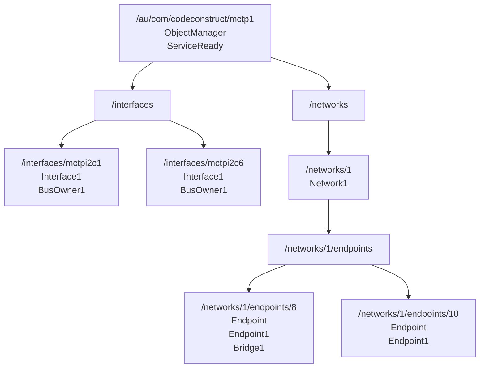

<!-- source: DeepWiki mcp.deepwiki.com · repo NVIDIA/mctp · page 9 Reference · fetched 2026-10-26 -->

# Reference

<details>
<summary>Relevant source files</summary>

The following files were used as context for generating this wiki page:

- [conf/mctpd.conf](conf/mctpd.conf)
- [docs/mctpd.md](docs/mctpd.md)
- [src/mctp-control-spec.h](src/mctp-control-spec.h)

</details>


This page provides quick reference tables and lookup information for MCTP protocol constants, D-Bus interfaces, control commands, and configuration options. Use this page when you need to quickly find command codes, completion codes, D-Bus method signatures, or configuration parameter details.

For detailed explanations of control protocol implementation, see [MCTP Control Protocol](#3.2). For comprehensive D-Bus interface documentation with examples, see [D-Bus Interface](#4) and its sub-pages. For configuration file format and semantics, see [Configuration](#2.1.3).

## MCTP Control Commands Reference

The following table lists all MCTP control protocol commands defined in DSP0236. These command codes are used in the `command_code` field of control message headers.

| Command Code | Name | Request Structure | Response Structure | Description |
|--------------|------|-------------------|-------------------|-------------|
| 0x00 | Reserved | - | - | Reserved, not used |
| 0x01 | Set Endpoint ID | `mctp_ctrl_cmd_set_eid` | `mctp_ctrl_resp_set_eid` | Assign EID to endpoint, supports bridge pool allocation |
| 0x02 | Get Endpoint ID | `mctp_ctrl_cmd_get_eid` | `mctp_ctrl_resp_get_eid` | Query endpoint's current EID and type |
| 0x03 | Get Endpoint UUID | `mctp_ctrl_cmd_get_uuid` | `mctp_ctrl_resp_get_uuid` | Retrieve 128-bit UUID identifying endpoint |
| 0x04 | Get Version Support | `mctp_ctrl_cmd_get_mctp_ver_support` | `mctp_ctrl_resp_get_mctp_ver_support` | Query MCTP protocol version support |
| 0x05 | Get Message Type Support | `mctp_ctrl_cmd_get_msg_type_support` | `mctp_ctrl_resp_get_msg_type_support` | Query supported message types (PLDM, SPDM, etc.) |
| 0x06 | Get Vendor Message Support | `mctp_ctrl_cmd_get_vdm_support` | `mctp_ctrl_resp_get_vdm_support` | Query vendor-defined message capabilities |
| 0x07 | Resolve Endpoint ID | `mctp_ctrl_cmd_resolve_endpoint_id` | `mctp_ctrl_resp_resolve_endpoint_id` | Resolve EID to physical address |
| 0x08 | Allocate Endpoint IDs | `mctp_ctrl_cmd_alloc_eid` | `mctp_ctrl_resp_alloc_eid` | Bridge requests EID pool from bus owner |
| 0x09 | Routing Info Update | `mctp_ctrl_cmd_routing_info_update` | - | Update routing information (multicast) |
| 0x0A | Get Routing Table Entries | `mctp_ctrl_cmd_get_routing_table` | `mctp_ctrl_resp_get_routing_table` | Query bridge routing table |
| 0x0B | Prepare Endpoint Discovery | - | `mctp_ctrl_resp_prepare_discovery` | Prepare for endpoint discovery |
| 0x0C | Endpoint Discovery | - | `mctp_ctrl_resp_endpoint_discovery` | Perform endpoint discovery |
| 0x0D | Discovery Notify | `mctp_ctrl_cmd_discovery_notify` | `mctp_ctrl_resp_discovery_notify` | Notify of endpoint discovery |
| 0x0E | Get Network ID | - | - | Query network identifier |
| 0x0F | Query Hop | - | - | Query hop information |
| 0x10 | Resolve UUID | - | - | Resolve UUID to EID |
| 0x11 | Query Rate Limit | - | - | Query rate limiting parameters |
| 0x12 | Request TX Rate Limit | - | - | Request transmit rate limit |
| 0x13 | Update Rate Limit | - | - | Update rate limiting configuration |
| 0x14 | Query Supported Interfaces | - | - | Query supported physical interfaces |
| 0xF0-0xFF | Transport Specific | - | - | Reserved for transport-specific commands |

**Sources:** [src/mctp-control-spec.h:233-257]()

## Control Protocol Message Structure

The following diagram shows the relationship between control message structures and their usage in mctpd.

```mermaid
graph TB
    subgraph "Base Structures"
        HDR["mctp_ctrl_msg_hdr<br/>rq_dgram_inst<br/>command_code"]
        RESP["mctp_ctrl_resp<br/>+ completion_code"]
    end
    
    subgraph "Set EID (0x01)"
        SET_REQ["mctp_ctrl_cmd_set_eid<br/>operation<br/>eid"]
        SET_RESP["mctp_ctrl_resp_set_eid<br/>completion_code<br/>status<br/>eid_set<br/>eid_pool_size"]
    end
    
    subgraph "Get EID (0x02)"
        GET_REQ["mctp_ctrl_cmd_get_eid"]
        GET_RESP["mctp_ctrl_resp_get_eid<br/>eid<br/>eid_type<br/>medium_data"]
    end
    
    subgraph "Get UUID (0x03)"
        UUID_REQ["mctp_ctrl_cmd_get_uuid"]
        UUID_RESP["mctp_ctrl_resp_get_uuid<br/>uuid[16]"]
    end
    
    subgraph "Get Message Types (0x05)"
        MSG_REQ["mctp_ctrl_cmd_get_msg_type_support"]
        MSG_RESP["mctp_ctrl_resp_get_msg_type_support<br/>msg_type_count<br/>+ msg_type_entry[]"]
    end
    
    subgraph "Get Routing Table (0x0A)"
        RT_REQ["mctp_ctrl_cmd_get_routing_table<br/>entry_handle"]
        RT_RESP["mctp_ctrl_resp_get_routing_table<br/>next_entry_handle<br/>number_of_entries<br/>routing_entries[]"]
    end
    
    HDR -.embedded in.-> SET_REQ
    HDR -.embedded in.-> GET_REQ
    HDR -.embedded in.-> UUID_REQ
    HDR -.embedded in.-> MSG_REQ
    HDR -.embedded in.-> RT_REQ
    
    RESP -.base for.-> SET_RESP
    RESP -.base for.-> GET_RESP
    RESP -.base for.-> UUID_RESP
    RESP -.base for.-> MSG_RESP
    RESP -.base for.-> RT_RESP
```



**Sources:** [src/mctp-control-spec.h:16-223]()

## Completion Codes

MCTP control protocol responses include a completion code indicating success or error conditions.

| Code | Name | Description |
|------|------|-------------|
| 0x00 | `MCTP_CTRL_CC_SUCCESS` | Command completed successfully |
| 0x01 | `MCTP_CTRL_CC_ERROR` | Generic error |
| 0x02 | `MCTP_CTRL_CC_ERROR_INVALID_DATA` | Invalid data in request |
| 0x03 | `MCTP_CTRL_CC_ERROR_INVALID_LENGTH` | Message length incorrect |
| 0x04 | `MCTP_CTRL_CC_ERROR_NOT_READY` | Endpoint not ready |
| 0x05 | `MCTP_CTRL_CC_ERROR_UNSUPPORTED_CMD` | Command not supported |
| 0x80-0xFF | Command-specific | Command-specific error codes |

**Command-Specific Completion Codes:**

| Command | Code | Name | Description |
|---------|------|------|-------------|
| Get MCTP Version Support | 0x80 | `MCTP_CTRL_CC_GET_MCTP_VER_SUPPORT_UNSUPPORTED_TYPE` | Message type not supported |

**Sources:** [src/mctp-control-spec.h:259-272]()

## Physical Transport Binding Identifiers

These identifiers specify the physical transport layer binding used for MCTP communication.

| Binding ID | Name | Constant | Description |
|------------|------|----------|-------------|
| 0x00 | Reserved | `MCTP_BINDING_RESERVED` | Reserved |
| 0x01 | SMBus/I2C | `MCTP_BINDING_SMBUS` | I2C/SMBus transport |
| 0x02 | PCIe VDM | `MCTP_BINDING_PCIE` | PCIe Vendor Defined Messages |
| 0x03 | USB | `MCTP_BINDING_USB` | USB transport |
| 0x04 | KCS | `MCTP_BINDING_KCS` | Keyboard Controller Style |
| 0x05 | Serial | `MCTP_BINDING_SERIAL` | Serial/UART transport |
| 0x06 | Vendor | `MCTP_BINDING_VENDOR` | Vendor-specific binding |

**Sources:** [src/mctp-control-spec.h:307-316]()

## D-Bus Interface Summary

The following table summarizes all D-Bus interfaces exposed by mctpd.

| Interface | Object Path Pattern | Methods | Properties | Signals |
|-----------|---------------------|---------|------------|---------|
| `org.freedesktop.DBus.ObjectManager` | `/au/com/codeconstruct/mctp1` | GetManagedObjects | - | InterfacesAdded, InterfacesRemoved |
| `au.com.codeconstruct.MCTP.Interface1` | `/au/com/codeconstruct/mctp1/interfaces/<name>` | - | NetworkId, Role | - |
| `au.com.codeconstruct.MCTP.BusOwner1` | `/au/com/codeconstruct/mctp1/interfaces/<name>` | SetupEndpoint, AssignEndpoint, AssignEndpointStatic, LearnEndpoint, GetEndpointID | - | TransportError |
| `au.com.codeconstruct.MCTP.Network1` | `/au/com/codeconstruct/mctp1/networks/<net>` | LearnEndpoint, EndpointPing | LocalEIDs | - |
| `au.com.codeconstruct.MCTP.Endpoint1` | `/au/com/codeconstruct/mctp1/networks/<net>/endpoints/<eid>` | SetMTU, Remove, Recover | - | - |
| `xyz.openbmc_project.MCTP.Endpoint` | `/au/com/codeconstruct/mctp1/networks/<net>/endpoints/<eid>` | - | EID, NetworkId, SupportedMessageTypes, UUID | - |
| `au.com.codeconstruct.MCTP.Bridge1` | `/au/com/codeconstruct/mctp1/networks/<net>/endpoints/<eid>` | - | PoolStart, PoolEnd | - |
| `au.com.codeconstruct.MCTP.ServiceReady` | `/au/com/codeconstruct/mctp1` | - | ServiceReady, ReadyCount | - |

**Sources:** [docs/mctpd.md:1-284]()

## D-Bus Object Hierarchy



**Sources:** [docs/mctpd.md:9-23]()

## D-Bus Method Signatures Quick Reference

| Interface | Method | Input Signature | Output Signature | Description |
|-----------|--------|----------------|------------------|-------------|
| BusOwner1 | SetupEndpoint | `ay` (hwaddr) | `yisb` (eid, net, path, new) | Setup endpoint with EID query/assignment |
| BusOwner1 | AssignEndpoint | `ay` (hwaddr) | `yisb` (eid, net, path, new) | Always assign new EID |
| BusOwner1 | AssignEndpointStatic | `ayyay` (hwaddr, eid, pool_start, ignore_eids) | `yisb` (eid, net, path, new) | Assign specific static EID |
| BusOwner1 | LearnEndpoint | `ay` (hwaddr) | `yisb` (eid, net, path, new) | Query existing EID only |
| BusOwner1 | GetEndpointID | `ay` (hwaddr) | `yyy` (eid, eid_type, medium_data) | Get EID without setup |
| Network1 | LearnEndpoint | `y` (eid) | `sb` (path, new) | Learn routable endpoint |
| Network1 | EndpointPing | `y` (eid) | - | Ping endpoint for responsiveness |
| Endpoint1 | SetMTU | `u` (mtu) | - | Set endpoint route MTU |
| Endpoint1 | Remove | - | - | Remove endpoint |
| Endpoint1 | Recover | - | - | Recover degraded endpoint |

**Sources:** [docs/mctpd.md:82-267]()

## Configuration Options Reference

The following table lists all configuration options available in `/etc/mctpd.conf`.

| Section | Option | Type | Default | Description |
|---------|--------|------|---------|-------------|
| (global) | `mode` | string enum | `"bus-owner"` | Operation mode: `"bus-owner"`, `"endpoint"`, or `"unknown"` |
| `[mctp]` | `message_timeout_ms` | integer | 250 | Timeout for control messages in milliseconds |
| `[mctp]` | `uuid` | string (UUID) | system UUID | Override endpoint UUID (RFC 4122 format) |
| `[bus-owner]` | `dynamic_eid_range` | array[2] | `[8, 254]` | Min and max EID values for dynamic allocation (inclusive) |
| `[bus-owner]` | `max_pool_size` | integer | 15 | Maximum EID pool size for bridge endpoints |

**Configuration File Format:**

The configuration file uses TOML format. Example:

```toml
mode = "bus-owner"

[mctp]
message_timeout_ms = 30
# uuid = "21f0f554-7f7c-4211-9ca1-6d0f000ea9e7"

[bus-owner]
dynamic_eid_range = [8, 254]
max_pool_size = 15
```

**Sources:** [docs/mctpd.md:286-369](), [conf/mctpd.conf:1-20]()

## EID (Endpoint ID) Constants and Ranges

| Value | Name | Description |
|-------|------|-------------|
| 0 | NULL EID | Unassigned endpoint or broadcast |
| 1-7 | Reserved | Reserved for future use |
| 8 | Default BMC EID | Common default for bus owner |
| 8-254 | Dynamic Range | Default range for dynamic allocation |
| 255 | Broadcast | Broadcast to all endpoints |

**EID Type Values:**

| Type | Constant | Description |
|------|----------|-------------|
| 0 | `MCTP_DYNAMIC_EID` | Dynamically allocated EID |
| 1 | `MCTP_STATIC_EID` | Static EID configured on endpoint |
| 2 | `MCTP_STATIC_EID_MATCHING_PRESENT` | Static EID matches configured value |
| 3 | `MCTP_STATIC_EID_NOT_MATCHING_PRESENT` | Static EID doesn't match configured |

**Sources:** [src/mctp-control-spec.h:329-336]()

## Set Endpoint ID Operations

| Operation | Value | Constant | Description |
|-----------|-------|----------|-------------|
| Set EID | 0 | `mctp_ctrl_cmd_set_eid_set_eid` | Normal EID assignment |
| Force EID | 1 | `mctp_ctrl_cmd_set_eid_force_eid` | Force EID even if already set |
| Reset EID | 2 | `mctp_ctrl_cmd_set_eid_reset_eid` | Reset endpoint to EID 0 |
| Set Discovered Flag | 3 | `mctp_ctrl_cmd_set_eid_set_discovered_flag` | Mark as discovered |

**Assignment Status Values:**

| Status | Value | Constant | Description |
|--------|-------|----------|-------------|
| Accepted | 0 | `MCTP_SET_EID_ACCEPTED` | EID assignment accepted |
| Rejected | 1 | `MCTP_SET_EID_REJECTED` | EID assignment rejected |

**Allocation Status Values:**

| Status | Value | Constant | Description |
|--------|-------|----------|-------------|
| No Pool | 0 | `MCTP_SET_EID_POOL_NONE` | No pool requested/allocated |
| Pool Required | 1 | `MCTP_SET_EID_POOL_REQUIRED` | Bridge requires pool |
| Pool Received | 2 | `MCTP_SET_EID_POOL_RECEIVED` | Pool successfully allocated |

**Sources:** [src/mctp-control-spec.h:30-306]()

## Endpoint Type Values

| Type | Value | Constant | Description |
|------|-------|----------|-------------|
| Simple Endpoint | 0 | `MCTP_SIMPLE_ENDPOINT` | Non-bridge endpoint |
| Bus Owner Bridge | 1 | `MCTP_BUS_OWNER_BRIDGE` | Bridge with bus owner capability |

**Sources:** [src/mctp-control-spec.h:322-327]()

## Routing Table Entry Types

| Type | Value | Constant | Description |
|------|-------|----------|-------------|
| Endpoint | 0x00 | `MCTP_ROUTING_ENTRY_ENDPOINT` | Single endpoint entry |
| Bridge and Endpoints | 0x01 | `MCTP_ROUTING_ENTRY_BRIDGE_AND_ENDPOINTS` | Bridge plus downstream endpoints |
| Bridge | 0x02 | `MCTP_ROUTING_ENTRY_BRIDGE` | Bridge only |
| Endpoints | 0x03 | `MCTP_ROUTING_ENTRY_ENDPOINTS` | Multiple endpoints |

**Assignment Type:**

| Type | Value | Constant | Description |
|------|-------|----------|-------------|
| Dynamic | 0 | `MCTP_DYNAMIC_ASSIGNMENT` | Dynamically assigned by bus owner |
| Static | 1 | `MCTP_STATIC_ASSIGNMENT` | Statically configured |

**Sources:** [src/mctp-control-spec.h:338-372]()

## Control Message Header Flags

| Flag | Mask | Description |
|------|------|-------------|
| `MCTP_CTRL_HDR_FLAG_REQUEST` | 0x80 | Request message (bit 7 set) |
| `MCTP_CTRL_HDR_FLAG_DGRAM` | 0x40 | Datagram message (bit 6 set) |
| `MCTP_CTRL_HDR_INSTANCE_ID_MASK` | 0x1F | Instance ID field (bits 0-4) |

**Message Type:**

| Value | Constant | Description |
|-------|----------|-------------|
| 0x00 | `MCTP_CTRL_HDR_MSG_TYPE` | Control protocol message type |

**Sources:** [src/mctp-control-spec.h:224-227]()

## Build-Time Configuration Constants

The following constants are defined at build time and affect mctpd behavior:

| Define | Description | Default |
|--------|-------------|---------|
| `HAVE_LINUX_MCTP_H` | Kernel MCTP headers available | Detected |
| `HAVE_SD_BUS_ERROR_MOVE` | libsystemd version check | Detected |

**Meson Build Options:**

| Option | Type | Default | Description |
|--------|------|---------|-------------|
| `unsafe-recover-nil-uuid` | boolean | false | Allow recovery of endpoints with null UUID |
| `unsafe-writable-connectivity` | boolean | false | Enable writable Connectivity property |
| `tests` | boolean | true | Build test suite |

**Sources:** Based on meson.build configuration detection

## MTU (Maximum Transmission Unit) Ranges

| Transport | Minimum MTU | Maximum MTU | Default |
|-----------|-------------|-------------|---------|
| I2C/SMBus | 68 | 254 | Interface default |
| PCIe | Varies | Varies | Interface default |
| Serial | Varies | Varies | Interface default |

**Note:** Per-route MTU can be configured using the `SetMTU` method on endpoint objects. If not set, the interface MTU is used.

**Sources:** [docs/mctpd.md:248-256]()

## Common D-Bus Error Names

When D-Bus method calls fail, mctpd returns standard D-Bus errors:

| Error Name | Description |
|------------|-------------|
| `org.freedesktop.DBus.Error.InvalidArgs` | Invalid method arguments |
| `org.freedesktop.DBus.Error.Failed` | Generic operation failure |
| `org.freedesktop.DBus.Error.NoReply` | Operation timed out |
| `org.freedesktop.DBus.Error.UnknownObject` | Object path does not exist |
| `org.freedesktop.DBus.Error.UnknownInterface` | Interface not supported |

**Sources:** Standard D-Bus error handling conventions

---

