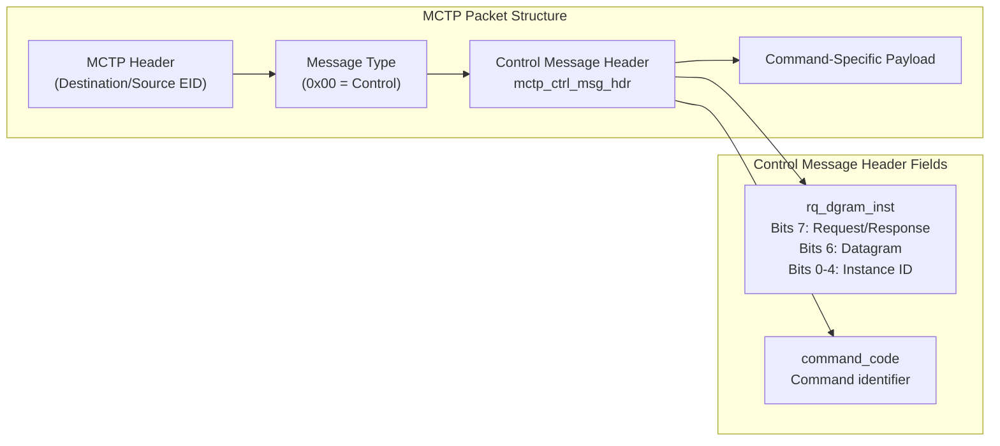
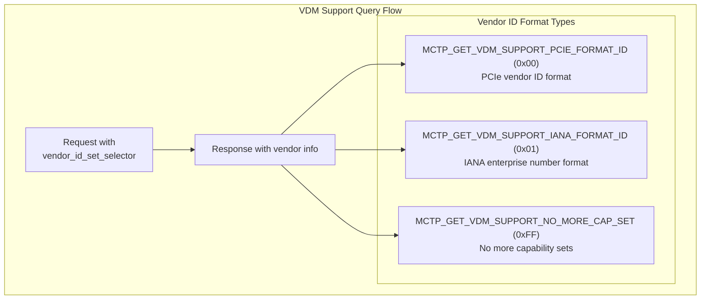
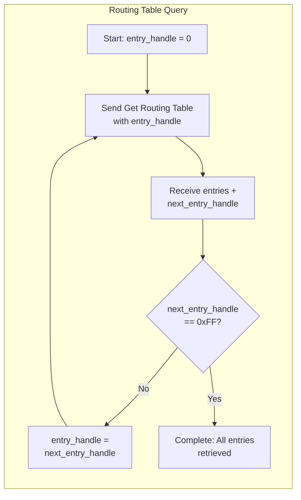
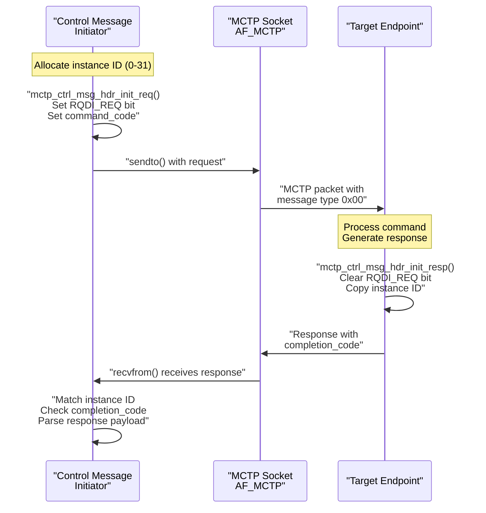

<!-- source: DeepWiki mcp.deepwiki.com · repo NVIDIA/mctp · page 9.1 MCTP Control Commands · fetched 2026-10-26 -->

# MCTP Control Commands

<details>
<summary>Relevant source files</summary>

The following files were used as context for generating this wiki page:

- [src/mctp-control-spec.h](src/mctp-control-spec.h)

</details>


This page provides a comprehensive reference for MCTP control protocol commands as implemented in the MCTP repository. These commands are defined by the DMTF DSP0236 v1.3.0 specification and are used for endpoint discovery, EID assignment, routing table management, and other control operations.

For information about how mctpd implements and uses these control commands, see [MCTP Control Protocol](#3.2). For details on the overall system architecture, see [System Architecture](#3.1).

**Sources**: [src/mctp-control-spec.h:1-392]()

---

## Control Message Structure

All MCTP control messages share a common header structure that identifies the message type, request/response direction, and instance ID for transaction tracking.

### Message Header Layout



**Sources**: [src/mctp-control-spec.h:16-19](), [src/mctp-control-spec.h:224-227]()

### Core Data Structures

| Structure | Purpose | Fields |
|-----------|---------|--------|
| `mctp_ctrl_msg_hdr` | Common header for all control messages | `rq_dgram_inst`, `command_code` |
| `mctp_ctrl_resp` | Common response with completion code | Inherits `mctp_ctrl_msg_hdr`, adds `completion_code` |

The `rq_dgram_inst` field encodes three pieces of information:
- **Bit 7 (MCTP_CTRL_HDR_FLAG_REQUEST)**: Set for requests, clear for responses
- **Bit 6 (MCTP_CTRL_HDR_FLAG_DGRAM)**: Datagram flag
- **Bits 0-4 (MCTP_CTRL_HDR_INSTANCE_ID_MASK)**: Instance ID for transaction matching

**Sources**: [src/mctp-control-spec.h:16-28](), [src/mctp-control-spec.h:374-391]()

---

## Command Code Reference

The following table lists all MCTP control commands defined in DSP0236 v1.3.0 Table 12.

| Command Code | Command Name | Description | Implemented |
|-------------|--------------|-------------|-------------|
| 0x00 | MCTP_CTRL_CMD_RESERVED | Reserved | N/A |
| 0x01 | MCTP_CTRL_CMD_SET_ENDPOINT_ID | Assign or update endpoint EID | Yes |
| 0x02 | MCTP_CTRL_CMD_GET_ENDPOINT_ID | Query endpoint's current EID | Yes |
| 0x03 | MCTP_CTRL_CMD_GET_ENDPOINT_UUID | Retrieve endpoint's UUID | Yes |
| 0x04 | MCTP_CTRL_CMD_GET_VERSION_SUPPORT | Query MCTP version support | Yes |
| 0x05 | MCTP_CTRL_CMD_GET_MESSAGE_TYPE_SUPPORT | Query supported message types | Yes |
| 0x06 | MCTP_CTRL_CMD_GET_VENDOR_MESSAGE_SUPPORT | Query vendor-specific message support | Yes |
| 0x07 | MCTP_CTRL_CMD_RESOLVE_ENDPOINT_ID | Resolve EID to physical address | Yes |
| 0x08 | MCTP_CTRL_CMD_ALLOCATE_ENDPOINT_IDS | Allocate EID pool for bridge | Yes |
| 0x09 | MCTP_CTRL_CMD_ROUTING_INFO_UPDATE | Update routing information | Yes |
| 0x0A | MCTP_CTRL_CMD_GET_ROUTING_TABLE_ENTRIES | Retrieve routing table from bridge | Yes |
| 0x0B | MCTP_CTRL_CMD_PREPARE_ENDPOINT_DISCOVERY | Prepare for discovery process | Yes |
| 0x0C | MCTP_CTRL_CMD_ENDPOINT_DISCOVERY | Perform endpoint discovery | Yes |
| 0x0D | MCTP_CTRL_CMD_DISCOVERY_NOTIFY | Notify of discovery completion | Yes |
| 0x0E | MCTP_CTRL_CMD_GET_NETWORK_ID | Query network ID | No |
| 0x0F | MCTP_CTRL_CMD_QUERY_HOP | Query hop information | No |
| 0x10 | MCTP_CTRL_CMD_RESOLVE_UUID | Resolve UUID to EID | No |
| 0x11 | MCTP_CTRL_CMD_QUERY_RATE_LIMIT | Query rate limiting parameters | No |
| 0x12 | MCTP_CTRL_CMD_REQUEST_TX_RATE_LIMIT | Request transmit rate limit | No |
| 0x13 | MCTP_CTRL_CMD_UPDATE_RATE_LIMIT | Update rate limit settings | No |
| 0x14 | MCTP_CTRL_CMD_QUERY_SUPPORTED_INTERFACES | Query supported interfaces | No |
| 0xF0-0xFF | Transport-specific commands | Binding-specific extensions | Varies |

**Sources**: [src/mctp-control-spec.h:229-257]()

---

## Completion Codes

All control message responses include a completion code indicating success or error conditions.

| Completion Code | Name | Description |
|----------------|------|-------------|
| 0x00 | MCTP_CTRL_CC_SUCCESS | Command completed successfully |
| 0x01 | MCTP_CTRL_CC_ERROR | Generic error |
| 0x02 | MCTP_CTRL_CC_ERROR_INVALID_DATA | Invalid data in request |
| 0x03 | MCTP_CTRL_CC_ERROR_INVALID_LENGTH | Invalid message length |
| 0x04 | MCTP_CTRL_CC_ERROR_NOT_READY | Endpoint not ready to process command |
| 0x05 | MCTP_CTRL_CC_ERROR_UNSUPPORTED_CMD | Command not supported |
| 0x80 | MCTP_CTRL_CC_GET_MCTP_VER_SUPPORT_UNSUPPORTED_TYPE | Message type not supported (Get Version Support) |
| 0x80-0xFF | Command-specific error codes | Defined per command |

**Note**: Error responses should only be interpreted up to the completion code field. The constant `MCTP_CTRL_ERROR_RESP_LEN` defines the minimum size for error responses.

**Sources**: [src/mctp-control-spec.h:259-271](), [src/mctp-control-spec.h:26-28]()

---

## Command Details

### Set Endpoint ID (0x01)

Assigns or updates an endpoint's EID. This is the primary command used by bus owners to configure endpoint addressing.

```mermaid
graph TB
    subgraph "Request: mctp_ctrl_cmd_set_eid"
        REQ_HDR["ctrl_hdr<br/>command_code = 0x01"]
        REQ_OP["operation<br/>mctp_ctrl_cmd_set_eid_op"]
        REQ_EID["eid<br/>Requested EID"]
    end
    
    subgraph "Response: mctp_ctrl_resp_set_eid"
        RESP_HDR["ctrl_hdr<br/>command_code = 0x01"]
        RESP_CC["completion_code"]
        RESP_STATUS["status<br/>Assignment + Allocation bits"]
        RESP_EID["eid_set<br/>Assigned EID"]
        RESP_POOL["eid_pool_size<br/>Pool size for bridges"]
    end
    
    REQ_HDR --> REQ_OP
    REQ_OP --> REQ_EID
    
    RESP_HDR --> RESP_CC
    RESP_CC --> RESP_STATUS
    RESP_STATUS --> RESP_EID
    RESP_EID --> RESP_POOL
```



#### Request Fields

| Field | Type | Description |
|-------|------|-------------|
| `operation` | `mctp_ctrl_cmd_set_eid_op` | Operation type (see below) |
| `eid` | `uint8_t` | Requested EID value |

**Operation Types**:
- `mctp_ctrl_cmd_set_eid_set_eid` (0): Set EID
- `mctp_ctrl_cmd_set_eid_force_eid` (1): Force EID (override existing)
- `mctp_ctrl_cmd_set_eid_reset_eid` (2): Reset EID to 0
- `mctp_ctrl_cmd_set_eid_set_discovered_flag` (3): Set discovered flag

#### Response Fields

| Field | Type | Description |
|-------|------|-------------|
| `completion_code` | `uint8_t` | Success/error status |
| `status` | `uint8_t` | Assignment status (bits 4-5) and allocation status (bits 0-1) |
| `eid_set` | `mctp_eid_t` | Actually assigned EID |
| `eid_pool_size` | `uint8_t` | Size of EID pool allocated (for bridges) |

**Status Field Encoding**:
- **Assignment Status** (bits 4-5):
  - `MCTP_SET_EID_ACCEPTED` (0): EID accepted
  - `MCTP_SET_EID_REJECTED` (1): EID rejected
- **Allocation Status** (bits 0-1):
  - `MCTP_SET_EID_POOL_NONE` (0): No pool needed
  - `MCTP_SET_EID_POOL_REQUIRED` (1): Pool required but not received
  - `MCTP_SET_EID_POOL_RECEIVED` (2): Pool received

**Sources**: [src/mctp-control-spec.h:30-49](), [src/mctp-control-spec.h:273-305]()

---

### Get Endpoint ID (0x02)

Queries an endpoint's current EID and type information.

#### Request Structure: `mctp_ctrl_cmd_get_eid`

No additional fields beyond the control header.

#### Response Structure: `mctp_ctrl_resp_get_eid`

| Field | Type | Description |
|-------|------|-------------|
| `completion_code` | `uint8_t` | Success/error status |
| `eid` | `mctp_eid_t` | Current EID (0 if unassigned) |
| `eid_type` | `uint8_t` | Endpoint type and EID type (see below) |
| `medium_data` | `uint8_t` | Medium-specific data |

**EID Type Field Encoding**:
- **Endpoint Type** (bits 4-5):
  - `MCTP_SIMPLE_ENDPOINT` (0): Simple endpoint
  - `MCTP_BUS_OWNER_BRIDGE` (1): Bus owner or bridge
- **EID Type** (bits 0-1):
  - `MCTP_DYNAMIC_EID` (0): Dynamic EID
  - `MCTP_STATIC_EID` (1): Static EID configured
  - `MCTP_STATIC_EID_MATCHING_PRESENT` (2): Static match present
  - `MCTP_STATIC_EID_NOT_MATCHING_PRESENT` (3): Static non-match present

**Sources**: [src/mctp-control-spec.h:51-61](), [src/mctp-control-spec.h:322-336]()

---

### Get Endpoint UUID (0x03)

Retrieves the endpoint's universally unique identifier.

#### Request Structure: `mctp_ctrl_cmd_get_uuid`

No additional fields beyond the control header.

#### Response Structure: `mctp_ctrl_resp_get_uuid`

| Field | Type | Description |
|-------|------|-------------|
| `completion_code` | `uint8_t` | Success/error status |
| `uuid` | `uint8_t[16]` | 128-bit UUID in little-endian format |

**Sources**: [src/mctp-control-spec.h:63-71]()

---

### Get MCTP Version Support (0x04)

Queries supported MCTP versions for a specific message type or base specification.

#### Request Structure: `mctp_ctrl_cmd_get_mctp_ver_support`

| Field | Type | Description |
|-------|------|-------------|
| `msg_type_number` | `uint8_t` | Message type (0xFF for base specification) |

Use `MCTP_GET_VERSION_SUPPORT_BASE_INFO` (0xFF) to query the base MCTP protocol version.

#### Response Structure: `mctp_ctrl_resp_get_mctp_ver_support`

| Field | Type | Description |
|-------|------|-------------|
| `completion_code` | `uint8_t` | Success/error status |
| `number_of_entries` | `uint8_t` | Count of version entries following |

Followed by an array of `version_entry` structures:

| Field | Type | Description |
|-------|------|-------------|
| `major` | `uint8_t` | Major version number |
| `minor` | `uint8_t` | Minor version number |
| `update` | `uint8_t` | Update version number |
| `alpha` | `uint8_t` | Alpha/pre-release version |

**Sources**: [src/mctp-control-spec.h:73-115](), [src/mctp-control-spec.h:102]()

---

### Get Message Type Support (0x05)

Queries the list of MCTP message types supported by an endpoint.

#### Request Structure: `mctp_ctrl_cmd_get_msg_type_support`

No additional fields beyond the control header.

#### Response Structure: `mctp_ctrl_resp_get_msg_type_support`

| Field | Type | Description |
|-------|------|-------------|
| `completion_code` | `uint8_t` | Success/error status |
| `msg_type_count` | `uint8_t` | Number of supported message types |

Followed by an array of `msg_type_entry` structures:

| Field | Type | Description |
|-------|------|-------------|
| `msg_type_no` | `uint8_t` | Message type number |

**Sources**: [src/mctp-control-spec.h:117-129]()

---

### Get Vendor Message Support (0x06)

Queries vendor-specific message support capabilities.



#### Request Structure: `mctp_ctrl_cmd_get_vdm_support`

| Field | Type | Description |
|-------|------|-------------|
| `vendor_id_set_selector` | `uint8_t` | Vendor ID set index (0 for first) |

#### Response Structure: `mctp_ctrl_resp_get_vdm_support`

| Field | Type | Description |
|-------|------|-------------|
| `completion_code` | `uint8_t` | Success/error status |
| `vendor_id_set_selector` | `uint8_t` | Selector value from request |
| `vendor_id_format` | `uint8_t` | Format type (0x00=PCIe, 0x01=IANA) |
| `vendor_id_data_pcie` | `uint16_t` | PCIe vendor ID (if format=0x00) |
| `vendor_id_data_iana` | `uint32_t` | IANA enterprise number (if format=0x01) |

For PCIe format, use the specialized structure `mctp_pci_ctrl_resp_get_vdm_support`:

| Field | Type | Description |
|-------|------|-------------|
| `vendor_id_data` | `uint16_t` | PCIe vendor ID |
| `command_set_type` | `uint16_t` | Command set type identifier |

**Sources**: [src/mctp-control-spec.h:131-156](), [src/mctp-control-spec.h:318-320]()

---

### Allocate Endpoint IDs (0x08)

Used by bus owners to allocate EID pools to bridge endpoints.

#### Request Structure: `mctp_ctrl_cmd_alloc_eid`

| Field | Type | Description |
|-------|------|-------------|
| `alloc_eid_op` | `mctp_ctrl_cmd_alloc_eid_op` | Allocation operation (bits 0-1) |
| `pool_size` | `uint8_t` | Requested pool size |
| `start_eid` | `uint8_t` | Starting EID for pool |

**Allocation Operations**:
- `alloc_eid` (0): Allocate EID pool
- `force_alloc` (1): Force allocation
- `get_alloc_info` (2): Get allocation information
- `reserved` (3): Reserved

#### Response Structure: `mctp_ctrl_resp_alloc_eid`

| Field | Type | Description |
|-------|------|-------------|
| `completion_code` | `uint8_t` | Success/error status |
| `status` | Bits 0-1 | Allocation status |
| `eid_pool_size` | `uint8_t` | Allocated pool size |
| `eid_set` | `uint8_t` | Starting EID of allocated pool |

**Sources**: [src/mctp-control-spec.h:78-100]()

---

### Routing Info Update (0x09)

Updates routing information on bridge endpoints to inform them of reachable EIDs.

#### Request Structure: `mctp_ctrl_cmd_routing_info_update`

| Field | Type | Description |
|-------|------|-------------|
| `number_of_entries` | `uint8_t` | Count of routing entries |
| `entries` | `routing_info_entry[]` | Array of routing entries |

#### Routing Entry Structure: `routing_info_entry`

| Field | Type | Description |
|-------|------|-------------|
| `entry_type` | `uint8_t` | Entry type and port information |
| `eid_range` | `uint8_t` | Number of EIDs in range |
| `first_eid` | `uint8_t` | First EID in range |
| `phys_address` | `uint8_t[]` | Physical address (variable length) |

**Sources**: [src/mctp-control-spec.h:211-222]()

---

### Get Routing Table Entries (0x0A)

Retrieves routing table information from a bridge endpoint.



#### Request Structure: `mctp_ctrl_cmd_get_routing_table`

| Field | Type | Description |
|-------|------|-------------|
| `entry_handle` | `uint8_t` | Entry handle (0 for first, or value from previous response) |

#### Response Structure: `mctp_ctrl_resp_get_routing_table`

| Field | Type | Description |
|-------|------|-------------|
| `completion_code` | `uint8_t` | Success/error status |
| `next_entry_handle` | `uint8_t` | Handle for next query (0xFF if complete) |
| `number_of_entries` | `uint8_t` | Count of entries in this response |
| `routing_entries` | `get_routing_table_entry[]` | Array of routing entries |

#### Routing Table Entry Structure: `get_routing_table_entry`

| Field | Type | Description |
|-------|------|-------------|
| `eid_range_size` | `uint8_t` | Size of EID range |
| `starting_eid` | `uint8_t` | Starting EID in range |
| `entry_type` | `uint8_t` | Entry type, assignment type, and port (see below) |
| `phys_transport_binding_id` | `uint8_t` | Physical transport binding |
| `phys_media_type_id` | `uint8_t` | Physical media type |
| `phys_address_size` | `uint8_t` | Size of physical address field |

**Entry Type Field Encoding**:
- **Bits 0-4**: Port number
- **Bit 5**: Assignment type (0=dynamic, 1=static)
- **Bits 6-7**: Entry type
  - `MCTP_ROUTING_ENTRY_ENDPOINT` (0x00): Single endpoint
  - `MCTP_ROUTING_ENTRY_BRIDGE_AND_ENDPOINTS` (0x01): Bridge and endpoints
  - `MCTP_ROUTING_ENTRY_BRIDGE` (0x02): Bridge only
  - `MCTP_ROUTING_ENTRY_ENDPOINTS` (0x03): Endpoints only

**Sources**: [src/mctp-control-spec.h:167-187](), [src/mctp-control-spec.h:338-372]()

---

### Discovery Commands (0x0B, 0x0C, 0x0D)

These commands support multi-phase endpoint discovery processes.

#### Prepare Endpoint Discovery (0x0B)

Response structure: `mctp_ctrl_resp_prepare_discovery`

| Field | Type | Description |
|-------|------|-------------|
| `completion_code` | `uint8_t` | Success/error status |

#### Endpoint Discovery (0x0C)

Response structure: `mctp_ctrl_resp_endpoint_discovery`

| Field | Type | Description |
|-------|------|-------------|
| `completion_code` | `uint8_t` | Success/error status |

#### Discovery Notify (0x0D)

Request structure: `mctp_ctrl_cmd_discovery_notify` - no additional fields.

Response structure: `mctp_ctrl_resp_discovery_notify`

| Field | Type | Description |
|-------|------|-------------|
| `completion_code` | `uint8_t` | Success/error status |

**Sources**: [src/mctp-control-spec.h:158-165](), [src/mctp-control-spec.h:189-197]()

---

### Resolve Endpoint ID (0x07)

Resolves an EID to its physical address through a bridge.

#### Request Structure: `mctp_ctrl_cmd_resolve_endpoint_id`

| Field | Type | Description |
|-------|------|-------------|
| `eid` | `uint8_t` | EID to resolve |

#### Response Structure: `mctp_ctrl_resp_resolve_endpoint_id`

| Field | Type | Description |
|-------|------|-------------|
| `completion_code` | `uint8_t` | Success/error status |
| `eid` | `uint8_t` | Resolved EID |
| `physical_address` | `uint8_t[]` | Variable-length physical address |

**Sources**: [src/mctp-control-spec.h:199-209]()

---

## Physical Transport Bindings

The following binding identifiers are used in routing table entries and other transport-specific fields (DSP0239 v1.7.0 Table 3):

| Binding ID | Name | Description |
|-----------|------|-------------|
| 0x00 | MCTP_BINDING_RESERVED | Reserved |
| 0x01 | MCTP_BINDING_SMBUS | I2C/SMBus binding |
| 0x02 | MCTP_BINDING_PCIE | PCIe VDM binding |
| 0x03 | MCTP_BINDING_USB | USB binding |
| 0x04 | MCTP_BINDING_KCS | KCS binding |
| 0x05 | MCTP_BINDING_SERIAL | Serial/UART binding |
| 0x06 | MCTP_BINDING_VEDNOR | Vendor-specific binding |

**Sources**: [src/mctp-control-spec.h:307-316]()

---

## Helper Macros and Functions

The header provides several inline functions and macros for working with control messages.

### Message Initialization

```c
// Initialize request header
void mctp_ctrl_msg_hdr_init_req(struct mctp_ctrl_msg_hdr *req,
                                uint8_t iid, uint8_t command_code);

// Initialize response header from request
void mctp_ctrl_msg_hdr_init_resp(struct mctp_ctrl_msg_hdr *resp,
                                 struct mctp_ctrl_msg_hdr req);
```

These functions handle proper setting of the request/response bit and instance ID matching.

**Sources**: [src/mctp-control-spec.h:378-391]()

### Field Extraction Macros

The following macros extract and set fields in packed structures:

**Set EID Operation**:
- `GET_MCTP_SET_EID_OPERATION(field)` - Extract operation from Set EID request
- `SET_MCTP_SET_EID_OPERATION(status)` - Encode operation value

**EID Assignment Status**:
- `SET_MCTP_EID_ASSIGNMENT_STATUS(status)` - Encode assignment status (bits 4-5)

**EID Allocation Status**:
- `SET_MCTP_EID_ALLOCATION_STATUS(status)` - Encode allocation status (bits 0-1)

**Endpoint Type and ID Type**:
- `SET_ENDPOINT_TYPE(type)` - Encode endpoint type (bits 4-5)
- `SET_ENDPOINT_ID_TYPE(type)` - Encode EID type (bits 0-1)

**Routing Entry Fields**:
- `GET_ROUTING_ENTRY_PORT(field)` / `SET_ROUTING_ENTRY_PORT(port)` - Port number (bits 0-4)
- `GET_ROUTING_ENTRY_ASSIGNMENT_TYPE(field)` / `SET_ROUTING_ENTRY_ASSIGNMENT_TYPE(type)` - Assignment type (bit 5)
- `GET_ROUTING_ENTRY_TYPE(field)` / `SET_ROUTING_ENTRY_TYPE(type)` - Entry type (bits 6-7)

**Sources**: [src/mctp-control-spec.h:277-372]()

---

## Request/Response Transaction Flow



**Key Points**:
- Instance IDs (0-31) are used to match requests with responses
- The request bit (bit 7 of `rq_dgram_inst`) distinguishes requests from responses
- All responses include a completion code indicating success or failure
- On error, only parse up to `MCTP_CTRL_ERROR_RESP_LEN` bytes

**Sources**: [src/mctp-control-spec.h:374-391](), [src/mctp-control-spec.h:224-228]()

---

## Usage in mctpd

The control protocol structures are used throughout mctpd for endpoint discovery and management. Key usage patterns include:

| Operation | Commands Used | Context |
|-----------|--------------|---------|
| Endpoint Discovery | Get EID → Set EID → Get UUID → Get Message Types | BusOwner1.SetupEndpoint |
| Bridge Configuration | Set EID → Allocate EIDs → Routing Info Update | Bridge endpoint setup |
| Endpoint Query | Get EID, Get UUID, Get Message Types | Network scanning |
| Routing Table Query | Get Routing Table Entries (iterative) | Bridge1.GetRoutingTable |

For details on how mctpd implements these patterns, see [Endpoint Management](#2.1.2) and [MCTP Control Protocol](#3.2).

**Sources**: [src/mctp-control-spec.h:1-392]()

---

