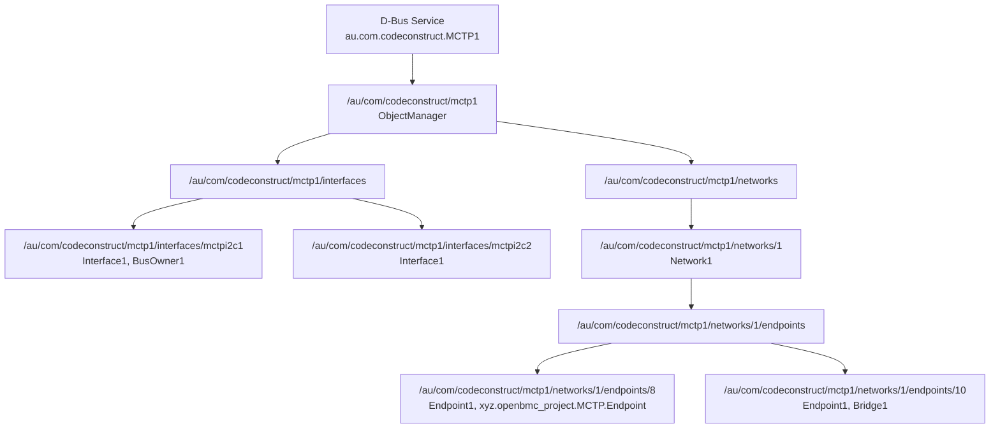
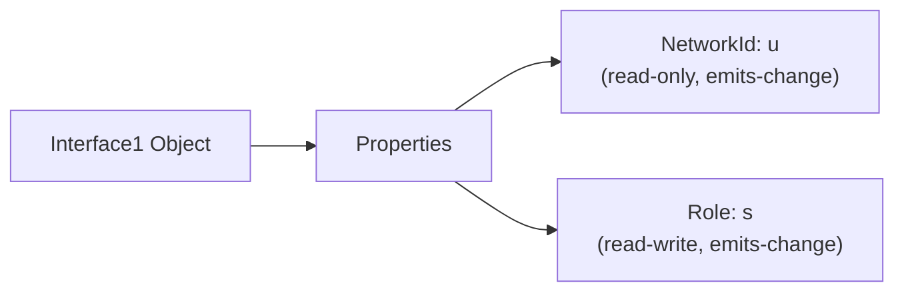
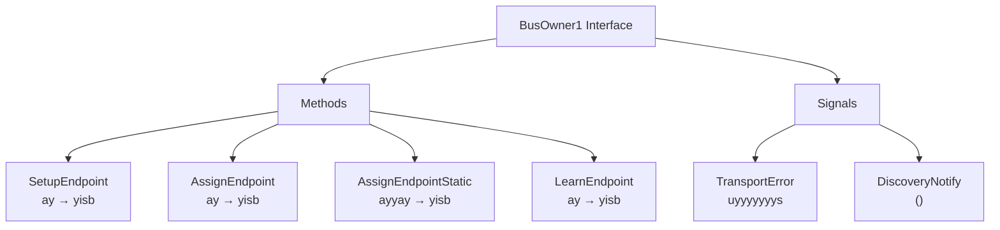
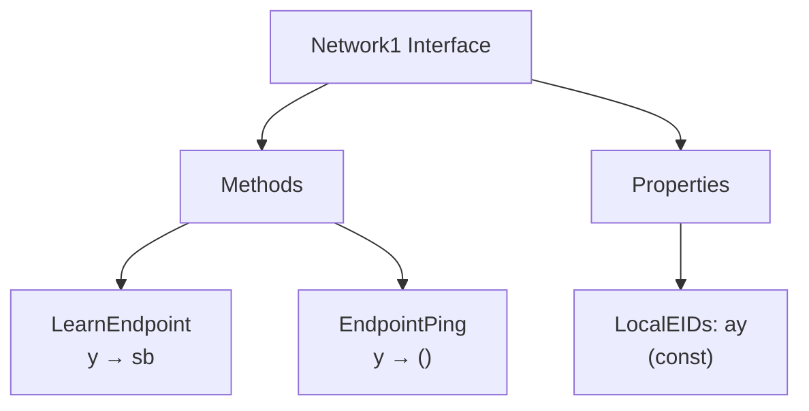
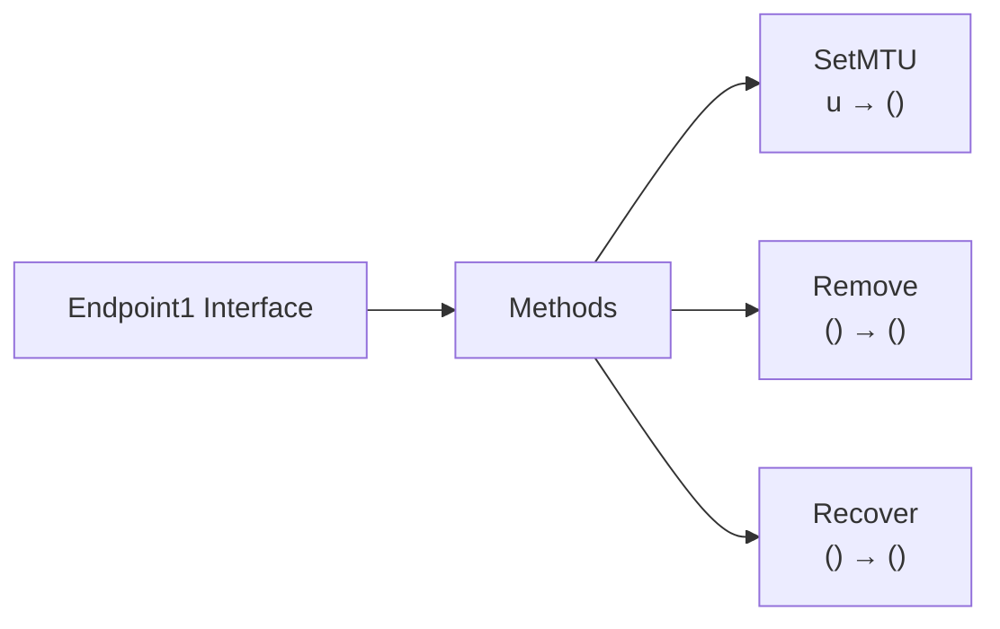
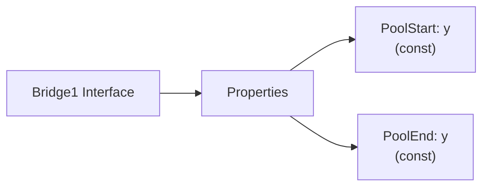

<!-- source: DeepWiki mcp.deepwiki.com · repo NVIDIA/mctp · page 9.2 D-Bus API Reference · fetched 2026-10-26 -->

# D-Bus API Reference

<details>
<summary>Relevant source files</summary>

The following files were used as context for generating this wiki page:

- [conf/mctpd.conf](conf/mctpd.conf)
- [docs/mctpd.md](docs/mctpd.md)
- [src/mctpd-util.h](src/mctpd-util.h)
- [src/mctpd.c](src/mctpd.c)

</details>


This document provides a comprehensive reference for all D-Bus interfaces, methods, signals, and properties exposed by the `mctpd` daemon. This is a technical reference for developers integrating with mctpd via D-Bus.

For conceptual information about the D-Bus architecture and usage patterns, see [D-Bus Interface](#4). For detailed documentation of specific interface behaviors, see [BusOwner1 Interface](#4.1), [Endpoint1 Interface](#4.2), [Network1 Interface](#4.3), and [Bridge Management](#4.4).

## Service and Object Hierarchy

The `mctpd` daemon claims the D-Bus bus name `au.com.codeconstruct.MCTP1` and exposes a tree of objects representing the MCTP system state.



**Sources:** [src/mctpd.c:44-57](), [docs/mctpd.md:1-23]()

## Object Path Patterns

| Object Type | Path Pattern | Description |
|-------------|--------------|-------------|
| Root | `/au/com/codeconstruct/mctp1` | Top-level namespace |
| Interface | `/au/com/codeconstruct/mctp1/interfaces/<ifname>` | MCTP network interfaces |
| Network | `/au/com/codeconstruct/mctp1/networks/<net_id>` | MCTP networks |
| Endpoint | `/au/com/codeconstruct/mctp1/networks/<net_id>/endpoints/<eid>` | MCTP endpoints |

**Sources:** [src/mctpd.c:44-46](), [docs/mctpd.md:6-23]()

## Interface Reference

### org.freedesktop.DBus.ObjectManager

Implemented on: `/au/com/codeconstruct/mctp1`

Standard D-Bus interface for enumerating managed objects. Provides `GetManagedObjects()` method to retrieve all networks, endpoints, and interfaces in a single call.

**Methods:**

| Method | Signature | Description |
|--------|-----------|-------------|
| `GetManagedObjects` | `() → a{oa{sa{sv}}}` | Returns all managed objects with their interfaces and properties |

**Signals:**

| Signal | Signature | Description |
|--------|-----------|-------------|
| `InterfacesAdded` | `oa{sa{sv}}` | Emitted when a new object is added |
| `InterfacesRemoved` | `oas` | Emitted when an object is removed |

**Example:**
```bash
busctl call au.com.codeconstruct.MCTP1 \
    /au/com/codeconstruct/mctp1 \
    org.freedesktop.DBus.ObjectManager \
    GetManagedObjects
```

**Sources:** [docs/mctpd.md:34-35]()

---

### au.com.codeconstruct.MCTP.Interface1

Implemented on: Interface objects (`/au/com/codeconstruct/mctp1/interfaces/<ifname>`)

Represents a local MCTP network interface that connects to an MCTP bus.



**Properties:**

| Property | Type | Access | Flags | Description |
|----------|------|--------|-------|-------------|
| `NetworkId` | `u` (uint32) | read-only | emits-change | Network ID this interface belongs to |
| `Role` | `s` (string) | read-write | emits-change | Interface role: "BusOwner", "Endpoint", or "Unknown" |

**Role Values:**
- `"BusOwner"`: Interface acts as bus owner, assigns EIDs to endpoints
- `"Endpoint"`: Interface accepts EID assignments from external bus owner
- `"Unknown"`: Not yet configured (writable only from this state)

**Example - Query interface role:**
```bash
busctl get-property au.com.codeconstruct.MCTP1 \
    /au/com/codeconstruct/mctp1/interfaces/mctpi2c1 \
    au.com.codeconstruct.MCTP.Interface1 \
    Role
```

**Example - Set interface role (only when Unknown):**
```bash
busctl set-property au.com.codeconstruct.MCTP1 \
    /au/com/codeconstruct/mctp1/interfaces/mctpi2c1 \
    au.com.codeconstruct.MCTP.Interface1 \
    Role s "BusOwner"
```

**Sources:** [docs/mctpd.md:42-69](), [src/mctpd.c:55]()

---

### au.com.codeconstruct.MCTP.BusOwner1

Implemented on: Interface objects where `Role` is `"BusOwner"`

Provides bus-owner level functions for managing MCTP endpoints on an interface.



**Methods:**

| Method | Input Signature | Output Signature | Description |
|--------|----------------|------------------|-------------|
| `SetupEndpoint` | `ay` (hwaddr) | `yisb` (eid, net, path, new) | Query and optionally assign EID to endpoint |
| `AssignEndpoint` | `ay` (hwaddr) | `yisb` (eid, net, path, new) | Always assign new EID, allocate pool for bridges |
| `AssignEndpointStatic` | `ayyay` (hwaddr, eid, pool_start, ignore_eids) | `yisb` (eid, net, path, new) | Assign specific static EID |
| `LearnEndpoint` | `ay` (hwaddr) | `yisb` (eid, net, path, new) | Query endpoint EID without assigning |

**Method Details:**

#### SetupEndpoint

```
SetupEndpoint(hwaddr: ay) → (eid: y, net: i, path: s, new: b)
```

Normal method for adding an endpoint. Queries the endpoint's current EID and assigns a new one if needed (EID=0). Routes and neighbor entries are created automatically.

**Input:**
- `hwaddr`: Hardware address (1 byte for I2C 7-bit address)

**Output:**
- `eid`: Assigned endpoint ID
- `net`: Network ID
- `path`: D-Bus object path for endpoint
- `new`: `true` if a new EID was assigned, `false` if using existing EID

**Example:**
```bash
busctl call au.com.codeconstruct.MCTP1 \
    /au/com/codeconstruct/mctp1/interfaces/mctpi2c6 \
    au.com.codeconstruct.MCTP.BusOwner1 \
    SetupEndpoint ay 1 0x1d
```

#### AssignEndpoint

```
AssignEndpoint(hwaddr: ay) → (eid: y, net: i, path: s, new: b)
```

Similar to `SetupEndpoint` but always assigns a new EID. For bridge endpoints, also allocates a downstream EID pool. Returns `new=false` only if endpoint was already known to mctpd.

#### AssignEndpointStatic

```
AssignEndpointStatic(hwaddr: ay, static_eid: y, pool_start: y, ignore_eids: ay) 
    → (eid: y, net: i, path: s, new: b)
```

Assigns a specific static EID to an endpoint.

**Input:**
- `hwaddr`: Hardware address
- `static_eid`: Specific EID to assign
- `pool_start`: Starting EID for downstream pool (bridges only, ignored for non-bridges)
- `ignore_eids`: Array of EIDs to ignore in bridge routing table (can be empty)

Fails if endpoint already has a different EID or if the static EID is already in use.

#### LearnEndpoint

```
LearnEndpoint(hwaddr: ay) → (eid: y, net: i, path: s, new: b)
```

Queries endpoint for existing EID without assigning. Returns `new=true` if EID is newly discovered, `new=false` if already known.

**Signals:**

| Signal | Signature | Description |
|--------|-----------|-------------|
| `TransportError` | `uyyyyyyys` | Transport-level error occurred |
| `DiscoveryNotify` | `()` | Discovery Notify message received |

#### TransportError

```
TransportError(error_code: u, direction: y, binding: y, src_eid: y, 
               dest_eid: y, tag: y, msg_type: y, command_code: y, interface: s)
```

Emitted when a transport-level error occurs during MCTP message transmission or reception.

**Parameters:**
- `error_code`: Transport error code (kernel-defined)
- `direction`: `0` = RX, `1` = TX
- `binding`: MCTP binding type (see binding type constants)
- `src_eid`: Source endpoint ID
- `dest_eid`: Destination endpoint ID
- `tag`: MCTP message tag
- `msg_type`: MCTP message type
- `command_code`: Command code from message payload (for control messages)
- `interface`: Interface name where error occurred

**Binding Type Values:**

| Value | Binding |
|-------|---------|
| 0x01 | SMBus |
| 0x02 | PCIe VDM |
| 0x03 | USB |
| 0x04 | KCS |
| 0x05 | Serial |
| 0x06 | I3C |

**Sources:** [docs/mctpd.md:71-184](), [src/mctpd.c:47](), [src/mctpd-util.h:86-98](), [src/mctpd.c:1484-1514]()

---

### au.com.codeconstruct.MCTP.Network1

Implemented on: Network objects (`/au/com/codeconstruct/mctp1/networks/<net_id>`)

Represents an MCTP network and provides network-level operations.



**Methods:**

| Method | Input Signature | Output Signature | Description |
|--------|----------------|------------------|-------------|
| `LearnEndpoint` | `y` (eid) | `sb` (path, new) | Enumerate static endpoint by EID |
| `EndpointPing` | `y` (eid) | `()` | Ping endpoint to check responsiveness |

**Method Details:**

#### LearnEndpoint

```
LearnEndpoint(eid: y) → (path: s, new: b)
```

Performs enumeration of a static endpoint that is already routable. Useful for discovering bridged endpoints where EID assignment was handled by the bridge.

**Input:**
- `eid`: Endpoint ID to learn

**Output:**
- `path`: D-Bus object path for the endpoint
- `new`: `true` if newly discovered, `false` if already known

#### EndpointPing

```
EndpointPing(eid: y) → ()
```

Pings an endpoint by EID to verify responsiveness. Returns nothing on success, D-Bus error if unreachable.

**Example:**
```bash
busctl call au.com.codeconstruct.MCTP1 \
    /au/com/codeconstruct/mctp1/networks/1 \
    au.com.codeconstruct.MCTP.Network1 \
    EndpointPing y 10
```

**Properties:**

| Property | Type | Access | Flags | Description |
|----------|------|--------|-------|-------------|
| `LocalEIDs` | `ay` (byte array) | read-only | const | Array of local EIDs on this network |

**Sources:** [docs/mctpd.md:186-233](), [src/mctpd.c:56]()

---

### au.com.codeconstruct.MCTP.Endpoint1

Implemented on: Endpoint objects (`/au/com/codeconstruct/mctp1/networks/<net_id>/endpoints/<eid>`)

Code Construct-specific endpoint management interface.



**Methods:**

| Method | Input Signature | Output Signature | Description |
|--------|----------------|------------------|-------------|
| `SetMTU` | `u` (mtu) | `()` | Set route MTU for this endpoint |
| `Remove` | `()` | `()` | Remove endpoint, routes, and neighbor entries |
| `Recover` | `()` | `()` | Attempt to recover degraded endpoint |

**Method Details:**

#### SetMTU

```
SetMTU(mtu: u) → ()
```

Sets the MTU (maximum transmission unit) on the route to this endpoint. Must be within the allowed range for the binding (e.g., I2C: 68-254).

If not set (or set to 0), the per-interface MTU is used (configurable via `mctp link set <ifname> mtu <value>`).

**Example:**
```bash
busctl call au.com.codeconstruct.MCTP1 \
    /au/com/codeconstruct/mctp1/networks/1/endpoints/11 \
    au.com.codeconstruct.MCTP.Endpoint1 \
    SetMTU u 80
```

#### Remove

```
Remove() → ()
```

Removes the endpoint from mctpd, deleting associated routes and neighbor entries from the kernel.

#### Recover

```
Recover() → ()
```

Attempts recovery of a degraded endpoint. Queries endpoint properties and re-establishes connectivity. See [Error Handling and Recovery](#7.2) for details.

**Sources:** [docs/mctpd.md:245-268](), [src/mctpd.c:48]()

---

### au.com.codeconstruct.MCTP.Bridge1

Implemented on: Bridge endpoint objects (endpoints with allocated EID pools)

Exposes bridge-specific properties for endpoints that act as MCTP bridges.



**Properties:**

| Property | Type | Access | Flags | Description |
|----------|------|--------|-------|-------------|
| `PoolStart` | `y` (byte) | read-only | const | First EID in downstream allocation pool |
| `PoolEnd` | `y` (byte) | read-only | const | Last EID in downstream allocation pool |

These properties indicate the EID range allocated to a bridge for assigning to its downstream endpoints. The pool is a contiguous range of EIDs.

**Sources:** [docs/mctpd.md:270-284](), [src/mctpd.c:49]()

---

### xyz.openbmc_project.MCTP.Endpoint

Implemented on: Endpoint objects (`/au/com/codeconstruct/mctp1/networks/<net_id>/endpoints/<eid>`)

OpenBMC standard interface for MCTP endpoints. Provides properties describing endpoint characteristics.

**Properties:**

| Property | Type | Access | Description |
|----------|------|--------|-------------|
| `EID` | `y` (byte) | read-only | MCTP Endpoint ID |
| `NetworkId` | `u` (uint32) | read-only | Network ID |
| `SupportedMessageTypes` | `ay` (byte array) | read-only | Array of supported MCTP message types |

**Sources:** [docs/mctpd.md:241-243](), [src/mctpd.c:52]()

---

### xyz.openbmc_project.Common.UUID

Implemented on: Endpoint objects that have a UUID

Provides UUID property for endpoints that respond to Get Endpoint UUID control command.

**Properties:**

| Property | Type | Access | Description |
|----------|------|--------|-------------|
| `UUID` | `s` (string) | read-only | RFC 4122 UUID string for the endpoint |

**Sources:** [src/mctpd.c:53]()

---

### xyz.openbmc_project.MCTP.Binding

Implemented on: Endpoint objects

Provides binding-specific endpoint information.

**Properties:**

| Property | Type | Access | Description |
|----------|------|--------|-------------|
| `BindingID` | `s` (string) | read-only | MCTP binding type (e.g., "MctpOverSmbus") |
| `BindingMediumID` | `s` (string) | read-only | Medium-specific identifier |
| `BindingMode` | `s` (string) | read-only | Binding mode |

**Sources:** [src/mctpd.c:54]()

---

### xyz.openbmc_project.State.ServiceReady

Implemented on: Interface objects

Reports service readiness state to OpenBMC infrastructure.

**Properties:**

| Property | Type | Access | Description |
|----------|------|--------|-------------|
| `CurrentState` | `s` (string) | read-only | Current state: "Starting" or "Enabled" |
| `ServiceType` | `s` (string) | read-only | Service type (always "MCTP") |

**State Values:**
- `"xyz.openbmc_project.State.ServiceReady.States.Starting"`: Service initializing
- `"xyz.openbmc_project.State.ServiceReady.States.Enabled"`: Service ready

**Sources:** [src/mctpd.c:57-67](), [src/mctpd.c:146-149]()

---

## D-Bus Method Call Examples

### Complete Endpoint Setup Workflow

```bash
# 1. Check interface role
busctl get-property au.com.codeconstruct.MCTP1 \
    /au/com/codeconstruct/mctp1/interfaces/mctpi2c1 \
    au.com.codeconstruct.MCTP.Interface1 \
    Role

# 2. Setup endpoint at physical address 0x1d
busctl call au.com.codeconstruct.MCTP1 \
    /au/com/codeconstruct/mctp1/interfaces/mctpi2c1 \
    au.com.codeconstruct.MCTP.BusOwner1 \
    SetupEndpoint ay 1 0x1d
# Returns: 8 1 "/au/com/codeconstruct/mctp1/networks/1/endpoints/8" true

# 3. Get endpoint properties
busctl introspect au.com.codeconstruct.MCTP1 \
    /au/com/codeconstruct/mctp1/networks/1/endpoints/8

# 4. Query supported message types
busctl get-property au.com.codeconstruct.MCTP1 \
    /au/com/codeconstruct/mctp1/networks/1/endpoints/8 \
    xyz.openbmc_project.MCTP.Endpoint \
    SupportedMessageTypes

# 5. Set MTU on the route
busctl call au.com.codeconstruct.MCTP1 \
    /au/com/codeconstruct/mctp1/networks/1/endpoints/8 \
    au.com.codeconstruct.MCTP.Endpoint1 \
    SetMTU u 100

# 6. Ping the endpoint
busctl call au.com.codeconstruct.MCTP1 \
    /au/com/codeconstruct/mctp1/networks/1 \
    au.com.codeconstruct.MCTP.Network1 \
    EndpointPing y 8
```

### Bridge Endpoint with Static EID

```bash
# Assign static EID 20 to bridge, with pool starting at 30
# Ignore EIDs 8 and 9 in routing table
busctl call au.com.codeconstruct.MCTP1 \
    /au/com/codeconstruct/mctp1/interfaces/mctpi2c1 \
    au.com.codeconstruct.MCTP.BusOwner1 \
    AssignEndpointStatic ayyyy 1 0x50 20 30 2 8 9

# Check bridge pool allocation
busctl get-property au.com.codeconstruct.MCTP1 \
    /au/com/codeconstruct/mctp1/networks/1/endpoints/20 \
    au.com.codeconstruct.MCTP.Bridge1 \
    PoolStart

busctl get-property au.com.codeconstruct.MCTP1 \
    /au/com/codeconstruct/mctp1/networks/1/endpoints/20 \
    au.com.codeconstruct.MCTP.Bridge1 \
    PoolEnd
```

### Enumerate All Endpoints

```bash
# Get all managed objects
busctl call au.com.codeconstruct.MCTP1 \
    /au/com/codeconstruct/mctp1 \
    org.freedesktop.DBus.ObjectManager \
    GetManagedObjects

# Monitor for new endpoints
busctl monitor au.com.codeconstruct.MCTP1 \
    --match "type='signal',interface='org.freedesktop.DBus.ObjectManager',member='InterfacesAdded'"
```

### Monitor Transport Errors

```bash
# Subscribe to TransportError signals
busctl monitor au.com.codeconstruct.MCTP1 \
    --match "type='signal',interface='au.com.codeconstruct.MCTP.BusOwner1',member='TransportError'"
```

**Sources:** [docs/mctpd.md:89-265]()

## D-Bus Type Signatures Reference

Common type signatures used in mctpd's D-Bus API:

| Signature | Type | Example |
|-----------|------|---------|
| `y` | byte (uint8) | `8` |
| `i` | int32 | `1` |
| `u` | uint32 | `1` |
| `s` | string | `"BusOwner"` |
| `b` | boolean | `true` |
| `ay` | byte array | `[0x1d]` |
| `as` | string array | `["mctpi2c1"]` |
| `o` | object path | `"/au/com/codeconstruct/mctp1/networks/1/endpoints/8"` |
| `a{oa{sa{sv}}}` | dict of objects | ObjectManager result |

**Sources:** [docs/mctpd.md:48-264]()

## Error Codes

D-Bus method calls may return standard D-Bus errors:

| Error | Description |
|-------|-------------|
| `org.freedesktop.DBus.Error.InvalidArgs` | Invalid argument provided |
| `org.freedesktop.DBus.Error.Failed` | General failure (check MCTP control protocol completion code) |
| `org.freedesktop.DBus.Error.Timeout` | MCTP message timeout |
| `org.freedesktop.DBus.Error.NoReply` | Endpoint did not respond |

Application-specific errors may include additional error messages describing MCTP control protocol completion codes or transport errors.

**Sources:** [src/mctpd.c:754-1321]()

---

