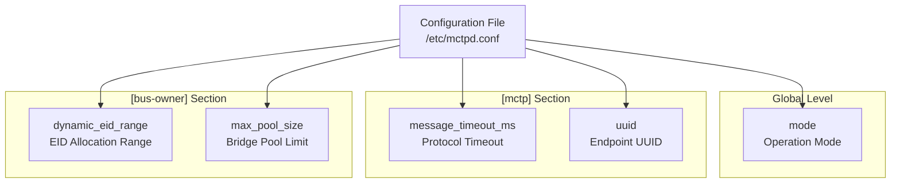
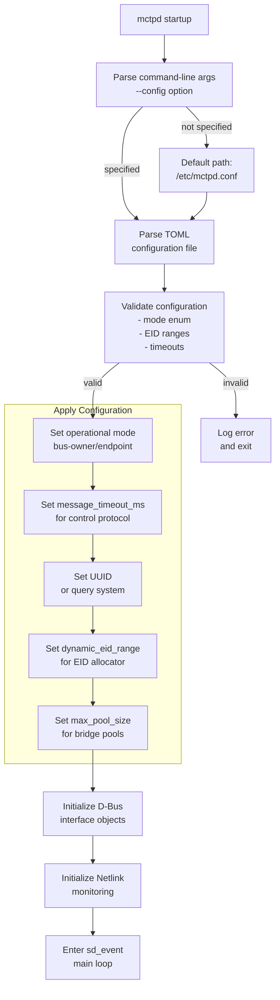
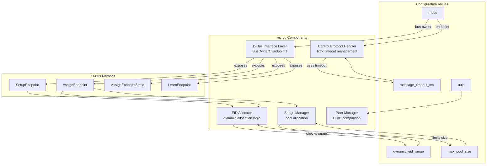

<!-- source: DeepWiki mcp.deepwiki.com · repo NVIDIA/mctp · page 9.3 Configuration Reference · fetched 2026-10-26 -->

# Configuration Reference

<details>
<summary>Relevant source files</summary>

The following files were used as context for generating this wiki page:

- [CHANGELOG.md](CHANGELOG.md)
- [conf/mctpd.conf](conf/mctpd.conf)
- [docs/mctpd.md](docs/mctpd.md)

</details>


This page provides a complete reference for all configuration options available in `mctpd.conf`. For information about building and installing mctpd, see [Building and Installation](#5). For D-Bus API details, see [D-Bus API Reference](#9.2).

## Overview

The mctpd daemon reads its configuration from a TOML-formatted file, typically located at `/etc/mctpd.conf`. Configuration can be overridden using the `--config` command-line option. The configuration file controls operational mode, protocol behavior, and resource allocation policies.

**Sources:** [docs/mctpd.md:286-294]()

---

## Configuration File Structure



**Sources:** [docs/mctpd.md:286-369](), [conf/mctpd.conf:1-20]()

---

## Global Configuration Options

Global settings apply to all modes of mctpd operation and are specified at the top level of the configuration file.

### mode

| Property | Value |
|----------|-------|
| **Type** | String enum |
| **Valid Values** | `"bus-owner"`, `"endpoint"`, `"unknown"` |
| **Default** | `"bus-owner"` |
| **Example** | `mode = "bus-owner"` |

Sets the operational mode of mctpd:

- **`bus-owner`**: mctpd assumes responsibility for allocating EIDs to endpoints on the network. Exposes the `au.com.codeconstruct.MCTP.BusOwner1` D-Bus interface on interface objects.
- **`endpoint`**: mctpd operates as an endpoint, accepting EID assignments from an external bus owner. Does not perform EID allocation.
- **`unknown`**: Initial unconfigured state, typically set by other platform infrastructure before operation begins.

When in `endpoint` mode, mctpd handles incoming "Set Endpoint ID" messages to assign EIDs to local interfaces.

**Sources:** [docs/mctpd.md:294-308](), [conf/mctpd.conf:1-2](), [CHANGELOG.md:27-28]()

---

## [mctp] Section

This section affects MCTP protocol behavior and includes settings common to both bus-owner and endpoint modes.

### message_timeout_ms

| Property | Value |
|----------|-------|
| **Type** | Integer |
| **Units** | Milliseconds |
| **Default** | `250` |
| **Range** | Positive integers |
| **Example** | `message_timeout_ms = 30` |

Sets the timeout for outgoing MCTP request messages. A request is considered lost if no response is received within this duration. The timeout applies to all control protocol operations including:

- Get Endpoint ID (`0x02`)
- Set Endpoint ID (`0x01`)
- Get Endpoint UUID (`0x03`)
- Get Message Type Support (`0x05`)
- Other control protocol commands defined in [mctp-control-spec.h]()

Long timeouts may degrade performance since mctpd typically waits for operations synchronously. Short timeouts may cause false failures on slow or congested networks.

**Sources:** [docs/mctpd.md:314-323](), [conf/mctpd.conf:4-6]()

### uuid

| Property | Value |
|----------|-------|
| **Type** | String |
| **Format** | RFC 4122 UUID |
| **Default** | System UUID (queried) |
| **Example** | `uuid = "21f0f554-7f7c-4211-9ca1-6d0f000ea9e7"` |

Specifies the UUID used to identify this endpoint to peers. Returned in response to the MCTP "Get Endpoint UUID" control command (`0x03`).

If not specified, mctpd queries the system-wide UUID, which typically has correct semantics for MCTP endpoint identification. Manual configuration is rarely necessary but may be useful in:

- Systems without accessible system UUID
- Testing and development scenarios
- Specialized endpoint identification requirements

The UUID must be formatted as a standard RFC 4122 UUID string with hyphens.

**Sources:** [docs/mctpd.md:326-342](), [conf/mctpd.conf:8-10]()

---

## [bus-owner] Section

This section affects behavior when mctpd operates in bus-owner mode (`mode = "bus-owner"`). Settings in this section are ignored when mctpd operates in endpoint mode.

### dynamic_eid_range

| Property | Value |
|----------|-------|
| **Type** | Array of 2 integers |
| **Format** | `[min, max]` (inclusive) |
| **Default** | `[8, 254]` |
| **Range** | Each element: 1-254 |
| **Example** | `dynamic_eid_range = [8, 254]` |

Specifies the range of EIDs available for dynamic allocation to newly discovered endpoints. The range is inclusive of both min and max values.

This range is used when:
- `SetupEndpoint` assigns a new EID to an endpoint reporting EID 0
- `AssignEndpoint` allocates an EID to an endpoint

This range is NOT used for:
- Local interface EIDs
- Statically-allocated EIDs via `AssignEndpointStatic`
- EIDs already assigned by other bus owners

The default `[8, 254]` makes the entire MCTP dynamic EID address space available. EID 0 is reserved (null EID), and EIDs 1-7 are reserved by the MCTP specification.

**Sources:** [docs/mctpd.md:347-359](), [conf/mctpd.conf:12-16](), [CHANGELOG.md:24]()

### max_pool_size

| Property | Value |
|----------|-------|
| **Type** | Integer |
| **Default** | `15` |
| **Range** | Positive integers |
| **Example** | `max_pool_size = 15` |

Determines the maximum EID pool size that mctpd will allocate to a bridge endpoint in response to a "Set Endpoint ID" command. Bridge endpoints request pool allocations to manage downstream endpoints.

When a bridge requests a pool larger than `max_pool_size`, the allocation is truncated to this limit. This prevents a single bridge from consuming excessive EID address space.

Pool allocation affects:
- `AssignEndpoint` method for bridge endpoints
- `au.com.codeconstruct.MCTP.Bridge1` interface properties (`PoolStart`, `PoolEnd`)
- Routing table entries for bridged endpoints

**Sources:** [docs/mctpd.md:361-369](), [conf/mctpd.conf:18]()

---

## Configuration Processing Flow



**Sources:** [docs/mctpd.md:286-294](), [CHANGELOG.md:139]()

---

## Configuration Impact on Runtime Behavior



**Sources:** [docs/mctpd.md:286-369](), [CHANGELOG.md:21-28]()

---

## Complete Configuration Examples

### Example 1: Bus Owner with Conservative Settings

```toml
# Conservative bus owner configuration for production
mode = "bus-owner"

[mctp]
# Longer timeout for slow I2C networks
message_timeout_ms = 500

[bus-owner]
# Restrict EID range to avoid conflicts
dynamic_eid_range = [16, 127]
# Smaller bridge pools for controlled topology
max_pool_size = 8
```

### Example 2: Endpoint Mode

```toml
# Endpoint mode - accepts EID from external bus owner
mode = "endpoint"

[mctp]
# Standard timeout
message_timeout_ms = 250
# Custom UUID for this endpoint
uuid = "21f0f554-7f7c-4211-9ca1-6d0f000ea9e7"
```

### Example 3: Bus Owner with Full Address Space

```toml
# Bus owner using full dynamic EID range
mode = "bus-owner"

[mctp]
message_timeout_ms = 250

[bus-owner]
# Maximum available dynamic range
dynamic_eid_range = [8, 254]
# Allow larger bridge pools
max_pool_size = 30
```

### Example 4: Development/Testing Configuration

```toml
# Development configuration with tight constraints
mode = "bus-owner"

[mctp]
# Very short timeout for testing error handling
message_timeout_ms = 30

[bus-owner]
# Small range for testing EID exhaustion
dynamic_eid_range = [8, 20]
# Small pools for testing bridge limits
max_pool_size = 5
```

**Sources:** [conf/mctpd.conf:1-20](), [docs/mctpd.md:286-369]()

---

## Configuration Option Summary Table

| Option | Section | Type | Default | Description |
|--------|---------|------|---------|-------------|
| `mode` | Global | String | `"bus-owner"` | Operational mode: `bus-owner`, `endpoint`, or `unknown` |
| `message_timeout_ms` | `[mctp]` | Integer | `250` | Timeout in milliseconds for control protocol requests |
| `uuid` | `[mctp]` | String | System UUID | RFC 4122 UUID for endpoint identification |
| `dynamic_eid_range` | `[bus-owner]` | Array[2] | `[8, 254]` | Min and max EIDs for dynamic allocation (inclusive) |
| `max_pool_size` | `[bus-owner]` | Integer | `15` | Maximum EID pool size for bridge endpoints |

**Sources:** [docs/mctpd.md:286-369](), [conf/mctpd.conf:1-20]()

---

## Configuration Validation Rules

The following validation rules are enforced when parsing the configuration file:

1. **mode validation**: Must be one of `"bus-owner"`, `"endpoint"`, or `"unknown"`
2. **message_timeout_ms validation**: Must be a positive integer
3. **uuid validation**: If specified, must be a valid RFC 4122 UUID format
4. **dynamic_eid_range validation**: 
   - Must be an array with exactly 2 elements
   - Both elements must be integers in range [1, 254]
   - First element (min) must be ≤ second element (max)
   - Range must not include EID 0 (reserved)
5. **max_pool_size validation**: Must be a positive integer

Invalid configurations will cause mctpd to log an error and exit during startup.

**Sources:** [docs/mctpd.md:286-369]()

---

## Configuration and Command-Line Options

The configuration file path can be overridden using the command-line:

```bash
# Use default configuration
mctpd

# Use custom configuration file
mctpd --config /custom/path/mctpd.conf
```

Command-line options take precedence over configuration file settings where applicable.

**Sources:** [docs/mctpd.md:289-290]()