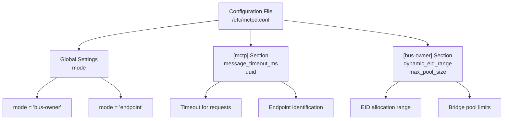
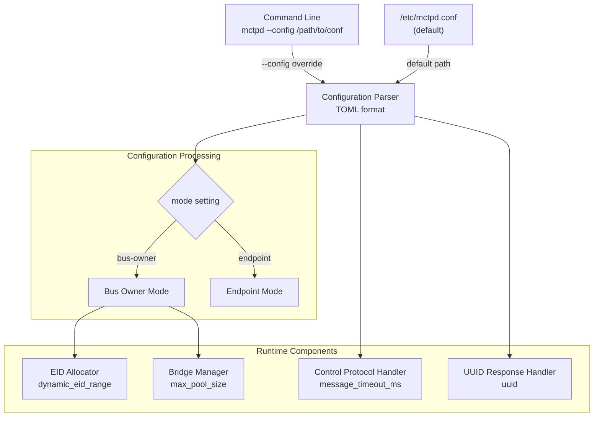
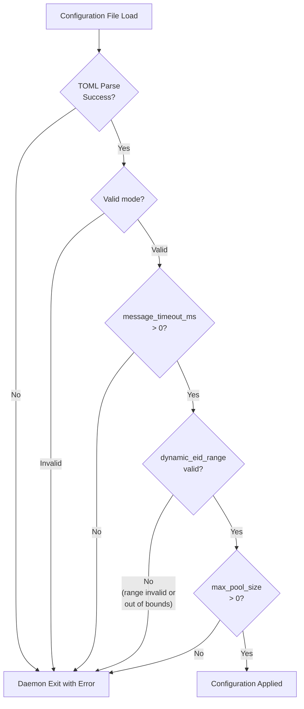

<!-- source: DeepWiki mcp.deepwiki.com · repo NVIDIA/mctp · extra page Configuration · fetched 2026-10-26 -->

# Configuration

<details>
<summary>Relevant source files</summary>

The following files were used as context for generating this wiki page:

- [CHANGELOG.md](CHANGELOG.md)
- [conf/mctpd.conf](conf/mctpd.conf)
- [docs/mctpd.md](docs/mctpd.md)

</details>


## Purpose and Scope

This page documents the configuration file format and settings for the `mctpd` daemon. It covers how to configure operational modes, protocol parameters, and bus owner behavior through `/etc/mctpd.conf`. 

For information about build-time configuration options, see [Build Options and Configuration](#5.2). For details on how configuration affects daemon architecture and runtime behavior, see [Daemon Architecture](#2.1.1) and [Endpoint Management](#2.1.2).

**Sources:** [docs/mctpd.md:286-369](), [conf/mctpd.conf:1-20]()

## Configuration File Overview

The `mctpd` daemon reads configuration from a TOML-formatted file, located by default at `/etc/mctpd.conf`. An alternative path can be specified using the `--config` command-line option when starting the daemon.

The configuration file consists of:
- Global settings (at the top level)
- `[mctp]` section for protocol-level configuration
- `[bus-owner]` section for bus owner-specific settings

**Sources:** [docs/mctpd.md:288-292]()

### Configuration File Structure



**Sources:** [docs/mctpd.md:286-369](), [conf/mctpd.conf:1-20]()

## Global Settings

### `mode` - Operational Mode

| Property | Value |
|----------|-------|
| **Type** | String enum: `"bus-owner"` or `"endpoint"` |
| **Default** | `"bus-owner"` |
| **Location** | Top-level setting |

The `mode` setting determines the overall operational mode of `mctpd`:

- **`bus-owner`**: The daemon assumes responsibility for allocating EIDs to other endpoints on the network. It actively manages endpoint discovery and configuration through the MCTP control protocol.
- **`endpoint`**: The daemon operates as a managed endpoint, accepting EID assignments from an external bus owner rather than allocating them itself.

**Example:**
```toml
mode = "bus-owner"
```

When operating in endpoint mode, `mctpd` handles incoming Set Endpoint ID messages and assigns EIDs to local interfaces accordingly.

**Sources:** [docs/mctpd.md:298-308](), [conf/mctpd.conf:1-2](), [CHANGELOG.md:27-28]()

## MCTP Protocol Section

The `[mctp]` section contains settings that affect MCTP protocol behavior and are applicable to both bus-owner and endpoint modes.

### `message_timeout_ms` - Message Timeout

| Property | Value |
|----------|-------|
| **Type** | Integer (milliseconds) |
| **Default** | 250 |
| **Range** | Typically 30-1000 ms |

This setting specifies the timeout duration for outgoing MCTP request messages. If no response is received within this timeout, the message is considered lost and the operation fails.

**Performance Consideration:** Long timeouts can degrade `mctpd` performance since most control protocol operations execute synchronously. The default value of 250ms provides a balance between reliability and responsiveness.

**Example:**
```toml
[mctp]
message_timeout_ms = 30
```

**Sources:** [docs/mctpd.md:314-323](), [conf/mctpd.conf:4-6]()

### `uuid` - Endpoint UUID

| Property | Value |
|----------|-------|
| **Type** | String (RFC 4122 UUID format) |
| **Default** | Queried from system |
| **Optional** | Yes |

This setting specifies the UUID used to identify this endpoint to peers, returned in response to the MCTP "Get Endpoint UUID" control protocol command.

**Default Behavior:** If not specified, `mctpd` queries the system-wide UUID, which typically has correct semantics for MCTP endpoint identification.

**Format:** RFC 4122 UUID string with hyphens:
```toml
[mctp]
uuid = "21f0f554-7f7c-4211-9ca1-6d0f000ea9e7"
```

**Sources:** [docs/mctpd.md:325-341](), [conf/mctpd.conf:8-10]()

## Bus Owner Section

The `[bus-owner]` section contains settings that only apply when `mctpd` is running in bus owner mode (`mode = "bus-owner"`).

### `dynamic_eid_range` - Dynamic EID Allocation Range

| Property | Value |
|----------|-------|
| **Type** | Array of 2 integers `[min, max]` |
| **Default** | `[8, 254]` |
| **Range** | Values are inclusive, within 8-254 |

This setting specifies the range of EIDs available for dynamic allocation to newly discovered peers. The daemon allocates EIDs sequentially from this range when assigning addresses to endpoints.

**Scope:** This range only applies to dynamic allocations. Local interface EIDs and statically-allocated EIDs (via `AssignEndpointStatic`) may fall outside this range.

**Example:**
```toml
[bus-owner]
dynamic_eid_range = [8, 254]
```

The default value makes the entire usable MCTP EID address space (excluding broadcast EID 0 and reserved values 1-7) available for dynamic allocations.

**Sources:** [docs/mctpd.md:347-359](), [conf/mctpd.conf:13-16]()

### `max_pool_size` - Maximum Bridge Pool Size

| Property | Value |
|----------|-------|
| **Type** | Integer |
| **Default** | 15 |
| **Purpose** | Limits bridge endpoint pool allocations |

This setting determines the maximum EID pool size that a bridge endpoint may request in its Set Endpoint ID response. If a bridge requests a pool larger than this value, the allocation is truncated to this maximum.

**Example:**
```toml
[bus-owner]
max_pool_size = 15
```

This setting prevents a single bridge from consuming excessive EID space, ensuring that EIDs remain available for other endpoints and bridges on the network.

**Sources:** [docs/mctpd.md:361-368](), [conf/mctpd.conf:18]()

## Configuration Processing Flow

The following diagram illustrates how configuration settings flow from the file to runtime daemon behavior:



**Sources:** [docs/mctpd.md:288-292](), [conf/mctpd.conf:1-20]()

### Configuration-to-Code Mapping

The following table shows how configuration settings map to code components:

| Configuration Setting | Code Component | File Reference |
|-----------------------|----------------|----------------|
| `mode` | Operational mode check, D-Bus interface setup | [src/mctpd.c]() |
| `message_timeout_ms` | Control protocol timeout handling | [src/mctpd.c]() |
| `uuid` | Get Endpoint UUID command response | [src/mctpd.c]() |
| `dynamic_eid_range` | EID allocation logic | [src/mctpd.c]() |
| `max_pool_size` | Bridge pool allocation | [src/mctpd.c]() |

**Sources:** [docs/mctpd.md:286-369]()

## Configuration Examples

### Bus Owner Configuration

Complete configuration for a system acting as an MCTP bus owner with conservative EID allocation:

```toml
# Bus owner mode with restricted EID range
mode = "bus-owner"

[mctp]
message_timeout_ms = 250
# Optional: override system UUID
# uuid = "21f0f554-7f7c-4211-9ca1-6d0f000ea9e7"

[bus-owner]
# Reserve EIDs 8-63 for dynamic allocation
dynamic_eid_range = [8, 63]
# Limit bridge pools to 10 EIDs
max_pool_size = 10
```

**Sources:** [conf/mctpd.conf:1-20](), [docs/mctpd.md:298-368]()

### Endpoint Configuration

Configuration for a system operating as a managed endpoint:

```toml
# Endpoint mode - accept EID assignments from bus owner
mode = "endpoint"

[mctp]
message_timeout_ms = 250
```

Note that the `[bus-owner]` section is not needed when operating in endpoint mode.

**Sources:** [docs/mctpd.md:298-308]()

### High-Reliability Configuration

Configuration optimized for slow or unreliable networks:

```toml
mode = "bus-owner"

[mctp]
# Longer timeout for slow devices
message_timeout_ms = 1000

[bus-owner]
dynamic_eid_range = [8, 254]
max_pool_size = 15
```

**Sources:** [docs/mctpd.md:314-323]()

## Configuration Settings Reference Table

| Section | Setting | Type | Default | Description |
|---------|---------|------|---------|-------------|
| (global) | `mode` | string enum | `"bus-owner"` | Operational mode: `"bus-owner"` or `"endpoint"` |
| `[mctp]` | `message_timeout_ms` | integer | 250 | Timeout for request messages (ms) |
| `[mctp]` | `uuid` | string | system UUID | RFC 4122 UUID for endpoint identification |
| `[bus-owner]` | `dynamic_eid_range` | integer[2] | `[8, 254]` | Min/max EIDs for dynamic allocation |
| `[bus-owner]` | `max_pool_size` | integer | 15 | Maximum bridge pool size |

**Sources:** [docs/mctpd.md:286-369](), [conf/mctpd.conf:1-20]()

## Configuration Validation



**Sources:** [docs/mctpd.md:286-369]()

## Runtime Configuration Changes

Configuration is read once at daemon startup. Changes to `/etc/mctpd.conf` require restarting the `mctpd` daemon to take effect:

```bash
systemctl restart mctpd
```

There is no support for runtime configuration reload through signals or D-Bus methods.

**Sources:** [docs/mctpd.md:288-292]()

---

