<!-- source: DeepWiki mcp.deepwiki.com · repo NVIDIA/mctp · extra page Daemon Architecture · fetched 2026-10-26 -->

# Daemon Architecture

<details>
<summary>Relevant source files</summary>

The following files were used as context for generating this wiki page:

- [src/mctpd-util.h](src/mctpd-util.h)
- [src/mctpd.c](src/mctpd.c)

</details>


## Purpose and Scope

This page documents the internal architecture of the `mctpd` daemon, including its event-driven design, core data structures, and component interactions. This covers the fundamental building blocks and design patterns used throughout the daemon implementation.

For information about endpoint discovery and EID assignment workflows, see [Endpoint Management](#2.1.2). For configuration file options, see [Configuration](#2.1.3). For details on the D-Bus interfaces exposed by the daemon, see [D-Bus Interface](#4).

---

## Event-Driven Architecture

The daemon is built on a centralized event loop provided by systemd's `sd_event` library. All asynchronous operations—including D-Bus method calls, Netlink monitoring, and MCTP socket I/O—are coordinated through this event loop using callback-based handlers.

### Event Loop Structure

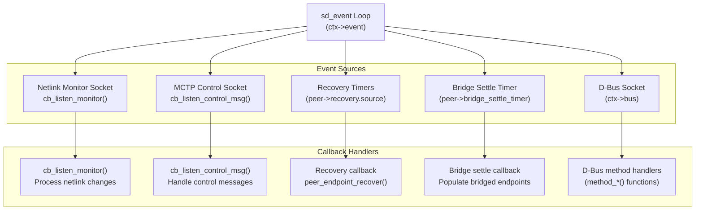

The event loop is created during daemon initialization and runs indefinitely until shutdown. Event sources register file descriptors and timers, and the loop dispatches callbacks when events occur.

**Sources:** [src/mctpd.c:224-226](), [src/mctpd.c:1422-1482](), [src/mctpd.c:1595-1704]()

---

## Core Data Structures

The daemon maintains four primary data structures that represent the state of the MCTP network:

### Context Structure (`struct ctx`)

The global context structure holds all daemon-wide state, including configuration, event loop handles, and collections of networks, peers, and interfaces.

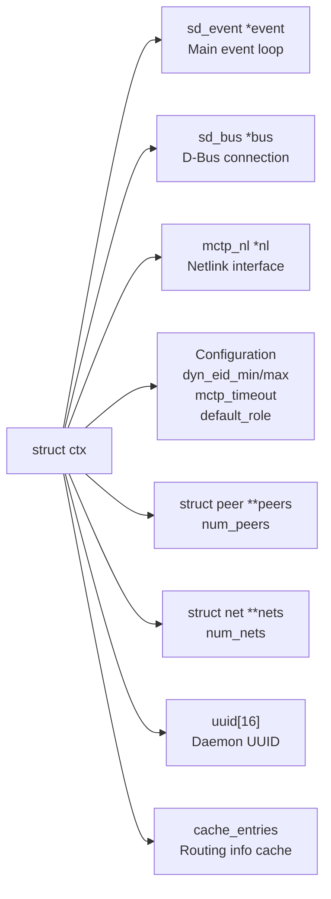

Key fields in `struct ctx`:

| Field | Type | Purpose |
|-------|------|---------|
| `event` | `sd_event *` | Main event loop handle |
| `bus` | `sd_bus *` | D-Bus system bus connection |
| `nl` | `mctp_nl *` | Netlink abstraction for kernel interface |
| `peers` | `struct peer **` | Dynamic array of all known endpoints |
| `num_peers` | `size_t` | Current number of peers |
| `nets` | `struct net **` | Array of network structures |
| `num_nets` | `size_t` | Number of networks |
| `dyn_eid_min/max` | `mctp_eid_t` | EID allocation range |
| `mctp_timeout` | `uint64_t` | Timeout in microseconds for MCTP responses |
| `iid` | `uint8_t` | Next Instance ID for control messages |
| `default_role` | `enum endpoint_role` | Default operational mode |

**Sources:** [src/mctpd.c:224-271]()

### Network Structure (`struct net`)

Each network structure represents an MCTP network domain and maintains an EID-to-peer mapping table.

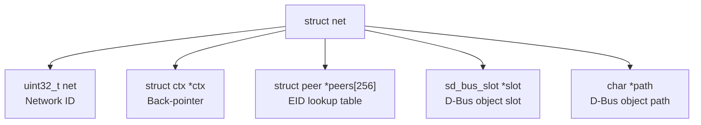

The `peers` array provides O(1) lookup of endpoints by EID within a network. Array indices correspond to EID values (0-255), with `NULL` entries indicating unused EIDs.

**Sources:** [src/mctpd.c:87-96](), [src/mctpd.c:349-356](), [src/mctpd.c:377-385]()

### Link Structure (`struct link`)

Link structures represent physical MCTP interfaces (e.g., `mctpi2c1`, `mctpusb0`) with their operational state and D-Bus registration.

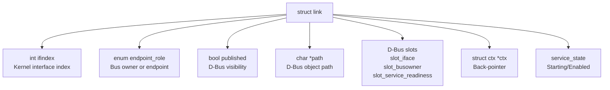

Each link has an associated operational role:
- **Bus Owner**: Actively assigns EIDs to discovered endpoints
- **Endpoint**: Passively accepts EID assignments from a remote bus owner

**Sources:** [src/mctpd.c:133-150](), [src/mctpd.c:103-131]()

### Peer Structure (`struct peer`)

Peer structures represent individual MCTP endpoints, both local and remote, with their routing information, properties, and recovery state.

```mermaid
graph TB
    PEER["struct peer"]
    
    subgraph "Identification"
        EID["mctp_eid_t eid"]
        NET["uint32_t net"]
        UUID["uint8_t *uuid<br/>(16 bytes)"]
    end
    
    subgraph "Routing"
        Phys["dest_phys phys<br/>Physical address"]
        State["enum state<br/>REMOTE or LOCAL"]
        HaveNeigh["bool have_neigh"]
        HaveRoute["bool have_route"]
        MTU["uint32_t mtu"]
    end
    
    subgraph "Properties"
        Types["uint8_t *message_types<br/>num_message_types"]
        EPType["uint8_t endpoint_type"]
        MedSpec["uint8_t medium_spec"]
    end
    
    subgraph "Bridge Support"
        PoolSize["uint8_t pool_size"]
        PoolStart["uint8_t pool_start"]
        IgnoreEIDs["mctp_eid_t *ignore_eids<br/>num_ignore_eids"]
        RoutingTable["struct get_routing_table_entry"]
    end
    
    subgraph "Recovery"
        Degraded["bool degraded"]
        Recovery["struct recovery<br/>Timer and retry state"]
    end
    
    subgraph "D-Bus"
        Published["bool published"]
        Slots["Multiple sd_bus_slot*"]
        Path["char *path"]
    end
    
    PEER --> EID
    PEER --> NET
    PEER --> UUID
    PEER --> Phys
    PEER --> State
    PEER --> Types
    PEER --> PoolSize
    PEER --> Degraded
    PEER --> Published
```

Key peer states:
- **REMOTE**: Regular endpoint reachable via physical addressing
- **LOCAL**: Represents a local interface's own EID

**Sources:** [src/mctpd.c:152-222]()

---

## Data Structure Relationships

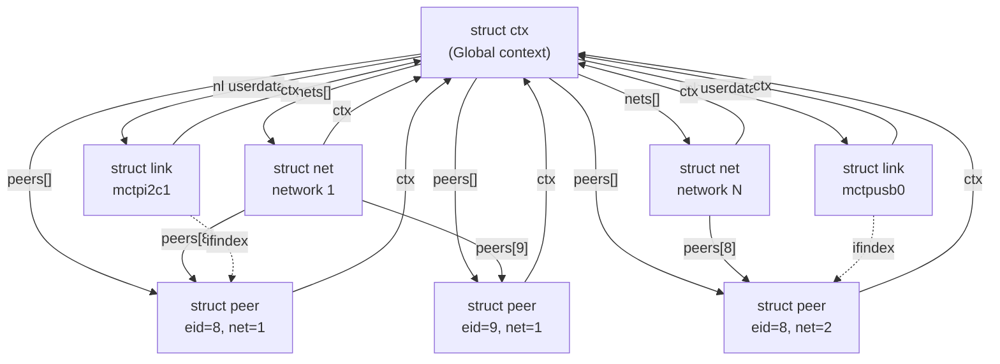

**Key relationships:**
- `ctx` contains arrays of all `peer` and `net` structures
- Each `net` has an EID lookup table pointing to `peer` structures
- `link` structures are stored as userdata in the `mctp_nl` (netlink) context
- All structures maintain back-pointers to `ctx` for accessing global state
- Peers reference their network by ID, not by pointer

**Sources:** [src/mctpd.c:87-96](), [src/mctpd.c:152-222](), [src/mctpd.c:224-271]()

---

## Component Interaction Patterns

### Callback Registration Pattern

The daemon extensively uses callback-based event handling. Components register callbacks with appropriate event sources:

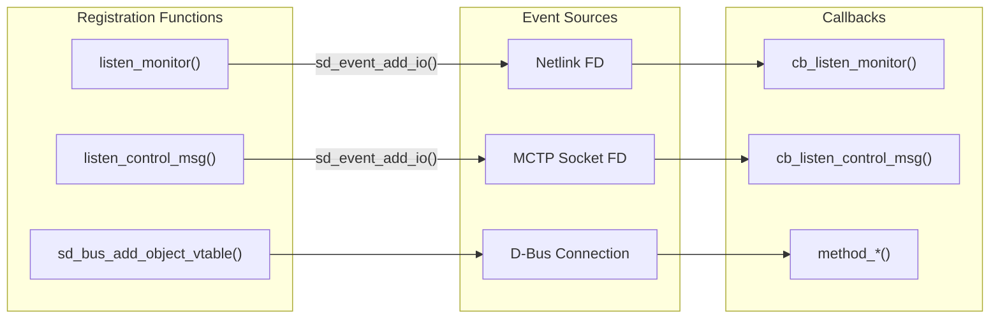

**Netlink Monitoring:** [src/mctpd.c:1692-1704]()
- `listen_monitor()` registers `cb_listen_monitor()` with the netlink socket
- Callback processes interface, address, and route changes

**MCTP Control Socket:** [src/mctpd.c:1422-1482]()
- `listen_control_msg()` registers `cb_listen_control_msg()` with MCTP socket
- Callback dispatches to specific control message handlers

**D-Bus Methods:** Various method handlers throughout [src/mctpd.c]()
- vtable arrays define method signatures and handlers
- Methods registered per object path (endpoints, networks, links)

**Sources:** [src/mctpd.c:1422-1482](), [src/mctpd.c:1595-1690](), [src/mctpd.c:1692-1704]()

### Peer Lifecycle Management

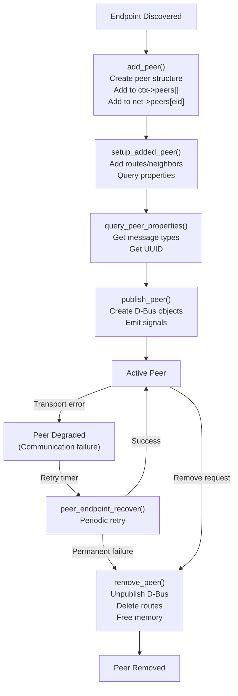

**Key functions:**
- `add_peer()` [src/mctpd.c:2174-2223](): Allocates and initializes peer structure
- `setup_added_peer()` [src/mctpd.c:3368-3398](): Configures routing and queries properties
- `publish_peer()` [src/mctpd.c:3526-3633](): Exposes peer to D-Bus
- `remove_peer()` [src/mctpd.c:2285-2374](): Cleanup and deallocation
- `peer_endpoint_recover()` [src/mctpd.c:3951-4036](): Recovery state machine

**Sources:** [src/mctpd.c:2174-2223](), [src/mctpd.c:2285-2374](), [src/mctpd.c:3266-3398](), [src/mctpd.c:3526-3633](), [src/mctpd.c:3951-4036]()

### Control Message Dispatch

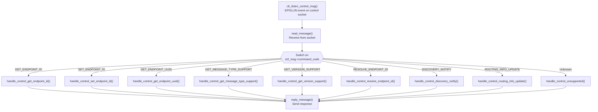

The control message callback [src/mctpd.c:1323-1420]() implements a dispatch table for all MCTP control protocol commands. Each handler processes the request and calls `reply_message()` or `reply_message_phys()` to send the response.

**Sources:** [src/mctpd.c:1323-1420](), [src/mctpd.c:666-694](), [src/mctpd.c:641-663]()

---

## Memory Management Patterns

### Dynamic Arrays

The daemon uses dynamically-sized arrays for peers and networks that grow and shrink as endpoints are discovered or removed:

**Peer array growth** [src/mctpd.c:2203-2209]():
```c
tmp = realloc(ctx->peers, (ctx->num_peers + 1) * sizeof(*ctx->peers));
ctx->peers = tmp;
ctx->peers[ctx->num_peers] = peer;
ctx->num_peers++;
```

**Peer array shrinkage** [src/mctpd.c:2352-2369]():
```c
ctx->num_peers--;
memmove(ctx->peers + idx, ctx->peers + idx + 1,
        (ctx->num_peers - idx) * sizeof(struct peer *));
tmp = realloc(ctx->peers, ctx->num_peers * sizeof(struct peer *));
```

### Deferred Free Pattern

The `dfree()` function [src/mctpd.c:479-501]() provides automatic memory cleanup using the event loop:

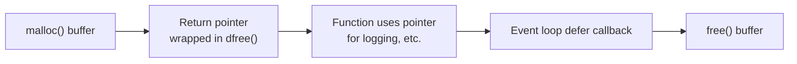

This pattern is used for temporary string buffers in logging functions like `dest_phys_tostr()` [src/mctpd.c:409-422]() and `peer_tostr()` [src/mctpd.c:444-456](). The buffer remains valid until the next event loop iteration, avoiding manual memory management in callers.

**Sources:** [src/mctpd.c:479-501](), [src/mctpd.c:409-422](), [src/mctpd.c:444-456]()

---

## Socket and Network I/O Patterns

### Request-Response Pattern with Timeout

The daemon implements synchronous request-response communication with endpoints using a temporary event loop:

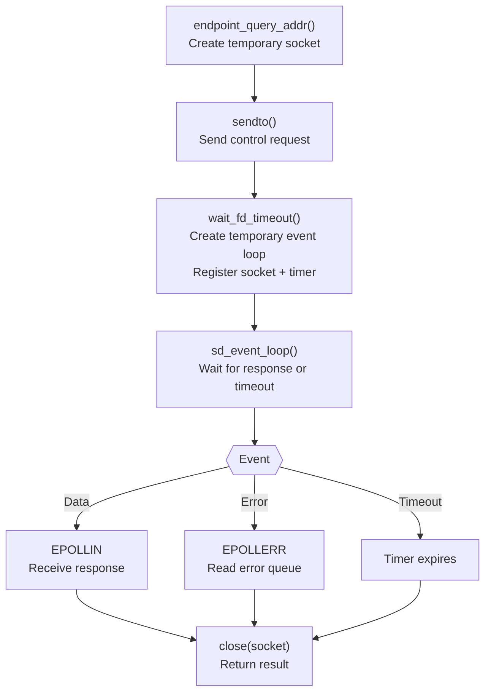

**Key functions:**
- `endpoint_query_addr()` [src/mctpd.c:1916-2033](): Base query function
- `endpoint_query_peer()` [src/mctpd.c:2037-2058](): Query by EID
- `endpoint_query_phys()` [src/mctpd.c:2062-2088](): Query by physical address
- `wait_fd_timeout()` [src/mctpd.c:522-548](): Synchronous wait with timeout

This pattern allows the daemon to make synchronous control protocol requests without blocking the main event loop.

**Sources:** [src/mctpd.c:1916-2033](), [src/mctpd.c:522-548](), [src/mctpd.c:2037-2058](), [src/mctpd.c:2062-2088]()

### Error Queue Processing

The daemon processes MCTP transport errors through the kernel's error queue mechanism:

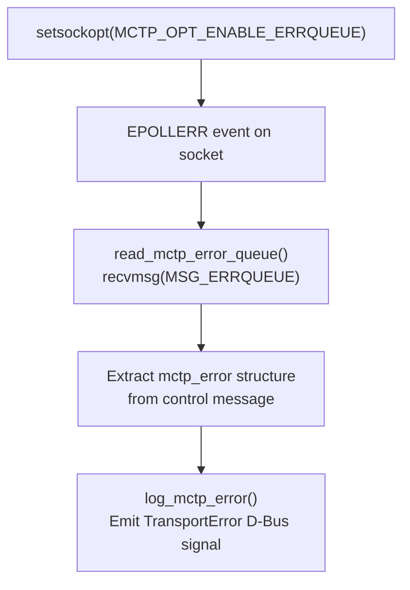

The error queue is enabled on control sockets [src/mctpd.c:1456-1467]() and query sockets [src/mctpd.c:1949-1955](). When errors occur, the `read_mctp_error_queue()` function [src/mctpd.c:1516-1592]() processes them and emits D-Bus signals for monitoring.

**Sources:** [src/mctpd.c:1456-1467](), [src/mctpd.c:1516-1592](), [src/mctpd.c:1484-1514]()

---

## Initialization and Shutdown

### Daemon Startup Sequence

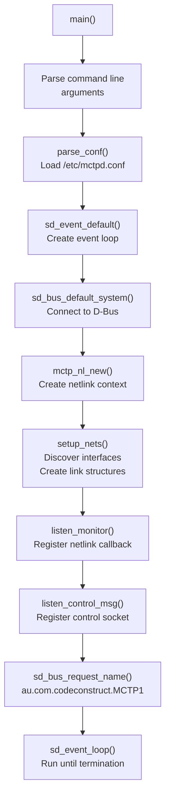

During initialization, the daemon:
1. Parses configuration to determine operational mode and EID ranges
2. Creates the event loop and connects to D-Bus
3. Initializes netlink monitoring for kernel MCTP state
4. Discovers existing interfaces and creates link objects
5. Registers event sources (netlink, control socket)
6. Claims the D-Bus service name
7. Enters the main event loop

**Sources:** [src/mctpd.c:4605-4950]()

---

## Design Principles

### Separation of Concerns

The architecture cleanly separates:
- **Transport Layer**: Netlink and MCTP socket operations ([src/mctp-netlink.c]())
- **Protocol Layer**: Control message encoding/decoding ([src/mctp-control-spec.h]())
- **Management Layer**: Peer lifecycle and state management ([src/mctpd.c]())
- **Interface Layer**: D-Bus API exposure ([src/mctpd.c]() vtables)

### Asynchronous-First Design

All I/O operations integrate with the event loop, preventing blocking:
- D-Bus method calls return immediately and use D-Bus's async reply mechanism
- Netlink monitoring uses non-blocking sockets with callbacks
- Long-running operations (discovery, recovery) use timers

### State Machine Approach

Complex workflows are implemented as state machines:
- **Peer recovery** [src/mctpd.c:3951-4036](): Tracks retry count and exponential backoff
- **Bridge endpoint discovery** [src/mctpd.c:3685-3793](): Polls bridged endpoints with settle timer
- **Link service readiness** [src/mctpd.c:146-149](): Starting → Enabled state transition

**Sources:** [src/mctpd.c:3951-4036](), [src/mctpd.c:3685-3793](), [src/mctpd.c:146-149]()

---

