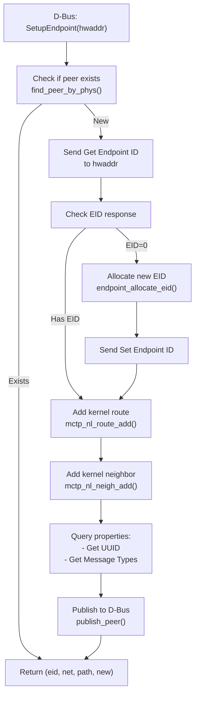
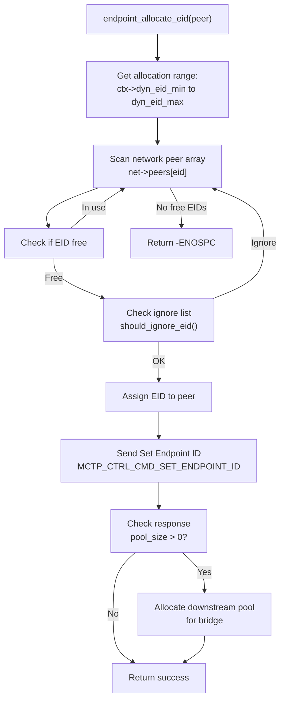
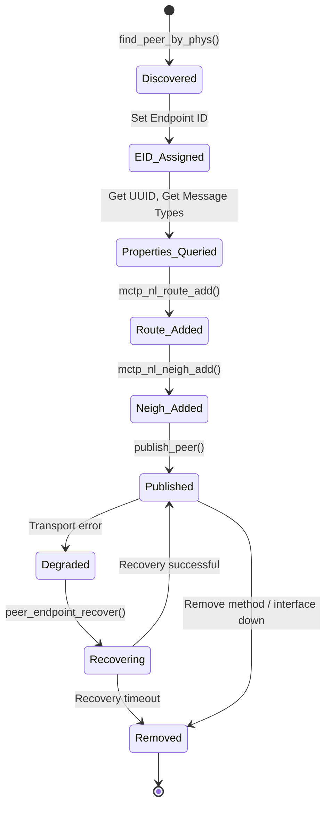
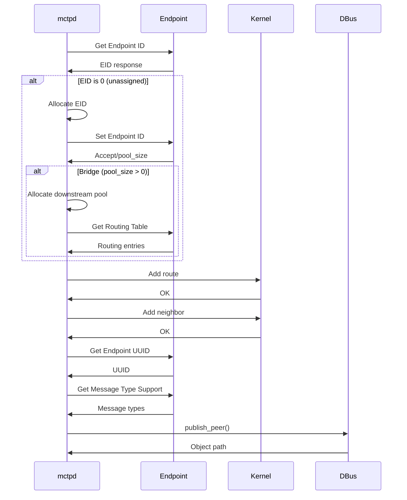
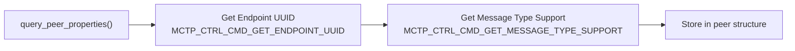
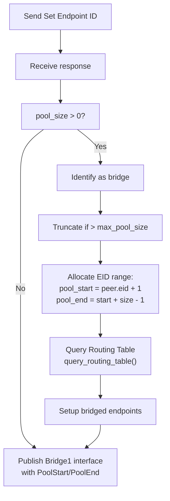
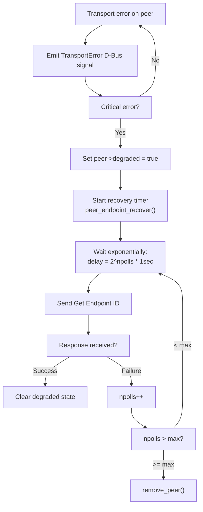
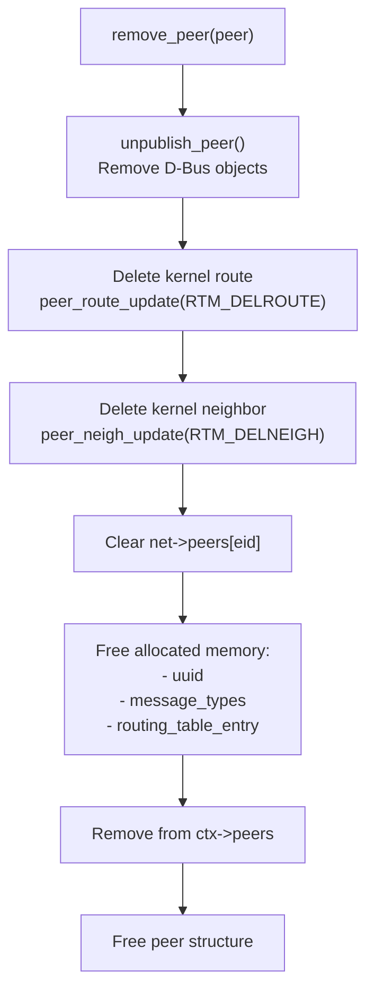
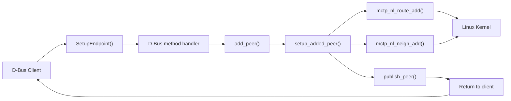
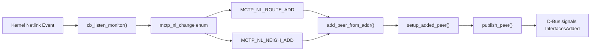

<!-- source: DeepWiki mcp.deepwiki.com · repo NVIDIA/mctp · extra page Endpoint Management · fetched 2026-10-26 -->

# Endpoint Management

<details>
<summary>Relevant source files</summary>

The following files were used as context for generating this wiki page:

- [conf/mctpd.conf](conf/mctpd.conf)
- [docs/mctpd.md](docs/mctpd.md)
- [src/mctpd-util.h](src/mctpd-util.h)
- [src/mctpd.c](src/mctpd.c)

</details>


## Purpose and Scope

This page documents how `mctpd` discovers, configures, and manages MCTP endpoints throughout their lifecycle. It covers the endpoint discovery process, EID (Endpoint ID) assignment mechanisms, property queries, bridge endpoint handling, and recovery procedures.

For information about the overall daemon architecture and event loop, see [Daemon Architecture](#2.1.1). For D-Bus interface details for endpoint management, see [BusOwner1 Interface](#4.1) and [Endpoint1 Interface](#4.2). For bridge-specific D-Bus operations, see [Bridge Management](#4.4).

---

## Endpoint Representation

### Peer Structure

Endpoints are represented internally by the `struct peer` data structure, which tracks all state for both local and remote endpoints.

**Key Fields:**

| Field | Type | Purpose |
|-------|------|---------|
| `eid` | `mctp_eid_t` | Endpoint ID (8-254) |
| `net` | `uint32_t` | MCTP network identifier |
| `state` | enum | `LOCAL` or `REMOTE` |
| `phys` | `dest_phys` | Physical address (interface, hardware address) |
| `published` | `bool` | Whether visible on D-Bus |
| `have_neigh` | `bool` | Whether neighbor table entry exists |
| `have_route` | `bool` | Whether route exists in kernel |
| `uuid` | `uint8_t*` | 16-byte endpoint UUID |
| `message_types` | `uint8_t*` | Supported MCTP message types |
| `pool_size` | `uint8_t` | For bridges: downstream EID pool size |
| `pool_start` | `mctp_eid_t` | For bridges: first EID in pool |
| `degraded` | `bool` | Endpoint in degraded/error state |

**Network Peer Array:**

Each network maintains a 256-element array mapping EIDs to peer structures:

```
struct net {
    struct peer *peers[256];  // Indexed by EID
    uint32_t net;
    // ...
}
```

Sources: [src/mctpd.c:152-222](), [src/mctpd.c:86-96]()

---

## Endpoint Discovery Flow

### SetupEndpoint Operation

The `SetupEndpoint` D-Bus method is the primary mechanism for discovering and configuring endpoints. It performs a complete discovery and configuration sequence.



**Diagram: SetupEndpoint Discovery Flow**

Sources: [src/mctpd.c:3080-3270]()

### Discovery Methods

The daemon provides multiple methods for endpoint discovery with different behaviors:

| Method | EID Query | EID Assignment | Use Case |
|--------|-----------|----------------|----------|
| `SetupEndpoint` | Yes | If EID=0 | Standard discovery |
| `AssignEndpoint` | No | Always | Force assignment with pool allocation |
| `AssignEndpointStatic` | No | Static EID | Pre-determined EID assignment |
| `LearnEndpoint` | Yes | No | Discover bridged endpoints |

**D-Bus Method Implementations:**

- `SetupEndpoint`: [src/mctpd.c:3080-3270]()
- `AssignEndpoint`: [src/mctpd.c:3272-3419]()
- `AssignEndpointStatic`: [src/mctpd.c:3421-3609]()
- `LearnEndpoint`: [src/mctpd.c:4009-4127]()

Sources: [docs/mctpd.md:90-160]()

---

## EID Assignment

### Dynamic EID Allocation

The daemon maintains a pool of available EIDs for dynamic allocation. The range is configurable via `dynamic_eid_range` in the configuration file.



**Diagram: Dynamic EID Allocation Process**

**EID Allocation Logic:**

The `endpoint_allocate_eid()` function implements a sequential scan through the configured EID range:

1. Start at `ctx->dyn_eid_min`
2. Skip EIDs already in use (`net->peers[eid] != NULL`)
3. Skip EIDs in ignore list (for bridges)
4. Allocate first available EID
5. Send Set Endpoint ID command
6. If endpoint is a bridge, allocate downstream pool

Sources: [src/mctpd.c:2769-2909]()

### Bridge Pool Allocation

When an endpoint responds to Set Endpoint ID with a non-zero `eid_pool_size`, the daemon allocates a contiguous range of EIDs for the bridge's downstream endpoints.

**Pool Allocation Algorithm:**

```
requested_size = min(response.pool_size, ctx->max_pool_size)
pool_start = peer.eid + 1
pool_end = pool_start + requested_size - 1

Store in peer:
    peer->pool_size = requested_size
    peer->pool_start = pool_start
```

**Bridge Pool Properties:**

The allocated pool is exposed via D-Bus on the endpoint object:

- Interface: `au.com.codeconstruct.MCTP.Bridge1`
- Properties: `PoolStart` (byte), `PoolEnd` (byte)

Sources: [src/mctpd.c:2861-2907](), [src/mctpd.c:1922-1965]()

### Static EID Assignment

The `AssignEndpointStatic` method assigns a specific EID to an endpoint. It validates that:

1. The static EID is not already in use by a different endpoint
2. If the endpoint already has an EID, it matches the static EID
3. The static EID is within valid range (8-254)

Sources: [src/mctpd.c:3421-3609]()

---

## Endpoint Lifecycle

### Peer State Machine



**Diagram: Endpoint State Machine**

### Peer Setup Sequence

The `setup_added_peer()` function orchestrates the complete endpoint setup:



**Diagram: Endpoint Setup Sequence**

**Key Functions:**

- `setup_added_peer()`: [src/mctpd.c:2484-2522]()
- `add_peer()`: [src/mctpd.c:2524-2622]()
- `add_peer_route()`: [src/mctpd.c:2306-2339]()
- `query_peer_properties()`: [src/mctpd.c:2912-3078]()

Sources: [src/mctpd.c:2484-2622]()

### Endpoint Publication to D-Bus

The `publish_peer()` function creates D-Bus objects and interfaces for discovered endpoints:

**Interfaces Added:**

1. `xyz.openbmc_project.MCTP.Endpoint` - OpenBMC standard interface
2. `au.com.codeconstruct.MCTP.Endpoint1` - CodeConstruct management interface
3. `xyz.openbmc_project.Common.UUID` - UUID property interface
4. `xyz.openbmc_project.MCTP.Binding` - Binding type information
5. `au.com.codeconstruct.MCTP.Bridge1` - Added if `pool_size > 0`

**Object Path Format:**

```
/au/com/codeconstruct/mctp1/networks/<net>/endpoints/<eid>
```

Sources: [src/mctpd.c:2158-2304](), [src/mctpd.c:1922-1965]()

---

## Property Queries

### Queried Properties

After EID assignment, the daemon queries endpoint capabilities using MCTP control protocol commands:

**Query Sequence:**



**Diagram: Property Query Flow**

**Retrieved Data:**

| Property | Control Command | Stored In |
|----------|----------------|-----------|
| UUID | `Get Endpoint UUID` (0x03) | `peer->uuid` (16 bytes) |
| Message Types | `Get Message Type Support` (0x05) | `peer->message_types` (array) |
| Endpoint Type | From Get EID response | `peer->endpoint_type` |
| Medium Specific | From Get EID response | `peer->medium_spec` |

**Control Protocol Implementation:**

The daemon uses `send_control_message_and_wait()` to send queries and wait for responses:

```c
// Send control message with timeout
rc = send_control_message_and_wait(ctx, peer, 
                                   req_buf, req_len,
                                   &resp_buf, &resp_len,
                                   ctx->mctp_timeout);
```

Sources: [src/mctpd.c:2912-3078](), [src/mctpd.c:2624-2767]()

---

## Bridge Endpoint Management

### Bridge Detection and Pool Allocation

Bridges are identified by a non-zero `eid_pool_size` in the Set Endpoint ID response. The daemon allocates a contiguous EID pool for the bridge's downstream devices.



**Diagram: Bridge Pool Allocation Flow**

### Routing Table Queries

For bridge endpoints, the daemon queries the routing table to discover downstream endpoints:

**Query Message:**

```
Command: Get Routing Table Entries (0x0A)
Parameters: Entry handle = 0xFF (start)
```

**Response Processing:**

The routing table response contains entries with:
- `first_eid`: Starting EID of range
- `eid_range`: Number of EIDs in range
- `entry_type`: Type of entry (0x00 = endpoint, 0x01 = bridge)
- Physical address (variable length)

**Bridged Endpoint Setup:**

For each routing table entry:
1. Create peer structure with bridged EID
2. Mark as indirect endpoint (`is_direct_endpoint = false`)
3. Add route through bridge interface
4. Skip neighbor table entry (no direct physical address)
5. Query properties if accessible

Sources: [src/mctpd.c:3611-3906](), [src/mctpd.c:3908-4007]()

### Bridge Settle Timer

After querying the routing table, a settle timer delays final publication to allow transient states to resolve:

```c
#define BRIDGE_SETTLE_DELAY_SEC 4

// Start timer after routing table query
rc = sd_event_add_time_relative(ctx->event,
                                &peer->bridge_settle_timer,
                                CLOCK_MONOTONIC,
                                BRIDGE_SETTLE_DELAY_SEC * USEC_PER_SEC,
                                0,
                                cb_bridge_settle_timeout,
                                peer);
```

Sources: [src/mctpd.c:59](), [src/mctpd.c:3793-3810]()

---

## Recovery Mechanisms

### Transport Error Detection

The daemon monitors transport errors via the MCTP error queue. When errors are detected, affected endpoints may be marked as degraded.



**Diagram: Endpoint Recovery Flow**

### Recovery State

The `peer->recovery` structure tracks recovery attempts:

```c
struct {
    uint64_t delay;            // Exponential backoff delay
    sd_event_source *source;   // Timer event source
    int npolls;                // Number of recovery attempts
    mctp_eid_t eid;           // Original EID
    uint8_t endpoint_type;     // Cached for verification
    uint8_t medium_spec;       // Cached for verification
} recovery;
```

**Recovery Process:**

1. Mark endpoint as degraded (`peer->degraded = true`)
2. Start recovery timer with exponential backoff: `delay = 2^npolls * 1 second`
3. Send Get Endpoint ID to check if endpoint responds
4. If response matches cached properties, restore endpoint
5. If maximum attempts exceeded, remove endpoint

**Configuration Option:**

Recovery for endpoints with null UUID can be disabled with the build option `unsafe-recover-nil-uuid`.

Sources: [src/mctpd.c:2341-2482](), [src/mctpd.c:214-221]()

### Error Queue Processing

The daemon registers an error queue callback on control message sockets:

```c
// Enable error queue
val = 1;
setsockopt(sd, SOL_MCTP, MCTP_OPT_ENABLE_ERRQUEUE, &val, sizeof(val));

// Register for EPOLLERR events
sd_event_add_io(ctx->event, NULL, sd, EPOLLIN | EPOLLERR,
                cb_listen_control_msg, ctx);
```

When `EPOLLERR` occurs, `read_mctp_error_queue()` retrieves error details and emits D-Bus signals.

Sources: [src/mctpd.c:1456-1474](), [src/mctpd.c:1516-1592]()

---

## Endpoint Removal

### Removal Triggers

Endpoints can be removed through several mechanisms:

1. **D-Bus `.Remove` method** - Explicit removal request
2. **Interface down** - Network interface goes down
3. **Recovery timeout** - Endpoint fails recovery attempts
4. **Netlink route/neighbor deletion** - Kernel state changes

### Removal Process



**Diagram: Endpoint Removal Process**

**Key Functions:**

- `remove_peer()`: [src/mctpd.c:2093-2156]()
- `unpublish_peer()`: [src/mctpd.c:2052-2091]()
- `peer_route_update()`: [src/mctpd.c:1967-2020]()
- `peer_neigh_update()`: [src/mctpd.c:2022-2050]()

### Bridged Endpoint Cleanup

When a bridge endpoint is removed, all downstream bridged endpoints must also be removed:

```c
// Called before removing bridge peer
remove_bridged_peers(bridge);

// Iterates through all peers, removing those using bridge as gateway
for (i = 0; i < ctx->num_peers; i++) {
    if (peer->phys.ifindex == bridge->phys.ifindex &&
        !peer->is_direct_endpoint) {
        remove_peer(peer);
    }
}
```

Sources: [src/mctpd.c:1845-1866]()

---

## Endpoint Lookup Functions

The daemon provides several lookup functions for finding endpoints:

| Function | Search By | Returns |
|----------|-----------|---------|
| `find_peer_by_addr()` | EID + Network ID | `struct peer*` |
| `find_peer_by_phys()` | Physical address (ifindex + hwaddr) | `struct peer*` |
| `find_local_eids_by_net()` | Network ID | Array of local EIDs |

**Usage Example:**

```c
// Find peer by EID
struct peer *peer = find_peer_by_addr(ctx, eid, net_id);

// Find peer by physical address
dest_phys phys = {
    .ifindex = 3,
    .hwaddr = {0x1d},
    .hwaddr_len = 1
};
struct peer *peer = find_peer_by_phys(ctx, &phys);
```

Sources: [src/mctpd.c:377-406](), [src/mctpd.c:365-375]()

---

## Key Data Flows

### Add Peer from D-Bus to Kernel



**Diagram: Add Peer Data Flow**

### Netlink Event to D-Bus



**Diagram: Netlink to D-Bus Event Flow**

Sources: [src/mctpd.c:1595-1843]()

---

## Configuration Impact

### EID Allocation Range

The `dynamic_eid_range` configuration controls which EIDs are available for allocation:

```toml
[bus-owner]
dynamic_eid_range = [8, 254]  # Default: entire range
```

The daemon will only allocate EIDs within this range. Static EIDs and local interface EIDs may fall outside this range.

### Maximum Pool Size

The `max_pool_size` configuration limits bridge pool allocations:

```toml
[bus-owner]
max_pool_size = 15  # Default: 15 EIDs
```

If a bridge requests a larger pool, it will be truncated to this maximum.

### Message Timeout

The `message_timeout_ms` affects control protocol timeouts during endpoint queries:

```toml
[mctp]
message_timeout_ms = 250  # Default: 250ms
```

Longer timeouts increase discovery time but improve reliability on slow transports.

Sources: [conf/mctpd.conf:1-20](), [docs/mctpd.md:286-369]()

---

