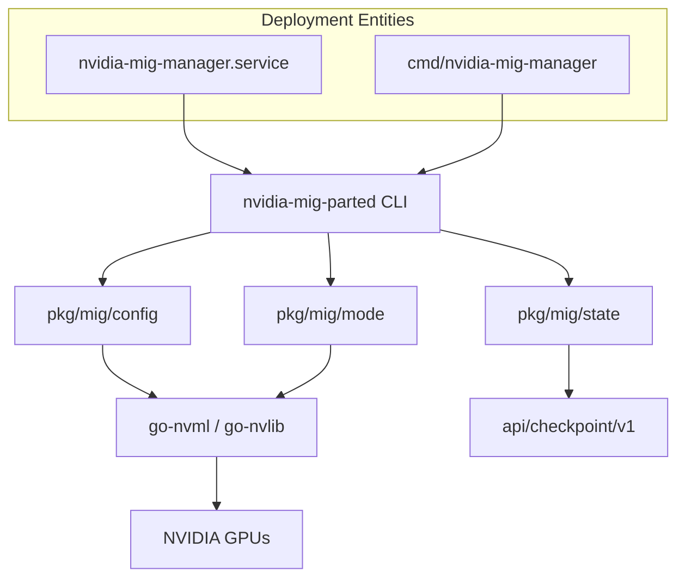
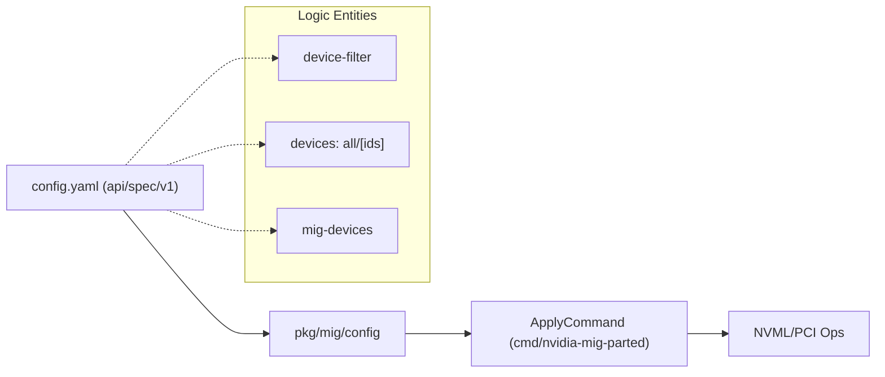

<!-- source: DeepWiki mcp.deepwiki.com · repo NVIDIA/mig-parted · page 1 Overview · fetched 2026-10-26 -->

# Overview

Relevant source files

The following files were used as context for generating this wiki page:

- [CHANGELOG.md](CHANGELOG.md)
- [README.md](README.md)
- [deployments/container/nvidia-mig-manager-example-hopper-blackwell.yaml](deployments/container/nvidia-mig-manager-example-hopper-blackwell.yaml)
- [deployments/container/nvidia-mig-manager-example.yaml](deployments/container/nvidia-mig-manager-example.yaml)
- [deployments/systemd/README.md](deployments/systemd/README.md)
- [deployments/systemd/install.sh](deployments/systemd/install.sh)
- [deployments/systemd/nvidia-gpu-reset.target](deployments/systemd/nvidia-gpu-reset.target)
- [deployments/systemd/nvidia-mig-parted.sh](deployments/systemd/nvidia-mig-parted.sh)
- [deployments/systemd/uninstall.sh](deployments/systemd/uninstall.sh)
- [versions.mk](versions.mk)

This document provides a technical introduction to NVIDIA MIG-Parted, a comprehensive system for managing Multi-Instance GPU (MIG) configurations on NVIDIA GPUs. MIG-Parted offers a declarative approach to MIG management, enabling system administrators to define, apply, and validate MIG configurations consistently across standalone systems and clusters.

For information about getting started with MIG-Parted, see [Getting Started](#1.1).

## What is MIG?

Multi-Instance GPU (MIG) is a mode of operation in NVIDIA Ampere architecture GPUs and newer that allows partitioning a physical GPU into multiple isolated "MIG Devices". Each MIG instance functions as an independent GPU with dedicated compute resources, memory, and bandwidth. MIG enables:

- Higher GPU utilization in multi-tenant environments.
- Workload isolation and quality of service.
- Fine-grained resource allocation for diverse workloads.

MIG partitioning is done by subdividing the GPU into fixed partitions of memory and compute resources. MIG configurations are identified by profiles like `1g.5gb` (1 GPU slice with 5GB memory) or `3g.20gb` (3 GPU slices with 20GB memory).

Sources: [README.md:3-9]()

## MIG-Parted Architecture

MIG-Parted consists of several core components that work together to manage MIG configurations. The system bridges high-level user configurations to low-level hardware adjustments via the NVIDIA Management Library (NVML).

### System Component Map

Key components:

- **nvidia-mig-parted CLI**: The primary entry point defined in `cmd/nvidia-mig-parted`. [deployments/systemd/install.sh:31-32]()
- **MIG Config Manager**: Handles creation and configuration of MIG instances via `pkg/mig/config`.
- **MIG Mode Manager**: Controls MIG mode (enabled/disabled) for GPUs via `pkg/mig/mode`.
- **MIG State Manager**: Manages persistence and restoration of MIG configurations via `pkg/mig/state`.
- **NVML Interface**: Communicates with NVIDIA hardware using `go-nvml` and `go-nvlib` wrappers.

Sources: [README.md:11-22](), [deployments/systemd/README.md:1-5](), [deployments/systemd/install.sh:31-32]()

## Deployment Options

MIG-Parted can be deployed in several ways depending on the infrastructure:

1. **Standalone CLI**: Direct use of the `nvidia-mig-parted` binary. [README.md:92-101]()
2. **Systemd Service**: The `nvidia-mig-manager.service` provides persistence across reboots and manages driver client lifecycles via hooks. [deployments/systemd/README.md:1-23]()
3. **Kubernetes Integration**: The `nvidia-mig-manager` DaemonSet (defined in `deployments/container/`) applies configurations based on node labels and coordinates with the GPU Operator. [deployments/container/nvidia-mig-manager-example.yaml:1-30]()

Sources: [deployments/systemd/README.md:1-23](), [deployments/container/nvidia-mig-manager-example.yaml:1-30]()

## Configuration Management

MIG-Parted uses a versioned YAML-based configuration format defined in `api/spec/v1`.

### Configuration Data Flow

A typical configuration file includes:
1. A version identifier (e.g., `version: v1`). [README.md:25]()
2. Named MIG configurations (e.g., `all-1g.5gb`), each containing:
   - `device-filter`: Limits the config to specific PCI IDs. [deployments/container/nvidia-mig-manager-example.yaml:185]()
   - `devices`: Target indices or "all". [README.md:28]()
   - `mig-enabled`: Boolean for MIG mode. [README.md:29]()
   - `mig-devices`: Map of profiles and counts. [README.md:39-40]()

Sources: [README.md:25-83](), [deployments/container/nvidia-mig-manager-example.yaml:137-283]()

## Supported GPU Models and Profiles

MIG-Parted supports a wide range of NVIDIA GPU models, from Ampere to Blackwell architectures.

| GPU Model | Example MIG Profiles | PCI Device IDs |
|-----------|----------------------|----------------|
| A100-40GB | 1g.5gb, 2g.10gb, 3g.20gb | 0x20B010DE, 0x20B110DE |
| A100-80GB | 1g.10gb, 2g.20gb, 7g.80gb | 0x20B210DE, 0x20B510DE |
| H100-80GB | 1g.10gb, 3g.40gb, 7g.80gb | 0x233010DE, 0x233110DE |
| H200-141GB | 1g.18gb, 3g.71gb, 7g.141gb | 0x233510DE |
| B200 | 1g.23gb, 3g.90gb, 7g.180gb | 0x290110DE |
| GB200 HGX | 1g.24gb, 3g.95gb, 7g.189gb | 0x294110DE |

Sources: [deployments/container/nvidia-mig-manager-example.yaml:144-235](), [deployments/container/nvidia-mig-manager-example-hopper-blackwell.yaml:110-277](), [CHANGELOG.md:89-97]()

## CLI Commands

The `nvidia-mig-parted` CLI provides the following commands:

| Command | Description | Example |
|---------|-------------|---------|
| `apply` | Apply a MIG configuration. [README.md:191]() | `nvidia-mig-parted apply -f config.yaml -c all-1g.5gb` |
| `assert` | Verify a configuration is applied. [README.md:119]() | `nvidia-mig-parted assert -f config.yaml -c all-1g.5gb` |
| `export` | Export current hardware state to YAML. [README.md:105]() | `nvidia-mig-parted export` |
| `checkpoint` | Save current MIG state to a file. | `nvidia-mig-parted checkpoint` |
| `restore` | Restore state from a checkpoint. | `nvidia-mig-parted restore` |

Sources: [README.md:103-131](), [README.md:189-228](), [deployments/systemd/nvidia-mig-parted.sh:3]()

## Integration and Automation

### Systemd and Hooks
The `nvidia-mig-manager.service` uses a hooks system (`hooks.sh`, `hooks.yaml`) to stop services like `dcgm-exporter` or `k8s-device-plugin` before applying changes, ensuring GPUs are not in use during resets. [deployments/systemd/README.md:3-19]()

### Kubernetes
The Kubernetes manager (`cmd/nvidia-mig-manager`) watches for node label changes and triggers the `apply` logic, enabling dynamic MIG reconfiguration in cloud-native environments. [deployments/container/nvidia-mig-manager-example.yaml:24-58]()

Sources: [deployments/systemd/README.md:1-23](), [deployments/container/nvidia-mig-manager-example.yaml:1-84]()

---

