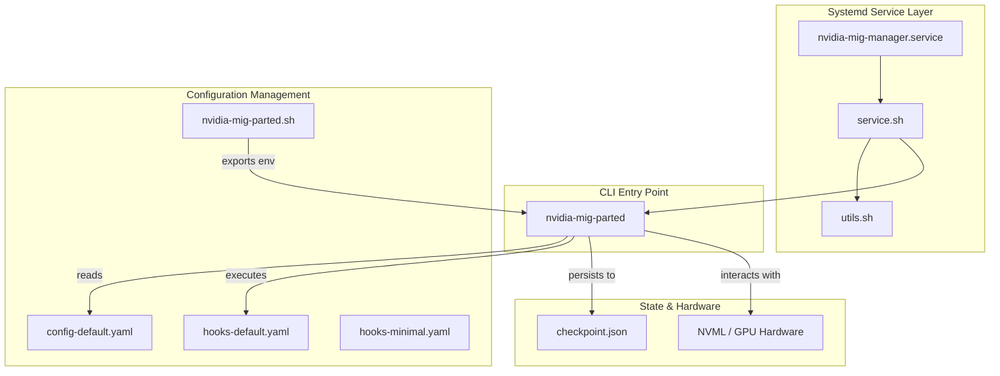
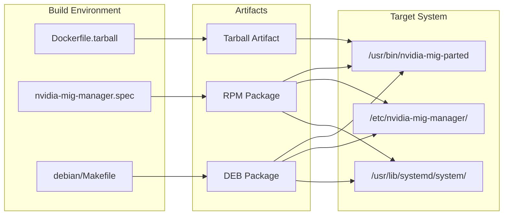

<!-- source: DeepWiki mcp.deepwiki.com · repo NVIDIA/mig-parted · page 1.1 Getting Started · fetched 2026-10-26 -->

# Getting Started

<details>
<summary>Relevant source files</summary>

The following files were used as context for generating this wiki page:

- [README.md](README.md)
- [deployments/systemd/README.md](deployments/systemd/README.md)
- [deployments/systemd/install.sh](deployments/systemd/install.sh)
- [deployments/systemd/nvidia-gpu-reset.target](deployments/systemd/nvidia-gpu-reset.target)
- [deployments/systemd/nvidia-mig-parted.sh](deployments/systemd/nvidia-mig-parted.sh)
- [deployments/systemd/packages/Dockerfile.tarball](deployments/systemd/packages/Dockerfile.tarball)
- [deployments/systemd/packages/debian/Makefile](deployments/systemd/packages/debian/Makefile)
- [deployments/systemd/packages/debian/postinst](deployments/systemd/packages/debian/postinst)
- [deployments/systemd/packages/debian/postrm](deployments/systemd/packages/debian/postrm)
- [deployments/systemd/packages/rpm/SPECS/nvidia-mig-manager.spec](deployments/systemd/packages/rpm/SPECS/nvidia-mig-manager.spec)
- [deployments/systemd/packages/tarball/install.sh](deployments/systemd/packages/tarball/install.sh)
- [deployments/systemd/uninstall.sh](deployments/systemd/uninstall.sh)

</details>


This guide provides a comprehensive introduction to NVIDIA MIG-Parted, helping new users quickly install, configure, and start using the tool to manage Multi-Instance GPU (MIG) configurations on NVIDIA GPUs. For a general overview of MIG-Parted and the problems it solves, see [Overview](#1).

## What is MIG-Parted?

MIG-Parted is a tool designed for system administrators to simplify the management of MIG partitions on NVIDIA GPUs. It allows you to declaratively define MIG configurations and apply them across your systems in a consistent way. [README.md:11-15]()

The tool enables you to:
- Define configurations for multiple MIG profiles in a single YAML file. [README.md:22-83]()
- Apply configurations across all GPUs or specific devices. [README.md:92-101]()
- Assert that specific configurations are applied correctly. [README.md:117-130]()
- Export current configurations. [README.md:103-115]()
- Checkpoint and restore MIG states. [deployments/systemd/nvidia-mig-parted.sh:3]()

Sources: [README.md:1-22](), [deployments/systemd/packages/rpm/SPECS/nvidia-mig-manager.spec:24-31]()

## Installation Options

There are several ways to install MIG-Parted depending on your environment and preferences.

### From Pre-built Packages

MIG-Parted is distributed as assets with GitHub releases in various package formats, including `deb`, `rpm`, and `tarball`. [README.md:144-148]()

```
# Download from the releases page
https://github.com/NVIDIA/mig-parted/releases
```

### Using Docker with Go Install

```bash
docker run \
    --rm \
    -v $(pwd):/dest \
    golang:1.20.1 \
    sh -c "
    go install github.com/NVIDIA/mig-parted/cmd/nvidia-mig-parted@latest
    mv /go/bin/nvidia-mig-parted /dest/nvidia-mig-parted
    "
```
Sources: [README.md:152-162](), [deployments/systemd/install.sh:55-61]()

### Using Go Get and Install Directly

```bash
GO111MODULE=off go get -u github.com/NVIDIA/mig-parted/cmd/nvidia-mig-parted
GOBIN=$(pwd) go install github.com/NVIDIA/mig-parted/cmd/nvidia-mig-parted
```
Sources: [README.md:164-168]()

### Clone and Build from Repository

```bash
git clone http://github.com/NVIDIA/mig-parted
cd mig-parted
go build ./cmd/nvidia-mig-parted
```
Sources: [README.md:170-175]()

### Installing with Systemd Integration

To install MIG-Parted with systemd integration for improved management capabilities, use the provided installation script: [deployments/systemd/README.md:34-35]()

```bash
# After downloading the repository
cd deployments/systemd
./install.sh
```

This installs the `nvidia-mig-manager.service`, the `nvidia-gpu-reset.target`, and related configuration files under `/etc/nvidia-mig-manager`. [deployments/systemd/install.sh:17-47](), [deployments/systemd/packages/rpm/SPECS/nvidia-mig-manager.spec:45-63]()

Sources: [README.md:142-180](), [deployments/systemd/install.sh:1-107](), [deployments/systemd/packages/tarball/install.sh:17-47]()

## MIG-Parted Architecture

### Core Components and File Interactions

The following diagram maps high-level operations to the underlying configuration and script entities.



Sources: [deployments/systemd/packages/rpm/SPECS/nvidia-mig-manager.spec:11-22](), [deployments/systemd/nvidia-mig-parted.sh:1-4](), [deployments/systemd/README.md:48-60]()

### Installation and Deployment Flow

This diagram illustrates how the build process translates source code into deployable artifacts across different platforms.



Sources: [deployments/systemd/packages/Dockerfile.tarball:78-92](), [deployments/systemd/packages/rpm/SPECS/nvidia-mig-manager.spec:45-63](), [deployments/systemd/packages/debian/Makefile:31-49]()

## Basic Usage

### Command Overview

The `nvidia-mig-parted` CLI provides several commands for managing MIG configurations:

| Command | Description |
|---------|-------------|
| `apply` | Apply a MIG configuration from a config file |
| `assert` | Assert that a specific MIG configuration is currently applied |
| `export` | Export the current MIG configuration |
| `checkpoint` | Checkpoint current MIG state to a file |
| `restore` | Restore MIG state from a checkpoint file |

Sources: [README.md:92-130](), [deployments/systemd/README.md:69-71]()

### Configuration Files

MIG-Parted uses YAML configuration files to define MIG configurations. A typical configuration defines labels like `all-1g.5gb` or `all-balanced` which map to specific device slices. [README.md:24-83]()

When using systemd integration, configuration files are stored in `/etc/nvidia-mig-manager/`:
- `config.yaml` - Main configuration file (often auto-generated or customized). [deployments/systemd/README.md:61-63]()
- `hooks.yaml` - Symlinked to either `hooks-default.yaml` or `hooks-minimal.yaml` depending on GPU compute capability. [deployments/systemd/install.sh:88-104]()

Sources: [README.md:24-83](), [deployments/systemd/nvidia-mig-parted.sh:1-3](), [deployments/systemd/packages/debian/postinst:8-24]()

## Quick Start Examples

### Apply a MIG Configuration

To apply a specific MIG configuration from a configuration file:

```bash
nvidia-mig-parted apply -f examples/config.yaml -c all-1g.5gb
```
[README.md:191-192]()

### Apply Only MIG Mode Changes

To change the MIG mode (enabled/disabled) without configuring MIG devices:

```bash
nvidia-mig-parted apply --mode-only -f examples/config.yaml -c all-enabled
```
[README.md:196-197]()

### Export Current Configuration

To export the current MIG configuration:

```bash
nvidia-mig-parted export
```
[README.md:103-105]()

### Assert Configuration

To verify if a specific configuration is applied:

```bash
nvidia-mig-parted assert -f examples/config.yaml -c all-1g.5gb
```
[README.md:117-130]()

### Using Environment Variables

You can use environment variables instead of command-line flags. When using the systemd integration, these are set in `/etc/profile.d/nvidia-mig-parted.sh`. [deployments/systemd/README.md:73-80]()

```bash
export MIG_PARTED_CONFIG_FILE=/etc/nvidia-mig-manager/config.yaml
export MIG_PARTED_HOOKS_FILE=/etc/nvidia-mig-manager/hooks.yaml
nvidia-mig-parted apply -c all-1g.5gb
```

Sources: [README.md:182-267](), [deployments/systemd/nvidia-mig-parted.sh:1-4]()

## Using with Systemd Integration

The `nvidia-mig-manager.service` provides additional capabilities:

1. **Service Orchestration**: Automatically stopping and starting necessary services (like `k8s-device-plugin` or `dcgm-exporter`) when changing MIG configuration via `hooks.sh`. [deployments/systemd/README.md:13-18]()
2. **Persistence**: Persisting MIG configurations across node reboots. [deployments/systemd/README.md:20-22]()
3. **Driverless Mode**: Applying MIG mode changes without requiring the NVIDIA driver to be loaded. [deployments/systemd/README.md:24-26]()
4. **Virtualization Support**: Automatically rebooting when necessary for GPU Passthrough. [deployments/systemd/README.md:28-32]()

### Applying with Hooks

When using hooks, ensure you point to the hooks file to trigger service restarts:

```bash
nvidia-mig-parted apply -f /etc/nvidia-mig-manager/config.yaml -k /etc/nvidia-mig-manager/hooks.yaml -c all-1g.5gb
```
[deployments/systemd/README.md:86-88]()

Sources: [deployments/systemd/README.md:1-33](), [deployments/systemd/nvidia-mig-parted.sh:1-3](), [deployments/systemd/packages/rpm/SPECS/nvidia-mig-manager.spec:33-35]()

## Checkpoint and Restore

MIG-Parted allows you to save the current MIG state to a checkpoint file and restore it later. This is useful for returning to a known state after experimental changes.

```bash
# Create a checkpoint
nvidia-mig-parted checkpoint -f /var/lib/nvidia-mig-manager/checkpoint.json

# Restore from a checkpoint
nvidia-mig-parted restore -f /var/lib/nvidia-mig-manager/checkpoint.json
```

Sources: [deployments/systemd/nvidia-mig-parted.sh:3](), [deployments/systemd/README.md:52]()

## Known Issues

- **GPU Reset Failures**: MIG-Parted will fail to perform a GPU reset if the `nvidia_drm` kernel module is loaded. You must unload it before applying mode changes. [README.md:269-274]()
- **Sudo Environment**: The files in `/etc/profile.d/` are not sourced when running commands under `sudo`. Use `sudo -E` or explicitly pass flags. [deployments/systemd/README.md:82-89]()

Sources: [README.md:269-274](), [deployments/systemd/README.md:82-89]()

---

