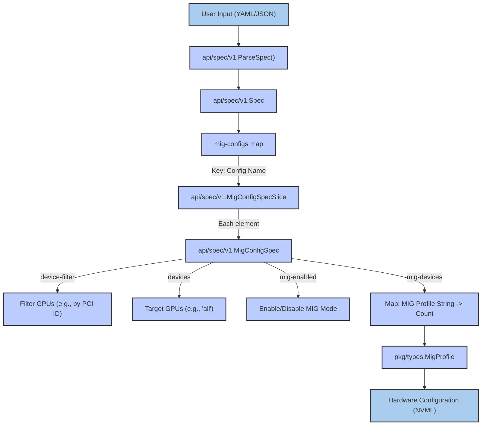
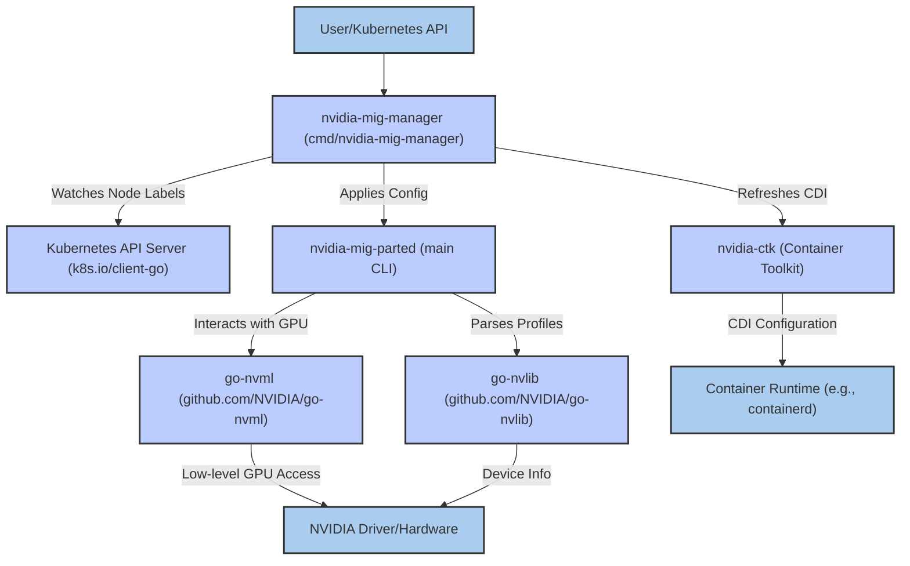

<!-- source: DeepWiki mcp.deepwiki.com · repo NVIDIA/mig-parted · page 10 Glossary · fetched 2026-10-26 -->

# Glossary

Relevant source files

The following files were used as context for generating this wiki page:

- [CHANGELOG.md](CHANGELOG.md)
- [api/spec/v1/helpers.go](api/spec/v1/helpers.go)
- [api/spec/v1/spec.go](api/spec/v1/spec.go)
- [api/spec/v1/spec_test.go](api/spec/v1/spec_test.go)
- [cmd/nvidia-mig-manager/find.go](cmd/nvidia-mig-manager/find.go)
- [cmd/nvidia-mig-manager/main.go](cmd/nvidia-mig-manager/main.go)
- [deployments/container/Dockerfile](deployments/container/Dockerfile)
- [deployments/container/Makefile](deployments/container/Makefile)
- [deployments/container/multi-arch.mk](deployments/container/multi-arch.mk)
- [deployments/container/native-only.mk](deployments/container/native-only.mk)
- [deployments/container/nvidia-mig-manager-example-hopper-blackwell.yaml](deployments/container/nvidia-mig-manager-example-hopper-blackwell.yaml)
- [deployments/container/nvidia-mig-manager-example.yaml](deployments/container/nvidia-mig-manager-example.yaml)
- [deployments/container/reconfigure-mig.sh](deployments/container/reconfigure-mig.sh)
- [deployments/systemd/config-default.yaml](deployments/systemd/config-default.yaml)
- [examples/config.yaml](examples/config.yaml)
- [go.mod](go.mod)
- [go.sum](go.sum)
- [pkg/mig/config/known_configs_test.go](pkg/mig/config/known_configs_test.go)
- [pkg/types/mig_config.go](pkg/types/mig_config.go)
- [pkg/types/mig_config_group.go](pkg/types/mig_config_group.go)
- [pkg/types/mig_profile.go](pkg/types/mig_profile.go)
- [vendor/github.com/NVIDIA/go-nvml/pkg/nvml/device.go](vendor/github.com/NVIDIA/go-nvml/pkg/nvml/device.go)
- [vendor/github.com/NVIDIA/go-nvml/pkg/nvml/gpm.go](vendor/github.com/NVIDIA/go-nvml/pkg/nvml/gpm.go)
- [vendor/modules.txt](vendor/modules.txt)
- [versions.mk](versions.mk)

This page defines key terms, jargon, and abbreviations used within the `mig-parted` codebase. It aims to provide an onboarding engineer with a clear understanding of the project's domain, components, and underlying concepts.

## Multi-Instance GPU (MIG)

MIG is a feature on NVIDIA GPUs that allows a single GPU to be securely partitioned into multiple, independent GPU Instances (GIs) and Compute Instances (CIs). Each MIG instance has its own dedicated memory, cache, and streaming multiprocessors, enabling multiple workloads to run in parallel on a single GPU without interference.

*   **GPU Instance (GI)**: A hardware-isolated partition of a physical GPU's memory and streaming multiprocessors.
*   **Compute Instance (CI)**: A further subdivision of a GPU Instance, providing isolated compute resources.
*   **MIG Profile**: A specific configuration of GIs and CIs on a GPU. MIG profiles are represented as strings like `"1g.5gb"`, `"2g.10gb"`, or `"1c.1g.5gb+me"`. The format typically indicates the number of GIs, the memory allocated to each GI, and optional attributes like "me" for media extensions.
    *   **Format**: The `pkg/types.MigProfile` struct [pkg/types/mig_profile.go:29-31]() represents a MIG profile. The `AssertValidMigProfileFormat` function [pkg/types/mig_profile.go:43-45]() validates the string format.
    *   **Examples**:
        *   `"1g.5gb"`: One GPU Instance with 5GB of memory.
        *   `"1c.2g.10gb"`: One Compute Instance on a 2GI, 10GB partition.
        *   `"1g.5gb+me"`: One GPU Instance with 5GB of memory and media extensions enabled.
    *   **Discovery**: MIG profiles are discovered from hardware using `pkg/mig/discovery` [pkg/mig/discovery/discovery.go]().
Sources: [pkg/types/mig_profile.go:29-31](), [pkg/types/mig_profile.go:43-45]()

## Configuration Concepts

The `mig-parted` tool manages MIG configurations through a structured API.

*   **`MigConfig`**: Represents a desired MIG configuration for a set of GPUs. It specifies whether MIG is enabled and the desired MIG device profiles.
    *   **Structure**: Defined by the `MigConfig` struct [pkg/types/mig_config.go:23-27]().
*   **`MigConfigGroup`**: A collection of `MigConfig` objects, typically used to apply different configurations to different subsets of GPUs based on filters.
    *   **Structure**: Defined by the `MigConfigGroup` struct [pkg/types/mig_config_group.go:23-26]().
*   **`Spec`**: The top-level configuration object that holds a map of named `MigConfigGroup`s. This is the primary input format for `nvidia-mig-parted`.
    *   **Structure**: Defined by the `Spec` struct [api/spec/v1/spec.go:23-26]().
    *   **Parsing**: The `ParseSpec` function [api/spec/v1/helpers.go:23-25]() is used to parse YAML/JSON into a `Spec` object.
*   **`MigConfigSpec`**: A single entry within a `MigConfigGroup` that specifies a MIG configuration for a filtered set of devices.
    *   **Fields**: Includes `device-filter` (list of PCI device IDs), `devices` (e.g., "all"), `mig-enabled` (boolean), and `mig-devices` (map of MIG profile strings to counts).
    *   **Structure**: Defined by the `MigConfigSpec` struct [api/spec/v1/spec.go:30-36]().
*   **`MigConfigSpecSlice`**: A slice of `MigConfigSpec` objects, allowing multiple configurations to be applied sequentially or conditionally.
    *   **Structure**: Defined by the `MigConfigSpecSlice` type [api/spec/v1/spec.go:39-41]().

### Configuration Flow

The following diagram illustrates the relationship between configuration concepts and their processing within `mig-parted`.

Sources: [api/spec/v1/spec.go:23-26](), [api/spec/v1/spec.go:30-36](), [api/spec/v1/spec.go:39-41](), [api/spec/v1/helpers.go:23-25](), [pkg/types/mig_config.go:23-27](), [pkg/types/mig_config_group.go:23-26]()

## Kubernetes Labels

In a Kubernetes environment, `nvidia-mig-manager` uses node labels to signal and manage MIG configurations.

*   **`nvidia.com/mig.config`**: This Kubernetes node label [cmd/nvidia-mig-manager/main.go:49]() is used by the `nvidia-mig-manager` to determine the desired MIG configuration for a node. The value of this label corresponds to a named `MigConfigGroup` defined in the `config.yaml`.
    *   **Example**: `nvidia.com/mig.config=all-1g.5gb` would instruct the manager to apply the "all-1g.5gb" configuration.
*   **`nvidia.com/gpu.deploy.mig-manager`**: A node selector label used in Kubernetes DaemonSets (e.g., `nvidia-mig-manager-example.yaml` [deployments/container/nvidia-mig-manager-example.yaml:21-22]()) to ensure the `nvidia-mig-manager` pod is scheduled only on nodes intended for MIG management.
Sources: [cmd/nvidia-mig-manager/main.go:49](), [deployments/container/nvidia-mig-manager-example.yaml:21-22]()

## Hardware Generations

NVIDIA GPUs are categorized into different hardware generations, each with specific capabilities and supported MIG profiles. The `mig-parted` tool includes predefined configurations for various generations.

*   **Ampere (e.g., A100, A30)**: Early generation supporting MIG. Configurations like `all-1g.5gb`, `all-2g.10gb`, `all-1g.6gb` are common.
    *   **A100-40GB, A800-40GB**: PCI Device IDs `0x20B010DE`, `0x20B110DE`, `0x20F110DE`, `0x20F610DE` [deployments/systemd/config-default.yaml:114]().
    *   **A100-80GB, A800-80GB**: PCI Device IDs `0x20B210DE`, `0x20B510DE`, `0x20F310DE`, `0x20F510DE` [deployments/systemd/config-default.yaml:107]().
    *   **A30-24GB**: Supported profiles include `1g.6gb`, `2g.12gb`, `4g.24gb` [deployments/systemd/config-default.yaml:159-188]().
*   **Hopper (e.g., H100, H200)**: Newer generation with expanded MIG capabilities.
    *   **H100-80GB, H800-80GB**: PCI Device IDs `0x233010DE`, `0x233110DE`, `0x232210DE`, `0x232410DE` [deployments/systemd/config-default.yaml:107]().
    *   **H100 NVL, H800 NVL, GH200**: Supported profiles include `1g.12gb`, `1g.24gb`, `2g.24gb`, `3g.47gb`, `4g.47gb`, `7g.94gb` [deployments/systemd/config-default.yaml:190-270]().
    *   **H200-141GB**: PCI Device ID `0x233510DE` [deployments/container/nvidia-mig-manager-example-hopper-blackwell.yaml:137]().
*   **Blackwell (e.g., B200, GB200, GB300)**: The latest generation, introducing new MIG profiles and capabilities.
    *   **RTX PRO 6000 Blackwell**: PCI Device ID `0x2BB510DE` [deployments/systemd/config-default.yaml:309]().
    *   **B200**: PCI Device ID `0x290110DE` [deployments/systemd/config-default.yaml:316]().
    *   **GB200 HGX**: PCI Device ID `0x294110DE` [deployments/systemd/config-default.yaml:293]().
    *   **GB300**: PCI Device ID `0x31C210DE` [deployments/systemd/config-default.yaml:301]().

The `config-default.yaml` [deployments/systemd/config-default.yaml]() file contains many predefined configurations for these GPU generations.
Sources: [deployments/systemd/config-default.yaml:107](), [deployments/systemd/config-default.yaml:114](), [deployments/systemd/config-default.yaml:159-188](), [deployments/systemd/config-default.yaml:190-270](), [deployments/systemd/config-default.yaml:293](), [deployments/systemd/config-default.yaml:301](), [deployments/systemd/config-default.yaml:309](), [deployments/systemd/config-default.yaml:316](), [deployments/container/nvidia-mig-manager-example-hopper-blackwell.yaml:137]()

## Tool Names and Code Pointers

This section lists the main executables and their corresponding Go packages.

*   **`nvidia-mig-parted`**: The primary CLI tool for managing MIG configurations.
    *   **Main package**: `github.com/NVIDIA/mig-parted` [go.mod:1]()
    *   **CLI framework**: Uses `github.com/urfave/cli/v3` [go.mod:10]().
*   **`nvidia-mig-manager`**: The Kubernetes component responsible for applying MIG configurations to nodes based on labels.
    *   **Main package**: `cmd/nvidia-mig-manager` [cmd/nvidia-mig-manager/main.go:17]().
    *   **Core logic**: The `main` function [cmd/nvidia-mig-manager/main.go:122-126]() orchestrates the synchronization loop.
    *   **Kubernetes client**: Uses `k8s.io/client-go` [go.mod:15]() for interacting with the Kubernetes API.
*   **`go-nvml`**: A Go binding for the NVIDIA Management Library (NVML). `mig-parted` uses this library to interact with NVIDIA GPUs at a low level.
    *   **Module**: `github.com/NVIDIA/go-nvml` [go.mod:7]().
    *   **Key packages**: `pkg/nvml` for NVML API calls, `pkg/dl` for dynamic library loading.
*   **`go-nvlib`**: A Go library providing common NVIDIA library utilities, including MIG profile parsing and device enumeration.
    *   **Module**: `github.com/NVIDIA/go-nvlib` [go.mod:6]().
    *   **Key packages**: `pkg/nvlib/device` for device-related operations, `pkg/nvpci` for PCI information.
*   **`nvidia-ctk`**: The NVIDIA Container Toolkit CLI. `nvidia-mig-manager` uses `nvidia-ctk` for certain operations, such as refreshing CDI (Container Device Interface) configurations.
    *   **Integration**: The `Dockerfile` [deployments/container/Dockerfile:51-54]() includes `nvidia-ctk` as a dependency.
    *   **Path**: Typically found at `/usr/bin/nvidia-ctk` within the container [deployments/container/Dockerfile:83]().

### Tool Interaction Diagram

Sources: [go.mod:1](), [go.mod:6](), [go.mod:7](), [go.mod:10](), [go.mod:15](), [cmd/nvidia-mig-manager/main.go:17](), [cmd/nvidia-mig-manager/main.go:122-126](), [deployments/container/Dockerfile:51-54](), [deployments/container/Dockerfile:83]()