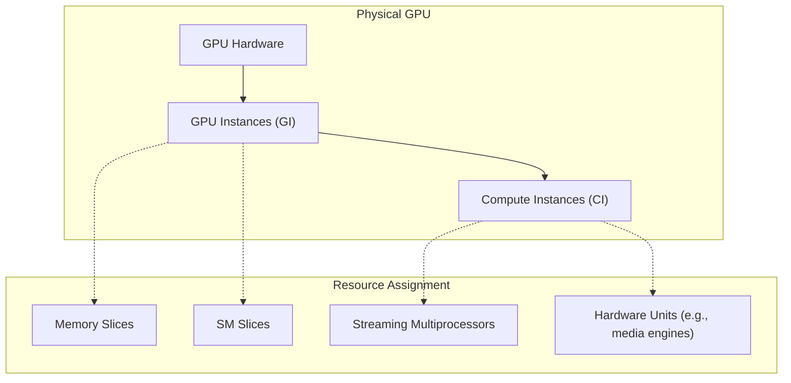
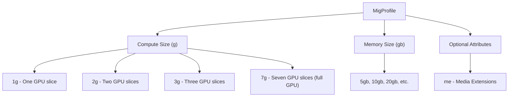
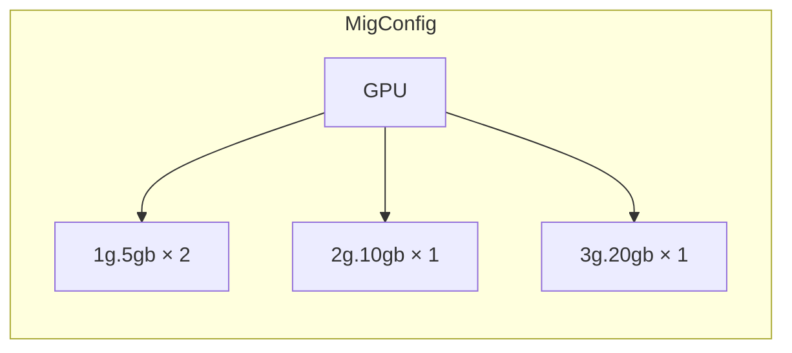
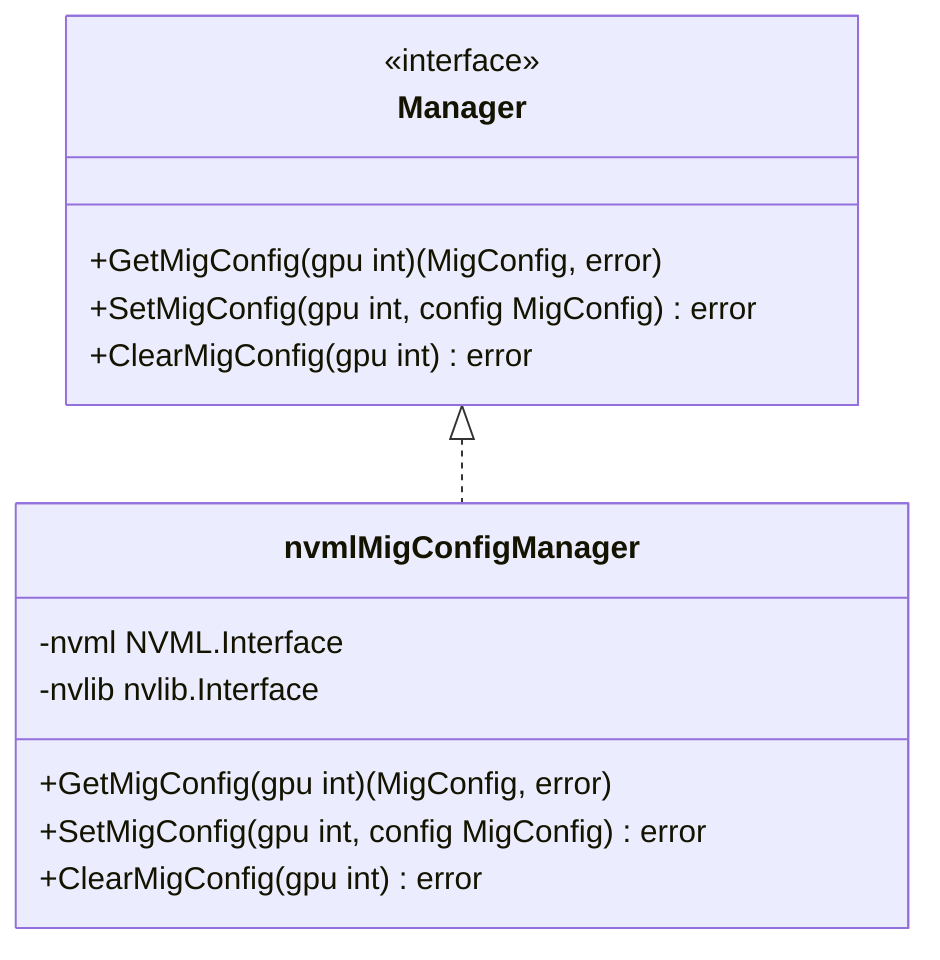
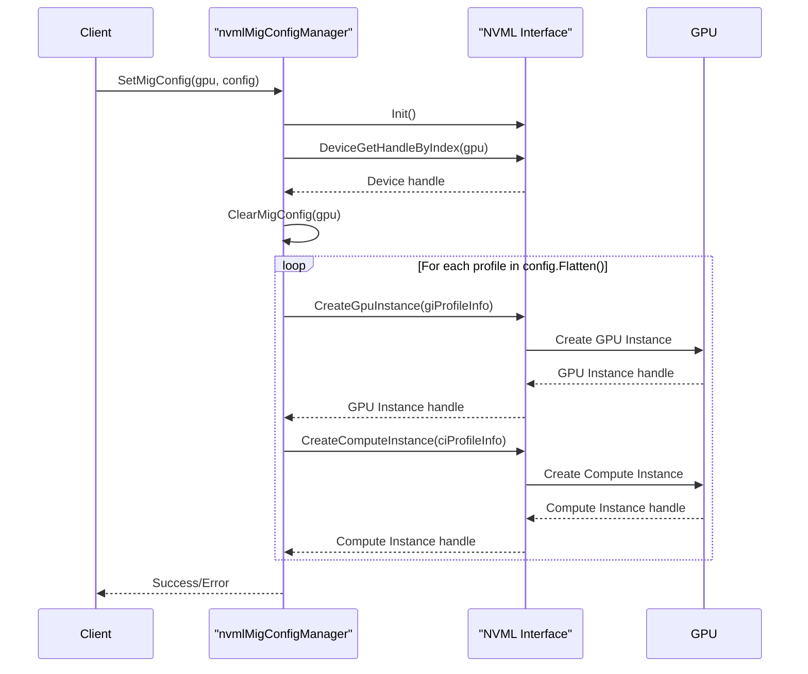
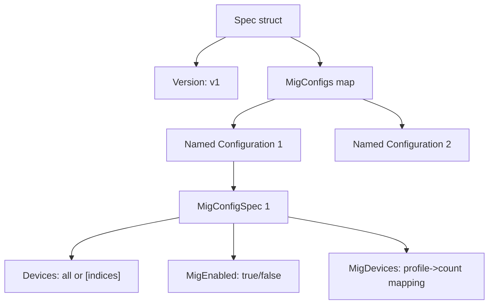
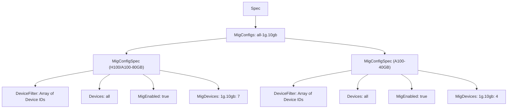
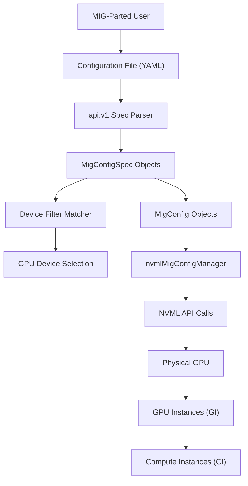

<!-- source: DeepWiki mcp.deepwiki.com · repo NVIDIA/mig-parted · page 2 Core Concepts · fetched 2026-10-26 -->

# Core Concepts

<details>
<summary>Relevant source files</summary>

The following files were used as context for generating this wiki page:

- [api/spec/v1/helpers.go](api/spec/v1/helpers.go)
- [api/spec/v1/helpers_test.go](api/spec/v1/helpers_test.go)
- [api/spec/v1/spec.go](api/spec/v1/spec.go)
- [api/spec/v1/spec_test.go](api/spec/v1/spec_test.go)
- [cmd/nvidia-mig-parted/util/device.go](cmd/nvidia-mig-parted/util/device.go)
- [examples/config.yaml](examples/config.yaml)
- [pkg/mig/config/known_configs.go](pkg/mig/config/known_configs.go)
- [pkg/mig/config/known_configs_test.go](pkg/mig/config/known_configs_test.go)
- [pkg/mig/discovery/discovery.go](pkg/mig/discovery/discovery.go)
- [pkg/mig/discovery/discovery_test.go](pkg/mig/discovery/discovery_test.go)
- [pkg/types/device.go](pkg/types/device.go)
- [pkg/types/device_test.go](pkg/types/device_test.go)
- [pkg/types/mig_config.go](pkg/types/mig_config.go)
- [pkg/types/mig_config_group.go](pkg/types/mig_config_group.go)
- [pkg/types/mig_profile.go](pkg/types/mig_profile.go)

</details>


This page explains the fundamental concepts of NVIDIA's Multi-Instance GPU (MIG) technology and how the MIG-Parted tool manages MIG configurations. For information about specific CLI commands and usage, see [nvidia-mig-parted CLI](#3).

## What is MIG?

Multi-Instance GPU (MIG) is a feature available on certain NVIDIA GPUs that allows a single physical GPU to be partitioned into multiple isolated GPU instances, each with dedicated compute resources, memory, and bandwidth. MIG enables:

- Better GPU utilization
- Workload isolation
- Fine-grained resource allocation for different workloads
- Quality of service guarantees

MIG-Parted is a management tool that simplifies the configuration and maintenance of MIG settings across GPUs in a system.

## MIG Architecture

MIG divides a GPU into two primary resource types:

### GPU Instance Components



Sources: 
- pkg/mig/config/known_configs.go
- pkg/types/mig_profile.go

1. **GPU Instances (GI)** - Primary partitions that get memory and GPU engine resources
2. **Compute Instances (CI)** - Further subdivisions of a GPU Instance that share the memory but get dedicated compute resources

## MIG Profiles

MIG profiles define specific configurations of GPU resources. The `MigProfile` struct in [pkg/types/mig_profile.go:28-31]() represents these profiles using a standardized naming convention:

```
[Compute Size].[Memory Size][+Attributes]
```

For example:
- `1g.5gb` - One GPU slice with 5GB memory
- `2g.10gb` - Two GPU slices with 10GB memory
- `3g.20gb` - Three GPU slices with 20GB memory
- `1g.5gb+me` - One GPU slice with 5GB memory and media extensions



Sources:
- pkg/types/mig_profile.go
- examples/config.yaml

## MIG Configuration

A MIG configuration (`MigConfig` type in [pkg/types/mig_config.go:28-29]()) defines how a GPU is partitioned. It maps MIG profile names to the number of instances of that profile to be created on a GPU.

### Example Configuration

```yaml
all-balanced:
  - devices: all
    mig-enabled: true
    mig-devices:
      "1g.5gb": 2
      "2g.10gb": 1
      "3g.20gb": 1
```

This configuration creates:
- 2 instances of `1g.5gb` 
- 1 instance of `2g.10gb`
- 1 instance of `3g.20gb`



Sources:
- pkg/types/mig_config.go
- examples/config.yaml

## Configuration Management

The core functionality for managing MIG configurations is implemented in the `Manager` interface and `nvmlMigConfigManager` struct in [pkg/mig/config/known_configs.go:55-57]():



This manager interacts with the NVIDIA Management Library (NVML) to:

1. **Get** the current MIG configuration of a GPU
2. **Set** a new MIG configuration 
3. **Clear** an existing MIG configuration

The following diagram illustrates the configuration application process:



Sources:
- pkg/mig/config/known_configs.go

## Configuration Specification Format

MIG-Parted uses a structured configuration format defined in the `Spec` struct in [api/spec/v1/spec.go:30-33](). This YAML-based configuration includes:

1. A version identifier
2. A map of named MIG configurations
3. For each named configuration, a list of specifications that define:
   - Which devices to configure
   - Whether MIG is enabled
   - The MIG device profiles to create

For details, see [Configuration API and Spec Format](#2.1).

### Example Configuration File

```yaml
version: v1
mig-configs:
  all-disabled:
    - devices: all
      mig-enabled: false

  all-1g.5gb:
    - devices: all
      mig-enabled: true
      mig-devices:
        "1g.5gb": 7
```



Sources:
- api/spec/v1/spec.go
- examples/config.yaml

## Device Filtering

MIG-Parted supports filtering which devices a configuration is applied to based on the device type using the `device-filter` field in the `MigConfigSpec` struct [api/spec/v1/spec.go:36-41]().

The `MatchesDeviceFilter()` method in [api/spec/v1/helpers.go:24-47]() determines if a configuration should be applied to a particular device based on its ID.

This allows for different configurations on different GPU models:

```yaml
mig-configs:
  all-1g.10gb:
    # H100-80GB, H800-80GB, A100-80GB, A800-80GB
    - device-filter: ["0x233010DE", "0x233110DE", "0x232210DE"]
      devices: all
      mig-enabled: true
      mig-devices:
        "1g.10gb": 7

    # A100-40GB, A800-40GB
    - device-filter: ["0x20B010DE", "0x20B110DE"]
      devices: all
      mig-enabled: true
      mig-devices:
        "1g.10gb": 4
```



Sources:
- api/spec/v1/helpers.go
- examples/config.yaml

## Predefined Configurations and Discovery

MIG-Parted includes predefined configurations for various GPU models, which are generated and managed by the `pkg/mig/builder` package. These configurations are discovered from hardware capabilities. For example, `A100_SXM4_40GB` has a specific `MigConfigGroup` [pkg/mig/config/known_configs.go:61-63]() that defines its supported MIG profiles.

The `pkg/mig/discovery` package is responsible for identifying available MIG profiles on a system's GPUs. It uses NVML to query device capabilities and constructs `ProfileInfo` objects [pkg/mig/discovery/discovery.go:42-47]() for each discovered profile. Special handling exists for GPUs like the A30, where NVML might report incorrect profiles, leading to hardcoded profiles being used [pkg/mig/discovery/discovery.go:75-87]().

For details, see [MIG Profile Types and Discovery](#2.2).

## System Architecture

The following diagram shows how all components interact in the MIG-Parted system:



Sources:
- api/spec/v1/spec.go
- api/spec/v1/helpers.go
- pkg/types/mig_config.go
- pkg/mig/config/known_configs.go
- pkg/mig/discovery/discovery.go
- cmd/nvidia-mig-parted/util/device.go

## Key Implementation Details

### MigConfig Implementation

The `MigConfig` type [pkg/types/mig_config.go:28-29]() provides several key methods:

- `AssertValidFormat()` - Ensures all MIG profiles in the configuration are valid [pkg/types/mig_config.go:40-59]()
- `IsSubsetOf()` - Checks if one configuration is a subset of another [pkg/types/mig_config.go:62-72]()
- `Equals()` - Compares two configurations for equality [pkg/types/mig_config.go:83-96]()
- `Flatten()` - Converts a configuration into a slice of `MigProfile` objects [pkg/types/mig_config.go:99-134]()

### Configuration Application Process

When applying a configuration to a GPU, the `SetMigConfig` method (part of the `Manager` interface) is invoked. This process involves:

1. Initializing NVML and obtaining the device handle.
2. Verifying that MIG mode is enabled on the device.
3. Clearing any existing MIG configuration.
4. Creating GPU Instances (GI) based on the requested profiles.
5. Creating Compute Instances (CI) in each GPU Instance.
6. Handling any errors by cleaning up partial configurations.

This process ensures that the GPU is properly configured according to the requested MIG profiles.
Sources:
- pkg/mig/config/known_configs.go

---

