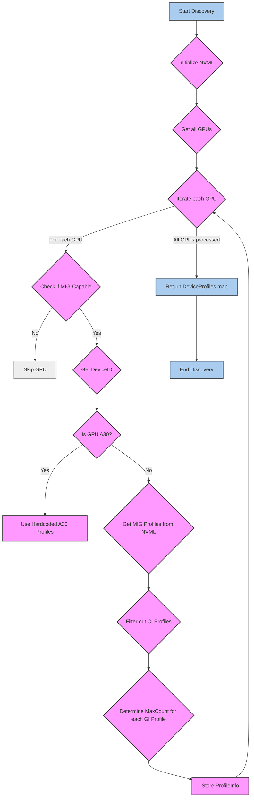

<!-- source: DeepWiki mcp.deepwiki.com · repo NVIDIA/mig-parted · page 2.2 MIG Profile Types and Discovery · fetched 2026-10-26 -->

# MIG Profile Types and Discovery

<details>
<summary>Relevant source files</summary>

The following files were used as context for generating this wiki page:

- [api/spec/v1/helpers_test.go](api/spec/v1/helpers_test.go)
- [cmd/nvidia-mig-parted/generateconfig/generate_config.go](cmd/nvidia-mig-parted/generateconfig/generate_config.go)
- [cmd/nvidia-mig-parted/util/device.go](cmd/nvidia-mig-parted/util/device.go)
- [pkg/mig/builder/balanced.go](pkg/mig/builder/balanced.go)
- [pkg/mig/builder/balanced_test.go](pkg/mig/builder/balanced_test.go)
- [pkg/mig/builder/builder.go](pkg/mig/builder/builder.go)
- [pkg/mig/config/known_configs.go](pkg/mig/config/known_configs.go)
- [pkg/mig/discovery/discovery.go](pkg/mig/discovery/discovery.go)
- [pkg/mig/discovery/discovery_test.go](pkg/mig/discovery/discovery_test.go)
- [pkg/types/device.go](pkg/types/device.go)
- [pkg/types/device_test.go](pkg/types/device_test.go)
- [pkg/types/mig_config.go](pkg/types/mig_config.go)
- [pkg/types/mig_config_group.go](pkg/types/mig_config_group.go)
- [pkg/types/mig_profile.go](pkg/types/mig_profile.go)

</details>


This page details the core data structures used to represent NVIDIA Multi-Instance GPU (MIG) profiles and configurations within the `mig-parted` codebase. It also explains how these profiles are discovered from the underlying hardware and how a builder package automatically generates configuration files based on this discovery.

## MIG Profile Types

The `pkg/types` package defines several key types for representing MIG profiles and configurations.

### `MigProfile`

The `MigProfile` struct [pkg/types/mig_profile.go:29-31]() represents a specific MIG profile. It embeds `nvdev.MigProfileInfo` from `go-nvlib`, which contains detailed information about the profile, such as its GPU Instance (GI) and Compute Instance (CI) IDs, memory size, and attributes.

Examples of `MigProfile` string representations include:
*   `1g.5gb`: A GPU Instance with 1 GI slice and 5GB of memory.
*   `2g.10gb`: A GPU Instance with 2 GI slices and 10GB of memory.
*   `1c.2g.10gb`: A Compute Instance with 1 CI slice within a 2g GI, and 10GB of memory.
*   `1c.1g.5gb+me`: A Compute Instance with 1 CI slice within a 1g GI, 5GB of memory, and Media Extensions (`+me`) attribute.

The `pkg/types/mig_profile.go` file provides functions for working with `MigProfile` objects:
*   `NewMigProfile(giProfileID, ciProfileID, ciEngProfileID int, migMemorySizeMB, deviceMemorySizeBytes uint64)` [pkg/types/mig_profile.go:34-40](): Constructs a new `MigProfile` from raw profile information.
*   `AssertValidMigProfileFormat(profile string)` [pkg/types/mig_profile.go:43-45](): Checks if a string adheres to the expected MIG profile format.
*   `ParseMigProfile(profile string)` [pkg/types/mig_profile.go:48-54](): Converts a string representation into a `MigProfile` object.
*   `MustParseMigProfile(profile string)` [pkg/types/mig_profile.go:57-60](): Similar to `ParseMigProfile` but panics on error.
*   `HasAttribute(attr string)` [pkg/types/mig_profile.go:63-70](): Checks if the `MigProfile` has a specific attribute (e.g., `me` for Media Extensions).

Sources:
* [pkg/types/mig_profile.go:29-31]()
* [pkg/types/mig_profile.go:34-40]()
* [pkg/types/mig_profile.go:43-45]()
* [pkg/types/mig_profile.go:48-54]()
* [pkg/types/mig_profile.go:57-60]()
* [pkg/types/mig_profile.go:63-70]()

### `MigConfig`

The `MigConfig` type [pkg/types/mig_config.go:28]() is a `map[string]int` that represents a desired MIG configuration for a single GPU. The keys are string representations of `MigProfile`s, and the values are the counts of how many instances of that profile should be created.

Key functions for `MigConfig`:
*   `NewMigConfig(mps []*MigProfile)` [pkg/types/mig_config.go:31-37](): Creates a `MigConfig` from a slice of `MigProfile`s.
*   `AssertValidFormat()` [pkg/types/mig_config.go:40-59](): Validates the format of the `MigProfile` strings and their counts within the config.
*   `IsSubsetOf(config MigConfig)` [pkg/types/mig_config.go:62-72](): Checks if the current `MigConfig` is a subset of another.
*   `Contains(profile string)` [pkg/types/mig_config.go:75-80](): Checks if a specific profile exists in the config with a count greater than zero.
*   `Equals(config MigConfig)` [pkg/types/mig_config.go:83-96](): Compares two `MigConfig`s for equality.
*   `Flatten()` [pkg/types/mig_config.go:99-134](): Converts the `MigConfig` back into a slice of `MigProfile` objects, duplicating profiles according to their counts.

Sources:
* [pkg/types/mig_config.go:28]()
* [pkg/types/mig_config.go:31-37]()
* [pkg/types/mig_config.go:40-59]()
* [pkg/types/mig_config.go:62-72]()
* [pkg/types/mig_config.go:75-80]()
* [pkg/types/mig_config.go:83-96]()
* [pkg/types/mig_config.go:99-134]()

### `MigConfigGroup` and `MigConfigGroups`

The `MigConfigGroup` interface [pkg/types/mig_config_group.go:25-29]() defines methods for interacting with a logical collection of `MigConfig`s, typically representing all valid configurations for a specific GPU type.

The `MigConfigGroupBase` struct [pkg/types/mig_config_group.go:33-35]() provides a base implementation for `MigConfigGroup`, holding a slice of `MigConfig`s.

The `MigConfigGroups` type [pkg/types/mig_config_group.go:38]() is a map from `DeviceID` to `MigConfigGroup`, allowing the system to associate specific GPU hardware with its supported MIG configurations.

An example of a `MigConfigGroup` implementation is `a100_sxm4_40gb_MigConfigGroup` [pkg/mig/config/known_configs.go:62-64](), which defines the possible MIG configurations for an A100 SXM4 40GB GPU. This group is initialized with a set of predefined `MigProfile`s [pkg/mig/config/known_configs.go:127-163]() and then iterates through permutations to generate all valid `MigConfig`s [pkg/mig/config/known_configs.go:75-124]().

Sources:
* [pkg/types/mig_config_group.go:25-29]()
* [pkg/types/mig_config_group.go:33-35]()
* [pkg/types/mig_config_group.go:38]()
* [pkg/mig/config/known_configs.go:62-64]()
* [pkg/mig/config/known_configs.go:75-124]()
* [pkg/mig/config/known_configs.go:127-163]()

### `DeviceID`

The `DeviceID` struct [pkg/types/device.go:26-31]() uniquely identifies a GPU based on its PCI device, vendor, subsystem device, and subsystem vendor IDs.

Key functions for `DeviceID`:
*   `NewDeviceID(device, vendor uint16)` [pkg/types/device.go:34-39](): Creates a `DeviceID` from device and vendor IDs.
*   `NewDeviceIDWithSubsystem(device, vendor, subDevice, subVendor uint16)` [pkg/types/device.go:42-50](): Creates a `DeviceID` including subsystem information.
*   `NewDeviceIDFromPacked(packed uint32)` [pkg/types/device.go:53-58](): Creates a `DeviceID` from a combined 32-bit device+vendor value.
*   `NewDeviceIDFromString(str string)` [pkg/types/device.go:61-96](): Parses a string representation into a `DeviceID`.
*   `String()` [pkg/types/device.go:99-105](): Returns the string representation of a `DeviceID`.
*   `Matches(hardware DeviceID)` [pkg/types/device.go:124-137](): Checks if a `DeviceID` filter matches a hardware `DeviceID`.

Sources:
* [pkg/types/device.go:26-31]()
* [pkg/types/device.go:34-39]()
* [pkg/types/device.go:42-50]()
* [pkg/types/device.go:53-58]()
* [pkg/types/device.go:61-96]()
* [pkg/types/device.go:99-105]()
* [pkg/types/device.go:124-137]()

## MIG Profile Discovery

The `pkg/mig/discovery` package is responsible for identifying available MIG profiles on the system's GPUs.

### `DiscoverMIGProfiles()`

The `DiscoverMIGProfiles()` function [pkg/mig/discovery/discovery.go:92-107]() is the entry point for profile discovery. It initializes NVML (NVIDIA Management Library) and then uses an internal `discoverer` struct to iterate through all detected GPUs.

The discovery process involves:
1.  **NVML Initialization**: `util.NvmlInit(nvmllib)` [pkg/mig/discovery/discovery.go:94-97]() initializes the NVML library.
2.  **Device Iteration**: The `deviceLib.VisitDevices()` method [pkg/mig/discovery/discovery.go:114]() iterates over each GPU.
3.  **MIG Capability Check**: For each device, `dev.IsMigCapable()` [pkg/mig/discovery/discovery.go:120-123]() determines if it supports MIG. Non-MIG-capable devices are skipped.
4.  **A30 Special Handling**: Due to a known NVML bug, A30 GPUs (`deviceIDA30` [pkg/mig/discovery/discovery.go:37]()) have their profiles hardcoded via `getHardcodedA30Profiles()` [pkg/mig/discovery/discovery.go:75-87]().
5.  **Profile Retrieval**: For other MIG-capable devices, `dev.GetMigProfiles()` [pkg/mig/discovery/discovery.go:144-147]() retrieves the available MIG profiles.
6.  **Filtering Compute Instance (CI) Profiles**: The discovery process explicitly skips CI profiles (e.g., `1c.2g.10gb`) using `isCIProfile(profileInfo.C, profileInfo.G)` [pkg/mig/discovery/discovery.go:169-172](). This is because `mig-parted`'s "all-*" configurations typically provision full GPU Instances (GI) rather than sub-partitions.
7.  **Max Count Determination**: For each discovered GI profile, `nvmlDevice.GetGpuInstanceProfileInfo(profileInfo.GIProfileID)` [pkg/mig/discovery/discovery.go:175-181]() is used to determine the `MaxCount` (how many instances of that profile can be created on the GPU).
8.  **Result Aggregation**: The discovered profiles, along with their `MaxCount` and `DeviceID`, are stored in a `DeviceProfiles` map [pkg/mig/discovery/discovery.go:50]().

The `ProfileInfo` struct [pkg/mig/discovery/discovery.go:41-46]() encapsulates the discovered profile's name, maximum instance count, `DeviceID`, and the underlying `nvdev.MigProfile` object.


**Diagram: MIG Profile Discovery Flow**

Sources:
* [pkg/mig/discovery/discovery.go:37]()
* [pkg/mig/discovery/discovery.go:41-46]()
* [pkg/mig/discovery/discovery.go:50]()
* [pkg/mig/discovery/discovery.go:75-87]()
* [pkg/mig/discovery/discovery.go:92-107]()
* [pkg/mig/discovery/discovery.go:114]()
* [pkg/mig/discovery/discovery.go:120-123]()
* [pkg/mig/discovery/discovery.go:144-147]()
* [pkg/mig/discovery/discovery.go:169-172]()
* [pkg/mig/discovery/discovery.go:175-181]()

## Auto-Generation of Configurations with `pkg/mig/builder`

The `pkg/mig/builder` package uses the discovered MIG profiles to automatically generate a `v1.Spec` configuration, which can then be output in YAML or JSON format. This is primarily used by the `nvidia-mig-parted generate-config` command [cmd/nvidia-mig-parted/generateconfig/generate_config.go:52-55]().

### `GenerateConfigSpec()`

The `GenerateConfigSpec()` function [pkg/mig/builder/builder.go:148-153]() orchestrates the generation of the `v1.Spec`.
1.  It first calls `discovery.DiscoverMIGProfiles()` [pkg/mig/builder/builder.go:149]() to get the `DeviceProfiles` from the system.
2.  Then, it passes these discovered profiles to `buildMigConfigSpec()` [pkg/mig/builder/builder.go:43-145]() to construct the `v1.Spec`.

### `buildMigConfigSpec()`

This internal function [pkg/mig/builder/builder.go:43-145]() takes the `DeviceProfiles` and performs the following steps:
1.  **Group Profiles**: It groups the discovered `ProfileInfo` by their `Name` across all devices, and also tracks all unique `DeviceID`s [pkg/mig/builder/builder.go:49-61]().
2.  **Add Base Configurations**: It adds standard configurations:
    *   `all-disabled`: Disables MIG on all devices.
    *   `all-enabled`: Enables MIG on all devices without creating any MIG devices.
    *   `all-balanced`: Generates a balanced MIG configuration (details in `pkg/mig/builder/balanced.go`).
    [pkg/mig/builder/builder.go:64-83]()
3.  **Generate Per-Profile Configurations**: For each unique MIG profile name discovered (e.g., `1g.5gb`):
    *   It groups devices by the `MaxCount` supported for that specific profile [pkg/mig/builder/builder.go:92-96]().
    *   It normalizes the profile name (e.g., `1g.5gb+me` becomes `1g.5gb.me`) using `normalizeProfileName()` [pkg/mig/builder/builder.go:37-39]().
    *   For each unique `MaxCount` group, it creates a `MigConfigSpec` [pkg/mig/builder/builder.go:111-116]() that sets `MigEnabled: true` and `MigDevices` to create `MaxCount` instances of that profile.
    *   If multiple GPU types are present (heterogeneous system), a `DeviceFilter` is added to the `MigConfigSpec` to target only the relevant devices [pkg/mig/builder/builder.go:119-130]().
    *   These `MigConfigSpec`s are collected into a `MigConfigSpecSlice` and assigned to a configuration name like `all-1g.5gb` [pkg/mig/builder/builder.go:102-139]().
4.  **Return `v1.Spec`**: Finally, it constructs and returns a `migspec.Spec` object [pkg/mig/builder/builder.go:141-144]() containing all generated configurations.

### Output Functions

The `pkg/mig/builder` package also provides functions to output the generated `v1.Spec` in different formats:
*   `GenerateConfigYAML()` [pkg/mig/builder/builder.go:156-169](): Generates the configuration as YAML bytes.
*   `GenerateConfigJSON()` [pkg/mig/builder/builder.go:172-185](): Generates the configuration as JSON bytes.

```mermaid
graph TD
    A[Start `GenerateConfigSpec()`] --> B{Call `discovery.DiscoverMIGProfiles()`};
    B --> C{Receive `DeviceProfiles`};
    C --> D{Call `buildMigConfigSpec(DeviceProfiles)`};

    subgraph buildMigConfigSpec
        D --> E[Initialize `v1.Spec` with base configs];
        E --> F{Group `ProfileInfo` by Name and `DeviceID`};
        F --> G{Add "all-disabled" config};
        G --> H{Add "all-enabled" config};
        H --> I{Add "all-balanced" config};
        I --> J{Iterate unique MIG Profile Names};
        J -- For each Profile Name --> K{Group devices by `MaxCount` for this profile};
        K --> L{Normalize Profile Name (e.g., 1g.5gb+me -> 1g.5gb.me)};
        L --> M{Create `MigConfigSpec` for each `MaxCount` group};
        M -- If heterogeneous system --> N{Add `DeviceFilter` to `MigConfigSpec`};
        N --> O[Add `MigConfigSpec` to `v1.Spec` under "all-<profile-name>"];
        O --> J;
        J -- All profiles processed --> P[Return populated `v1.Spec`];
    end

    P --> Q[Return `v1.Spec` from `GenerateConfigSpec()`];
    Q --> R{Call `GenerateConfigYAML()` or `GenerateConfigJSON()`};
    R -- YAML --> S[Marshal `v1.Spec` to YAML];
    R -- JSON --> T[Marshal `v1.Spec` to JSON];
    S --> U[Return YAML bytes];
    T --> U;
    U --> V[End];
```
**Diagram: Configuration Auto-Generation Flow**

Sources:
* [cmd/nvidia-mig-parted/generateconfig/generate_config.go:52-55]()
* [pkg/mig/builder/builder.go:37-39]()
* [pkg/mig/builder/builder.go:43-145]()
* [pkg/mig/builder/builder.go:49-61]()
* [pkg/mig/builder/builder.go:64-83]()
* [pkg/mig/builder/builder.go:92-96]()
* [pkg/mig/builder/builder.go:102-139]()
* [pkg/mig/builder/builder.go:111-116]()
* [pkg/mig/builder/builder.go:119-130]()
* [pkg/mig/builder/builder.go:141-144]()
* [pkg/mig/builder/builder.go:148-153]()
* [pkg/mig/builder/builder.go:149]()
* [pkg/mig/builder/builder.go:156-169]()
* [pkg/mig/builder/builder.go:172-185]()

---

