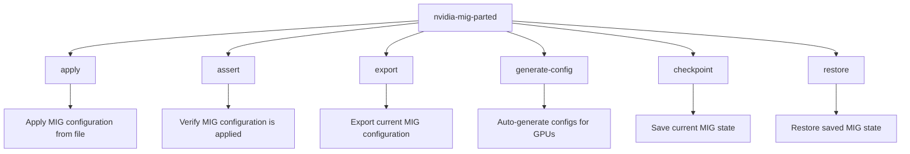
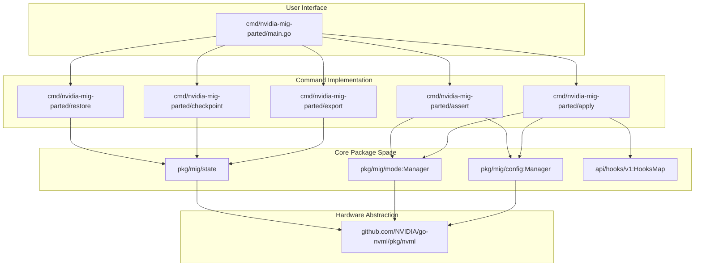

<!-- source: DeepWiki mcp.deepwiki.com · repo NVIDIA/mig-parted · page 3 nvidia-mig-parted CLI · fetched 2026-10-26 -->

# nvidia-mig-parted CLI

Relevant source files

The following files were used as context for generating this wiki page:

- [cmd/nvidia-mig-parted/apply/apply.go](cmd/nvidia-mig-parted/apply/apply.go)
- [cmd/nvidia-mig-parted/assert/assert.go](cmd/nvidia-mig-parted/assert/assert.go)
- [cmd/nvidia-mig-parted/export/export.go](cmd/nvidia-mig-parted/export/export.go)
- [cmd/nvidia-mig-parted/export/export_test.go](cmd/nvidia-mig-parted/export/export_test.go)
- [cmd/nvidia-mig-parted/main.go](cmd/nvidia-mig-parted/main.go)
- [cmd/nvidia-mig-parted/util/mig.go](cmd/nvidia-mig-parted/util/mig.go)
- [cmd/nvidia-mig-parted/util/nvml.go](cmd/nvidia-mig-parted/util/nvml.go)
- [cmd/nvidia-mig-parted/util/util.go](cmd/nvidia-mig-parted/util/util.go)
- [hack/benchmark-perf.sh](hack/benchmark-perf.sh)

The `nvidia-mig-parted` CLI is a technical command-line tool designed to manage Multi-Instance GPU (MIG) configurations across all NVIDIA GPUs on a node. It provides commands for applying, verifying, exporting, saving, and restoring MIG configurations on NVIDIA GPUs that support MIG technology.

This page documents the CLI tool, its commands, options, and usage patterns. For information about the systemd service integration, see [Systemd Integration](#4), and for information about Kubernetes integration, see [Kubernetes Integration](#5).

## CLI Architecture

The CLI is built using the `urfave/cli/v3` framework [cmd/nvidia-mig-parted/main.go:24](). It follows a command/subcommand structure where each operation is encapsulated in a dedicated package.

### Command Structure Diagram

Sources: [cmd/nvidia-mig-parted/main.go:62-71]()

### Core Components and Interactions

The CLI serves as a wrapper around several core managers defined in `pkg/mig`.

Sources: [cmd/nvidia-mig-parted/main.go:26-32](), [cmd/nvidia-mig-parted/util/mig.go:28-66](), [cmd/nvidia-mig-parted/apply/apply.go:54-60]()

## Global Options

The CLI provides global options that apply to all commands:

| Option | Aliases | Description | Environment Variable |
|--------|---------|-------------|----------------------|
| `--debug` | `-d` | Enable debug-level logging | `MIG_PARTED_DEBUG` |

Sources: [cmd/nvidia-mig-parted/main.go:52-61]()

## Commands

Detailed documentation for each command is available on their respective child pages.

### apply Command
The `apply` command is the primary entry point for modifying GPU state. It compares the desired configuration against the current hardware state and performs the minimum set of operations (mode changes, resets, and device creation) to reach the target state.

For details, see [apply Command](#3.1).
Sources: [cmd/nvidia-mig-parted/apply/apply.go:68-73]()

### assert Command
The `assert` command is a non-destructive verification tool. It is frequently used by the `nvidia-mig-manager` service to determine if a re-configuration is necessary. It returns a non-zero exit code if the current hardware state does not match the provided specification.

For details, see [assert Command](#3.2).
Sources: [cmd/nvidia-mig-parted/assert/assert.go:64-69]()

### export Command
The `export` command inspects the current MIG state of all GPUs and generates a configuration file in YAML or JSON format that represents that state. This is useful for capturing a "known good" state from a manually configured machine.

For details, see [export Command](#3.3).
Sources: [cmd/nvidia-mig-parted/export/export.go:64-69]()

### checkpoint and restore Commands
These commands allow for low-level state persistence. `checkpoint` saves the exact instance IDs and configuration details to a JSON file, while `restore` attempts to recreate that exact state. This is typically used for maintaining state across driver reloads or system reboots.

For details, see [checkpoint and restore Commands](#3.4).
Sources: [cmd/nvidia-mig-parted/main.go:69-70]()

## Internal Logic & Utilities

### NVML Initialization
The CLI handles NVML lifecycle through utility functions in `cmd/nvidia-mig-parted/util/nvml.go`. It checks for the `nvidia` kernel module [cmd/nvidia-mig-parted/util/nvml.go:34-46]() and ensures the NVML version is at least 11 [cmd/nvidia-mig-parted/util/nvml.go:30-32]().

### Manager Selection
The tool dynamically selects the appropriate manager implementation based on the system state. If the NVIDIA kernel module is not loaded, it falls back to a PCI-based `mode.Manager` to enable MIG mode before NVML can be initialized [cmd/nvidia-mig-parted/util/mig.go:28-46]().

### Configuration Selection
When multiple configurations are present in a single file, the CLI uses `GetSelectedMigConfig` to resolve which specific `MigConfigSpecSlice` to use based on the `--selected-config` flag [cmd/nvidia-mig-parted/assert/assert.go:197-213]().

## Usage Patterns

The following table summarizes common CLI usage patterns:

| Goal | Command | Key Flags |
|------|---------|-----------|
| **Apply Config** | `apply` | `-f <file> -c <label>` |
| **Check Config** | `assert` | `-f <file> -c <label>` |
| **Dry Run Config** | `assert` | `--valid-config -f <file>` |
| **Save State** | `checkpoint` | `-f checkpoint.json` |
| **Generate Spec** | `export` | `-o yaml` |

Sources: [cmd/nvidia-mig-parted/apply/apply.go:76-112](), [cmd/nvidia-mig-parted/assert/assert.go:72-101](), [cmd/nvidia-mig-parted/export/export.go:72-89]()

---

