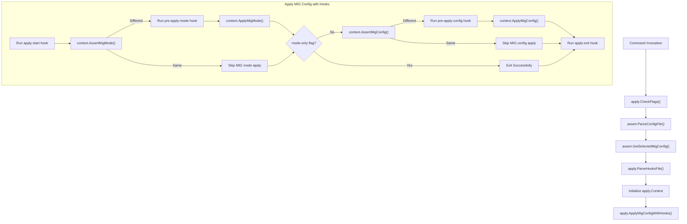
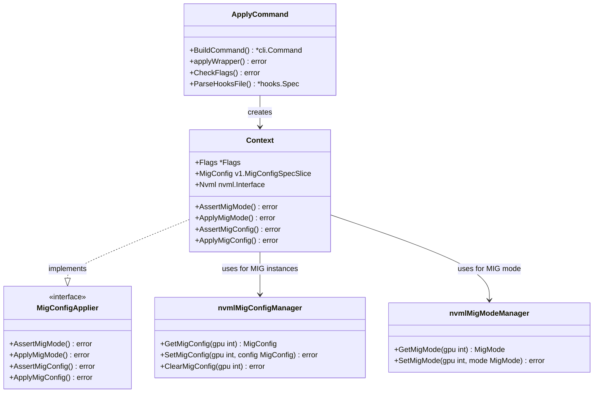

<!-- source: DeepWiki mcp.deepwiki.com · repo NVIDIA/mig-parted · page 3.1 apply Command · fetched 2026-10-26 -->

# apply Command

<details>
<summary>Relevant source files</summary>

The following files were used as context for generating this wiki page:

- [cmd/nvidia-mig-parted/apply/apply.go](cmd/nvidia-mig-parted/apply/apply.go)
- [cmd/nvidia-mig-parted/apply/config.go](cmd/nvidia-mig-parted/apply/config.go)
- [cmd/nvidia-mig-parted/apply/mode.go](cmd/nvidia-mig-parted/apply/mode.go)
- [cmd/nvidia-mig-parted/assert/assert.go](cmd/nvidia-mig-parted/assert/assert.go)
- [cmd/nvidia-mig-parted/assert/config.go](cmd/nvidia-mig-parted/assert/config.go)
- [cmd/nvidia-mig-parted/assert/mode.go](cmd/nvidia-mig-parted/assert/mode.go)
- [cmd/nvidia-mig-parted/export/config.go](cmd/nvidia-mig-parted/export/config.go)
- [cmd/nvidia-mig-parted/export/export.go](cmd/nvidia-mig-parted/export/export.go)
- [cmd/nvidia-mig-parted/export/export_test.go](cmd/nvidia-mig-parted/export/export_test.go)
- [cmd/nvidia-mig-parted/main.go](cmd/nvidia-mig-parted/main.go)
- [pkg/mig/config/config.go](pkg/mig/config/config.go)
- [pkg/mig/config/config_test.go](pkg/mig/config/config_test.go)
- [pkg/mig/mode/nvml.go](pkg/mig/mode/nvml.go)
- [pkg/mig/mode/nvml_test.go](pkg/mig/mode/nvml_test.go)

</details>


The `apply` command in `nvidia-mig-parted` is the primary tool for configuring MIG (Multi-Instance GPU) on NVIDIA GPUs. It enables applying a specific MIG configuration from a configuration file to one or more GPUs in the system. This command handles both MIG mode changes (enabling/disabling MIG functionality) and detailed MIG device configuration (creating specific MIG instances).

For information on checking configurations without applying them, see the [assert Command](#3.2).

Sources: [cmd/nvidia-mig-parted/apply/apply.go:68-71]()

## Command Syntax and Options

The basic syntax for the apply command is:

```bash
nvidia-mig-parted apply [options]
```

### Required Flags

- `--config-file, -f`: Path to the configuration file containing MIG configurations. This file defines the MIG profiles you want to apply. [cmd/nvidia-mig-parted/apply/apply.go:77-83]()

### Optional Flags

- `--selected-config, -c`: The label of the specific MIG configuration from the config file to apply. Required if multiple configurations are present in the file. [cmd/nvidia-mig-parted/apply/apply.go:84-90]()
- `--hooks-file, -k`: Path to a YAML file containing hooks to be executed at different stages of the apply process. [cmd/nvidia-mig-parted/apply/apply.go:91-97]()
- `--skip-reset, -s`: Skip the GPU reset operation after applying the desired MIG mode to all GPUs. Useful when you want to avoid the downtime associated with a GPU reset. [cmd/nvidia-mig-parted/apply/apply.go:98-104]()
- `--mode-only, -m`: Only change the MIG enabled setting from the config, without configuring any MIG devices. [cmd/nvidia-mig-parted/apply/apply.go:105-111]()

All these flags can also be set using equivalent environment variables (e.g., `MIG_PARTED_CONFIG_FILE` for `--config-file`).

Sources: [cmd/nvidia-mig-parted/apply/apply.go:76-112]()

## Architecture and Workflow

The apply command follows a carefully structured workflow to ensure safe and consistent application of MIG configurations.

### Command Execution Flow



Sources: [cmd/nvidia-mig-parted/apply/apply.go:185-232](), [cmd/nvidia-mig-parted/apply/apply.go:234-292]()

### Component Interaction

The `apply` package leverages the `assert` package for configuration parsing and state verification, while using `pkg/mig/config` and `pkg/mig/mode` for low-level hardware interaction.



Sources: [cmd/nvidia-mig-parted/apply/apply.go:42-60](), [pkg/mig/config/config.go:32-41](), [pkg/mig/mode/nvml.go:25-27]()

## Implementation Details

### Internal Flow through pkg/mig/config

When `ApplyMigConfig()` is called, it utilizes the `nvmlMigConfigManager` to modify hardware state. The `SetMigConfig` function in `pkg/mig/config/config.go` performs the following steps:

1.  **Device Resolution**: Resolves logical MIG profiles (e.g., `1g.5gb`) to specific NVML GI/CI profile IDs for the target GPU using `resolveMigProfileOnDevice` [pkg/mig/config/config.go:48-57]().
2.  **State Clearing**: Before applying a new configuration, it calls `ClearMigConfig` to remove existing GPU instances [pkg/mig/config/config.go:142-145]().
3.  **Permutation Iteration**: Uses `iteratePermutationsUntilSuccess` to attempt different creation orders of MIG instances, as hardware placement constraints can sometimes cause specific orderings to fail [pkg/mig/config/config.go:125-208]().
4.  **Instance Creation**: Calls `device.CreateGpuInstance` and `gi.CreateComputeInstance` for each profile in the configuration [pkg/mig/config/config.go:167-182]().

### Internal Flow through pkg/mig/mode

The `ApplyMigMode()` function handles the enabling or disabling of MIG at the driver level:

1.  **Capability Check**: Verifies if the GPU supports MIG using `modeManager.IsMigCapable()` [cmd/nvidia-mig-parted/apply/mode.go:62-66]().
2.  **Mode Transition**: Calls `modeManager.SetMigMode()` to update the `DEVICE_MIG_ENABLE` or `DEVICE_MIG_DISABLE` status [cmd/nvidia-mig-parted/apply/mode.go:97-100]().
3.  **Pending Changes**: Checks if the change requires a GPU reset via `modeManager.IsMigModeChangePending()` [cmd/nvidia-mig-parted/apply/mode.go:102-106]().
4.  **GPU Reset**: If changes are pending and `--skip-reset` is not set, it invokes `util.ResetAllGPUs()` which typically triggers a `nvidia-smi -r` or equivalent operation [cmd/nvidia-mig-parted/apply/mode.go:119-132]().

Sources: [pkg/mig/config/config.go:101-218](), [cmd/nvidia-mig-parted/apply/mode.go:30-133](), [pkg/mig/mode/nvml.go:73-92]()

## Hooks Integration

The apply command integrates with a hooks system defined in `api/hooks/v1`. Environment variables from the CLI are mapped to the hooks environment via `GetHooksEnvsMap` [cmd/nvidia-mig-parted/apply/apply.go:143-164]().

### Hooks Execution Order
1.  **apply-start**: Executed at the beginning of the apply process.
2.  **pre-apply-mode**: Executed only if a MIG mode change is required.
3.  **pre-apply-config**: Executed only if MIG instance changes are required.
4.  **apply-exit**: Executed at the end, regardless of success or failure.

Sources: [cmd/nvidia-mig-parted/apply/apply.go:234-292]()

## Using the apply Command

### Basic Usage Example
```bash
nvidia-mig-parted apply --config-file /etc/nvidia/mig-parted/config.yaml --selected-config all-1g.5gb
```

### Mode-Only Changes
To only change the MIG mode (enable/disable) without configuring MIG instances:
```bash
nvidia-mig-parted apply -f config.yaml -c all-enabled --mode-only
```

### Skipping Reset
To avoid GPU reset after MIG mode changes:
```bash
nvidia-mig-parted apply -f config.yaml -c all-enabled --skip-reset
```

Sources: [cmd/nvidia-mig-parted/apply/apply.go:76-112]()

---

