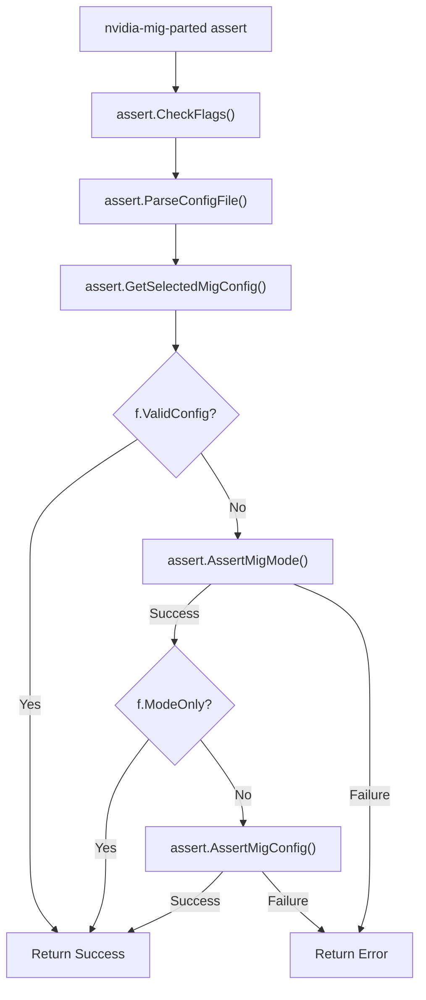
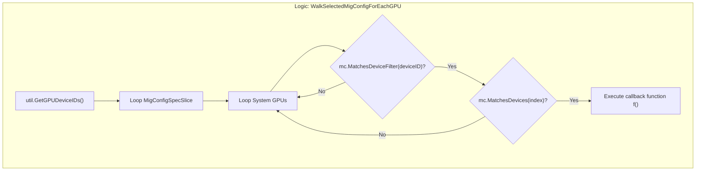

<!-- source: DeepWiki mcp.deepwiki.com · repo NVIDIA/mig-parted · page 3.2 assert Command · fetched 2026-10-26 -->

# assert Command

<details>
<summary>Relevant source files</summary>

The following files were used as context for generating this wiki page:

- [cmd/nvidia-mig-parted/apply/apply.go](cmd/nvidia-mig-parted/apply/apply.go)
- [cmd/nvidia-mig-parted/apply/config.go](cmd/nvidia-mig-parted/apply/config.go)
- [cmd/nvidia-mig-parted/apply/mode.go](cmd/nvidia-mig-parted/apply/mode.go)
- [cmd/nvidia-mig-parted/assert/assert.go](cmd/nvidia-mig-parted/assert/assert.go)
- [cmd/nvidia-mig-parted/assert/config.go](cmd/nvidia-mig-parted/assert/config.go)
- [cmd/nvidia-mig-parted/assert/mode.go](cmd/nvidia-mig-parted/assert/mode.go)
- [cmd/nvidia-mig-parted/export/config.go](cmd/nvidia-mig-parted/export/config.go)
- [cmd/nvidia-mig-parted/export/export.go](cmd/nvidia-mig-parted/export/export.go)
- [cmd/nvidia-mig-parted/export/export_test.go](cmd/nvidia-mig-parted/export/export_test.go)
- [cmd/nvidia-mig-parted/main.go](cmd/nvidia-mig-parted/main.go)

</details>


The `assert` command is a verification tool within the `nvidia-mig-parted` CLI that allows users to validate whether a specific Multi-Instance GPU (MIG) configuration is currently applied to the node. Unlike the [apply Command](#3.1), which modifies the system, the `assert` command performs non-destructive validation.

## Command Overview

The command flow is managed by `assertWrapper`, which orchestrates the parsing of the configuration and the subsequent calls to the mode and configuration assertion functions.

### Execution Flow

Sources: [cmd/nvidia-mig-parted/assert/assert.go:106-158]()

## Command Usage

The `assert` command verifies that a specific MIG configuration from a config file is currently applied to the system's GPUs.

### Available Flags

| Flag | Alias | Description | Environment Variable |
|------|-------|-------------|---------------------|
| `--config-file` | `-f` | Path to the configuration file (use `-` for stdin) | `MIG_PARTED_CONFIG_FILE` |
| `--selected-config` | `-c` | The label of the `mig-config` from the file to assert | `MIG_PARTED_SELECTED_CONFIG` |
| `--mode-only` | `-m` | Only assert MIG mode settings, not device configuration | `MIG_PARTED_MODE_CHANGE_ONLY` |
| `--valid-config` | `-a` | Only validate that the config file is valid and selection exists | `MIG_PARTED_VALID_CONFIG` |

Sources: [cmd/nvidia-mig-parted/assert/assert.go:72-101]()

## Implementation Details

### Data Structures
The command uses a `Context` struct to pass state, including the parsed configuration and the `nvml.Interface`.

```go
type Context struct {
	*cli.Command
	Flags     *Flags
	MigConfig v1.MigConfigSpecSlice
	Nvml      nvml.Interface
}
```
Sources: [cmd/nvidia-mig-parted/assert/assert.go:52-57]()

### GPU Iteration Logic
The core of the assertion logic relies on `WalkSelectedMigConfigForEachGPU`. This function iterates through the `MigConfigSpecSlice` and matches them against the physical GPUs on the node using `DeviceFilter` and `Devices` index lists.


Sources: [cmd/nvidia-mig-parted/assert/assert.go:215-248]()

### AssertMigMode
Defined in `cmd/nvidia-mig-parted/assert/mode.go`, this function verifies the MIG enablement status.
- It initializes NVML via `util.NvmlInit` if the NVIDIA driver module is loaded [cmd/nvidia-mig-parted/assert/mode.go:29-40]().
- It uses a `MigModeManager` to check `IsMigCapable` and `GetMigMode` for each GPU [cmd/nvidia-mig-parted/assert/mode.go:42-68]().
- If a GPU is not MIG-capable but the config requires `MigEnabled: true`, the assertion fails [cmd/nvidia-mig-parted/assert/mode.go:60-62]().

### AssertMigConfig
Defined in `cmd/nvidia-mig-parted/assert/config.go`, this function verifies the specific MIG device partitions.
- It retrieves the current MIG configuration using `configManager.GetMigConfig(i)` [cmd/nvidia-mig-parted/assert/config.go:72-75]().
- It compares the current state to the desired state using the `Equals` method on the `types.MigConfig` object [cmd/nvidia-mig-parted/assert/config.go:79-82]().
- It tracks matches in a boolean slice and fails if the number of matches does not equal the total number of GPUs [cmd/nvidia-mig-parted/assert/config.go:92-94]().

## Integration with Manager
The `apply` command directly consumes these assertion functions to determine if a system is already in the desired state before attempting changes. The `Context` in the `apply` package embeds the `assert.Context` to facilitate this reuse.

```go
func (c *Context) AssertMigMode() error {
	return assert.AssertMigMode(&c.Context)
}

func (c *Context) AssertMigConfig() error {
	return assert.AssertMigConfig(&c.Context)
}
```
Sources: [cmd/nvidia-mig-parted/apply/apply.go:49-52](), [cmd/nvidia-mig-parted/apply/apply.go:168-181]()

## Exit Codes and Output
- **Success (Match)**: Prints "Selected MIG configuration currently applied" and returns exit code 0 [cmd/nvidia-mig-parted/assert/assert.go:156-157]().
- **Failure (Mismatch)**: Returns `fmt.Errorf("assertion failure: selected configuration not currently applied")` which results in a non-zero exit code [cmd/nvidia-mig-parted/assert/assert.go:141-153]().
- **Validation Only**: If `--valid-config` is used, it prints "Selected MIG configuration is valid" without checking hardware [cmd/nvidia-mig-parted/assert/assert.go:125-128]().

Sources:
- [cmd/nvidia-mig-parted/assert/assert.go]()
- [cmd/nvidia-mig-parted/assert/mode.go]()
- [cmd/nvidia-mig-parted/assert/config.go]()
- [cmd/nvidia-mig-parted/apply/apply.go]()

---

