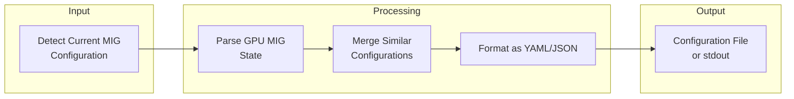
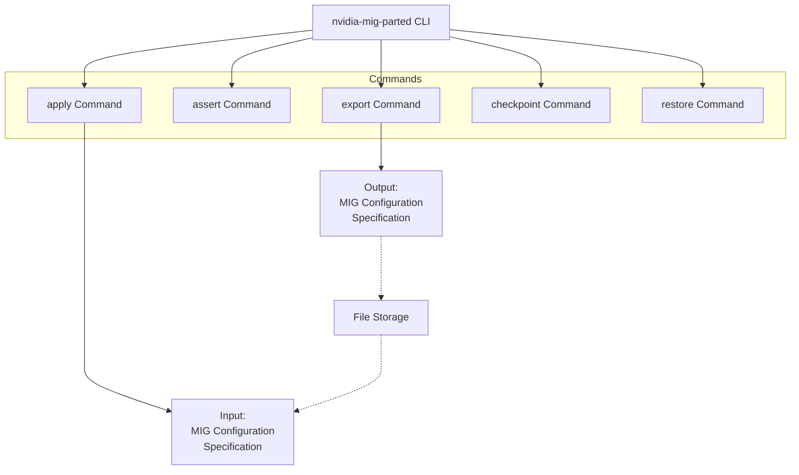

<!-- source: DeepWiki mcp.deepwiki.com · repo NVIDIA/mig-parted · page 3.3 export Command · fetched 2026-10-26 -->

# export Command

<details>
<summary>Relevant source files</summary>

The following files were used as context for generating this wiki page:

- [cmd/nvidia-mig-parted/apply/apply.go](cmd/nvidia-mig-parted/apply/apply.go)
- [cmd/nvidia-mig-parted/apply/config.go](cmd/nvidia-mig-parted/apply/config.go)
- [cmd/nvidia-mig-parted/apply/mode.go](cmd/nvidia-mig-parted/apply/mode.go)
- [cmd/nvidia-mig-parted/assert/assert.go](cmd/nvidia-mig-parted/assert/assert.go)
- [cmd/nvidia-mig-parted/assert/config.go](cmd/nvidia-mig-parted/assert/config.go)
- [cmd/nvidia-mig-parted/assert/mode.go](cmd/nvidia-mig-parted/assert/mode.go)
- [cmd/nvidia-mig-parted/export/config.go](cmd/nvidia-mig-parted/export/config.go)
- [cmd/nvidia-mig-parted/export/export.go](cmd/nvidia-mig-parted/export/export.go)
- [cmd/nvidia-mig-parted/export/export_test.go](cmd/nvidia-mig-parted/export/export_test.go)
- [cmd/nvidia-mig-parted/main.go](cmd/nvidia-mig-parted/main.go)

</details>


The `export` command in nvidia-mig-parted allows you to export the current MIG configuration from all NVIDIA GPUs in a format compatible with the configuration specification used by the `apply` command. This enables capturing existing MIG configurations for documentation, version control, or future reapplication. For saving and restoring the complete MIG state (including device details), see the [checkpoint and restore Commands](#3.4).

## Overview



Sources: [cmd/nvidia-mig-parted/export/export.go:65-91](), [cmd/nvidia-mig-parted/export/export.go:106-116]()

The export command queries the current MIG configuration of all available GPUs, consolidates similar configurations, and outputs a formatted configuration specification that can be saved to a file or redirected to other commands.

## Command Options

The `export` command supports the following flags:

| Flag | Alias | Description | Default | Environment Variable |
|------|-------|-------------|---------|---------------------|
| `--output-format` | `-o` | Format for the output (`json` or `yaml`) | `yaml` | `MIG_PARTED_OUTPUT_FORMAT` |
| `--config-label` | `-l` | Label to apply to the exported configuration | `current` | `MIG_PARTED_CONFIG_LABEL` |

Sources: [cmd/nvidia-mig-parted/export/export.go:72-87]()

## Integration with nvidia-mig-parted

The export command is one of the core commands in the nvidia-mig-parted CLI tool:



Sources: [cmd/nvidia-mig-parted/main.go:62-68]()

## Implementation Details

The `export` command's core logic resides in the `exportWrapper` function [cmd/nvidia-mig-parted/export/export.go:94-118](), which orchestrates the process of fetching, processing, and outputting the MIG configuration.

```mermaid
graph TD
    A[User executes 'nvidia-mig-parted export'] --> B{exportWrapper(c, f)};
    B --> C{CheckFlags(f)};
    C -- Error --> D[Show subcommand help & return error];
    C -- Success --> E[Create Context struct];
    E --> F{ExportMigConfigs(&context)};
    F -- Error --> G[Return error];
    F -- Success --> H{WriteOutput(os.Stdout, spec, f)};
    H -- Error --> I[Return error];
    H -- Success --> J[Return nil];

    subgraph "ExportMigConfigs(&context)"
        F1[NvmlInit(c.Nvml)] --> F2[GetGPUDeviceIDs()];
        F2 --> F3[NewMigModeManager(c.Nvml)];
        F3 --> F4[NewMigConfigManager(c.Nvml)];
        F4 --> F5{Loop through each GPU};
        F5 --> F6[IsMigCapable(i)];
        F6 --> F7[GetMigMode(i)];
        F7 --> F8[GetMigConfig(i)];
        F8 --> F9[Create v1.MigConfigSpec for GPU];
        F9 --> F10[Collect all MigConfigSpecs];
        F10 --> F11[mergeMigConfigSpecs(configSpecs)];
        F11 --> F12[Return v1.Spec];
    end

    subgraph "WriteOutput(w, spec, f)"
        H1{Switch on f.OutputFormat};
        H1 -- YAMLFormat --> H2[yaml.Marshal(spec)];
        H1 -- JSONFormat --> H3[json.MarshalIndent(spec)];
        H2 --> H4[w.Write(output)];
        H3 --> H4;
        H4 -- Error --> H5[Return error];
        H4 -- Success --> H6[Return nil];
    end
```
**Title: `export` Command Execution Flow**
Sources: [cmd/nvidia-mig-parted/export/export.go:94-118](), [cmd/nvidia-mig-parted/export/config.go:29-92](), [cmd/nvidia-mig-parted/export/export.go:130-149]()

The command performs the following operations:

1.  **Flag Validation**: `CheckFlags` [cmd/nvidia-mig-parted/export/export.go:120-128]() validates the provided command-line flags, specifically ensuring that the `--output-format` is either `json` or `yaml`.
2.  **NVML Initialization**: `util.NvmlInit(c.Nvml)` [cmd/nvidia-mig-parted/export/config.go:30-33]() initializes the NVIDIA Management Library (NVML) to interact with the GPUs. A deferred `util.TryNvmlShutdown(c.Nvml)` [cmd/nvidia-mig-parted/export/config.go:34]() ensures NVML is properly shut down.
3.  **GPU Enumeration**: `util.GetGPUDeviceIDs()` [cmd/nvidia-mig-parted/export/config.go:36-39]() retrieves a list of all GPU device IDs on the system.
4.  **MIG Mode and Config Managers**: `util.NewMigModeManager(c.Nvml)` [cmd/nvidia-mig-parted/export/config.go:41-44]() and `util.NewMigConfigManager(c.Nvml)` [cmd/nvidia-mig-parted/export/config.go:46-49]() are created to query MIG mode and configuration states.
5.  **Per-GPU Configuration Export**: The code iterates through each detected GPU [cmd/nvidia-mig-parted/export/config.go:51-83]():
    *   It determines the `deviceFilter` by stripping any subsystem qualifiers from the GPU's primary device ID string [cmd/nvidia-mig-parted/export/config.go:53-54]().
    *   It checks if the GPU is MIG-capable using `modeManager.IsMigCapable(i)` [cmd/nvidia-mig-parted/export/config.go:57-60]().
    *   If MIG-capable, it gets the current MIG mode (`mode.Enabled` or `mode.Disabled`) using `modeManager.GetMigMode(i)` [cmd/nvidia-mig-parted/export/config.go:61-66]().
    *   If MIG is enabled, it fetches the current MIG device configuration using `configManager.GetMigConfig(i)` [cmd/nvidia-mig-parted/export/config.go:69-74]().
    *   A `v1.MigConfigSpec` [api/spec/v1/types.go:30-36]() is constructed for each GPU, capturing its `DeviceFilter`, `Devices` (its index), `MigEnabled` state, and `MigDevices` (the MIG profiles configured).
6.  **Configuration Merging**: After collecting individual `v1.MigConfigSpec` entries for all GPUs, `mergeMigConfigSpecs(configSpecs)` [cmd/nvidia-mig-parted/export/config.go:88]() is called. This function optimizes the output by grouping identical configurations across multiple GPUs into a more compact representation.
7.  **Output Formatting**: `WriteOutput(os.Stdout, spec, f)` [cmd/nvidia-mig-parted/export/export.go:130-149]() serializes the resulting `v1.Spec` [api/spec/v1/types.go:20-27]() into either YAML or JSON format based on the `--output-format` flag and writes it to standard output.

### Configuration Merging

The `mergeMigConfigSpecs` function [cmd/nvidia-mig-parted/export/config.go:95-168]() is crucial for producing a human-readable and concise output. It takes a `v1.MigConfigSpecSlice` (a slice of `MigConfigSpec` objects) and merges entries that share the same `MigEnabled` state and `MigDevices` configuration.

The merging process involves two main steps:
1.  **Initial Merge**: It iterates through the input `specs` and attempts to merge them into an existing entry in the `merged` slice if their `MigEnabled` and `MigDevices` are identical. If no match is found, a new entry is added to `merged`. During this step, `mergeAndSortIntSlices` [cmd/nvidia-mig-parted/export/config.go:170-185]() and `mergeAndSortStringSlices` [cmd/nvidia-mig-parted/export/config.go:187-202]() are used to combine the `Devices` (GPU indices) and `DeviceFilter` (GPU model strings) fields, respectively, ensuring uniqueness and sorting.
2.  **Post-Merge Optimization**: After the initial merge, it further optimizes the `DeviceFilter` and `Devices` fields:
    *   If all GPUs on the node have been grouped into a single `MigConfigSpec` and share the same configuration, the `DeviceFilter` is set to `nil` and `Devices` is set to the string `"all"` [cmd/nvidia-mig-parted/export/config.go:145-158]().
    *   If a `MigConfigSpec` applies to all devices of a specific `DeviceFilter` (e.g., all A100-SXM4-40GB GPUs), its `Devices` field is set to `"all"` [cmd/nvidia-mig-parted/export/config.go:152-158]().
    *   If there's only one final merged entry, its `DeviceFilter` is set to `nil` [cmd/nvidia-mig-parted/export/config.go:165-167]().

This logic ensures that the exported YAML/JSON is as compact as possible while accurately representing the current MIG configuration.

Sources: [cmd/nvidia-mig-parted/export/export_test.go:27-203]()

## Usage Examples

### Basic Export

To export the current MIG configuration in the default YAML format:

```bash
nvidia-mig-parted export
```

### Export in JSON Format

To export the configuration in JSON format:

```bash
nvidia-mig-parted export --output-format json
```

### Export with Custom Label

To export with a custom configuration label:

```bash
nvidia-mig-parted export --config-label "my-cluster-config"
```

### Save to File

To save the exported configuration to a file:

```bash
nvidia-mig-parted export > mig-config.yaml
```

### Pipeline with Apply

To export and immediately apply the same configuration:

```bash
nvidia-mig-parted export | nvidia-mig-parted apply --config-file -
```

## Output Example

An example output of the export command in YAML format:

```yaml
version: v1
mig-configs:
  current:
    - devices: all
      migEnabled: true
      gpuInstanceSlices: 1
      profile: 1g.5gb
```

## Related Commands

-   [apply Command](#3.1): Used to apply MIG configurations exported with this command
-   [assert Command](#3.2): Verifies if a specific MIG configuration is currently applied
-   [checkpoint and restore Commands](#3.4): For more comprehensive state management

Sources: [cmd/nvidia-mig-parted/main.go:62-68]()

## Considerations

-   The `export` command only exports the configuration - not the complete state including memory contents.
-   For more comprehensive state management including preservation of the exact device configurations, use the [checkpoint and restore Commands](#3.4).
-   The exported configuration can be used as input to the `apply` command, making it useful for replicating configurations across systems.

---

