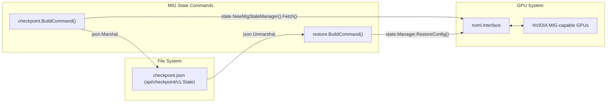
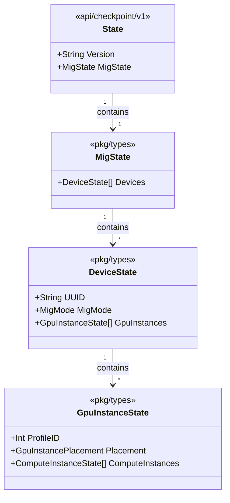

<!-- source: DeepWiki mcp.deepwiki.com · repo NVIDIA/mig-parted · page 3.4 checkpoint and restore Commands · fetched 2026-10-26 -->

# checkpoint and restore Commands

<details>
<summary>Relevant source files</summary>

The following files were used as context for generating this wiki page:

- [api/checkpoint/v1/state.go](api/checkpoint/v1/state.go)
- [api/hooks/v1/hooks.go](api/hooks/v1/hooks.go)
- [api/hooks/v1/hooks_test.go](api/hooks/v1/hooks_test.go)
- [cmd/nvidia-mig-parted/checkpoint/checkpoint.go](cmd/nvidia-mig-parted/checkpoint/checkpoint.go)
- [cmd/nvidia-mig-parted/restore/restore.go](cmd/nvidia-mig-parted/restore/restore.go)

</details>


The `checkpoint` and `restore` commands in NVIDIA MIG-Parted provide functionality for saving (checkpointing) the current MIG configuration state of all GPUs on a system and later restoring that state. These commands are particularly useful for system administrators who need to temporarily change MIG configurations but want to return to a previous known-good configuration later.

Unlike the `export` command which outputs a human-readable configuration, the `checkpoint` command creates a machine-readable state representation suitable for exact restoration of MIG configurations.

## Command Overview



Sources: [cmd/nvidia-mig-parted/checkpoint/checkpoint.go:46-52](), [cmd/nvidia-mig-parted/restore/restore.go:59-65](), [api/checkpoint/v1/state.go:27-30]()

## MIG State Structure

The MIG state captured by the checkpoint command represents the complete configuration of all MIG-capable GPUs on the system. The format is defined in `api/checkpoint/v1` and wraps the `MigState` type from the core `types` package.



Sources: [api/checkpoint/v1/state.go:24-30](), [pkg/types/mig_state.go]()

## The checkpoint Command

### Syntax

```bash
nvidia-mig-parted checkpoint [options]
```

### Command Flags

| Flag | Short | Environment Variable | Default | Description |
|------|-------|----------------------|---------|-------------|
| `--checkpoint-file` | `-f` | `MIG_PARTED_CHECKPOINT_FILE` | (required) | Path to the output checkpoint file |

Sources: [cmd/nvidia-mig-parted/checkpoint/checkpoint.go:59-67]()

### Checkpointing Process

The `checkpoint` command is managed by `checkpointWrapper`. It performs the following operations:

1.  **NVML Initialization**: Initializes the NVML library via `util.NvmlInit` [cmd/nvidia-mig-parted/checkpoint/checkpoint.go:91-95]().
2.  **State Fetching**: Calls `state.NewMigStateManager(nvml).Fetch()` to query the hardware for current MIG modes and instance layouts [cmd/nvidia-mig-parted/checkpoint/checkpoint.go:98-101]().
3.  **Versioning**: Wraps the result in a `checkpoint.State` struct with the version constant `v1` [cmd/nvidia-mig-parted/checkpoint/checkpoint.go:103-106]().
4.  **Serialization**: Marshals the struct to JSON and writes it to the file system [cmd/nvidia-mig-parted/checkpoint/checkpoint.go:108-120]().

Sources: [cmd/nvidia-mig-parted/checkpoint/checkpoint.go:84-124](), [api/checkpoint/v1/state.go:24-30]()

## The restore Command

### Syntax

```bash
nvidia-mig-parted restore [options]
```

### Command Flags

| Flag | Short | Environment Variable | Default | Description |
|------|-------|----------------------|---------|-------------|
| `--checkpoint-file` | `-f` | `MIG_PARTED_CHECKPOINT_FILE` | (required) | Path to the checkpoint file to restore from |
| `--hooks-file` | `-k` | `MIG_PARTED_HOOKS_FILE` | (none) | Path to a hooks file for custom actions |
| `--mode-only` | `-m` | `MIG_PARTED_MODE_CHANGE_ONLY` | false | Only restore MIG mode settings, not device configurations |

Sources: [cmd/nvidia-mig-parted/restore/restore.go:72-94]()

### Restoration Process

The `restore` command uses a `Context` struct to implement the `apply.ApplyContext` interface, allowing it to leverage the standard application logic used by the `apply` command [cmd/nvidia-mig-parted/restore/restore.go:51-57]().

1.  **Parsing**: Reads the JSON checkpoint via `ParseCheckpointFile` [cmd/nvidia-mig-parted/restore/restore.go:111-124]().
2.  **Hooks Setup**: If a hooks file is provided, it parses it into a `hooks.Spec` [cmd/nvidia-mig-parted/restore/restore.go:171-178]().
3.  **State Application**: Calls `apply.ApplyMigConfigWithHooks`. This function orchestrates the restoration by calling back into the `Context` methods:
    *   `ApplyMigMode()`: Invokes `MigStateManager.RestoreMode` to toggle MIG enabled/disabled states [cmd/nvidia-mig-parted/restore/restore.go:150-152]().
    *   `ApplyMigConfig()`: Invokes `MigStateManager.RestoreConfig` to recreate specific GPU and Compute instances [cmd/nvidia-mig-parted/restore/restore.go:154-156]().

Sources: [cmd/nvidia-mig-parted/restore/restore.go:158-195](), [api/hooks/v1/hooks.go:29-32]()

## Integration with Hooks System

The `restore` command supports the standard V1 hooks schema. Hooks are defined as a map of named triggers to a list of commands (`HookSpec`) [api/hooks/v1/hooks.go:29-46]().

When `restore` runs, it executes hooks at the following lifecycle stages defined in the `apply` package:
*   `apply-start`: Before any changes.
*   `pre-apply-mode`: Before changing MIG modes.
*   `pre-apply-config`: Before creating instances.
*   `apply-exit`: After successful restoration.

Each hook can define its own `Command`, `Args`, `Envs`, and `Workdir` [api/hooks/v1/hooks.go:35-40]().

Sources: [api/hooks/v1/hooks.go:51-77](), [cmd/nvidia-mig-parted/restore/restore.go:188-191]()

## Examples

### Creating a Checkpoint
```bash
nvidia-mig-parted checkpoint --checkpoint-file /tmp/mig-state.json
```

### Restoring from a Checkpoint
Restore the complete MIG configuration:
```bash
nvidia-mig-parted restore --checkpoint-file /tmp/mig-state.json
```

Restore only the MIG mode settings (enabled/disabled):
```bash
nvidia-mig-parted restore --checkpoint-file /tmp/mig-state.json --mode-only
```

## Technical Implementation Details

The core logic resides in `pkg/mig/state`. The `Manager` interface provides two primary restoration methods:
1.  `RestoreMode(*types.MigState)`: Ensures the physical MIG mode (enabled/disabled) matches the checkpoint [cmd/nvidia-mig-parted/restore/restore.go:150-152]().
2.  `RestoreConfig(*types.MigState)`: Tears down existing instances and recreates them to match the checkpointed layout [cmd/nvidia-mig-parted/restore/restore.go:154-156]().

The `restore.Context` also implements assertion methods (`AssertMigMode` and `AssertMigConfig`) which fetch the current state and compare it against the checkpoint using `reflect.DeepEqual` to verify if restoration is necessary or successful [cmd/nvidia-mig-parted/restore/restore.go:126-148]().

Sources: [cmd/nvidia-mig-parted/restore/restore.go:51-57](), [api/checkpoint/v1/state.go:24-30](), [pkg/types/mig_state.go]()

---

