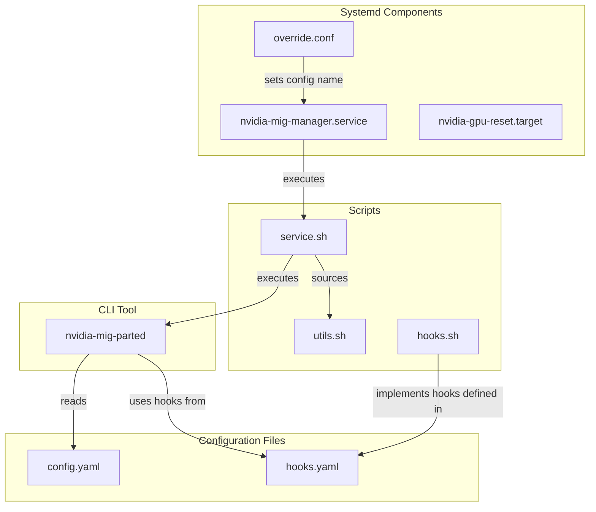
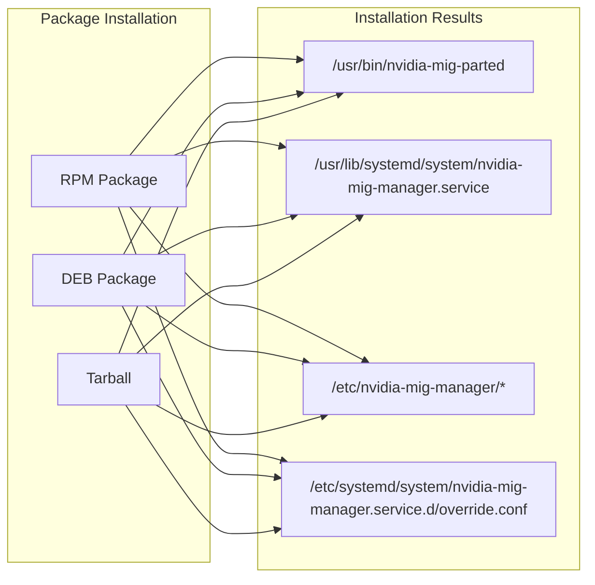
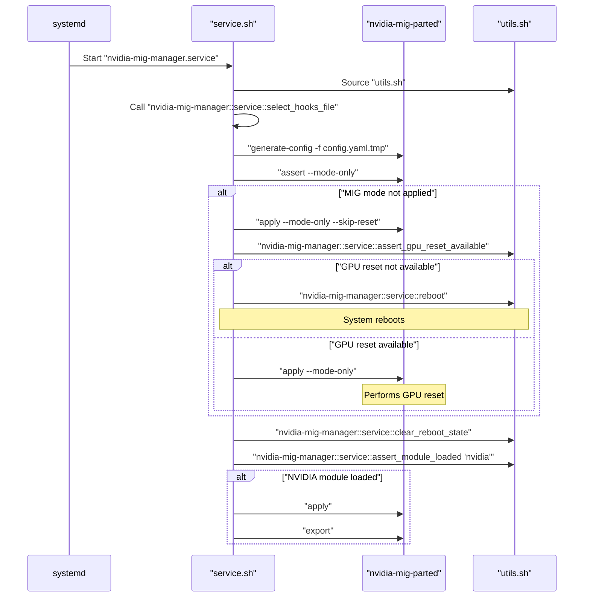
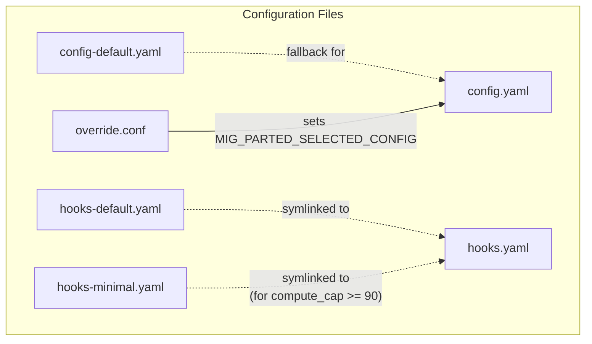

<!-- source: DeepWiki mcp.deepwiki.com · repo NVIDIA/mig-parted · page 4 Systemd Integration · fetched 2026-10-26 -->

# Systemd Integration

<details>
<summary>Relevant source files</summary>

The following files were used as context for generating this wiki page:

- [README.md](README.md)
- [deployments/systemd/README.md](deployments/systemd/README.md)
- [deployments/systemd/install.sh](deployments/systemd/install.sh)
- [deployments/systemd/nvidia-gpu-reset.target](deployments/systemd/nvidia-gpu-reset.target)
- [deployments/systemd/nvidia-mig-manager.service](deployments/systemd/nvidia-mig-manager.service)
- [deployments/systemd/nvidia-mig-parted.sh](deployments/systemd/nvidia-mig-parted.sh)
- [deployments/systemd/service.sh](deployments/systemd/service.sh)
- [deployments/systemd/uninstall.sh](deployments/systemd/uninstall.sh)
- [deployments/systemd/utils.sh](deployments/systemd/utils.sh)

</details>


This document provides detailed information about the systemd integration in NVIDIA MIG-Parted, specifically the `nvidia-mig-manager` systemd service. This integration enables automatic application of MIG configurations at system boot time and provides a robust framework for managing MIG states on NVIDIA GPUs. For information about using the underlying CLI tool directly, see [nvidia-mig-parted CLI](#3).

## Overview

The systemd integration for NVIDIA MIG-Parted consists of a systemd service (`nvidia-mig-manager.service`) and supporting scripts that wrap the `nvidia-mig-parted` CLI tool. This integration provides the following benefits:

- Automatic application of MIG configurations during system boot
- Persistent MIG configurations across reboots
- Robust error handling and recovery mechanisms
- Extensibility through a hooks system for custom actions

### Service Architecture

The following diagram illustrates the high-level architecture of the systemd integration:


Sources: [deployments/systemd/nvidia-mig-manager.service](), [deployments/systemd/service.sh](), [deployments/systemd/utils.sh](), [deployments/systemd/hooks.sh]()

## Installation

The systemd integration can be installed in several ways:

### Package Installation

The systemd integration is available as RPM and DEB packages:


Sources: [deployments/systemd/install.sh:31-39]() (implied by installation paths), [deployments/systemd/uninstall.sh:26-31]() (implied by removal paths)

### Manual Installation

You can also manually install the systemd integration using the provided installation script:

1. Clone the repository
2. Run the installation script:
   ```bash
   cd deployments/systemd
   ./install.sh
   ```

This script will:
- Install the `nvidia-mig-parted` binary to `/usr/bin` [deployments/systemd/install.sh:55-61]()
- Install the systemd service unit to `/usr/lib/systemd/system` [deployments/systemd/install.sh:63]()
- Create the necessary configuration directories [deployments/systemd/install.sh:41-46]()
- Enable the service [deployments/systemd/install.sh:86]()

Sources: [deployments/systemd/install.sh]()

## Service Components

The systemd integration consists of the following key components:

### 1. systemd Service Unit

The `nvidia-mig-manager.service` is defined as:

- Type: `oneshot` [deployments/systemd/nvidia-mig-manager.service:22]()
- Runs after `nvidia-persistenced.service` and `nvidia-fabricmanager.service` [deployments/systemd/nvidia-mig-manager.service:18]()
- Runs before `nvidia-gpu-reset.target` [deployments/systemd/nvidia-mig-manager.service:19]()
- Executes the `service.sh` script [deployments/systemd/nvidia-mig-manager.service:24]()

Sources: [deployments/systemd/nvidia-mig-manager.service]()

### 2. Service Script

The `service.sh` script is the main entry point executed by the systemd service. It performs the following tasks:

1. Sources utility functions from `utils.sh` [deployments/systemd/service.sh:19]()
2. Selects the appropriate hooks file based on GPU compute capability [deployments/systemd/service.sh:24]()
3. Generates `config.yaml` from hardware or uses existing/default [deployments/systemd/service.sh:35-51]()
4. Checks if the desired MIG mode is already applied [deployments/systemd/service.sh:64]()
5. If not, applies the MIG mode without issuing a GPU reset [deployments/systemd/service.sh:68]()
6. Checks if GPU reset is available [deployments/systemd/service.sh:78]()
   - If not, attempts to reboot the system [deployments/systemd/service.sh:83]()
   - If available, issues a GPU reset [deployments/systemd/service.sh:90]()
7. Clears any reboot state from previous runs [deployments/systemd/service.sh:98]()
8. Verifies the NVIDIA driver module is loaded [deployments/systemd/service.sh:100]()
9. Applies the full MIG configuration [deployments/systemd/service.sh:106]()
10. Exports the applied configuration [deployments/systemd/service.sh:112]()

Sources: [deployments/systemd/service.sh]()

### 3. Utilities

The `utils.sh` script provides various utility functions used by the service:

- Array manipulation: `nvidia-mig-manager::service::reverse_array` [deployments/systemd/utils.sh:34-41]()
- Module checking: `nvidia-mig-manager::service::assert_module_loaded` [deployments/systemd/utils.sh:43-51]()
- GPU reset checking: `nvidia-mig-manager::service::assert_gpu_reset_available` [deployments/systemd/utils.sh:53-69]()
- Reboot management: `nvidia-mig-manager::service::reboot`, `nvidia-mig-manager::service::clear_reboot_state` [deployments/systemd/utils.sh:71-91]()
- Configuration persistence: `nvidia-mig-manager::service::persist_config_across_reboot` [deployments/systemd/utils.sh:93-106]()
- Systemd service management: `nvidia-mig-manager::service::start_systemd_services`, `nvidia-mig-manager::service::stop_systemd_services` [deployments/systemd/utils.sh:150-179]()
- Container management: Functions for killing containers using Docker or containerd, e.g., `nvidia-mig-manager::service::kill_k8s_containers_via_docker_by_image` [deployments/systemd/utils.sh:181-211]()

Sources: [deployments/systemd/utils.sh]()

## Service Operation

The following sequence diagram illustrates the operation of the `nvidia-mig-manager` service:


Sources: [deployments/systemd/service.sh](), [deployments/systemd/utils.sh]()

## Configuration

The systemd integration uses several configuration files. For details, see [Configuration Files](#4.1).

### 1. Service Configuration

The `override.conf` file allows specifying which MIG configuration to apply through the `MIG_PARTED_SELECTED_CONFIG` environment variable. By default, it's set to `all-disabled` in the `install.sh` script, but the `service.sh` script expects this to be set externally.

```ini
[Service]
Environment="MIG_PARTED_SELECTED_CONFIG=all-disabled"
```
This file is located at `/etc/systemd/system/nvidia-mig-manager.service.d/override.conf`.

Sources: [deployments/systemd/override.conf](), [deployments/systemd/install.sh:66](), [deployments/systemd/service.sh:55]()

### 2. MIG Configuration

The MIG configurations are defined in the `config.yaml` file, located at `/etc/nvidia-mig-manager/config.yaml`. This file contains the various MIG configurations that can be applied. This file is dynamically generated by `nvidia-mig-parted generate-config` at boot time [deployments/systemd/service.sh:35-41](). If generation fails, it falls back to an existing `config.yaml` or `config-default.yaml` [deployments/systemd/service.sh:42-47](). For detailed information about the configuration file format, see [Configuration File Format](#6.1).

Sources: [deployments/systemd/service.sh:30-51]()

### Configuration File Relationships


Sources: [deployments/systemd/service.sh:30-51](), [deployments/systemd/utils.sh:108-148]()

## Hooks System

The systemd integration includes a hooks system that allows executing custom actions at different stages of the MIG configuration process. This is covered in detail in [Hooks System](#4.2).

The hooks are defined in the `hooks.yaml` file, which is typically a symlink to either `hooks-default.yaml` or `hooks-minimal.yaml` depending on the GPU architecture's compute capability [deployments/systemd/utils.sh:137-140]().

Sources: [deployments/systemd/utils.sh:108-148]()

## Installation File Structure

The following table shows the file structure created by the installation:

| File/Directory | Description |
|---------------|-------------|
| `/usr/bin/nvidia-mig-parted` | Main `nvidia-mig-parted` binary [deployments/systemd/install.sh:55-61]() |
| `/usr/lib/systemd/system/nvidia-mig-manager.service` | Systemd service unit for `nvidia-mig-manager` [deployments/systemd/install.sh:63]() |
| `/usr/lib/systemd/system/nvidia-gpu-reset.target` | Systemd target for GPU reset [deployments/systemd/install.sh:64]() |
| `/etc/profile.d/nvidia-mig-parted.sh` | Environment setup for the CLI tool, exports `MIG_PARTED_CONFIG_FILE`, `MIG_PARTED_HOOKS_FILE`, `MIG_PARTED_CHECKPOINT_FILE` [deployments/systemd/nvidia-mig-parted.sh]() |
| `/etc/systemd/system/nvidia-mig-manager.service.d/override.conf` | Service configuration override, sets `MIG_PARTED_SELECTED_CONFIG` [deployments/systemd/override.conf](), [deployments/systemd/install.sh:66]() |
| `/etc/nvidia-mig-manager/service.sh` | Main service script executed by `nvidia-mig-manager.service` [deployments/systemd/install.sh:67]() |
| `/etc/nvidia-mig-manager/utils.sh` | Utility functions used by `service.sh` and `hooks.sh` [deployments/systemd/install.sh:68]() |
| `/etc/nvidia-mig-manager/hooks.sh` | Hooks implementation script [deployments/systemd/install.sh:69]() |
| `/etc/nvidia-mig-manager/config.yaml` | Auto-generated MIG configuration file [deployments/systemd/service.sh:35-41]() |
| `/etc/nvidia-mig-manager/hooks.yaml` | Symlink to `hooks-default.yaml` or `hooks-minimal.yaml` [deployments/systemd/install.sh:88-107]() |
| `/etc/nvidia-mig-manager/hooks-default.yaml` | Default hooks configuration [deployments/systemd/install.sh:70]() |
| `/etc/nvidia-mig-manager/hooks-minimal.yaml` | Minimal hooks configuration for newer GPUs [deployments/systemd/install.sh:71]() |
| `/var/lib/nvidia-mig-manager/` | Directory for state information, e.g., `reboot_attempted` file [deployments/systemd/utils.sh:72]() |

Sources: [deployments/systemd/install.sh](), [deployments/systemd/nvidia-mig-parted.sh](), [deployments/systemd/override.conf](), [deployments/systemd/service.sh](), [deployments/systemd/utils.sh]()

## Common Operations

### Changing the Active MIG Configuration

To change the active MIG configuration:

1. Edit the `override.conf` file to change the `MIG_PARTED_SELECTED_CONFIG` value.
2. Reload the systemd daemon and restart the service:
   ```bash
   sudo systemctl daemon-reload
   sudo systemctl restart nvidia-mig-manager.service
   ```

Alternatively, you can use the utility function `persist_config_across_reboot` defined in `utils.sh` to persist the configuration:

```bash
source /etc/nvidia-mig-manager/utils.sh
nvidia-mig-manager::service::persist_config_across_reboot "your-config-name"
systemctl restart nvidia-mig-manager.service
```
This function writes the selected configuration to `/etc/systemd/system/nvidia-mig-manager.service.d/override.conf` [deployments/systemd/utils.sh:93-106]().

Sources: [deployments/systemd/utils.sh:93-106]()

### Reboot Handling

The service includes special handling for systems where GPU reset is not available (e.g., virtualized environments). In these cases, it will:

1. Attempt to apply the MIG mode without a reset [deployments/systemd/service.sh:68]()
2. Check if GPU reset is available using `nvidia-mig-manager::service::assert_gpu_reset_available` [deployments/systemd/service.sh:78]()
3. If not, trigger a system reboot using `nvidia-mig-manager::service::reboot` (only once) [deployments/systemd/service.sh:83]()
4. After reboot, clear the reboot state using `nvidia-mig-manager::service::clear_reboot_state` and continue with configuration [deployments/systemd/service.sh:98]()

This ensures that MIG configurations can be applied even in environments where direct GPU reset is not possible.

Sources: [deployments/systemd/service.sh:61-95](), [deployments/systemd/utils.sh:71-91]()

## Packaging

The systemd integration is packaged in several formats:

1. RPM packages for RedHat-based distributions
2. DEB packages for Debian/Ubuntu-based distributions
3. Tarballs for manual installation

Each package includes all necessary files and handles installation, symlink creation, and service enabling.

Sources: [deployments/systemd/install.sh]() (as the installation script is used by packaging)

---

