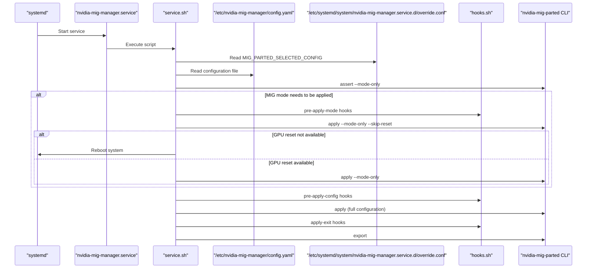
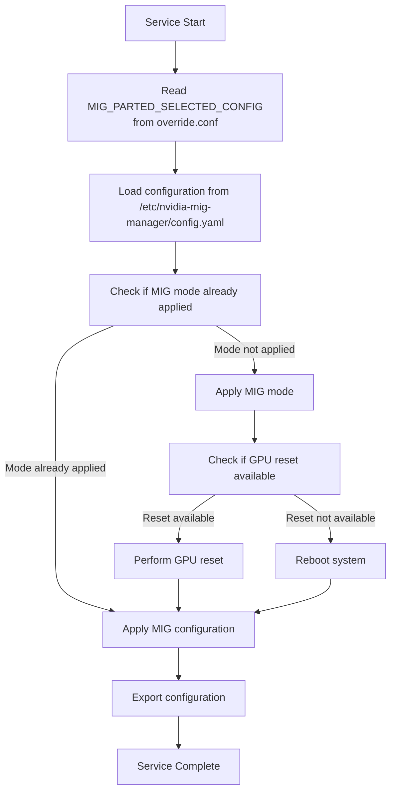

<!-- source: DeepWiki mcp.deepwiki.com · repo NVIDIA/mig-parted · page 4.1 Configuration Files · fetched 2026-10-26 -->

# Configuration Files

<details>
<summary>Relevant source files</summary>

The following files were used as context for generating this wiki page:

- [README.md](README.md)
- [cmd/nvidia-mig-manager/find.go](cmd/nvidia-mig-manager/find.go)
- [cmd/nvidia-mig-manager/main.go](cmd/nvidia-mig-manager/main.go)
- [deployments/container/reconfigure-mig.sh](deployments/container/reconfigure-mig.sh)
- [deployments/systemd/README.md](deployments/systemd/README.md)
- [deployments/systemd/config-default.yaml](deployments/systemd/config-default.yaml)
- [deployments/systemd/install.sh](deployments/systemd/install.sh)
- [deployments/systemd/nvidia-gpu-reset.target](deployments/systemd/nvidia-gpu-reset.target)
- [deployments/systemd/nvidia-mig-parted.sh](deployments/systemd/nvidia-mig-parted.sh)
- [deployments/systemd/override.conf](deployments/systemd/override.conf)
- [deployments/systemd/uninstall.sh](deployments/systemd/uninstall.sh)

</details>


This document provides a detailed explanation of the configuration files used by the NVIDIA MIG-Parted systemd service. These files define how Multi-Instance GPU (MIG) configurations are applied to NVIDIA GPUs through the `nvidia-mig-manager.service`. For information about the hooks system used by the service, see [Hooks System](#4.2).

## Overview of Configuration Files

The systemd integration of MIG-Parted relies on several configuration files to control its behavior:

1.  **config-default.yaml**: Defines available MIG configurations for various GPU models. This file is copied to `config.yaml` during installation.
2.  **override.conf**: Sets the environment variable that selects which configuration to apply.
3.  **nvidia-mig-parted.sh**: A profile script that sets environment variables for `nvidia-mig-parted` CLI.
4.  **service.sh**: Main service script that processes the configuration.
5.  **hooks.sh**: Contains hook functions that are executed at different stages of configuration application.

### Configuration File Relationships

```mermaid
flowchart LR
    subgraph "Input Configuration"
        direction TB
        ConfigDefault["config-default.yaml"]
        Override["override.conf"]
        ProfileScript["nvidia-mig-parted.sh"]
    end
    
    subgraph "Execution Scripts"
        direction TB
        Service["service.sh"]
        Hooks["hooks.sh"]
        Utils["utils.sh"]
    end
    
    subgraph "Systemd Integration"
        ServiceUnit["nvidia-mig-manager.service"]
    end
    
    ConfigDefault -- "copied to config.yaml" --> ConfigFile[/etc/nvidia-mig-manager/config.yaml\]
    Override --> ServiceUnit : "sets Environment"
    ProfileScript --> EnvVars[Environment Variables] : "sets MIG_PARTED_CONFIG_FILE, etc."
    
    ServiceUnit --> Service
    Service --> ConfigFile : "reads config"
    Service --> EnvVars : "uses MIG_PARTED_SELECTED_CONFIG"
    Service --> Hooks
    Service --> Utils
    Hooks --> Utils
    
    class ConfigDefault,Override,ProfileScript,Service,Hooks,Utils,ServiceUnit,ConfigFile,EnvVars default
```

Sources: [deployments/systemd/service.sh](), [deployments/systemd/nvidia-mig-manager.service](), [deployments/systemd/override.conf](), [deployments/systemd/hooks.sh](), [deployments/systemd/utils.sh](), [deployments/systemd/config-default.yaml](), [deployments/systemd/nvidia-mig-parted.sh]()

## Configuration Files in Detail

### config-default.yaml

The `config-default.yaml` file is the primary configuration file that defines all available MIG configurations. During installation, this file is copied to `/etc/nvidia-mig-manager/config.yaml` [deployments/systemd/install.sh:70](). Each configuration specifies:

-   Whether MIG mode is enabled
-   Device selection (which GPUs to configure)
-   Specific MIG device profiles and quantities to configure

The file has a specific structure:

```mermaid
classDiagram
    class "config.yaml" {
        version: string
        mig-configs: Map~string, MigConfig[]~
    }
    
    class "MigConfig" {
        devices: string | integer[]
        device-filter: string[] (optional)
        mig-enabled: boolean
        mig-devices: Map~string, integer~ (optional)
    }
    
    "config.yaml" --> "MigConfig" : contains
```

Sources: [deployments/systemd/config-default.yaml]()

A configuration entry consists of:

-   **devices**: Specifies which GPUs to apply the configuration to. Can be "all" or a specific list of GPU indexes.
-   **device-filter** (optional): A PCI device ID filter to apply configurations to specific GPU models.
-   **mig-enabled**: Boolean indicating whether MIG mode should be enabled.
-   **mig-devices**: A map of MIG profiles to the number of instances to create.

Example configuration from the default config:

```yaml
all-balanced:
  # H100-80GB, H800-80GB, A100-80GB, A800-80GB
  - device-filter: ["0x233010DE", "0x233110DE", "0x232210DE", "0x20B210DE", "0x20B510DE", "0x20F310DE", "0x20F510DE", "0x232410DE"]
    devices: all
    mig-enabled: true
    mig-devices:
      "1g.10gb": 2
      "2g.20gb": 1
      "3g.40gb": 1
```

The default configuration file includes predefined configurations for various GPU models, including:

-   Basic configurations like `all-disabled` and `all-enabled` [deployments/systemd/config-default.yaml:3-10]()
-   Model-specific configurations for A100, H100, A30, and other NVIDIA GPU models [deployments/systemd/config-default.yaml:13-289]()
-   Balanced configurations that create a mix of different MIG profile sizes [deployments/systemd/config-default.yaml:291-433]()

Sources: [deployments/systemd/config-default.yaml:1-433]()

### override.conf

The `override.conf` file is a systemd service override file that sets the `MIG_PARTED_SELECTED_CONFIG` environment variable, which determines which configuration from `config.yaml` is applied:

```
[Service]
Environment="MIG_PARTED_SELECTED_CONFIG=all-disabled"
```

This file is copied to `/etc/systemd/system/nvidia-mig-manager.service.d/override.conf` during installation [deployments/systemd/install.sh:66]() and is automatically used by systemd to override the service configuration.

Sources: [deployments/systemd/override.conf](), [deployments/systemd/install.sh:66]()

### nvidia-mig-parted.sh

The `nvidia-mig-parted.sh` script is installed into `/etc/profile.d/` [deployments/systemd/install.sh:65]() and sets environment variables for the `nvidia-mig-parted` CLI tool:

```bash
export MIG_PARTED_CONFIG_FILE=/etc/nvidia-mig-manager/config.yaml
export MIG_PARTED_HOOKS_FILE=/etc/nvidia-mig-manager/hooks.yaml
export MIG_PARTED_CHECKPOINT_FILE=/var/lib/nvidia-mig-manager/checkpoint.json
```

These environment variables ensure that when `nvidia-mig-parted` is run, it automatically uses the correct configuration, hooks, and checkpoint files. This is particularly useful for interactive shell sessions.

Sources: [deployments/systemd/nvidia-mig-parted.sh](), [deployments/systemd/install.sh:65]()

## Configuration Application Process

The configuration files are used in a specific workflow to apply MIG configurations to NVIDIA GPUs:



Sources: [deployments/systemd/service.sh:1-79](), [deployments/systemd/hooks.sh:1-125]()

## How Configuration Selection Works

When the `nvidia-mig-manager.service` is started, it:

1.  Reads the selected configuration name from the `MIG_PARTED_SELECTED_CONFIG` environment variable, which is typically set in `override.conf` [deployments/systemd/override.conf:2]().
2.  Loads the matching configuration from `/etc/nvidia-mig-manager/config.yaml`.
3.  Applies this configuration using the `nvidia-mig-parted` CLI tool.

The configuration can be changed by:

1.  Editing `override.conf` to set a different configuration name.
2.  Using the `nvidia-mig-manager::service::persist_config_across_reboot` utility function, which updates `override.conf` programmatically.



Sources: [deployments/systemd/service.sh:17-79](), [deployments/systemd/utils.sh:76-83]()

## Persisting Configuration Changes

The `nvidia-mig-manager::service::persist_config_across_reboot` function in `utils.sh` allows programmatically updating the selected configuration:

```bash
nvidia-mig-manager::service::persist_config_across_reboot ${selected_config}
```

This function:
1.  Creates or updates the `/etc/systemd/system/nvidia-mig-manager.service.d/override.conf` file [deployments/systemd/utils.sh:76-83]().
2.  Sets the `MIG_PARTED_SELECTED_CONFIG` environment variable to the specified configuration [deployments/systemd/utils.sh:76-83]().
3.  Reloads the systemd daemon to apply the changes [deployments/systemd/utils.sh:82]().

Sources: [deployments/systemd/utils.sh:76-83](), [deployments/systemd/hooks.sh:38-45]()

## Configuration Examples

The default `config-default.yaml` provides numerous predefined configurations for different GPU models and use cases. These are copied to `/etc/nvidia-mig-manager/config.yaml` during installation. Here are some examples:

| Configuration Name | Description |
|:-------------------|:------------|
| `all-disabled` | Disables MIG mode on all GPUs [deployments/systemd/config-default.yaml:3-5]() |
| `all-enabled` | Enables MIG mode on all GPUs but doesn't create any MIG instances [deployments/systemd/config-default.yaml:7-10]() |
| `all-1g.5gb` | Creates seven 1g.5gb MIG instances on each GPU (A100-40GB, A800-40GB) [deployments/systemd/config-default.yaml:13-18]() |
| `all-balanced` | Creates a mix of different-sized MIG instances appropriate for each GPU model [deployments/systemd/config-default.yaml:291-433]() |
| `all-7g.80gb` | Creates one 7g.80gb MIG instance on each GPU (H100-80GB, H800-80GB, A100-80GB, A800-80GB) [deployments/systemd/config-default.yaml:153-156]() |

Sources: [deployments/systemd/config-default.yaml:1-433]()

## Configuration File Locations

The MIG-Parted systemd integration looks for configuration files in these locations:

| File | Default Location |
|:-----|:-----------------|
| `config.yaml` | `/etc/nvidia-mig-manager/config.yaml` |
| `override.conf` | `/etc/systemd/system/nvidia-mig-manager.service.d/override.conf` |
| `nvidia-mig-parted.sh` | `/etc/profile.d/nvidia-mig-parted.sh` |
| `service.sh` | `/etc/nvidia-mig-manager/service.sh` |
| `hooks.sh` | `/etc/nvidia-mig-manager/hooks.sh` |
| `utils.sh` | `/etc/nvidia-mig-manager/utils.sh` |

The location of the configuration file can be overridden by setting the `MIG_PARTED_CONFIG_FILE` environment variable.

Sources: [deployments/systemd/service.sh:21-22](), [deployments/systemd/nvidia-mig-parted.sh:1]()

## Summary

The MIG-Parted systemd integration uses a combination of configuration files to define and apply MIG configurations to NVIDIA GPUs. The primary files are:

1.  `config.yaml` (copied from `config-default.yaml`), which defines available MIG configurations.
2.  `override.conf`, which selects which configuration to apply.
3.  `nvidia-mig-parted.sh`, which sets environment variables for the CLI.
4.  Supporting scripts (`service.sh`, `hooks.sh`, `utils.sh`) that implement the configuration application process.

These files work together to provide a flexible, declarative way to manage MIG configurations on NVIDIA GPUs through the systemd service manager.

---

