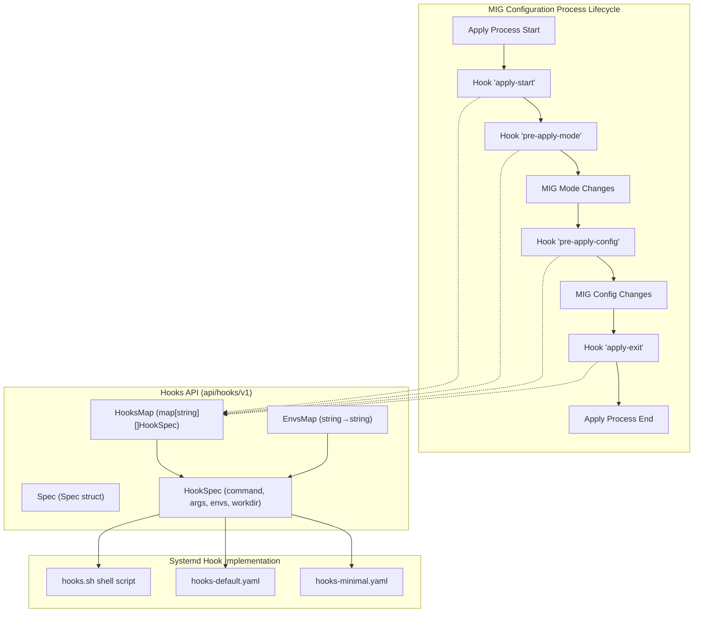
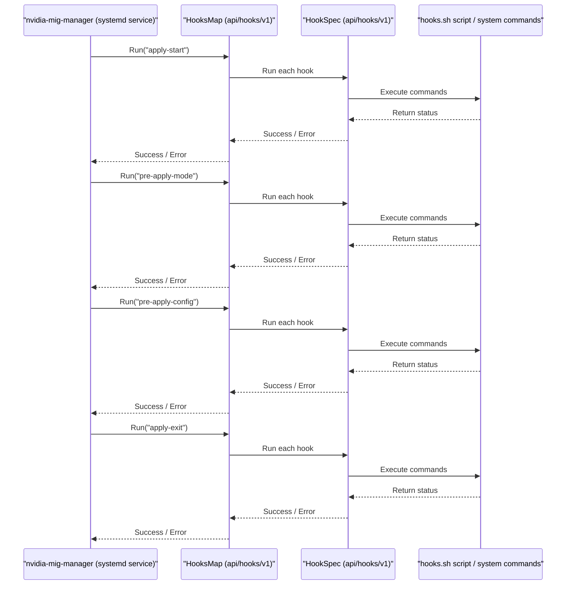

<!-- source: DeepWiki mcp.deepwiki.com · repo NVIDIA/mig-parted · page 4.2 Hooks System · fetched 2026-10-26 -->

# Hooks System

<details>
<summary>Relevant source files</summary>

The following files were used as context for generating this wiki page:

- [api/checkpoint/v1/state.go](api/checkpoint/v1/state.go)
- [api/hooks/v1/hooks.go](api/hooks/v1/hooks.go)
- [api/hooks/v1/hooks_test.go](api/hooks/v1/hooks_test.go)
- [cmd/nvidia-mig-parted/apply/hooks.go](cmd/nvidia-mig-parted/apply/hooks.go)
- [deployments/systemd/hooks-default.yaml](deployments/systemd/hooks-default.yaml)
- [deployments/systemd/hooks-minimal.yaml](deployments/systemd/hooks-minimal.yaml)
- [deployments/systemd/hooks.sh](deployments/systemd/hooks.sh)
- [deployments/systemd/packages/debian/conffiles](deployments/systemd/packages/debian/conffiles)

</details>


## Purpose and Scope

The Hooks System in NVIDIA MIG-Parted provides a flexible mechanism for executing custom actions at defined points in the MIG configuration lifecycle. This system is leveraged by the systemd service integration to properly manage system services and Kubernetes workloads that might be disrupted during MIG mode or configuration changes on NVIDIA GPUs. Beyond systemd, the hooks framework is extensible for any custom needs that require triggering commands before or after applying MIG changes.

This page covers the implementation details of the hooks system, including:

- The default shell script hooks implementation (`hooks.sh`)
- The predefined hooks YAML configurations (`hooks-default.yaml` and `hooks-minimal.yaml`)
- The GPU compute capability check logic that selects which hooks configuration to use on startup
- The schema and API facilities in `api/hooks/v1` that define and run hooks

For broader context on the systemd service, see [Systemd Integration](#4).

Sources: [deployments/systemd/hooks.sh:1-148](), [deployments/systemd/hooks-default.yaml:1-22](), [deployments/systemd/hooks-minimal.yaml:1-7](), [api/hooks/v1/hooks.go:1-100]()

---

## Hooks System Architecture

The hooks system enables the execution of one or more commands ("hooks") associated with named lifecycle events during MIG configuration. Each hook may specify its working directory, environment variables, command path, and arguments. Hooks are invoked synchronously by the application or service managing the MIG reconfiguration.

### Components Overview

- **Spec (api/hooks/v1.Spec)**  
  Defines the versioned container of all hooks. Holds a map of named hooks to lists of hook commands.

- **HookSpec (api/hooks/v1.HookSpec)**  
  Defines a single executable hook command, including the executable path, args, environment variables, and working directory.

- **HooksMap (api/hooks/v1.HooksMap)**  
  Maps hook names (e.g., `"apply-start"`) to lists of `HookSpec` that should run at that hook point.

- **EnvsMap (api/hooks/v1.EnvsMap)**  
  Represents the environment variable name-value map for a hook.

- **Shell Script Hooks (deployments/systemd/hooks.sh)**  
  Implements the concrete hook functions for service and pod management during MIG config changes.

- **Hooks YAML Files (deployments/systemd/hooks-default.yaml, hooks-minimal.yaml)**  
  Provide default configurations that specify which commands to run at which hooks.

### Architecture Diagram: Natural Language ↔ Code Entities



Sources: [api/hooks/v1/hooks.go:25-47](), [deployments/systemd/hooks.sh:1-148](), [deployments/systemd/hooks-default.yaml:1-22](), [deployments/systemd/hooks-minimal.yaml:1-7]()

---

## Hook Execution Flow

Hooks are executed sequentially at the following standard points defined by NVIDIA MIG-Parted's systemd integration:

| Hook Name       | When Invoked                      | Typical Action                                           |
|-----------------|---------------------------------|----------------------------------------------------------|
| `apply-start`   | At the beginning of the apply    | Persist the selected MIG config across reboots           |
| `pre-apply-mode`| Before changing MIG mode         | Stop Kubernetes services, pods, and NVIDIA driver services|
| `pre-apply-config` | Before applying MIG config     | Stop Kubernetes services and pods                         |
| `apply-exit`    | At the end of the apply          | Restart NVIDIA driver and Kubernetes services            |

### Sequence Diagram for Hook Execution



The `HooksMap.Run` method executes all hooks registered for a given hook name, injecting configured environment variables, changing to the correct working directory, and optionally streaming command output to standard output and error.

Sources: [api/hooks/v1/hooks.go:48-77](), [deployments/systemd/hooks.sh:37-84]()

---

## API Details: `api/hooks/v1`

The hooks API defines the data structures and runtime logic for defining and executing hooks.

### Key Types

```go
// Spec holds version info and named hooks
type Spec struct {
    Version string   `json:"version"`
    Hooks   HooksMap `json:"hooks"`
}

// HookSpec defines a single hook command to run
type HookSpec struct {
    Command string   `json:"command"` // Executable path
    Args    []string `json:"args"`    // Command-line arguments
    Envs    EnvsMap  `json:"envs"`    // Environment variables
    Workdir string   `json:"workdir"` // Working directory
}

// EnvsMap is a map of environment variable names to values
type EnvsMap map[string]string

// HooksMap maps hook names (e.g. "apply-start") to an array of HookSpec
type HooksMap map[string][]HookSpec
```

### Running Hooks

- `HooksMap.Run(name string, envs EnvsMap, output bool) error`  
  Runs all hooks associated with the given `name`. Merges hook-specific environment variables with the provided `envs` map and optionally prints output.

- `HookSpec.Run(envs EnvsMap, output bool) error`  
  Executes one hook command following configuration.

- Environment Variables merge with `EnvsMap.Combine`, where runtime variables override hook defaults.

- The environment is converted to `key=value` format by `EnvsMap.Format()`.

```go
// Run all hooks under `name` in a HooksMap
func (h HooksMap) Run(name string, envs EnvsMap, output bool) error {
    hooks, exists := h[name]
    if !exists {
        return nil
    }
    for _, hook := range hooks {
        err := hook.Run(envs, output)
        if err != nil {
            return err
        }
    }
    return nil
}

// Run a single hook command
func (h *HookSpec) Run(envs EnvsMap, output bool) error {
    cmd := exec.Command(h.Command, h.Args...)
    cmd.Env = h.Envs.Combine(envs).Format()
    cmd.Dir = h.Workdir
    if output {
        cmd.Stdout = os.Stdout
        cmd.Stderr = os.Stderr
    }
    return cmd.Run()
}
```

Sources: [api/hooks/v1/hooks.go:25-77](), [api/hooks/v1/hooks.go:79-99]()

---

## Default Hooks Configuration Files

### `hooks-default.yaml`

This YAML file defines the full default hook set used on supported hardware. It defines the four standard hooks, each running the corresponding command that sources `hooks.sh` and calls the respective bash functions.

```yaml
version: v1
hooks:
  apply-start:
    - workdir: "/etc/nvidia-mig-manager"
      command: "/bin/bash"
      args: ["-x", "-c", "source hooks.sh; apply-start ${MIG_PARTED_SELECTED_CONFIG}"]
  pre-apply-mode:
    - workdir: "/etc/nvidia-mig-manager"
      command: "/bin/bash"
      args: ["-x", "-c", "source hooks.sh; pre-apply-mode"]
  pre-apply-config:
    - workdir: "/etc/nvidia-mig-manager"
      command: "/bin/bash"
      args: ["-x", "-c", "source hooks.sh; pre-apply-config"]
  apply-exit:
    - workdir: "/etc/nvidia-mig-manager"
      command: "/bin/bash"
      args: ["-x", "-c", "source hooks.sh; apply-exit"]
    - workdir: "/etc/nvidia-mig-manager"
      command: "/bin/bash"
      args: ["-x", "-c", "source hooks.sh; refresh-cdi"]
```

### `hooks-minimal.yaml`

A minimal hooks configuration, containing only the `apply-start` hook invocation. Used on hardware where the default hooks are not appropriate.

```yaml
version: v1
hooks:
  apply-start:
    - workdir: "/etc/nvidia-mig-manager"
      command: "/bin/bash"
      args: ["-x", "-c", "source hooks.sh; apply-start ${MIG_PARTED_SELECTED_CONFIG}"]
```

The choice between these two hooks configurations is done at runtime based on GPU compute capability (see next section).

Sources: [deployments/systemd/hooks-default.yaml:1-22](), [deployments/systemd/hooks-minimal.yaml:1-7]()

---

## Compute Capability Check and Hooks Selection

At startup, the `nvidia-mig-manager` systemd service detects the GPU compute capability and selects the appropriate hooks configuration file:

- **Default**: For GPUs with compute capability 8.0+ (e.g., A100, H100), uses `hooks-default.yaml`.
- **Minimal**: For GPUs older than 8.0, uses `hooks-minimal.yaml`.

This mechanism ensures compatibility and avoids executing hooks that require features only available on newer hardware.

The service loads the selected hooks configuration into the `api/hooks/v1.Spec` structure and uses the `HooksMap` field to run hooks as needed during the apply process.

Sources: [deployments/systemd/hooks-default.yaml](), [deployments/systemd/hooks-minimal.yaml]()

---

## Systemd Hooks Shell Script (`hooks.sh`)

The shell script `deployments/systemd/hooks.sh` is the core implementation of the hook commands defined in the YAML configs. It includes functions that control NVIDIA driver services, Kubernetes services, and Kubernetes pods.

### Services and Pods Managed

- **Driver services:**  
  - `nvsm.service`  
  - `nvidia-dcgm.service`

- **Kubernetes services:**  
  - `dcgm-exporter.service`  
  - `kubelet.service`

- **Kubernetes pods images:**  
  - `k8s-device-plugin`  
  - `gpu-feature-discovery`  
  - `dcgm-exporter`

### Hook Shell Functions

| Function Name     | Purpose / Actions                                        |
|-------------------|---------------------------------------------------------|
| `apply-start()`   | Persists selected config across reboot                      |
| `pre-apply-mode()`| Stops kube services, pods, driver services to avoid issues |
| `pre-apply-config()`| Stops kube services and pods (driver services are left running)  |
| `apply-exit()`    | Starts driver and Kubernetes services again                |
| `refresh-cdi()`   | Restarts `nvidia-cdi-refresh.service` to update CDI specs  |

### Stop/Start Helper Functions

- `stop_k8s_services()` / `start_k8s_services()`  
  Stop/start kubelet and dcgm-exporter systemd services, respecting the order and without waiting for synchronous completion (using `--no-block`).

- `stop_driver_services()` / `start_driver_services()`  
  Stops/starts driver-related services in reverse startup order.

- `stop_k8s_pods()`  
  Kills Kubernetes pods by matching container images via Docker and containerd.

### Implementation Notes

- Service stop functions reverse the array of service names to shut down in dependency-safe order.
- Start functions use asynchronous systemd starts to avoid deadlocks with `nvidia-gpu-reset.target`.
- The script uses utility functions sourced from `utils.sh` for array operations and service management.
- All functions return non-zero exit codes on failure to indicate error conditions to the service.

```mermaid
flowchart TD
    subgraph "Hooks Script Functions"
        A1["apply-start()"]
        A2["pre-apply-mode()"]
        A3["pre-apply-config()"]
        A4["apply-exit()"]
        A5["refresh-cdi()"]
        
        A1 --> PersistConfig["persist_config_across_reboot()"]
        
        A2 --> StopK8sServices1["stop_k8s_services()"]
        A2 --> StopK8sPods1["stop_k8s_pods()"]
        A2 --> StopDriverServices["stop_driver_services()"]
        
        A3 --> StopK8sServices2["stop_k8s_services()"]
        A3 --> StopK8sPods2["stop_k8s_pods()"]
        
        A4 --> StartDriverServices["start_driver_services()"]
        A4 --> StartK8sServices["start_k8s_services()"]
    end

    subgraph "Service Management Functions"
        StopK8sServices1 --> ReverseArray1["reverse_array()"]
        StopK8sServices1 --> StopSystemdServices1["stop_systemd_services()"]
        
        StopK8sServices2 --> ReverseArray2["reverse_array()"]
        StopK8sServices2 --> StopSystemdServices2["stop_systemd_services()"]
        
        StopDriverServices --> ReverseArray3["reverse_array()"]
        StopDriverServices --> StopSystemdServices3["stop_systemd_services()"]
        
        StartDriverServices --> StartSystemdServices1["start_systemd_services() --no-block"]
        StartK8sServices --> StartSystemdServices2["start_systemd_services() --no-block"]
        
        StopK8sPods1 --> KillDockerPods["kill_k8s_containers_via_docker_by_image()"]
        StopK8sPods1 --> KillContainerdPods["kill_k8s_containers_via_containerd_by_image()"]
        
        StopK8sPods2 --> KillDockerPods
        StopK8sPods2 --> KillContainerdPods
    end
```



Sources: [deployments/systemd/hooks.sh:21-148]()

---

## Using Hooks in the Apply Command (`cmd/nvidia-mig-parted/apply/hooks.go`)

The `apply` command in `nvidia-mig-parted` uses the `api/hooks/v1` package to load and run hooks as part of applying a MIG configuration.

An `ApplyHooks` interface encapsulates the hooks with methods:

- `ApplyStart(envs, output) error`
- `PreApplyMode(envs, output) error`
- `PreApplyConfig(envs, output) error`
- `ApplyExit(envs, output) error`

The concrete implementation delegates to the `HooksMap.Run` method with matching hook names.

```go
type ApplyHooks interface {
    ApplyStart(envs hooks.EnvsMap, output bool) error
    PreApplyMode(envs hooks.EnvsMap, output bool) error
    PreApplyConfig(envs hooks.EnvsMap, output bool) error
    ApplyExit(envs hooks.EnvsMap, output bool) error
}

func NewApplyHooks(hooksMap hooks.HooksMap) ApplyHooks {
    return &applyHooks{hooksMap}
}

func (h *applyHooks) ApplyStart(envs hooks.EnvsMap, output bool) error {
    return h.Run("apply-start", envs, output)
}

func (h *applyHooks) PreApplyMode(envs hooks.EnvsMap, output bool) error {
    return h.Run("pre-apply-mode", envs, output)
}

func (h *applyHooks) PreApplyConfig(envs hooks.EnvsMap, output bool) error {
    return h.Run("pre-apply-config", envs, output)
}

func (h *applyHooks) ApplyExit(envs hooks.EnvsMap, output bool) error {
    return h.Run("apply-exit", envs, output)
}
```

This abstraction allows the apply command flow to insert hook calls seamlessly before and after key operations, passing any desired environment variables.

Sources: [cmd/nvidia-mig-parted/apply/hooks.go:17-62](), [api/hooks/v1/hooks.go:25-77]()

---

## Summary

The NVIDIA MIG-Parted Hooks System is a flexible framework that empowers the systemd integration and other clients to execute customized commands during the MIG apply lifecycle. By abstracting hooks configuration into YAML and providing a rich API for declarative hook definitions and runtime execution, it enables clean service and workload management around complex MIG reconfiguration operations.

Key points:

- The hooks system triggers named sequences of commands to manage services/pods when applying MIG configuration.
- Hooks are defined as versioned YAML files implementing the `api/hooks/v1.Spec` schema.
- The systemd integration provides a default robust shell script hooks implementation (`hooks.sh`) controlling NVIDIA driver and Kubernetes components.
- A compute capability-based mechanism selects between default full hooks or a minimal set for older GPUs.
- The `apply` command runs hooks at prescribed points via an interface built on `api/hooks/v1`.

This design provides both default operational safety and extensibility for site-specific requirements.

---

# End of page

Sources:
- [api/hooks/v1/hooks.go:1-100]()
- [api/hooks/v1/hooks_test.go:19-158]()
- [deployments/systemd/hooks.sh:1-148]()
- [deployments/systemd/hooks-default.yaml:1-22]()
- [deployments/systemd/hooks-minimal.yaml:1-7]()
- [cmd/nvidia-mig-parted/apply/hooks.go:17-62]()

---

