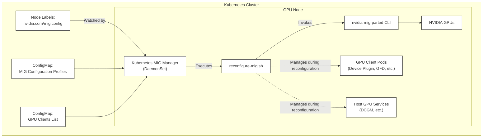
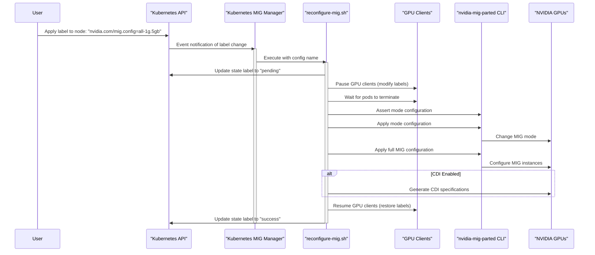
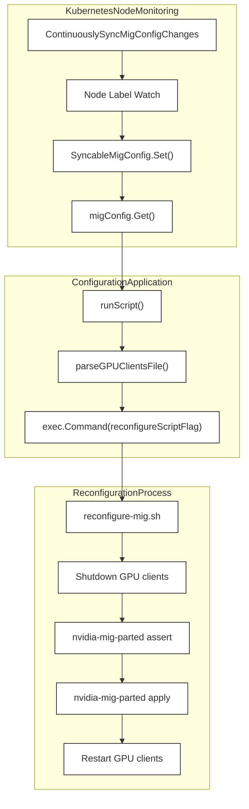

<!-- source: DeepWiki mcp.deepwiki.com · repo NVIDIA/mig-parted · page 5 Kubernetes Integration · fetched 2026-10-26 -->

# Kubernetes Integration

<details>
<summary>Relevant source files</summary>

The following files were used as context for generating this wiki page:

- [CHANGELOG.md](CHANGELOG.md)
- [cmd/nvidia-mig-manager/find.go](cmd/nvidia-mig-manager/find.go)
- [cmd/nvidia-mig-manager/main.go](cmd/nvidia-mig-manager/main.go)
- [deployments/container/nvidia-mig-manager-example-hopper-blackwell.yaml](deployments/container/nvidia-mig-manager-example-hopper-blackwell.yaml)
- [deployments/container/nvidia-mig-manager-example.yaml](deployments/container/nvidia-mig-manager-example.yaml)
- [deployments/container/reconfigure-mig.sh](deployments/container/reconfigure-mig.sh)
- [deployments/systemd/config-default.yaml](deployments/systemd/config-default.yaml)
- [versions.mk](versions.mk)

</details>


This page documents the Kubernetes integration for NVIDIA MIG-Parted, which enables declarative management of Multi-Instance GPU (MIG) configurations in Kubernetes environments. The integration provides a way to apply and manage MIG configurations on GPU nodes through Kubernetes node labels, enabling automated configuration of GPU partitioning across a cluster.

For information about the underlying `nvidia-mig-parted` CLI tool that powers this integration, see [nvidia-mig-parted CLI](#3).

## Architecture Overview

The Kubernetes integration consists of a dedicated component called the **Kubernetes MIG Manager** that runs as a DaemonSet on GPU nodes. This component watches for changes to specific node labels and applies the corresponding MIG configurations using the underlying `nvidia-mig-parted` toolkit.

### MIG Manager Architecture



Sources: [cmd/nvidia-mig-manager/main.go:5-436](), [deployments/container/reconfigure-mig.sh:1-656]()

### MIG Configuration Workflow



Sources: [cmd/nvidia-mig-manager/main.go:282-314](), [deployments/container/reconfigure-mig.sh:370-656]()

## Deployment

The MIG Manager is deployed as a DaemonSet in Kubernetes. The DaemonSet uses node selectors to target GPU nodes where MIG configurations should be managed.

### Required Components

1. **MIG Manager DaemonSet**: The main component that watches for configuration changes
2. **ServiceAccount**: With permissions to manage node labels and pods
3. **ConfigMaps**:
   - MIG configuration profiles
   - GPU client definitions for managing during reconfigurations

### Example Deployment

```yaml
# DaemonSet definition
apiVersion: apps/v1
kind: DaemonSet
metadata:
  name: nvidia-mig-manager
spec:
  selector:
    matchLabels:
      app: nvidia-mig-manager
  template:
    spec:
      hostPID: true
      hostIPC: true
      nodeSelector:
        nvidia.com/gpu.deploy.mig-manager: "true"
      serviceAccount: nvidia-mig-manager-service-account
      containers:
      - name: nvidia-mig-manager
        image: nvcr.io/nvidia/cloud-native/k8s-mig-manager:v0.14.5
        env:
        - name: NODE_NAME
          valueFrom:
            fieldRef:
              fieldPath: spec.nodeName
        - name: CONFIG_FILE
          value: "/mig-parted-config/config.yaml"
        securityContext:
          privileged: true
        volumeMounts:
        - mountPath: /host
          name: host-root
        - mountPath: /mig-parted-config
          name: mig-parted-config
```

Sources: [deployments/container/nvidia-mig-manager-example.yaml:1-76]()

### Required RBAC Permissions

```yaml
# ServiceAccount
apiVersion: v1
kind: ServiceAccount
metadata:
  name: nvidia-mig-manager-service-account

# ClusterRole with permissions to manage nodes and pods
apiVersion: rbac.authorization.k8s.io/v1
kind: ClusterRole
metadata:
  name: nvidia-mig-manager-role
rules:
  - apiGroups: [""]
    resources: ["*"]
    verbs: ["*"]

# ClusterRoleBinding to assign permissions to the ServiceAccount
apiVersion: rbac.authorization.k8s.io/v1
kind: ClusterRoleBinding
metadata:
  name: nvidia-mig-manager-role-binding
subjects:
  - kind: ServiceAccount
    name: nvidia-mig-manager-service-account
roleRef:
  kind: ClusterRole
  name: nvidia-mig-manager-role
  apiGroup: rbac.authorization.k8s.io
```

Sources: [deployments/container/nvidia-mig-manager-example.yaml:77-103]()

## Configuration

### Node Labels

The MIG Manager watches for changes to the following node labels:

| Label | Purpose |
|-------|---------|
| `nvidia.com/mig.config` | Specifies the desired MIG configuration profile |
| `nvidia.com/mig.config.state` | Indicates the current state of MIG configuration (managed by MIG Manager) |
| `nvidia.com/gpu.deploy.*` | Controls GPU client pods (device-plugin, GFD, DCGM, etc.) |

When the `nvidia.com/mig.config` label is set or changed, the MIG Manager triggers the reconfiguration process to apply the specified configuration.

Sources: [cmd/nvidia-mig-manager/main.go:43-43](), [deployments/container/reconfigure-mig.sh:17-35]()

### MIG Configuration Profiles

MIG configurations are defined in a ConfigMap and mounted into the MIG Manager pod. The configuration file format follows the same structure as the `config.yaml` used by `nvidia-mig-parted`.

```yaml
apiVersion: v1
kind: ConfigMap
metadata:
  name: mig-parted-config
data:
  config.yaml: |
    version: v1
    mig-configs:
      all-disabled:
        - devices: all
          mig-enabled: false

      all-1g.5gb:
        - devices: all
          mig-enabled: true
          mig-devices:
            "1g.5gb": 7
```

Sources: [deployments/container/nvidia-mig-manager-example.yaml:104-129](), [deployments/container/nvidia-mig-manager-example-hopper-blackwell.yaml:98-313]()

### GPU Client Management

The MIG Manager needs to know which GPU client pods and host services to manage during reconfiguration. This is done through a ConfigMap:

```yaml
apiVersion: v1
kind: ConfigMap
metadata:
  name: gpu-clients
data:
  clients.yaml: |
    version: v1
    systemd-services:
      - nvsm.service
      - nvsm-mqtt.service
      - nvsm-core.service
      - nvsm-api-gateway.service
      - nvsm-notifier.service
      - nv_peer_mem.service
      - nvidia-dcgm.service
      - dcgm-exporter.service
```

Sources: [deployments/container/nvidia-mig-manager-example.yaml:104-123](), [cmd/nvidia-mig-manager/main.go:78-81]()

### Environment Variables

The MIG Manager supports numerous configuration options through environment variables:

| Environment Variable | Description | Default |
|----------------------|-------------|---------|
| `NODE_NAME` | The name of the node to watch | Required |
| `CONFIG_FILE` | Path to the MIG configuration file | Required |
| `HOST_ROOT_MOUNT` | Container path where host root is mounted | `/host` |
| `HOST_NVIDIA_DIR` | Host path to NVIDIA software directory | `/usr/local/nvidia` |
| `WITH_REBOOT` | Reboot if changing MIG mode fails | `false` |
| `WITH_SHUTDOWN_HOST_GPU_CLIENTS` | Shutdown host GPU clients during reconfiguration | `false` |
| `DEFAULT_GPU_CLIENTS_NAMESPACE` | Namespace for GPU client pods | `default` |
| `CDI_ENABLED` | Enable Container Device Interface support | `false` |

Sources: [cmd/nvidia-mig-manager/main.go:121-261](), [deployments/container/reconfigure-mig.sh:17-35]()

## MIG Configuration Process

The MIG configuration process in Kubernetes follows these steps:

### Code Flow Diagram



Sources: [cmd/nvidia-mig-manager/main.go:282-314](), [cmd/nvidia-mig-manager/main.go:406-435](), [deployments/container/reconfigure-mig.sh:370-656]()

### Detailed Steps

1.  **Label Change Detection**:
    *   The MIG Manager watches the node label `nvidia.com/mig.config` [cmd/nvidia-mig-manager/main.go:49]()
    *   When the label changes, it triggers the reconfiguration process [cmd/nvidia-mig-manager/main.go:406-435]()

2.  **State Tracking**:
    *   The node label `nvidia.com/mig.config.state` is updated to track progress
    *   States include: "pending", "success", "failed", "rebooting"

3.  **GPU Client Management**:
    *   Kubernetes GPU client pods are paused by modifying their node selectors
    *   Host systemd services are stopped if configured to do so [deployments/container/reconfigure-mig.sh:493-545]()

4.  **MIG Configuration Application**:
    *   The MIG mode is applied first (if changed)
    *   The MIG device configuration is then applied
    *   If enabled, CDI specifications are generated [deployments/container/reconfigure-mig.sh:589-624]()

5.  **Recovery**:
    *   GPU clients are restored once configuration is complete
    *   On failure, the state is set to "failed"
    *   If reboot is enabled, the node is rebooted on MIG mode change failure [deployments/container/reconfigure-mig.sh:626-656]()

Sources: [deployments/container/reconfigure-mig.sh:438-656](), [cmd/nvidia-mig-manager/main.go:300-314]()

## GPU Client Coordination

The MIG Manager coordinates with various GPU clients during reconfiguration:

### Kubernetes Clients

The reconfiguration process manages the following Kubernetes components by controlling their node selector labels:

*   NVIDIA Device Plugin (`nvidia.com/gpu.deploy.device-plugin`)
*   GPU Feature Discovery (`nvidia.com/gpu.deploy.gpu-feature-discovery`)
*   DCGM Exporter (`nvidia.com/gpu.deploy.dcgm-exporter`)
*   DCGM (`nvidia.com/gpu.deploy.dcgm`)
*   NVSM (`nvidia.com/gpu.deploy.nvsm`)

### Host Services

When `WITH_SHUTDOWN_HOST_GPU_CLIENTS` is enabled, the reconfiguration process manages host systemd services specified in the GPU clients ConfigMap:

*   DCGM services
*   NVSM services
*   Kubelet service (for MIG mode changes)

Sources: [deployments/container/reconfigure-mig.sh:184-364](), [deployments/container/reconfigure-mig.sh:493-545]()

## Container Device Interface (CDI) Support

Starting with version `v0.8.0-rc.2` [CHANGELOG.md:138](), the MIG Manager includes support for the Container Device Interface (CDI) specification:

1.  When `CDI_ENABLED` is set, the MIG Manager will generate CDI specifications after applying MIG configurations [cmd/nvidia-mig-manager/main.go:293-296]()
2.  It runs `nvidia-smi` to ensure all device nodes are created [deployments/container/reconfigure-mig.sh:592]()
3.  Then it uses `nvidia-ctk` to generate CDI specifications for the MIG devices [deployments/container/reconfigure-mig.sh:600-601]()
4.  The specifications are written to `/var/run/cdi/management.nvidia.com-gpu.yaml` on the host [deployments/container/reconfigure-mig.sh:602]()

Sources: [deployments/container/reconfigure-mig.sh:589-624](), [cmd/nvidia-mig-manager/main.go:293-296](), [cmd/nvidia-mig-manager/main.go:329-350]()

## Example Configurations

### A100 Example Configuration

```yaml
mig-configs:
  all-disabled:
    - devices: all
      mig-enabled: false

  # A100-40GB, A800-40GB
  all-1g.5gb:
    - devices: all
      mig-enabled: true
      mig-devices:
        "1g.5gb": 7

  all-balanced:
    # A100-40GB, A800-40GB
    - device-filter: ["0x20B010DE", "0x20B110DE", "0x20F110DE", "0x20F610DE"]
      devices: all
      mig-enabled: true
      mig-devices:
        "1g.5gb": 2
        "2g.10gb": 1
        "3g.20gb": 1
```

Sources: [deployments/container/nvidia-mig-manager-example.yaml:130-320](), [deployments/systemd/config-default.yaml:12-48]()

### Hopper/Blackwell Example Configuration

```yaml
mig-configs:
  all-disabled:
    - devices: all
      mig-enabled: false

  # H100-80GB, H800-80GB
  all-1g.10gb:
    - devices: all
      mig-enabled: true
      mig-devices:
        "1g.10gb": 7

  # B200
  all-balanced:
    - device-filter: ["0x290110DE"]
      devices: all
      mig-enabled: true
      mig-devices:
        "1g.23gb": 2
        "2g.45gb": 1
        "3g.90gb": 1
```

Sources: [deployments/container/nvidia-mig-manager-example-hopper-blackwell.yaml:103-359](), [deployments/systemd/config-default.yaml:105-120](), [deployments/systemd/config-default.yaml:316-322]()

## Usage Example

To apply a MIG configuration to a node, simply set the appropriate node label:

```bash
kubectl label node gpu-node-1 nvidia.com/mig.config=all-1g.5gb
```

The MIG Manager will detect this change and apply the configuration. The state of the operation can be monitored through the `nvidia.com/mig.config.state` label:

```bash
kubectl get node gpu-node-1 --show-labels | grep nvidia.com/mig.config.state
```

---

