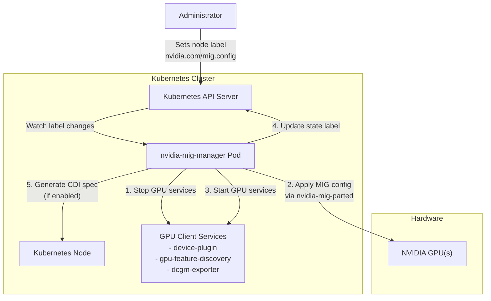
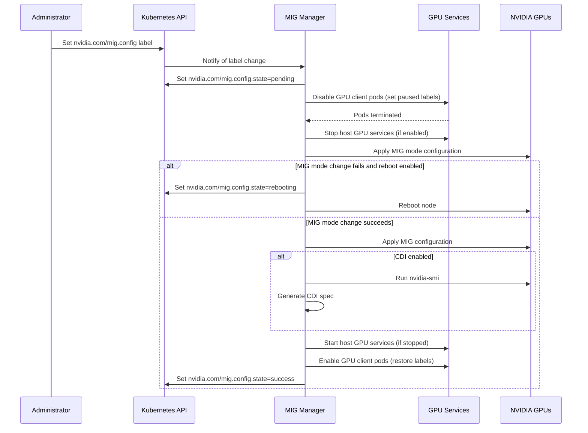
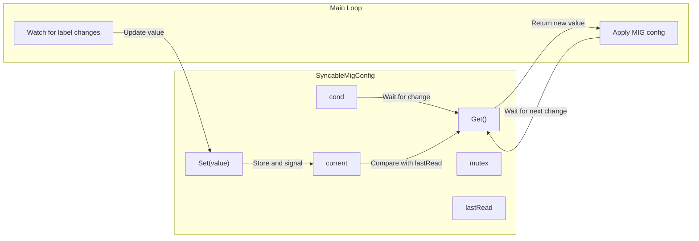

<!-- source: DeepWiki mcp.deepwiki.com · repo NVIDIA/mig-parted · page 5.1 Kubernetes MIG Manager · fetched 2026-10-26 -->

# Kubernetes MIG Manager

<details>
<summary>Relevant source files</summary>

The following files were used as context for generating this wiki page:

- [cmd/nvidia-mig-manager/find.go](cmd/nvidia-mig-manager/find.go)
- [cmd/nvidia-mig-manager/main.go](cmd/nvidia-mig-manager/main.go)
- [deployments/container/reconfigure-mig.sh](deployments/container/reconfigure-mig.sh)
- [deployments/systemd/config-default.yaml](deployments/systemd/config-default.yaml)
- [internal/nvlib/mig/mig.go](internal/nvlib/mig/mig.go)
- [internal/nvlib/mig/mode.go](internal/nvlib/mig/mode.go)
- [internal/nvlib/nvlib.go](internal/nvlib/nvlib.go)
- [internal/systemd/systemd.go](internal/systemd/systemd.go)
- [pkg/mig/mode/mode.go](pkg/mig/mode/mode.go)
- [pkg/mig/reconfigure/reconfigure.go](pkg/mig/reconfigure/reconfigure.go)
- [pkg/mig/reconfigure/reconfigure_test.go](pkg/mig/reconfigure/reconfigure_test.go)
- [vendor/github.com/coreos/go-systemd/v22/LICENSE](vendor/github.com/coreos/go-systemd/v22/LICENSE)
- [vendor/github.com/coreos/go-systemd/v22/NOTICE](vendor/github.com/coreos/go-systemd/v22/NOTICE)

</details>


The Kubernetes MIG Manager is a component that enables declarative management of NVIDIA Multi-Instance GPU (MIG) configurations in Kubernetes environments. It watches for changes to specific node labels and automatically reconfigures MIG settings on NVIDIA GPUs according to the requested configuration.

For information about other deployment methods, see [Systemd Integration](#4).

## Overview

The Kubernetes MIG Manager extends the capabilities of the `nvidia-mig-parted` CLI tool to provide seamless integration with Kubernetes. It enables administrators to manage MIG configurations by simply updating node labels, making MIG management consistent with the Kubernetes declarative paradigm.

### Key Features

- **Label-driven configuration**: Apply MIG configurations by setting a simple node label [cmd/nvidia-mig-manager/main.go:49]()
- **Automatic service management**: Gracefully stops and restarts GPU-dependent services [pkg/mig/reconfigure/reconfigure.go:164-178](), [pkg/mig/reconfigure/reconfigure.go:223-230]()
- **Persistent configuration**: Maintains MIG configuration across node reboots [pkg/mig/reconfigure/reconfigure.go:148-151]()
- **Containerized deployment**: Runs as a Kubernetes component
- **CDI support**: Integrates with NVIDIA Container Device Interface [pkg/mig/reconfigure/reconfigure.go:211-221]()

Sources: [cmd/nvidia-mig-manager/main.go:1-436]()

## Architecture

The Kubernetes MIG Manager follows a controller pattern, watching for changes to node labels and reconciling the desired state with the actual state.

### High-Level Architecture



Sources: [cmd/nvidia-mig-manager/main.go:282-314](), [deployments/container/reconfigure-mig.sh:397-656]()

### Component Diagram

```mermaid
classDiagram
    class KubeMIGManager {
        +main()
        -validateFlags()
        -start()
        -runScript()
        -ContinuouslySyncMigConfigChanges()
    }
    
    class SyncableMigConfig {
        -cond *sync.Cond
        -mutex sync.Mutex
        -current string
        -lastRead string
        +Set(value string)
        +Get() string
    }
    
    class ReconfigureScript {
        +runScript()
        -host_stop_systemd_services()
        -host_start_systemd_services()
        -host_persist_config()
        -exit_success()
        -exit_failed()
    }
    
    KubeMIGManager --> SyncableMigConfig : uses
    KubeMIGManager --> ReconfigureScript : executes
    KubeMIGManager --> "nvidia-mig-parted" : invokes
    ReconfigureScript --> "nvidia-mig-parted" : invokes
```

Sources: [cmd/nvidia-mig-manager/main.go:78-113](), [cmd/nvidia-mig-manager/main.go:374-404](), [deployments/container/reconfigure-mig.sh:1-657]()

## Workflow

The Kubernetes MIG Manager follows a specific sequence of operations when applying a new MIG configuration:

### Configuration Change Workflow



Sources: [deployments/container/reconfigure-mig.sh:437-656]()

## Installation

The Kubernetes MIG Manager is typically deployed as a DaemonSet running on nodes with NVIDIA GPUs. It requires access to the Kubernetes API and the host's GPU devices.

### Required Permissions

- Read/write access to node labels
- Ability to manipulate GPU services (systemd services on the host)
- Access to NVIDIA GPUs through the container

### Container Configuration

| Parameter | Description | Default |
|-----------|-------------|---------|
| `NODE_NAME` | Name of the Kubernetes node to watch | (Required) |
| `CONFIG_FILE` | Path to MIG-parted configuration file | (Required) |
| `KUBECONFIG` | Path to kubeconfig file for API access | "" |
| `WITH_REBOOT` | Enable automatic node reboot on MIG mode change failure | false |
| `WITH_SHUTDOWN_HOST_GPU_CLIENTS` | Enable management of host systemd services | false |
| `CDI_ENABLED` | Enable CDI spec generation | false |
| `HOST_ROOT_MOUNT` | Path where host root is mounted in container | "/host" |

Sources: [cmd/nvidia-mig-manager/main.go:122-261]()

## Configuration via Node Labels

The Kubernetes MIG Manager uses node labels to control MIG configurations and track state.

### MIG Configuration Label

The primary label used to trigger configuration changes is:

```
nvidia.com/mig.config: <configuration-name>
```

Where `<configuration-name>` refers to a named configuration in the MIG-parted configuration file.

### State Labels

The manager uses several labels to track and control the state of GPU services and MIG configuration:

| Label | Purpose | Values |
|-------|---------|--------|
| `nvidia.com/mig.config.state` | Tracks MIG configuration state | "pending", "success", "failed", "rebooting" |
| `nvidia.com/gpu.deploy.device-plugin` | Controls device plugin deployment | "true", "paused-for-mig-change", "false" |
| `nvidia.com/gpu.deploy.gpu-feature-discovery` | Controls GFD deployment | "true", "paused-for-mig-change", "false" |
| `nvidia.com/gpu.deploy.dcgm-exporter` | Controls DCGM exporter deployment | "true", "paused-for-mig-change", "false" |
| `nvidia.com/gpu.deploy.dcgm` | Controls DCGM deployment | "true", "paused-for-mig-change", "false" |

Sources: [cmd/nvidia-mig-manager/main.go:42-44](), [pkg/mig/reconfigure/reconfigure.go:41-48](), [deployments/container/reconfigure-mig.sh:493-500](), [deployments/container/reconfigure-mig.sh:644-650]()

## CDI Support

When Container Device Interface (CDI) support is enabled, the MIG Manager also generates CDI specifications that allow MIG devices to be exposed to containers in a standardized way.

### CDI Workflow

1. After applying a MIG configuration, the manager runs `nvidia-smi` to create device nodes [pkg/mig/reconfigure/reconfigure.go:212-216]()
2. It then generates a CDI specification file using `nvidia-ctk` [pkg/mig/reconfigure/reconfigure.go:217-221]()
3. The specification is stored in `/var/run/cdi/management.nvidia.com-gpu.yaml` [pkg/mig/reconfigure/reconfigure.go:400]()

Sources: [deployments/container/reconfigure-mig.sh:589-624](), [cmd/nvidia-mig-manager/find.go:17-89]()

## Implementation Details

### Label Watching and Synchronization

The MIG Manager uses the Kubernetes client-go library to watch for changes to the node's labels. It specifically watches for changes to the `nvidia.com/mig.config` label [cmd/nvidia-mig-manager/main.go:49]().

The `SyncableMigConfig` structure provides thread-safe access to the current MIG configuration value, with support for blocking until a new value is available [cmd/nvidia-mig-manager/main.go:90-120]().



Sources: [cmd/nvidia-mig-manager/main.go:78-113](), [cmd/nvidia-mig-manager/main.go:406-435]()

### Reconfiguration Process

The reconfiguration process is handled by the `reconfigure.Run()` method [pkg/mig/reconfigure/reconfigure.go:127](), which performs the following steps:

1. Validates that the requested configuration exists [pkg/mig/reconfigure/reconfigure.go:137-140]()
2. Checks if the configuration is already applied [pkg/mig/reconfigure/reconfigure.go:142-146]()
3. Persists the selected configuration to the host's systemd service [pkg/mig/reconfigure/reconfigure.go:148-151]()
4. Checks if a MIG mode change is required [pkg/mig/reconfigure/reconfigure.go:153-156]()
5. Shuts down GPU clients (both Kubernetes pods and systemd services) [pkg/mig/reconfigure/reconfigure.go:164-178](), [pkg/mig/reconfigure/reconfigure.go:174-178]()
6. Applies the MIG mode and configuration changes [pkg/mig/reconfigure/reconfigure.go:184-204](), [pkg/mig/reconfigure/reconfigure.go:206-209]()
7. Generates CDI specifications if enabled [pkg/mig/reconfigure/reconfigure.go:211-221]()
8. Restarts the GPU clients [pkg/mig/reconfigure/reconfigure.go:223-230]()
9. Updates the node labels to reflect the final state [pkg/mig/reconfigure/reconfigure.go:232-235]()

Sources: [pkg/mig/reconfigure/reconfigure.go:127-235]()

## Troubleshooting

### Common Issues

1. **Configuration Not Applied**
   - Check the `nvidia.com/mig.config.state` label - should be "success"
   - Check container logs for error messages

2. **MIG Mode Change Failures**
   - If `WITH_REBOOT` is enabled, check if the node rebooted [pkg/mig/reconfigure/reconfigure.go:186-204]()
   - Verify that GPU clients were properly shut down before MIG mode change [pkg/mig/reconfigure/reconfigure.go:164-178]()

3. **GPU Services Not Restarting**
   - Check if service-specific labels were correctly restored [pkg/mig/reconfigure/reconfigure.go:232-235]()
   - Verify the systemd services are enabled on the host [internal/systemd/systemd.go:115-117]()

Sources: [deployments/container/reconfigure-mig.sh:193-233]()

## Summary

The Kubernetes MIG Manager provides a declarative, Kubernetes-native approach to managing NVIDIA MIG configurations. By watching node labels and orchestrating the MIG configuration process, it enables administrators to easily change MIG settings without direct node access, while ensuring proper handling of GPU-dependent services.

For examples of how to deploy the MIG Manager in a Kubernetes environment, see [Deployment Examples](#5.2).

---

