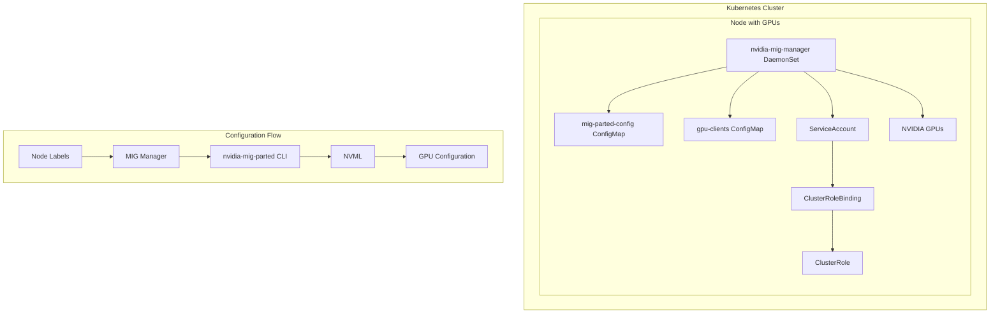
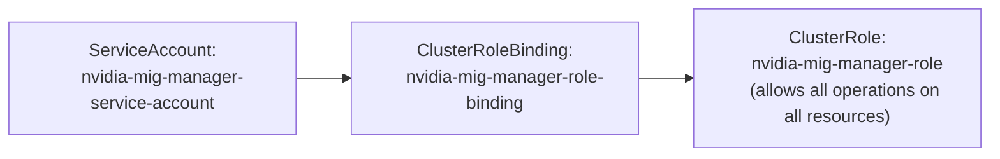
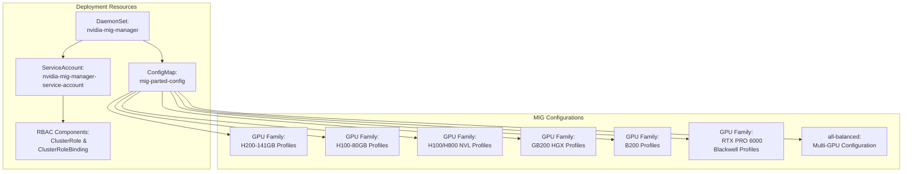
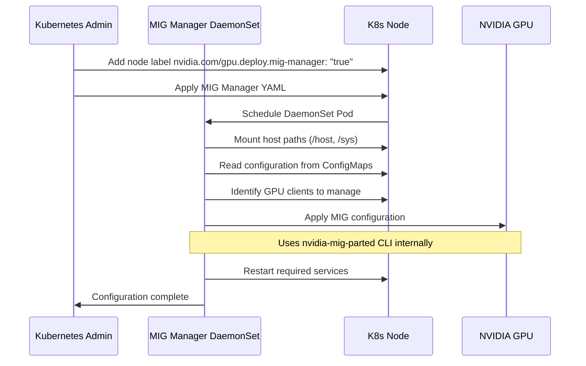
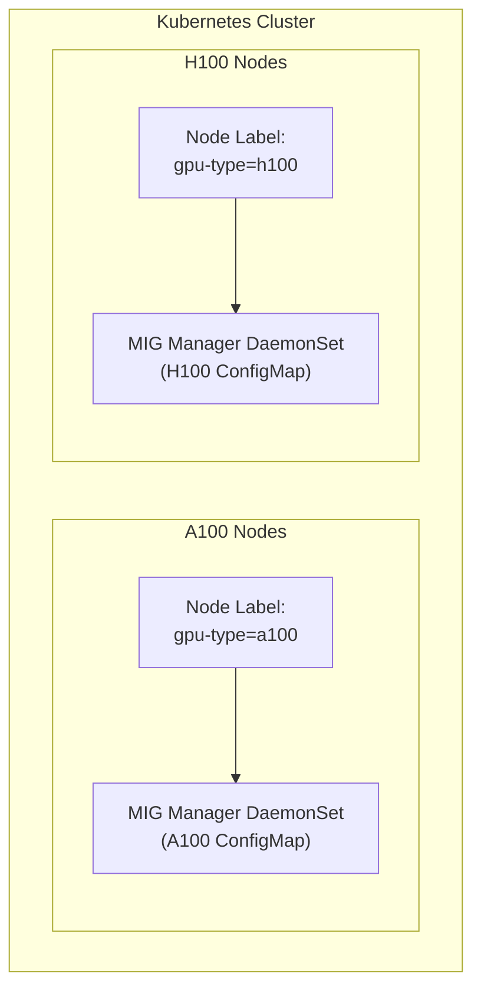

<!-- source: DeepWiki mcp.deepwiki.com · repo NVIDIA/mig-parted · page 5.2 Deployment Examples · fetched 2026-10-26 -->

# Deployment Examples

<details>
<summary>Relevant source files</summary>

The following files were used as context for generating this wiki page:

- [CHANGELOG.md](CHANGELOG.md)
- [cmd/nvidia-mig-manager/find.go](cmd/nvidia-mig-manager/find.go)
- [cmd/nvidia-mig-manager/main.go](cmd/nvidia-mig-manager/main.go)
- [deployments/container/nvidia-mig-manager-example-hopper-blackwell.yaml](deployments/container/nvidia-mig-manager-example-hopper-blackwell.yaml)
- [deployments/container/nvidia-mig-manager-example.yaml](deployments/container/nvidia-mig-manager-example.yaml)
- [deployments/container/reconfigure-mig.sh](deployments/container/reconfigure-mig.sh)
- [deployments/systemd/config-default.yaml](deployments/systemd/config-default.yaml)
- [versions.mk](versions.mk)

</details>


This page provides practical examples for deploying the NVIDIA MIG Manager in Kubernetes environments. These examples demonstrate how to set up and configure the MIG Manager as a DaemonSet to manage Multi-Instance GPU (MIG) configurations on NVIDIA GPUs in a Kubernetes cluster. For information about the Kubernetes MIG Manager component itself, see [Kubernetes MIG Manager](#5.1).

## Deployment Architecture

The following diagram illustrates how the MIG Manager is deployed in a Kubernetes cluster:



Sources: [deployments/container/nvidia-mig-manager-example.yaml:1-76](), [deployments/container/nvidia-mig-manager-example-hopper-blackwell.yaml:1-68]()

## Standard Deployment Example

The standard deployment of the NVIDIA MIG Manager consists of several Kubernetes resources:

1. A **DaemonSet** that runs the MIG Manager on each node with NVIDIA GPUs
2. A **ServiceAccount**, **ClusterRole**, and **ClusterRoleBinding** for RBAC permissions
3. **ConfigMaps** for GPU client management and MIG configuration profiles

### Basic DaemonSet Structure

```mermaid
classDiagram
    class "nvidia-mig-manager DaemonSet" {
        +nodeSelector: nvidia.com/gpu.deploy.mig-manager: "true"
        +containers: nvidia-mig-manager
        +volumes: host-root, host-sys, gpu-clients, mig-parted-config
    }

    class "nvidia-mig-manager Container" {
        +image: nvcr.io/nvidia/cloud-native/k8s-mig-manager:v0.14.5
        +env: NODE_NAME, CONFIG_FILE, etc.
        +volumeMounts: /host, /sys, /gpu-clients, /mig-parted-config
        +securityContext: privileged: true
    }

    class "ConfigMaps" {
        +gpu-clients: systemd services list
        +mig-parted-config: MIG configurations
    }

    "nvidia-mig-manager DaemonSet" --> "nvidia-mig-manager Container"
    "nvidia-mig-manager Container" --> "ConfigMaps"
```

Sources: [deployments/container/nvidia-mig-manager-example.yaml:1-76]()

### Key Configuration Parameters

The MIG Manager DaemonSet uses several important environment variables:

| Environment Variable | Purpose | Default |
|---------------------|---------|---------|
| NODE_NAME | Kubernetes node name | From fieldRef |
| POD_NAME | Kubernetes pod name | From fieldRef |
| POD_NAMESPACE | Kubernetes pod namespace | From fieldRef |
| CONFIG_FILE | Path to MIG configuration file | /mig-parted-config/config.yaml |
| GPU_CLIENTS_FILE | Path to GPU clients list | /gpu-clients/clients.yaml |
| HOST_ROOT_MOUNT | Path to host root mount | /host |
| HOST_NVIDIA_DIR | Path to NVIDIA directory on host | /usr/local/nvidia |
| HOST_KUBELET_SYSTEMD_SERVICE | Name of host's kubelet systemd service | kubelet.service |
| HOST_MIG_MANAGER_STATE_FILE | Host path for mig-manager state file | /etc/systemd/system/nvidia-mig-manager.service.d/override.conf |
| DEFAULT_GPU_CLIENTS_NAMESPACE | Default namespace for GPU client Pods | gpu-operator |
| WITH_SHUTDOWN_HOST_GPU_CLIENTS | Whether to shut down GPU clients | true |
| WITH_REBOOT | Whether to reboot node after config changes | false |

Sources: [deployments/container/nvidia-mig-manager-example.yaml:26-58](), [cmd/nvidia-mig-manager/main.go:130-220]()

### RBAC Configuration

The MIG Manager requires elevated permissions to manage GPU configurations:



Sources: [deployments/container/nvidia-mig-manager-example.yaml:77-103]()

### GPU Clients Configuration

The `gpu-clients` ConfigMap defines services that need to be managed when applying MIG configuration changes:

```yaml
clients.yaml:
  version: v1
  systemd-services:
    - nvsm.service
    - nvsm-mqtt.service
    - nvsm-core.service
    - nvsm-api-gateway.service
    - nvsm-notifier.service
    - nv_peer_mem.service
    - nvidia-dcgm.service
    - dcgm-exporter.service
```

Sources: [deployments/container/nvidia-mig-manager-example.yaml:104-123]()

## Architecture-Specific Deployment Example

For the newer Hopper (H100, H200) and Blackwell (B200, GB200, RTX PRO 6000 Blackwell) architectures, a specialized deployment example is provided.

### Hopper and Blackwell Deployment Structure

The Hopper/Blackwell deployment is similar to the standard deployment but includes GPU-specific MIG profiles in the configuration:



Sources: [deployments/container/nvidia-mig-manager-example-hopper-blackwell.yaml:1-360]()

### Hopper/Blackwell MIG Profiles

The Hopper and Blackwell architectures support different MIG profiles compared to earlier GPU generations. The configuration includes profiles for:

- H200-141GB: `1g.18gb` to `7g.141gb`
- H100-80GB/H800-80GB: `1g.10gb` to `7g.80gb`
- H100 NVL/H800 NVL: `1g.12gb` to `7g.94gb`
- GB200 HGX: `1g.24gb` to `7g.189gb`
- B200: Profiles including `4g.90gb`
- RTX PRO 6000 Blackwell: `1g.24gb.gfx` to `4g.96gb`

Each profile defines a specific GPU memory and compute partition.

Sources: [deployments/container/nvidia-mig-manager-example-hopper-blackwell.yaml:103-313](), [deployments/systemd/config-default.yaml:49-104]()

### Balanced Configuration Example

The `all-balanced` configuration demonstrates a practical mixed-profile setup for each GPU architecture:

```mermaid
flowchart LR
    subgraph "GPU-Specific Balanced Configurations"
        GB200HGX["GB200 HGX:
        1g.23gb × 2
        2g.47gb × 1
        3g.93gb × 1"]

        GB300["GB300:
        1g.35gb × 2
        2g.70gb × 1
        3g.139gb × 1"]

        RTXPRO6000["RTX PRO 6000 Blackwell:
        1g.24gb × 2
        2g.48gb × 1"]

        B200["B200:
        1g.23gb × 2
        2g.45gb × 1
        3g.90gb × 1"]

        B300["B300:
        1g.34gb × 2
        2g.67gb × 1
        3g.135gb × 1"]

        GH200HBM3e["GH200 144G HBM3e:
        1g.24gb × 2
        2g.48gb × 1
        3g.96gb × 1"]

        H200_141GB["H200-141GB:
        1g.18gb × 2
        2g.35gb × 1
        3g.71gb × 1"]

        H200NVL["H200 NVL:
        1g.23gb × 2
        2g.47gb × 1
        3g.94gb × 1"]

        H100_96GB["H100-96GB:
        1g.12gb × 2
        2g.24gb × 1
        3g.48gb × 1"]

        GH200["GH200:
        1g.12gb × 2
        2g.24gb × 1
        3g.48gb × 1"]

        H100NVL["H100 NVL:
        1g.12gb × 2
        2g.24gb × 1
        3g.47gb × 1"]

        H800NVL["H800 NVL:
        1g.12gb × 2
        2g.24gb × 1
        3g.47gb × 1"]

        H100_80GB["H100-80GB:
        1g.10gb × 2
        2g.20gb × 1
        3g.40gb × 1"]

        H800_80GB["H800-80GB:
        1g.10gb × 2
        2g.20gb × 1
        3g.40gb × 1"]

        A800_40GB["A800-40GB:
        1g.5gb × 2
        2g.10gb × 1
        3g.20gb × 1"]

        A800_80GB["A800-80GB:
        1g.10gb × 2
        2g.20gb × 1
        3g.40gb × 1"]

        A100_40GB["A100-40GB:
        1g.5gb × 2
        2g.10gb × 1
        3g.20gb × 1"]

        A100_80GB["A100-80GB:
        1g.10gb × 2
        2g.20gb × 1
        3g.40gb × 1"]

        A30_24GB["A30-24GB:
        1g.6gb × 2
        2g.12gb × 1"]

        PG506_96GB["PG506-96GB:
        1g.12gb × 2
        2g.24gb × 1
        3g.48gb × 1"]
    end
```



Sources: [deployments/container/nvidia-mig-manager-example-hopper-blackwell.yaml:315-360](), [deployments/systemd/config-default.yaml:291-675]()

## Deployment Workflow

The following diagram illustrates the deployment workflow for the MIG Manager in a Kubernetes environment:



Sources: [deployments/container/nvidia-mig-manager-example.yaml:1-76](), [deployments/container/nvidia-mig-manager-example-hopper-blackwell.yaml:1-68]()

## Deployment Steps

To deploy the NVIDIA MIG Manager in your Kubernetes cluster:

1.  Select the appropriate example YAML based on your GPU architecture:
    *   For A100/A30/A800 GPUs: Use `deployments/container/nvidia-mig-manager-example.yaml`
    *   For H100/H200/B200/GB200 GPUs: Use `deployments/container/nvidia-mig-manager-example-hopper-blackwell.yaml`

2.  Customize the ConfigMaps to match your desired MIG configuration.

3.  Label your GPU nodes with `nvidia.com/gpu.deploy.mig-manager: "true"`.

4.  Apply the YAML to your cluster:
    ```bash
    kubectl apply -f <selected-mig-manager-example.yaml>
    ```

5.  Verify the deployment:
    ```bash
    kubectl get pods -l app=nvidia-mig-manager
    ```

Sources: [deployments/container/nvidia-mig-manager-example.yaml:1-76](), [deployments/container/nvidia-mig-manager-example-hopper-blackwell.yaml:1-68]()

## Common Deployment Patterns

### Multi-Node Heterogeneous Cluster

For clusters with different GPU types, you can use node labels and nodeSelectors to apply different MIG configurations to different node types:



Sources: [deployments/container/nvidia-mig-manager-example.yaml:1-76](), [deployments/container/nvidia-mig-manager-example-hopper-blackwell.yaml:1-68]()

### Node-Specific MIG Configurations

For more granular control, you can create multiple ConfigMaps and DaemonSets with specific nodeSelectors:

| Node Type | MIG Configuration | Node Label |
|-----------|-------------------|------------|
| Training Nodes | `all-1g.20gb` | `node-purpose=training` |
| Inference Nodes | `all-2g.10gb` | `node-purpose=inference` |
| Mixed Workload | `all-balanced` | `node-purpose=mixed` |

Sources: [deployments/container/nvidia-mig-manager-example.yaml:124-321](), [deployments/container/nvidia-mig-manager-example-hopper-blackwell.yaml:98-360]()

## Version Compatibility

The examples provided in the repository are compatible with specific versions of the NVIDIA MIG Manager:

| NVIDIA MIG Manager Version | CUDA Version | Compatible GPUs |
|----------------------------|--------------|----------------|
| v0.14.5 | 13.2.1 | A100, A30, A800, H100, H200, B200, GB200, GH200, RTX PRO 6000 Blackwell |
| v0.14.4 | 13.2.1 | A100, A30, A800, H100, H200, B200, GB200, GH200, RTX PRO 6000 Blackwell |
| v0.14.3 | 13.2.1 | A100, A30, A800, H100, H200, B200, GB200, GH200, RTX PRO 6000 Blackwell |
| v0.14.2 | 13.2.1 | A100, A30, A800, H100, H200, B200, GB200, GH200, RTX PRO 6000 Blackwell |
| v0.14.1 | 13.2.1 | A100, A30, A800, H100, H200, B200, GB200, GH200, RTX PRO 6000 Blackwell |
| v0.14.0 | 13.1.1 | A100, A30, A800, H100, H200, B200, GB200, GH200, RTX PRO 6000 Blackwell |
| v0.13.1 | 12.5.4 | A100, A30, A800, H100, H200, B200, GB200, GH200, RTX PRO 6000 Blackwell |
| v0.13.0 | 12.5.4 | A100, A30, A800, H100, H200, B200, GB200, GH200, RTX PRO 6000 Blackwell |
| v0.12.3 | 12.9.1 | A100, A30, A800, H100, H200, B200, GB200, GH200, RTX PRO 6000 Blackwell |
| v0.12.2 | 12.9.1 | A100, A30, A800, H100, H200, B200, GB200, GH200, RTX PRO 6000 Blackwell |
| v0.12.1 | 12.8.1 | A100, A30, A800, H100, H200, B200, GB200, GH200 |
| v0.12.0 | 12.8.1 | A100, A30, A800, H100, H200, B200, GB200, GH200 |
| v0.11.0 | 12.8.0 | A100, A30, A800, H100, H200, B200, GH200 |

Sources: [versions.mk:16-16](), [CHANGELOG.md:1-107]()

---

