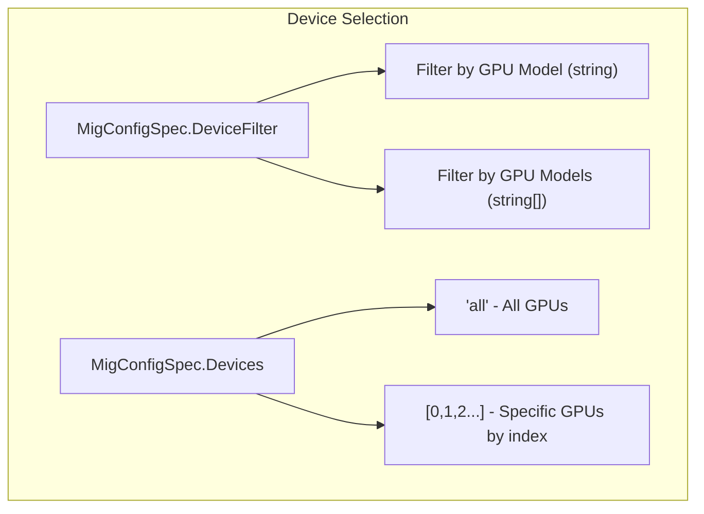
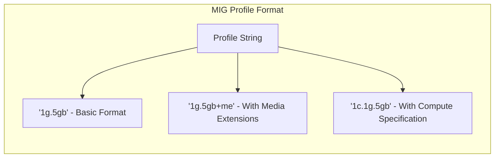
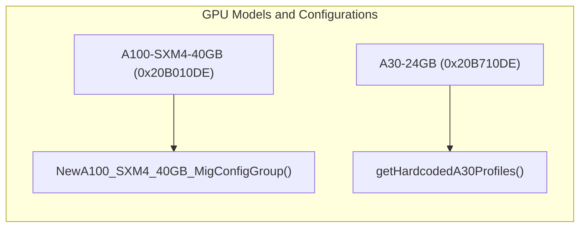
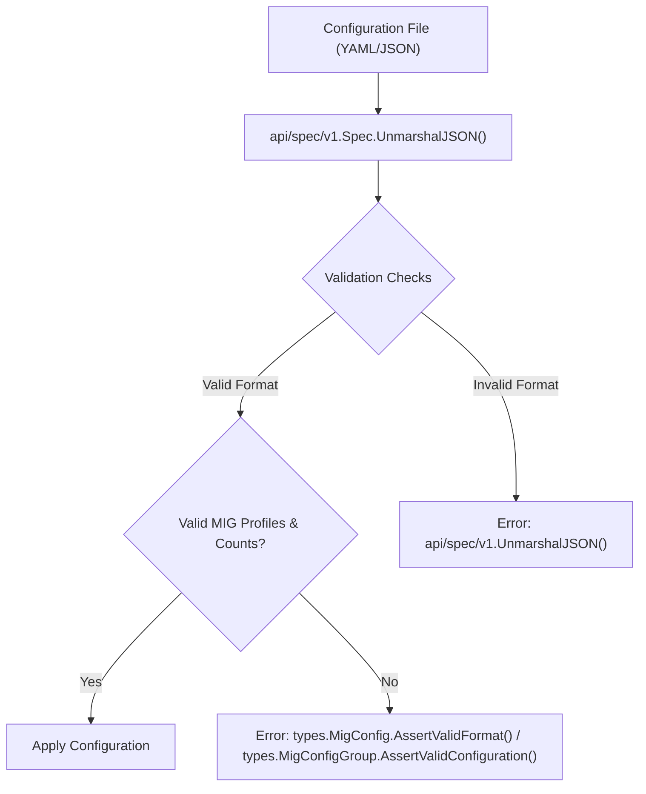

<!-- source: DeepWiki mcp.deepwiki.com · repo NVIDIA/mig-parted · page 6 Configuration Reference · fetched 2026-10-26 -->

# Configuration Reference

<details>
<summary>Relevant source files</summary>

The following files were used as context for generating this wiki page:

- [api/spec/v1/helpers.go](api/spec/v1/helpers.go)
- [api/spec/v1/helpers_test.go](api/spec/v1/helpers_test.go)
- [api/spec/v1/spec.go](api/spec/v1/spec.go)
- [api/spec/v1/spec_test.go](api/spec/v1/spec_test.go)
- [cmd/nvidia-mig-parted/util/device.go](cmd/nvidia-mig-parted/util/device.go)
- [examples/config.yaml](examples/config.yaml)
- [pkg/mig/config/known_configs.go](pkg/mig/config/known_configs.go)
- [pkg/mig/config/known_configs_test.go](pkg/mig/config/known_configs_test.go)
- [pkg/mig/discovery/discovery.go](pkg/mig/discovery/discovery.go)
- [pkg/mig/discovery/discovery_test.go](pkg/mig/discovery/discovery_test.go)
- [pkg/types/device.go](pkg/types/device.go)
- [pkg/types/device_test.go](pkg/types/device_test.go)

</details>


This page provides a comprehensive reference for the configuration file format and options used in NVIDIA MIG-Parted. It details how to define MIG configurations for NVIDIA GPUs using the configuration file, including the syntax, structure, and available options. For information about applying configurations using the CLI, see [nvidia-mig-parted CLI](#3).

## Configuration File Format

The MIG-Parted configuration file uses YAML format and follows a specific structure to define MIG configurations for GPU devices. The configuration file consists of a version field and a map of named MIG configurations.

```mermaid
classDiagram
    class "Spec" {
        +string Version
        +map~string, MigConfigSpecSlice~ MigConfigs
    }
    
    class "MigConfigSpecSlice" {
        +[]MigConfigSpec
    }
    
    class "MigConfigSpec" {
        +interface{} DeviceFilter
        +interface{} Devices
        +bool MigEnabled
        +types.MigConfig MigDevices
    }
    
    "Spec" --> "MigConfigSpecSlice" : contains
    "MigConfigSpecSlice" --> "MigConfigSpec" : contains
```
The `Spec` struct [api/spec/v1/spec.go:30-33]() defines the top-level structure of the configuration file, containing a `Version` and a map of `MigConfigs`. Each entry in `MigConfigs` is a `MigConfigSpecSlice` [api/spec/v1/spec.go:43-44](), which is an array of `MigConfigSpec` [api/spec/v1/spec.go:35-41]() objects.

For details on the structure and parsing rules, see [Configuration File Format](#6.1).

Sources: [api/spec/v1/spec.go:30-44](), [api/spec/v1/spec_test.go:16-396]()

### Version Field

The version field specifies the configuration file format version. Currently, only `v1` is supported. The `Version` constant [api/spec/v1/spec.go:26-27]() defines the expected version.

```yaml
version: v1
```

Sources: [api/spec/v1/spec.go:26-27](), [api/spec/v1/spec.go:30-33]()

### MIG Configs Section

The `mig-configs` section contains a map of named MIG configurations. Each named configuration consists of one or more MIG configuration specifications (`MigConfigSpec`).

```yaml
mig-configs:
  config-name-1:
    - # MigConfigSpec 1
    - # MigConfigSpec 2
  config-name-2:
    - # MigConfigSpec 1
```

Sources: [api/spec/v1/spec.go:30-33](), [examples/config.yaml:1-71]()

### MIG Config Spec Structure

Each MIG configuration specification (`MigConfigSpec`) defines how MIG should be configured for a set of GPU devices. It includes the following fields:

| Field | Type | Required | Description |
|-------|------|----------|-------------|
| `device-filter` | string or array of strings | No | Filter for specific GPU models or device IDs. |
| `devices` | "all" or array of integers | Yes | Specifies which GPU devices to configure by index or all. |
| `mig-enabled` | boolean | Yes | Whether MIG is enabled on the devices. |
| `mig-devices` | map[string]int | Only when `mig-enabled` is true | Map of MIG profiles to count. Uses `types.MigConfig` [api/spec/v1/spec.go:40](). |

Sources: [api/spec/v1/spec.go:35-41](), [api/spec/v1/spec_test.go:237-395]()

## Device Selection

The configuration system provides two ways to specify which devices should be configured: `device-filter` and `devices`.



Sources: [api/spec/v1/spec.go:35-41](), [api/spec/v1/helpers.go:16-67]()

### Device Filter

The `device-filter` field allows filtering GPU devices by model or device ID. It can be a single string or an array of strings. The `MatchesDeviceFilter` method [api/spec/v1/helpers.go:24-47]() is used to check if a `MigConfigSpec` matches a given `types.DeviceID`.

```yaml
# Single model filter
device-filter: "A100-SXM4-40GB"

# Multiple model filter
device-filter: ["A100-SXM4-40GB", "A100-PCIE-40GB"]

# Device ID filter
device-filter: "0x20B010DE"
```

The device filter is applied using hexadecimal device IDs, which represent the combination of PCI device and vendor IDs. For example, `0x20B010DE` represents an A100-SXM4-40GB GPU. The `types.NewDeviceIDFromString` function [pkg/types/device.go:61-96]() parses these strings into `types.DeviceID` objects.

Sources: [api/spec/v1/helpers.go:16-47](), [pkg/types/device.go:16-54](), [pkg/types/device.go:61-96]()

### Devices Field

The `devices` field specifies which GPU devices to configure. It can be either the string "all" to select all devices or an array of integers representing device indices. The `MatchesAllDevices` [api/spec/v1/helpers.go:49-55]() and `MatchesDevices` [api/spec/v1/helpers.go:57-67]() methods determine if a `MigConfigSpec` applies to a specific device.

```yaml
# All devices
devices: all

# Specific devices by index
devices: [0, 1, 2, 3]
```

Sources: [api/spec/v1/helpers.go:49-67](), [api/spec/v1/spec.go:117-149]()

## MIG Profile Format

The MIG profile format specifies the GPU Instance (GI) and Compute Instance (CI) configuration for a MIG device. The format follows a pattern that represents the compute capability and memory of the MIG slice.



Sources: [pkg/types/mig_profile.go:16-70]()

### Basic Profile Format

The basic profile format follows the pattern `{g}g.{mem}gb` where:
- `{g}` is the relative size of the GPU Instance (1, 2, 3, 4, or 7)
- `{mem}` is the memory size in GB

Examples include:
- `1g.5gb` - 1/7th of the GPU with 5GB memory
- `3g.20gb` - 3/7th of the GPU with 20GB memory
- `7g.40gb` - The full GPU with 40GB memory

### Media Extensions

Profiles with media extensions are indicated by adding `+me` to the basic format:
- `1g.5gb+me` - 1/7th of the GPU with 5GB memory and media extensions

Sources: [pkg/types/mig_profile.go:16-70](), [pkg/mig/config/known_configs.go:17-181]()

## MIG Devices Configuration

The `mig-devices` field defines which MIG profiles to create on the selected devices. It is a map where the keys are MIG profile strings and the values are the count of each profile to create. This map corresponds to the `types.MigConfig` type [pkg/types/mig_config.go:21-23]().

```yaml
mig-devices:
  "1g.5gb": 2    # Create 2 instances of 1g.5gb profile
  "2g.10gb": 1   # Create 1 instance of 2g.10gb profile
  "3g.20gb": 1   # Create 1 instance of 3g.20gb profile
```

The sum of the relative GPU sizes must not exceed the capacity of the GPU. For example, on an A100-40GB (which has 7 GPU slices), you cannot configure more than 7 slices total. The `AssertValidConfiguration` method [pkg/mig/config/known_configs_test.go:139]() is used to validate these constraints.

Sources: [pkg/types/mig_config.go:16-134](), [examples/config.yaml:1-71](), [pkg/mig/config/known_configs_test.go:139]()

## Predefined Configurations

MIG-Parted includes a variety of predefined configurations for different GPU models. These configurations are defined in the default configuration file and can be used as-is or as templates for custom configurations. The `pkg/mig/config/known_configs.go` file [pkg/mig/config/known_configs.go:16-181]() contains logic for generating these configurations.

For a detailed list and explanation of these configurations, see [Predefined Configurations](#6.2).

The following table lists some common predefined configurations:

| Configuration Name | Description |
|-------------------|-------------|
| `all-disabled` | MIG mode disabled on all GPUs |
| `all-enabled` | MIG mode enabled on all GPUs but without MIG devices |
| `all-1g.5gb` | Creates seven 1g.5gb instances on each A100-40GB |
| `all-2g.10gb` | Creates three 2g.10gb instances on each A100-40GB |
| `all-3g.20gb` | Creates two 3g.20gb instances on each A100-40GB |
| `all-balanced` | Creates a balanced mix of different MIG profiles |

Sources: [examples/config.yaml:1-71]()

### Device-Specific Configurations

The default configuration includes specific configurations for different GPU models. The `pkg/mig/discovery` package [pkg/mig/discovery/discovery.go:16-210]() is responsible for discovering available MIG profiles on different GPU types, including special handling for devices like A30 [pkg/mig/discovery/discovery.go:73-87]().



For each GPU model, there are specific MIG profiles available based on the GPU's architecture and memory capacity.

Sources: [pkg/mig/config/known_configs.go:26-28](), [pkg/mig/config/known_configs.go:61-72](), [pkg/mig/discovery/discovery.go:37-39](), [pkg/mig/discovery/discovery.go:73-87]()

## Configuration Examples

### Basic Configuration

A simple configuration to disable MIG mode on all GPUs:

```yaml
version: v1
mig-configs:
  all-disabled:
    - devices: all
      mig-enabled: false
```

### Enabling MIG with Specific Profiles

Enable MIG mode on all GPUs and create 7 instances of the 1g.5gb profile:

```yaml
version: v1
mig-configs:
  all-1g.5gb:
    - devices: all
      mig-enabled: true
      mig-devices:
        "1g.5gb": 7
```

### Mixed Configuration

Different MIG configurations for different GPUs:

```yaml
version: v1
mig-configs:
  custom-config:
    - devices: [0,1,2,3]  # First 4 GPUs: MIG disabled
      mig-enabled: false
    - devices: [4]        # GPU 4: 7 instances of 1g.5gb
      mig-enabled: true
      mig-devices:
        "1g.5gb": 7
    - devices: [5]        # GPU 5: 3 instances of 2g.10gb
      mig-enabled: true
      mig-devices:
        "2g.10gb": 3
```

### Device Filtering Example

Apply different configurations based on GPU model:

```yaml
version: v1
mig-configs:
  model-specific:
    - device-filter: "A100-SXM4-40GB"  # For A100-SXM4-40GB GPUs
      devices: all
      mig-enabled: true
      mig-devices:
        "3g.20gb": 2
    - device-filter: "A30-24GB"        # For A30-24GB GPUs
      devices: all
      mig-enabled: true
      mig-devices:
        "2g.12gb": 2
```

Sources: [examples/config.yaml:1-71]()

## Configuration Validation

The MIG-Parted system validates configurations to ensure they are valid for the target GPUs. It checks:

1. The configuration format is correct, handled by `UnmarshalJSON` methods for `Spec` [api/spec/v1/spec.go:47-99]() and `MigConfigSpec` [api/spec/v1/spec.go:101-183]().
2. MIG profiles are valid and supported by the GPU.
3. The total number of GPU slices does not exceed the GPU's capacity, validated by `types.MigConfig.AssertValidFormat` [pkg/types/mig_config.go:39-59]() and `types.MigConfigGroup.AssertValidConfiguration` [pkg/types/mig_config_group.go:16-57]().
4. The configuration is compatible with the GPU's architecture.

If an invalid configuration is provided, the system will return an error explaining why the configuration is invalid.



Sources: [api/spec/v1/spec.go:47-183](), [pkg/types/mig_config.go:39-59](), [pkg/types/mig_config_group.go:16-57]()

## Internal Configuration Processing

When a configuration is applied, the MIG-Parted system follows these steps:

1. Parse the configuration file.
2. Validate the configuration.
3. Apply MIG mode to selected devices.
4. Create GPU Instances (GI) according to the configuration.
5. Create Compute Instances (CI) within each GPU Instance.

If any step fails, the system will attempt to restore the previous state to avoid leaving the GPU in an inconsistent state.

Sources: [pkg/mig/config/config.go:102-213]()

---

