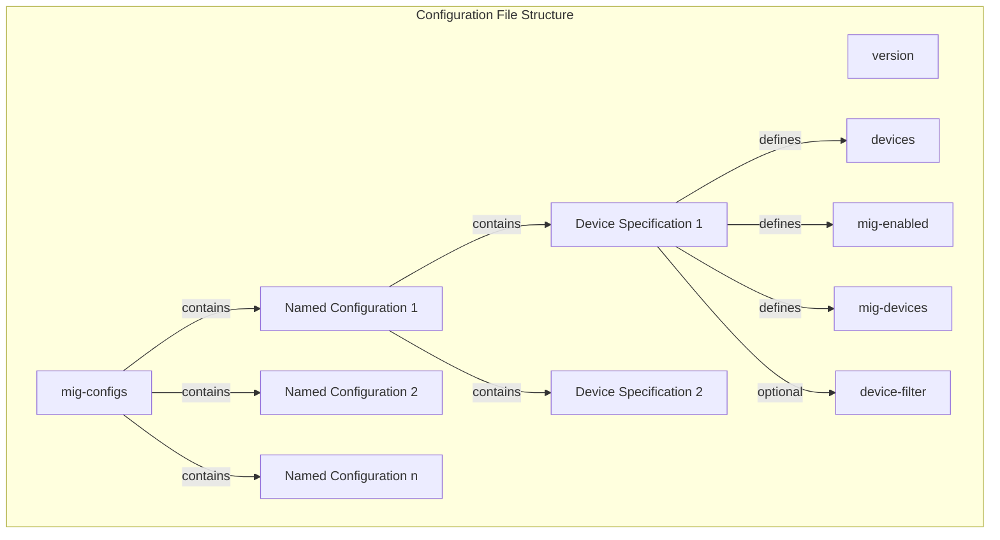
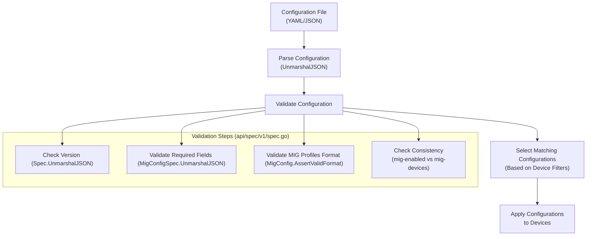
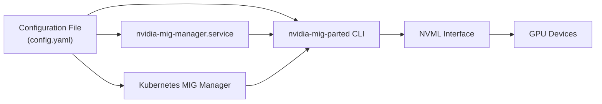

<!-- source: DeepWiki mcp.deepwiki.com · repo NVIDIA/mig-parted · page 6.1 Configuration File Format · fetched 2026-10-26 -->

# Configuration File Format

<details>
<summary>Relevant source files</summary>

The following files were used as context for generating this wiki page:

- [api/spec/v1/helpers.go](api/spec/v1/helpers.go)
- [api/spec/v1/spec.go](api/spec/v1/spec.go)
- [api/spec/v1/spec_test.go](api/spec/v1/spec_test.go)
- [examples/config.yaml](examples/config.yaml)
- [pkg/mig/config/known_configs_test.go](pkg/mig/config/known_configs_test.go)
- [pkg/types/mig_config.go](pkg/types/mig_config.go)
- [pkg/types/mig_config_group.go](pkg/types/mig_config_group.go)
- [pkg/types/mig_profile.go](pkg/types/mig_profile.go)

</details>


This document describes the format and structure of the configuration files used by NVIDIA MIG-Parted. These configuration files define Multi-Instance GPU (MIG) profiles that can be applied to NVIDIA GPUs, enabling fine-grained allocation of GPU resources.

## Overview

The MIG-Parted configuration file uses YAML format to define a collection of named MIG configurations that can be applied to NVIDIA GPUs. Each configuration specifies which devices should be targeted and what MIG profile should be applied to them.



Sources: [examples/config.yaml](), [api/spec/v1/spec.go]()

## File Structure

The configuration file consists of two main sections:

1. `version`: Specifies the version of the configuration format (currently "v1").
2. `mig-configs`: Contains named MIG configurations that can be referenced by the CLI tools and other components.

### Top-Level Format

```yaml
version: v1
mig-configs:
  config-name-1:
    - devices: ...
      mig-enabled: ...
      mig-devices: ...
  config-name-2:
    - devices: ...
      mig-enabled: ...
      mig-devices: ...
```

The top-level structure is defined by the `Spec` struct [api/spec/v1/spec.go:30-33](). The `Version` field [api/spec/v1/spec.go:31]() is a string and must be "v1" [api/spec/v1/spec.go:27](). The `MigConfigs` field [api/spec/v1/spec.go:32]() is a map where keys are configuration names (strings) and values are `MigConfigSpecSlice` [api/spec/v1/spec.go:44]().

Sources: [examples/config.yaml:1-11](), [api/spec/v1/spec.go:30-33]()

## Named MIG Configurations

Each named configuration under `mig-configs` defines a specific MIG setup that can be applied to one or more GPUs. The configuration name is used as a reference when applying configurations using the `nvidia-mig-parted` CLI. For details on using the CLI, see [apply Command](#3.1).

Each named configuration contains a list of device specifications, which define how MIG should be configured on specific GPUs.

```mermaid
classDiagram
    class Spec {
        +string Version
        +map~string, MigConfigSpecSlice~ MigConfigs
    }
    
    class MigConfigSpecSlice {
        +[]MigConfigSpec
    }
    
    class MigConfigSpec {
        +interface{} DeviceFilter
        +interface{} Devices
        +bool MigEnabled
        +types.MigConfig MigDevices
    }
    
    class MigConfig {
        +map~string, int~
    }
    
    Spec -- MigConfigSpecSlice: contains
    MigConfigSpecSlice -- MigConfigSpec: consists of
    MigConfigSpec -- MigConfig: references
```

Sources: [api/spec/v1/spec.go:26-44]()

## Device Specifications

Each device specification is represented by a `MigConfigSpec` struct [api/spec/v1/spec.go:36-41]() and defines:

1. Which devices the configuration applies to (`devices`).
2. Whether MIG is enabled (`mig-enabled`).
3. What MIG profiles to configure (`mig-devices`).
4. Optionally, a filter to apply configurations only to specific device models (`device-filter`).

### Device Selection

The `Devices` field [api/spec/v1/spec.go:38]() in `MigConfigSpec` can be specified in two ways:

1. As the string "all" to target all available devices:
   ```yaml
   devices: all
   ```
   This is checked by the `MatchesAllDevices` method [api/spec/v1/helpers.go:49-54]().

2. As a list of specific device indices to target specific GPUs:
   ```yaml
   devices: [0, 1, 3]
   ```
   This is checked by the `MatchesDevices` method [api/spec/v1/helpers.go:57-67]().

Sources: [api/spec/v1/spec.go:133-149](), [api/spec/v1/helpers.go:49-67]()

### MIG Enablement

The `MigEnabled` field [api/spec/v1/spec.go:39]() is a boolean that determines whether MIG mode is enabled on the specified devices:

```yaml
mig-enabled: true  # Enable MIG mode
```

or

```yaml
mig-enabled: false  # Disable MIG mode
```

When `mig-enabled` is `false`, the `mig-devices` field should be omitted. If `mig-devices` is present when `mig-enabled` is `false`, an error will be returned during unmarshaling [api/spec/v1/spec.go:177-179](). When `mig-enabled` is `true`, the `mig-devices` field is required [api/spec/v1/spec.go:173-175]() (except for the special case of enabling MIG with no instances configured, which is represented by an empty `mig-devices` map).

Sources: [api/spec/v1/spec.go:150-157](), [api/spec/v1/spec.go:173-179]()

### MIG Device Configuration

The `MigDevices` field [api/spec/v1/spec.go:40]() is of type `types.MigConfig` [pkg/types/mig_config.go:28](), which is a map where:
- The keys are MIG profile names (e.g., "1g.5gb", "3g.20gb")
- The values are the number of instances of that profile to create

Example:
```yaml
mig-devices:
  "1g.5gb": 2
  "2g.10gb": 1
  "3g.20gb": 1
```

This would create 2 instances of the "1g.5gb" profile, 1 instance of the "2g.10gb" profile, and 1 instance of the "3g.20gb" profile.

The MIG profile names follow the format `<compute-capability>g.<memory-size>gb`, optionally followed by `+me` to indicate that the profile includes a media extension. The `types.MigConfig` type includes an `AssertValidFormat` method [pkg/types/mig_config.go:40-59]() to validate the profile strings and counts. The `ParseMigProfile` function [pkg/types/mig_profile.go:48-54]() is used to convert string representations into `types.MigProfile` objects.

Sources: [examples/config.yaml:12-48](), [api/spec/v1/spec.go:157-167](), [pkg/types/mig_config.go:28](), [pkg/types/mig_config.go:40-59](), [pkg/types/mig_profile.go:48-54]()

### Device Filtering

The optional `DeviceFilter` field [api/spec/v1/spec.go:37]() allows configurations to be applied only to specific GPU models or device IDs. This can be specified as:

1. A single device model or ID string:
   ```yaml
   device-filter: "A100-SXM4-40GB"
   ```

2. A list of device models or IDs:
   ```yaml
   device-filter: ["A100-SXM4-40GB", "A100-PCIE-40GB"]
   ```

Device filters can also be specified using PCI device IDs. The `MatchesDeviceFilter` method [api/spec/v1/helpers.go:24-47]() is used to check if a `MigConfigSpec` matches a given `types.DeviceID`.

Sources: [api/spec/v1/spec.go:119-132](), [api/spec/v1/helpers.go:24-47]()

## Configuration Processing Flow

The following diagram illustrates how configuration files are processed by the MIG-Parted system:



Sources: [api/spec/v1/spec.go:46-183](), [pkg/types/mig_config.go:40-59]()

## Example Configurations

### Basic Configuration Examples

1. Disable MIG on all devices:

```yaml
version: v1
mig-configs:
  all-disabled:
    - devices: all
      mig-enabled: false
```

2. Enable MIG with no instances (empty configuration):

```yaml
version: v1
mig-configs:
  all-enabled:
    - devices: all
      mig-enabled: true
      mig-devices: {}
```

3. Configure all devices with the same MIG profile:

```yaml
version: v1
mig-configs:
  all-1g.5gb:
    - devices: all
      mig-enabled: true
      mig-devices:
        "1g.5gb": 7
```

Sources: [examples/config.yaml:1-18]()

### Mixed MIG Profiles

Configure all devices with a mix of different MIG profiles:

```yaml
version: v1
mig-configs:
  all-balanced:
    - devices: all
      mig-enabled: true
      mig-devices:
        "1g.5gb": 2
        "2g.10gb": 1
        "3g.20gb": 1
```

Sources: [examples/config.yaml:42-48]()

### Different Configurations for Different Devices

Configure some devices with MIG disabled and others with different MIG profiles:

```yaml
version: v1
mig-configs:
  custom-config:
    - devices: [0,1,2,3]
      mig-enabled: false
    - devices: [4]
      mig-enabled: true
      mig-devices:
        "1g.5gb": 7
    - devices: [5]
      mig-enabled: true
      mig-devices:
        "2g.10gb": 3
```

Sources: [examples/config.yaml:50-70]()

### Device-Specific Configurations

Configure different profiles for different GPU models:

```yaml
version: v1
mig-configs:
  all-1g.10gb:
    # H100-80GB, H800-80GB, A100-80GB, A800-80GB
    - device-filter: ["0x233010DE", "0x233110DE", "0x232210DE", "0x20B210DE"]
      devices: all
      mig-enabled: true
      mig-devices:
        "1g.10gb": 7
    
    # A100-40GB, A800-40GB
    - device-filter: ["0x20B010DE", "0x20B110DE"]
      devices: all
      mig-enabled: true
      mig-devices:
        "1g.10gb": 4
```

Sources: [api/spec/v1/spec_test.go:107-123]()

## Validation Rules

The configuration file is validated against several rules enforced by the `UnmarshalJSON` methods of `Spec` [api/spec/v1/spec.go:46-99]() and `MigConfigSpec` [api/spec/v1/spec.go:102-183]():

1. The `version` field must be "v1" [api/spec/v1/spec.go:70-72]().
2. The `mig-configs` section must contain at least one named configuration [api/spec/v1/spec.go:83-85]().
3. Each named configuration must contain at least one device specification [api/spec/v1/spec.go:86-90]().
4. Each device specification must include:
   - `devices` field (either "all" or a list of device indices) [api/spec/v1/spec.go:109-114]()
   - `mig-enabled` field (boolean) [api/spec/v1/spec.go:109-114]()
5. If `mig-enabled` is `true`, the `mig-devices` field must be present [api/spec/v1/spec.go:173-175]() (an empty map `{}` is valid for no instances).
6. If `mig-enabled` is `false`, the `mig-devices` field must be omitted or empty [api/spec/v1/spec.go:177-179]().
7. MIG profile names in `mig-devices` must follow the correct format, and counts must be non-negative [pkg/types/mig_config.go:40-59]().

Sources: [api/spec/v1/spec.go:46-183](), [api/spec/v1/spec_test.go:137-235](), [pkg/types/mig_config.go:40-59]()

## Default Configuration

MIG-Parted includes a default configuration file with predefined configurations for various NVIDIA GPU models. This can be found at [deployments/systemd/config-default.yaml]().

For information about these predefined configurations, see [Predefined Configurations](#6.2).

## Relationship with Other Components

The configuration file is used by various components of the MIG-Parted system:



Sources: [api/spec/v1/spec.go]()

## Summary

The configuration file format provides a flexible way to define MIG profiles for NVIDIA GPUs. Key features include:

- Named configurations for easy reference
- Device filtering by model/ID
- Support for multiple MIG profiles within a single configuration
- Different configurations for different devices

By understanding this format, you can create custom MIG configurations tailored to your specific workload requirements.

---

