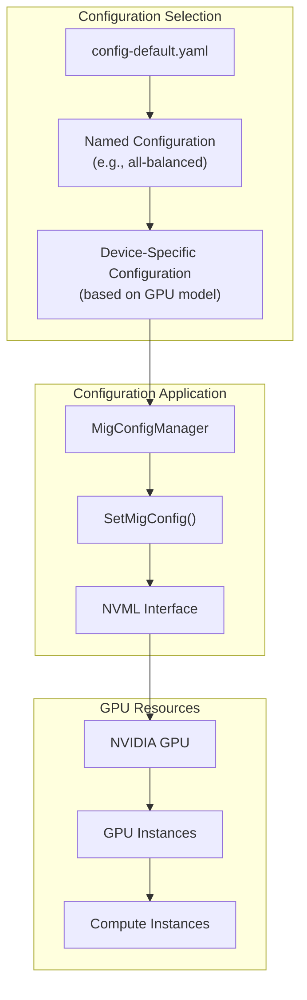

<!-- source: DeepWiki mcp.deepwiki.com · repo NVIDIA/mig-parted · page 6.2 Predefined Configurations · fetched 2026-10-26 -->

# Predefined Configurations

<details>
<summary>Relevant source files</summary>

The following files were used as context for generating this wiki page:

- [cmd/nvidia-mig-manager/find.go](cmd/nvidia-mig-manager/find.go)
- [cmd/nvidia-mig-manager/main.go](cmd/nvidia-mig-manager/main.go)
- [cmd/nvidia-mig-parted/generateconfig/generate_config.go](cmd/nvidia-mig-parted/generateconfig/generate_config.go)
- [deployments/container/reconfigure-mig.sh](deployments/container/reconfigure-mig.sh)
- [deployments/systemd/config-default.yaml](deployments/systemd/config-default.yaml)
- [examples/dgx-station-80gb-config.yaml](examples/dgx-station-80gb-config.yaml)
- [pkg/mig/builder/balanced.go](pkg/mig/builder/balanced.go)
- [pkg/mig/builder/balanced_test.go](pkg/mig/builder/balanced_test.go)
- [pkg/mig/builder/builder.go](pkg/mig/builder/builder.go)

</details>


This document provides a comprehensive overview of the predefined MIG (Multi-Instance GPU) configurations available in the NVIDIA MIG-Parted system. These configurations serve as templates that can be applied to compatible NVIDIA GPUs to enable specific MIG partitioning schemes. For information about how to create custom MIG configurations, see [Configuration File Format](#6.1).

## Overview of Predefined Configurations

Predefined configurations are named, ready-to-use MIG configuration templates that define specific partitioning schemes for NVIDIA GPUs with MIG capability. These configurations specify how a GPU should be divided into smaller instances with specific compute and memory allocations.



Sources: [deployments/systemd/config-default.yaml:1-433]()

## Configuration Naming Convention

Predefined configurations follow a structured naming convention that indicates their purpose and scope:

- **all-disabled**: Disables MIG mode on all devices
- **all-enabled**: Enables MIG mode but doesn't create any instances
- **all-{profile}**: Creates instances of a specific profile type on all devices
- **all-balanced**: Creates a balanced mix of different instance types

The profile portion of the name (e.g., `1g.5gb`) follows this format:

```
{compute-slice}g.{memory-size}gb[+me]
```

Where:
- **compute-slice**: Represents the relative compute capability (1g, 2g, 3g, etc.)
- **memory-size**: Represents the memory allocation in GB
- **+me** (optional): Indicates Media Extensions are enabled for this profile

Sources: [deployments/systemd/config-default.yaml:3-205]()

## Configuration Structure

Each predefined configuration in `config-default.yaml` consists of one or more configuration blocks that specify:

1. The devices to configure (typically `all`)
2. Device filtering options (based on specific GPU models)
3. MIG mode enablement status
4. MIG device profile specifications

Here's an example of a predefined configuration for creating seven 1g.5gb instances:

```yaml
all-1g.5gb:
  - devices: all
    mig-enabled: true
    mig-devices:
      "1g.5gb": 7
```

Sources: [deployments/systemd/config-default.yaml:13-17]()

## GPU-Specific Configurations

The predefined configurations are organized to work with specific GPU models. Device filtering ensures that appropriate configurations are applied to compatible devices.

```mermaid
graph TD
    subgraph "GPU Models"
        A100["A100-40GB/A800-40GB"]
        A100_80["A100-80GB/A800-80GB"]
        A30["A30-24GB"]
        H100_80["H100-80GB/H800-80GB"]
        H100_NVL["H100 NVL/H800 NVL"]
        H100_96["H100-96GB/PG506-96GB"]
        H200_141["H200-141GB/GH200 144G HBM3e"]
        B200["B200"]
        GB200_HGX["GB200 HGX"]
        RTX_PRO_6000["RTX PRO 6000 Blackwell"]
    end

    subgraph "Profile Types"
        P1g5["1g.5gb"]
        P1g10["1g.10gb"]
        P2g10["2g.10gb"]
        P3g20["3g.20gb"]
        P4g20["4g.20gb"]
        P7g40["7g.40gb"]
        P1g6["1g.6gb"]
        P2g12["2g.12gb"]
        P4g24["4g.24gb"]
        P1g12["1g.12gb"]
        P1g24["1g.24gb"]
        P2g24["2g.24gb"]
        P3g47["3g.47gb"]
        P4g47["4g.47gb"]
        P7g94["7g.94gb"]
        P3g48["3g.48gb"]
        P4g48["4g.48gb"]
        P7g96["7g.96gb"]
        P1g47["1g.47gb"]
        P2g47["2g.47gb"]
        P3g93["3g.93gb"]
        P4g93["4g.93gb"]
        P7g186["7g.186gb"]
        P1g24gfx["1g.24gb+gfx"]
        P1g24meall["1g.24gb+me.all"]
        P1g24me["1g.24gb-me"]
        P2g48["2g.48gb"]
        P2g48gfx["2g.48gb+gfx"]
        P2g48meall["2g.48gb+me.all"]
        P2g48me["2g.48gb-me"]
        P4g96["4g.96gb"]
        P4g96gfx["4g.96gb+gfx"]
    end
    
    A100 --> P1g5 & P2g10 & P3g20 & P4g20 & P7g40
    A100_80 --> P1g10 & P2g20 & P3g40 & P4g40 & P7g80
    A30 --> P1g6 & P2g12 & P4g24
    H100_80 --> P1g10 & P2g20 & P3g40 & P4g40 & P7g80
    H100_NVL --> P1g12 & P1g24 & P2g24 & P3g47 & P4g47 & P7g94
    H100_96 --> P3g48 & P4g48 & P7g96
    H200_141 --> P3g48 & P4g48 & P7g96
    GB200_HGX --> P1g47 & P2g47 & P3g93 & P4g93 & P7g186
    RTX_PRO_6000 --> P1g24gfx & P1g24meall & P1g24me & P2g48 & P2g48gfx & P2g48meall & P2g48me & P4g96 & P4g96gfx
```



Sources: [deployments/systemd/config-default.yaml:12-289]()

### Device ID Filtering

Device filtering is implemented using PCI device IDs to ensure configurations are applied only to compatible GPUs:

```yaml
# H100-80GB, H800-80GB, A100-80GB, A800-80GB
all-1g.10gb:
  # H100-80GB, H800-80GB, A100-80GB, A800-80GB
  - device-filter: ["0x233010DE", "0x233110DE", "0x232210DE", "0x20B210DE", "0x20B510DE", "0x20F310DE", "0x20F510DE", "0x232410DE"]
    devices: all
    mig-enabled: true
    mig-devices:
      "1g.10gb": 7

  # A100-40GB, A800-40GB
  - device-filter: ["0x20B010DE", "0x20B110DE", "0x20F110DE", "0x20F610DE"]
    devices: all
    mig-enabled: true
    mig-devices:
      "1g.10gb": 4
```

The `device-filter` field in the `MigConfigSpec` allows specifying a list of PCI device IDs. If this field is present, the configuration slice only applies to GPUs matching one of the specified device IDs [deployments/systemd/config-default.yaml:107-118]().

Sources: [deployments/systemd/config-default.yaml:104-119]()

## Implementation Structure

The predefined configurations are implemented through a layered structure of code components:

```mermaid
classDiagram
    direction LR
    class MigProfile {
        +GIProfileID int
        +CIProfileID int
        +CIEngProfileID int
        +G int
        +C int
        +Attributes []string
        +String() string
        +HasAttribute(attr string) bool
    }
    
    class MigConfig {
        +map[string]int
        +AssertValidFormat() error
        +IsSubsetOf(config MigConfig) bool
        +Contains(profile string) bool
        +Equals(config MigConfig) bool
        +Flatten() []*MigProfile
    }
    
    class MigConfigSpec {
        +DeviceFilter interface{}
        +Devices interface{}
        +MigEnabled bool
        +MigDevices MigConfig
    }

    class Spec {
        +Version string
        +MigConfigs map[string]MigConfigSpecSlice
    }

    class MigConfigSpecSlice {
        +[]MigConfigSpec
    }
    
    class MigConfigManager {
        <<interface>>
        +GetMigConfig(gpu int) (MigConfig, error)
        +SetMigConfig(gpu int, config MigConfig) error
        +ClearMigConfig(gpu int) error
    }
    
    MigConfig --* MigProfile : contains
    MigConfigSpec --> MigConfig : uses
    MigConfigSpecSlice --> MigConfigSpec : contains
    Spec --> MigConfigSpecSlice : contains
    MigConfigManager --> MigConfig : applies
```

Sources: [pkg/mig/builder/builder.go:29-32](), [pkg/mig/builder/builder.go:141-144]()

### MigProfile

The `MigProfile` struct represents a specific MIG profile, such as "1g.5gb" or "3g.40gb+me". Each profile defines:

- GPU Instance (GI) profile ID
- Compute Instance (CI) profile ID
- Compute Instance Engine profile ID
- Memory size
- Optional attributes (e.g., media extensions)

Sources: [pkg/mig/builder/builder.go:37-38]()

### MigConfig

The `MigConfig` type is a map that associates MIG profile strings with their counts. For example:

```
{
  "1g.5gb": 2,
  "2g.10gb": 1,
  "3g.20gb": 1
}
```

This represents a configuration with two 1g.5gb instances, one 2g.10gb instance, and one 3g.20gb instance.

Sources: [pkg/mig/builder/builder.go:77]()

### `pkg/mig/builder` for Auto-Generation

The `pkg/mig/builder` package is responsible for dynamically generating MIG configurations based on the profiles discovered on the system [pkg/mig/builder/builder.go:148-153](). This allows for the creation of `config-default.yaml` and other configuration files that are tailored to the specific hardware present.

The `builder` package provides functions like `GenerateConfigSpec()`, `GenerateConfigYAML()`, and `GenerateConfigJSON()` to programmatically create `migspec.Spec` objects or their YAML/JSON representations [pkg/mig/builder/builder.go:148-184]().

The auto-generation process involves:
1. **Discovering MIG Profiles**: `discovery.DiscoverMIGProfiles()` is called to get available profiles from the hardware [pkg/mig/builder/builder.go:149]().
2. **Grouping Profiles**: Profiles are grouped by name and device ID [pkg/mig/builder/builder.go:44-61]().
3. **Creating Base Configurations**: `all-disabled` and `all-enabled` configurations are always added [pkg/mig/builder/builder.go:66-79]().
4. **Building `all-balanced`**: The `buildAllBalancedConfig()` function constructs the `all-balanced` configuration based on a predefined formula and available base profiles [pkg/mig/builder/builder.go:81](), [pkg/mig/builder/balanced.go:31-35]().
5. **Generating Per-Profile Configurations**: For each unique profile discovered, an `all-{profile}` configuration is created, potentially with `device-filter` if multiple GPU types are present [pkg/mig/builder/builder.go:89-139]().

Sources: [pkg/mig/builder/builder.go:148-184](), [pkg/mig/builder/builder.go:44-61](), [pkg/mig/builder/builder.go:66-79](), [pkg/mig/builder/builder.go:81](), [pkg/mig/builder/balanced.go:31-35](), [pkg/mig/builder/builder.go:89-139]()

## All-Balanced Configuration

The "all-balanced" configuration is particularly noteworthy as it provides a mix of different instance types tailored to each GPU model. It's designed to provide a balanced allocation of resources for diverse workloads.

The `all-balanced` configuration is dynamically generated by the `pkg/mig/builder` package. It uses a `balancedFormula` to determine the optimal mix of 1g, 2g, and 3g profiles for GPUs with 7 or 4 total slots [pkg/mig/builder/balanced.go:31-35]().

Here's an example of the balanced configuration for the A100-40GB:

```yaml
# A100-40GB, A800-40GB
- device-filter: ["0x20B010DE", "0x20B110DE", "0x20F110DE", "0x20F610DE"]
  devices: all
  mig-enabled: true
  mig-devices:
    "1g.5gb": 2
    "2g.10gb": 1
    "3g.20gb": 1
```

This creates two 1g.5gb instances, one 2g.10gb instance, and one 3g.20gb instance, providing a mix of small, medium, and large instances.

Sources: [deployments/systemd/config-default.yaml:206-276](), [pkg/mig/builder/balanced.go:31-35]()

## Available Predefined Configurations

The following table summarizes some of the key predefined configurations available for different GPU models, as found in `deployments/systemd/config-default.yaml`:

| Configuration Name | Applicable GPU Models | Description |
|-------------------|------------------------|-------------|
| `all-disabled` | All MIG-capable GPUs | Disables MIG mode on all devices |
| `all-enabled` | All MIG-capable GPUs | Enables MIG mode without creating instances |
| `all-1g.5gb` | A100-40GB, A800-40GB | Creates seven 1g.5gb instances |
| `all-1g.5gb.me` | A100-40GB, A800-40GB | Creates one 1g.5gb+me instance |
| `all-2g.10gb` | A100-40GB, A800-40GB | Creates three 2g.10gb instances |
| `all-3g.20gb` | A100-40GB, A800-40GB | Creates two 3g.20gb instances |
| `all-4g.20gb` | A100-40GB, A800-40GB | Creates one 4g.20gb instance |
| `all-7g.40gb` | A100-40GB, A800-40GB | Creates one 7g.40gb instance |
| `all-1g.24gb.gfx` | RTX PRO 6000 Blackwell | Creates four 1g.24gb+gfx instances |
| `all-1g.24gb.me.all` | RTX PRO 6000 Blackwell | Creates one 1g.24gb+me.all instance |
| `all-1g.24gb-me` | RTX PRO 6000 Blackwell | Creates four 1g.24gb-me instances |
| `all-2g.48gb` | RTX PRO 6000 Blackwell | Creates two 2g.48gb instances |
| `all-2g.48gb.gfx` | RTX PRO 6000 Blackwell | Creates two 2g.48gb+gfx instances |
| `all-2g.48gb.me.all` | RTX PRO 6000 Blackwell | Creates one 2g.48gb+me.all instance |
| `all-2g.48gb-me` | RTX PRO 6000 Blackwell | Creates two 2g.48gb-me instances |
| `all-4g.96gb` | RTX PRO 6000 Blackwell | Creates one 4g.96gb instance |
| `all-4g.96gb.gfx` | RTX PRO 6000 Blackwell | Creates one 4g.96gb+gfx instance |
| `all-1g.10gb` | H100-80GB, H800-80GB, A100-80GB, A800-80GB, A100-40GB, A800-40GB | Creates seven 1g.10gb instances (or four on 40GB models) |
| `all-1g.10gb.me` | H100-80GB, H800-80GB, A100-80GB, A800-80GB | Creates one 1g.10gb+me instance |
| `all-1g.20gb` | H100-80GB, H800-80GB, A100-80GB, A800-80GB | Creates four 1g.20gb instances |
| `all-2g.20gb` | H100-80GB, H800-80GB, A100-80GB, A800-80GB | Creates three 2g.20gb instances |
| `all-3g.40gb` | H100-80GB, H800-80GB, A100-80GB, A800-80GB | Creates two 3g.40gb instances |
| `all-4g.40gb` | H100-80GB, H800-80GB, A100-80GB, A800-80GB | Creates one 4g.40gb instance |
| `all-7g.80gb` | H100-80GB, H800-80GB, A100-80GB, A800-80GB | Creates one 7g.80gb instance |
| `all-1g.6gb` | A30-24GB | Creates four 1g.6gb instances |
| `all-1g.6gb.me` | A30-24GB | Creates one 1g.6gb+me instance |
| `all-2g.12gb` | A30-24GB | Creates two 2g.12gb instances |
| `all-2g.12gb.me` | A30-24GB | Creates one 2g.12gb+me instance |
| `all-4g.24gb` | A30-24GB | Creates one 4g.24gb instance |
| `all-1g.12gb` | H100 NVL, H800 NVL, GH200 | Creates seven 1g.12gb instances |
| `all-1g.12gb.me` | H100 NVL, H800 NVL, GH200 | Creates one 1g.12gb+me instance |
| `all-1g.24gb` | H100 NVL, H800 NVL, GH200 | Creates four 1g.24gb instances |
| `all-2g.24gb` | H100 NVL, H800 NVL, GH200 | Creates three 2g.24gb instances |
| `all-1g.24gb.me` | H100 NVL, H800 NVL, GH200 | Creates one 1g.24gb+me instance |
| `all-1g.47gb` | GB200 HGX | Creates four 1g.47gb instances |
| `all-2g.47gb` | GB200 HGX | Creates three 2g.47gb instances |
| `all-3g.93gb` | GB200 HGX | Creates two 3g.93gb instances |
| `all-4g.93gb` | GB200 HGX | Creates one 4g.93gb instance |
| `all-7g.186gb` | GB200 HGX | Creates one 7g.186gb instance |
| `all-3g.47gb` | H100 NVL, H800 NVL | Creates two 3g.47gb instances |
| `all-4g.47gb` | H100 NVL, H800 NVL | Creates one 4g.47gb instance |
| `all-7g.94gb` | H100 NVL, H800 NVL | Creates one 7g.94gb instance |
| `all-3g.48gb` | H100-96GB, PG506-96GB, GH200 | Creates two 3g.48gb instances |
| `all-4g.48gb` | H100-96GB, PG506-96GB, GH200 | Creates one 4g.48gb instance |
| `all-7g.96gb` | H100-96GB, PG506-96GB, GH200 | Creates one 7g.96gb instance |
| `all-balanced` | All MIG-capable GPUs | Creates a mix of instances tailored to each GPU model |

Sources: [deployments/systemd/config-default.yaml:3-433]()

## Using Predefined Configurations

Predefined configurations can be used with the `nvidia-mig-parted` CLI tool's `apply` command:

```bash
nvidia-mig-parted apply -c all-balanced
```

This will apply the "all-balanced" configuration to all compatible GPUs in the system.

For more information on using the `apply` command, see [apply Command](#3.1).

Sources: [deployments/systemd/config-default.yaml:290-433]()

## Configuration Validation

When applying a predefined configuration, the MIG-Parted system validates that:

1. The configuration format is valid (profile names and counts)
2. The configuration is valid for the target GPUs (compatible with their capabilities)
3. The target GPUs are MIG-capable and have MIG mode enabled

If validation fails, the configuration will not be applied and an error will be returned.

Sources: [pkg/mig/builder/builder.go:150-152]()

## Summary

Predefined configurations in NVIDIA MIG-Parted provide a convenient way to apply common MIG partitioning schemes to compatible GPUs. These configurations are organized by GPU model and profile type, making it easy to select an appropriate configuration for specific needs. The `pkg/mig/builder` package further enhances this by enabling the auto-generation of these configurations based on discovered hardware capabilities.

The configuration system's flexible design allows for both simple configurations (e.g., all instances of the same type) and more complex configurations (e.g., balanced mix of different instance types), catering to a wide range of use cases.

---

