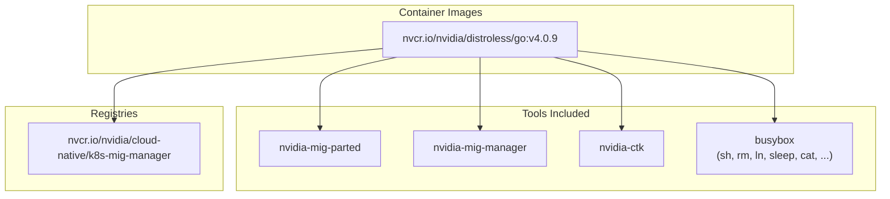
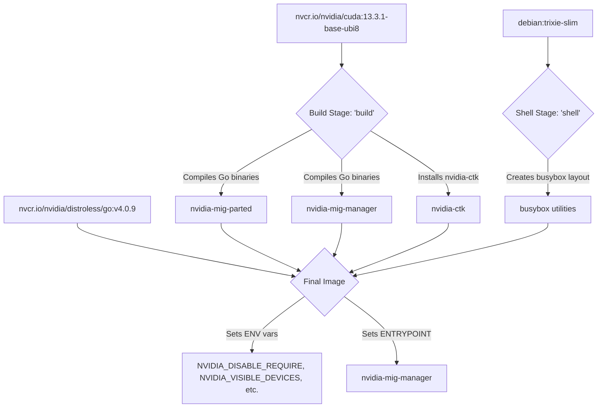
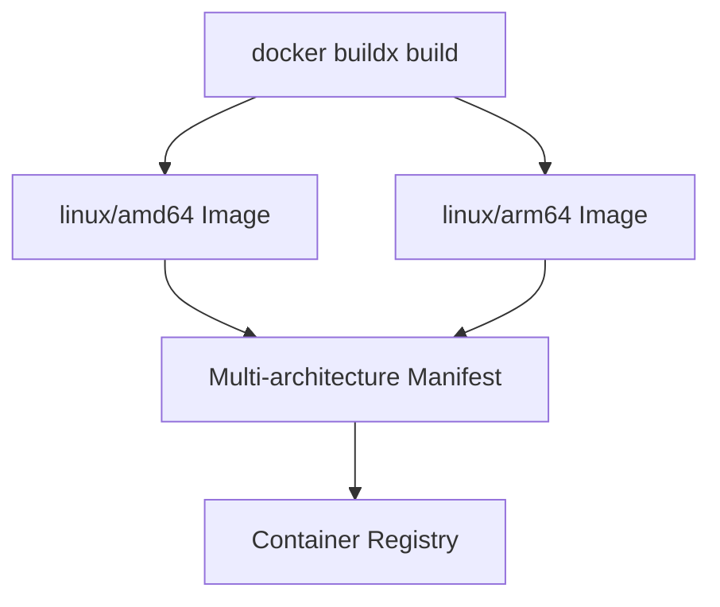
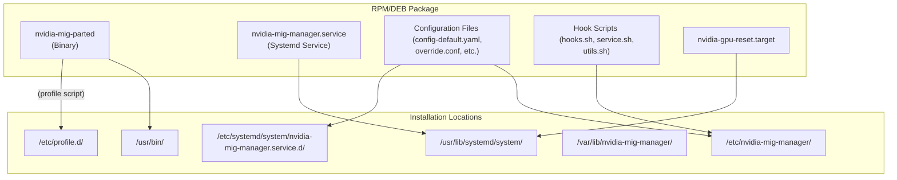
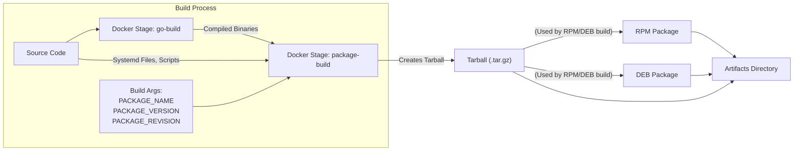
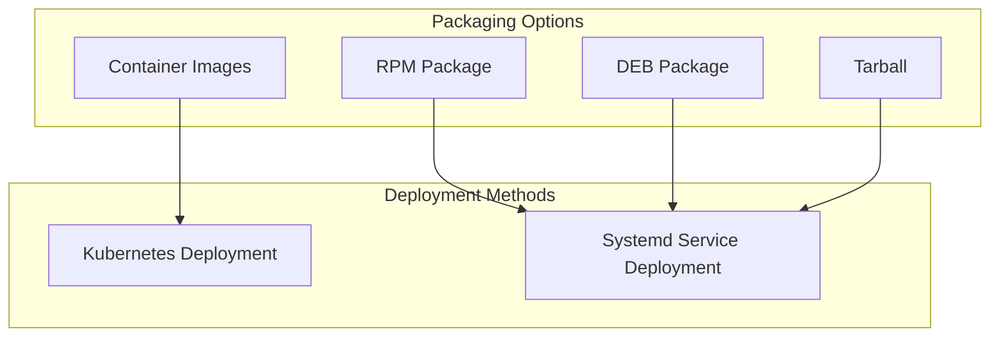

<!-- source: DeepWiki mcp.deepwiki.com · repo NVIDIA/mig-parted · page 7 Packaging and Deployment · fetched 2026-10-26 -->

# Packaging and Deployment

<details>
<summary>Relevant source files</summary>

The following files were used as context for generating this wiki page:

- [deployments/container/Dockerfile](deployments/container/Dockerfile)
- [deployments/container/Makefile](deployments/container/Makefile)
- [deployments/container/multi-arch.mk](deployments/container/multi-arch.mk)
- [deployments/container/native-only.mk](deployments/container/native-only.mk)
- [deployments/systemd/packages/Dockerfile.tarball](deployments/systemd/packages/Dockerfile.tarball)
- [deployments/systemd/packages/debian/Makefile](deployments/systemd/packages/debian/Makefile)
- [deployments/systemd/packages/debian/postinst](deployments/systemd/packages/debian/postinst)
- [deployments/systemd/packages/debian/postrm](deployments/systemd/packages/debian/postrm)
- [deployments/systemd/packages/rpm/SPECS/nvidia-mig-manager.spec](deployments/systemd/packages/rpm/SPECS/nvidia-mig-manager.spec)
- [deployments/systemd/packages/tarball/install.sh](deployments/systemd/packages/tarball/install.sh)

</details>


This page documents the various packaging and deployment options available for NVIDIA MIG-Parted. It covers container images, system packages, and build configurations to help users deploy the tools in their environment. For information about configuring the systemd service, see [Systemd Integration](#4) or for Kubernetes-specific deployment, see [Kubernetes Integration](#5).

## Container Images

NVIDIA MIG-Parted provides container images to facilitate deployment in containerized environments, particularly for Kubernetes deployments. For details on the available images and how to build them, see [Container Images](#7.1).

### Available Image Variants

NVIDIA provides container images primarily based on a distroless Go image, including a busybox shell stage for essential utilities. The main image is `nvcr.io/nvidia/distroless/go:v4.0.9` [deployments/container/Dockerfile:69]().



Sources: [deployments/container/Dockerfile:69-83](), [deployments/container/Makefile:22-24]()

### Container Image Build Process

The container images are built using a multi-stage build process defined in `deployments/container/Dockerfile` [deployments/container/Dockerfile:1-112]():

1.  **Build Stage (`build`)**: Compiles the Go binaries (`nvidia-mig-parted`, `nvidia-mig-manager`) and installs `nvidia-ctk`. This stage uses `nvcr.io/nvidia/cuda:13.3.1-base-ubi8` as its base [deployments/container/Dockerfile:15]().
2.  **Shell Stage (`shell`)**: Creates a static busybox layout with essential shell utilities (e.g., `sh`, `rm`, `ln`) using `debian:trixie-slim` as its base [deployments/container/Dockerfile:61-67]().
3.  **Final Stage**: Creates a minimal runtime image based on `nvcr.io/nvidia/distroless/go:v4.0.9` [deployments/container/Dockerfile:69](), copying the compiled binaries and the busybox utilities.



Sources: [deployments/container/Dockerfile:15-57](), [deployments/container/Dockerfile:61-67](), [deployments/container/Dockerfile:69-83]()

### Multi-architecture Support

The container images support multiple CPU architectures. When `BUILD_MULTI_ARCH_IMAGES=true` is set, `docker buildx` is used to create multi-architecture images [deployments/container/multi-arch.mk:18]().



Sources: [deployments/container/multi-arch.mk:18](), [deployments/container/Makefile:15-21]()

## System Packages

NVIDIA MIG-Parted can be deployed using traditional system packages for integration with systemd. For details on the available RPM and DEB packages and how to build them, see [RPM and DEB Packages](#7.2).

### Available Package Types

| Package Type | Supported Architectures | Description |
|--------------|-------------------------|-------------|
| RPM | amd64, arm64 | For RHEL, CentOS, and other RPM-based distributions |
| DEB | amd64, arm64 | For Ubuntu, Debian, and other DEB-based distributions |
| Tarball | amd64, arm64 | Distribution-agnostic tarball for manual installation |

### Package Contents

The system packages include:

-   The `nvidia-mig-parted` binary
-   The `nvidia-mig-manager.service` systemd service
-   Configuration files for the service (e.g., `config-default.yaml`, `override.conf`)
-   Hook scripts for integration with system events (e.g., `hooks.sh`, `service.sh`, `utils.sh`)



Sources: [deployments/systemd/packages/rpm/SPECS/nvidia-mig-manager.spec:45-80](), [deployments/systemd/packages/tarball/install.sh:23-54]()

### Package Build Process

The packages are built using Docker-based build environments to ensure consistency. `Dockerfile.tarball` [deployments/systemd/packages/Dockerfile.tarball:1-101]() is an example of how the tarball is created, which then forms the basis for RPM and DEB packages.



Sources: [deployments/systemd/packages/Dockerfile.tarball:1-101]()

### RPM Package Details

The RPM package (`nvidia-mig-manager.spec`) [deployments/systemd/packages/rpm/SPECS/nvidia-mig-manager.spec:1-130]() performs the following actions during installation:

1.  Installs the `nvidia-mig-parted` binary to `/usr/bin/` [deployments/systemd/packages/rpm/SPECS/nvidia-mig-manager.spec:53]().
2.  Installs the systemd service file `nvidia-mig-manager.service` to `/usr/lib/systemd/system` [deployments/systemd/packages/rpm/SPECS/nvidia-mig-manager.spec:54]().
3.  Creates configuration directories like `/etc/nvidia-mig-manager` and `/var/lib/nvidia-mig-manager` [deployments/systemd/packages/rpm/SPECS/nvidia-mig-manager.spec:48-51]().
4.  Sets up symbolic links for default configuration, specifically selecting `hooks-default.yaml` or `hooks-minimal.yaml` based on GPU compute capability [deployments/systemd/packages/rpm/SPECS/nvidia-mig-manager.spec:86-104]().
5.  Enables the `nvidia-mig-manager.service` and reloads the systemd daemon [deployments/systemd/packages/rpm/SPECS/nvidia-mig-manager.spec:83-84]().

The `maybe_add_hooks_symlink` function [deployments/systemd/packages/rpm/SPECS/nvidia-mig-manager.spec:86-104]() in the `%posttrans` script handles the selection of the appropriate hooks configuration based on the detected GPU compute capability.

Sources: [deployments/systemd/packages/rpm/SPECS/nvidia-mig-manager.spec:45-104]()

### DEB Package Details

Similar to RPM, the DEB package installs binaries, service files, and configuration. The `postinst` script [deployments/systemd/packages/debian/postinst:1-50]() handles post-installation tasks, including the selection of the appropriate hooks symlink based on GPU compute capability, mirroring the RPM behavior [deployments/systemd/packages/debian/postinst:8-24](). The `postrm` script [deployments/systemd/packages/debian/postrm:1-44]() handles cleanup during package removal, including removing the dynamically created `hooks.yaml` symlink and `config.yaml` [deployments/systemd/packages/debian/postrm:8-15](), [deployments/systemd/packages/debian/postrm:22]().

Sources: [deployments/systemd/packages/debian/Makefile:31-49](), [deployments/systemd/packages/debian/postinst:8-24](), [deployments/systemd/packages/debian/postrm:8-22]()

## Building from Source

For custom builds and development, you can build NVIDIA MIG-Parted from source.

### Container Images

To build container images, use the `Makefile` in `deployments/container` [deployments/container/Makefile:1-79]():

```bash
# Build the default image (based on distroless Go with busybox)
make -C deployments/container image

# Build multi-architecture images
BUILD_MULTI_ARCH_IMAGES=true make -C deployments/container image
```

Sources: [deployments/container/Makefile:60-73]()

### System Packages

To build system packages, refer to the `Makefile` in `deployments/systemd/packages`. This Makefile orchestrates the Docker-based builds for RPM, DEB, and tarball packages.

```bash
# Build all packages for all architectures (requires Docker)
make -C deployments/systemd/packages all

# Build a specific package type for a specific architecture, e.g., RPM for amd64
make -C deployments/systemd/packages rpm-amd64
```

Sources: [deployments/systemd/packages/Dockerfile.tarball:1-101]()

## Deployment Scenarios

### Kubernetes Deployment

For Kubernetes deployments, the container image is used with the Kubernetes MIG Manager. This allows declarative MIG configuration through Kubernetes. For details, see [Kubernetes Integration](#5).

### Systemd Service Deployment

For bare-metal or VM deployments, the RPM/DEB packages provide a systemd service that manages the MIG configuration. For details, see [Systemd Integration](#4).



Sources: [deployments/container/Dockerfile:112](), [deployments/systemd/packages/rpm/SPECS/nvidia-mig-manager.spec:24-35]()

---

