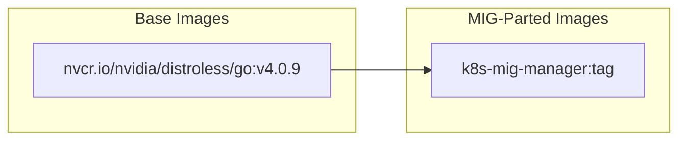
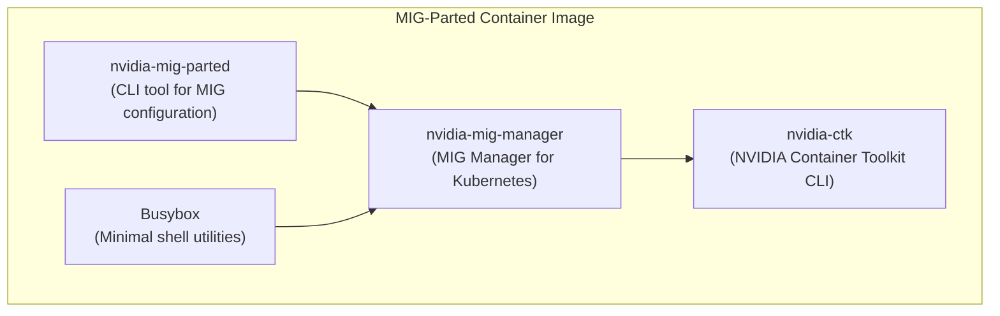
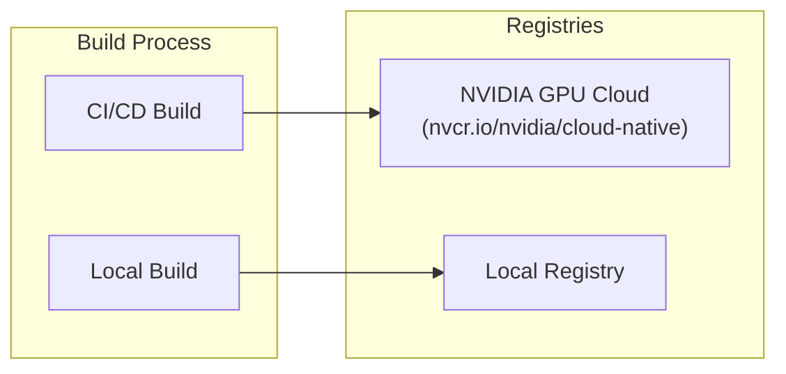
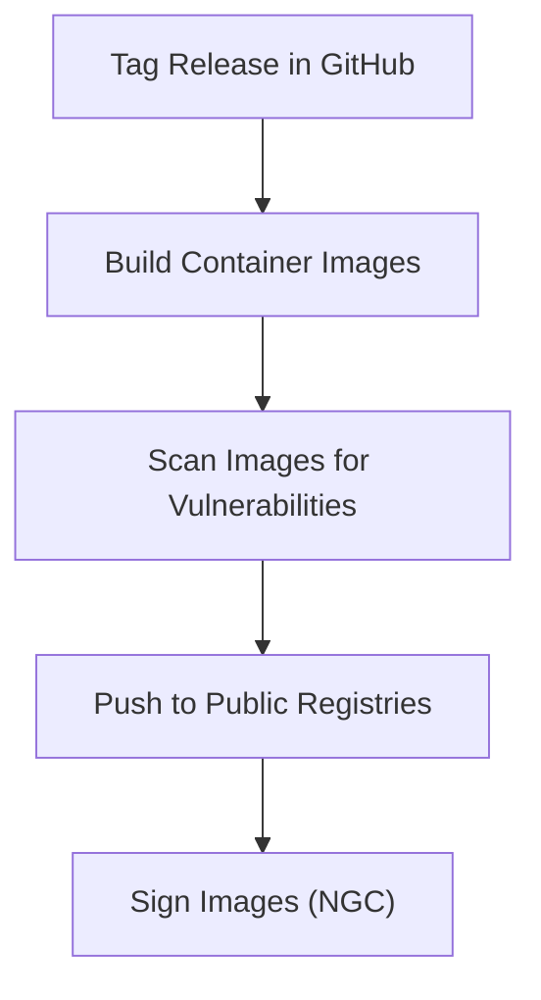

<!-- source: DeepWiki mcp.deepwiki.com · repo NVIDIA/mig-parted · page 7.1 Container Images · fetched 2026-10-26 -->

# Container Images

<details>
<summary>Relevant source files</summary>

The following files were used as context for generating this wiki page:

- [CHANGELOG.md](CHANGELOG.md)
- [deployments/container/Dockerfile](deployments/container/Dockerfile)
- [deployments/container/Makefile](deployments/container/Makefile)
- [deployments/container/multi-arch.mk](deployments/container/multi-arch.mk)
- [deployments/container/native-only.mk](deployments/container/native-only.mk)
- [deployments/container/nvidia-mig-manager-example-hopper-blackwell.yaml](deployments/container/nvidia-mig-manager-example-hopper-blackwell.yaml)
- [deployments/container/nvidia-mig-manager-example.yaml](deployments/container/nvidia-mig-manager-example.yaml)
- [versions.mk](versions.mk)

</details>


This page documents the container images available for NVIDIA MIG-Parted, including their contents, build process, and how to use them. The container images provide a convenient way to deploy NVIDIA MIG-Parted and the Kubernetes MIG Manager in containerized environments. For information about RPM and DEB packages, see [RPM and DEB Packages](#7.2).

## Available Container Images

NVIDIA MIG-Parted offers container images based on a distroless base.



Sources: [deployments/container/Dockerfile:69]()

### Image Registries

The container images are available in the following registries:

| Registry | Image Name | Description |
|----------|------------|-------------|
| NVIDIA NGC | `nvcr.io/nvidia/cloud-native/k8s-mig-manager` | Official NVIDIA releases |

For tagged releases, images follow the naming pattern: `<registry>/<image-name>:<tag>`.
For example: `nvcr.io/nvidia/cloud-native/k8s-mig-manager:v0.14.5`

Sources: [deployments/container/Makefile:25]()

## Container Image Contents

Each container image includes the following components:



These components work together to provide the full functionality of MIG-Parted in a containerized environment:

1. `nvidia-mig-parted` - The core CLI tool for MIG configuration management [deployments/container/Dockerfile:81]()
2. `nvidia-mig-manager` - The Kubernetes MIG Manager that interfaces with Kubernetes [deployments/container/Dockerfile:82]()
3. `nvidia-ctk` - NVIDIA Container Toolkit utilities [deployments/container/Dockerfile:83]()
4. `busybox` - Provides essential shell utilities like `sh`, `rm`, `ln`, `sleep`, `cat` for the distroless base image [deployments/container/Dockerfile:61-67]().

The image also configures several environment variables required for MIG management:

| Environment Variable | Value | Purpose |
|----------------------|-------|---------|
| `NVIDIA_DISABLE_REQUIRE` | `true` | Disables driver version requirements |
| `NVIDIA_VISIBLE_DEVICES` | `all` | Makes all GPUs visible to the container |
| `NVIDIA_MIG_CONFIG_DEVICES` | `all` | Allows MIG configuration on all devices |
| `NVIDIA_DRIVER_CAPABILITIES` | `utility` | Enables GPU utilities |

Sources: [deployments/container/Dockerfile:85-88]()

## Container Image Build Process

The MIG-Parted container images are built using a multi-stage build process defined in `deployments/container/Dockerfile`.

```mermaid
graph TD
    subgraph "Stage 1: build (FROM nvcr.io/nvidia/cuda:13.3.1-base-ubi8)"
        A[Install Build Tools] --> B{Download and Install Go}
        B --> C[Set GOPATH and PATH]
        C --> D[Copy Source Code]
        D --> E[Run 'make cmds' to build nvidia-mig-parted and nvidia-mig-manager]
        E --> F[Install nvidia-ctk]
    end

    subgraph "Stage 2: shell (FROM debian:trixie-slim)"
        G[Install busybox-static] --> H[Create /busybox directory]
        H --> I[Copy busybox binary]
        I --> J[Install busybox applets (sh, rm, ln, etc.)]
    end

    subgraph "Stage 3: Final Image (FROM nvcr.io/nvidia/distroless/go:v4.0.9)"
        K[Set USER to 0:0]
        K --> L[Copy /busybox from 'shell' stage]
        L --> M[Create symlink /bin/sh to /busybox/sh]
        M --> N[Create symlink /var/run to /run]
        N --> O[Set PATH environment variable]
        O --> P[Copy nvidia-mig-parted from 'build' stage]
        P --> Q[Copy nvidia-mig-manager from 'build' stage]
        Q --> R[Copy nvidia-ctk from 'build' stage]
        R --> S[Set NVIDIA_* Environment Variables]
        S --> T[Set Image Labels]
        T --> U[Set ENTRYPOINT to nvidia-mig-manager]
    end
```
**Diagram: Multi-stage Dockerfile Build Process**

Sources: [deployments/container/Dockerfile:15-112]()

The build process is orchestrated through Makefiles that support both single-architecture and multi-architecture builds.

Sources: [deployments/container/Makefile:51-55](), [deployments/container/Makefile:60-73]()

## Building Custom Container Images

To build the container images locally, you can use the provided Makefiles:

### Prerequisites

- Docker with BuildX (for multi-architecture builds)
- Make
- Internet access to pull base images

### Building Images

The default build target builds the image.

```bash
make -f deployments/container/Makefile build
```

To build with multi-architecture support (amd64 and arm64):

```bash
BUILD_MULTI_ARCH_IMAGES=true make -f deployments/container/Makefile build
```

### Customizing Builds

You can customize the build with the following variables:

| Variable | Description | Default |
|----------|-------------|---------|
| `IMAGE_NAME` | The name of the image | `nvcr.io/nvidia/cloud-native/k8s-mig-manager` [deployments/container/Makefile:25]() |
| `VERSION` | The version tag | Current version from `versions.mk` [versions.mk:16]() |
| `BUILD_MULTI_ARCH_IMAGES` | Enable multi-arch builds | `no` [deployments/container/Makefile:15]() |
| `PUSH_ON_BUILD` | Push image after build | `false` [deployments/container/multi-arch.mk:15](), [deployments/container/native-only.mk:15]() |
| `GOLANG_VERSION` | The Go version to use for building | Determined by `hack/golang-version.sh` [versions.mk:18]() |
| `NVIDIA_CTK_VERSION` | The NVIDIA Container Toolkit version to include | Determined by `hack/container-toolkit-version.sh` [versions.mk:25]() |

Sources: [deployments/container/Makefile:15-40](), [deployments/container/Makefile:60-73](), [versions.mk:16-25]()

## Container Image Distribution

MIG-Parted container images are distributed through multiple channels:



The CI/CD pipelines (GitHub Actions and GitLab CI) automatically build and push images for different platforms and distributions.

Sources: [deployments/container/Makefile:24-25]()

## Using the Container Images

### Pulling Images

To pull an image from NGC:

```bash
docker pull nvcr.io/nvidia/cloud-native/k8s-mig-manager:v0.14.5
```

The version `v0.14.5` is an example, refer to `CHANGELOG.md` for the latest version. [CHANGELOG.md:3-4]()

### Running in Kubernetes

The images are designed to be used with the Kubernetes MIG Manager. For detailed information about deploying in Kubernetes, see [Kubernetes Integration](#5). Example Kubernetes DaemonSet manifests are provided in `deployments/container/nvidia-mig-manager-example.yaml` and `deployments/container/nvidia-mig-manager-example-hopper-blackwell.yaml`.

Sources: [deployments/container/nvidia-mig-manager-example.yaml:26](), [deployments/container/nvidia-mig-manager-example-hopper-blackwell.yaml:26]()

## Container Image Release Process

When a new version of MIG-Parted is released, the following process is followed:



Development images are also automatically built from the `main` branch with the tag `devel`.

Sources: [versions.mk:20]()

---

