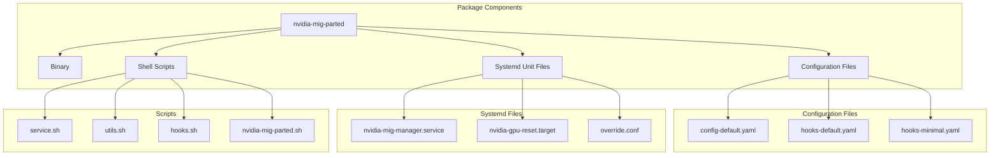
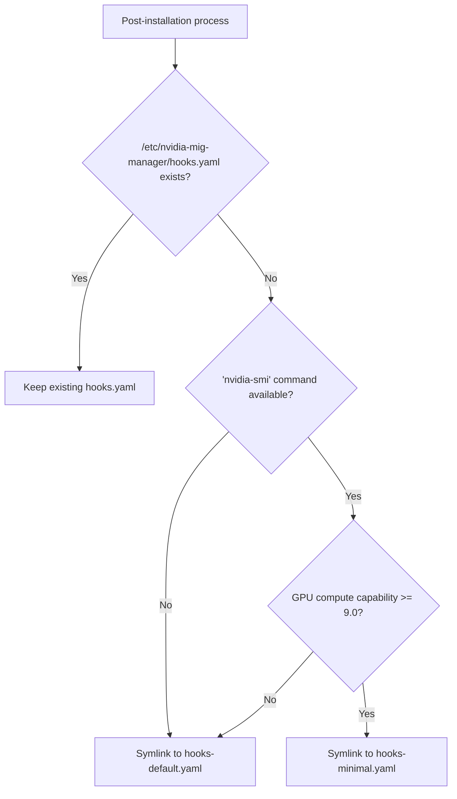

<!-- source: DeepWiki mcp.deepwiki.com · repo NVIDIA/mig-parted · page 7.2 RPM and DEB Packages · fetched 2026-10-26 -->

# RPM and DEB Packages

<details>
<summary>Relevant source files</summary>

The following files were used as context for generating this wiki page:

- [deployments/systemd/packages/.gitignore](deployments/systemd/packages/.gitignore)
- [deployments/systemd/packages/Dockerfile.deb](deployments/systemd/packages/Dockerfile.deb)
- [deployments/systemd/packages/Dockerfile.rpm](deployments/systemd/packages/Dockerfile.rpm)
- [deployments/systemd/packages/Dockerfile.tarball](deployments/systemd/packages/Dockerfile.tarball)
- [deployments/systemd/packages/debian/Makefile](deployments/systemd/packages/debian/Makefile)
- [deployments/systemd/packages/debian/changelog.old](deployments/systemd/packages/debian/changelog.old)
- [deployments/systemd/packages/debian/compat](deployments/systemd/packages/debian/compat)
- [deployments/systemd/packages/debian/control](deployments/systemd/packages/debian/control)
- [deployments/systemd/packages/debian/copyright](deployments/systemd/packages/debian/copyright)
- [deployments/systemd/packages/debian/nvidia-mig-manager.lintian-overrides](deployments/systemd/packages/debian/nvidia-mig-manager.lintian-overrides)
- [deployments/systemd/packages/debian/postinst](deployments/systemd/packages/debian/postinst)
- [deployments/systemd/packages/debian/postrm](deployments/systemd/packages/debian/postrm)
- [deployments/systemd/packages/rpm/SPECS/changelog.old](deployments/systemd/packages/rpm/SPECS/changelog.old)
- [deployments/systemd/packages/rpm/SPECS/nvidia-mig-manager.spec](deployments/systemd/packages/rpm/SPECS/nvidia-mig-manager.spec)
- [deployments/systemd/packages/tarball/install.sh](deployments/systemd/packages/tarball/install.sh)

</details>


This page documents the RPM and DEB packaging system for NVIDIA MIG-Parted, focusing on how these packages are structured, built, and deployed. The packages provide a convenient way to install the `nvidia-mig-manager` systemd service and `nvidia-mig-parted` CLI on Linux systems that use RPM (Red Hat, CentOS, Fedora) or DEB (Debian, Ubuntu) package managers. For container-based deployment methods, see [Container Images](#7.1).

## Package Overview

The `nvidia-mig-manager` package contains all the components needed to run the MIG-Parted system as a systemd service on a Linux host.



Sources: [deployments/systemd/packages/rpm/SPECS/nvidia-mig-manager.spec:1-80]()

## Package Contents

The packaged files are organized in a standard Linux directory structure:

| Path | Description |
|------|-------------|
| `/usr/bin/nvidia-mig-parted` | The main CLI executable |
| `/usr/lib/systemd/system/nvidia-mig-manager.service` | Systemd service definition |
| `/usr/lib/systemd/system/nvidia-gpu-reset.target` | Systemd target for GPU reset |
| `/etc/profile.d/nvidia-mig-parted.sh` | Shell environment configuration |
| `/etc/systemd/system/nvidia-mig-manager.service.d/override.conf` | Service override configuration |
| `/etc/nvidia-mig-manager/` | Configuration directory |
| `/etc/nvidia-mig-manager/config-default.yaml` | Default MIG configuration file |
| `/etc/nvidia-mig-manager/hooks-default.yaml` | Default hooks configuration |
| `/etc/nvidia-mig-manager/hooks-minimal.yaml` | Minimal hooks configuration |
| `/etc/nvidia-mig-manager/service.sh` | Service management script |
| `/etc/nvidia-mig-manager/utils.sh` | Utility functions |
| `/etc/nvidia-mig-manager/hooks.sh` | Hooks implementation |
| `/var/lib/nvidia-mig-manager/` | Runtime data directory |

Sources: [deployments/systemd/packages/rpm/SPECS/nvidia-mig-manager.spec:45-80]()

## Building Packages

The packaging system supports building RPM and DEB packages for both AMD64 (x86_64) and ARM64 (aarch64) architectures.

### Build System Architecture

```mermaid
flowchart TD
    Start["Make Command"] --> Target["Build Target"]
    Target --> DockerBuild["Docker Build"]
    DockerBuild --> Container["Container Environment"]
    Container --> GoBuild["Go Binary Build (go-build stage)"]
    GoBuild --> Artifacts["/artifacts/nvidia-mig-parted"]
    Artifacts --> PackageBuild["Package Build Process"]
    PackageBuild --> Output["Output Packages"]

    subgraph "Build Targets"
        T1["rpm-amd64"]
        T2["rpm-arm64"]
        T3["deb-amd64"]
        T4["deb-arm64"]
        T5["tarball-amd64"]
        T6["tarball-arm64"]
    end

    subgraph "Build Parameters"
        P1["PACKAGE_NAME"]
        P2["PACKAGE_VERSION"]
        P3["PACKAGE_REVISION"]
        P4["GIT_COMMIT"]
        P5["GOLANG_VERSION"]
    end

    T1 & T2 --> DockerfileRPM["Dockerfile.rpm"]
    T3 & T4 --> DockerfileDEB["Dockerfile.deb"]
    T5 & T6 --> DockerfileTarball["Dockerfile.tarball"]

    DockerfileRPM --> RPMBuild["rpmbuild"]
    DockerfileDEB --> DebBuild["debuild"]
    DockerfileTarball --> TarballCmd["tar -zcvf"]

    RPMBuild --> "RPM Package"
    DebBuild --> "DEB Package"
    TarballCmd --> "Tarball"
```

Sources:
- [deployments/systemd/packages/Dockerfile.rpm:1-104]()
- [deployments/systemd/packages/Dockerfile.deb:1-97]()
- [deployments/systemd/packages/Dockerfile.tarball:1-101]()

### Building RPM Packages

RPM packages are built using `Dockerfile.rpm`. This Dockerfile first builds the `nvidia-mig-parted` binary in a `go-build` stage [deployments/systemd/packages/Dockerfile.rpm:18-55](), then uses a separate stage to prepare the RPM build environment and execute `rpmbuild` [deployments/systemd/packages/Dockerfile.rpm:57-104](). The `nvidia-mig-manager.spec` file [deployments/systemd/packages/rpm/SPECS/nvidia-mig-manager.spec:1-130]() defines the package metadata, installation paths, and post-installation/pre-uninstallation scripts.

To build RPM packages, use the following make targets:

```bash
make rpm-amd64  # Build RPM for x86_64
make rpm-arm64  # Build RPM for aarch64
make rpm        # Build RPMs for both architectures
```

The build process uses a CentOS 7 base image to ensure compatibility with a wide range of RPM-based distributions [deployments/systemd/packages/Dockerfile.rpm:18]().

Sources:
- [deployments/systemd/packages/Dockerfile.rpm:1-104]()
- [deployments/systemd/packages/rpm/SPECS/nvidia-mig-manager.spec:1-130]()

### Building DEB Packages

DEB packages are built using `Dockerfile.deb`. Similar to the RPM build, it includes a `go-build` stage for the binary [deployments/systemd/packages/Dockerfile.deb:18-55](), followed by a stage to set up the Debian packaging tools and run `debuild` [deployments/systemd/packages/Dockerfile.deb:57-97](). The `debian` directory [deployments/systemd/packages/debian/]() contains control files and scripts like `postinst` and `postrm` that define the package's behavior.

To build DEB packages, use the following make targets:

```bash
make deb-amd64  # Build DEB for x86_64
make deb-arm64  # Build DEB for aarch64
make deb        # Build DEBs for both architectures
```

The build process uses an Ubuntu base image to ensure compatibility with a wide range of Debian-based distributions [deployments/systemd/packages/Dockerfile.deb:18]().

Sources:
- [deployments/systemd/packages/Dockerfile.deb:1-97]()
- [deployments/systemd/packages/debian/Makefile:1-50]()

### Building Tarball Packages

A tarball package is also available, built using `Dockerfile.tarball`. This Dockerfile collects all necessary files, including the `nvidia-mig-parted` binary, service files, and scripts, into a directory structure that can be archived [deployments/systemd/packages/Dockerfile.tarball:75-92](). The `install.sh` script [deployments/systemd/packages/tarball/install.sh:1-90]() is provided to manually install these files on a system.

To build tarball packages, use the following make targets:

```bash
make tarball-amd64  # Build tarball for x86_64
make tarball-arm64  # Build tarball for aarch64
make tarball        # Build tarballs for both architectures
```

Sources:
- [deployments/systemd/packages/Dockerfile.tarball:1-101]()
- [deployments/systemd/packages/tarball/install.sh:1-90]()

### Build Configuration

The build process uses several configuration variables:

| Variable | Description |
|----------|-------------|
| `PACKAGE_NAME` | Package name (e.g., `nvidia-mig-manager`) |
| `PACKAGE_VERSION` | Package version |
| `PACKAGE_REVISION` | Package revision |
| `GIT_COMMIT` | Git commit hash for changelog generation |
| `GOLANG_VERSION` | Go compiler version used for building the binary |

These variables are passed as `ARG` and `ENV` to the Dockerfiles [deployments/systemd/packages/Dockerfile.rpm:67-73](), [deployments/systemd/packages/Dockerfile.deb:64-70](), [deployments/systemd/packages/Dockerfile.tarball:64-70]().

## Package Installation

### RPM Installation

To install the RPM package:

```bash
sudo rpm -i nvidia-mig-manager-<version>-<revision>.<arch>.rpm
```

Post-installation, the package executes the `%posttrans` script defined in the spec file [deployments/systemd/packages/rpm/SPECS/nvidia-mig-manager.spec:82-104](). This script performs the following actions:
1. Reloads the systemd daemon using `systemctl daemon-reload` [deployments/systemd/packages/rpm/SPECS/nvidia-mig-manager.spec:83]().
2. Enables the `nvidia-mig-manager.service` using `systemctl enable` [deployments/systemd/packages/rpm/SPECS/nvidia-mig-manager.spec:84]().
3. Calls the `maybe_add_hooks_symlink` function to set up the `hooks.yaml` symlink [deployments/systemd/packages/rpm/SPECS/nvidia-mig-manager.spec:104]().

Sources: [deployments/systemd/packages/rpm/SPECS/nvidia-mig-manager.spec:82-112]()

### DEB Installation

To install the DEB package:

```bash
sudo dpkg -i nvidia-mig-manager_<version>-<revision>_<arch>.deb
```

The DEB package uses a `postinst` script [deployments/systemd/packages/debian/postinst:1-50]() which is executed during the `configure` stage of installation [deployments/systemd/packages/debian/postinst:27-28](). This script calls the `maybe_add_hooks_symlink` function [deployments/systemd/packages/debian/postinst:28]() to configure the hooks symlink, similar to the RPM package.

Sources: [deployments/systemd/packages/debian/postinst:1-50]()

### Tarball Installation

For tarball installations, the `install.sh` script [deployments/systemd/packages/tarball/install.sh:1-90]() handles the deployment. It creates necessary directories [deployments/systemd/packages/tarball/install.sh:30-35](), copies files to their respective locations [deployments/systemd/packages/tarball/install.sh:44-53](), sets permissions [deployments/systemd/packages/tarball/install.sh:55-67](), reloads the systemd daemon, enables the service [deployments/systemd/packages/tarball/install.sh:68-69](), and then calls `maybe_add_hooks_symlink` [deployments/systemd/packages/tarball/install.sh:89]() to configure the hooks.

Sources: [deployments/systemd/packages/tarball/install.sh:1-90]()

## Configuration During Installation

During installation, the package performs automatic configuration based on the system. This primarily involves selecting the appropriate `hooks.yaml` file.



Sources:
- [deployments/systemd/packages/rpm/SPECS/nvidia-mig-manager.spec:86-102]()
- [deployments/systemd/packages/debian/postinst:8-23]()
- [deployments/systemd/packages/tarball/install.sh:71-87]()

### Hooks Configuration Logic

The `maybe_add_hooks_symlink` function is responsible for this logic.
1. It first checks if `/etc/nvidia-mig-manager/hooks.yaml` already exists [deployments/systemd/packages/rpm/SPECS/nvidia-mig-manager.spec:87](). If it does, no action is taken.
2. If `hooks.yaml` does not exist, it checks for the presence of `nvidia-smi` [deployments/systemd/packages/rpm/SPECS/nvidia-mig-manager.spec:91](). If `nvidia-smi` is not found, it defaults to symlinking `hooks-default.yaml` [deployments/systemd/packages/rpm/SPECS/nvidia-mig-manager.spec:92]().
3. If `nvidia-smi` is available, it queries the compute capability of the first GPU [deployments/systemd/packages/rpm/SPECS/nvidia-mig-manager.spec:96]().
4. If the compute capability is 9.0 or greater (e.g., Hopper architecture), it symlinks `hooks-minimal.yaml` [deployments/systemd/packages/rpm/SPECS/nvidia-mig-manager.spec:98](). Otherwise, it symlinks `hooks-default.yaml` [deployments/systemd/packages/rpm/SPECS/nvidia-mig-manager.spec:100]().

This ensures that systems with newer GPUs (like Hopper) get a more optimized, minimal set of hooks, while older systems or those without `nvidia-smi` fall back to a default configuration.

Sources:
- [deployments/systemd/packages/rpm/SPECS/nvidia-mig-manager.spec:86-102]()
- [deployments/systemd/packages/debian/postinst:8-23]()
- [deployments/systemd/packages/tarball/install.sh:71-87]()

### Default Configuration

The `config-default.yaml` file is installed into `/etc/nvidia-mig-manager/` [deployments/systemd/packages/rpm/SPECS/nvidia-mig-manager.spec:62](). While the installation process does not explicitly create a symlink for `config.yaml` like it does for `hooks.yaml`, the `nvidia-mig-manager` service is designed to use `config-default.yaml` if `config.yaml` is not present.

## Package Removal

### RPM Removal

To remove the RPM package:

```bash
sudo rpm -e nvidia-mig-manager
```

During uninstallation, the `%preun` script in the spec file is executed [deployments/systemd/packages/rpm/SPECS/nvidia-mig-manager.spec:114-124](). This script performs the following actions if it's a full uninstall (`$1 -eq 0`):
1. Disables the `nvidia-mig-manager.service` [deployments/systemd/packages/rpm/SPECS/nvidia-mig-manager.spec:119]().
2. Reloads the systemd daemon [deployments/systemd/packages/rpm/SPECS/nvidia-mig-manager.spec:120]().
3. Calls `maybe_remove_hooks_symlink` to remove the `hooks.yaml` symlink if it points to `hooks-minimal.yaml` or `hooks-default.yaml` [deployments/systemd/packages/rpm/SPECS/nvidia-mig-manager.spec:121]().
4. Removes any runtime-generated `config.yaml` [deployments/systemd/packages/rpm/SPECS/nvidia-mig-manager.spec:123]().

Sources: [deployments/systemd/packages/rpm/SPECS/nvidia-mig-manager.spec:114-124]()

### DEB Removal

To remove the DEB package:

```bash
sudo dpkg -r nvidia-mig-manager
```

The DEB package uses a `postrm` script [deployments/systemd/packages/debian/postrm:1-43]() which is executed during the `purge` stage of uninstallation [deployments/systemd/packages/debian/postrm:18-22](). This script calls `maybe_remove_hooks_symlink` [deployments/systemd/packages/debian/postrm:20]() and removes any runtime-generated `config.yaml` [deployments/systemd/packages/debian/postrm:22](), similar to the RPM package.

Sources: [deployments/systemd/packages/debian/postrm:1-43]()

### Tarball Uninstallation

For tarball installations, an `uninstall.sh` script is provided [deployments/systemd/packages/tarball/uninstall.sh:1-70](). This script disables and stops the service, removes the installed files and directories, and cleans up the `hooks.yaml` symlink and `config.yaml`.

Sources: [deployments/systemd/packages/tarball/uninstall.sh:1-70]()

## Package Version Management

The package versioning for both RPM and DEB packages is dynamically generated during the build process.

For RPMs, the `nvidia-mig-manager.spec` file uses `%define` directives to set `version` and `revision` from build arguments [deployments/systemd/packages/Dockerfile.rpm:98-99](). The changelog entry is also generated dynamically using `release_date` and `git_commit` [deployments/systemd/packages/rpm/SPECS/nvidia-mig-manager.spec:127-129]().

For DEBs, the `dch` command is used within `Dockerfile.deb` to create a changelog entry with the specified `PACKAGE_VERSION_STRING` and `GIT_COMMIT` [deployments/systemd/packages/Dockerfile.deb:86-91]().

The `PACKAGE_VERSION` and `PACKAGE_REVISION` are typically derived from Git tags and build parameters, ensuring consistent versioning across different package types.

Sources:
- [deployments/systemd/packages/rpm/SPECS/nvidia-mig-manager.spec:3-4]()
- [deployments/systemd/packages/Dockerfile.rpm:98-99]()
- [deployments/systemd/packages/Dockerfile.deb:86-91]()

---

