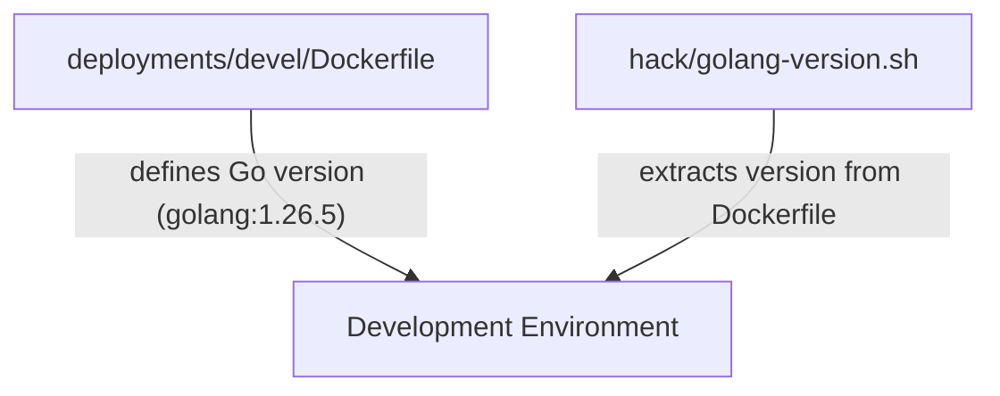
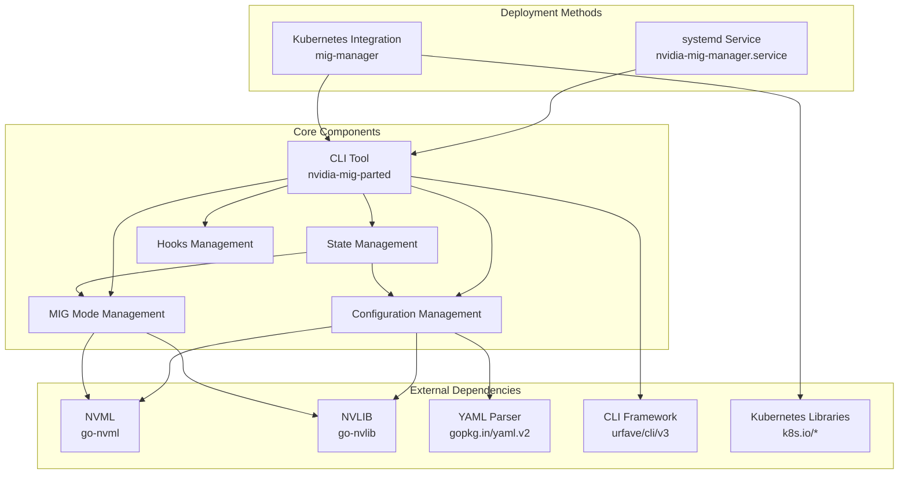
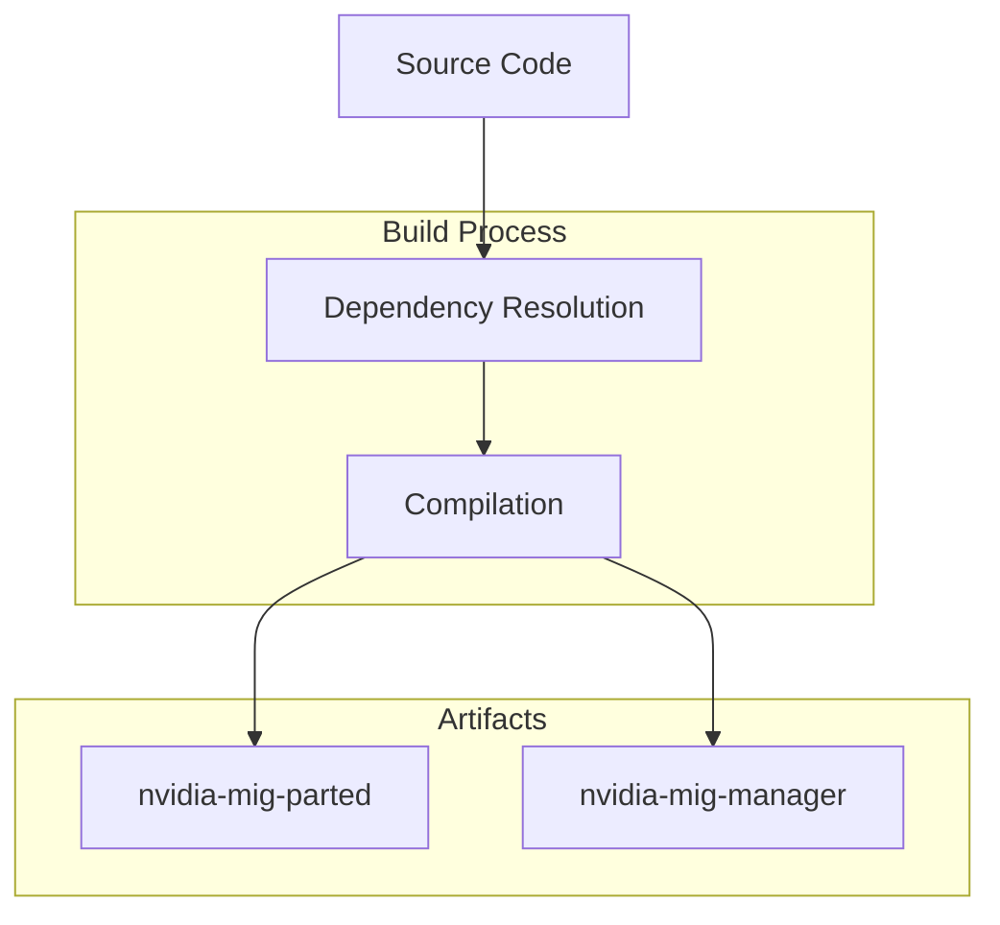
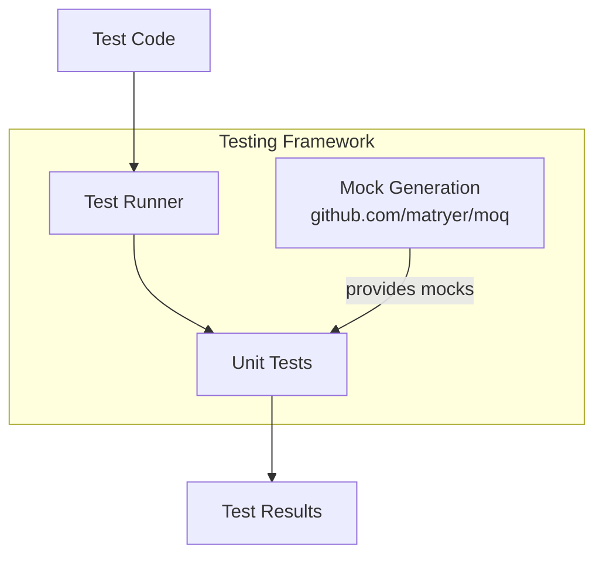
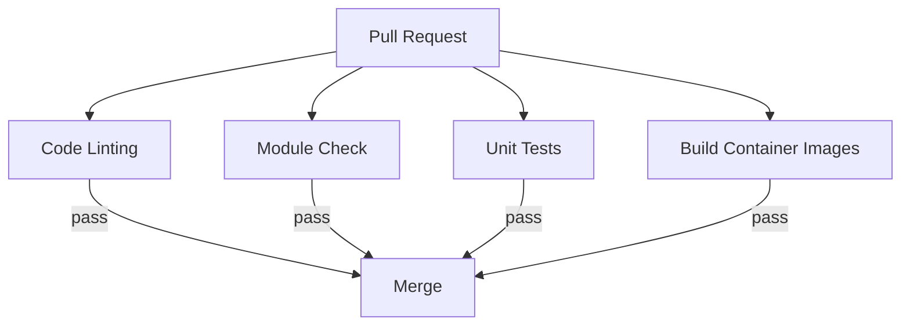
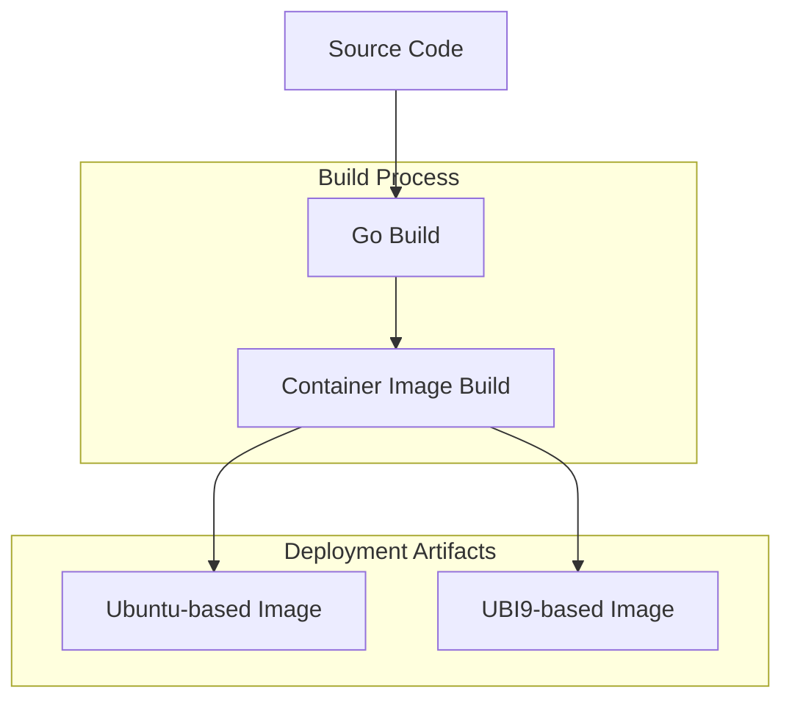

<!-- source: DeepWiki mcp.deepwiki.com · repo NVIDIA/mig-parted · page 8 Development Guide · fetched 2026-10-26 -->

# Development Guide

<details>
<summary>Relevant source files</summary>

The following files were used as context for generating this wiki page:

- [.common-ci.yml](.common-ci.yml)
- [.github/dependabot.yml](.github/dependabot.yml)
- [.gitlab-ci.yml](.gitlab-ci.yml)
- [.nvidia-ci.yml](.nvidia-ci.yml)
- [Makefile](Makefile)
- [deployments/devel/Dockerfile](deployments/devel/Dockerfile)
- [deployments/devel/Makefile](deployments/devel/Makefile)
- [hack/golang-version.sh](hack/golang-version.sh)

</details>


This guide provides essential information for developers who want to contribute to or extend the NVIDIA MIG-Parted project. It covers setting up a development environment, understanding the core dependencies, and implementing tests for your contributions.

For information on deploying and configuring the project, see [Packaging and Deployment](#7).

## Environment Setup

### Go Version Requirements

The MIG-Parted repository is built with Go 1.26.5. The exact version used in the official builds is defined in the development Dockerfile:



Sources: [deployments/devel/Dockerfile:17-17](), [hack/golang-version.sh:20-20]()

### Setting Up the Development Environment

You can set up your development environment either locally or using a container:

#### Local Development Setup

1. Install Go 1.26.5 or later
2. Clone the repository
3. Install development tools:

```bash
cd deployments/devel
make install-tools
```

Sources: [deployments/devel/Makefile:19-21]()

#### Container-based Development

Use the provided development container which includes all necessary tools:

```bash
# Build the development container
docker build -t mig-parted-dev -f deployments/devel/Dockerfile deployments/devel

# Run the container with the repository mounted
docker run -it --rm -v $(pwd):/work mig-parted-dev
```

Sources: [deployments/devel/Dockerfile:1-27](), [deployments/devel/Makefile:31-37]()

## Project Structure

The project is organized into several key components that work together to manage MIG configurations:



Sources: [Makefile:23-24]()

## Core Dependencies

MIG-Parted relies on several key dependencies to function. For details, see [Core Dependencies](#8.2).

### NVIDIA Libraries

- **go-nvml** - Go bindings for the NVIDIA Management Library (NVML)
- **go-nvlib** - Go library providing extended functionality for NVIDIA device management

### Command Line Interface

- **urfave/cli/v3** - Framework for building command-line applications in Go

### Configuration and Serialization

- **yaml.v2** - YAML parsing and encoding
- **sigs.k8s.io/yaml** - YAML utilities from Kubernetes

### Kubernetes Integration

- **k8s.io/api** - Kubernetes API definitions
- **k8s.io/apimachinery** - Schema, typing, and utility functions for Kubernetes
- **k8s.io/client-go** - Client libraries for accessing Kubernetes

### Testing and Logging

- **stretchr/testify** - Testing toolkit
- **sirupsen/logrus** - Structured logging

Here's a table of the core dependencies and their versions:

| Dependency | Purpose |
|------------|---------|
| go-nvlib | NVIDIA device library |
| go-nvml | NVIDIA Management Library bindings |
| logrus | Structured logging |
| testify | Testing framework |
| urfave/cli/v3 | CLI application framework |
| yaml.v2 | YAML parsing and encoding |
| k8s.io/api | Kubernetes API |
| k8s.io/apimachinery | Kubernetes utilities |
| k8s.io/client-go | Kubernetes client |

Sources: [Makefile:76-79]()

### Development Tools

Additional tools used for development include:

- **golangci-lint** - Linting toolset for Go
- **matryer/moq** - Mock generation tool for interfaces
- **go-licenses** - Tool for generating third-party notices

Sources: [deployments/devel/Makefile:19-21](), [Makefile:86-87]()

## Building the Project

MIG-Parted can be built using standard Go tools or via the provided Makefiles. For details, see [Build Environment](#8.1).

### Building with Go

```bash
go build ./...
```

### Building with Make

```bash
make build
```

The build process creates the following binaries:

- `nvidia-mig-parted` - The main CLI tool
- `nvidia-mig-manager` - The Kubernetes MIG Manager



Sources: [Makefile:51-52]()

## Code Style and Conventions

### Linting

MIG-Parted uses `golangci-lint` for code quality checks.

To run linting locally:

```bash
make lint
```

Sources: [Makefile:74-75]()

### Code Formatting

Code is formatted using:

- `gofmt` - Standard Go formatter
- `goimports` - Import organization and formatting

To format code:

```bash
make fmt
make goimports
```

Sources: [Makefile:65-71]()

## Testing

MIG-Parted uses the `testify` package for writing unit tests. For details, see [Testing](#8.3).

### Unit Testing

Tests can be run using:

```bash
make test
```

### Testing Process



Sources: [Makefile:102-103]()

## Contribution Workflow

The recommended workflow for contributing to MIG-Parted:

1. **Fork and Clone**: Fork the repository and clone your fork
2. **Create a Branch**: Create a new branch for your feature or bugfix
3. **Implement Changes**: Make your code changes
4. **Run Tests**: Ensure all tests pass with `make test`
5. **Lint Code**: Run linting with `make lint`
6. **Submit PR**: Create a pull request against the main branch

### Dependency Management

Dependencies are managed through Go modules. To update dependencies:

```bash
make vendor
```

This command runs `go mod tidy`, `go mod vendor`, and `go mod verify`.
To check if the vendor directory is up-to-date:

```bash
make check-vendor
```

Sources: [Makefile:77-79](), [Makefile:81-82]()

### CI/CD Process

The repository uses GitLab CI/CD for continuous integration. The workflow includes:

1. Linting
2. Module checks
3. Testing
4. Building container images

Pull requests must pass all these checks before being merged.



Sources: [.common-ci.yml:24-32](), [.gitlab-ci.yml:18-44]()

## Dependency Updates

MIG-Parted uses Dependabot to keep dependencies up to date. The configuration specifies:

- Weekly updates for Go modules
- Daily updates for Docker images and GitHub Actions

Kubernetes-related dependencies are grouped together to ensure compatibility.

Sources: [.github/dependabot.yml:1-43]()

## Build Artifacts and Container Images

The project can be packaged as container images using the provided Dockerfiles.



For more details about building and packaging options, see [Container Images](#7.1).

Sources: [.gitlab-ci.yml:36-44]()

## Development Tools

The repository includes several helper scripts to aid development:

- `hack/golang-version.sh` - Extracts the golang version from the Dockerfile

These tools help maintain version consistency across the project.

Sources: [hack/golang-version.sh:1-23]()

---

