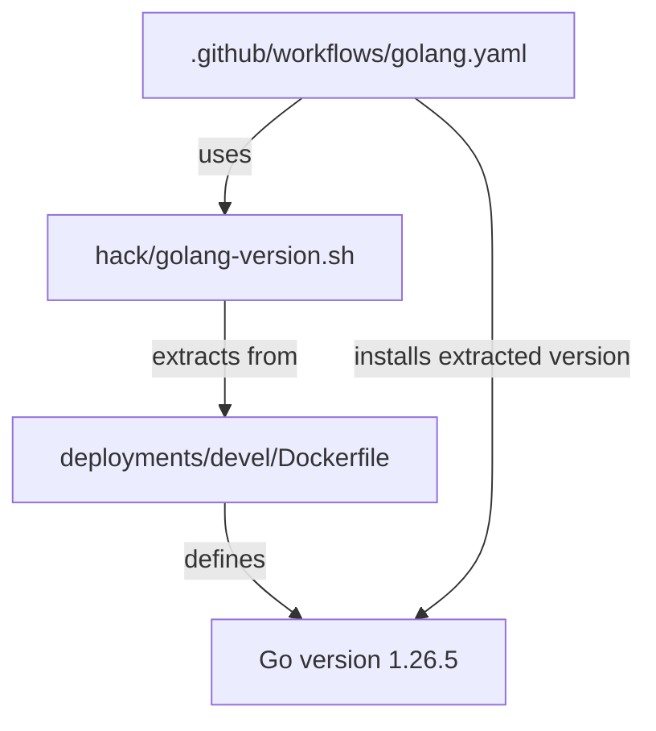
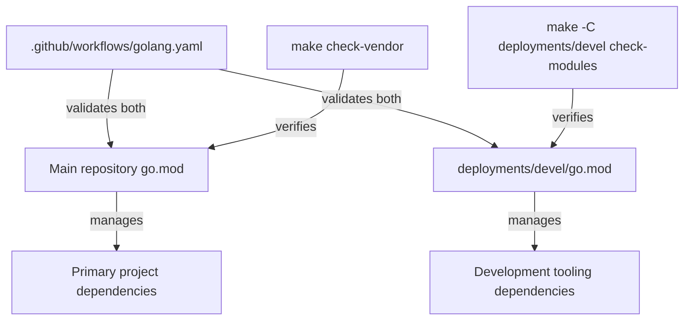
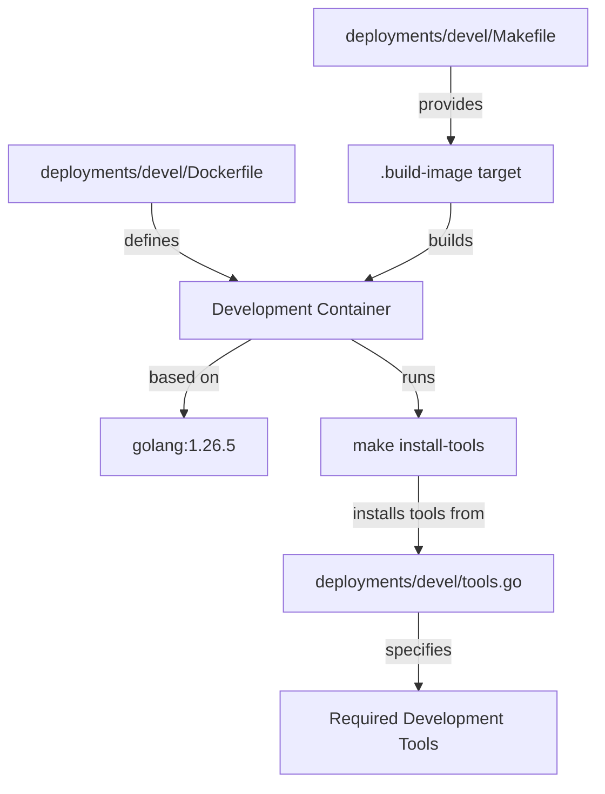
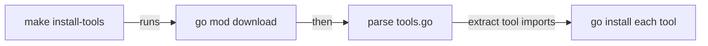
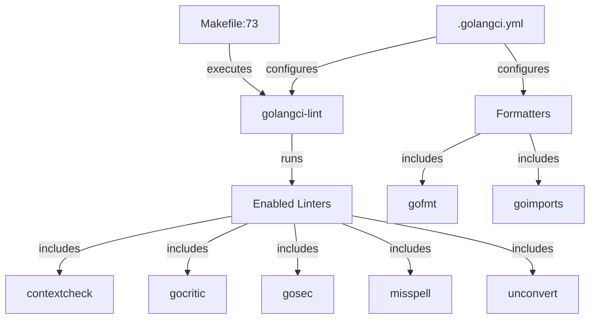
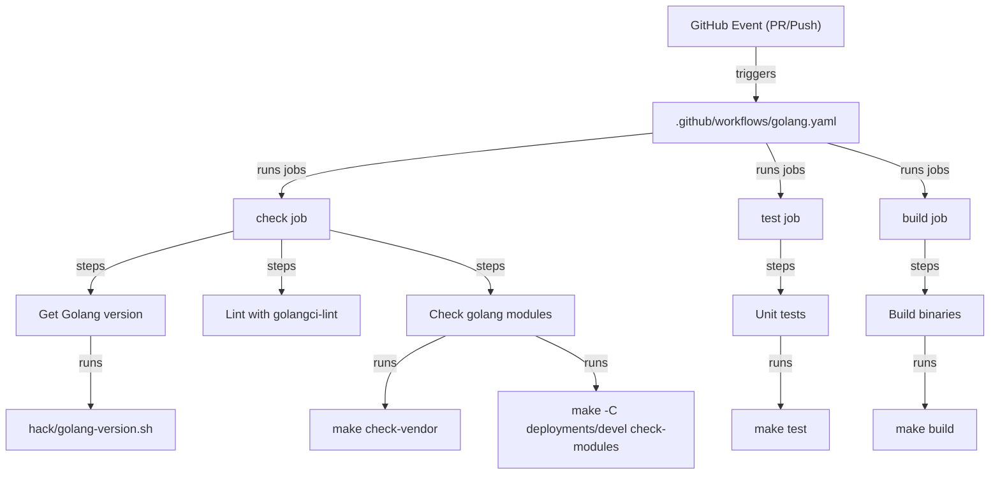
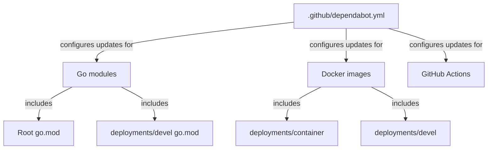
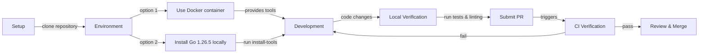
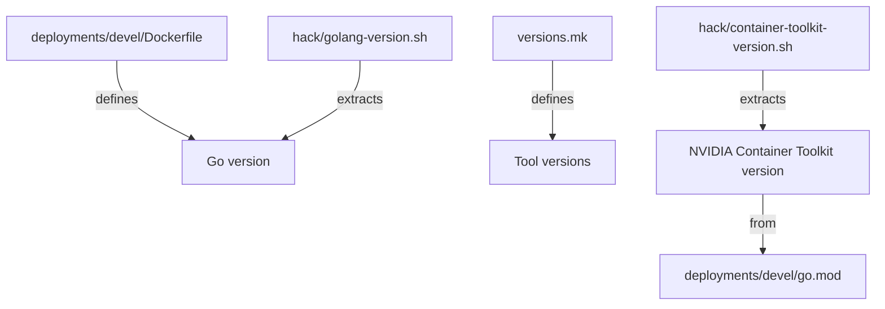

<!-- source: DeepWiki mcp.deepwiki.com · repo NVIDIA/mig-parted · page 8.1 Build Environment · fetched 2026-10-26 -->

# Build Environment

<details>
<summary>Relevant source files</summary>

The following files were used as context for generating this wiki page:

- [.common-ci.yml](.common-ci.yml)
- [.github/dependabot.yml](.github/dependabot.yml)
- [.github/workflows/build.yaml](.github/workflows/build.yaml)
- [.github/workflows/golang.yaml](.github/workflows/golang.yaml)
- [.github/workflows/image.yaml](.github/workflows/image.yaml)
- [.gitlab-ci.yml](.gitlab-ci.yml)
- [.nvidia-ci.yml](.nvidia-ci.yml)
- [Makefile](Makefile)
- [deployments/devel/Dockerfile](deployments/devel/Dockerfile)
- [deployments/devel/Makefile](deployments/devel/Makefile)
- [deployments/systemd/packages/Makefile](deployments/systemd/packages/Makefile)
- [hack/golang-version.sh](hack/golang-version.sh)

</details>


## Purpose and Scope

This document describes the build environment for the NVIDIA MIG-Parted repository, including the tools, configurations, and processes required to develop, build, and test the codebase. For information about core dependencies used by the project, see [Core Dependencies](#8.2), and for information about testing procedures, see [Testing](#8.3).

## Go Development Setup

NVIDIA MIG-Parted is written in Go. The build environment ensures consistent Go version usage and dependency management across development and CI environments.

### Go Version Management

The Go version is defined in the development Dockerfile and extracted by scripts for CI use:



Sources: [deployments/devel/Dockerfile:17](), [hack/golang-version.sh:20-22](), [.github/workflows/golang.yaml:33-34](), [.github/workflows/golang.yaml:37]()

### Module Structure

The project uses Go modules for dependency management with a specific structure:



Sources: [deployments/devel/Makefile:43-44](), [Makefile:76-78](), [.github/workflows/golang.yaml:46-47]()

### Key Development Dependencies

The development environment includes several important dependencies. The `deployments/devel/go.mod` file lists these dependencies, which are primarily tools used during development and CI.

Sources: [deployments/devel/go.mod]()

## Docker-based Development Environment

A Docker container provides a consistent development environment for all contributors, ensuring reproducible builds.

### Development Container Architecture



Sources: [deployments/devel/Dockerfile:17-26](), [deployments/devel/Makefile:31-37](), [deployments/devel/Makefile:19-21]()

### Tool Installation

Development tools are installed through the `install-tools` Make target:

```bash
make -C deployments/devel install-tools
```

This target first downloads Go module dependencies and then parses the `tools.go` file to extract and install all required development tools using `go install`.



Sources: [deployments/devel/Makefile:16-21]()

## Code Quality Tools

The repository uses several code quality tools to maintain high code standards.

### Linting Configuration

Code linting is handled by `golangci-lint` with specific configurations defined in `.golangci.yml`. The `lint` target in the root `Makefile` executes `golangci-lint`.



Sources: [.golangci.yml:1-41](), [Makefile:73]()

## Continuous Integration

GitHub Actions workflows automate testing and validation of code changes.

### CI Workflow

The CI process includes linting, module verification, testing, and building, as defined in `.github/workflows/golang.yaml`.



Sources: [.github/workflows/golang.yaml:25-88](), [hack/golang-version.sh:1-22](), [Makefile:76-78](), [deployments/devel/Makefile:43-44](), [Makefile:102-103](), [Makefile:55-56]()

### Dependency Management

Dependabot automatically updates dependencies for the project, configured in `.github/dependabot.yml`.



Sources: [.github/dependabot.yml:1-42]()

## Development Workflow

The standard development workflow leverages the build environment to ensure code quality and consistency.

### Setup and Development Process



Sources: [deployments/devel/Dockerfile:17](), [deployments/devel/Makefile:19-21](), [Makefile:55-56](), [Makefile:73](), [Makefile:102-103]()

### Local Development Commands

Common commands used during local development, primarily from the root `Makefile` and `deployments/devel/Makefile`:

| Command | Purpose |
|---------|---------|
| `make build` | Build the project binaries [Makefile:55-56]() |
| `make test` | Run unit tests and generate coverage report [Makefile:102-103]() |
| `make lint` | Run `golangci-lint` on the codebase [Makefile:73]() |
| `make vendor` | Manage Go module dependencies, including `go mod tidy` and `go mod vendor` [Makefile:76-78]() |
| `make check-vendor` | Verify module dependencies are up-to-date by checking for `git diff` on `go.mod`, `go.sum`, and `vendor` [Makefile:80-81]() |
| `make -C deployments/devel install-tools` | Install development tools specified in `deployments/devel/tools.go` [deployments/devel/Makefile:19-21]() |
| `make -C deployments/devel check-modules` | Verify `deployments/devel` module dependencies are up-to-date [deployments/devel/Makefile:43-44]() |
| `make docker-build` | Build the project binaries inside the development Docker container [Makefile:123-134]() |
| `make .shell` | Start an interactive shell within the development Docker container [Makefile:137-147]() |

Sources: [Makefile:55-56](), [Makefile:73](), [Makefile:76-78](), [Makefile:80-81](), [Makefile:102-103](), [Makefile:123-134](), [Makefile:137-147](), [deployments/devel/Makefile:19-21](), [deployments/devel/Makefile:43-44]()

## Versioning

The project maintains consistent versions across different components. The Go version is explicitly defined in the `deployments/devel/Dockerfile` and extracted by `hack/golang-version.sh`.



Sources: [deployments/devel/Dockerfile:17](), [hack/golang-version.sh:20-22]()

## Summary

The NVIDIA MIG-Parted build environment provides a consistent, reproducible framework for developing and testing the project. It leverages Docker containers, Go modules, and automated CI to ensure code quality and streamline the development process.

---

