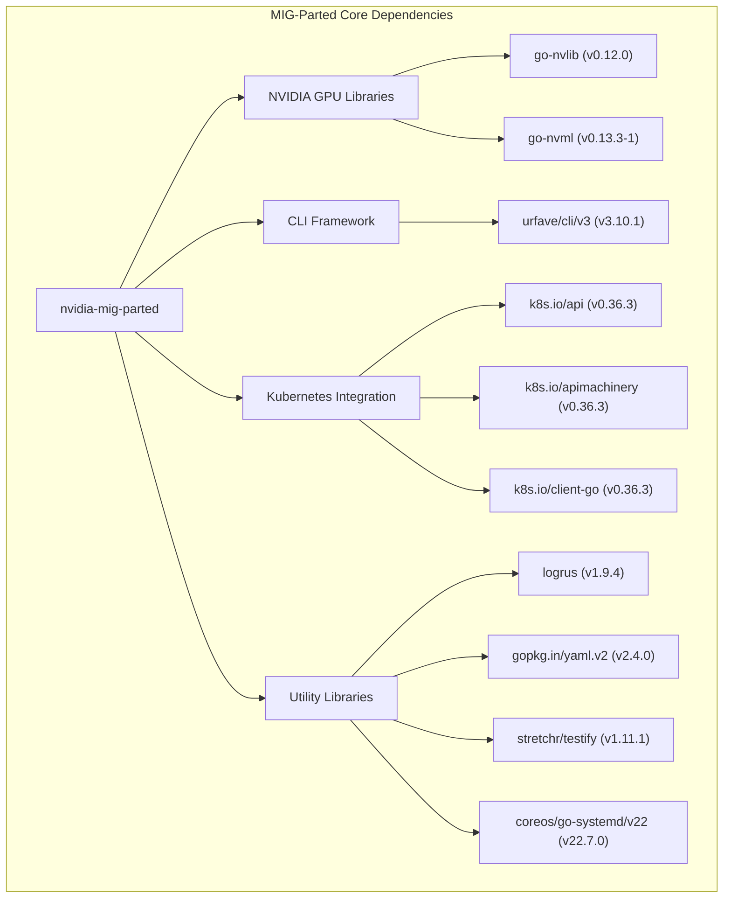
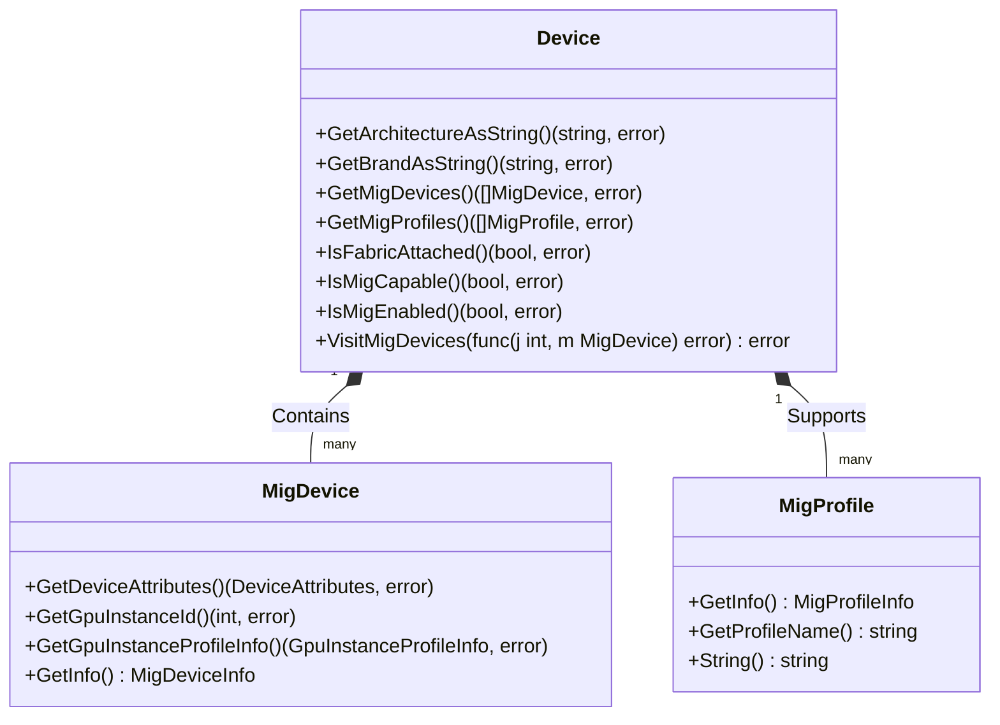
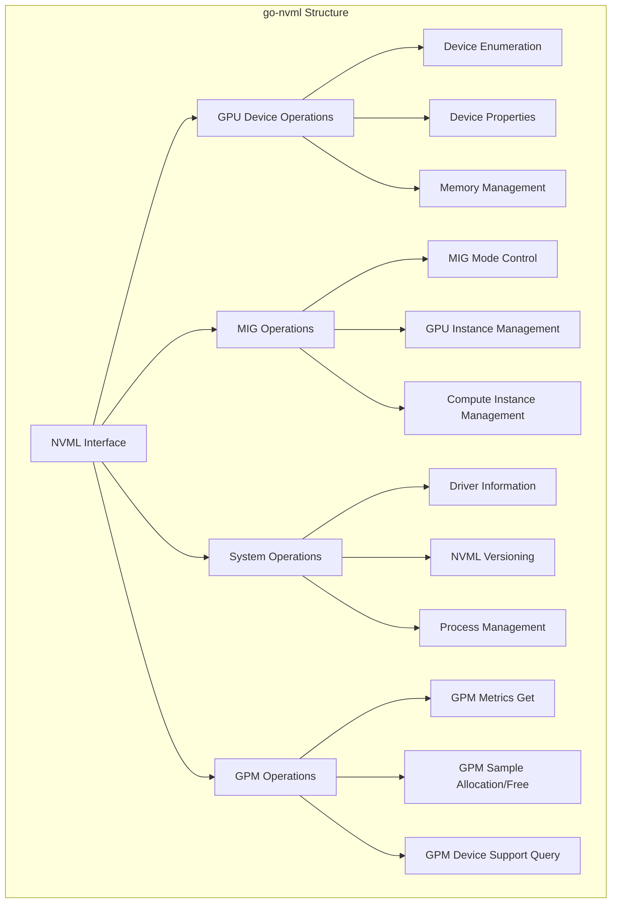
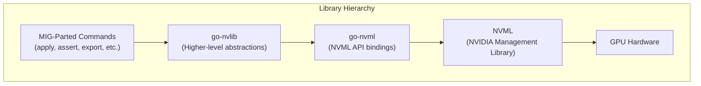
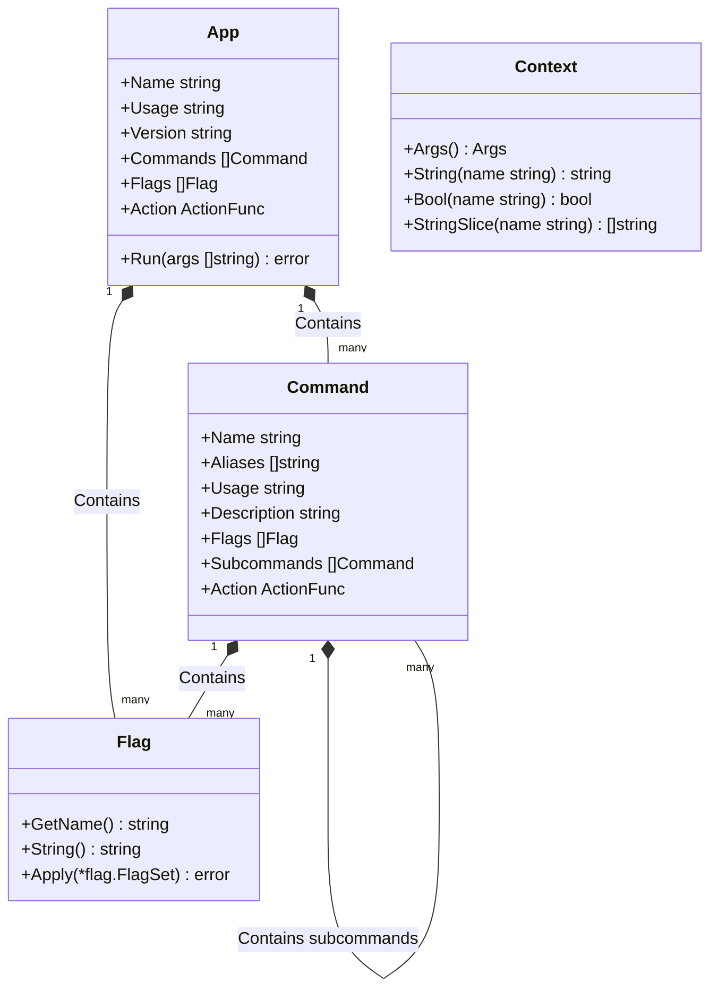
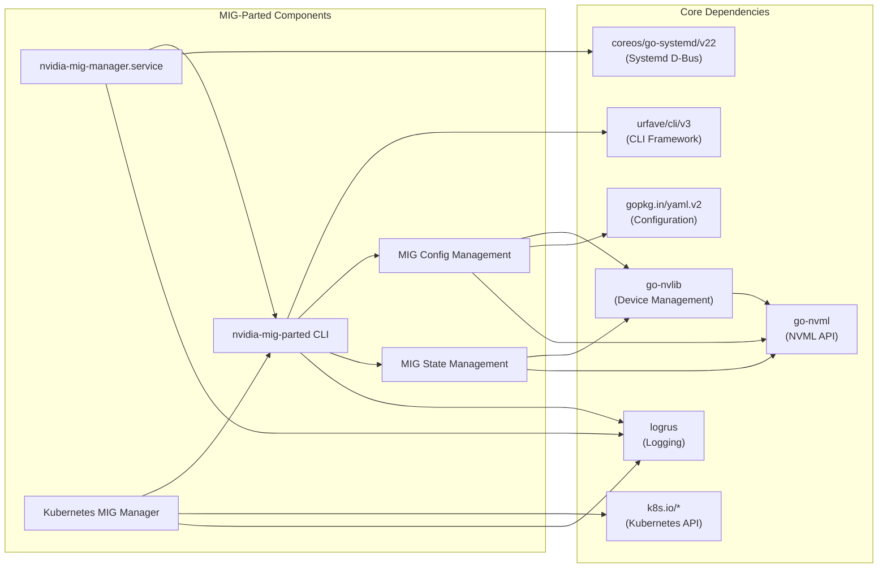
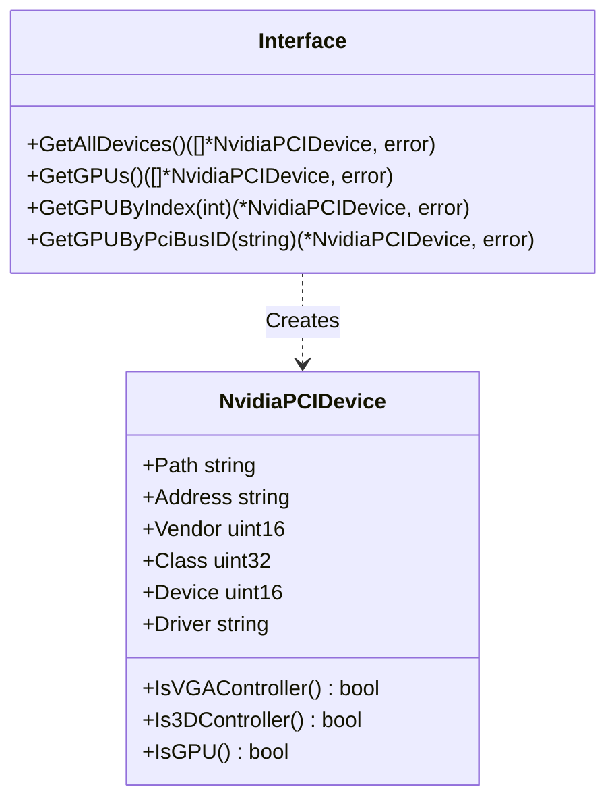

<!-- source: DeepWiki mcp.deepwiki.com · repo NVIDIA/mig-parted · page 8.2 Core Dependencies · fetched 2026-10-26 -->

# Core Dependencies

Relevant source files

The following files were used as context for generating this wiki page:

- [.gitignore](.gitignore)
- [THIRD_PARTY_NOTICES.md](THIRD_PARTY_NOTICES.md)
- [deployments/devel/go.mod](deployments/devel/go.mod)
- [deployments/devel/go.sum](deployments/devel/go.sum)
- [deployments/devel/tools.go](deployments/devel/tools.go)
- [go.mod](go.mod)
- [go.sum](go.sum)
- [hack/container-toolkit-version.sh](hack/container-toolkit-version.sh)
- [hack/generate-third-party-notices.sh](hack/generate-third-party-notices.sh)
- [vendor/github.com/NVIDIA/go-nvlib/pkg/nvlib/device/device.go](vendor/github.com/NVIDIA/go-nvlib/pkg/nvlib/device/device.go)
- [vendor/github.com/NVIDIA/go-nvlib/pkg/nvlib/device/mig_device.go](vendor/github.com/NVIDIA/go-nvlib/pkg/nvlib/device/mig_device.go)
- [vendor/github.com/NVIDIA/go-nvlib/pkg/nvlib/device/mig_profile.go](vendor/github.com/NVIDIA/go-nvlib/pkg/nvlib/device/mig_profile.go)
- [vendor/github.com/NVIDIA/go-nvlib/pkg/nvpci/mmio/mmio.go](vendor/github.com/NVIDIA/go-nvlib/pkg/nvpci/mmio/mmio.go)
- [vendor/github.com/NVIDIA/go-nvlib/pkg/nvpci/mmio/mock.go](vendor/github.com/NVIDIA/go-nvlib/pkg/nvpci/mmio/mock.go)
- [vendor/github.com/NVIDIA/go-nvlib/pkg/nvpci/mock.go](vendor/github.com/NVIDIA/go-nvlib/pkg/nvpci/mock.go)
- [vendor/github.com/NVIDIA/go-nvlib/pkg/nvpci/nvpci.go](vendor/github.com/NVIDIA/go-nvlib/pkg/nvpci/nvpci.go)
- [vendor/github.com/NVIDIA/go-nvlib/pkg/nvpci/nvpci_mock.go](vendor/github.com/NVIDIA/go-nvlib/pkg/nvpci/nvpci_mock.go)
- [vendor/github.com/NVIDIA/go-nvlib/pkg/pciids/default_pci.ids](vendor/github.com/NVIDIA/go-nvlib/pkg/pciids/default_pci.ids)
- [vendor/github.com/NVIDIA/go-nvml/pkg/nvml/device.go](vendor/github.com/NVIDIA/go-nvml/pkg/nvml/device.go)
- [vendor/github.com/NVIDIA/go-nvml/pkg/nvml/gpm.go](vendor/github.com/NVIDIA/go-nvml/pkg/nvml/gpm.go)
- [vendor/modules.txt](vendor/modules.txt)

This page documents the core third-party libraries and frameworks that MIG-Parted depends on. Understanding these dependencies is essential for developers who want to contribute to or extend the project. For information about building the project itself, see [Build Environment](#8.1).

## Overview of Dependencies

MIG-Parted relies on several key dependencies to interface with NVIDIA GPUs, provide command-line functionality, and integrate with Kubernetes environments.

Sources: [go.mod:1-17]()

## NVIDIA GPU Libraries

MIG-Parted's primary function is to manage NVIDIA GPU configurations, particularly focusing on Multi-Instance GPU (MIG) functionality. It relies on two core NVIDIA libraries to interact with the hardware.

### go-nvlib

The `go-nvlib` package provides higher-level abstractions for working with NVIDIA GPUs, particularly for MIG-related operations.

Key features:
- Device discovery and enumeration [vendor/github.com/NVIDIA/go-nvlib/pkg/nvlib/device/device.go:59-66]()
- MIG profile management [vendor/github.com/NVIDIA/go-nvlib/pkg/nvlib/device/device.go:35-36]()
- GPU property queries [vendor/github.com/NVIDIA/go-nvlib/pkg/nvlib/device/device.go:74-214]()
- PCI device interactions [vendor/github.com/NVIDIA/go-nvlib/pkg/nvpci/nvpci.go:206-225]()

Sources: [vendor/github.com/NVIDIA/go-nvlib/pkg/nvlib/device/device.go:27-43](), [vendor/github.com/NVIDIA/go-nvlib/pkg/nvlib/device/mig_device.go:27-40](), [vendor/github.com/NVIDIA/go-nvlib/pkg/nvlib/device/mig_profile.go:27-36]()

### go-nvml

The `go-nvml` package provides Go bindings for the NVIDIA Management Library (NVML), which offers direct access to NVIDIA GPU devices at a lower level than go-nvlib.

Key features:
- GPU device management [vendor/github.com/NVIDIA/go-nvml/pkg/nvml/device.go:103-144]()
- Memory and utilization monitoring [vendor/github.com/NVIDIA/go-nvml/pkg/nvml/device.go:220-229]()
- Process tracking [vendor/github.com/NVIDIA/go-nvml/pkg/nvml/process.go:20-30]()
- MIG mode configuration [vendor/github.com/NVIDIA/go-nvml/pkg/nvml/mig.go:15-25]()
- System-level NVIDIA driver interaction [vendor/github.com/NVIDIA/go-nvml/pkg/nvml/system.go:15-25]()

Sources: [vendor/github.com/NVIDIA/go-nvml/pkg/nvml/device.go:103-144](), [vendor/github.com/NVIDIA/go-nvml/pkg/nvml/mig.go:15-25](), [vendor/github.com/NVIDIA/go-nvml/pkg/nvml/system.go:15-25](), [vendor/github.com/NVIDIA/go-nvml/pkg/nvml/gpm.go:50-172]()

### Relationship Between go-nvlib and go-nvml

The relationship between these libraries is hierarchical: `go-nvlib` builds upon `go-nvml` to provide higher-level, more convenient abstractions.

Sources: [vendor/github.com/NVIDIA/go-nvlib/pkg/nvlib/device/device.go:27-43](), [vendor/github.com/NVIDIA/go-nvml/pkg/nvml/nvml.go:15-30]()

## CLI Framework

MIG-Parted uses the `urfave/cli/v3` framework to build its command-line interface.

### urfave/cli/v3

The `urfave/cli/v3` library provides a structured way to create command-line applications in Go, handling argument parsing, help text generation, and command organization.

Key features:
- Command hierarchy and organization
- Flag parsing and validation
- Help text generation
- Bash completion support
- Error handling

Sources: [go.mod:11](), [vendor/github.com/urfave/cli/v3/app.go:1-200](), [vendor/github.com/urfave/cli/v3/command.go:1-150]()

## Kubernetes Integration Libraries

For Kubernetes integration, MIG-Parted uses several Kubernetes client libraries.

### k8s.io/api, k8s.io/apimachinery, k8s.io/client-go

These libraries provide the Kubernetes API types, client implementations, and utility functions needed for the Kubernetes MIG Manager component.

Key functionalities:
- Kubernetes API client implementation [go.mod:15]()
- Custom resource definitions [go.mod:13]()
- Node labeling and annotation
- Controller patterns

Sources: [go.mod:13-15]()

## Utility Libraries

### coreos/go-systemd/v22

This library provides Go bindings for interacting with `systemd` via D-Bus. It is used for managing the `nvidia-mig-manager` systemd service, allowing for operations like starting, stopping, and checking the status of the service.

Sources: [go.mod:8](), [vendor/github.com/coreos/go-systemd/v22/dbus/conn.go:1-100]()

### logrus

`logrus` is a structured logging library used throughout the application for consistent and easily parsable log output.

Sources: [go.mod:9]()

### gopkg.in/yaml.v2

This library is used for parsing and generating configuration files, especially for MIG profiles and configurations, which are often defined in YAML format.

Sources: [go.mod:12]()

### stretchr/testify

`stretchr/testify` is a popular Go testing framework that provides assertion functions and mocking capabilities, used extensively in the project's unit and integration tests.

Sources: [go.mod:10]()

## Version Summary

The table below summarizes the key dependencies and their versions:

| Dependency | Version | Purpose |
|------------|---------|---------|
| go-nvlib | v0.12.0 | High-level NVIDIA GPU device operations |
| go-nvml | v0.13.3-1 | Low-level NVIDIA Management Library bindings |
| urfave/cli/v3 | v3.10.1 | Command-line interface framework |
| coreos/go-systemd/v22 | v22.7.0 | Systemd D-Bus integration |
| k8s.io/api | v0.36.3 | Kubernetes API types |
| k8s.io/apimachinery | v0.36.3 | Kubernetes API machinery |
| k8s.io/client-go | v0.36.3 | Kubernetes client implementation |
| logrus | v1.9.4 | Structured logging |
| gopkg.in/yaml.v2 | v2.4.0 | Configuration parsing |
| stretchr/testify | v1.11.1 | Testing framework |

Sources: [go.mod:1-17]()

## Dependency Flow in MIG-Parted

The following diagram illustrates how MIG-Parted components interact with the core dependencies:

Sources: [go.mod:1-17](), [vendor/modules.txt:1-495]()

## PCI Device Management

MIG-Parted also includes PCI device management functionality through the `nvpci` package in `go-nvlib`. This provides methods for discovering and managing NVIDIA PCI devices, particularly for GPU enumeration:

Sources: [vendor/github.com/NVIDIA/go-nvlib/pkg/nvpci/nvpci.go:52-64](), [vendor/github.com/NVIDIA/go-nvlib/pkg/nvpci/nvpci.go:110-127]()

## Vendor Directory Management

The project uses a `vendor` directory to manage its Go module dependencies. This strategy ensures that all required dependencies are committed directly into the repository, providing several benefits:
- **Reproducibility**: Builds are consistent across different environments and over time, as the exact versions of dependencies are locked.
- **Offline Builds**: The project can be built without requiring access to external Go module proxies or the internet.
- **Security**: Dependencies are explicitly controlled and can be audited.

The `go.mod` file [go.mod:1-17]() lists the direct dependencies, while `go.sum` [go.sum:1-57]() contains cryptographic hashes for all direct and indirect dependencies to ensure their integrity. The `vendor/modules.txt` file [vendor/modules.txt:1-495]() lists all vendored modules and their explicit versions, along with the specific packages from those modules that are included.

The `deployments/devel/go.mod` [deployments/devel/go.mod:1-10]() and `deployments/devel/go.sum` [deployments/devel/go.sum:1-57]() files are used specifically for development tools and their dependencies, ensuring that these do not interfere with the main project's dependency graph. For example, `github.com/NVIDIA/nvidia-container-toolkit` is listed here [deployments/devel/go.mod:6]() as a development dependency.

Sources: [go.mod:1-17](), [go.sum:1-57](), [vendor/modules.txt:1-495](), [deployments/devel/go.mod:1-10](), [deployments/devel/go.sum:1-57]()

## Conclusion

MIG-Parted relies on a set of carefully chosen dependencies that provide functionality ranging from low-level GPU management to high-level CLI interfaces and Kubernetes integration. Understanding these dependencies is crucial for developers who want to contribute to or extend the project.

The most critical dependencies are:
1. The NVIDIA libraries (`go-nvlib` and `go-nvml`) that provide access to GPU functionality
2. The CLI framework (`urfave/cli/v3`) that enables command-line operation
3. The Kubernetes libraries that enable integration with container orchestration
4. The `coreos/go-systemd/v22` library for systemd service management.

Together, these dependencies form the foundation that allows MIG-Parted to provide a comprehensive solution for managing Multi-Instance GPU configurations on NVIDIA GPUs.

---

