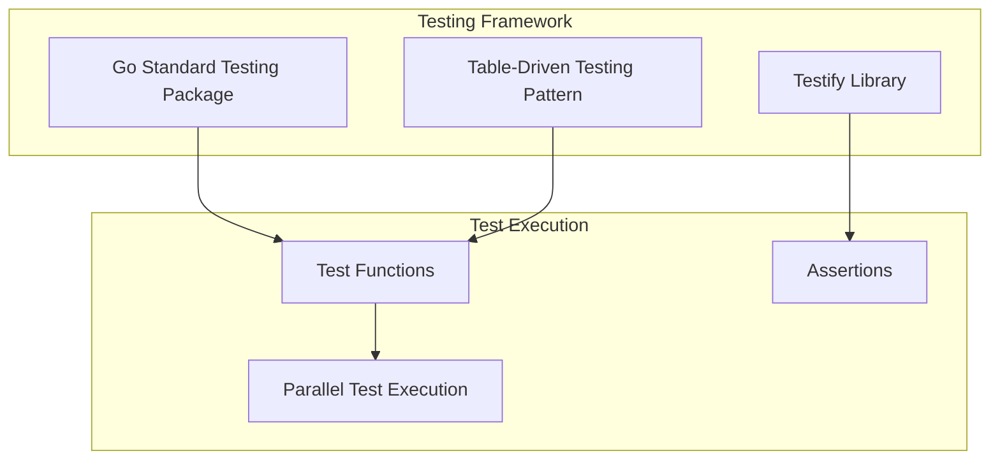
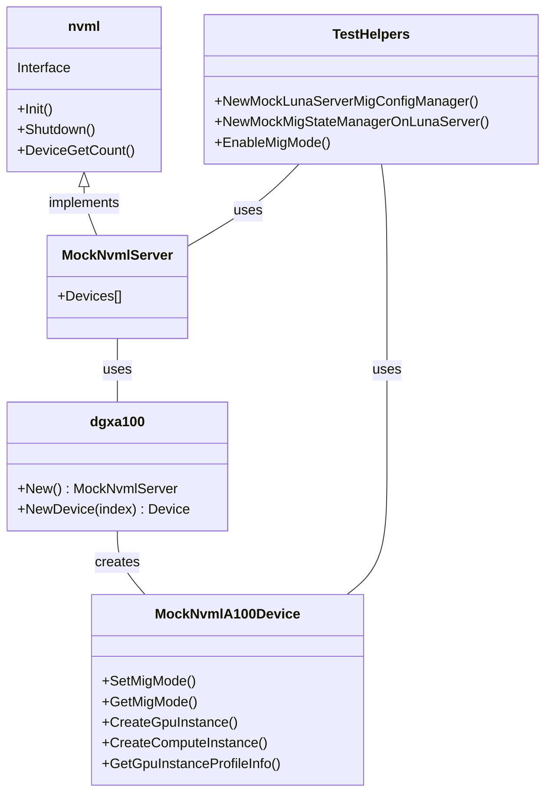
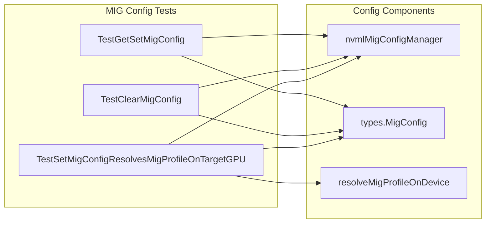
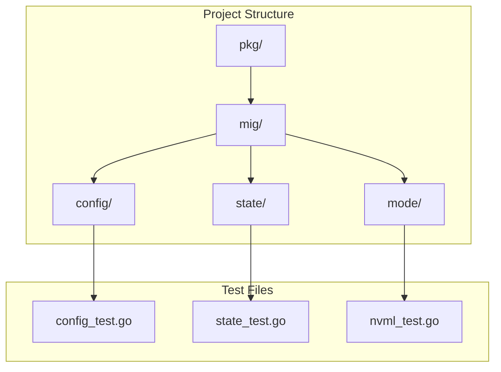
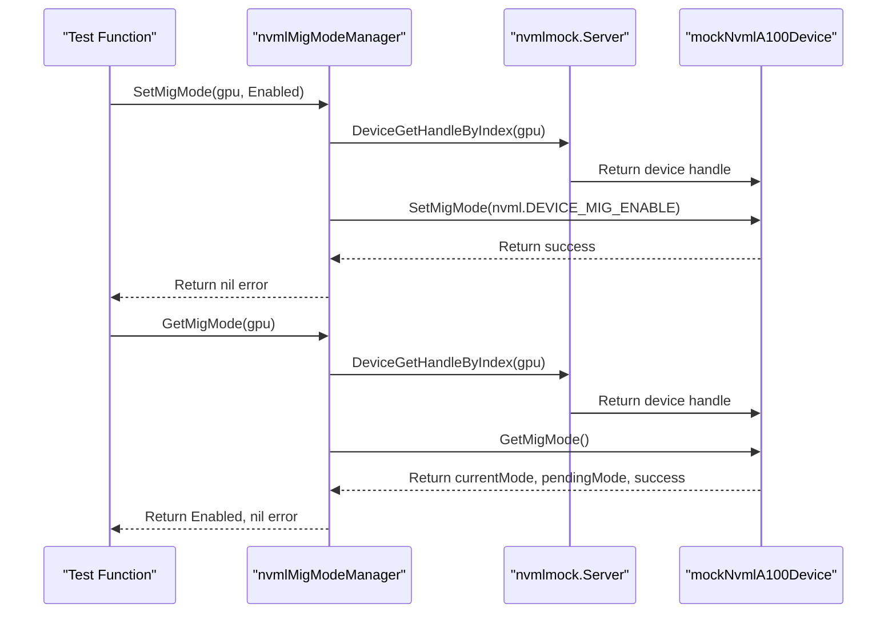
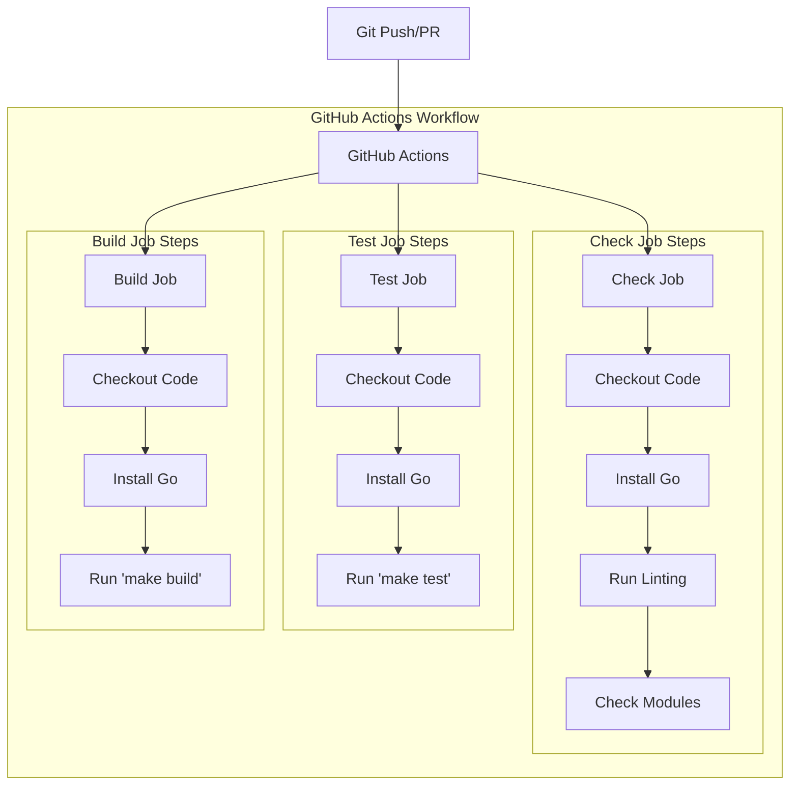

<!-- source: DeepWiki mcp.deepwiki.com · repo NVIDIA/mig-parted · page 8.3 Testing · fetched 2026-10-26 -->

# Testing

<details>
<summary>Relevant source files</summary>

The following files were used as context for generating this wiki page:

- [pkg/mig/config/config.go](pkg/mig/config/config.go)
- [pkg/mig/config/config_test.go](pkg/mig/config/config_test.go)
- [pkg/mig/mode/nvml.go](pkg/mig/mode/nvml.go)
- [pkg/mig/mode/nvml_test.go](pkg/mig/mode/nvml_test.go)
- [pkg/mig/state/state.go](pkg/mig/state/state.go)
- [pkg/mig/state/state_test.go](pkg/mig/state/state_test.go)
- [pkg/types/mig_state.go](pkg/types/mig_state.go)
- [vendor/github.com/NVIDIA/go-nvml/pkg/nvml/mock/gpuinstance.go](vendor/github.com/NVIDIA/go-nvml/pkg/nvml/mock/gpuinstance.go)
- [vendor/github.com/stretchr/testify/assert/assertion_compare.go](vendor/github.com/stretchr/testify/assert/assertion_compare.go)
- [vendor/github.com/stretchr/testify/assert/assertion_format.go](vendor/github.com/stretchr/testify/assert/assertion_format.go)
- [vendor/github.com/stretchr/testify/assert/assertion_forward.go](vendor/github.com/stretchr/testify/assert/assertion_forward.go)
- [vendor/github.com/stretchr/testify/assert/assertion_order.go](vendor/github.com/stretchr/testify/assert/assertion_order.go)
- [vendor/github.com/stretchr/testify/assert/assertions.go](vendor/github.com/stretchr/testify/assert/assertions.go)
- [vendor/github.com/stretchr/testify/assert/yaml/yaml_custom.go](vendor/github.com/stretchr/testify/assert/yaml/yaml_custom.go)
- [vendor/github.com/stretchr/testify/assert/yaml/yaml_default.go](vendor/github.com/stretchr/testify/assert/yaml/yaml_default.go)
- [vendor/github.com/stretchr/testify/assert/yaml/yaml_fail.go](vendor/github.com/stretchr/testify/assert/yaml/yaml_fail.go)
- [vendor/github.com/stretchr/testify/require/require.go](vendor/github.com/stretchr/testify/require/require.go)
- [vendor/github.com/stretchr/testify/require/require_forward.go](vendor/github.com/stretchr/testify/require/require_forward.go)

</details>


This page provides detailed information on testing the NVIDIA MIG-Parted project. It covers both unit testing approaches and automated testing workflows used in the project. For information about building the project, see [Build Environment](#8.1).

## Overview

NVIDIA MIG-Parted employs a robust testing strategy focused on unit testing to ensure code quality and reliability. The project uses Go's standard testing framework along with mocking capabilities to simulate NVIDIA GPU hardware interactions, allowing for comprehensive testing without requiring actual MIG-capable hardware.

Sources: [.github/workflows/golang.yaml:57-72](), [pkg/mig/config/config_test.go:1-206]()

## Testing Infrastructure

### Test Framework

MIG-Parted uses the standard Go testing package for unit tests, along with the Testify library for assertions and more expressive test constructs. The project utilizes table-driven testing extensively, where multiple test cases are defined in a data structure and executed in a loop, allowing for comprehensive coverage with minimal code duplication.



Sources: [pkg/mig/config/config_test.go:19-25](), [pkg/mig/state/state_test.go:19-23]()

### Mock Infrastructure

A critical aspect of MIG-Parted testing is the mock infrastructure that simulates NVIDIA hardware components. This allows testing the MIG management code without requiring actual MIG-capable GPU hardware.



The primary mock components include:

1.  **NVML Library Mock**: Simulates the NVIDIA Management Library (NVML) interfaces, specifically `nvml.Interface` [pkg/mig/config/config.go:39]().
2.  **DGX A100 Server Mock**: Provides a simulated DGX A100 server environment with MIG-capable GPUs, implemented by `dgxa100.New()` [pkg/mig/config/config_test.go:36]().
3.  **Mock Device Implementations**: Implements simulated behaviors for GPU operations, such as `mockNvmlA100Device` [pkg/mig/mode/nvml_test.go:32-49]().

Sources: [pkg/mig/config/config_test.go:33-37](), [pkg/mig/state/state_test.go:33-36](), [pkg/mig/mode/nvml_test.go:31-71]()

## Unit Testing

The unit tests in MIG-Parted focus on several key components:

### MIG Configuration Testing

The configuration tests verify the ability to:
- Set and retrieve MIG configurations using `SetMigConfig` [pkg/mig/config/config.go:101-218]() and `GetMigConfig` [pkg/mig/config/config.go:63-98]().
- Validate configurations against known GPU models.
- Clear existing MIG configurations using `ClearMigConfig` [pkg/mig/config/config.go:220-230]().
- Handle various permutations of configuration profiles using `iteratePermutationsUntilSuccess` [pkg/mig/config/config.go:125-208]().



Sources: [pkg/mig/config/config_test.go:46-205](), [pkg/mig/config/config.go:101-218](), [pkg/mig/config/config.go:63-98](), [pkg/mig/config/config.go:220-230](), [pkg/mig/config/config.go:125-208]()

### MIG State Management Testing

The state management tests ensure:
- Proper fetching of current MIG state using `Fetch()` [pkg/mig/state/state.go:66-146]().
- Restoration of saved state using `RestoreMode()` [pkg/mig/state/state.go:149-174]() and `RestoreConfig()` [pkg/mig/state/state.go:177-230]().
- Handling of different MIG modes.
- Proper serialization and deserialization of state information, represented by `types.MigState` [pkg/types/mig_state.go:26-28]().

Sources: [pkg/mig/state/state_test.go:38-107](), [pkg/mig/state/state.go:66-146](), [pkg/mig/state/state.go:149-174](), [pkg/mig/state/state.go:177-230](), [pkg/types/mig_state.go:26-28]()

### MIG Mode Testing

Mode testing validates:
- Checking if a GPU is MIG-capable using `IsMigCapable()` [pkg/mig/mode/nvml.go:35-50]().
- Enabling and disabling MIG mode using `SetMigMode()` [pkg/mig/mode/nvml.go:73-91]().
- Handling pending mode changes using `IsMigModeChangePending()` [pkg/mig/mode/nvml.go:94-110]().
- Error conditions in mode operations.

Sources: [pkg/mig/mode/nvml_test.go:73-136](), [pkg/mig/mode/nvml.go:35-50](), [pkg/mig/mode/nvml.go:73-91](), [pkg/mig/mode/nvml.go:94-110]()

## Test Organization

Tests in MIG-Parted are organized following Go conventions with test files placed alongside the code they test, using the `_test.go` suffix. The project uses table-driven testing extensively, which allows defining multiple test cases in a data structure and executing them in a loop.



Sources: [pkg/mig/config/config_test.go:1-206](), [pkg/mig/state/state_test.go:1-107](), [pkg/mig/mode/nvml_test.go:1-136]()

## Mocking Approach

The MIG-Parted project uses sophisticated mocking to simulate NVIDIA hardware:

1.  **Mock NVML Interface**: Provides a simulation of the NVIDIA Management Library API, defined by `nvml.Interface` [pkg/mig/config/config.go:39]().
2.  **DGX A100 Server Mocks**: Simulates a server with NVIDIA A100 GPUs that have MIG capability, instantiated by `dgxa100.New()` [pkg/mig/config/config_test.go:36]().
3.  **Mock Devices**: Implements specific behaviors for testing different MIG operations, such as `mockNvmlA100Device` [pkg/mig/mode/nvml_test.go:32-49]().

For example, the mock A100 device implements:
- MIG capability checking via `GetMigMode()` [pkg/mig/mode/nvml_test.go:67-72]().
- MIG mode toggling via `SetMigMode()` [pkg/mig/mode/nvml_test.go:54-65]().
- Reporting pending mode changes.
- Simulating driver busy conditions.



Sources: [pkg/mig/mode/nvml_test.go:31-71](), [pkg/mig/config/config_test.go:33-37](), [pkg/mig/mode/nvml.go:35-50](), [pkg/mig/mode/nvml.go:73-91](), [pkg/mig/mode/nvml.go:94-110]()

## Continuous Integration

The project uses GitHub Actions for continuous integration, with a workflow defined in `.github/workflows/golang.yaml`. This workflow performs:

1.  **Linting**: Using golangci-lint to enforce code quality standards.
2.  **Module Checking**: Ensuring Go module consistency.
3.  **Unit Testing**: Running all unit tests.
4.  **Build Verification**: Ensuring the project builds successfully.

The CI workflow runs on pull requests to main and release branches, as well as on pushes to these branches.



Sources: [.github/workflows/golang.yaml:15-88]()

## Running Tests

To run the MIG-Parted tests locally:

1.  **Run all tests**:
    ```bash
    make test
    ```

2.  **Run specific tests**:
    ```bash
    go test ./pkg/mig/config
    ```

3.  **Run tests with verbose output**:
    ```bash
    go test -v ./pkg/...
    ```

Sources: [.github/workflows/golang.yaml:72]()

## Testing Best Practices

The MIG-Parted project demonstrates several testing best practices:

1.  **Parallel Test Execution**: Tests use `t.Parallel()` [pkg/mig/config/config_test.go:70]() for concurrent execution.
2.  **Table-Driven Testing**: Defining multiple test cases in a data structure [pkg/mig/config/config_test.go:50-64]().
3.  **Mock Infrastructure**: Providing realistic simulations of hardware.
4.  **Comprehensive Assertions**: Using testify for clear test assertions, e.g., `require.Nil(t, err)` [vendor/github.com/stretchr/testify/require/require_forward.go:155]().
5.  **Isolation**: Each test runs in its own isolated environment.

Example of table-driven testing pattern used extensively in the project:

```go
testCases := []struct {
    description string
    mode        mode.MigMode
    config      types.MigConfig
}{
    // Test cases defined here
}

for i := range testCases {
    tc := testCases[i] // to allow us to run parallelly
    t.Run(tc.description, func(t *testing.T) {
        t.Parallel()
        // Test logic using tc values
    })
}
```

Sources: [pkg/mig/config/config_test.go:50-64](), [pkg/mig/state/state_test.go:42-69]()

---

