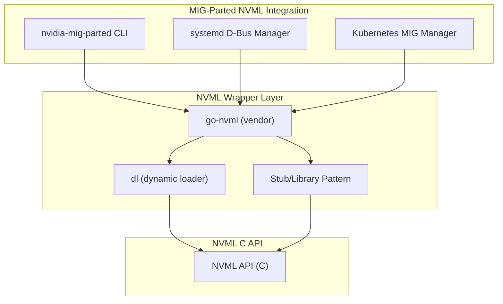
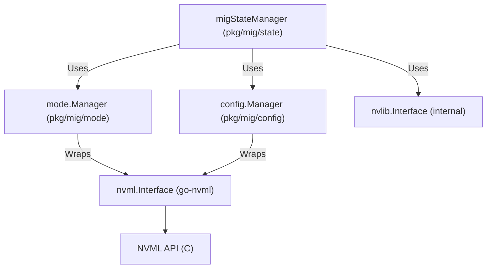

<!-- source: DeepWiki mcp.deepwiki.com · repo NVIDIA/mig-parted · page 9 Technical Reference · fetched 2026-10-26 -->

# Technical Reference

<details>
<summary>Relevant source files</summary>

The following files were used as context for generating this wiki page:

- [go.mod](go.mod)
- [go.sum](go.sum)
- [pkg/mig/state/state.go](pkg/mig/state/state.go)
- [pkg/mig/state/state_test.go](pkg/mig/state/state_test.go)
- [pkg/types/mig_state.go](pkg/types/mig_state.go)
- [vendor/github.com/NVIDIA/go-nvml/pkg/nvml/device.go](vendor/github.com/NVIDIA/go-nvml/pkg/nvml/device.go)
- [vendor/github.com/NVIDIA/go-nvml/pkg/nvml/gpm.go](vendor/github.com/NVIDIA/go-nvml/pkg/nvml/gpm.go)
- [vendor/modules.txt](vendor/modules.txt)

</details>


This document provides a detailed low-level technical reference for the internal components of the NVIDIA MIG-Parted project. It explains the core internal systems, data flow, and interactions with underlying libraries, particularly focusing on MIG state management and integration with the NVIDIA Management Library (NVML). This page serves as a high-level overview linking to more detailed child pages for deep technical details.

## Overview

MIG-Parted implements a modular architecture that orchestrates the enabling, configuration, and monitoring of Multi-Instance GPU (MIG) profiles on NVIDIA GPUs. At a foundational level, it manages:

- **MIG State Management** — representing and tracking the complete state of MIG instances on all GPUs of a node.
- **NVML Integration** — direct interaction with NVIDIA's low-level NVML library to perform GPU and MIG-specific operations.

This page introduces these core internal components and their relationships, directing technical readers to the child pages:

- [MIG State Management](#9.1) — covers how MIG state is modeled, fetched, restored, and manipulated internally, including the use of `pkg/mig/state`, `pkg/mig/mode`, `pkg/mig/config`, and `internal/nvlib/mig`.
- [NVML Integration](#9.2) — provides details about the wrapper around NVML, including the go-nvml library, type conversions, dynamic buffer management, performance monitoring (GPM), and systemd D-Bus integration.

---

## 9.1 MIG State Management

MIG state management encapsulates the logic and data structures required to fetch, save, and restore the entire MIG configuration for all GPUs on a node.

### Manager Interface

The central interface is `Manager` in `pkg/mig/state/state.go`, which defines:

- `Fetch() (*types.MigState, error)` — Collects current MIG state of all GPUs, returning a complete snapshot.
- `RestoreMode(state *types.MigState) error` — Restores only the MIG mode (enabled/disabled) per GPU.
- `RestoreConfig(state *types.MigState) error` — Restores the detailed MIG configuration (instance profiles) per GPU.

The primary implementation, `migStateManager`, composes the following sub-managers:

- `mode.Manager` — manages MIG mode toggling per GPU, via NVML.
- `config.Manager` — handles detailed MIG profile configuration on a GPU, also via NVML.
- `nvlib.Interface` — a helper interface to walk GPU and compute instances.

### State Representation

The state is represented via the `types.MigState` struct and related types in `pkg/types/mig_state.go`:

- `MigState` — contains a slice of `DeviceState`, representing all GPUs on a node.
- `DeviceState` — stores a GPU's UUID, its MIG mode state, and the list of `GpuInstanceState`.
- `GpuInstanceState` — stores the GPU instance's profile ID, placement, and its contained compute instances.
- `ComputeInstanceState` — stores the profile and engine profile IDs for compute instances.

### Fetching State

`Fetch()` initializes NVML, retrieves the count of GPUs, and iterates over each GPU:

- Checks whether MIG is supported (`IsMigCapable`).
- If enabled, enumerates GPU instances and their child compute instances through `nvlib.Mig` helpers.
- Builds the full nested `MigState` representation.

### Restoring State

Restoration is divided into two steps:

1. **RestoreMode**: For each device in the saved state, finds the NVML handle, obtains the device index, and sets the MIG mode on the device.
2. **RestoreConfig**: For devices with MIG enabled, clears any existing MIG config, then recreates all GPU instances and compute instances as per the saved state.

This layered approach allows precise control and facilitates operations like partial restores or mode toggling.

---

### Diagram: MIG State Management Components

```mermaid
flowchart TD
    subgraph "MIG State Manager"
        Manager["Manager Interface"]
        MigStateManager["migStateManager"]
        ModeManager["mode.Manager"]
        ConfigManager["config.Manager"]
        Nvlib["nvlib.Interface"]
    end

    Manager <|-- MigStateManager
    MigStateManager --> ModeManager
    MigStateManager --> ConfigManager
    MigStateManager --> Nvlib
```

Sources: [pkg/mig/state/state.go:19-174](), [pkg/types/mig_state.go:16-49](), [pkg/mig/state/state_test.go:33-106]()

For detailed implementation and behavior, see [MIG State Management](#9.1).

---

## 9.2 NVML Integration

NVML (NVIDIA Management Library) provides the foundational API for querying and managing GPU resources and MIG configurations.

MIG-Parted uses a layered integration approach:

- **go-nvml wrapper** (`vendor/github.com/NVIDIA/go-nvml/pkg/nvml`) offers Go bindings with advanced idioms such as stub functions for testing, dynamic buffer sizing, and reflect-based handle conversions.
- **Dynamic Loader (`dl` package)** provides in-process loading and symbol resolution of the NVML C library.
- **Internal systemd D-Bus manager** integrates GPU state changes and notifications with system services.

### NVML Wrapper Patterns

Key design patterns in `go-nvml` include:

- Use of stub functions that can be overridden for mocking in tests.
- Reflect-based handle type conversions to convert Go interface types to low-level NVML C handles (e.g., `nvmlDeviceHandle` function).
- Dynamic buffer allocation for querying variable-length attributes like device names or UUIDs.
- Performance Monitoring (GPM) lifecycle management including metric sample allocation and streaming.

### Handle Conversion Example

```go
func nvmlDeviceHandle(d Device) nvmlDevice { ... }
```

This function recursively unwraps interface layers to produce a raw `nvmlDevice` handle usable with low-level NVML calls. This is essential for passing Go-managed objects into C APIs [vendor/github.com/NVIDIA/go-nvml/pkg/nvml/device.go:24-59]().

### Performance Monitoring (GPM)

The NVML wrapper supports GPM samples, including allocation, fetching, and freeing of samples for performance metric monitoring:

- Allocation: `GpmSampleAlloc()`
- Fetching: `GpmSampleGet()`
- Freeing: `GpmSampleFree()`

These wrappers handle versioning and buffer management internally, ensuring correct calls across multiple NVML versions. They can query streaming support and enable or disable streaming per device.

### Diagram: NVML Integration Layer



Sources: [vendor/github.com/NVIDIA/go-nvml/pkg/nvml/device.go:24-59](), [vendor/github.com/NVIDIA/go-nvml/pkg/nvml/gpm.go:1-172](), [go.mod:6-17]()

For full implementation details, see [NVML Integration](#9.2).

---

## Interplay of State Management and NVML Integration

MIG-Parted’s capability to manage MIG configurations depends on a tight integration between the state management logic and the NVML API bindings. This relation is key to understanding the deployment lifecycle of MIG:



- The `migStateManager` composes the mode and config managers to fetch and restore complete MIG states.
- Both mode and config managers interact through the `nvml.Interface` abstraction to communicate with the NVIDIA drivers.
- The `nvlib` package provides helpers to enumerate and traverse GPU and MIG instances.

Sources: [pkg/mig/state/state.go:39-44](), [pkg/mig/config/config.go:31-60](), [pkg/mig/mode/nvml.go:28-94](), [vendor/github.com/NVIDIA/go-nvml/pkg/nvml/device.go:24-59]()

---

## Summary

This page presented high-level technical reference linking together:

- Internal MIG state management with robust state fetching and restoration.
- Multi-layered NVML integration providing reliable GPU and MIG interaction.
- Key data structures describing MIG state and configuration.

For comprehensive technical details, please consult the child pages:

- [MIG State Management](#9.1) — Covers core internal packages `pkg/mig/state`, `pkg/mig/mode`, `pkg/mig/config`, and interaction with `internal/nvlib/mig` and `api/checkpoint/v1`.
- [NVML Integration](#9.2) — Documents the `go-nvml` wrapper, its stub/library pattern, dynamic buffer management, GPM monitoring, and systemd D-Bus management.

---

Sources:

- [pkg/mig/state/state.go:17-174]()
- [pkg/types/mig_state.go:16-49]()
- [pkg/mig/state/state_test.go:33-106]()
- [vendor/github.com/NVIDIA/go-nvml/pkg/nvml/device.go:24-59]()
- [vendor/github.com/NVIDIA/go-nvml/pkg/nvml/gpm.go:1-172]()
- [pkg/mig/config/config.go:31-60]()

---

