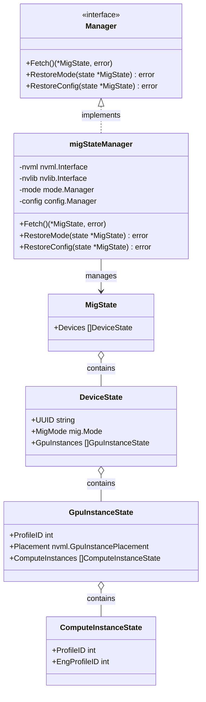
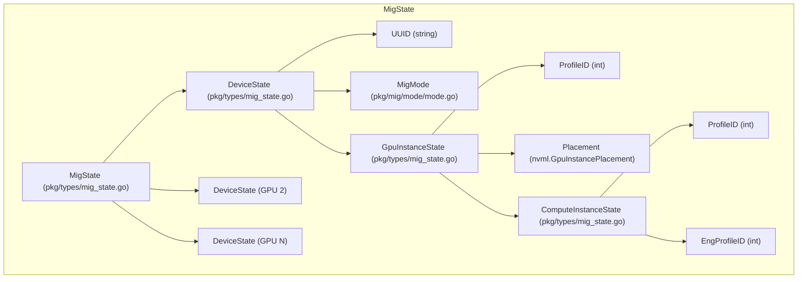
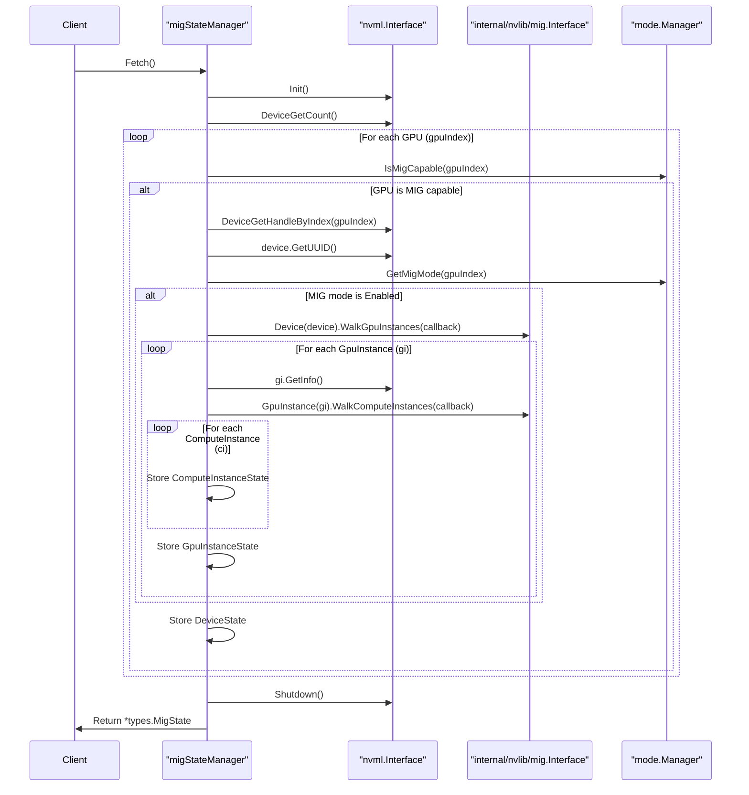
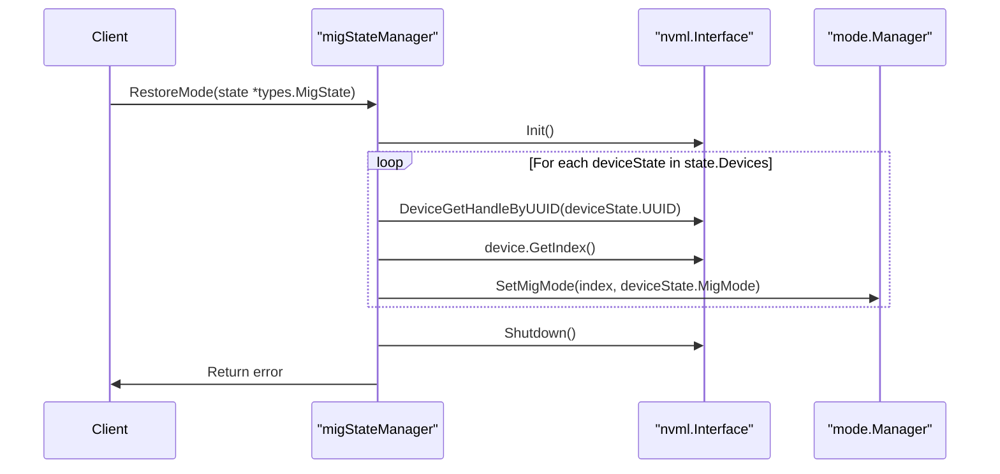
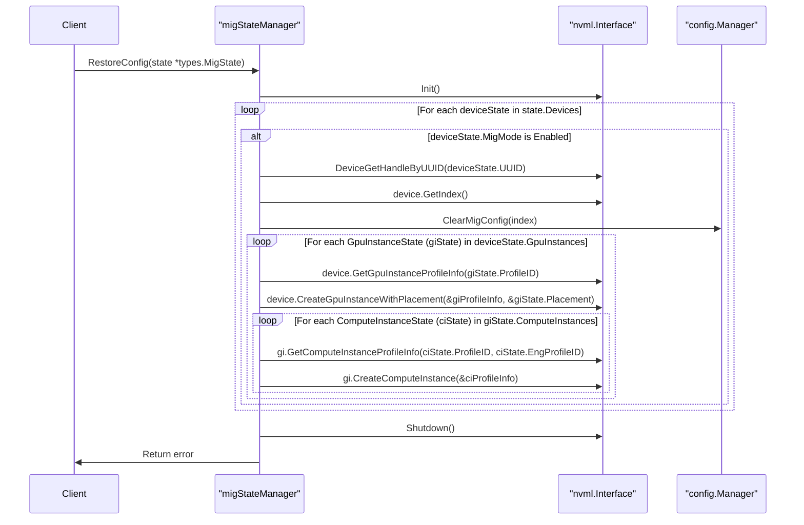
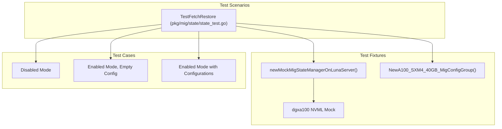

<!-- source: DeepWiki mcp.deepwiki.com · repo NVIDIA/mig-parted · page 9.1 MIG State Management · fetched 2026-10-26 -->

# MIG State Management

<details>
<summary>Relevant source files</summary>

The following files were used as context for generating this wiki page:

- [api/checkpoint/v1/state.go](api/checkpoint/v1/state.go)
- [api/hooks/v1/hooks.go](api/hooks/v1/hooks.go)
- [api/hooks/v1/hooks_test.go](api/hooks/v1/hooks_test.go)
- [internal/nvlib/mig/mig.go](internal/nvlib/mig/mig.go)
- [internal/nvlib/mig/mode.go](internal/nvlib/mig/mode.go)
- [internal/nvlib/nvlib.go](internal/nvlib/nvlib.go)
- [pkg/mig/config/config.go](pkg/mig/config/config.go)
- [pkg/mig/config/config_test.go](pkg/mig/config/config_test.go)
- [pkg/mig/mode/mode.go](pkg/mig/mode/mode.go)
- [pkg/mig/mode/nvml.go](pkg/mig/mode/nvml.go)
- [pkg/mig/mode/nvml_test.go](pkg/mig/mode/nvml_test.go)
- [pkg/mig/mode/pci.go](pkg/mig/mode/pci.go)
- [pkg/mig/mode/pci_test.go](pkg/mig/mode/pci_test.go)
- [pkg/mig/state/state.go](pkg/mig/state/state.go)
- [pkg/mig/state/state_test.go](pkg/mig/state/state_test.go)
- [pkg/types/mig_state.go](pkg/types/mig_state.go)
- [pkg/types/nvdev.go](pkg/types/nvdev.go)
- [vendor/github.com/NVIDIA/go-nvlib/pkg/nvlib/device/api.go](vendor/github.com/NVIDIA/go-nvlib/pkg/nvlib/device/api.go)

</details>


This document provides a technical overview of the MIG State Management system in the NVIDIA MIG-Parted repository. MIG State Management is responsible for capturing, storing, and restoring the complete Multi-Instance GPU (MIG) configuration state across all GPUs on a system. This capability is foundational for implementing checkpoint/restore functionality and ensuring configuration persistence across system reboots or updates.

For information about applying specific MIG configurations, see [nvidia-mig-parted CLI](#3). For details about the checkpoint and restore commands specifically, see [checkpoint and restore Commands](#3.4).

## Core Components

The MIG State Management system is built around a few key components:



**Title: MIG State Management Component Hierarchy**

Sources:
- [pkg/mig/state/state.go:32-37]()
- [pkg/mig/state/state.go:39-45]()
- [pkg/types/mig_state.go:26-48]()

The MIG State Management system is centered around the `Manager` interface [pkg/mig/state/state.go:32-37](), which provides three primary operations:
- `Fetch()`: Captures the current MIG state of all GPUs
- `RestoreMode()`: Restores only the MIG mode portion of a state
- `RestoreConfig()`: Restores the complete MIG configuration

## MIG State Data Structure

The MIG state is represented through a hierarchical data structure that mirrors the physical organization of MIG-enabled GPUs:



**Title: MIG State Data Structure Hierarchy**

Sources:
- [pkg/types/mig_state.go:26-48]()
- [pkg/mig/mode/mode.go:21-24]()

The data structure consists of:

- `MigState` [pkg/types/mig_state.go:26-28](): The top-level container storing state for all GPUs
- `DeviceState` [pkg/types/mig_state.go:30-34](): Contains the state for a specific GPU, identified by its UUID and `MigMode` [pkg/mig/mode/mode.go:21-24]()
- `GpuInstanceState` [pkg/types/mig_state.go:37-42](): Represents a GPU instance (GI) with its profile ID and placement
- `ComputeInstanceState` [pkg/types/mig_state.go:45-48](): Represents a compute instance (CI) with its profile and engine profile IDs

This hierarchy accurately captures the nested nature of MIG configurations where a GPU can have multiple GPU instances, and each GPU instance can have multiple compute instances.

## State Management Operations

### State Fetching

The `Fetch()` operation retrieves the current MIG state from all GPUs:



**Title: MIG State Fetching Process Flow**

Sources:
- [pkg/mig/state/state.go:76-156]()
- [internal/nvlib/mig/mig.go:67-91]()
- [internal/nvlib/mig/mig.go:95-123]()

The fetching process:
1. Initializes NVML [pkg/mig/state/state.go:67-71]().
2. Gets a count of all GPUs [pkg/mig/state/state.go:73-76]().
3. For each GPU, it checks if it's MIG capable using `mode.IsMigCapable` [pkg/mig/state/state.go:80-83]().
4. If capable, it retrieves the device handle and UUID [pkg/mig/state/state.go:89-97]().
5. It then gets the current MIG mode using `mode.GetMigMode` [pkg/mig/state/state.go:103-106]().
6. If MIG mode is `Enabled`, it uses `nvlib.Mig.Device(device).WalkGpuInstances` [pkg/mig/state/state.go:113-142]() to iterate through all GPU instances. For each GPU instance, it further uses `nvlib.Mig.GpuInstance(gi).WalkComputeInstances` [pkg/mig/state/state.go:124-136]() to iterate through compute instances, collecting their profile IDs and placement information.
7. A `types.MigState` object is constructed with all collected `DeviceState`, `GpuInstanceState`, and `ComputeInstanceState` [pkg/types/mig_state.go:26-48]().
8. Finally, NVML is shut down [pkg/mig/state/state.go:71]() and the `MigState` is returned.

### Mode Restoration

The `RestoreMode()` operation restores only the MIG mode for each GPU:



**Title: MIG Mode Restoration Process Flow**

Sources:
- [pkg/mig/state/state.go:158-184]()

The `RestoreMode` process:
1. Initializes NVML [pkg/mig/state/state.go:159-163]().
2. Iterates through each `DeviceState` in the provided `types.MigState` [pkg/mig/state/state.go:165]().
3. For each device, it gets the device handle by UUID and its index [pkg/mig/state/state.go:166-174]().
4. It then calls `mode.SetMigMode` [pkg/mig/state/state.go:176-179]() to set the MIG mode for that GPU.
5. Finally, NVML is shut down [pkg/mig/state/state.go:163]() and any errors are returned.

### Configuration Restoration

The `RestoreConfig()` operation restores the complete MIG configuration:



**Title: MIG Configuration Restoration Process Flow**

Sources:
- [pkg/mig/state/state.go:187-241]()

The `RestoreConfig` process:
1. Initializes NVML [pkg/mig/state/state.go:178-182]().
2. Iterates through each `DeviceState` in the provided `types.MigState` [pkg/mig/state/state.go:184]().
3. If the `MigMode` for a device is `Enabled`, it proceeds to restore its configuration.
4. It gets the device handle by UUID and its index [pkg/mig/state/state.go:189-197]().
5. It first clears any existing MIG configuration on the GPU using `config.ClearMigConfig` [pkg/mig/state/state.go:199-202]().
6. It then iterates through each `GpuInstanceState` [pkg/mig/state/state.go:204](). For each `giState`, it retrieves the GPU instance profile info and creates the GPU instance using `device.CreateGpuInstanceWithPlacement` [pkg/mig/state/state.go:205-214]().
7. Inside each GPU instance, it iterates through `ComputeInstanceState` objects [pkg/mig/state/state.go:216](). For each `ciState`, it retrieves the compute instance profile info and creates the compute instance using `gi.CreateComputeInstance` [pkg/mig/state/state.go:217-225]().
8. Finally, NVML is shut down [pkg/mig/state/state.go:182]() and any errors are returned.

## Integration with MIG System Components

The MIG State Manager integrates with other key components of the MIG management system:

```mermaid
graph TD
    subgraph "MIG State Management"
        MSM["migStateManager (pkg/mig/state)"]
    end
    
    subgraph "MIG Mode Management"
        MMM["mode.Manager (pkg/mig/mode)"]
        NVMLMode["nvmlMigModeManager"]
        PCIMode["pciMigModeManager"]
    end
    
    subgraph "MIG Config Management"
        MCM["config.Manager (pkg/mig/config)"]
        NVMLConfig["nvmlMigConfigManager"]
    end
    
    subgraph "NVML Interface"
        NVML["nvml.Interface (go-nvml)"]
        NVLib["nvlib.Interface (go-nvlib)"]
    end
    
    subgraph "Data Structures"
        MS["MigState (pkg/types)"]
        MC["MigConfig (pkg/types)"]
        MP["MigProfile (pkg/types)"]
    end

    MSM --> NVML
    MSM --> NVLib
    MSM --> MMM
    MSM --> MCM
    
    MSM --> MS
    MCM --> MC
    MC --> MP
    
    MMM --> NVML
    MCM --> NVML
    
    NVMLMode .|> MMM
    PCIMode .|> MMM
    NVMLConfig .|> MCM
```

**Title: MIG State Management System Integration**

Sources:
- [pkg/mig/state/state.go:39-45]()
- [pkg/mig/state/state.go:56-63]()
- [pkg/mig/mode/nvml.go:25-33]()
- [pkg/mig/mode/pci.go:51-54]()
- [pkg/mig/config/config.go:37-41]()

The `migStateManager` [pkg/mig/state/state.go:39-45]() depends on:
- The `nvml.Interface` [vendor/github.com/NVIDIA/go-nvml/pkg/nvml/nvml.go]() for direct GPU interactions.
- The `nvlib.Interface` [internal/nvlib/nvlib.go]() for simplified GPU operations, specifically `WalkGpuInstances` [internal/nvlib/mig/mig.go:67-91]() and `WalkComputeInstances` [internal/nvlib/mig/mig.go:95-123]().
- The `mode.Manager` [pkg/mig/mode/mode.go:26-30]() interface, implemented by `nvmlMigModeManager` [pkg/mig/mode/nvml.go:25-33]() (using NVML) and `pciMigModeManager` [pkg/mig/mode/pci.go:51-54]() (using PCI MMIO) for managing MIG mode state.
- The `config.Manager` [pkg/mig/config/config.go:31-35]() interface, implemented by `nvmlMigConfigManager` [pkg/mig/config/config.go:37-41]() for handling MIG configurations.

## Creating and Using a MIG State Manager

The state manager can be created using the provided factory functions:

```go
// Create a standard MIG State Manager
nvmlLib := nvml.New()
stateManager := state.NewMigStateManager(nvmlLib) // [pkg/mig/state/state.go:56-63]()

// Create a mock MIG State Manager for testing
mockNvml := dgxa100.New()  // Mock NVML implementation
mockStateManager := state.NewMigStateManager(mockNvml) // [pkg/mig/state/state.go:56-63]()
```

A typical usage flow would be:

1. Fetch the current state
2. Store the state (e.g., to a file)
3. Later, restore the state from storage

```go
// Fetch current state
state, err := stateManager.Fetch() // [pkg/mig/state/state.go:76-156]()
if err != nil {
    // Handle error
}

// ... Store state to persistent storage ...

// Later, restore the state
err = stateManager.RestoreMode(state) // [pkg/mig/state/state.go:158-184]()
if err != nil {
    // Handle error
}

err = stateManager.RestoreConfig(state) // [pkg/mig/state/state.go:187-241]()
if err != nil {
    // Handle error
}
```

Sources:
- [pkg/mig/state/state.go:56-63]()
- [pkg/mig/state/state.go:76-156]()
- [pkg/mig/state/state.go:158-184]()
- [pkg/mig/state/state.go:187-241]()

## Error Handling

The MIG State Management system employs a consistent error handling pattern:

1. Each operation returns an appropriate error when something fails.
2. Operations like `RestoreConfig` will attempt to clear the MIG configuration on error [pkg/mig/config/config.go:209-213]().
3. NVML shutdown is handled in a defer statement to ensure proper cleanup [pkg/mig/state/state.go:71]().

The error messages are descriptive, providing context about what operation failed and why:

| Error Pattern | Example Message |
|---------------|----------------|
| Initialization failures | "error initializing NVML: ..." [pkg/mig/state/state.go:68-71]() |
| Device access failures | "error getting device handle: ..." [pkg/mig/state/state.go:90-92]() |
| MIG state failures | "error checking MIG capable: ..." [pkg/mig/state/state.go:81-83]() |
| GPU instance failures | "error creating GPU instance for '...': ..." [pkg/mig/state/state.go:212-214]() |
| Compute instance failures | "error creating Compute instance for '...': ..." [pkg/mig/state/state.go:223-225]() |

Sources:
- [pkg/mig/state/state.go:76-156]()
- [pkg/mig/state/state.go:158-184]()
- [pkg/mig/state/state.go:187-241]()
- [pkg/mig/config/config.go:209-213]()

## Performance Considerations

The MIG State Management operations involve direct interactions with GPU hardware through NVML and may require reconfiguration of GPU components. This means:

1. Operations can be time-consuming, especially on systems with many GPUs.
2. Operations that change MIG mode require a GPU reset and can temporarily disrupt GPU availability.
3. Properly managing NVML initialization and shutdown is important for system stability.

Most operations with high overhead are performed in a loop over all GPUs, making performance scale linearly with the number of GPUs in the system.

Sources:
- [pkg/mig/state/state.go:76-156]()
- [pkg/mig/state/state.go:187-241]()

## Testing

The MIG State Management system includes tests that verify its functionality:



**Title: MIG State Management Test Structure**

Sources:
- [pkg/mig/state/state_test.go:33-107]()
- [pkg/mig/state/state_test.go:33-36]()
- [pkg/mig/config/config_test.go:34-38]()

The test architecture:
1. Uses mock implementations of NVML and related components, such as `dgxa100.New()` [pkg/mig/state/state_test.go:34]() for NVML and `newMockMigStateManagerOnLunaServer()` [pkg/mig/state/state_test.go:33-36]() for the state manager.
2. Tests various MIG mode and configuration scenarios, including `Disabled` mode, `Enabled` mode with an empty configuration, and `Enabled` mode with various configurations generated by `config.NewA100_SXM4_40GB_MigConfigGroup()` [pkg/mig/state/state_test.go:40]().
3. Verifies that state fetched after restoration matches the original state [pkg/mig/state/state_test.go:103]().

## Relationship to Configuration Management

While MIG State Management focuses on capturing and restoring the complete state, the MIG Configuration Management system ([MIG State Management](#9.1)) is responsible for applying specific configurations. Key differences:

| MIG State Management | MIG Configuration Management |
|----------------------|------------------------------|
| Captures complete state of all GPUs | Applies specific configurations to GPUs |
| Restores exact placement of instances | Uses permutation-based placement strategies |
| Primarily used for checkpointing/restoring | Used for initial configuration |
| State structure includes UUIDs and placement info | Config structure only includes profile counts |

The two systems work together to provide both flexible configuration (Config Management) and exact state restoration (State Management).

Sources:
- [pkg/mig/state/state.go:32-37]()
- [pkg/mig/config/config.go:31-35]()

## Summary

The MIG State Management system provides a robust mechanism for capturing and restoring MIG configurations across NVIDIA GPUs. It serves as a critical component for ensuring configuration persistence and enabling checkpoint/restore functionality in the MIG-Parted ecosystem.

By integrating with the MIG Mode and MIG Config managers, it provides a comprehensive solution for managing the complete MIG lifecycle, from initial configuration to state preservation and restoration.

---

