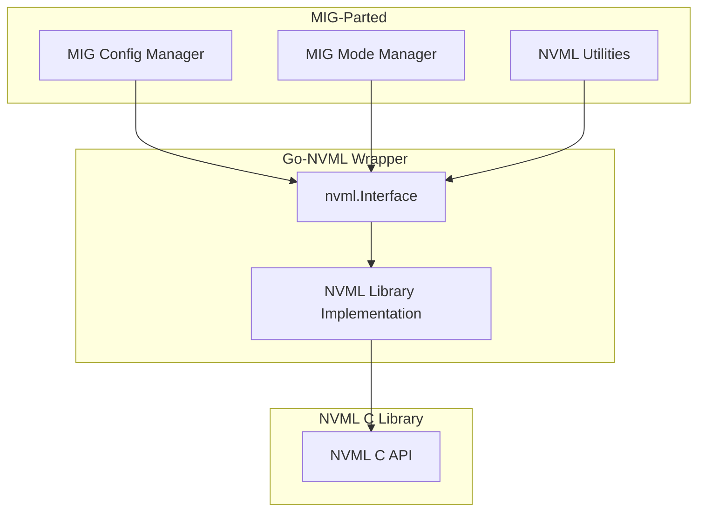
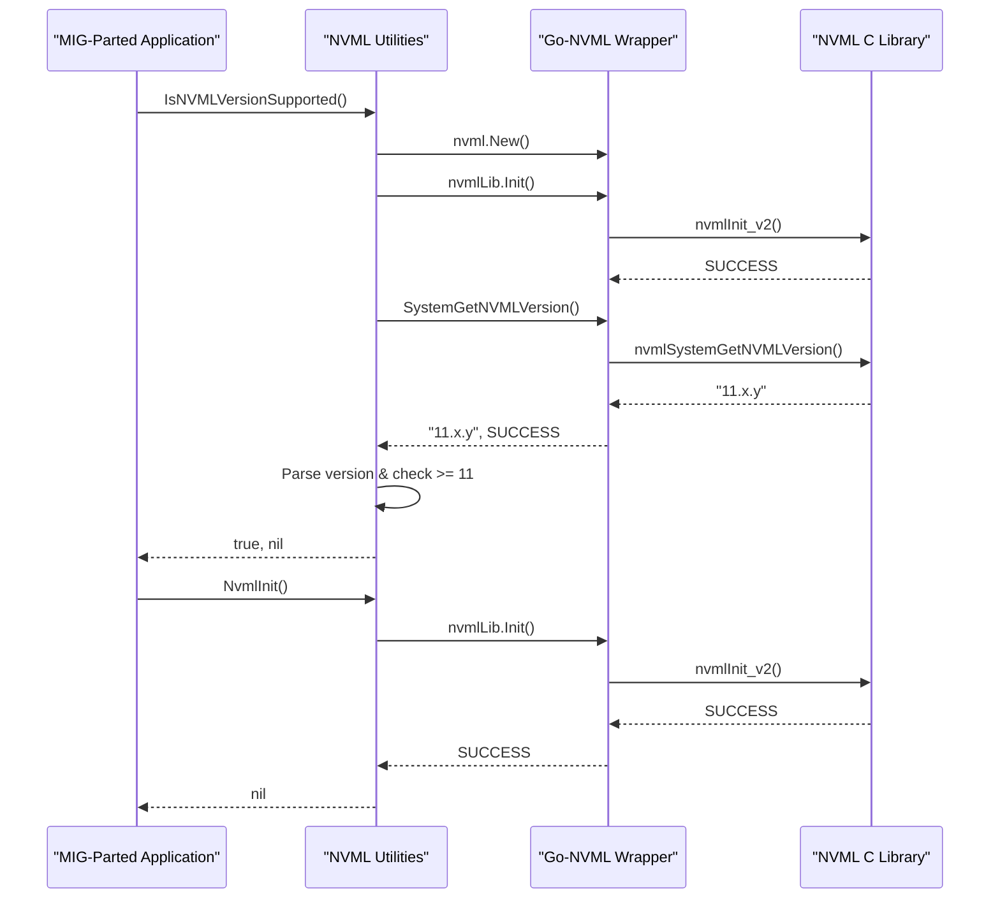
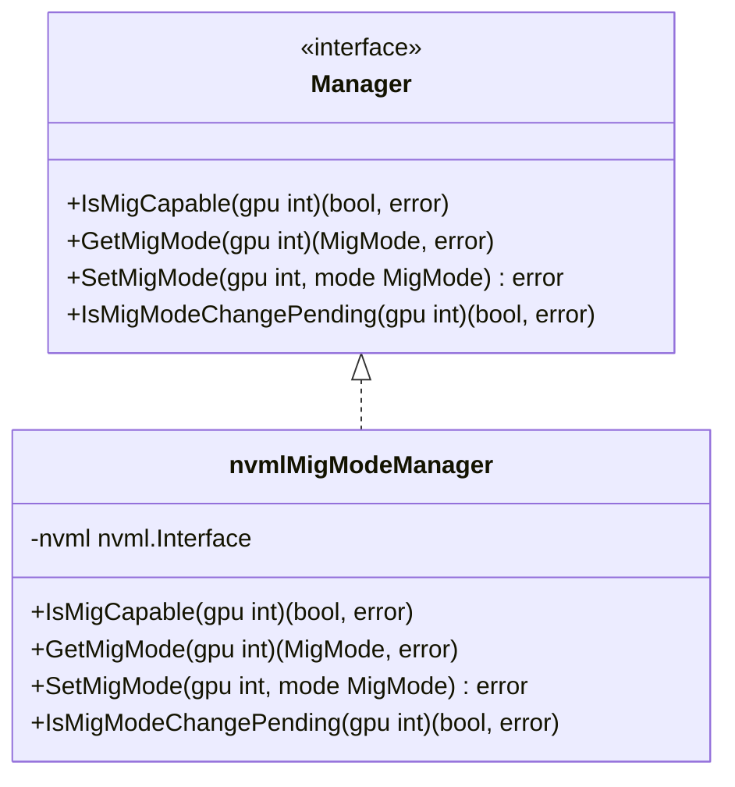
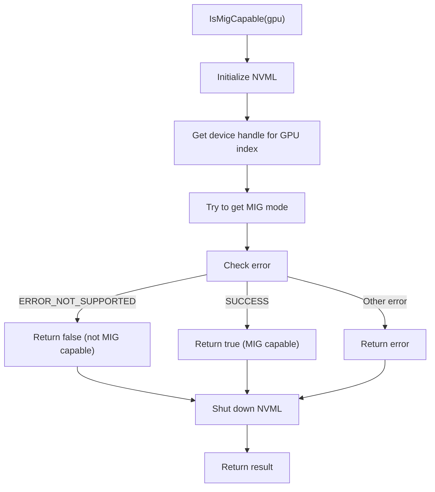
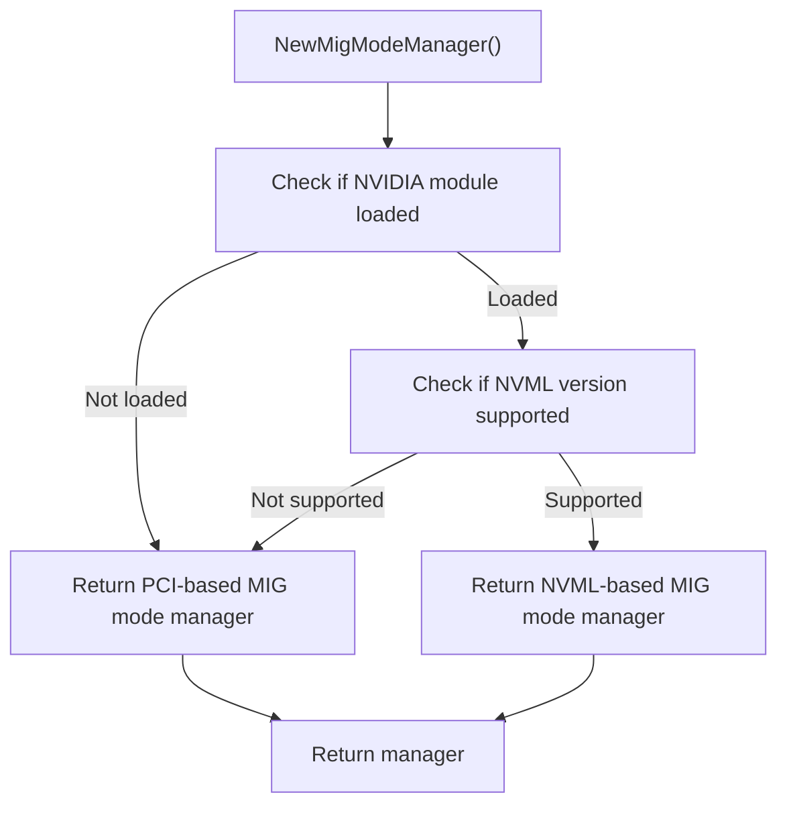
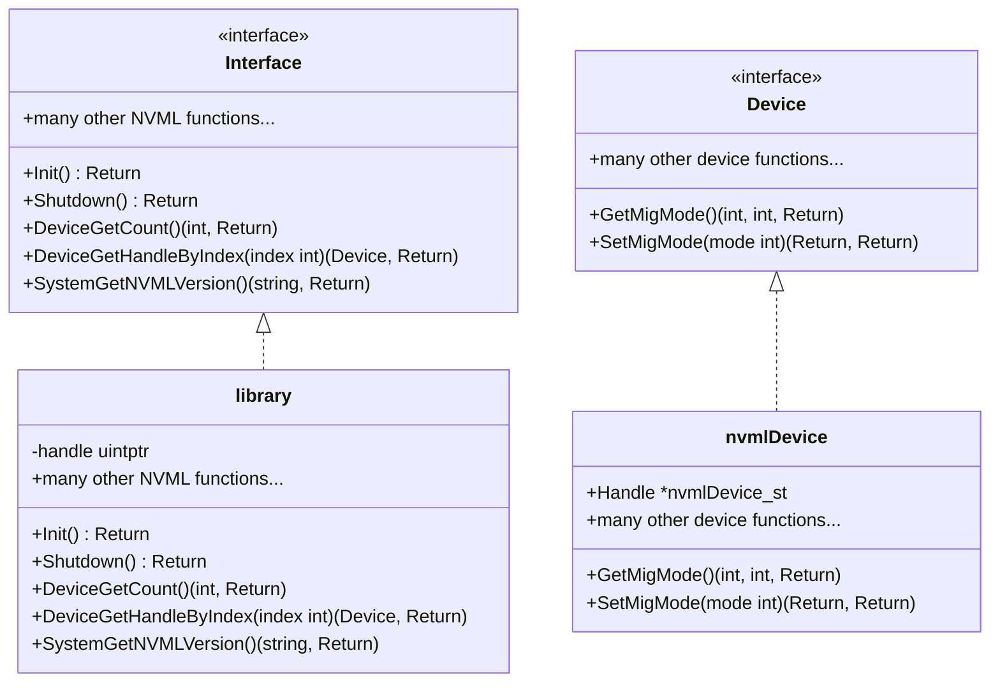
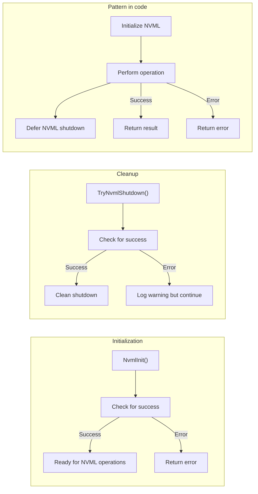

<!-- source: DeepWiki mcp.deepwiki.com · repo NVIDIA/mig-parted · page 9.2 NVML Integration · fetched 2026-10-26 -->

# NVML Integration

Relevant source files

The following files were used as context for generating this wiki page:

- [go.mod](go.mod)
- [go.sum](go.sum)
- [vendor/github.com/NVIDIA/go-nvml/pkg/dl/dl.go](vendor/github.com/NVIDIA/go-nvml/pkg/dl/dl.go)
- [vendor/github.com/NVIDIA/go-nvml/pkg/dl/dl_linux.go](vendor/github.com/NVIDIA/go-nvml/pkg/dl/dl_linux.go)
- [vendor/github.com/NVIDIA/go-nvml/pkg/dl/dl_other.go](vendor/github.com/NVIDIA/go-nvml/pkg/dl/dl_other.go)
- [vendor/github.com/NVIDIA/go-nvml/pkg/nvml/api.go](vendor/github.com/NVIDIA/go-nvml/pkg/nvml/api.go)
- [vendor/github.com/NVIDIA/go-nvml/pkg/nvml/cgo_helpers_static.go](vendor/github.com/NVIDIA/go-nvml/pkg/nvml/cgo_helpers_static.go)
- [vendor/github.com/NVIDIA/go-nvml/pkg/nvml/const.go](vendor/github.com/NVIDIA/go-nvml/pkg/nvml/const.go)
- [vendor/github.com/NVIDIA/go-nvml/pkg/nvml/device.go](vendor/github.com/NVIDIA/go-nvml/pkg/nvml/device.go)
- [vendor/github.com/NVIDIA/go-nvml/pkg/nvml/gpm.go](vendor/github.com/NVIDIA/go-nvml/pkg/nvml/gpm.go)
- [vendor/github.com/NVIDIA/go-nvml/pkg/nvml/init.go](vendor/github.com/NVIDIA/go-nvml/pkg/nvml/init.go)
- [vendor/github.com/NVIDIA/go-nvml/pkg/nvml/mock/device.go](vendor/github.com/NVIDIA/go-nvml/pkg/nvml/mock/device.go)
- [vendor/github.com/NVIDIA/go-nvml/pkg/nvml/mock/interface.go](vendor/github.com/NVIDIA/go-nvml/pkg/nvml/mock/interface.go)
- [vendor/github.com/NVIDIA/go-nvml/pkg/nvml/nvml.go](vendor/github.com/NVIDIA/go-nvml/pkg/nvml/nvml.go)
- [vendor/github.com/NVIDIA/go-nvml/pkg/nvml/nvml.h](vendor/github.com/NVIDIA/go-nvml/pkg/nvml/nvml.h)
- [vendor/github.com/NVIDIA/go-nvml/pkg/nvml/system.go](vendor/github.com/NVIDIA/go-nvml/pkg/nvml/system.go)
- [vendor/github.com/NVIDIA/go-nvml/pkg/nvml/types_gen.go](vendor/github.com/NVIDIA/go-nvml/pkg/nvml/types_gen.go)
- [vendor/github.com/NVIDIA/go-nvml/pkg/nvml/vgpu.go](vendor/github.com/NVIDIA/go-nvml/pkg/nvml/vgpu.go)
- [vendor/github.com/NVIDIA/go-nvml/pkg/nvml/zz_generated.api.go](vendor/github.com/NVIDIA/go-nvml/pkg/nvml/zz_generated.api.go)
- [vendor/github.com/coreos/go-systemd/v22/dbus/dbus.go](vendor/github.com/coreos/go-systemd/v22/dbus/dbus.go)
- [vendor/github.com/coreos/go-systemd/v22/dbus/methods.go](vendor/github.com/coreos/go-systemd/v22/dbus/methods.go)
- [vendor/github.com/coreos/go-systemd/v22/dbus/set.go](vendor/github.com/coreos/go-systemd/v22/dbus/set.go)
- [vendor/github.com/coreos/go-systemd/v22/dbus/subscription.go](vendor/github.com/coreos/go-systemd/v22/dbus/subscription.go)
- [vendor/github.com/coreos/go-systemd/v22/dbus/subscription_set.go](vendor/github.com/coreos/go-systemd/v22/dbus/subscription_set.go)
- [vendor/modules.txt](vendor/modules.txt)

This page documents how NVIDIA MIG-Parted integrates with the NVIDIA Management Library (NVML) to interact with and manage MIG-capable NVIDIA GPUs. For information about MIG state management, see [MIG State Management](#9.1).

## Overview

The NVIDIA Management Library (NVML) is a C-based API that provides direct access to NVIDIA GPU device monitoring and management functionality. MIG-Parted uses NVML through the Go-NVML wrapper library to perform critical operations such as:

- Querying GPU capabilities
- Managing MIG mode (enabling/disabling)
- Configuring MIG instances
- Reading device information

Sources: 
- [vendor/github.com/NVIDIA/go-nvml/pkg/nvml/device.go:1-1110]()
- [vendor/github.com/NVIDIA/go-nvml/pkg/nvml/system.go:1-140]()
- [go.mod:6-7]()

## NVML Initialization and Version Checking

Before using NVML functionality, MIG-Parted must initialize the NVML library and ensure the installed version meets minimum requirements. The MIG-Parted utility functions handle this initialization and version checking process.

Key components of the initialization process:

1. **Version Checking**: MIG-Parted requires NVML version 11 or higher
2. **Initialization**: Calls to `nvmlLib.Init()` establish a connection to the NVML library
3. **Shutdown**: `TryNvmlShutdown()` ensures NVML is properly closed when operations complete

Sources:
- [vendor/github.com/NVIDIA/go-nvml/pkg/nvml/init.go:18-48]()

## MIG Mode Management via NVML

MIG-Parted uses NVML to detect MIG-capable GPUs and manage their MIG modes (enabled or disabled). The `nvmlMigModeManager` implements this functionality through the `Manager` interface.

The workflow for MIG mode operations typically follows this pattern:

1. Initialize NVML
2. Get device handle by index
3. Perform the desired MIG mode operation
4. Handle any errors
5. Shut down NVML

For example, to check if a GPU is MIG-capable:

Sources:
- [vendor/github.com/NVIDIA/go-nvml/pkg/nvml/mock/device.go:11-13]()

## MIG-Parted Manager Factory Functions

MIG-Parted provides factory functions that create the appropriate MIG managers based on system capabilities. These functions check if the NVIDIA driver is loaded and if the NVML version is supported before creating NVML-based managers.

The decision flow for choosing between NVML and PCI-based implementations:

| Condition | NVIDIA Module Loaded | NVML Version Supported | Manager Implementation |
|-----------|----------------------|------------------------|------------------------|
| ✅        | ✅                   | NVML-based             | Full functionality     |
| ✅        | ❌                   | PCI-based              | Limited functionality  |
| ❌        | N/A                  | PCI-based              | Limited functionality  |

Sources:
- [go.mod:6-7]()

## Go-NVML Wrapper Architecture

MIG-Parted uses the Go-NVML wrapper to interface with the NVML C library. This wrapper provides a Go-friendly API for interacting with NVML.

Key components of the Go-NVML wrapper:

1.  **Interface**: Defines the API for interacting with NVML [vendor/github.com/NVIDIA/go-nvml/pkg/nvml/api.go:22-1000]()
2.  **library**: Implements the Interface by calling the actual C functions [vendor/github.com/NVIDIA/go-nvml/pkg/nvml/zz_generated.api.go:22-1000]()
3.  **Device**: Interface for GPU devices [vendor/github.com/NVIDIA/go-nvml/pkg/nvml/mock/device.go:11-13]()
4.  **nvmlDevice**: Implementation of Device that wraps the C device handle [vendor/github.com/NVIDIA/go-nvml/pkg/nvml/types_gen.go:8-10]()

### Go-NVML Wrapper Pattern (Stub/Library)

The `go-nvml` library employs a wrapper pattern that allows for both direct calls to the NVML C library and the use of mock implementations for testing. This is achieved through a `library` struct that holds function pointers to the actual NVML C functions, and a `libnvml` global variable that is an instance of this `library`.

For example, the `nvml.DeviceGetCount()` function is implemented as a method on the `library` struct [vendor/github.com/NVIDIA/go-nvml/pkg/nvml/device.go:103-106](). The `nvml.DeviceGetCount` package-level variable then points to `libnvml.DeviceGetCount` [vendor/github.com/NVIDIA/go-nvml/pkg/nvml/zz_generated.api.go:67](). This allows for easy mocking by replacing the `libnvml` instance in tests.

### Handle Conversion via `reflect`

Many NVML functions operate on opaque handles (e.g., `nvmlDevice_t`). The `go-nvml` wrapper uses Go's `reflect` package to convert between Go interface types (like `nvml.Device`) and the underlying C `nvmlDevice` struct. The `nvmlDeviceHandle` function [vendor/github.com/NVIDIA/go-nvml/pkg/nvml/device.go:28-59]() is a key part of this mechanism, allowing functions that accept an `nvml.Device` interface to extract the underlying `nvmlDevice` struct for CGO calls.

### Dynamic Buffer Sizing

Several NVML functions require pre-allocated buffers to store output data (e.g., device names, UUIDs). The `go-nvml` wrapper handles dynamic buffer sizing by allocating Go slices of appropriate sizes and passing pointers to these slices to the C functions. For example, `DeviceGetName` [vendor/github.com/NVIDIA/go-nvml/pkg/nvml/device.go:151-155]() allocates a byte slice of `DEVICE_NAME_V2_BUFFER_SIZE` [vendor/github.com/NVIDIA/go-nvml/pkg/nvml/const.go:320]() and passes its address to the underlying C function.

### GPM Performance Monitoring Lifecycle

The GPU Performance Monitoring (GPM) API in NVML allows for collecting performance metrics. The `go-nvml` wrapper provides functions for managing the GPM lifecycle:

-   `GpmSampleAlloc()`: Allocates a `GpmSample` object [vendor/github.com/NVIDIA/go-nvml/pkg/nvml/gpm.go:89-94]()
-   `GpmSampleGet()`: Populates a `GpmSample` with current metrics for a device [vendor/github.com/NVIDIA/go-nvml/pkg/nvml/gpm.go:96-107]()
-   `GpmMetricsGet()`: Retrieves specific metrics from two `GpmSample` objects [vendor/github.com/NVIDIA/go-nvml/pkg/nvml/gpm.go:68-78]()
-   `GpmSampleFree()`: Frees the allocated `GpmSample` object [vendor/github.com/NVIDIA/go-nvml/pkg/nvml/gpm.go:80-86]()

This lifecycle ensures proper resource management for GPM data collection.

### `dl` (Dynamic Loader) Package

The `go-nvml` library uses the `dl` package [vendor/github.com/NVIDIA/go-nvml/pkg/dl/dl.go:1-100]() for dynamic loading of the NVML shared library. This allows `mig-parted` to locate and load `libnvidia-ml.so` at runtime, rather than linking against it statically. The `dl_linux.go` [vendor/github.com/NVIDIA/go-nvml/pkg/dl/dl_linux.go:1-100]() file contains the Linux-specific implementation using `dlopen` and `dlsym`.

### `internal/systemd` D-Bus Manager

The `go-systemd` dependency [go.mod:8]() provides an interface for interacting with `systemd` via D-Bus. While not directly part of the `go-nvml` wrapper, `mig-parted` uses this to manage `systemd` services, which might involve NVML operations. The `dbus` package [vendor/github.com/coreos/go-systemd/v22/dbus/dbus.go:1-100]() within `go-systemd` handles the D-Bus communication.

## Error Handling and Lifecycle Management

NVML operations must be properly initialized and shut down to prevent resource leaks. MIG-Parted provides utility functions to handle these lifecycle operations and manage errors consistently.

Common error handling patterns:

1.  **Initialization errors**: Returned directly to the caller
2.  **Operation errors**: Checked against NVML return codes to determine the appropriate action
3.  **Shutdown errors**: Logged as warnings but generally don't affect the return value

Sources:
- [vendor/github.com/NVIDIA/go-nvml/pkg/nvml/init.go:18-48]()

## NVML Constants and Data Types

The Go-NVML wrapper defines constants and data types that correspond to those in the NVML C library. These are used throughout MIG-Parted for MIG operations.

| NVML Constant | Value | Description |
|---------------|-------|-------------|
| `SUCCESS` | 0 | The operation was successful |
| `ERROR_NOT_SUPPORTED` | 5 | The operation is not supported |
| `DEVICE_MIG_ENABLE` | 1 | MIG mode is enabled |
| `DEVICE_MIG_DISABLE` | 0 | MIG mode is disabled |

Key data types:

-   `nvmlDevice`: Represents a GPU device [vendor/github.com/NVIDIA/go-nvml/pkg/nvml/types_gen.go:8-10]()
-   `Return`: Represents an NVML return code [vendor/github.com/NVIDIA/go-nvml/pkg/nvml/nvml.go:34-36]()
-   `MigMode`: Custom enum for MIG mode (Enabled=1, Disabled=0)

Sources:
- [vendor/github.com/NVIDIA/go-nvml/pkg/nvml/const.go:30-318]()
- [vendor/github.com/NVIDIA/go-nvml/pkg/nvml/types_gen.go:8-10]()
- [vendor/github.com/NVIDIA/go-nvml/pkg/nvml/nvml.go:34-36]()

## Summary

The NVML integration in MIG-Parted provides a robust mechanism for managing MIG-capable GPUs through the NVIDIA Management Library. The Go-NVML wrapper offers a Go-friendly interface to the C library, while the MIG-Parted utility functions provide higher-level abstractions for common operations.

This integration allows MIG-Parted to:
1.  Detect MIG-capable GPUs
2.  Enable or disable MIG mode
3.  Configure MIG instances
4.  Check for pending MIG mode changes
5.  Provide fallback mechanisms when NVML is not available

By leveraging NVML, MIG-Parted can provide a comprehensive solution for managing MIG configurations on NVIDIA GPUs.

---

