# Page: Overview

# Overview

<details>
<summary>Relevant source files</summary>

The following files were used as context for generating this wiki page:

- [CHANGELOG.md](CHANGELOG.md)
- [README.md](README.md)
- [deployments/container/nvidia-mig-manager-example-hopper-blackwell.yaml](deployments/container/nvidia-mig-manager-example-hopper-blackwell.yaml)
- [deployments/container/nvidia-mig-manager-example.yaml](deployments/container/nvidia-mig-manager-example.yaml)
- [deployments/systemd/README.md](deployments/systemd/README.md)
- [deployments/systemd/install.sh](deployments/systemd/install.sh)
- [deployments/systemd/nvidia-gpu-reset.target](deployments/systemd/nvidia-gpu-reset.target)
- [deployments/systemd/nvidia-mig-parted.sh](deployments/systemd/nvidia-mig-parted.sh)
- [deployments/systemd/uninstall.sh](deployments/systemd/uninstall.sh)
- [versions.mk](versions.mk)

</details>


This document provides a technical introduction to NVIDIA MIG-Parted, a comprehensive system for managing Multi-Instance GPU (MIG) configurations on NVIDIA GPUs. MIG-Parted offers a declarative approach to MIG management, enabling system administrators to define, apply, and validate MIG configurations consistently across standalone systems and clusters.

For information about getting started with MIG-Parted, see [Getting Started](#1.1).

## What is MIG?

Multi-Instance GPU (MIG) is a mode of operation in NVIDIA Ampere architecture GPUs and newer that allows partitioning a physical GPU into multiple isolated "MIG Devices". Each MIG instance functions as an independent GPU with dedicated compute resources, memory, and bandwidth. MIG enables:

- Higher GPU utilization in multi-tenant environments.
- Workload isolation and quality of service.
- Fine-grained resource allocation for diverse workloads.

MIG partitioning is done by subdividing the GPU into fixed partitions of memory and compute resources. MIG configurations are identified by profiles like `1g.5gb` (1 GPU slice with 5GB memory) or `3g.20gb` (3 GPU slices with 20GB memory).

Sources: [README.md:3-9]()

## MIG-Parted Architecture

MIG-Parted consists of several core components that work together to manage MIG configurations. The system bridges high-level user configurations to low-level hardware adjustments via the NVIDIA Management Library (NVML).

### System Component Map

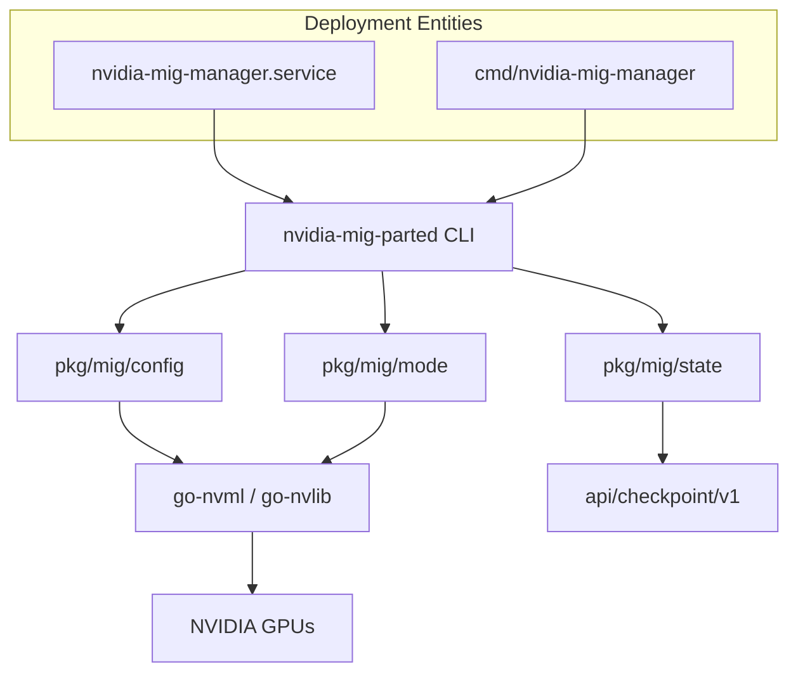

Key components:

- **nvidia-mig-parted CLI**: The primary entry point defined in `cmd/nvidia-mig-parted`. [deployments/systemd/install.sh:31-32]()
- **MIG Config Manager**: Handles creation and configuration of MIG instances via `pkg/mig/config`.
- **MIG Mode Manager**: Controls MIG mode (enabled/disabled) for GPUs via `pkg/mig/mode`.
- **MIG State Manager**: Manages persistence and restoration of MIG configurations via `pkg/mig/state`.
- **NVML Interface**: Communicates with NVIDIA hardware using `go-nvml` and `go-nvlib` wrappers.

Sources: [README.md:11-22](), [deployments/systemd/README.md:1-5](), [deployments/systemd/install.sh:31-32]()

## Deployment Options

MIG-Parted can be deployed in several ways depending on the infrastructure:

1. **Standalone CLI**: Direct use of the `nvidia-mig-parted` binary. [README.md:92-101]()
2. **Systemd Service**: The `nvidia-mig-manager.service` provides persistence across reboots and manages driver client lifecycles via hooks. [deployments/systemd/README.md:1-23]()
3. **Kubernetes Integration**: The `nvidia-mig-manager` DaemonSet (defined in `deployments/container/`) applies configurations based on node labels and coordinates with the GPU Operator. [deployments/container/nvidia-mig-manager-example.yaml:1-30]()

Sources: [deployments/systemd/README.md:1-23](), [deployments/container/nvidia-mig-manager-example.yaml:1-30]()

## Configuration Management

MIG-Parted uses a versioned YAML-based configuration format defined in `api/spec/v1`.

### Configuration Data Flow

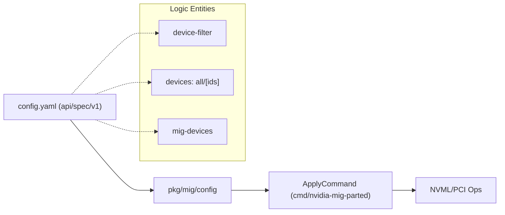

A typical configuration file includes:
1. A version identifier (e.g., `version: v1`). [README.md:25]()
2. Named MIG configurations (e.g., `all-1g.5gb`), each containing:
   - `device-filter`: Limits the config to specific PCI IDs. [deployments/container/nvidia-mig-manager-example.yaml:185]()
   - `devices`: Target indices or "all". [README.md:28]()
   - `mig-enabled`: Boolean for MIG mode. [README.md:29]()
   - `mig-devices`: Map of profiles and counts. [README.md:39-40]()

Sources: [README.md:25-83](), [deployments/container/nvidia-mig-manager-example.yaml:137-283]()

## Supported GPU Models and Profiles

MIG-Parted supports a wide range of NVIDIA GPU models, from Ampere to Blackwell architectures.

| GPU Model | Example MIG Profiles | PCI Device IDs |
|-----------|----------------------|----------------|
| A100-40GB | 1g.5gb, 2g.10gb, 3g.20gb | 0x20B010DE, 0x20B110DE |
| A100-80GB | 1g.10gb, 2g.20gb, 7g.80gb | 0x20B210DE, 0x20B510DE |
| H100-80GB | 1g.10gb, 3g.40gb, 7g.80gb | 0x233010DE, 0x233110DE |
| H200-141GB | 1g.18gb, 3g.71gb, 7g.141gb | 0x233510DE |
| B200 | 1g.23gb, 3g.90gb, 7g.180gb | 0x290110DE |
| GB200 HGX | 1g.24gb, 3g.95gb, 7g.189gb | 0x294110DE |

Sources: [deployments/container/nvidia-mig-manager-example.yaml:144-235](), [deployments/container/nvidia-mig-manager-example-hopper-blackwell.yaml:110-277](), [CHANGELOG.md:89-97]()

## CLI Commands

The `nvidia-mig-parted` CLI provides the following commands:

| Command | Description | Example |
|---------|-------------|---------|
| `apply` | Apply a MIG configuration. [README.md:191]() | `nvidia-mig-parted apply -f config.yaml -c all-1g.5gb` |
| `assert` | Verify a configuration is applied. [README.md:119]() | `nvidia-mig-parted assert -f config.yaml -c all-1g.5gb` |
| `export` | Export current hardware state to YAML. [README.md:105]() | `nvidia-mig-parted export` |
| `checkpoint` | Save current MIG state to a file. | `nvidia-mig-parted checkpoint` |
| `restore` | Restore state from a checkpoint. | `nvidia-mig-parted restore` |

Sources: [README.md:103-131](), [README.md:189-228](), [deployments/systemd/nvidia-mig-parted.sh:3]()

## Integration and Automation

### Systemd and Hooks
The `nvidia-mig-manager.service` uses a hooks system (`hooks.sh`, `hooks.yaml`) to stop services like `dcgm-exporter` or `k8s-device-plugin` before applying changes, ensuring GPUs are not in use during resets. [deployments/systemd/README.md:3-19]()

### Kubernetes
The Kubernetes manager (`cmd/nvidia-mig-manager`) watches for node label changes and triggers the `apply` logic, enabling dynamic MIG reconfiguration in cloud-native environments. [deployments/container/nvidia-mig-manager-example.yaml:24-58]()

Sources: [deployments/systemd/README.md:1-23](), [deployments/container/nvidia-mig-manager-example.yaml:1-84]()

---

# Page: Getting Started

# Getting Started

<details>
<summary>Relevant source files</summary>

The following files were used as context for generating this wiki page:

- [README.md](README.md)
- [deployments/systemd/README.md](deployments/systemd/README.md)
- [deployments/systemd/install.sh](deployments/systemd/install.sh)
- [deployments/systemd/nvidia-gpu-reset.target](deployments/systemd/nvidia-gpu-reset.target)
- [deployments/systemd/nvidia-mig-parted.sh](deployments/systemd/nvidia-mig-parted.sh)
- [deployments/systemd/packages/Dockerfile.tarball](deployments/systemd/packages/Dockerfile.tarball)
- [deployments/systemd/packages/debian/Makefile](deployments/systemd/packages/debian/Makefile)
- [deployments/systemd/packages/debian/postinst](deployments/systemd/packages/debian/postinst)
- [deployments/systemd/packages/debian/postrm](deployments/systemd/packages/debian/postrm)
- [deployments/systemd/packages/rpm/SPECS/nvidia-mig-manager.spec](deployments/systemd/packages/rpm/SPECS/nvidia-mig-manager.spec)
- [deployments/systemd/packages/tarball/install.sh](deployments/systemd/packages/tarball/install.sh)
- [deployments/systemd/uninstall.sh](deployments/systemd/uninstall.sh)

</details>


This guide provides a comprehensive introduction to NVIDIA MIG-Parted, helping new users quickly install, configure, and start using the tool to manage Multi-Instance GPU (MIG) configurations on NVIDIA GPUs. For a general overview of MIG-Parted and the problems it solves, see [Overview](#1).

## What is MIG-Parted?

MIG-Parted is a tool designed for system administrators to simplify the management of MIG partitions on NVIDIA GPUs. It allows you to declaratively define MIG configurations and apply them across your systems in a consistent way. [README.md:11-15]()

The tool enables you to:
- Define configurations for multiple MIG profiles in a single YAML file. [README.md:22-83]()
- Apply configurations across all GPUs or specific devices. [README.md:92-101]()
- Assert that specific configurations are applied correctly. [README.md:117-130]()
- Export current configurations. [README.md:103-115]()
- Checkpoint and restore MIG states. [deployments/systemd/nvidia-mig-parted.sh:3]()

Sources: [README.md:1-22](), [deployments/systemd/packages/rpm/SPECS/nvidia-mig-manager.spec:24-31]()

## Installation Options

There are several ways to install MIG-Parted depending on your environment and preferences.

### From Pre-built Packages

MIG-Parted is distributed as assets with GitHub releases in various package formats, including `deb`, `rpm`, and `tarball`. [README.md:144-148]()

```
# Download from the releases page
https://github.com/NVIDIA/mig-parted/releases
```

### Using Docker with Go Install

```bash
docker run \
    --rm \
    -v $(pwd):/dest \
    golang:1.20.1 \
    sh -c "
    go install github.com/NVIDIA/mig-parted/cmd/nvidia-mig-parted@latest
    mv /go/bin/nvidia-mig-parted /dest/nvidia-mig-parted
    "
```
Sources: [README.md:152-162](), [deployments/systemd/install.sh:55-61]()

### Using Go Get and Install Directly

```bash
GO111MODULE=off go get -u github.com/NVIDIA/mig-parted/cmd/nvidia-mig-parted
GOBIN=$(pwd) go install github.com/NVIDIA/mig-parted/cmd/nvidia-mig-parted
```
Sources: [README.md:164-168]()

### Clone and Build from Repository

```bash
git clone http://github.com/NVIDIA/mig-parted
cd mig-parted
go build ./cmd/nvidia-mig-parted
```
Sources: [README.md:170-175]()

### Installing with Systemd Integration

To install MIG-Parted with systemd integration for improved management capabilities, use the provided installation script: [deployments/systemd/README.md:34-35]()

```bash
# After downloading the repository
cd deployments/systemd
./install.sh
```

This installs the `nvidia-mig-manager.service`, the `nvidia-gpu-reset.target`, and related configuration files under `/etc/nvidia-mig-manager`. [deployments/systemd/install.sh:17-47](), [deployments/systemd/packages/rpm/SPECS/nvidia-mig-manager.spec:45-63]()

Sources: [README.md:142-180](), [deployments/systemd/install.sh:1-107](), [deployments/systemd/packages/tarball/install.sh:17-47]()

## MIG-Parted Architecture

### Core Components and File Interactions

The following diagram maps high-level operations to the underlying configuration and script entities.

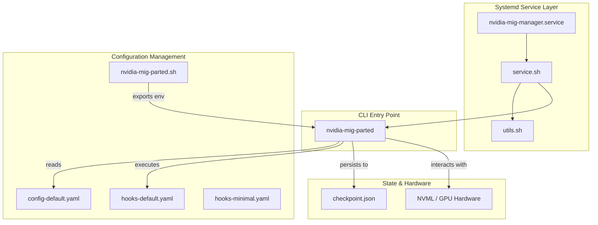

Sources: [deployments/systemd/packages/rpm/SPECS/nvidia-mig-manager.spec:11-22](), [deployments/systemd/nvidia-mig-parted.sh:1-4](), [deployments/systemd/README.md:48-60]()

### Installation and Deployment Flow

This diagram illustrates how the build process translates source code into deployable artifacts across different platforms.

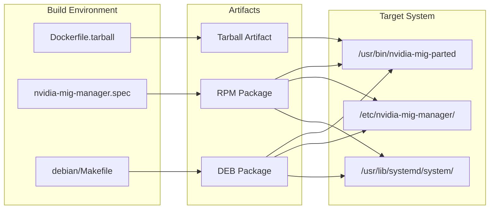

Sources: [deployments/systemd/packages/Dockerfile.tarball:78-92](), [deployments/systemd/packages/rpm/SPECS/nvidia-mig-manager.spec:45-63](), [deployments/systemd/packages/debian/Makefile:31-49]()

## Basic Usage

### Command Overview

The `nvidia-mig-parted` CLI provides several commands for managing MIG configurations:

| Command | Description |
|---------|-------------|
| `apply` | Apply a MIG configuration from a config file |
| `assert` | Assert that a specific MIG configuration is currently applied |
| `export` | Export the current MIG configuration |
| `checkpoint` | Checkpoint current MIG state to a file |
| `restore` | Restore MIG state from a checkpoint file |

Sources: [README.md:92-130](), [deployments/systemd/README.md:69-71]()

### Configuration Files

MIG-Parted uses YAML configuration files to define MIG configurations. A typical configuration defines labels like `all-1g.5gb` or `all-balanced` which map to specific device slices. [README.md:24-83]()

When using systemd integration, configuration files are stored in `/etc/nvidia-mig-manager/`:
- `config.yaml` - Main configuration file (often auto-generated or customized). [deployments/systemd/README.md:61-63]()
- `hooks.yaml` - Symlinked to either `hooks-default.yaml` or `hooks-minimal.yaml` depending on GPU compute capability. [deployments/systemd/install.sh:88-104]()

Sources: [README.md:24-83](), [deployments/systemd/nvidia-mig-parted.sh:1-3](), [deployments/systemd/packages/debian/postinst:8-24]()

## Quick Start Examples

### Apply a MIG Configuration

To apply a specific MIG configuration from a configuration file:

```bash
nvidia-mig-parted apply -f examples/config.yaml -c all-1g.5gb
```
[README.md:191-192]()

### Apply Only MIG Mode Changes

To change the MIG mode (enabled/disabled) without configuring MIG devices:

```bash
nvidia-mig-parted apply --mode-only -f examples/config.yaml -c all-enabled
```
[README.md:196-197]()

### Export Current Configuration

To export the current MIG configuration:

```bash
nvidia-mig-parted export
```
[README.md:103-105]()

### Assert Configuration

To verify if a specific configuration is applied:

```bash
nvidia-mig-parted assert -f examples/config.yaml -c all-1g.5gb
```
[README.md:117-130]()

### Using Environment Variables

You can use environment variables instead of command-line flags. When using the systemd integration, these are set in `/etc/profile.d/nvidia-mig-parted.sh`. [deployments/systemd/README.md:73-80]()

```bash
export MIG_PARTED_CONFIG_FILE=/etc/nvidia-mig-manager/config.yaml
export MIG_PARTED_HOOKS_FILE=/etc/nvidia-mig-manager/hooks.yaml
nvidia-mig-parted apply -c all-1g.5gb
```

Sources: [README.md:182-267](), [deployments/systemd/nvidia-mig-parted.sh:1-4]()

## Using with Systemd Integration

The `nvidia-mig-manager.service` provides additional capabilities:

1. **Service Orchestration**: Automatically stopping and starting necessary services (like `k8s-device-plugin` or `dcgm-exporter`) when changing MIG configuration via `hooks.sh`. [deployments/systemd/README.md:13-18]()
2. **Persistence**: Persisting MIG configurations across node reboots. [deployments/systemd/README.md:20-22]()
3. **Driverless Mode**: Applying MIG mode changes without requiring the NVIDIA driver to be loaded. [deployments/systemd/README.md:24-26]()
4. **Virtualization Support**: Automatically rebooting when necessary for GPU Passthrough. [deployments/systemd/README.md:28-32]()

### Applying with Hooks

When using hooks, ensure you point to the hooks file to trigger service restarts:

```bash
nvidia-mig-parted apply -f /etc/nvidia-mig-manager/config.yaml -k /etc/nvidia-mig-manager/hooks.yaml -c all-1g.5gb
```
[deployments/systemd/README.md:86-88]()

Sources: [deployments/systemd/README.md:1-33](), [deployments/systemd/nvidia-mig-parted.sh:1-3](), [deployments/systemd/packages/rpm/SPECS/nvidia-mig-manager.spec:33-35]()

## Checkpoint and Restore

MIG-Parted allows you to save the current MIG state to a checkpoint file and restore it later. This is useful for returning to a known state after experimental changes.

```bash
# Create a checkpoint
nvidia-mig-parted checkpoint -f /var/lib/nvidia-mig-manager/checkpoint.json

# Restore from a checkpoint
nvidia-mig-parted restore -f /var/lib/nvidia-mig-manager/checkpoint.json
```

Sources: [deployments/systemd/nvidia-mig-parted.sh:3](), [deployments/systemd/README.md:52]()

## Known Issues

- **GPU Reset Failures**: MIG-Parted will fail to perform a GPU reset if the `nvidia_drm` kernel module is loaded. You must unload it before applying mode changes. [README.md:269-274]()
- **Sudo Environment**: The files in `/etc/profile.d/` are not sourced when running commands under `sudo`. Use `sudo -E` or explicitly pass flags. [deployments/systemd/README.md:82-89]()

Sources: [README.md:269-274](), [deployments/systemd/README.md:82-89]()

---

# Page: Core Concepts

# Core Concepts

<details>
<summary>Relevant source files</summary>

The following files were used as context for generating this wiki page:

- [api/spec/v1/helpers.go](api/spec/v1/helpers.go)
- [api/spec/v1/helpers_test.go](api/spec/v1/helpers_test.go)
- [api/spec/v1/spec.go](api/spec/v1/spec.go)
- [api/spec/v1/spec_test.go](api/spec/v1/spec_test.go)
- [cmd/nvidia-mig-parted/util/device.go](cmd/nvidia-mig-parted/util/device.go)
- [examples/config.yaml](examples/config.yaml)
- [pkg/mig/config/known_configs.go](pkg/mig/config/known_configs.go)
- [pkg/mig/config/known_configs_test.go](pkg/mig/config/known_configs_test.go)
- [pkg/mig/discovery/discovery.go](pkg/mig/discovery/discovery.go)
- [pkg/mig/discovery/discovery_test.go](pkg/mig/discovery/discovery_test.go)
- [pkg/types/device.go](pkg/types/device.go)
- [pkg/types/device_test.go](pkg/types/device_test.go)
- [pkg/types/mig_config.go](pkg/types/mig_config.go)
- [pkg/types/mig_config_group.go](pkg/types/mig_config_group.go)
- [pkg/types/mig_profile.go](pkg/types/mig_profile.go)

</details>


This page explains the fundamental concepts of NVIDIA's Multi-Instance GPU (MIG) technology and how the MIG-Parted tool manages MIG configurations. For information about specific CLI commands and usage, see [nvidia-mig-parted CLI](#3).

## What is MIG?

Multi-Instance GPU (MIG) is a feature available on certain NVIDIA GPUs that allows a single physical GPU to be partitioned into multiple isolated GPU instances, each with dedicated compute resources, memory, and bandwidth. MIG enables:

- Better GPU utilization
- Workload isolation
- Fine-grained resource allocation for different workloads
- Quality of service guarantees

MIG-Parted is a management tool that simplifies the configuration and maintenance of MIG settings across GPUs in a system.

## MIG Architecture

MIG divides a GPU into two primary resource types:

### GPU Instance Components

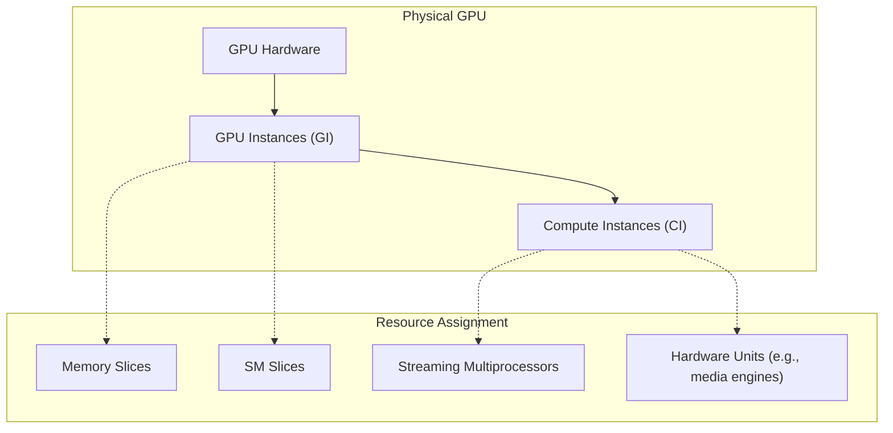

Sources: 
- pkg/mig/config/known_configs.go
- pkg/types/mig_profile.go

1. **GPU Instances (GI)** - Primary partitions that get memory and GPU engine resources
2. **Compute Instances (CI)** - Further subdivisions of a GPU Instance that share the memory but get dedicated compute resources

## MIG Profiles

MIG profiles define specific configurations of GPU resources. The `MigProfile` struct in [pkg/types/mig_profile.go:28-31]() represents these profiles using a standardized naming convention:

```
[Compute Size].[Memory Size][+Attributes]
```

For example:
- `1g.5gb` - One GPU slice with 5GB memory
- `2g.10gb` - Two GPU slices with 10GB memory
- `3g.20gb` - Three GPU slices with 20GB memory
- `1g.5gb+me` - One GPU slice with 5GB memory and media extensions

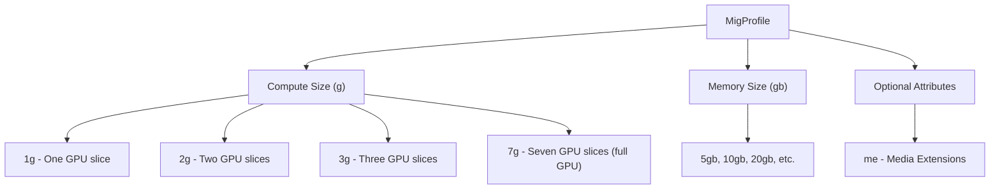

Sources:
- pkg/types/mig_profile.go
- examples/config.yaml

## MIG Configuration

A MIG configuration (`MigConfig` type in [pkg/types/mig_config.go:28-29]()) defines how a GPU is partitioned. It maps MIG profile names to the number of instances of that profile to be created on a GPU.

### Example Configuration

```yaml
all-balanced:
  - devices: all
    mig-enabled: true
    mig-devices:
      "1g.5gb": 2
      "2g.10gb": 1
      "3g.20gb": 1
```

This configuration creates:
- 2 instances of `1g.5gb` 
- 1 instance of `2g.10gb`
- 1 instance of `3g.20gb`

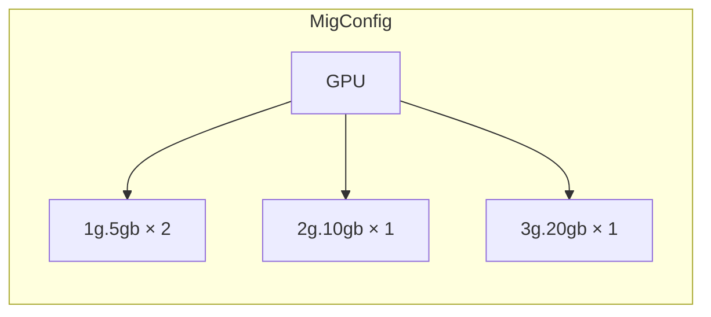

Sources:
- pkg/types/mig_config.go
- examples/config.yaml

## Configuration Management

The core functionality for managing MIG configurations is implemented in the `Manager` interface and `nvmlMigConfigManager` struct in [pkg/mig/config/known_configs.go:55-57]():

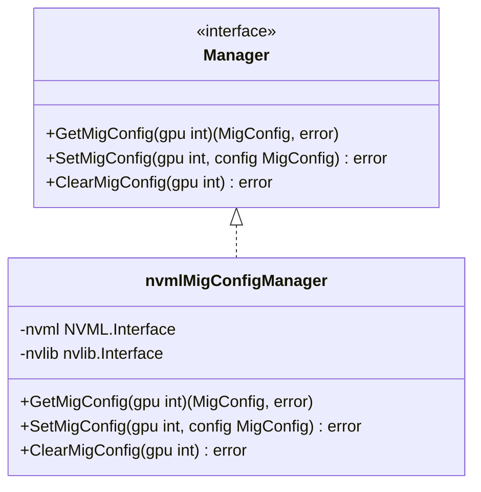

This manager interacts with the NVIDIA Management Library (NVML) to:

1. **Get** the current MIG configuration of a GPU
2. **Set** a new MIG configuration 
3. **Clear** an existing MIG configuration

The following diagram illustrates the configuration application process:

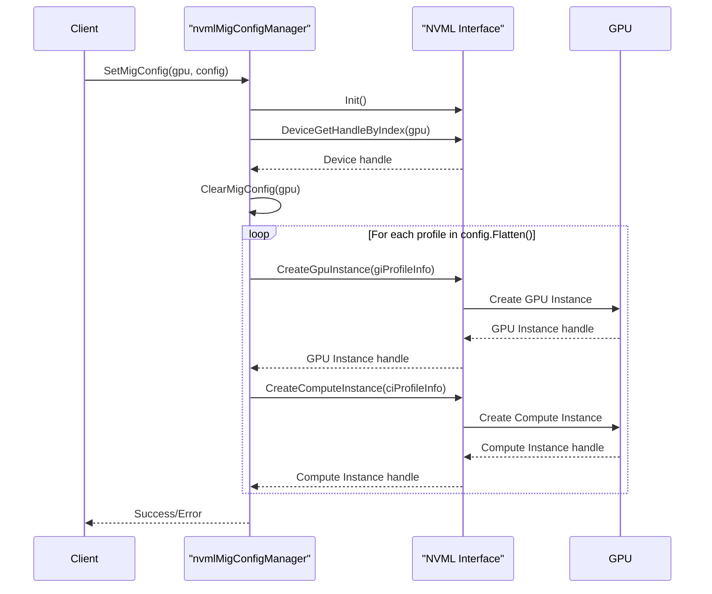

Sources:
- pkg/mig/config/known_configs.go

## Configuration Specification Format

MIG-Parted uses a structured configuration format defined in the `Spec` struct in [api/spec/v1/spec.go:30-33](). This YAML-based configuration includes:

1. A version identifier
2. A map of named MIG configurations
3. For each named configuration, a list of specifications that define:
   - Which devices to configure
   - Whether MIG is enabled
   - The MIG device profiles to create

For details, see [Configuration API and Spec Format](#2.1).

### Example Configuration File

```yaml
version: v1
mig-configs:
  all-disabled:
    - devices: all
      mig-enabled: false

  all-1g.5gb:
    - devices: all
      mig-enabled: true
      mig-devices:
        "1g.5gb": 7
```

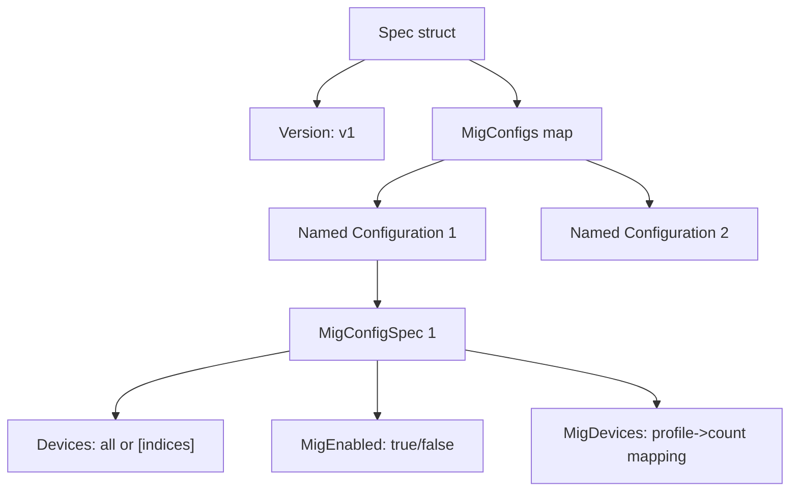

Sources:
- api/spec/v1/spec.go
- examples/config.yaml

## Device Filtering

MIG-Parted supports filtering which devices a configuration is applied to based on the device type using the `device-filter` field in the `MigConfigSpec` struct [api/spec/v1/spec.go:36-41]().

The `MatchesDeviceFilter()` method in [api/spec/v1/helpers.go:24-47]() determines if a configuration should be applied to a particular device based on its ID.

This allows for different configurations on different GPU models:

```yaml
mig-configs:
  all-1g.10gb:
    # H100-80GB, H800-80GB, A100-80GB, A800-80GB
    - device-filter: ["0x233010DE", "0x233110DE", "0x232210DE"]
      devices: all
      mig-enabled: true
      mig-devices:
        "1g.10gb": 7

    # A100-40GB, A800-40GB
    - device-filter: ["0x20B010DE", "0x20B110DE"]
      devices: all
      mig-enabled: true
      mig-devices:
        "1g.10gb": 4
```

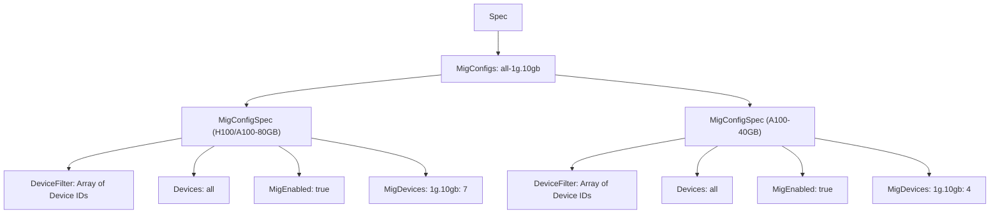

Sources:
- api/spec/v1/helpers.go
- examples/config.yaml

## Predefined Configurations and Discovery

MIG-Parted includes predefined configurations for various GPU models, which are generated and managed by the `pkg/mig/builder` package. These configurations are discovered from hardware capabilities. For example, `A100_SXM4_40GB` has a specific `MigConfigGroup` [pkg/mig/config/known_configs.go:61-63]() that defines its supported MIG profiles.

The `pkg/mig/discovery` package is responsible for identifying available MIG profiles on a system's GPUs. It uses NVML to query device capabilities and constructs `ProfileInfo` objects [pkg/mig/discovery/discovery.go:42-47]() for each discovered profile. Special handling exists for GPUs like the A30, where NVML might report incorrect profiles, leading to hardcoded profiles being used [pkg/mig/discovery/discovery.go:75-87]().

For details, see [MIG Profile Types and Discovery](#2.2).

## System Architecture

The following diagram shows how all components interact in the MIG-Parted system:

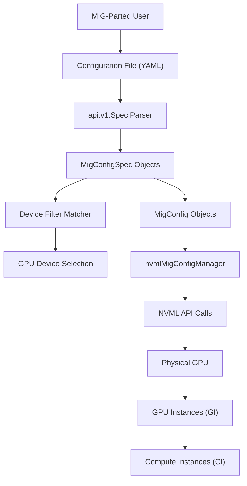

Sources:
- api/spec/v1/spec.go
- api/spec/v1/helpers.go
- pkg/types/mig_config.go
- pkg/mig/config/known_configs.go
- pkg/mig/discovery/discovery.go
- cmd/nvidia-mig-parted/util/device.go

## Key Implementation Details

### MigConfig Implementation

The `MigConfig` type [pkg/types/mig_config.go:28-29]() provides several key methods:

- `AssertValidFormat()` - Ensures all MIG profiles in the configuration are valid [pkg/types/mig_config.go:40-59]()
- `IsSubsetOf()` - Checks if one configuration is a subset of another [pkg/types/mig_config.go:62-72]()
- `Equals()` - Compares two configurations for equality [pkg/types/mig_config.go:83-96]()
- `Flatten()` - Converts a configuration into a slice of `MigProfile` objects [pkg/types/mig_config.go:99-134]()

### Configuration Application Process

When applying a configuration to a GPU, the `SetMigConfig` method (part of the `Manager` interface) is invoked. This process involves:

1. Initializing NVML and obtaining the device handle.
2. Verifying that MIG mode is enabled on the device.
3. Clearing any existing MIG configuration.
4. Creating GPU Instances (GI) based on the requested profiles.
5. Creating Compute Instances (CI) in each GPU Instance.
6. Handling any errors by cleaning up partial configurations.

This process ensures that the GPU is properly configured according to the requested MIG profiles.
Sources:
- pkg/mig/config/known_configs.go

---

# Page: Configuration API and Spec Format

# Configuration API and Spec Format

<details>
<summary>Relevant source files</summary>

The following files were used as context for generating this wiki page:

- [api/spec/v1/helpers.go](api/spec/v1/helpers.go)
- [api/spec/v1/spec.go](api/spec/v1/spec.go)
- [api/spec/v1/spec_test.go](api/spec/v1/spec_test.go)
- [examples/config.yaml](examples/config.yaml)
- [pkg/mig/config/known_configs_test.go](pkg/mig/config/known_configs_test.go)
- [pkg/types/mig_config.go](pkg/types/mig_config.go)
- [pkg/types/mig_config_group.go](pkg/types/mig_config_group.go)
- [pkg/types/mig_profile.go](pkg/types/mig_profile.go)

</details>


This page details the versioned API types used for defining NVIDIA MIG (Multi-Instance GPU) configurations. These types are primarily found in the `api/spec/v1` package and are designed to be parsed from YAML or JSON files. We will cover the `Spec`, `MigConfigSpec`, and `MigConfigSpecSlice` structs, explaining their fields and how they are used to define desired MIG states.

## Spec Structure and Parsing

The top-level configuration object is the `Spec` struct, defined in `api/spec/v1/spec.go` [api/spec/v1/spec.go:30-33](). It encapsulates the version of the API and a map of named MIG configurations.

```go
type Spec struct {
	Version    string                        `json:"version"               yaml:"version"`
	MigConfigs map[string]MigConfigSpecSlice `json:"mig-configs,omitempty" yaml:"mig-configs,omitempty"`
}
```

The `Version` field [api/spec/v1/spec.go:31]() is mandatory and must be "v1" [api/spec/v1/spec.go:27](). This ensures compatibility and allows for future API evolution. The `MigConfigs` field [api/spec/v1/spec.go:32]() is a map where keys are user-defined names for configurations (e.g., "all-disabled", "all-balanced") and values are `MigConfigSpecSlice`s.

Parsing of the `Spec` struct from JSON (and by extension, YAML, through `sigs.k8s.io/yaml`) is handled by a custom `UnmarshalJSON` method [api/spec/v1/spec.go:47-99](). This method performs several validations:
*   It checks for the presence of the `version` field [api/spec/v1/spec.go:54-56]().
*   It validates that the `version` field is "v1" [api/spec/v1/spec.go:70-72]().
*   It ensures that if `mig-configs` is present, it is not empty [api/spec/v1/spec.go:83-85]().
*   It also checks that each `MigConfigSpecSlice` within `mig-configs` is not empty [api/spec/v1/spec.go:86-89]().
*   Any unexpected fields in the top-level `Spec` will result in an error [api/spec/v1/spec.go:93-94]().

### Example `Spec`

```yaml
version: v1
mig-configs:
  all-disabled:
    - devices: all
      mig-enabled: false
  all-balanced:
    - devices: all
      mig-enabled: true
      mig-devices:
        "1g.5gb": 2
        "2g.10gb": 1
        "3g.20gb": 1
```
Sources: [api/spec/v1/spec.go:30-33](), [api/spec/v1/spec.go:47-99](), [api/spec/v1/spec.go:27](), [examples/config.yaml:1-48]()

## MigConfigSpec and MigConfigSpecSlice

A `MigConfigSpecSlice` [api/spec/v1/spec.go:44]() is simply a slice of `MigConfigSpec` structs. Each `MigConfigSpec` [api/spec/v1/spec.go:36-41]() defines a specific MIG configuration for a subset of GPUs.

```go
type MigConfigSpec struct {
	DeviceFilter interface{}     `json:"device-filter,omitempty" yaml:"device-filter,flow,omitempty"`
	Devices      interface{}     `json:"devices"                 yaml:"devices,flow"`
	MigEnabled   bool            `json:"mig-enabled"             yaml:"mig-enabled"`
	MigDevices   types.MigConfig `json:"mig-devices"             yaml:"mig-devices"`
}
```

The `MigConfigSpec` also has a custom `UnmarshalJSON` method [api/spec/v1/spec.go:101-183]() to enforce validation rules.

### Fields of `MigConfigSpec`

#### `device-filter`
The `device-filter` field [api/spec/v1/spec.go:37]() allows specifying which GPU models this configuration applies to. It can be a single string or a slice of strings.
*   If omitted, the configuration applies to all device models.
*   If a string, it specifies a single device model (e.g., "A100-SXM4-40GB").
*   If a slice of strings, it specifies multiple device models (e.g., `["A100-SXM4-40GB", "A100-PCIE-40GB"]`).

The `MatchesDeviceFilter` helper function [api/spec/v1/helpers.go:24-47]() is used to check if a `MigConfigSpec` matches a given `types.DeviceID`.

#### `devices`
The `devices` field [api/spec/v1/spec.go:38]() specifies which physical GPUs (by index) the configuration applies to. It can be the string "all" or a slice of integers.
*   "all": Applies the configuration to all GPUs matching the `device-filter`.
*   `[0, 1, 2]`: Applies the configuration to GPUs at indices 0, 1, and 2.

The `MatchesAllDevices` [api/spec/v1/helpers.go:50-55]() and `MatchesDevices` [api/spec/v1/helpers.go:58-67]() helper functions are used to determine if a `MigConfigSpec` applies to a specific device index.

#### `mig-enabled`
The `mig-enabled` field [api/spec/v1/spec.go:39]() is a boolean indicating whether MIG mode should be enabled or disabled for the selected devices.
*   If `true`, MIG mode is enabled, and the `mig-devices` field becomes mandatory.
*   If `false`, MIG mode is disabled, and the `mig-devices` field must be empty or omitted.

#### `mig-devices`
The `mig-devices` field [api/spec/v1/spec.go:40]() is a `types.MigConfig` map. This map defines the desired MIG profiles and their counts for the selected GPUs.
*   The keys of the map are string representations of MIG profiles (e.g., "1g.5gb", "2g.10gb", "1c.2g.10gb+me").
*   The values are integers representing the number of instances of that MIG profile to create.

The `types.MigConfig` type [pkg/types/mig_config.go:28]() itself has an `AssertValidFormat` method [pkg/types/mig_config.go:40-59]() to ensure that the profile strings are valid and counts are non-negative. An example of an invalid format would be a profile string like "bogus" [api/spec/v1/spec_test.go:336-340]().

### Example `MigConfigSpec`

```yaml
# Example 1: Disable MIG for specific devices of a certain model
- device-filter: "A100-SXM4-40GB"
  devices: [0, 1, 2, 3]
  mig-enabled: false

# Example 2: Enable MIG with a specific profile for other devices of the same model
- device-filter: "A100-SXM4-40GB"
  devices: [4, 5, 6, 7]
  mig-enabled: true
  mig-devices:
    "1g.5gb": 2
    "2g.10gb": 1
    "3g.20gb": 1
```
Sources: [api/spec/v1/spec.go:36-41](), [api/spec/v1/spec.go:44](), [api/spec/v1/spec.go:101-183](), [api/spec/v1/helpers.go:24-47](), [api/spec/v1/helpers.go:50-55](), [api/spec/v1/helpers.go:58-67](), [pkg/types/mig_config.go:28](), [pkg/types/mig_config.go:40-59](), [api/spec/v1/spec_test.go:336-340](), [examples/config.yaml:90-104]()

## Data Flow and Validation

The parsing process involves several layers of validation to ensure the configuration is well-formed and semantically correct.

### Diagram: Configuration Parsing and Validation
```mermaid
graph TD
    A[YAML/JSON Configuration File] --> B{yaml.Unmarshal / json.Unmarshal};
    B --> C{api/spec/v1.Spec.UnmarshalJSON};
    C -- Validates "version" and "mig-configs" structure --> D{api/spec/v1.MigConfigSpec.UnmarshalJSON for each entry};
    D -- Validates "devices", "mig-enabled", "device-filter" --> E{pkg/types.MigConfig.AssertValidFormat for "mig-devices"};
    E -- Validates MIG profile strings and counts --> F[Parsed api/spec/v1.Spec Object];

    subgraph Validation Steps
        C -- "version" field check --> C;
        C -- "mig-configs" not empty --> C;
        D -- "devices" and "mig-enabled" required --> D;
        D -- "mig-devices" required if "mig-enabled: true" --> D;
        D -- "mig-devices" empty if "mig-enabled: false" --> D;
        E -- Valid MIG profile format (e.g., "1g.5gb") --> E;
        E -- Non-negative counts for profiles --> E;
    end
```
Sources: [api/spec/v1/spec.go:47-99](), [api/spec/v1/spec.go:101-183](), [pkg/types/mig_config.go:40-59]()

### `MigProfile` and `MigConfig` Types

The `mig-devices` field uses the `types.MigConfig` type [pkg/types/mig_config.go:28](), which is a map of `string` (MIG profile) to `int` (count). The string representation of a MIG profile is handled by the `types.MigProfile` struct [pkg/types/mig_profile.go:29]().

The `types.MigProfile` struct wraps `nvdev.MigProfileInfo` from `go-nvlib` [pkg/types/mig_profile.go:31](). It provides methods like `ParseMigProfile` [pkg/types/mig_profile.go:48-54]() and `AssertValidMigProfileFormat` [pkg/types/mig_profile.go:43-45]() to convert string representations into structured objects and validate their format. Examples of valid MIG profile strings include "1g.5gb", "2g.10gb", "1c.2g.10gb", or "1c.1g.5gb+me" [pkg/types/mig_profile.go:28]().

The `types.MigConfig` also includes methods for comparing configurations, such as `IsSubsetOf` [pkg/types/mig_config.go:61-72]() and `Equals` [pkg/types/mig_config.go:83-96](), and for converting the map back into a slice of `MigProfile` objects using `Flatten` [pkg/types/mig_config.go:100-134]().

### Diagram: MIG Profile and Config Relationship
```mermaid
graph TD
    A["User Input (YAML/JSON)"] --> B["mig-devices field (map[string]int)"];
    B -- Key: "MIG Profile String" --> C["pkg/types.MigConfig"];
    C -- Validation: AssertValidFormat() --> D["pkg/types.MigProfile"];
    D -- Parsing: ParseMigProfile() --> E["go-nvlib/pkg/nvlib/device.MigProfileInfo"];

    subgraph "Key Code Entities"
        C["pkg/types.MigConfig"]
        D["pkg/types.MigProfile"]
        E["go-nvlib/pkg/nvlib/device.MigProfileInfo"]
    end
```
Sources: [pkg/types/mig_config.go:28](), [pkg/types/mig_config.go:40-59](), [pkg/types/mig_profile.go:29](), [pkg/types/mig_profile.go:31](), [pkg/types/mig_profile.go:48-54](), [pkg/types/mig_profile.go:43-45](), [pkg/types/mig_profile.go:28](), [pkg/types/mig_config.go:61-72](), [pkg/types/mig_config.go:83-96](), [pkg/types/mig_config.go:100-134]()

---

# Page: MIG Profile Types and Discovery

# MIG Profile Types and Discovery

<details>
<summary>Relevant source files</summary>

The following files were used as context for generating this wiki page:

- [api/spec/v1/helpers_test.go](api/spec/v1/helpers_test.go)
- [cmd/nvidia-mig-parted/generateconfig/generate_config.go](cmd/nvidia-mig-parted/generateconfig/generate_config.go)
- [cmd/nvidia-mig-parted/util/device.go](cmd/nvidia-mig-parted/util/device.go)
- [pkg/mig/builder/balanced.go](pkg/mig/builder/balanced.go)
- [pkg/mig/builder/balanced_test.go](pkg/mig/builder/balanced_test.go)
- [pkg/mig/builder/builder.go](pkg/mig/builder/builder.go)
- [pkg/mig/config/known_configs.go](pkg/mig/config/known_configs.go)
- [pkg/mig/discovery/discovery.go](pkg/mig/discovery/discovery.go)
- [pkg/mig/discovery/discovery_test.go](pkg/mig/discovery/discovery_test.go)
- [pkg/types/device.go](pkg/types/device.go)
- [pkg/types/device_test.go](pkg/types/device_test.go)
- [pkg/types/mig_config.go](pkg/types/mig_config.go)
- [pkg/types/mig_config_group.go](pkg/types/mig_config_group.go)
- [pkg/types/mig_profile.go](pkg/types/mig_profile.go)

</details>


This page details the core data structures used to represent NVIDIA Multi-Instance GPU (MIG) profiles and configurations within the `mig-parted` codebase. It also explains how these profiles are discovered from the underlying hardware and how a builder package automatically generates configuration files based on this discovery.

## MIG Profile Types

The `pkg/types` package defines several key types for representing MIG profiles and configurations.

### `MigProfile`

The `MigProfile` struct [pkg/types/mig_profile.go:29-31]() represents a specific MIG profile. It embeds `nvdev.MigProfileInfo` from `go-nvlib`, which contains detailed information about the profile, such as its GPU Instance (GI) and Compute Instance (CI) IDs, memory size, and attributes.

Examples of `MigProfile` string representations include:
*   `1g.5gb`: A GPU Instance with 1 GI slice and 5GB of memory.
*   `2g.10gb`: A GPU Instance with 2 GI slices and 10GB of memory.
*   `1c.2g.10gb`: A Compute Instance with 1 CI slice within a 2g GI, and 10GB of memory.
*   `1c.1g.5gb+me`: A Compute Instance with 1 CI slice within a 1g GI, 5GB of memory, and Media Extensions (`+me`) attribute.

The `pkg/types/mig_profile.go` file provides functions for working with `MigProfile` objects:
*   `NewMigProfile(giProfileID, ciProfileID, ciEngProfileID int, migMemorySizeMB, deviceMemorySizeBytes uint64)` [pkg/types/mig_profile.go:34-40](): Constructs a new `MigProfile` from raw profile information.
*   `AssertValidMigProfileFormat(profile string)` [pkg/types/mig_profile.go:43-45](): Checks if a string adheres to the expected MIG profile format.
*   `ParseMigProfile(profile string)` [pkg/types/mig_profile.go:48-54](): Converts a string representation into a `MigProfile` object.
*   `MustParseMigProfile(profile string)` [pkg/types/mig_profile.go:57-60](): Similar to `ParseMigProfile` but panics on error.
*   `HasAttribute(attr string)` [pkg/types/mig_profile.go:63-70](): Checks if the `MigProfile` has a specific attribute (e.g., `me` for Media Extensions).

Sources:
* [pkg/types/mig_profile.go:29-31]()
* [pkg/types/mig_profile.go:34-40]()
* [pkg/types/mig_profile.go:43-45]()
* [pkg/types/mig_profile.go:48-54]()
* [pkg/types/mig_profile.go:57-60]()
* [pkg/types/mig_profile.go:63-70]()

### `MigConfig`

The `MigConfig` type [pkg/types/mig_config.go:28]() is a `map[string]int` that represents a desired MIG configuration for a single GPU. The keys are string representations of `MigProfile`s, and the values are the counts of how many instances of that profile should be created.

Key functions for `MigConfig`:
*   `NewMigConfig(mps []*MigProfile)` [pkg/types/mig_config.go:31-37](): Creates a `MigConfig` from a slice of `MigProfile`s.
*   `AssertValidFormat()` [pkg/types/mig_config.go:40-59](): Validates the format of the `MigProfile` strings and their counts within the config.
*   `IsSubsetOf(config MigConfig)` [pkg/types/mig_config.go:62-72](): Checks if the current `MigConfig` is a subset of another.
*   `Contains(profile string)` [pkg/types/mig_config.go:75-80](): Checks if a specific profile exists in the config with a count greater than zero.
*   `Equals(config MigConfig)` [pkg/types/mig_config.go:83-96](): Compares two `MigConfig`s for equality.
*   `Flatten()` [pkg/types/mig_config.go:99-134](): Converts the `MigConfig` back into a slice of `MigProfile` objects, duplicating profiles according to their counts.

Sources:
* [pkg/types/mig_config.go:28]()
* [pkg/types/mig_config.go:31-37]()
* [pkg/types/mig_config.go:40-59]()
* [pkg/types/mig_config.go:62-72]()
* [pkg/types/mig_config.go:75-80]()
* [pkg/types/mig_config.go:83-96]()
* [pkg/types/mig_config.go:99-134]()

### `MigConfigGroup` and `MigConfigGroups`

The `MigConfigGroup` interface [pkg/types/mig_config_group.go:25-29]() defines methods for interacting with a logical collection of `MigConfig`s, typically representing all valid configurations for a specific GPU type.

The `MigConfigGroupBase` struct [pkg/types/mig_config_group.go:33-35]() provides a base implementation for `MigConfigGroup`, holding a slice of `MigConfig`s.

The `MigConfigGroups` type [pkg/types/mig_config_group.go:38]() is a map from `DeviceID` to `MigConfigGroup`, allowing the system to associate specific GPU hardware with its supported MIG configurations.

An example of a `MigConfigGroup` implementation is `a100_sxm4_40gb_MigConfigGroup` [pkg/mig/config/known_configs.go:62-64](), which defines the possible MIG configurations for an A100 SXM4 40GB GPU. This group is initialized with a set of predefined `MigProfile`s [pkg/mig/config/known_configs.go:127-163]() and then iterates through permutations to generate all valid `MigConfig`s [pkg/mig/config/known_configs.go:75-124]().

Sources:
* [pkg/types/mig_config_group.go:25-29]()
* [pkg/types/mig_config_group.go:33-35]()
* [pkg/types/mig_config_group.go:38]()
* [pkg/mig/config/known_configs.go:62-64]()
* [pkg/mig/config/known_configs.go:75-124]()
* [pkg/mig/config/known_configs.go:127-163]()

### `DeviceID`

The `DeviceID` struct [pkg/types/device.go:26-31]() uniquely identifies a GPU based on its PCI device, vendor, subsystem device, and subsystem vendor IDs.

Key functions for `DeviceID`:
*   `NewDeviceID(device, vendor uint16)` [pkg/types/device.go:34-39](): Creates a `DeviceID` from device and vendor IDs.
*   `NewDeviceIDWithSubsystem(device, vendor, subDevice, subVendor uint16)` [pkg/types/device.go:42-50](): Creates a `DeviceID` including subsystem information.
*   `NewDeviceIDFromPacked(packed uint32)` [pkg/types/device.go:53-58](): Creates a `DeviceID` from a combined 32-bit device+vendor value.
*   `NewDeviceIDFromString(str string)` [pkg/types/device.go:61-96](): Parses a string representation into a `DeviceID`.
*   `String()` [pkg/types/device.go:99-105](): Returns the string representation of a `DeviceID`.
*   `Matches(hardware DeviceID)` [pkg/types/device.go:124-137](): Checks if a `DeviceID` filter matches a hardware `DeviceID`.

Sources:
* [pkg/types/device.go:26-31]()
* [pkg/types/device.go:34-39]()
* [pkg/types/device.go:42-50]()
* [pkg/types/device.go:53-58]()
* [pkg/types/device.go:61-96]()
* [pkg/types/device.go:99-105]()
* [pkg/types/device.go:124-137]()

## MIG Profile Discovery

The `pkg/mig/discovery` package is responsible for identifying available MIG profiles on the system's GPUs.

### `DiscoverMIGProfiles()`

The `DiscoverMIGProfiles()` function [pkg/mig/discovery/discovery.go:92-107]() is the entry point for profile discovery. It initializes NVML (NVIDIA Management Library) and then uses an internal `discoverer` struct to iterate through all detected GPUs.

The discovery process involves:
1.  **NVML Initialization**: `util.NvmlInit(nvmllib)` [pkg/mig/discovery/discovery.go:94-97]() initializes the NVML library.
2.  **Device Iteration**: The `deviceLib.VisitDevices()` method [pkg/mig/discovery/discovery.go:114]() iterates over each GPU.
3.  **MIG Capability Check**: For each device, `dev.IsMigCapable()` [pkg/mig/discovery/discovery.go:120-123]() determines if it supports MIG. Non-MIG-capable devices are skipped.
4.  **A30 Special Handling**: Due to a known NVML bug, A30 GPUs (`deviceIDA30` [pkg/mig/discovery/discovery.go:37]()) have their profiles hardcoded via `getHardcodedA30Profiles()` [pkg/mig/discovery/discovery.go:75-87]().
5.  **Profile Retrieval**: For other MIG-capable devices, `dev.GetMigProfiles()` [pkg/mig/discovery/discovery.go:144-147]() retrieves the available MIG profiles.
6.  **Filtering Compute Instance (CI) Profiles**: The discovery process explicitly skips CI profiles (e.g., `1c.2g.10gb`) using `isCIProfile(profileInfo.C, profileInfo.G)` [pkg/mig/discovery/discovery.go:169-172](). This is because `mig-parted`'s "all-*" configurations typically provision full GPU Instances (GI) rather than sub-partitions.
7.  **Max Count Determination**: For each discovered GI profile, `nvmlDevice.GetGpuInstanceProfileInfo(profileInfo.GIProfileID)` [pkg/mig/discovery/discovery.go:175-181]() is used to determine the `MaxCount` (how many instances of that profile can be created on the GPU).
8.  **Result Aggregation**: The discovered profiles, along with their `MaxCount` and `DeviceID`, are stored in a `DeviceProfiles` map [pkg/mig/discovery/discovery.go:50]().

The `ProfileInfo` struct [pkg/mig/discovery/discovery.go:41-46]() encapsulates the discovered profile's name, maximum instance count, `DeviceID`, and the underlying `nvdev.MigProfile` object.

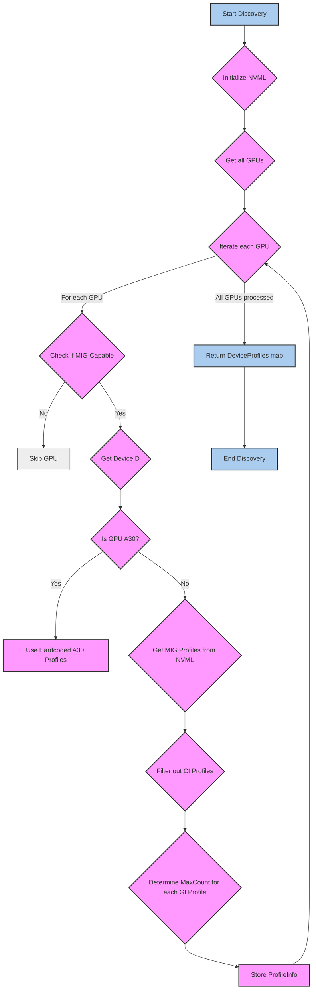
**Diagram: MIG Profile Discovery Flow**

Sources:
* [pkg/mig/discovery/discovery.go:37]()
* [pkg/mig/discovery/discovery.go:41-46]()
* [pkg/mig/discovery/discovery.go:50]()
* [pkg/mig/discovery/discovery.go:75-87]()
* [pkg/mig/discovery/discovery.go:92-107]()
* [pkg/mig/discovery/discovery.go:114]()
* [pkg/mig/discovery/discovery.go:120-123]()
* [pkg/mig/discovery/discovery.go:144-147]()
* [pkg/mig/discovery/discovery.go:169-172]()
* [pkg/mig/discovery/discovery.go:175-181]()

## Auto-Generation of Configurations with `pkg/mig/builder`

The `pkg/mig/builder` package uses the discovered MIG profiles to automatically generate a `v1.Spec` configuration, which can then be output in YAML or JSON format. This is primarily used by the `nvidia-mig-parted generate-config` command [cmd/nvidia-mig-parted/generateconfig/generate_config.go:52-55]().

### `GenerateConfigSpec()`

The `GenerateConfigSpec()` function [pkg/mig/builder/builder.go:148-153]() orchestrates the generation of the `v1.Spec`.
1.  It first calls `discovery.DiscoverMIGProfiles()` [pkg/mig/builder/builder.go:149]() to get the `DeviceProfiles` from the system.
2.  Then, it passes these discovered profiles to `buildMigConfigSpec()` [pkg/mig/builder/builder.go:43-145]() to construct the `v1.Spec`.

### `buildMigConfigSpec()`

This internal function [pkg/mig/builder/builder.go:43-145]() takes the `DeviceProfiles` and performs the following steps:
1.  **Group Profiles**: It groups the discovered `ProfileInfo` by their `Name` across all devices, and also tracks all unique `DeviceID`s [pkg/mig/builder/builder.go:49-61]().
2.  **Add Base Configurations**: It adds standard configurations:
    *   `all-disabled`: Disables MIG on all devices.
    *   `all-enabled`: Enables MIG on all devices without creating any MIG devices.
    *   `all-balanced`: Generates a balanced MIG configuration (details in `pkg/mig/builder/balanced.go`).
    [pkg/mig/builder/builder.go:64-83]()
3.  **Generate Per-Profile Configurations**: For each unique MIG profile name discovered (e.g., `1g.5gb`):
    *   It groups devices by the `MaxCount` supported for that specific profile [pkg/mig/builder/builder.go:92-96]().
    *   It normalizes the profile name (e.g., `1g.5gb+me` becomes `1g.5gb.me`) using `normalizeProfileName()` [pkg/mig/builder/builder.go:37-39]().
    *   For each unique `MaxCount` group, it creates a `MigConfigSpec` [pkg/mig/builder/builder.go:111-116]() that sets `MigEnabled: true` and `MigDevices` to create `MaxCount` instances of that profile.
    *   If multiple GPU types are present (heterogeneous system), a `DeviceFilter` is added to the `MigConfigSpec` to target only the relevant devices [pkg/mig/builder/builder.go:119-130]().
    *   These `MigConfigSpec`s are collected into a `MigConfigSpecSlice` and assigned to a configuration name like `all-1g.5gb` [pkg/mig/builder/builder.go:102-139]().
4.  **Return `v1.Spec`**: Finally, it constructs and returns a `migspec.Spec` object [pkg/mig/builder/builder.go:141-144]() containing all generated configurations.

### Output Functions

The `pkg/mig/builder` package also provides functions to output the generated `v1.Spec` in different formats:
*   `GenerateConfigYAML()` [pkg/mig/builder/builder.go:156-169](): Generates the configuration as YAML bytes.
*   `GenerateConfigJSON()` [pkg/mig/builder/builder.go:172-185](): Generates the configuration as JSON bytes.

```mermaid
graph TD
    A[Start `GenerateConfigSpec()`] --> B{Call `discovery.DiscoverMIGProfiles()`};
    B --> C{Receive `DeviceProfiles`};
    C --> D{Call `buildMigConfigSpec(DeviceProfiles)`};

    subgraph buildMigConfigSpec
        D --> E[Initialize `v1.Spec` with base configs];
        E --> F{Group `ProfileInfo` by Name and `DeviceID`};
        F --> G{Add "all-disabled" config};
        G --> H{Add "all-enabled" config};
        H --> I{Add "all-balanced" config};
        I --> J{Iterate unique MIG Profile Names};
        J -- For each Profile Name --> K{Group devices by `MaxCount` for this profile};
        K --> L{Normalize Profile Name (e.g., 1g.5gb+me -> 1g.5gb.me)};
        L --> M{Create `MigConfigSpec` for each `MaxCount` group};
        M -- If heterogeneous system --> N{Add `DeviceFilter` to `MigConfigSpec`};
        N --> O[Add `MigConfigSpec` to `v1.Spec` under "all-<profile-name>"];
        O --> J;
        J -- All profiles processed --> P[Return populated `v1.Spec`];
    end

    P --> Q[Return `v1.Spec` from `GenerateConfigSpec()`];
    Q --> R{Call `GenerateConfigYAML()` or `GenerateConfigJSON()`};
    R -- YAML --> S[Marshal `v1.Spec` to YAML];
    R -- JSON --> T[Marshal `v1.Spec` to JSON];
    S --> U[Return YAML bytes];
    T --> U;
    U --> V[End];
```
**Diagram: Configuration Auto-Generation Flow**

Sources:
* [cmd/nvidia-mig-parted/generateconfig/generate_config.go:52-55]()
* [pkg/mig/builder/builder.go:37-39]()
* [pkg/mig/builder/builder.go:43-145]()
* [pkg/mig/builder/builder.go:49-61]()
* [pkg/mig/builder/builder.go:64-83]()
* [pkg/mig/builder/builder.go:92-96]()
* [pkg/mig/builder/builder.go:102-139]()
* [pkg/mig/builder/builder.go:111-116]()
* [pkg/mig/builder/builder.go:119-130]()
* [pkg/mig/builder/builder.go:141-144]()
* [pkg/mig/builder/builder.go:148-153]()
* [pkg/mig/builder/builder.go:149]()
* [pkg/mig/builder/builder.go:156-169]()
* [pkg/mig/builder/builder.go:172-185]()

---

# Page: nvidia-mig-parted CLI

# nvidia-mig-parted CLI

<details>
<summary>Relevant source files</summary>

The following files were used as context for generating this wiki page:

- [cmd/nvidia-mig-parted/apply/apply.go](cmd/nvidia-mig-parted/apply/apply.go)
- [cmd/nvidia-mig-parted/assert/assert.go](cmd/nvidia-mig-parted/assert/assert.go)
- [cmd/nvidia-mig-parted/export/export.go](cmd/nvidia-mig-parted/export/export.go)
- [cmd/nvidia-mig-parted/export/export_test.go](cmd/nvidia-mig-parted/export/export_test.go)
- [cmd/nvidia-mig-parted/main.go](cmd/nvidia-mig-parted/main.go)
- [cmd/nvidia-mig-parted/util/mig.go](cmd/nvidia-mig-parted/util/mig.go)
- [cmd/nvidia-mig-parted/util/nvml.go](cmd/nvidia-mig-parted/util/nvml.go)
- [cmd/nvidia-mig-parted/util/util.go](cmd/nvidia-mig-parted/util/util.go)
- [hack/benchmark-perf.sh](hack/benchmark-perf.sh)

</details>


The `nvidia-mig-parted` CLI is a technical command-line tool designed to manage Multi-Instance GPU (MIG) configurations across all NVIDIA GPUs on a node. It provides commands for applying, verifying, exporting, saving, and restoring MIG configurations on NVIDIA GPUs that support MIG technology.

This page documents the CLI tool, its commands, options, and usage patterns. For information about the systemd service integration, see [Systemd Integration](#4), and for information about Kubernetes integration, see [Kubernetes Integration](#5).

## CLI Architecture

The CLI is built using the `urfave/cli/v3` framework [cmd/nvidia-mig-parted/main.go:24](). It follows a command/subcommand structure where each operation is encapsulated in a dedicated package.

### Command Structure Diagram

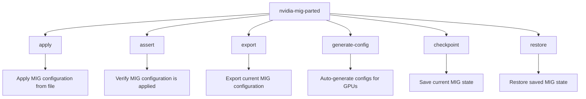

Sources: [cmd/nvidia-mig-parted/main.go:62-71]()

### Core Components and Interactions

The CLI serves as a wrapper around several core managers defined in `pkg/mig`.

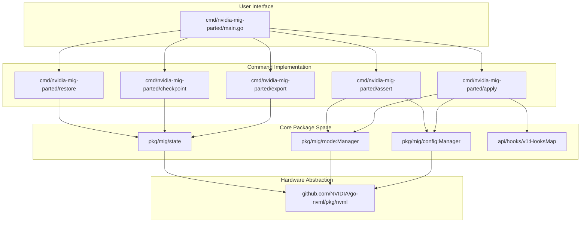

Sources: [cmd/nvidia-mig-parted/main.go:26-32](), [cmd/nvidia-mig-parted/util/mig.go:28-66](), [cmd/nvidia-mig-parted/apply/apply.go:54-60]()

## Global Options

The CLI provides global options that apply to all commands:

| Option | Aliases | Description | Environment Variable |
|--------|---------|-------------|----------------------|
| `--debug` | `-d` | Enable debug-level logging | `MIG_PARTED_DEBUG` |

Sources: [cmd/nvidia-mig-parted/main.go:52-61]()

## Commands

Detailed documentation for each command is available on their respective child pages.

### apply Command
The `apply` command is the primary entry point for modifying GPU state. It compares the desired configuration against the current hardware state and performs the minimum set of operations (mode changes, resets, and device creation) to reach the target state.

For details, see [apply Command](#3.1).
Sources: [cmd/nvidia-mig-parted/apply/apply.go:68-73]()

### assert Command
The `assert` command is a non-destructive verification tool. It is frequently used by the `nvidia-mig-manager` service to determine if a re-configuration is necessary. It returns a non-zero exit code if the current hardware state does not match the provided specification.

For details, see [assert Command](#3.2).
Sources: [cmd/nvidia-mig-parted/assert/assert.go:64-69]()

### export Command
The `export` command inspects the current MIG state of all GPUs and generates a configuration file in YAML or JSON format that represents that state. This is useful for capturing a "known good" state from a manually configured machine.

For details, see [export Command](#3.3).
Sources: [cmd/nvidia-mig-parted/export/export.go:64-69]()

### checkpoint and restore Commands
These commands allow for low-level state persistence. `checkpoint` saves the exact instance IDs and configuration details to a JSON file, while `restore` attempts to recreate that exact state. This is typically used for maintaining state across driver reloads or system reboots.

For details, see [checkpoint and restore Commands](#3.4).
Sources: [cmd/nvidia-mig-parted/main.go:69-70]()

## Internal Logic & Utilities

### NVML Initialization
The CLI handles NVML lifecycle through utility functions in `cmd/nvidia-mig-parted/util/nvml.go`. It checks for the `nvidia` kernel module [cmd/nvidia-mig-parted/util/nvml.go:34-46]() and ensures the NVML version is at least 11 [cmd/nvidia-mig-parted/util/nvml.go:30-32]().

### Manager Selection
The tool dynamically selects the appropriate manager implementation based on the system state. If the NVIDIA kernel module is not loaded, it falls back to a PCI-based `mode.Manager` to enable MIG mode before NVML can be initialized [cmd/nvidia-mig-parted/util/mig.go:28-46]().

### Configuration Selection
When multiple configurations are present in a single file, the CLI uses `GetSelectedMigConfig` to resolve which specific `MigConfigSpecSlice` to use based on the `--selected-config` flag [cmd/nvidia-mig-parted/assert/assert.go:197-213]().

## Usage Patterns

The following table summarizes common CLI usage patterns:

| Goal | Command | Key Flags |
|------|---------|-----------|
| **Apply Config** | `apply` | `-f <file> -c <label>` |
| **Check Config** | `assert` | `-f <file> -c <label>` |
| **Dry Run Config** | `assert` | `--valid-config -f <file>` |
| **Save State** | `checkpoint` | `-f checkpoint.json` |
| **Generate Spec** | `export` | `-o yaml` |

Sources: [cmd/nvidia-mig-parted/apply/apply.go:76-112](), [cmd/nvidia-mig-parted/assert/assert.go:72-101](), [cmd/nvidia-mig-parted/export/export.go:72-89]()

---

# Page: apply Command

# apply Command

<details>
<summary>Relevant source files</summary>

The following files were used as context for generating this wiki page:

- [cmd/nvidia-mig-parted/apply/apply.go](cmd/nvidia-mig-parted/apply/apply.go)
- [cmd/nvidia-mig-parted/apply/config.go](cmd/nvidia-mig-parted/apply/config.go)
- [cmd/nvidia-mig-parted/apply/mode.go](cmd/nvidia-mig-parted/apply/mode.go)
- [cmd/nvidia-mig-parted/assert/assert.go](cmd/nvidia-mig-parted/assert/assert.go)
- [cmd/nvidia-mig-parted/assert/config.go](cmd/nvidia-mig-parted/assert/config.go)
- [cmd/nvidia-mig-parted/assert/mode.go](cmd/nvidia-mig-parted/assert/mode.go)
- [cmd/nvidia-mig-parted/export/config.go](cmd/nvidia-mig-parted/export/config.go)
- [cmd/nvidia-mig-parted/export/export.go](cmd/nvidia-mig-parted/export/export.go)
- [cmd/nvidia-mig-parted/export/export_test.go](cmd/nvidia-mig-parted/export/export_test.go)
- [cmd/nvidia-mig-parted/main.go](cmd/nvidia-mig-parted/main.go)
- [pkg/mig/config/config.go](pkg/mig/config/config.go)
- [pkg/mig/config/config_test.go](pkg/mig/config/config_test.go)
- [pkg/mig/mode/nvml.go](pkg/mig/mode/nvml.go)
- [pkg/mig/mode/nvml_test.go](pkg/mig/mode/nvml_test.go)

</details>


The `apply` command in `nvidia-mig-parted` is the primary tool for configuring MIG (Multi-Instance GPU) on NVIDIA GPUs. It enables applying a specific MIG configuration from a configuration file to one or more GPUs in the system. This command handles both MIG mode changes (enabling/disabling MIG functionality) and detailed MIG device configuration (creating specific MIG instances).

For information on checking configurations without applying them, see the [assert Command](#3.2).

Sources: [cmd/nvidia-mig-parted/apply/apply.go:68-71]()

## Command Syntax and Options

The basic syntax for the apply command is:

```bash
nvidia-mig-parted apply [options]
```

### Required Flags

- `--config-file, -f`: Path to the configuration file containing MIG configurations. This file defines the MIG profiles you want to apply. [cmd/nvidia-mig-parted/apply/apply.go:77-83]()

### Optional Flags

- `--selected-config, -c`: The label of the specific MIG configuration from the config file to apply. Required if multiple configurations are present in the file. [cmd/nvidia-mig-parted/apply/apply.go:84-90]()
- `--hooks-file, -k`: Path to a YAML file containing hooks to be executed at different stages of the apply process. [cmd/nvidia-mig-parted/apply/apply.go:91-97]()
- `--skip-reset, -s`: Skip the GPU reset operation after applying the desired MIG mode to all GPUs. Useful when you want to avoid the downtime associated with a GPU reset. [cmd/nvidia-mig-parted/apply/apply.go:98-104]()
- `--mode-only, -m`: Only change the MIG enabled setting from the config, without configuring any MIG devices. [cmd/nvidia-mig-parted/apply/apply.go:105-111]()

All these flags can also be set using equivalent environment variables (e.g., `MIG_PARTED_CONFIG_FILE` for `--config-file`).

Sources: [cmd/nvidia-mig-parted/apply/apply.go:76-112]()

## Architecture and Workflow

The apply command follows a carefully structured workflow to ensure safe and consistent application of MIG configurations.

### Command Execution Flow

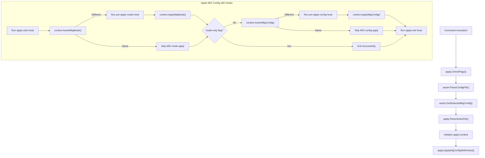

Sources: [cmd/nvidia-mig-parted/apply/apply.go:185-232](), [cmd/nvidia-mig-parted/apply/apply.go:234-292]()

### Component Interaction

The `apply` package leverages the `assert` package for configuration parsing and state verification, while using `pkg/mig/config` and `pkg/mig/mode` for low-level hardware interaction.

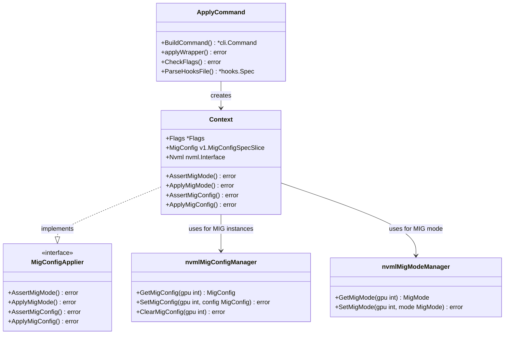

Sources: [cmd/nvidia-mig-parted/apply/apply.go:42-60](), [pkg/mig/config/config.go:32-41](), [pkg/mig/mode/nvml.go:25-27]()

## Implementation Details

### Internal Flow through pkg/mig/config

When `ApplyMigConfig()` is called, it utilizes the `nvmlMigConfigManager` to modify hardware state. The `SetMigConfig` function in `pkg/mig/config/config.go` performs the following steps:

1.  **Device Resolution**: Resolves logical MIG profiles (e.g., `1g.5gb`) to specific NVML GI/CI profile IDs for the target GPU using `resolveMigProfileOnDevice` [pkg/mig/config/config.go:48-57]().
2.  **State Clearing**: Before applying a new configuration, it calls `ClearMigConfig` to remove existing GPU instances [pkg/mig/config/config.go:142-145]().
3.  **Permutation Iteration**: Uses `iteratePermutationsUntilSuccess` to attempt different creation orders of MIG instances, as hardware placement constraints can sometimes cause specific orderings to fail [pkg/mig/config/config.go:125-208]().
4.  **Instance Creation**: Calls `device.CreateGpuInstance` and `gi.CreateComputeInstance` for each profile in the configuration [pkg/mig/config/config.go:167-182]().

### Internal Flow through pkg/mig/mode

The `ApplyMigMode()` function handles the enabling or disabling of MIG at the driver level:

1.  **Capability Check**: Verifies if the GPU supports MIG using `modeManager.IsMigCapable()` [cmd/nvidia-mig-parted/apply/mode.go:62-66]().
2.  **Mode Transition**: Calls `modeManager.SetMigMode()` to update the `DEVICE_MIG_ENABLE` or `DEVICE_MIG_DISABLE` status [cmd/nvidia-mig-parted/apply/mode.go:97-100]().
3.  **Pending Changes**: Checks if the change requires a GPU reset via `modeManager.IsMigModeChangePending()` [cmd/nvidia-mig-parted/apply/mode.go:102-106]().
4.  **GPU Reset**: If changes are pending and `--skip-reset` is not set, it invokes `util.ResetAllGPUs()` which typically triggers a `nvidia-smi -r` or equivalent operation [cmd/nvidia-mig-parted/apply/mode.go:119-132]().

Sources: [pkg/mig/config/config.go:101-218](), [cmd/nvidia-mig-parted/apply/mode.go:30-133](), [pkg/mig/mode/nvml.go:73-92]()

## Hooks Integration

The apply command integrates with a hooks system defined in `api/hooks/v1`. Environment variables from the CLI are mapped to the hooks environment via `GetHooksEnvsMap` [cmd/nvidia-mig-parted/apply/apply.go:143-164]().

### Hooks Execution Order
1.  **apply-start**: Executed at the beginning of the apply process.
2.  **pre-apply-mode**: Executed only if a MIG mode change is required.
3.  **pre-apply-config**: Executed only if MIG instance changes are required.
4.  **apply-exit**: Executed at the end, regardless of success or failure.

Sources: [cmd/nvidia-mig-parted/apply/apply.go:234-292]()

## Using the apply Command

### Basic Usage Example
```bash
nvidia-mig-parted apply --config-file /etc/nvidia/mig-parted/config.yaml --selected-config all-1g.5gb
```

### Mode-Only Changes
To only change the MIG mode (enable/disable) without configuring MIG instances:
```bash
nvidia-mig-parted apply -f config.yaml -c all-enabled --mode-only
```

### Skipping Reset
To avoid GPU reset after MIG mode changes:
```bash
nvidia-mig-parted apply -f config.yaml -c all-enabled --skip-reset
```

Sources: [cmd/nvidia-mig-parted/apply/apply.go:76-112]()

---

# Page: assert Command

# assert Command

<details>
<summary>Relevant source files</summary>

The following files were used as context for generating this wiki page:

- [cmd/nvidia-mig-parted/apply/apply.go](cmd/nvidia-mig-parted/apply/apply.go)
- [cmd/nvidia-mig-parted/apply/config.go](cmd/nvidia-mig-parted/apply/config.go)
- [cmd/nvidia-mig-parted/apply/mode.go](cmd/nvidia-mig-parted/apply/mode.go)
- [cmd/nvidia-mig-parted/assert/assert.go](cmd/nvidia-mig-parted/assert/assert.go)
- [cmd/nvidia-mig-parted/assert/config.go](cmd/nvidia-mig-parted/assert/config.go)
- [cmd/nvidia-mig-parted/assert/mode.go](cmd/nvidia-mig-parted/assert/mode.go)
- [cmd/nvidia-mig-parted/export/config.go](cmd/nvidia-mig-parted/export/config.go)
- [cmd/nvidia-mig-parted/export/export.go](cmd/nvidia-mig-parted/export/export.go)
- [cmd/nvidia-mig-parted/export/export_test.go](cmd/nvidia-mig-parted/export/export_test.go)
- [cmd/nvidia-mig-parted/main.go](cmd/nvidia-mig-parted/main.go)

</details>


The `assert` command is a verification tool within the `nvidia-mig-parted` CLI that allows users to validate whether a specific Multi-Instance GPU (MIG) configuration is currently applied to the node. Unlike the [apply Command](#3.1), which modifies the system, the `assert` command performs non-destructive validation.

## Command Overview

The command flow is managed by `assertWrapper`, which orchestrates the parsing of the configuration and the subsequent calls to the mode and configuration assertion functions.

### Execution Flow
```mermaid
flowchart TD
    A["nvidia-mig-parted assert"] --> B["assert.CheckFlags()"]
    B --> C["assert.ParseConfigFile()"]
    C --> D["assert.GetSelectedMigConfig()"]
    D --> E{f.ValidConfig?}
    E -- "Yes" --> F["Return Success"]
    E -- "No" --> G["assert.AssertMigMode()"]
    G -- "Success" --> H{f.ModeOnly?}
    G -- "Failure" --> I["Return Error"]
    H -- "Yes" --> F
    H -- "No" --> J["assert.AssertMigConfig()"]
    J -- "Success" --> F
    J -- "Failure" --> I
```
Sources: [cmd/nvidia-mig-parted/assert/assert.go:106-158]()

## Command Usage

The `assert` command verifies that a specific MIG configuration from a config file is currently applied to the system's GPUs.

### Available Flags

| Flag | Alias | Description | Environment Variable |
|------|-------|-------------|---------------------|
| `--config-file` | `-f` | Path to the configuration file (use `-` for stdin) | `MIG_PARTED_CONFIG_FILE` |
| `--selected-config` | `-c` | The label of the `mig-config` from the file to assert | `MIG_PARTED_SELECTED_CONFIG` |
| `--mode-only` | `-m` | Only assert MIG mode settings, not device configuration | `MIG_PARTED_MODE_CHANGE_ONLY` |
| `--valid-config` | `-a` | Only validate that the config file is valid and selection exists | `MIG_PARTED_VALID_CONFIG` |

Sources: [cmd/nvidia-mig-parted/assert/assert.go:72-101]()

## Implementation Details

### Data Structures
The command uses a `Context` struct to pass state, including the parsed configuration and the `nvml.Interface`.

```go
type Context struct {
	*cli.Command
	Flags     *Flags
	MigConfig v1.MigConfigSpecSlice
	Nvml      nvml.Interface
}
```
Sources: [cmd/nvidia-mig-parted/assert/assert.go:52-57]()

### GPU Iteration Logic
The core of the assertion logic relies on `WalkSelectedMigConfigForEachGPU`. This function iterates through the `MigConfigSpecSlice` and matches them against the physical GPUs on the node using `DeviceFilter` and `Devices` index lists.

```mermaid
flowchart TD
    subgraph "Logic: WalkSelectedMigConfigForEachGPU"
    W1["util.GetGPUDeviceIDs()"] --> W2["Loop MigConfigSpecSlice"]
    W2 --> W3["Loop System GPUs"]
    W3 --> W4{"mc.MatchesDeviceFilter(deviceID)?"}
    W4 -- "Yes" --> W5{"mc.MatchesDevices(index)?"}
    W5 -- "Yes" --> W6["Execute callback function f()"]
    W4 -- "No" --> W3
    W5 -- "No" --> W3
    end
```
Sources: [cmd/nvidia-mig-parted/assert/assert.go:215-248]()

### AssertMigMode
Defined in `cmd/nvidia-mig-parted/assert/mode.go`, this function verifies the MIG enablement status.
- It initializes NVML via `util.NvmlInit` if the NVIDIA driver module is loaded [cmd/nvidia-mig-parted/assert/mode.go:29-40]().
- It uses a `MigModeManager` to check `IsMigCapable` and `GetMigMode` for each GPU [cmd/nvidia-mig-parted/assert/mode.go:42-68]().
- If a GPU is not MIG-capable but the config requires `MigEnabled: true`, the assertion fails [cmd/nvidia-mig-parted/assert/mode.go:60-62]().

### AssertMigConfig
Defined in `cmd/nvidia-mig-parted/assert/config.go`, this function verifies the specific MIG device partitions.
- It retrieves the current MIG configuration using `configManager.GetMigConfig(i)` [cmd/nvidia-mig-parted/assert/config.go:72-75]().
- It compares the current state to the desired state using the `Equals` method on the `types.MigConfig` object [cmd/nvidia-mig-parted/assert/config.go:79-82]().
- It tracks matches in a boolean slice and fails if the number of matches does not equal the total number of GPUs [cmd/nvidia-mig-parted/assert/config.go:92-94]().

## Integration with Manager
The `apply` command directly consumes these assertion functions to determine if a system is already in the desired state before attempting changes. The `Context` in the `apply` package embeds the `assert.Context` to facilitate this reuse.

```go
func (c *Context) AssertMigMode() error {
	return assert.AssertMigMode(&c.Context)
}

func (c *Context) AssertMigConfig() error {
	return assert.AssertMigConfig(&c.Context)
}
```
Sources: [cmd/nvidia-mig-parted/apply/apply.go:49-52](), [cmd/nvidia-mig-parted/apply/apply.go:168-181]()

## Exit Codes and Output
- **Success (Match)**: Prints "Selected MIG configuration currently applied" and returns exit code 0 [cmd/nvidia-mig-parted/assert/assert.go:156-157]().
- **Failure (Mismatch)**: Returns `fmt.Errorf("assertion failure: selected configuration not currently applied")` which results in a non-zero exit code [cmd/nvidia-mig-parted/assert/assert.go:141-153]().
- **Validation Only**: If `--valid-config` is used, it prints "Selected MIG configuration is valid" without checking hardware [cmd/nvidia-mig-parted/assert/assert.go:125-128]().

Sources:
- [cmd/nvidia-mig-parted/assert/assert.go]()
- [cmd/nvidia-mig-parted/assert/mode.go]()
- [cmd/nvidia-mig-parted/assert/config.go]()
- [cmd/nvidia-mig-parted/apply/apply.go]()

---

# Page: export Command

# export Command

<details>
<summary>Relevant source files</summary>

The following files were used as context for generating this wiki page:

- [cmd/nvidia-mig-parted/apply/apply.go](cmd/nvidia-mig-parted/apply/apply.go)
- [cmd/nvidia-mig-parted/apply/config.go](cmd/nvidia-mig-parted/apply/config.go)
- [cmd/nvidia-mig-parted/apply/mode.go](cmd/nvidia-mig-parted/apply/mode.go)
- [cmd/nvidia-mig-parted/assert/assert.go](cmd/nvidia-mig-parted/assert/assert.go)
- [cmd/nvidia-mig-parted/assert/config.go](cmd/nvidia-mig-parted/assert/config.go)
- [cmd/nvidia-mig-parted/assert/mode.go](cmd/nvidia-mig-parted/assert/mode.go)
- [cmd/nvidia-mig-parted/export/config.go](cmd/nvidia-mig-parted/export/config.go)
- [cmd/nvidia-mig-parted/export/export.go](cmd/nvidia-mig-parted/export/export.go)
- [cmd/nvidia-mig-parted/export/export_test.go](cmd/nvidia-mig-parted/export/export_test.go)
- [cmd/nvidia-mig-parted/main.go](cmd/nvidia-mig-parted/main.go)

</details>


The `export` command in nvidia-mig-parted allows you to export the current MIG configuration from all NVIDIA GPUs in a format compatible with the configuration specification used by the `apply` command. This enables capturing existing MIG configurations for documentation, version control, or future reapplication. For saving and restoring the complete MIG state (including device details), see the [checkpoint and restore Commands](#3.4).

## Overview

```mermaid
flowchart LR
    subgraph "Input"
        Detect["Detect Current MIG\nConfiguration"]
    end
    
    subgraph "Processing"
        Parse["Parse GPU MIG\nState"]
        Merge["Merge Similar\nConfigurations"]
        Format["Format as YAML/JSON"]
    end
    
    subgraph "Output"
        Config["Configuration File\nor stdout"]
    end
    
    Detect --> Parse
    Parse --> Merge
    Merge --> Format
    Format --> Config
```

Sources: [cmd/nvidia-mig-parted/export/export.go:65-91](), [cmd/nvidia-mig-parted/export/export.go:106-116]()

The export command queries the current MIG configuration of all available GPUs, consolidates similar configurations, and outputs a formatted configuration specification that can be saved to a file or redirected to other commands.

## Command Options

The `export` command supports the following flags:

| Flag | Alias | Description | Default | Environment Variable |
|------|-------|-------------|---------|---------------------|
| `--output-format` | `-o` | Format for the output (`json` or `yaml`) | `yaml` | `MIG_PARTED_OUTPUT_FORMAT` |
| `--config-label` | `-l` | Label to apply to the exported configuration | `current` | `MIG_PARTED_CONFIG_LABEL` |

Sources: [cmd/nvidia-mig-parted/export/export.go:72-87]()

## Integration with nvidia-mig-parted

The export command is one of the core commands in the nvidia-mig-parted CLI tool:

```mermaid
flowchart TD
    CLI["nvidia-mig-parted CLI"]
    
    subgraph "Commands"
        Apply["apply Command"]
        Assert["assert Command"]
        Export["export Command"]
        Checkpoint["checkpoint Command"]
        Restore["restore Command"]
    end
    
    CLI --> Apply
    CLI --> Assert
    CLI --> Export
    CLI --> Checkpoint
    CLI --> Restore
    
    Export --> Out["Output:\nMIG Configuration\nSpecification"]
    Apply --> In["Input:\nMIG Configuration\nSpecification"]
    
    Out -..-> Storage["File Storage"]
    Storage -..-> In
```

Sources: [cmd/nvidia-mig-parted/main.go:62-68]()

## Implementation Details

The `export` command's core logic resides in the `exportWrapper` function [cmd/nvidia-mig-parted/export/export.go:94-118](), which orchestrates the process of fetching, processing, and outputting the MIG configuration.

```mermaid
graph TD
    A[User executes 'nvidia-mig-parted export'] --> B{exportWrapper(c, f)};
    B --> C{CheckFlags(f)};
    C -- Error --> D[Show subcommand help & return error];
    C -- Success --> E[Create Context struct];
    E --> F{ExportMigConfigs(&context)};
    F -- Error --> G[Return error];
    F -- Success --> H{WriteOutput(os.Stdout, spec, f)};
    H -- Error --> I[Return error];
    H -- Success --> J[Return nil];

    subgraph "ExportMigConfigs(&context)"
        F1[NvmlInit(c.Nvml)] --> F2[GetGPUDeviceIDs()];
        F2 --> F3[NewMigModeManager(c.Nvml)];
        F3 --> F4[NewMigConfigManager(c.Nvml)];
        F4 --> F5{Loop through each GPU};
        F5 --> F6[IsMigCapable(i)];
        F6 --> F7[GetMigMode(i)];
        F7 --> F8[GetMigConfig(i)];
        F8 --> F9[Create v1.MigConfigSpec for GPU];
        F9 --> F10[Collect all MigConfigSpecs];
        F10 --> F11[mergeMigConfigSpecs(configSpecs)];
        F11 --> F12[Return v1.Spec];
    end

    subgraph "WriteOutput(w, spec, f)"
        H1{Switch on f.OutputFormat};
        H1 -- YAMLFormat --> H2[yaml.Marshal(spec)];
        H1 -- JSONFormat --> H3[json.MarshalIndent(spec)];
        H2 --> H4[w.Write(output)];
        H3 --> H4;
        H4 -- Error --> H5[Return error];
        H4 -- Success --> H6[Return nil];
    end
```
**Title: `export` Command Execution Flow**
Sources: [cmd/nvidia-mig-parted/export/export.go:94-118](), [cmd/nvidia-mig-parted/export/config.go:29-92](), [cmd/nvidia-mig-parted/export/export.go:130-149]()

The command performs the following operations:

1.  **Flag Validation**: `CheckFlags` [cmd/nvidia-mig-parted/export/export.go:120-128]() validates the provided command-line flags, specifically ensuring that the `--output-format` is either `json` or `yaml`.
2.  **NVML Initialization**: `util.NvmlInit(c.Nvml)` [cmd/nvidia-mig-parted/export/config.go:30-33]() initializes the NVIDIA Management Library (NVML) to interact with the GPUs. A deferred `util.TryNvmlShutdown(c.Nvml)` [cmd/nvidia-mig-parted/export/config.go:34]() ensures NVML is properly shut down.
3.  **GPU Enumeration**: `util.GetGPUDeviceIDs()` [cmd/nvidia-mig-parted/export/config.go:36-39]() retrieves a list of all GPU device IDs on the system.
4.  **MIG Mode and Config Managers**: `util.NewMigModeManager(c.Nvml)` [cmd/nvidia-mig-parted/export/config.go:41-44]() and `util.NewMigConfigManager(c.Nvml)` [cmd/nvidia-mig-parted/export/config.go:46-49]() are created to query MIG mode and configuration states.
5.  **Per-GPU Configuration Export**: The code iterates through each detected GPU [cmd/nvidia-mig-parted/export/config.go:51-83]():
    *   It determines the `deviceFilter` by stripping any subsystem qualifiers from the GPU's primary device ID string [cmd/nvidia-mig-parted/export/config.go:53-54]().
    *   It checks if the GPU is MIG-capable using `modeManager.IsMigCapable(i)` [cmd/nvidia-mig-parted/export/config.go:57-60]().
    *   If MIG-capable, it gets the current MIG mode (`mode.Enabled` or `mode.Disabled`) using `modeManager.GetMigMode(i)` [cmd/nvidia-mig-parted/export/config.go:61-66]().
    *   If MIG is enabled, it fetches the current MIG device configuration using `configManager.GetMigConfig(i)` [cmd/nvidia-mig-parted/export/config.go:69-74]().
    *   A `v1.MigConfigSpec` [api/spec/v1/types.go:30-36]() is constructed for each GPU, capturing its `DeviceFilter`, `Devices` (its index), `MigEnabled` state, and `MigDevices` (the MIG profiles configured).
6.  **Configuration Merging**: After collecting individual `v1.MigConfigSpec` entries for all GPUs, `mergeMigConfigSpecs(configSpecs)` [cmd/nvidia-mig-parted/export/config.go:88]() is called. This function optimizes the output by grouping identical configurations across multiple GPUs into a more compact representation.
7.  **Output Formatting**: `WriteOutput(os.Stdout, spec, f)` [cmd/nvidia-mig-parted/export/export.go:130-149]() serializes the resulting `v1.Spec` [api/spec/v1/types.go:20-27]() into either YAML or JSON format based on the `--output-format` flag and writes it to standard output.

### Configuration Merging

The `mergeMigConfigSpecs` function [cmd/nvidia-mig-parted/export/config.go:95-168]() is crucial for producing a human-readable and concise output. It takes a `v1.MigConfigSpecSlice` (a slice of `MigConfigSpec` objects) and merges entries that share the same `MigEnabled` state and `MigDevices` configuration.

The merging process involves two main steps:
1.  **Initial Merge**: It iterates through the input `specs` and attempts to merge them into an existing entry in the `merged` slice if their `MigEnabled` and `MigDevices` are identical. If no match is found, a new entry is added to `merged`. During this step, `mergeAndSortIntSlices` [cmd/nvidia-mig-parted/export/config.go:170-185]() and `mergeAndSortStringSlices` [cmd/nvidia-mig-parted/export/config.go:187-202]() are used to combine the `Devices` (GPU indices) and `DeviceFilter` (GPU model strings) fields, respectively, ensuring uniqueness and sorting.
2.  **Post-Merge Optimization**: After the initial merge, it further optimizes the `DeviceFilter` and `Devices` fields:
    *   If all GPUs on the node have been grouped into a single `MigConfigSpec` and share the same configuration, the `DeviceFilter` is set to `nil` and `Devices` is set to the string `"all"` [cmd/nvidia-mig-parted/export/config.go:145-158]().
    *   If a `MigConfigSpec` applies to all devices of a specific `DeviceFilter` (e.g., all A100-SXM4-40GB GPUs), its `Devices` field is set to `"all"` [cmd/nvidia-mig-parted/export/config.go:152-158]().
    *   If there's only one final merged entry, its `DeviceFilter` is set to `nil` [cmd/nvidia-mig-parted/export/config.go:165-167]().

This logic ensures that the exported YAML/JSON is as compact as possible while accurately representing the current MIG configuration.

Sources: [cmd/nvidia-mig-parted/export/export_test.go:27-203]()

## Usage Examples

### Basic Export

To export the current MIG configuration in the default YAML format:

```bash
nvidia-mig-parted export
```

### Export in JSON Format

To export the configuration in JSON format:

```bash
nvidia-mig-parted export --output-format json
```

### Export with Custom Label

To export with a custom configuration label:

```bash
nvidia-mig-parted export --config-label "my-cluster-config"
```

### Save to File

To save the exported configuration to a file:

```bash
nvidia-mig-parted export > mig-config.yaml
```

### Pipeline with Apply

To export and immediately apply the same configuration:

```bash
nvidia-mig-parted export | nvidia-mig-parted apply --config-file -
```

## Output Example

An example output of the export command in YAML format:

```yaml
version: v1
mig-configs:
  current:
    - devices: all
      migEnabled: true
      gpuInstanceSlices: 1
      profile: 1g.5gb
```

## Related Commands

-   [apply Command](#3.1): Used to apply MIG configurations exported with this command
-   [assert Command](#3.2): Verifies if a specific MIG configuration is currently applied
-   [checkpoint and restore Commands](#3.4): For more comprehensive state management

Sources: [cmd/nvidia-mig-parted/main.go:62-68]()

## Considerations

-   The `export` command only exports the configuration - not the complete state including memory contents.
-   For more comprehensive state management including preservation of the exact device configurations, use the [checkpoint and restore Commands](#3.4).
-   The exported configuration can be used as input to the `apply` command, making it useful for replicating configurations across systems.

---

# Page: checkpoint and restore Commands

# checkpoint and restore Commands

<details>
<summary>Relevant source files</summary>

The following files were used as context for generating this wiki page:

- [api/checkpoint/v1/state.go](api/checkpoint/v1/state.go)
- [api/hooks/v1/hooks.go](api/hooks/v1/hooks.go)
- [api/hooks/v1/hooks_test.go](api/hooks/v1/hooks_test.go)
- [cmd/nvidia-mig-parted/checkpoint/checkpoint.go](cmd/nvidia-mig-parted/checkpoint/checkpoint.go)
- [cmd/nvidia-mig-parted/restore/restore.go](cmd/nvidia-mig-parted/restore/restore.go)

</details>


The `checkpoint` and `restore` commands in NVIDIA MIG-Parted provide functionality for saving (checkpointing) the current MIG configuration state of all GPUs on a system and later restoring that state. These commands are particularly useful for system administrators who need to temporarily change MIG configurations but want to return to a previous known-good configuration later.

Unlike the `export` command which outputs a human-readable configuration, the `checkpoint` command creates a machine-readable state representation suitable for exact restoration of MIG configurations.

## Command Overview

```mermaid
flowchart LR
    subgraph "MIG State Commands"
        direction TB
        Checkpoint["checkpoint.BuildCommand()"]
        Restore["restore.BuildCommand()"]
    end
    
    subgraph "File System"
        CheckpointFile["checkpoint.json (api/checkpoint/v1.State)"]
    end
    
    subgraph "GPU System"
        NVML["nvml.Interface"]
        GPUs["NVIDIA MIG-capable GPUs"]
    end
    
    Checkpoint --> |"json.Marshal"|CheckpointFile
    CheckpointFile --> |"json.Unmarshal"|Restore
    Checkpoint --> |"state.NewMigStateManager().Fetch()"|NVML
    Restore --> |"state.Manager.RestoreConfig()"|NVML
    NVML <--> GPUs
```

Sources: [cmd/nvidia-mig-parted/checkpoint/checkpoint.go:46-52](), [cmd/nvidia-mig-parted/restore/restore.go:59-65](), [api/checkpoint/v1/state.go:27-30]()

## MIG State Structure

The MIG state captured by the checkpoint command represents the complete configuration of all MIG-capable GPUs on the system. The format is defined in `api/checkpoint/v1` and wraps the `MigState` type from the core `types` package.

```mermaid
classDiagram
    class State {
        <<api/checkpoint/v1>>
        +String Version
        +MigState MigState
    }
    
    class MigState {
        <<pkg/types>>
        +DeviceState[] Devices
    }
    
    class DeviceState {
        <<pkg/types>>
        +String UUID
        +MigMode MigMode
        +GpuInstanceState[] GpuInstances
    }
    
    class GpuInstanceState {
        <<pkg/types>>
        +Int ProfileID
        +GpuInstancePlacement Placement
        +ComputeInstanceState[] ComputeInstances
    }
    
    State "1" --> "1" MigState: contains
    MigState "1" --> "*" DeviceState: contains
    DeviceState "1" --> "*" GpuInstanceState: contains
```

Sources: [api/checkpoint/v1/state.go:24-30](), [pkg/types/mig_state.go]()

## The checkpoint Command

### Syntax

```bash
nvidia-mig-parted checkpoint [options]
```

### Command Flags

| Flag | Short | Environment Variable | Default | Description |
|------|-------|----------------------|---------|-------------|
| `--checkpoint-file` | `-f` | `MIG_PARTED_CHECKPOINT_FILE` | (required) | Path to the output checkpoint file |

Sources: [cmd/nvidia-mig-parted/checkpoint/checkpoint.go:59-67]()

### Checkpointing Process

The `checkpoint` command is managed by `checkpointWrapper`. It performs the following operations:

1.  **NVML Initialization**: Initializes the NVML library via `util.NvmlInit` [cmd/nvidia-mig-parted/checkpoint/checkpoint.go:91-95]().
2.  **State Fetching**: Calls `state.NewMigStateManager(nvml).Fetch()` to query the hardware for current MIG modes and instance layouts [cmd/nvidia-mig-parted/checkpoint/checkpoint.go:98-101]().
3.  **Versioning**: Wraps the result in a `checkpoint.State` struct with the version constant `v1` [cmd/nvidia-mig-parted/checkpoint/checkpoint.go:103-106]().
4.  **Serialization**: Marshals the struct to JSON and writes it to the file system [cmd/nvidia-mig-parted/checkpoint/checkpoint.go:108-120]().

Sources: [cmd/nvidia-mig-parted/checkpoint/checkpoint.go:84-124](), [api/checkpoint/v1/state.go:24-30]()

## The restore Command

### Syntax

```bash
nvidia-mig-parted restore [options]
```

### Command Flags

| Flag | Short | Environment Variable | Default | Description |
|------|-------|----------------------|---------|-------------|
| `--checkpoint-file` | `-f` | `MIG_PARTED_CHECKPOINT_FILE` | (required) | Path to the checkpoint file to restore from |
| `--hooks-file` | `-k` | `MIG_PARTED_HOOKS_FILE` | (none) | Path to a hooks file for custom actions |
| `--mode-only` | `-m` | `MIG_PARTED_MODE_CHANGE_ONLY` | false | Only restore MIG mode settings, not device configurations |

Sources: [cmd/nvidia-mig-parted/restore/restore.go:72-94]()

### Restoration Process

The `restore` command uses a `Context` struct to implement the `apply.ApplyContext` interface, allowing it to leverage the standard application logic used by the `apply` command [cmd/nvidia-mig-parted/restore/restore.go:51-57]().

1.  **Parsing**: Reads the JSON checkpoint via `ParseCheckpointFile` [cmd/nvidia-mig-parted/restore/restore.go:111-124]().
2.  **Hooks Setup**: If a hooks file is provided, it parses it into a `hooks.Spec` [cmd/nvidia-mig-parted/restore/restore.go:171-178]().
3.  **State Application**: Calls `apply.ApplyMigConfigWithHooks`. This function orchestrates the restoration by calling back into the `Context` methods:
    *   `ApplyMigMode()`: Invokes `MigStateManager.RestoreMode` to toggle MIG enabled/disabled states [cmd/nvidia-mig-parted/restore/restore.go:150-152]().
    *   `ApplyMigConfig()`: Invokes `MigStateManager.RestoreConfig` to recreate specific GPU and Compute instances [cmd/nvidia-mig-parted/restore/restore.go:154-156]().

Sources: [cmd/nvidia-mig-parted/restore/restore.go:158-195](), [api/hooks/v1/hooks.go:29-32]()

## Integration with Hooks System

The `restore` command supports the standard V1 hooks schema. Hooks are defined as a map of named triggers to a list of commands (`HookSpec`) [api/hooks/v1/hooks.go:29-46]().

When `restore` runs, it executes hooks at the following lifecycle stages defined in the `apply` package:
*   `apply-start`: Before any changes.
*   `pre-apply-mode`: Before changing MIG modes.
*   `pre-apply-config`: Before creating instances.
*   `apply-exit`: After successful restoration.

Each hook can define its own `Command`, `Args`, `Envs`, and `Workdir` [api/hooks/v1/hooks.go:35-40]().

Sources: [api/hooks/v1/hooks.go:51-77](), [cmd/nvidia-mig-parted/restore/restore.go:188-191]()

## Examples

### Creating a Checkpoint
```bash
nvidia-mig-parted checkpoint --checkpoint-file /tmp/mig-state.json
```

### Restoring from a Checkpoint
Restore the complete MIG configuration:
```bash
nvidia-mig-parted restore --checkpoint-file /tmp/mig-state.json
```

Restore only the MIG mode settings (enabled/disabled):
```bash
nvidia-mig-parted restore --checkpoint-file /tmp/mig-state.json --mode-only
```

## Technical Implementation Details

The core logic resides in `pkg/mig/state`. The `Manager` interface provides two primary restoration methods:
1.  `RestoreMode(*types.MigState)`: Ensures the physical MIG mode (enabled/disabled) matches the checkpoint [cmd/nvidia-mig-parted/restore/restore.go:150-152]().
2.  `RestoreConfig(*types.MigState)`: Tears down existing instances and recreates them to match the checkpointed layout [cmd/nvidia-mig-parted/restore/restore.go:154-156]().

The `restore.Context` also implements assertion methods (`AssertMigMode` and `AssertMigConfig`) which fetch the current state and compare it against the checkpoint using `reflect.DeepEqual` to verify if restoration is necessary or successful [cmd/nvidia-mig-parted/restore/restore.go:126-148]().

Sources: [cmd/nvidia-mig-parted/restore/restore.go:51-57](), [api/checkpoint/v1/state.go:24-30](), [pkg/types/mig_state.go]()

---

# Page: Systemd Integration

# Systemd Integration

<details>
<summary>Relevant source files</summary>

The following files were used as context for generating this wiki page:

- [README.md](README.md)
- [deployments/systemd/README.md](deployments/systemd/README.md)
- [deployments/systemd/install.sh](deployments/systemd/install.sh)
- [deployments/systemd/nvidia-gpu-reset.target](deployments/systemd/nvidia-gpu-reset.target)
- [deployments/systemd/nvidia-mig-manager.service](deployments/systemd/nvidia-mig-manager.service)
- [deployments/systemd/nvidia-mig-parted.sh](deployments/systemd/nvidia-mig-parted.sh)
- [deployments/systemd/service.sh](deployments/systemd/service.sh)
- [deployments/systemd/uninstall.sh](deployments/systemd/uninstall.sh)
- [deployments/systemd/utils.sh](deployments/systemd/utils.sh)

</details>


This document provides detailed information about the systemd integration in NVIDIA MIG-Parted, specifically the `nvidia-mig-manager` systemd service. This integration enables automatic application of MIG configurations at system boot time and provides a robust framework for managing MIG states on NVIDIA GPUs. For information about using the underlying CLI tool directly, see [nvidia-mig-parted CLI](#3).

## Overview

The systemd integration for NVIDIA MIG-Parted consists of a systemd service (`nvidia-mig-manager.service`) and supporting scripts that wrap the `nvidia-mig-parted` CLI tool. This integration provides the following benefits:

- Automatic application of MIG configurations during system boot
- Persistent MIG configurations across reboots
- Robust error handling and recovery mechanisms
- Extensibility through a hooks system for custom actions

### Service Architecture

The following diagram illustrates the high-level architecture of the systemd integration:

```mermaid
flowchart TD
    subgraph "Systemd Components"
        service["nvidia-mig-manager.service"]
        override["override.conf"]
        target["nvidia-gpu-reset.target"]
    end

    subgraph "Configuration Files"
        config["config.yaml"]
        hooks["hooks.yaml"]
    end

    subgraph "Scripts"
        service_sh["service.sh"]
        utils_sh["utils.sh"]
        hooks_sh["hooks.sh"]
    end

    subgraph "CLI Tool"
        cli["nvidia-mig-parted"]
    end

    service -->|"executes"| service_sh
    service_sh -->|"sources"| utils_sh
    service_sh -->|"executes"| cli

    cli -->|"reads"| config
    cli -->|"uses hooks from"| hooks

    override -->|"sets config name"| service

    hooks_sh -->|"implements hooks defined in"| hooks
```
Sources: [deployments/systemd/nvidia-mig-manager.service](), [deployments/systemd/service.sh](), [deployments/systemd/utils.sh](), [deployments/systemd/hooks.sh]()

## Installation

The systemd integration can be installed in several ways:

### Package Installation

The systemd integration is available as RPM and DEB packages:

```mermaid
flowchart LR
    subgraph "Package Installation"
        rpm["RPM Package"]
        deb["DEB Package"]
        tarball["Tarball"]
    end

    subgraph "Installation Results"
        bin["/usr/bin/nvidia-mig-parted"]
        service["/usr/lib/systemd/system/nvidia-mig-manager.service"]
        conf["/etc/nvidia-mig-manager/*"]
        override["/etc/systemd/system/nvidia-mig-manager.service.d/override.conf"]
    end

    rpm --> bin
    rpm --> service
    rpm --> conf
    rpm --> override

    deb --> bin
    deb --> service
    deb --> conf
    deb --> override

    tarball --> bin
    tarball --> service
    tarball --> conf
    tarball --> override
```
Sources: [deployments/systemd/install.sh:31-39]() (implied by installation paths), [deployments/systemd/uninstall.sh:26-31]() (implied by removal paths)

### Manual Installation

You can also manually install the systemd integration using the provided installation script:

1. Clone the repository
2. Run the installation script:
   ```bash
   cd deployments/systemd
   ./install.sh
   ```

This script will:
- Install the `nvidia-mig-parted` binary to `/usr/bin` [deployments/systemd/install.sh:55-61]()
- Install the systemd service unit to `/usr/lib/systemd/system` [deployments/systemd/install.sh:63]()
- Create the necessary configuration directories [deployments/systemd/install.sh:41-46]()
- Enable the service [deployments/systemd/install.sh:86]()

Sources: [deployments/systemd/install.sh]()

## Service Components

The systemd integration consists of the following key components:

### 1. systemd Service Unit

The `nvidia-mig-manager.service` is defined as:

- Type: `oneshot` [deployments/systemd/nvidia-mig-manager.service:22]()
- Runs after `nvidia-persistenced.service` and `nvidia-fabricmanager.service` [deployments/systemd/nvidia-mig-manager.service:18]()
- Runs before `nvidia-gpu-reset.target` [deployments/systemd/nvidia-mig-manager.service:19]()
- Executes the `service.sh` script [deployments/systemd/nvidia-mig-manager.service:24]()

Sources: [deployments/systemd/nvidia-mig-manager.service]()

### 2. Service Script

The `service.sh` script is the main entry point executed by the systemd service. It performs the following tasks:

1. Sources utility functions from `utils.sh` [deployments/systemd/service.sh:19]()
2. Selects the appropriate hooks file based on GPU compute capability [deployments/systemd/service.sh:24]()
3. Generates `config.yaml` from hardware or uses existing/default [deployments/systemd/service.sh:35-51]()
4. Checks if the desired MIG mode is already applied [deployments/systemd/service.sh:64]()
5. If not, applies the MIG mode without issuing a GPU reset [deployments/systemd/service.sh:68]()
6. Checks if GPU reset is available [deployments/systemd/service.sh:78]()
   - If not, attempts to reboot the system [deployments/systemd/service.sh:83]()
   - If available, issues a GPU reset [deployments/systemd/service.sh:90]()
7. Clears any reboot state from previous runs [deployments/systemd/service.sh:98]()
8. Verifies the NVIDIA driver module is loaded [deployments/systemd/service.sh:100]()
9. Applies the full MIG configuration [deployments/systemd/service.sh:106]()
10. Exports the applied configuration [deployments/systemd/service.sh:112]()

Sources: [deployments/systemd/service.sh]()

### 3. Utilities

The `utils.sh` script provides various utility functions used by the service:

- Array manipulation: `nvidia-mig-manager::service::reverse_array` [deployments/systemd/utils.sh:34-41]()
- Module checking: `nvidia-mig-manager::service::assert_module_loaded` [deployments/systemd/utils.sh:43-51]()
- GPU reset checking: `nvidia-mig-manager::service::assert_gpu_reset_available` [deployments/systemd/utils.sh:53-69]()
- Reboot management: `nvidia-mig-manager::service::reboot`, `nvidia-mig-manager::service::clear_reboot_state` [deployments/systemd/utils.sh:71-91]()
- Configuration persistence: `nvidia-mig-manager::service::persist_config_across_reboot` [deployments/systemd/utils.sh:93-106]()
- Systemd service management: `nvidia-mig-manager::service::start_systemd_services`, `nvidia-mig-manager::service::stop_systemd_services` [deployments/systemd/utils.sh:150-179]()
- Container management: Functions for killing containers using Docker or containerd, e.g., `nvidia-mig-manager::service::kill_k8s_containers_via_docker_by_image` [deployments/systemd/utils.sh:181-211]()

Sources: [deployments/systemd/utils.sh]()

## Service Operation

The following sequence diagram illustrates the operation of the `nvidia-mig-manager` service:

```mermaid
sequenceDiagram
    participant systemd
    participant service_sh as "service.sh"
    participant CLI as "nvidia-mig-parted"
    participant utils_sh as "utils.sh"

    systemd->>service_sh: Start "nvidia-mig-manager.service"
    service_sh->>utils_sh: Source "utils.sh"
    service_sh->>service_sh: Call "nvidia-mig-manager::service::select_hooks_file"
    service_sh->>CLI: "generate-config -f config.yaml.tmp"
    service_sh->>CLI: "assert --mode-only"

    alt "MIG mode not applied"
        service_sh->>CLI: "apply --mode-only --skip-reset"
        service_sh->>utils_sh: "nvidia-mig-manager::service::assert_gpu_reset_available"

        alt "GPU reset not available"
            service_sh->>utils_sh: "nvidia-mig-manager::service::reboot"
            Note over service_sh, utils_sh: System reboots
        else "GPU reset available"
            service_sh->>CLI: "apply --mode-only"
            Note over CLI: Performs GPU reset
        end
    end

    service_sh->>utils_sh: "nvidia-mig-manager::service::clear_reboot_state"
    service_sh->>utils_sh: "nvidia-mig-manager::service::assert_module_loaded 'nvidia'"

    alt "NVIDIA module loaded"
        service_sh->>CLI: "apply"
        service_sh->>CLI: "export"
    end
```
Sources: [deployments/systemd/service.sh](), [deployments/systemd/utils.sh]()

## Configuration

The systemd integration uses several configuration files. For details, see [Configuration Files](#4.1).

### 1. Service Configuration

The `override.conf` file allows specifying which MIG configuration to apply through the `MIG_PARTED_SELECTED_CONFIG` environment variable. By default, it's set to `all-disabled` in the `install.sh` script, but the `service.sh` script expects this to be set externally.

```ini
[Service]
Environment="MIG_PARTED_SELECTED_CONFIG=all-disabled"
```
This file is located at `/etc/systemd/system/nvidia-mig-manager.service.d/override.conf`.

Sources: [deployments/systemd/override.conf](), [deployments/systemd/install.sh:66](), [deployments/systemd/service.sh:55]()

### 2. MIG Configuration

The MIG configurations are defined in the `config.yaml` file, located at `/etc/nvidia-mig-manager/config.yaml`. This file contains the various MIG configurations that can be applied. This file is dynamically generated by `nvidia-mig-parted generate-config` at boot time [deployments/systemd/service.sh:35-41](). If generation fails, it falls back to an existing `config.yaml` or `config-default.yaml` [deployments/systemd/service.sh:42-47](). For detailed information about the configuration file format, see [Configuration File Format](#6.1).

Sources: [deployments/systemd/service.sh:30-51]()

### Configuration File Relationships

```mermaid
flowchart TD
    subgraph "Configuration Files"
        override["override.conf"]
        config_default["config-default.yaml"]
        config["config.yaml"]
        hooks_default["hooks-default.yaml"]
        hooks_minimal["hooks-minimal.yaml"]
        hooks["hooks.yaml"]
    end

    config_default -.-> |"fallback for"| config
    hooks_default -.-> |"symlinked to"| hooks
    hooks_minimal -.-> |"symlinked to\n(for compute_cap >= 90)"| hooks

    override -->|"sets MIG_PARTED_SELECTED_CONFIG"| config
```
Sources: [deployments/systemd/service.sh:30-51](), [deployments/systemd/utils.sh:108-148]()

## Hooks System

The systemd integration includes a hooks system that allows executing custom actions at different stages of the MIG configuration process. This is covered in detail in [Hooks System](#4.2).

The hooks are defined in the `hooks.yaml` file, which is typically a symlink to either `hooks-default.yaml` or `hooks-minimal.yaml` depending on the GPU architecture's compute capability [deployments/systemd/utils.sh:137-140]().

Sources: [deployments/systemd/utils.sh:108-148]()

## Installation File Structure

The following table shows the file structure created by the installation:

| File/Directory | Description |
|---------------|-------------|
| `/usr/bin/nvidia-mig-parted` | Main `nvidia-mig-parted` binary [deployments/systemd/install.sh:55-61]() |
| `/usr/lib/systemd/system/nvidia-mig-manager.service` | Systemd service unit for `nvidia-mig-manager` [deployments/systemd/install.sh:63]() |
| `/usr/lib/systemd/system/nvidia-gpu-reset.target` | Systemd target for GPU reset [deployments/systemd/install.sh:64]() |
| `/etc/profile.d/nvidia-mig-parted.sh` | Environment setup for the CLI tool, exports `MIG_PARTED_CONFIG_FILE`, `MIG_PARTED_HOOKS_FILE`, `MIG_PARTED_CHECKPOINT_FILE` [deployments/systemd/nvidia-mig-parted.sh]() |
| `/etc/systemd/system/nvidia-mig-manager.service.d/override.conf` | Service configuration override, sets `MIG_PARTED_SELECTED_CONFIG` [deployments/systemd/override.conf](), [deployments/systemd/install.sh:66]() |
| `/etc/nvidia-mig-manager/service.sh` | Main service script executed by `nvidia-mig-manager.service` [deployments/systemd/install.sh:67]() |
| `/etc/nvidia-mig-manager/utils.sh` | Utility functions used by `service.sh` and `hooks.sh` [deployments/systemd/install.sh:68]() |
| `/etc/nvidia-mig-manager/hooks.sh` | Hooks implementation script [deployments/systemd/install.sh:69]() |
| `/etc/nvidia-mig-manager/config.yaml` | Auto-generated MIG configuration file [deployments/systemd/service.sh:35-41]() |
| `/etc/nvidia-mig-manager/hooks.yaml` | Symlink to `hooks-default.yaml` or `hooks-minimal.yaml` [deployments/systemd/install.sh:88-107]() |
| `/etc/nvidia-mig-manager/hooks-default.yaml` | Default hooks configuration [deployments/systemd/install.sh:70]() |
| `/etc/nvidia-mig-manager/hooks-minimal.yaml` | Minimal hooks configuration for newer GPUs [deployments/systemd/install.sh:71]() |
| `/var/lib/nvidia-mig-manager/` | Directory for state information, e.g., `reboot_attempted` file [deployments/systemd/utils.sh:72]() |

Sources: [deployments/systemd/install.sh](), [deployments/systemd/nvidia-mig-parted.sh](), [deployments/systemd/override.conf](), [deployments/systemd/service.sh](), [deployments/systemd/utils.sh]()

## Common Operations

### Changing the Active MIG Configuration

To change the active MIG configuration:

1. Edit the `override.conf` file to change the `MIG_PARTED_SELECTED_CONFIG` value.
2. Reload the systemd daemon and restart the service:
   ```bash
   sudo systemctl daemon-reload
   sudo systemctl restart nvidia-mig-manager.service
   ```

Alternatively, you can use the utility function `persist_config_across_reboot` defined in `utils.sh` to persist the configuration:

```bash
source /etc/nvidia-mig-manager/utils.sh
nvidia-mig-manager::service::persist_config_across_reboot "your-config-name"
systemctl restart nvidia-mig-manager.service
```
This function writes the selected configuration to `/etc/systemd/system/nvidia-mig-manager.service.d/override.conf` [deployments/systemd/utils.sh:93-106]().

Sources: [deployments/systemd/utils.sh:93-106]()

### Reboot Handling

The service includes special handling for systems where GPU reset is not available (e.g., virtualized environments). In these cases, it will:

1. Attempt to apply the MIG mode without a reset [deployments/systemd/service.sh:68]()
2. Check if GPU reset is available using `nvidia-mig-manager::service::assert_gpu_reset_available` [deployments/systemd/service.sh:78]()
3. If not, trigger a system reboot using `nvidia-mig-manager::service::reboot` (only once) [deployments/systemd/service.sh:83]()
4. After reboot, clear the reboot state using `nvidia-mig-manager::service::clear_reboot_state` and continue with configuration [deployments/systemd/service.sh:98]()

This ensures that MIG configurations can be applied even in environments where direct GPU reset is not possible.

Sources: [deployments/systemd/service.sh:61-95](), [deployments/systemd/utils.sh:71-91]()

## Packaging

The systemd integration is packaged in several formats:

1. RPM packages for RedHat-based distributions
2. DEB packages for Debian/Ubuntu-based distributions
3. Tarballs for manual installation

Each package includes all necessary files and handles installation, symlink creation, and service enabling.

Sources: [deployments/systemd/install.sh]() (as the installation script is used by packaging)

---

# Page: Configuration Files

# Configuration Files

<details>
<summary>Relevant source files</summary>

The following files were used as context for generating this wiki page:

- [README.md](README.md)
- [cmd/nvidia-mig-manager/find.go](cmd/nvidia-mig-manager/find.go)
- [cmd/nvidia-mig-manager/main.go](cmd/nvidia-mig-manager/main.go)
- [deployments/container/reconfigure-mig.sh](deployments/container/reconfigure-mig.sh)
- [deployments/systemd/README.md](deployments/systemd/README.md)
- [deployments/systemd/config-default.yaml](deployments/systemd/config-default.yaml)
- [deployments/systemd/install.sh](deployments/systemd/install.sh)
- [deployments/systemd/nvidia-gpu-reset.target](deployments/systemd/nvidia-gpu-reset.target)
- [deployments/systemd/nvidia-mig-parted.sh](deployments/systemd/nvidia-mig-parted.sh)
- [deployments/systemd/override.conf](deployments/systemd/override.conf)
- [deployments/systemd/uninstall.sh](deployments/systemd/uninstall.sh)

</details>


This document provides a detailed explanation of the configuration files used by the NVIDIA MIG-Parted systemd service. These files define how Multi-Instance GPU (MIG) configurations are applied to NVIDIA GPUs through the `nvidia-mig-manager.service`. For information about the hooks system used by the service, see [Hooks System](#4.2).

## Overview of Configuration Files

The systemd integration of MIG-Parted relies on several configuration files to control its behavior:

1.  **config-default.yaml**: Defines available MIG configurations for various GPU models. This file is copied to `config.yaml` during installation.
2.  **override.conf**: Sets the environment variable that selects which configuration to apply.
3.  **nvidia-mig-parted.sh**: A profile script that sets environment variables for `nvidia-mig-parted` CLI.
4.  **service.sh**: Main service script that processes the configuration.
5.  **hooks.sh**: Contains hook functions that are executed at different stages of configuration application.

### Configuration File Relationships

```mermaid
flowchart LR
    subgraph "Input Configuration"
        direction TB
        ConfigDefault["config-default.yaml"]
        Override["override.conf"]
        ProfileScript["nvidia-mig-parted.sh"]
    end
    
    subgraph "Execution Scripts"
        direction TB
        Service["service.sh"]
        Hooks["hooks.sh"]
        Utils["utils.sh"]
    end
    
    subgraph "Systemd Integration"
        ServiceUnit["nvidia-mig-manager.service"]
    end
    
    ConfigDefault -- "copied to config.yaml" --> ConfigFile[/etc/nvidia-mig-manager/config.yaml\]
    Override --> ServiceUnit : "sets Environment"
    ProfileScript --> EnvVars[Environment Variables] : "sets MIG_PARTED_CONFIG_FILE, etc."
    
    ServiceUnit --> Service
    Service --> ConfigFile : "reads config"
    Service --> EnvVars : "uses MIG_PARTED_SELECTED_CONFIG"
    Service --> Hooks
    Service --> Utils
    Hooks --> Utils
    
    class ConfigDefault,Override,ProfileScript,Service,Hooks,Utils,ServiceUnit,ConfigFile,EnvVars default
```

Sources: [deployments/systemd/service.sh](), [deployments/systemd/nvidia-mig-manager.service](), [deployments/systemd/override.conf](), [deployments/systemd/hooks.sh](), [deployments/systemd/utils.sh](), [deployments/systemd/config-default.yaml](), [deployments/systemd/nvidia-mig-parted.sh]()

## Configuration Files in Detail

### config-default.yaml

The `config-default.yaml` file is the primary configuration file that defines all available MIG configurations. During installation, this file is copied to `/etc/nvidia-mig-manager/config.yaml` [deployments/systemd/install.sh:70](). Each configuration specifies:

-   Whether MIG mode is enabled
-   Device selection (which GPUs to configure)
-   Specific MIG device profiles and quantities to configure

The file has a specific structure:

```mermaid
classDiagram
    class "config.yaml" {
        version: string
        mig-configs: Map~string, MigConfig[]~
    }
    
    class "MigConfig" {
        devices: string | integer[]
        device-filter: string[] (optional)
        mig-enabled: boolean
        mig-devices: Map~string, integer~ (optional)
    }
    
    "config.yaml" --> "MigConfig" : contains
```

Sources: [deployments/systemd/config-default.yaml]()

A configuration entry consists of:

-   **devices**: Specifies which GPUs to apply the configuration to. Can be "all" or a specific list of GPU indexes.
-   **device-filter** (optional): A PCI device ID filter to apply configurations to specific GPU models.
-   **mig-enabled**: Boolean indicating whether MIG mode should be enabled.
-   **mig-devices**: A map of MIG profiles to the number of instances to create.

Example configuration from the default config:

```yaml
all-balanced:
  # H100-80GB, H800-80GB, A100-80GB, A800-80GB
  - device-filter: ["0x233010DE", "0x233110DE", "0x232210DE", "0x20B210DE", "0x20B510DE", "0x20F310DE", "0x20F510DE", "0x232410DE"]
    devices: all
    mig-enabled: true
    mig-devices:
      "1g.10gb": 2
      "2g.20gb": 1
      "3g.40gb": 1
```

The default configuration file includes predefined configurations for various GPU models, including:

-   Basic configurations like `all-disabled` and `all-enabled` [deployments/systemd/config-default.yaml:3-10]()
-   Model-specific configurations for A100, H100, A30, and other NVIDIA GPU models [deployments/systemd/config-default.yaml:13-289]()
-   Balanced configurations that create a mix of different MIG profile sizes [deployments/systemd/config-default.yaml:291-433]()

Sources: [deployments/systemd/config-default.yaml:1-433]()

### override.conf

The `override.conf` file is a systemd service override file that sets the `MIG_PARTED_SELECTED_CONFIG` environment variable, which determines which configuration from `config.yaml` is applied:

```
[Service]
Environment="MIG_PARTED_SELECTED_CONFIG=all-disabled"
```

This file is copied to `/etc/systemd/system/nvidia-mig-manager.service.d/override.conf` during installation [deployments/systemd/install.sh:66]() and is automatically used by systemd to override the service configuration.

Sources: [deployments/systemd/override.conf](), [deployments/systemd/install.sh:66]()

### nvidia-mig-parted.sh

The `nvidia-mig-parted.sh` script is installed into `/etc/profile.d/` [deployments/systemd/install.sh:65]() and sets environment variables for the `nvidia-mig-parted` CLI tool:

```bash
export MIG_PARTED_CONFIG_FILE=/etc/nvidia-mig-manager/config.yaml
export MIG_PARTED_HOOKS_FILE=/etc/nvidia-mig-manager/hooks.yaml
export MIG_PARTED_CHECKPOINT_FILE=/var/lib/nvidia-mig-manager/checkpoint.json
```

These environment variables ensure that when `nvidia-mig-parted` is run, it automatically uses the correct configuration, hooks, and checkpoint files. This is particularly useful for interactive shell sessions.

Sources: [deployments/systemd/nvidia-mig-parted.sh](), [deployments/systemd/install.sh:65]()

## Configuration Application Process

The configuration files are used in a specific workflow to apply MIG configurations to NVIDIA GPUs:

```mermaid
sequenceDiagram
    participant S as "systemd"
    participant NMS as "nvidia-mig-manager.service"
    participant SS as "service.sh"
    participant C as "/etc/nvidia-mig-manager/config.yaml"
    participant OC as "/etc/systemd/system/nvidia-mig-manager.service.d/override.conf"
    participant HS as "hooks.sh"
    participant MPC as "nvidia-mig-parted CLI"
    
    S->>NMS: Start service
    NMS->>SS: Execute script
    SS->>OC: Read MIG_PARTED_SELECTED_CONFIG
    SS->>C: Read configuration file
    SS->>MPC: assert --mode-only
    
    alt MIG mode needs to be applied
        SS->>HS: pre-apply-mode hooks
        SS->>MPC: apply --mode-only --skip-reset
        
        alt GPU reset not available
            SS->>S: Reboot system
        else GPU reset available
            SS->>MPC: apply --mode-only
        end
    end
    
    SS->>HS: pre-apply-config hooks
    SS->>MPC: apply (full configuration)
    SS->>HS: apply-exit hooks
    SS->>MPC: export
```

Sources: [deployments/systemd/service.sh:1-79](), [deployments/systemd/hooks.sh:1-125]()

## How Configuration Selection Works

When the `nvidia-mig-manager.service` is started, it:

1.  Reads the selected configuration name from the `MIG_PARTED_SELECTED_CONFIG` environment variable, which is typically set in `override.conf` [deployments/systemd/override.conf:2]().
2.  Loads the matching configuration from `/etc/nvidia-mig-manager/config.yaml`.
3.  Applies this configuration using the `nvidia-mig-parted` CLI tool.

The configuration can be changed by:

1.  Editing `override.conf` to set a different configuration name.
2.  Using the `nvidia-mig-manager::service::persist_config_across_reboot` utility function, which updates `override.conf` programmatically.

```mermaid
flowchart TD
    Start["Service Start"] --> ReadEnv["Read MIG_PARTED_SELECTED_CONFIG\nfrom override.conf"]
    ReadEnv --> LoadConfig["Load configuration from /etc/nvidia-mig-manager/config.yaml"]
    LoadConfig --> CheckMode["Check if MIG mode already applied"]
    
    CheckMode -->|"Mode not applied"| ApplyMode["Apply MIG mode"]
    CheckMode -->|"Mode already applied"| ApplyConfig["Apply MIG configuration"]
    
    ApplyMode --> CheckReset["Check if GPU reset available"]
    CheckReset -->|"Reset available"| Reset["Perform GPU reset"]
    CheckReset -->|"Reset not available"| Reboot["Reboot system"]
    
    Reset --> ApplyConfig
    Reboot --> ApplyConfig
    
    ApplyConfig --> Export["Export configuration"]
    Export --> End["Service Complete"]
```

Sources: [deployments/systemd/service.sh:17-79](), [deployments/systemd/utils.sh:76-83]()

## Persisting Configuration Changes

The `nvidia-mig-manager::service::persist_config_across_reboot` function in `utils.sh` allows programmatically updating the selected configuration:

```bash
nvidia-mig-manager::service::persist_config_across_reboot ${selected_config}
```

This function:
1.  Creates or updates the `/etc/systemd/system/nvidia-mig-manager.service.d/override.conf` file [deployments/systemd/utils.sh:76-83]().
2.  Sets the `MIG_PARTED_SELECTED_CONFIG` environment variable to the specified configuration [deployments/systemd/utils.sh:76-83]().
3.  Reloads the systemd daemon to apply the changes [deployments/systemd/utils.sh:82]().

Sources: [deployments/systemd/utils.sh:76-83](), [deployments/systemd/hooks.sh:38-45]()

## Configuration Examples

The default `config-default.yaml` provides numerous predefined configurations for different GPU models and use cases. These are copied to `/etc/nvidia-mig-manager/config.yaml` during installation. Here are some examples:

| Configuration Name | Description |
|:-------------------|:------------|
| `all-disabled` | Disables MIG mode on all GPUs [deployments/systemd/config-default.yaml:3-5]() |
| `all-enabled` | Enables MIG mode on all GPUs but doesn't create any MIG instances [deployments/systemd/config-default.yaml:7-10]() |
| `all-1g.5gb` | Creates seven 1g.5gb MIG instances on each GPU (A100-40GB, A800-40GB) [deployments/systemd/config-default.yaml:13-18]() |
| `all-balanced` | Creates a mix of different-sized MIG instances appropriate for each GPU model [deployments/systemd/config-default.yaml:291-433]() |
| `all-7g.80gb` | Creates one 7g.80gb MIG instance on each GPU (H100-80GB, H800-80GB, A100-80GB, A800-80GB) [deployments/systemd/config-default.yaml:153-156]() |

Sources: [deployments/systemd/config-default.yaml:1-433]()

## Configuration File Locations

The MIG-Parted systemd integration looks for configuration files in these locations:

| File | Default Location |
|:-----|:-----------------|
| `config.yaml` | `/etc/nvidia-mig-manager/config.yaml` |
| `override.conf` | `/etc/systemd/system/nvidia-mig-manager.service.d/override.conf` |
| `nvidia-mig-parted.sh` | `/etc/profile.d/nvidia-mig-parted.sh` |
| `service.sh` | `/etc/nvidia-mig-manager/service.sh` |
| `hooks.sh` | `/etc/nvidia-mig-manager/hooks.sh` |
| `utils.sh` | `/etc/nvidia-mig-manager/utils.sh` |

The location of the configuration file can be overridden by setting the `MIG_PARTED_CONFIG_FILE` environment variable.

Sources: [deployments/systemd/service.sh:21-22](), [deployments/systemd/nvidia-mig-parted.sh:1]()

## Summary

The MIG-Parted systemd integration uses a combination of configuration files to define and apply MIG configurations to NVIDIA GPUs. The primary files are:

1.  `config.yaml` (copied from `config-default.yaml`), which defines available MIG configurations.
2.  `override.conf`, which selects which configuration to apply.
3.  `nvidia-mig-parted.sh`, which sets environment variables for the CLI.
4.  Supporting scripts (`service.sh`, `hooks.sh`, `utils.sh`) that implement the configuration application process.

These files work together to provide a flexible, declarative way to manage MIG configurations on NVIDIA GPUs through the systemd service manager.

---

# Page: Hooks System

# Hooks System

<details>
<summary>Relevant source files</summary>

The following files were used as context for generating this wiki page:

- [api/checkpoint/v1/state.go](api/checkpoint/v1/state.go)
- [api/hooks/v1/hooks.go](api/hooks/v1/hooks.go)
- [api/hooks/v1/hooks_test.go](api/hooks/v1/hooks_test.go)
- [cmd/nvidia-mig-parted/apply/hooks.go](cmd/nvidia-mig-parted/apply/hooks.go)
- [deployments/systemd/hooks-default.yaml](deployments/systemd/hooks-default.yaml)
- [deployments/systemd/hooks-minimal.yaml](deployments/systemd/hooks-minimal.yaml)
- [deployments/systemd/hooks.sh](deployments/systemd/hooks.sh)
- [deployments/systemd/packages/debian/conffiles](deployments/systemd/packages/debian/conffiles)

</details>


## Purpose and Scope

The Hooks System in NVIDIA MIG-Parted provides a flexible mechanism for executing custom actions at defined points in the MIG configuration lifecycle. This system is leveraged by the systemd service integration to properly manage system services and Kubernetes workloads that might be disrupted during MIG mode or configuration changes on NVIDIA GPUs. Beyond systemd, the hooks framework is extensible for any custom needs that require triggering commands before or after applying MIG changes.

This page covers the implementation details of the hooks system, including:

- The default shell script hooks implementation (`hooks.sh`)
- The predefined hooks YAML configurations (`hooks-default.yaml` and `hooks-minimal.yaml`)
- The GPU compute capability check logic that selects which hooks configuration to use on startup
- The schema and API facilities in `api/hooks/v1` that define and run hooks

For broader context on the systemd service, see [Systemd Integration](#4).

Sources: [deployments/systemd/hooks.sh:1-148](), [deployments/systemd/hooks-default.yaml:1-22](), [deployments/systemd/hooks-minimal.yaml:1-7](), [api/hooks/v1/hooks.go:1-100]()

---

## Hooks System Architecture

The hooks system enables the execution of one or more commands ("hooks") associated with named lifecycle events during MIG configuration. Each hook may specify its working directory, environment variables, command path, and arguments. Hooks are invoked synchronously by the application or service managing the MIG reconfiguration.

### Components Overview

- **Spec (api/hooks/v1.Spec)**  
  Defines the versioned container of all hooks. Holds a map of named hooks to lists of hook commands.

- **HookSpec (api/hooks/v1.HookSpec)**  
  Defines a single executable hook command, including the executable path, args, environment variables, and working directory.

- **HooksMap (api/hooks/v1.HooksMap)**  
  Maps hook names (e.g., `"apply-start"`) to lists of `HookSpec` that should run at that hook point.

- **EnvsMap (api/hooks/v1.EnvsMap)**  
  Represents the environment variable name-value map for a hook.

- **Shell Script Hooks (deployments/systemd/hooks.sh)**  
  Implements the concrete hook functions for service and pod management during MIG config changes.

- **Hooks YAML Files (deployments/systemd/hooks-default.yaml, hooks-minimal.yaml)**  
  Provide default configurations that specify which commands to run at which hooks.

### Architecture Diagram: Natural Language ↔ Code Entities

```mermaid
flowchart TB
    subgraph "MIG Configuration Process Lifecycle"
        Start["Apply Process Start"]
        ApplyStart["Hook 'apply-start'"]
        PreApplyMode["Hook 'pre-apply-mode'"]
        ModeChange["MIG Mode Changes"]
        PreApplyConfig["Hook 'pre-apply-config'"]
        ConfigChange["MIG Config Changes"]
        ApplyExit["Hook 'apply-exit'"]
        End["Apply Process End"]
    end
    
    subgraph "Hooks API (api/hooks/v1)"
        Spec["Spec (Spec struct)"]
        HooksMap["HooksMap (map[string][]HookSpec)"]
        HookSpec["HookSpec (command, args, envs, workdir)"]
        EnvsMap["EnvsMap (string→string)"]
    end
    
    subgraph "Systemd Hook Implementation"
        HooksSh["hooks.sh shell script"]
        HooksDefaultYaml["hooks-default.yaml"]
        HooksMinimalYaml["hooks-minimal.yaml"]
    end
    
    Start --> ApplyStart
    ApplyStart --> PreApplyMode
    PreApplyMode --> ModeChange
    ModeChange --> PreApplyConfig
    PreApplyConfig --> ConfigChange
    ConfigChange --> ApplyExit
    ApplyExit --> End
    
    ApplyStart -.-> HooksMap
    PreApplyMode -.-> HooksMap
    PreApplyConfig -.-> HooksMap
    ApplyExit -.-> HooksMap
    
    HooksMap --> HookSpec
    HookSpec --> HooksSh
    HookSpec --> HooksDefaultYaml
    HookSpec --> HooksMinimalYaml
    
    EnvsMap --> HookSpec
```

Sources: [api/hooks/v1/hooks.go:25-47](), [deployments/systemd/hooks.sh:1-148](), [deployments/systemd/hooks-default.yaml:1-22](), [deployments/systemd/hooks-minimal.yaml:1-7]()

---

## Hook Execution Flow

Hooks are executed sequentially at the following standard points defined by NVIDIA MIG-Parted's systemd integration:

| Hook Name       | When Invoked                      | Typical Action                                           |
|-----------------|---------------------------------|----------------------------------------------------------|
| `apply-start`   | At the beginning of the apply    | Persist the selected MIG config across reboots           |
| `pre-apply-mode`| Before changing MIG mode         | Stop Kubernetes services, pods, and NVIDIA driver services|
| `pre-apply-config` | Before applying MIG config     | Stop Kubernetes services and pods                         |
| `apply-exit`    | At the end of the apply          | Restart NVIDIA driver and Kubernetes services            |

### Sequence Diagram for Hook Execution

```mermaid
sequenceDiagram
    participant Service as "nvidia-mig-manager (systemd service)"
    participant HooksMap as "HooksMap (api/hooks/v1)"
    participant HookSpec as "HookSpec (api/hooks/v1)"
    participant Shell as "hooks.sh script / system commands"
    
    Service->>HooksMap: Run("apply-start")
    HooksMap->>HookSpec: Run each hook
    HookSpec->>Shell: Execute commands
    Shell-->>HookSpec: Return status
    HookSpec-->>HooksMap: Success / Error
    HooksMap-->>Service: Success / Error
    
    Service->>HooksMap: Run("pre-apply-mode")
    HooksMap->>HookSpec: Run each hook
    HookSpec->>Shell: Execute commands
    Shell-->>HookSpec: Return status
    HookSpec-->>HooksMap: Success / Error
    HooksMap-->>Service: Success / Error
    
    Service->>HooksMap: Run("pre-apply-config")
    HooksMap->>HookSpec: Run each hook
    HookSpec->>Shell: Execute commands
    Shell-->>HookSpec: Return status
    HookSpec-->>HooksMap: Success / Error
    HooksMap-->>Service: Success / Error
    
    Service->>HooksMap: Run("apply-exit")
    HooksMap->>HookSpec: Run each hook
    HookSpec->>Shell: Execute commands
    Shell-->>HookSpec: Return status
    HookSpec-->>HooksMap: Success / Error
    HooksMap-->>Service: Success / Error
```

The `HooksMap.Run` method executes all hooks registered for a given hook name, injecting configured environment variables, changing to the correct working directory, and optionally streaming command output to standard output and error.

Sources: [api/hooks/v1/hooks.go:48-77](), [deployments/systemd/hooks.sh:37-84]()

---

## API Details: `api/hooks/v1`

The hooks API defines the data structures and runtime logic for defining and executing hooks.

### Key Types

```go
// Spec holds version info and named hooks
type Spec struct {
    Version string   `json:"version"`
    Hooks   HooksMap `json:"hooks"`
}

// HookSpec defines a single hook command to run
type HookSpec struct {
    Command string   `json:"command"` // Executable path
    Args    []string `json:"args"`    // Command-line arguments
    Envs    EnvsMap  `json:"envs"`    // Environment variables
    Workdir string   `json:"workdir"` // Working directory
}

// EnvsMap is a map of environment variable names to values
type EnvsMap map[string]string

// HooksMap maps hook names (e.g. "apply-start") to an array of HookSpec
type HooksMap map[string][]HookSpec
```

### Running Hooks

- `HooksMap.Run(name string, envs EnvsMap, output bool) error`  
  Runs all hooks associated with the given `name`. Merges hook-specific environment variables with the provided `envs` map and optionally prints output.

- `HookSpec.Run(envs EnvsMap, output bool) error`  
  Executes one hook command following configuration.

- Environment Variables merge with `EnvsMap.Combine`, where runtime variables override hook defaults.

- The environment is converted to `key=value` format by `EnvsMap.Format()`.

```go
// Run all hooks under `name` in a HooksMap
func (h HooksMap) Run(name string, envs EnvsMap, output bool) error {
    hooks, exists := h[name]
    if !exists {
        return nil
    }
    for _, hook := range hooks {
        err := hook.Run(envs, output)
        if err != nil {
            return err
        }
    }
    return nil
}

// Run a single hook command
func (h *HookSpec) Run(envs EnvsMap, output bool) error {
    cmd := exec.Command(h.Command, h.Args...)
    cmd.Env = h.Envs.Combine(envs).Format()
    cmd.Dir = h.Workdir
    if output {
        cmd.Stdout = os.Stdout
        cmd.Stderr = os.Stderr
    }
    return cmd.Run()
}
```

Sources: [api/hooks/v1/hooks.go:25-77](), [api/hooks/v1/hooks.go:79-99]()

---

## Default Hooks Configuration Files

### `hooks-default.yaml`

This YAML file defines the full default hook set used on supported hardware. It defines the four standard hooks, each running the corresponding command that sources `hooks.sh` and calls the respective bash functions.

```yaml
version: v1
hooks:
  apply-start:
    - workdir: "/etc/nvidia-mig-manager"
      command: "/bin/bash"
      args: ["-x", "-c", "source hooks.sh; apply-start ${MIG_PARTED_SELECTED_CONFIG}"]
  pre-apply-mode:
    - workdir: "/etc/nvidia-mig-manager"
      command: "/bin/bash"
      args: ["-x", "-c", "source hooks.sh; pre-apply-mode"]
  pre-apply-config:
    - workdir: "/etc/nvidia-mig-manager"
      command: "/bin/bash"
      args: ["-x", "-c", "source hooks.sh; pre-apply-config"]
  apply-exit:
    - workdir: "/etc/nvidia-mig-manager"
      command: "/bin/bash"
      args: ["-x", "-c", "source hooks.sh; apply-exit"]
    - workdir: "/etc/nvidia-mig-manager"
      command: "/bin/bash"
      args: ["-x", "-c", "source hooks.sh; refresh-cdi"]
```

### `hooks-minimal.yaml`

A minimal hooks configuration, containing only the `apply-start` hook invocation. Used on hardware where the default hooks are not appropriate.

```yaml
version: v1
hooks:
  apply-start:
    - workdir: "/etc/nvidia-mig-manager"
      command: "/bin/bash"
      args: ["-x", "-c", "source hooks.sh; apply-start ${MIG_PARTED_SELECTED_CONFIG}"]
```

The choice between these two hooks configurations is done at runtime based on GPU compute capability (see next section).

Sources: [deployments/systemd/hooks-default.yaml:1-22](), [deployments/systemd/hooks-minimal.yaml:1-7]()

---

## Compute Capability Check and Hooks Selection

At startup, the `nvidia-mig-manager` systemd service detects the GPU compute capability and selects the appropriate hooks configuration file:

- **Default**: For GPUs with compute capability 8.0+ (e.g., A100, H100), uses `hooks-default.yaml`.
- **Minimal**: For GPUs older than 8.0, uses `hooks-minimal.yaml`.

This mechanism ensures compatibility and avoids executing hooks that require features only available on newer hardware.

The service loads the selected hooks configuration into the `api/hooks/v1.Spec` structure and uses the `HooksMap` field to run hooks as needed during the apply process.

Sources: [deployments/systemd/hooks-default.yaml](), [deployments/systemd/hooks-minimal.yaml]()

---

## Systemd Hooks Shell Script (`hooks.sh`)

The shell script `deployments/systemd/hooks.sh` is the core implementation of the hook commands defined in the YAML configs. It includes functions that control NVIDIA driver services, Kubernetes services, and Kubernetes pods.

### Services and Pods Managed

- **Driver services:**  
  - `nvsm.service`  
  - `nvidia-dcgm.service`

- **Kubernetes services:**  
  - `dcgm-exporter.service`  
  - `kubelet.service`

- **Kubernetes pods images:**  
  - `k8s-device-plugin`  
  - `gpu-feature-discovery`  
  - `dcgm-exporter`

### Hook Shell Functions

| Function Name     | Purpose / Actions                                        |
|-------------------|---------------------------------------------------------|
| `apply-start()`   | Persists selected config across reboot                      |
| `pre-apply-mode()`| Stops kube services, pods, driver services to avoid issues |
| `pre-apply-config()`| Stops kube services and pods (driver services are left running)  |
| `apply-exit()`    | Starts driver and Kubernetes services again                |
| `refresh-cdi()`   | Restarts `nvidia-cdi-refresh.service` to update CDI specs  |

### Stop/Start Helper Functions

- `stop_k8s_services()` / `start_k8s_services()`  
  Stop/start kubelet and dcgm-exporter systemd services, respecting the order and without waiting for synchronous completion (using `--no-block`).

- `stop_driver_services()` / `start_driver_services()`  
  Stops/starts driver-related services in reverse startup order.

- `stop_k8s_pods()`  
  Kills Kubernetes pods by matching container images via Docker and containerd.

### Implementation Notes

- Service stop functions reverse the array of service names to shut down in dependency-safe order.
- Start functions use asynchronous systemd starts to avoid deadlocks with `nvidia-gpu-reset.target`.
- The script uses utility functions sourced from `utils.sh` for array operations and service management.
- All functions return non-zero exit codes on failure to indicate error conditions to the service.

```mermaid
flowchart TD
    subgraph "Hooks Script Functions"
        A1["apply-start()"]
        A2["pre-apply-mode()"]
        A3["pre-apply-config()"]
        A4["apply-exit()"]
        A5["refresh-cdi()"]
        
        A1 --> PersistConfig["persist_config_across_reboot()"]
        
        A2 --> StopK8sServices1["stop_k8s_services()"]
        A2 --> StopK8sPods1["stop_k8s_pods()"]
        A2 --> StopDriverServices["stop_driver_services()"]
        
        A3 --> StopK8sServices2["stop_k8s_services()"]
        A3 --> StopK8sPods2["stop_k8s_pods()"]
        
        A4 --> StartDriverServices["start_driver_services()"]
        A4 --> StartK8sServices["start_k8s_services()"]
    end

    subgraph "Service Management Functions"
        StopK8sServices1 --> ReverseArray1["reverse_array()"]
        StopK8sServices1 --> StopSystemdServices1["stop_systemd_services()"]
        
        StopK8sServices2 --> ReverseArray2["reverse_array()"]
        StopK8sServices2 --> StopSystemdServices2["stop_systemd_services()"]
        
        StopDriverServices --> ReverseArray3["reverse_array()"]
        StopDriverServices --> StopSystemdServices3["stop_systemd_services()"]
        
        StartDriverServices --> StartSystemdServices1["start_systemd_services() --no-block"]
        StartK8sServices --> StartSystemdServices2["start_systemd_services() --no-block"]
        
        StopK8sPods1 --> KillDockerPods["kill_k8s_containers_via_docker_by_image()"]
        StopK8sPods1 --> KillContainerdPods["kill_k8s_containers_via_containerd_by_image()"]
        
        StopK8sPods2 --> KillDockerPods
        StopK8sPods2 --> KillContainerdPods
    end
```

Sources: [deployments/systemd/hooks.sh:21-148]()

---

## Using Hooks in the Apply Command (`cmd/nvidia-mig-parted/apply/hooks.go`)

The `apply` command in `nvidia-mig-parted` uses the `api/hooks/v1` package to load and run hooks as part of applying a MIG configuration.

An `ApplyHooks` interface encapsulates the hooks with methods:

- `ApplyStart(envs, output) error`
- `PreApplyMode(envs, output) error`
- `PreApplyConfig(envs, output) error`
- `ApplyExit(envs, output) error`

The concrete implementation delegates to the `HooksMap.Run` method with matching hook names.

```go
type ApplyHooks interface {
    ApplyStart(envs hooks.EnvsMap, output bool) error
    PreApplyMode(envs hooks.EnvsMap, output bool) error
    PreApplyConfig(envs hooks.EnvsMap, output bool) error
    ApplyExit(envs hooks.EnvsMap, output bool) error
}

func NewApplyHooks(hooksMap hooks.HooksMap) ApplyHooks {
    return &applyHooks{hooksMap}
}

func (h *applyHooks) ApplyStart(envs hooks.EnvsMap, output bool) error {
    return h.Run("apply-start", envs, output)
}

func (h *applyHooks) PreApplyMode(envs hooks.EnvsMap, output bool) error {
    return h.Run("pre-apply-mode", envs, output)
}

func (h *applyHooks) PreApplyConfig(envs hooks.EnvsMap, output bool) error {
    return h.Run("pre-apply-config", envs, output)
}

func (h *applyHooks) ApplyExit(envs hooks.EnvsMap, output bool) error {
    return h.Run("apply-exit", envs, output)
}
```

This abstraction allows the apply command flow to insert hook calls seamlessly before and after key operations, passing any desired environment variables.

Sources: [cmd/nvidia-mig-parted/apply/hooks.go:17-62](), [api/hooks/v1/hooks.go:25-77]()

---

## Summary

The NVIDIA MIG-Parted Hooks System is a flexible framework that empowers the systemd integration and other clients to execute customized commands during the MIG apply lifecycle. By abstracting hooks configuration into YAML and providing a rich API for declarative hook definitions and runtime execution, it enables clean service and workload management around complex MIG reconfiguration operations.

Key points:

- The hooks system triggers named sequences of commands to manage services/pods when applying MIG configuration.
- Hooks are defined as versioned YAML files implementing the `api/hooks/v1.Spec` schema.
- The systemd integration provides a default robust shell script hooks implementation (`hooks.sh`) controlling NVIDIA driver and Kubernetes components.
- A compute capability-based mechanism selects between default full hooks or a minimal set for older GPUs.
- The `apply` command runs hooks at prescribed points via an interface built on `api/hooks/v1`.

This design provides both default operational safety and extensibility for site-specific requirements.

---

# End of page

Sources:
- [api/hooks/v1/hooks.go:1-100]()
- [api/hooks/v1/hooks_test.go:19-158]()
- [deployments/systemd/hooks.sh:1-148]()
- [deployments/systemd/hooks-default.yaml:1-22]()
- [deployments/systemd/hooks-minimal.yaml:1-7]()
- [cmd/nvidia-mig-parted/apply/hooks.go:17-62]()

---

# Page: Kubernetes Integration

# Kubernetes Integration

<details>
<summary>Relevant source files</summary>

The following files were used as context for generating this wiki page:

- [CHANGELOG.md](CHANGELOG.md)
- [cmd/nvidia-mig-manager/find.go](cmd/nvidia-mig-manager/find.go)
- [cmd/nvidia-mig-manager/main.go](cmd/nvidia-mig-manager/main.go)
- [deployments/container/nvidia-mig-manager-example-hopper-blackwell.yaml](deployments/container/nvidia-mig-manager-example-hopper-blackwell.yaml)
- [deployments/container/nvidia-mig-manager-example.yaml](deployments/container/nvidia-mig-manager-example.yaml)
- [deployments/container/reconfigure-mig.sh](deployments/container/reconfigure-mig.sh)
- [deployments/systemd/config-default.yaml](deployments/systemd/config-default.yaml)
- [versions.mk](versions.mk)

</details>


This page documents the Kubernetes integration for NVIDIA MIG-Parted, which enables declarative management of Multi-Instance GPU (MIG) configurations in Kubernetes environments. The integration provides a way to apply and manage MIG configurations on GPU nodes through Kubernetes node labels, enabling automated configuration of GPU partitioning across a cluster.

For information about the underlying `nvidia-mig-parted` CLI tool that powers this integration, see [nvidia-mig-parted CLI](#3).

## Architecture Overview

The Kubernetes integration consists of a dedicated component called the **Kubernetes MIG Manager** that runs as a DaemonSet on GPU nodes. This component watches for changes to specific node labels and applies the corresponding MIG configurations using the underlying `nvidia-mig-parted` toolkit.

### MIG Manager Architecture

```mermaid
flowchart TD
    subgraph "Kubernetes Cluster"
        nodeLbl["Node Labels:\nnvidia.com/mig.config"] --> |"Watched by"| migMgr
        
        subgraph "GPU Node"
            migMgr["Kubernetes MIG Manager\n(DaemonSet)"] --> |"Executes"| reconfScript["reconfigure-mig.sh"]
            reconfScript --> |"Invokes"| migPartedCLI["nvidia-mig-parted CLI"]
            migPartedCLI --> GPUs["NVIDIA GPUs"]
            
            k8sClients["GPU Client Pods\n(Device Plugin, GFD, etc.)"]
            sysClients["Host GPU Services\n(DCGM, etc.)"]
            
            reconfScript -.-> |"Manages during reconfiguration"| k8sClients
            reconfScript -.-> |"Manages during reconfiguration"| sysClients
        end
        
        configMap["ConfigMap:\nMIG Configuration Profiles"] --> migMgr
        clientsMap["ConfigMap:\nGPU Clients List"] --> migMgr
    end

    classDef components fill:#fff,stroke:#000
    class migMgr,reconfScript,migPartedCLI,GPUs,k8sClients,sysClients,nodeLbl,configMap,clientsMap components
```

Sources: [cmd/nvidia-mig-manager/main.go:5-436](), [deployments/container/reconfigure-mig.sh:1-656]()

### MIG Configuration Workflow

```mermaid
sequenceDiagram
    participant User
    participant K8sAPI as "Kubernetes API"
    participant MigManager as "Kubernetes MIG Manager"
    participant ReconfigScript as "reconfigure-mig.sh"
    participant GPUClients as "GPU Clients"
    participant MigPartedCLI as "nvidia-mig-parted CLI"
    participant GPUs as "NVIDIA GPUs"

    User->>K8sAPI: Apply label to node: "nvidia.com/mig.config=all-1g.5gb"
    K8sAPI->>MigManager: Event notification of label change
    activate MigManager
    MigManager->>ReconfigScript: Execute with config name
    activate ReconfigScript
    
    ReconfigScript->>K8sAPI: Update state label to "pending"
    ReconfigScript->>GPUClients: Pause GPU clients (modify labels)
    ReconfigScript->>GPUClients: Wait for pods to terminate
    
    ReconfigScript->>MigPartedCLI: Assert mode configuration
    ReconfigScript->>MigPartedCLI: Apply mode configuration
    MigPartedCLI->>GPUs: Change MIG mode
    
    ReconfigScript->>MigPartedCLI: Apply full MIG configuration
    MigPartedCLI->>GPUs: Configure MIG instances
    
    alt CDI Enabled
        ReconfigScript->>GPUs: Generate CDI specifications
    end
    
    ReconfigScript->>GPUClients: Resume GPU clients (restore labels)
    ReconfigScript->>K8sAPI: Update state label to "success"
    deactivate ReconfigScript
    deactivate MigManager
```

Sources: [cmd/nvidia-mig-manager/main.go:282-314](), [deployments/container/reconfigure-mig.sh:370-656]()

## Deployment

The MIG Manager is deployed as a DaemonSet in Kubernetes. The DaemonSet uses node selectors to target GPU nodes where MIG configurations should be managed.

### Required Components

1. **MIG Manager DaemonSet**: The main component that watches for configuration changes
2. **ServiceAccount**: With permissions to manage node labels and pods
3. **ConfigMaps**:
   - MIG configuration profiles
   - GPU client definitions for managing during reconfigurations

### Example Deployment

```yaml
# DaemonSet definition
apiVersion: apps/v1
kind: DaemonSet
metadata:
  name: nvidia-mig-manager
spec:
  selector:
    matchLabels:
      app: nvidia-mig-manager
  template:
    spec:
      hostPID: true
      hostIPC: true
      nodeSelector:
        nvidia.com/gpu.deploy.mig-manager: "true"
      serviceAccount: nvidia-mig-manager-service-account
      containers:
      - name: nvidia-mig-manager
        image: nvcr.io/nvidia/cloud-native/k8s-mig-manager:v0.14.5
        env:
        - name: NODE_NAME
          valueFrom:
            fieldRef:
              fieldPath: spec.nodeName
        - name: CONFIG_FILE
          value: "/mig-parted-config/config.yaml"
        securityContext:
          privileged: true
        volumeMounts:
        - mountPath: /host
          name: host-root
        - mountPath: /mig-parted-config
          name: mig-parted-config
```

Sources: [deployments/container/nvidia-mig-manager-example.yaml:1-76]()

### Required RBAC Permissions

```yaml
# ServiceAccount
apiVersion: v1
kind: ServiceAccount
metadata:
  name: nvidia-mig-manager-service-account

# ClusterRole with permissions to manage nodes and pods
apiVersion: rbac.authorization.k8s.io/v1
kind: ClusterRole
metadata:
  name: nvidia-mig-manager-role
rules:
  - apiGroups: [""]
    resources: ["*"]
    verbs: ["*"]

# ClusterRoleBinding to assign permissions to the ServiceAccount
apiVersion: rbac.authorization.k8s.io/v1
kind: ClusterRoleBinding
metadata:
  name: nvidia-mig-manager-role-binding
subjects:
  - kind: ServiceAccount
    name: nvidia-mig-manager-service-account
roleRef:
  kind: ClusterRole
  name: nvidia-mig-manager-role
  apiGroup: rbac.authorization.k8s.io
```

Sources: [deployments/container/nvidia-mig-manager-example.yaml:77-103]()

## Configuration

### Node Labels

The MIG Manager watches for changes to the following node labels:

| Label | Purpose |
|-------|---------|
| `nvidia.com/mig.config` | Specifies the desired MIG configuration profile |
| `nvidia.com/mig.config.state` | Indicates the current state of MIG configuration (managed by MIG Manager) |
| `nvidia.com/gpu.deploy.*` | Controls GPU client pods (device-plugin, GFD, DCGM, etc.) |

When the `nvidia.com/mig.config` label is set or changed, the MIG Manager triggers the reconfiguration process to apply the specified configuration.

Sources: [cmd/nvidia-mig-manager/main.go:43-43](), [deployments/container/reconfigure-mig.sh:17-35]()

### MIG Configuration Profiles

MIG configurations are defined in a ConfigMap and mounted into the MIG Manager pod. The configuration file format follows the same structure as the `config.yaml` used by `nvidia-mig-parted`.

```yaml
apiVersion: v1
kind: ConfigMap
metadata:
  name: mig-parted-config
data:
  config.yaml: |
    version: v1
    mig-configs:
      all-disabled:
        - devices: all
          mig-enabled: false

      all-1g.5gb:
        - devices: all
          mig-enabled: true
          mig-devices:
            "1g.5gb": 7
```

Sources: [deployments/container/nvidia-mig-manager-example.yaml:104-129](), [deployments/container/nvidia-mig-manager-example-hopper-blackwell.yaml:98-313]()

### GPU Client Management

The MIG Manager needs to know which GPU client pods and host services to manage during reconfiguration. This is done through a ConfigMap:

```yaml
apiVersion: v1
kind: ConfigMap
metadata:
  name: gpu-clients
data:
  clients.yaml: |
    version: v1
    systemd-services:
      - nvsm.service
      - nvsm-mqtt.service
      - nvsm-core.service
      - nvsm-api-gateway.service
      - nvsm-notifier.service
      - nv_peer_mem.service
      - nvidia-dcgm.service
      - dcgm-exporter.service
```

Sources: [deployments/container/nvidia-mig-manager-example.yaml:104-123](), [cmd/nvidia-mig-manager/main.go:78-81]()

### Environment Variables

The MIG Manager supports numerous configuration options through environment variables:

| Environment Variable | Description | Default |
|----------------------|-------------|---------|
| `NODE_NAME` | The name of the node to watch | Required |
| `CONFIG_FILE` | Path to the MIG configuration file | Required |
| `HOST_ROOT_MOUNT` | Container path where host root is mounted | `/host` |
| `HOST_NVIDIA_DIR` | Host path to NVIDIA software directory | `/usr/local/nvidia` |
| `WITH_REBOOT` | Reboot if changing MIG mode fails | `false` |
| `WITH_SHUTDOWN_HOST_GPU_CLIENTS` | Shutdown host GPU clients during reconfiguration | `false` |
| `DEFAULT_GPU_CLIENTS_NAMESPACE` | Namespace for GPU client pods | `default` |
| `CDI_ENABLED` | Enable Container Device Interface support | `false` |

Sources: [cmd/nvidia-mig-manager/main.go:121-261](), [deployments/container/reconfigure-mig.sh:17-35]()

## MIG Configuration Process

The MIG configuration process in Kubernetes follows these steps:

### Code Flow Diagram

```mermaid
flowchart TD
    subgraph "KubernetesNodeMonitoring"
        A1["ContinuouslySyncMigConfigChanges"] --> A2["Node Label Watch"]
        A2 --> A3["SyncableMigConfig.Set()"]
        A3 --> A4["migConfig.Get()"]
    end
    
    subgraph "ConfigurationApplication"
        B1["runScript()"] --> B2["parseGPUClientsFile()"]
        B2 --> B3["exec.Command(reconfigureScriptFlag)"]
    end
    
    subgraph "ReconfigurationProcess"
        C1["reconfigure-mig.sh"] --> C2["Shutdown GPU clients"]
        C2 --> C3["nvidia-mig-parted assert"]
        C3 --> C4["nvidia-mig-parted apply"]
        C4 --> C5["Restart GPU clients"]
    end
    
    A4 --> B1
    B3 --> C1
    
    classDef coreComponents fill:#fff,stroke:#000
    class A1,A2,A3,A4,B1,B2,B3,C1,C2,C3,C4,C5 coreComponents
```

Sources: [cmd/nvidia-mig-manager/main.go:282-314](), [cmd/nvidia-mig-manager/main.go:406-435](), [deployments/container/reconfigure-mig.sh:370-656]()

### Detailed Steps

1.  **Label Change Detection**:
    *   The MIG Manager watches the node label `nvidia.com/mig.config` [cmd/nvidia-mig-manager/main.go:49]()
    *   When the label changes, it triggers the reconfiguration process [cmd/nvidia-mig-manager/main.go:406-435]()

2.  **State Tracking**:
    *   The node label `nvidia.com/mig.config.state` is updated to track progress
    *   States include: "pending", "success", "failed", "rebooting"

3.  **GPU Client Management**:
    *   Kubernetes GPU client pods are paused by modifying their node selectors
    *   Host systemd services are stopped if configured to do so [deployments/container/reconfigure-mig.sh:493-545]()

4.  **MIG Configuration Application**:
    *   The MIG mode is applied first (if changed)
    *   The MIG device configuration is then applied
    *   If enabled, CDI specifications are generated [deployments/container/reconfigure-mig.sh:589-624]()

5.  **Recovery**:
    *   GPU clients are restored once configuration is complete
    *   On failure, the state is set to "failed"
    *   If reboot is enabled, the node is rebooted on MIG mode change failure [deployments/container/reconfigure-mig.sh:626-656]()

Sources: [deployments/container/reconfigure-mig.sh:438-656](), [cmd/nvidia-mig-manager/main.go:300-314]()

## GPU Client Coordination

The MIG Manager coordinates with various GPU clients during reconfiguration:

### Kubernetes Clients

The reconfiguration process manages the following Kubernetes components by controlling their node selector labels:

*   NVIDIA Device Plugin (`nvidia.com/gpu.deploy.device-plugin`)
*   GPU Feature Discovery (`nvidia.com/gpu.deploy.gpu-feature-discovery`)
*   DCGM Exporter (`nvidia.com/gpu.deploy.dcgm-exporter`)
*   DCGM (`nvidia.com/gpu.deploy.dcgm`)
*   NVSM (`nvidia.com/gpu.deploy.nvsm`)

### Host Services

When `WITH_SHUTDOWN_HOST_GPU_CLIENTS` is enabled, the reconfiguration process manages host systemd services specified in the GPU clients ConfigMap:

*   DCGM services
*   NVSM services
*   Kubelet service (for MIG mode changes)

Sources: [deployments/container/reconfigure-mig.sh:184-364](), [deployments/container/reconfigure-mig.sh:493-545]()

## Container Device Interface (CDI) Support

Starting with version `v0.8.0-rc.2` [CHANGELOG.md:138](), the MIG Manager includes support for the Container Device Interface (CDI) specification:

1.  When `CDI_ENABLED` is set, the MIG Manager will generate CDI specifications after applying MIG configurations [cmd/nvidia-mig-manager/main.go:293-296]()
2.  It runs `nvidia-smi` to ensure all device nodes are created [deployments/container/reconfigure-mig.sh:592]()
3.  Then it uses `nvidia-ctk` to generate CDI specifications for the MIG devices [deployments/container/reconfigure-mig.sh:600-601]()
4.  The specifications are written to `/var/run/cdi/management.nvidia.com-gpu.yaml` on the host [deployments/container/reconfigure-mig.sh:602]()

Sources: [deployments/container/reconfigure-mig.sh:589-624](), [cmd/nvidia-mig-manager/main.go:293-296](), [cmd/nvidia-mig-manager/main.go:329-350]()

## Example Configurations

### A100 Example Configuration

```yaml
mig-configs:
  all-disabled:
    - devices: all
      mig-enabled: false

  # A100-40GB, A800-40GB
  all-1g.5gb:
    - devices: all
      mig-enabled: true
      mig-devices:
        "1g.5gb": 7

  all-balanced:
    # A100-40GB, A800-40GB
    - device-filter: ["0x20B010DE", "0x20B110DE", "0x20F110DE", "0x20F610DE"]
      devices: all
      mig-enabled: true
      mig-devices:
        "1g.5gb": 2
        "2g.10gb": 1
        "3g.20gb": 1
```

Sources: [deployments/container/nvidia-mig-manager-example.yaml:130-320](), [deployments/systemd/config-default.yaml:12-48]()

### Hopper/Blackwell Example Configuration

```yaml
mig-configs:
  all-disabled:
    - devices: all
      mig-enabled: false

  # H100-80GB, H800-80GB
  all-1g.10gb:
    - devices: all
      mig-enabled: true
      mig-devices:
        "1g.10gb": 7

  # B200
  all-balanced:
    - device-filter: ["0x290110DE"]
      devices: all
      mig-enabled: true
      mig-devices:
        "1g.23gb": 2
        "2g.45gb": 1
        "3g.90gb": 1
```

Sources: [deployments/container/nvidia-mig-manager-example-hopper-blackwell.yaml:103-359](), [deployments/systemd/config-default.yaml:105-120](), [deployments/systemd/config-default.yaml:316-322]()

## Usage Example

To apply a MIG configuration to a node, simply set the appropriate node label:

```bash
kubectl label node gpu-node-1 nvidia.com/mig.config=all-1g.5gb
```

The MIG Manager will detect this change and apply the configuration. The state of the operation can be monitored through the `nvidia.com/mig.config.state` label:

```bash
kubectl get node gpu-node-1 --show-labels | grep nvidia.com/mig.config.state
```

---

# Page: Kubernetes MIG Manager

# Kubernetes MIG Manager

<details>
<summary>Relevant source files</summary>

The following files were used as context for generating this wiki page:

- [cmd/nvidia-mig-manager/find.go](cmd/nvidia-mig-manager/find.go)
- [cmd/nvidia-mig-manager/main.go](cmd/nvidia-mig-manager/main.go)
- [deployments/container/reconfigure-mig.sh](deployments/container/reconfigure-mig.sh)
- [deployments/systemd/config-default.yaml](deployments/systemd/config-default.yaml)
- [internal/nvlib/mig/mig.go](internal/nvlib/mig/mig.go)
- [internal/nvlib/mig/mode.go](internal/nvlib/mig/mode.go)
- [internal/nvlib/nvlib.go](internal/nvlib/nvlib.go)
- [internal/systemd/systemd.go](internal/systemd/systemd.go)
- [pkg/mig/mode/mode.go](pkg/mig/mode/mode.go)
- [pkg/mig/reconfigure/reconfigure.go](pkg/mig/reconfigure/reconfigure.go)
- [pkg/mig/reconfigure/reconfigure_test.go](pkg/mig/reconfigure/reconfigure_test.go)
- [vendor/github.com/coreos/go-systemd/v22/LICENSE](vendor/github.com/coreos/go-systemd/v22/LICENSE)
- [vendor/github.com/coreos/go-systemd/v22/NOTICE](vendor/github.com/coreos/go-systemd/v22/NOTICE)

</details>


The Kubernetes MIG Manager is a component that enables declarative management of NVIDIA Multi-Instance GPU (MIG) configurations in Kubernetes environments. It watches for changes to specific node labels and automatically reconfigures MIG settings on NVIDIA GPUs according to the requested configuration.

For information about other deployment methods, see [Systemd Integration](#4).

## Overview

The Kubernetes MIG Manager extends the capabilities of the `nvidia-mig-parted` CLI tool to provide seamless integration with Kubernetes. It enables administrators to manage MIG configurations by simply updating node labels, making MIG management consistent with the Kubernetes declarative paradigm.

### Key Features

- **Label-driven configuration**: Apply MIG configurations by setting a simple node label [cmd/nvidia-mig-manager/main.go:49]()
- **Automatic service management**: Gracefully stops and restarts GPU-dependent services [pkg/mig/reconfigure/reconfigure.go:164-178](), [pkg/mig/reconfigure/reconfigure.go:223-230]()
- **Persistent configuration**: Maintains MIG configuration across node reboots [pkg/mig/reconfigure/reconfigure.go:148-151]()
- **Containerized deployment**: Runs as a Kubernetes component
- **CDI support**: Integrates with NVIDIA Container Device Interface [pkg/mig/reconfigure/reconfigure.go:211-221]()

Sources: [cmd/nvidia-mig-manager/main.go:1-436]()

## Architecture

The Kubernetes MIG Manager follows a controller pattern, watching for changes to node labels and reconciling the desired state with the actual state.

### High-Level Architecture

```mermaid
flowchart TD
    subgraph "Kubernetes Cluster"
        API["Kubernetes API Server"]
        Node["Kubernetes Node"]
        MIGManager["nvidia-mig-manager Pod"]
        Services["GPU Client Services\n- device-plugin\n- gpu-feature-discovery\n- dcgm-exporter"]
    end

    subgraph "Hardware"
        GPU["NVIDIA GPU(s)"]
    end

    Admin["Administrator"] -->|"Sets node label\nnvidia.com/mig.config"| API
    API -->|"Watch label changes"| MIGManager
    MIGManager -->|"1. Stop GPU services"| Services
    MIGManager -->|"2. Apply MIG config\nvia nvidia-mig-parted"| GPU
    MIGManager -->|"3. Start GPU services"| Services
    MIGManager -->|"4. Update state label"| API
    MIGManager -->|"5. Generate CDI spec\n(if enabled)"| Node
```

Sources: [cmd/nvidia-mig-manager/main.go:282-314](), [deployments/container/reconfigure-mig.sh:397-656]()

### Component Diagram

```mermaid
classDiagram
    class KubeMIGManager {
        +main()
        -validateFlags()
        -start()
        -runScript()
        -ContinuouslySyncMigConfigChanges()
    }
    
    class SyncableMigConfig {
        -cond *sync.Cond
        -mutex sync.Mutex
        -current string
        -lastRead string
        +Set(value string)
        +Get() string
    }
    
    class ReconfigureScript {
        +runScript()
        -host_stop_systemd_services()
        -host_start_systemd_services()
        -host_persist_config()
        -exit_success()
        -exit_failed()
    }
    
    KubeMIGManager --> SyncableMigConfig : uses
    KubeMIGManager --> ReconfigureScript : executes
    KubeMIGManager --> "nvidia-mig-parted" : invokes
    ReconfigureScript --> "nvidia-mig-parted" : invokes
```

Sources: [cmd/nvidia-mig-manager/main.go:78-113](), [cmd/nvidia-mig-manager/main.go:374-404](), [deployments/container/reconfigure-mig.sh:1-657]()

## Workflow

The Kubernetes MIG Manager follows a specific sequence of operations when applying a new MIG configuration:

### Configuration Change Workflow

```mermaid
sequenceDiagram
    participant Admin as Administrator
    participant K8s as Kubernetes API
    participant MIG as MIG Manager
    participant Services as GPU Services
    participant GPU as NVIDIA GPUs

    Admin->>K8s: Set nvidia.com/mig.config label
    K8s->>MIG: Notify of label change
    MIG->>K8s: Set nvidia.com/mig.config.state=pending
    MIG->>Services: Disable GPU client pods (set paused labels)
    Services-->>MIG: Pods terminated
    MIG->>Services: Stop host GPU services (if enabled)
    MIG->>GPU: Apply MIG mode configuration
    
    alt MIG mode change fails and reboot enabled
        MIG->>K8s: Set nvidia.com/mig.config.state=rebooting
        MIG->>GPU: Reboot node
    else MIG mode change succeeds
        MIG->>GPU: Apply MIG configuration
        
        alt CDI enabled
            MIG->>GPU: Run nvidia-smi
            MIG->>MIG: Generate CDI spec
        end
        
        MIG->>Services: Start host GPU services (if stopped)
        MIG->>Services: Enable GPU client pods (restore labels)
        MIG->>K8s: Set nvidia.com/mig.config.state=success
    end
```

Sources: [deployments/container/reconfigure-mig.sh:437-656]()

## Installation

The Kubernetes MIG Manager is typically deployed as a DaemonSet running on nodes with NVIDIA GPUs. It requires access to the Kubernetes API and the host's GPU devices.

### Required Permissions

- Read/write access to node labels
- Ability to manipulate GPU services (systemd services on the host)
- Access to NVIDIA GPUs through the container

### Container Configuration

| Parameter | Description | Default |
|-----------|-------------|---------|
| `NODE_NAME` | Name of the Kubernetes node to watch | (Required) |
| `CONFIG_FILE` | Path to MIG-parted configuration file | (Required) |
| `KUBECONFIG` | Path to kubeconfig file for API access | "" |
| `WITH_REBOOT` | Enable automatic node reboot on MIG mode change failure | false |
| `WITH_SHUTDOWN_HOST_GPU_CLIENTS` | Enable management of host systemd services | false |
| `CDI_ENABLED` | Enable CDI spec generation | false |
| `HOST_ROOT_MOUNT` | Path where host root is mounted in container | "/host" |

Sources: [cmd/nvidia-mig-manager/main.go:122-261]()

## Configuration via Node Labels

The Kubernetes MIG Manager uses node labels to control MIG configurations and track state.

### MIG Configuration Label

The primary label used to trigger configuration changes is:

```
nvidia.com/mig.config: <configuration-name>
```

Where `<configuration-name>` refers to a named configuration in the MIG-parted configuration file.

### State Labels

The manager uses several labels to track and control the state of GPU services and MIG configuration:

| Label | Purpose | Values |
|-------|---------|--------|
| `nvidia.com/mig.config.state` | Tracks MIG configuration state | "pending", "success", "failed", "rebooting" |
| `nvidia.com/gpu.deploy.device-plugin` | Controls device plugin deployment | "true", "paused-for-mig-change", "false" |
| `nvidia.com/gpu.deploy.gpu-feature-discovery` | Controls GFD deployment | "true", "paused-for-mig-change", "false" |
| `nvidia.com/gpu.deploy.dcgm-exporter` | Controls DCGM exporter deployment | "true", "paused-for-mig-change", "false" |
| `nvidia.com/gpu.deploy.dcgm` | Controls DCGM deployment | "true", "paused-for-mig-change", "false" |

Sources: [cmd/nvidia-mig-manager/main.go:42-44](), [pkg/mig/reconfigure/reconfigure.go:41-48](), [deployments/container/reconfigure-mig.sh:493-500](), [deployments/container/reconfigure-mig.sh:644-650]()

## CDI Support

When Container Device Interface (CDI) support is enabled, the MIG Manager also generates CDI specifications that allow MIG devices to be exposed to containers in a standardized way.

### CDI Workflow

1. After applying a MIG configuration, the manager runs `nvidia-smi` to create device nodes [pkg/mig/reconfigure/reconfigure.go:212-216]()
2. It then generates a CDI specification file using `nvidia-ctk` [pkg/mig/reconfigure/reconfigure.go:217-221]()
3. The specification is stored in `/var/run/cdi/management.nvidia.com-gpu.yaml` [pkg/mig/reconfigure/reconfigure.go:400]()

Sources: [deployments/container/reconfigure-mig.sh:589-624](), [cmd/nvidia-mig-manager/find.go:17-89]()

## Implementation Details

### Label Watching and Synchronization

The MIG Manager uses the Kubernetes client-go library to watch for changes to the node's labels. It specifically watches for changes to the `nvidia.com/mig.config` label [cmd/nvidia-mig-manager/main.go:49]().

The `SyncableMigConfig` structure provides thread-safe access to the current MIG configuration value, with support for blocking until a new value is available [cmd/nvidia-mig-manager/main.go:90-120]().

```mermaid
flowchart LR
    subgraph "SyncableMigConfig"
        Set["Set(value)"]
        Get["Get()"]
        mutex["mutex"]
        cond["cond"]
        current["current"]
        lastRead["lastRead"]
    end
    
    subgraph "Main Loop"
        Watch["Watch for label changes"]
        Apply["Apply MIG config"]
    end
    
    Watch -->|"Update value"| Set
    Set -->|"Store and signal"| current
    cond -->|"Wait for change"| Get
    current -->|"Compare with lastRead"| Get
    Get -->|"Return new value"| Apply
    Apply -->|"Wait for next change"| Get
```

Sources: [cmd/nvidia-mig-manager/main.go:78-113](), [cmd/nvidia-mig-manager/main.go:406-435]()

### Reconfiguration Process

The reconfiguration process is handled by the `reconfigure.Run()` method [pkg/mig/reconfigure/reconfigure.go:127](), which performs the following steps:

1. Validates that the requested configuration exists [pkg/mig/reconfigure/reconfigure.go:137-140]()
2. Checks if the configuration is already applied [pkg/mig/reconfigure/reconfigure.go:142-146]()
3. Persists the selected configuration to the host's systemd service [pkg/mig/reconfigure/reconfigure.go:148-151]()
4. Checks if a MIG mode change is required [pkg/mig/reconfigure/reconfigure.go:153-156]()
5. Shuts down GPU clients (both Kubernetes pods and systemd services) [pkg/mig/reconfigure/reconfigure.go:164-178](), [pkg/mig/reconfigure/reconfigure.go:174-178]()
6. Applies the MIG mode and configuration changes [pkg/mig/reconfigure/reconfigure.go:184-204](), [pkg/mig/reconfigure/reconfigure.go:206-209]()
7. Generates CDI specifications if enabled [pkg/mig/reconfigure/reconfigure.go:211-221]()
8. Restarts the GPU clients [pkg/mig/reconfigure/reconfigure.go:223-230]()
9. Updates the node labels to reflect the final state [pkg/mig/reconfigure/reconfigure.go:232-235]()

Sources: [pkg/mig/reconfigure/reconfigure.go:127-235]()

## Troubleshooting

### Common Issues

1. **Configuration Not Applied**
   - Check the `nvidia.com/mig.config.state` label - should be "success"
   - Check container logs for error messages

2. **MIG Mode Change Failures**
   - If `WITH_REBOOT` is enabled, check if the node rebooted [pkg/mig/reconfigure/reconfigure.go:186-204]()
   - Verify that GPU clients were properly shut down before MIG mode change [pkg/mig/reconfigure/reconfigure.go:164-178]()

3. **GPU Services Not Restarting**
   - Check if service-specific labels were correctly restored [pkg/mig/reconfigure/reconfigure.go:232-235]()
   - Verify the systemd services are enabled on the host [internal/systemd/systemd.go:115-117]()

Sources: [deployments/container/reconfigure-mig.sh:193-233]()

## Summary

The Kubernetes MIG Manager provides a declarative, Kubernetes-native approach to managing NVIDIA MIG configurations. By watching node labels and orchestrating the MIG configuration process, it enables administrators to easily change MIG settings without direct node access, while ensuring proper handling of GPU-dependent services.

For examples of how to deploy the MIG Manager in a Kubernetes environment, see [Deployment Examples](#5.2).

---

# Page: Deployment Examples

# Deployment Examples

<details>
<summary>Relevant source files</summary>

The following files were used as context for generating this wiki page:

- [CHANGELOG.md](CHANGELOG.md)
- [cmd/nvidia-mig-manager/find.go](cmd/nvidia-mig-manager/find.go)
- [cmd/nvidia-mig-manager/main.go](cmd/nvidia-mig-manager/main.go)
- [deployments/container/nvidia-mig-manager-example-hopper-blackwell.yaml](deployments/container/nvidia-mig-manager-example-hopper-blackwell.yaml)
- [deployments/container/nvidia-mig-manager-example.yaml](deployments/container/nvidia-mig-manager-example.yaml)
- [deployments/container/reconfigure-mig.sh](deployments/container/reconfigure-mig.sh)
- [deployments/systemd/config-default.yaml](deployments/systemd/config-default.yaml)
- [versions.mk](versions.mk)

</details>


This page provides practical examples for deploying the NVIDIA MIG Manager in Kubernetes environments. These examples demonstrate how to set up and configure the MIG Manager as a DaemonSet to manage Multi-Instance GPU (MIG) configurations on NVIDIA GPUs in a Kubernetes cluster. For information about the Kubernetes MIG Manager component itself, see [Kubernetes MIG Manager](#5.1).

## Deployment Architecture

The following diagram illustrates how the MIG Manager is deployed in a Kubernetes cluster:

```mermaid
flowchart TD
    subgraph "Kubernetes Cluster"
        subgraph "Node with GPUs"
            DS["nvidia-mig-manager DaemonSet"] --> CM1["mig-parted-config ConfigMap"]
            DS --> CM2["gpu-clients ConfigMap"]
            DS --> SA["ServiceAccount"]
            SA --> CRB["ClusterRoleBinding"]
            CRB --> CR["ClusterRole"]
            DS --> GPU["NVIDIA GPUs"]
        end
    end

    subgraph "Configuration Flow"
        direction LR
        NL["Node Labels"] --> MIGM["MIG Manager"]
        MIGM --> MP["nvidia-mig-parted CLI"]
        MP --> NVML["NVML"]
        NVML --> GPUC["GPU Configuration"]
    end
```

Sources: [deployments/container/nvidia-mig-manager-example.yaml:1-76](), [deployments/container/nvidia-mig-manager-example-hopper-blackwell.yaml:1-68]()

## Standard Deployment Example

The standard deployment of the NVIDIA MIG Manager consists of several Kubernetes resources:

1. A **DaemonSet** that runs the MIG Manager on each node with NVIDIA GPUs
2. A **ServiceAccount**, **ClusterRole**, and **ClusterRoleBinding** for RBAC permissions
3. **ConfigMaps** for GPU client management and MIG configuration profiles

### Basic DaemonSet Structure

```mermaid
classDiagram
    class "nvidia-mig-manager DaemonSet" {
        +nodeSelector: nvidia.com/gpu.deploy.mig-manager: "true"
        +containers: nvidia-mig-manager
        +volumes: host-root, host-sys, gpu-clients, mig-parted-config
    }

    class "nvidia-mig-manager Container" {
        +image: nvcr.io/nvidia/cloud-native/k8s-mig-manager:v0.14.5
        +env: NODE_NAME, CONFIG_FILE, etc.
        +volumeMounts: /host, /sys, /gpu-clients, /mig-parted-config
        +securityContext: privileged: true
    }

    class "ConfigMaps" {
        +gpu-clients: systemd services list
        +mig-parted-config: MIG configurations
    }

    "nvidia-mig-manager DaemonSet" --> "nvidia-mig-manager Container"
    "nvidia-mig-manager Container" --> "ConfigMaps"
```

Sources: [deployments/container/nvidia-mig-manager-example.yaml:1-76]()

### Key Configuration Parameters

The MIG Manager DaemonSet uses several important environment variables:

| Environment Variable | Purpose | Default |
|---------------------|---------|---------|
| NODE_NAME | Kubernetes node name | From fieldRef |
| POD_NAME | Kubernetes pod name | From fieldRef |
| POD_NAMESPACE | Kubernetes pod namespace | From fieldRef |
| CONFIG_FILE | Path to MIG configuration file | /mig-parted-config/config.yaml |
| GPU_CLIENTS_FILE | Path to GPU clients list | /gpu-clients/clients.yaml |
| HOST_ROOT_MOUNT | Path to host root mount | /host |
| HOST_NVIDIA_DIR | Path to NVIDIA directory on host | /usr/local/nvidia |
| HOST_KUBELET_SYSTEMD_SERVICE | Name of host's kubelet systemd service | kubelet.service |
| HOST_MIG_MANAGER_STATE_FILE | Host path for mig-manager state file | /etc/systemd/system/nvidia-mig-manager.service.d/override.conf |
| DEFAULT_GPU_CLIENTS_NAMESPACE | Default namespace for GPU client Pods | gpu-operator |
| WITH_SHUTDOWN_HOST_GPU_CLIENTS | Whether to shut down GPU clients | true |
| WITH_REBOOT | Whether to reboot node after config changes | false |

Sources: [deployments/container/nvidia-mig-manager-example.yaml:26-58](), [cmd/nvidia-mig-manager/main.go:130-220]()

### RBAC Configuration

The MIG Manager requires elevated permissions to manage GPU configurations:

```mermaid
flowchart LR
    SA["ServiceAccount:
    nvidia-mig-manager-service-account"] --> CRB["ClusterRoleBinding:
    nvidia-mig-manager-role-binding"]
    CRB --> CR["ClusterRole:
    nvidia-mig-manager-role
    (allows all operations on all resources)"]
```

Sources: [deployments/container/nvidia-mig-manager-example.yaml:77-103]()

### GPU Clients Configuration

The `gpu-clients` ConfigMap defines services that need to be managed when applying MIG configuration changes:

```yaml
clients.yaml:
  version: v1
  systemd-services:
    - nvsm.service
    - nvsm-mqtt.service
    - nvsm-core.service
    - nvsm-api-gateway.service
    - nvsm-notifier.service
    - nv_peer_mem.service
    - nvidia-dcgm.service
    - dcgm-exporter.service
```

Sources: [deployments/container/nvidia-mig-manager-example.yaml:104-123]()

## Architecture-Specific Deployment Example

For the newer Hopper (H100, H200) and Blackwell (B200, GB200, RTX PRO 6000 Blackwell) architectures, a specialized deployment example is provided.

### Hopper and Blackwell Deployment Structure

The Hopper/Blackwell deployment is similar to the standard deployment but includes GPU-specific MIG profiles in the configuration:

```mermaid
flowchart TD
    subgraph "Deployment Resources"
        DS["DaemonSet:
        nvidia-mig-manager"] --> CM["ConfigMap:
        mig-parted-config"]

        DS --> SA["ServiceAccount:
        nvidia-mig-manager-service-account"]

        SA --> RBAC["RBAC Components:
        ClusterRole & ClusterRoleBinding"]
    end

    subgraph "MIG Configurations"
        CM --> CONF1["GPU Family:
        H200-141GB Profiles"]

        CM --> CONF2["GPU Family:
        H100-80GB Profiles"]

        CM --> CONF3["GPU Family:
        H100/H800 NVL Profiles"]

        CM --> CONF4["GPU Family:
        GB200 HGX Profiles"]

        CM --> CONF5["GPU Family:
        B200 Profiles"]

        CM --> CONF6["GPU Family:
        RTX PRO 6000 Blackwell Profiles"]

        CM --> BALANCED["all-balanced:
        Multi-GPU Configuration"]
    end
```

Sources: [deployments/container/nvidia-mig-manager-example-hopper-blackwell.yaml:1-360]()

### Hopper/Blackwell MIG Profiles

The Hopper and Blackwell architectures support different MIG profiles compared to earlier GPU generations. The configuration includes profiles for:

- H200-141GB: `1g.18gb` to `7g.141gb`
- H100-80GB/H800-80GB: `1g.10gb` to `7g.80gb`
- H100 NVL/H800 NVL: `1g.12gb` to `7g.94gb`
- GB200 HGX: `1g.24gb` to `7g.189gb`
- B200: Profiles including `4g.90gb`
- RTX PRO 6000 Blackwell: `1g.24gb.gfx` to `4g.96gb`

Each profile defines a specific GPU memory and compute partition.

Sources: [deployments/container/nvidia-mig-manager-example-hopper-blackwell.yaml:103-313](), [deployments/systemd/config-default.yaml:49-104]()

### Balanced Configuration Example

The `all-balanced` configuration demonstrates a practical mixed-profile setup for each GPU architecture:

```mermaid
flowchart LR
    subgraph "GPU-Specific Balanced Configurations"
        GB200HGX["GB200 HGX:
        1g.23gb × 2
        2g.47gb × 1
        3g.93gb × 1"]

        GB300["GB300:
        1g.35gb × 2
        2g.70gb × 1
        3g.139gb × 1"]

        RTXPRO6000["RTX PRO 6000 Blackwell:
        1g.24gb × 2
        2g.48gb × 1"]

        B200["B200:
        1g.23gb × 2
        2g.45gb × 1
        3g.90gb × 1"]

        B300["B300:
        1g.34gb × 2
        2g.67gb × 1
        3g.135gb × 1"]

        GH200HBM3e["GH200 144G HBM3e:
        1g.24gb × 2
        2g.48gb × 1
        3g.96gb × 1"]

        H200_141GB["H200-141GB:
        1g.18gb × 2
        2g.35gb × 1
        3g.71gb × 1"]

        H200NVL["H200 NVL:
        1g.23gb × 2
        2g.47gb × 1
        3g.94gb × 1"]

        H100_96GB["H100-96GB:
        1g.12gb × 2
        2g.24gb × 1
        3g.48gb × 1"]

        GH200["GH200:
        1g.12gb × 2
        2g.24gb × 1
        3g.48gb × 1"]

        H100NVL["H100 NVL:
        1g.12gb × 2
        2g.24gb × 1
        3g.47gb × 1"]

        H800NVL["H800 NVL:
        1g.12gb × 2
        2g.24gb × 1
        3g.47gb × 1"]

        H100_80GB["H100-80GB:
        1g.10gb × 2
        2g.20gb × 1
        3g.40gb × 1"]

        H800_80GB["H800-80GB:
        1g.10gb × 2
        2g.20gb × 1
        3g.40gb × 1"]

        A800_40GB["A800-40GB:
        1g.5gb × 2
        2g.10gb × 1
        3g.20gb × 1"]

        A800_80GB["A800-80GB:
        1g.10gb × 2
        2g.20gb × 1
        3g.40gb × 1"]

        A100_40GB["A100-40GB:
        1g.5gb × 2
        2g.10gb × 1
        3g.20gb × 1"]

        A100_80GB["A100-80GB:
        1g.10gb × 2
        2g.20gb × 1
        3g.40gb × 1"]

        A30_24GB["A30-24GB:
        1g.6gb × 2
        2g.12gb × 1"]

        PG506_96GB["PG506-96GB:
        1g.12gb × 2
        2g.24gb × 1
        3g.48gb × 1"]
    end
```

Sources: [deployments/container/nvidia-mig-manager-example-hopper-blackwell.yaml:315-360](), [deployments/systemd/config-default.yaml:291-675]()

## Deployment Workflow

The following diagram illustrates the deployment workflow for the MIG Manager in a Kubernetes environment:

```mermaid
sequenceDiagram
    participant Admin as Kubernetes Admin
    participant DS as MIG Manager DaemonSet
    participant Node as K8s Node
    participant GPU as NVIDIA GPU

    Admin->>Node: Add node label nvidia.com/gpu.deploy.mig-manager: "true"
    Admin->>Node: Apply MIG Manager YAML
    Node->>DS: Schedule DaemonSet Pod
    DS->>Node: Mount host paths (/host, /sys)
    DS->>Node: Read configuration from ConfigMaps
    DS->>Node: Identify GPU clients to manage
    DS->>GPU: Apply MIG configuration
    Note over DS,GPU: Uses nvidia-mig-parted CLI internally
    DS->>Node: Restart required services
    DS->>Admin: Configuration complete
```

Sources: [deployments/container/nvidia-mig-manager-example.yaml:1-76](), [deployments/container/nvidia-mig-manager-example-hopper-blackwell.yaml:1-68]()

## Deployment Steps

To deploy the NVIDIA MIG Manager in your Kubernetes cluster:

1.  Select the appropriate example YAML based on your GPU architecture:
    *   For A100/A30/A800 GPUs: Use `deployments/container/nvidia-mig-manager-example.yaml`
    *   For H100/H200/B200/GB200 GPUs: Use `deployments/container/nvidia-mig-manager-example-hopper-blackwell.yaml`

2.  Customize the ConfigMaps to match your desired MIG configuration.

3.  Label your GPU nodes with `nvidia.com/gpu.deploy.mig-manager: "true"`.

4.  Apply the YAML to your cluster:
    ```bash
    kubectl apply -f <selected-mig-manager-example.yaml>
    ```

5.  Verify the deployment:
    ```bash
    kubectl get pods -l app=nvidia-mig-manager
    ```

Sources: [deployments/container/nvidia-mig-manager-example.yaml:1-76](), [deployments/container/nvidia-mig-manager-example-hopper-blackwell.yaml:1-68]()

## Common Deployment Patterns

### Multi-Node Heterogeneous Cluster

For clusters with different GPU types, you can use node labels and nodeSelectors to apply different MIG configurations to different node types:

```mermaid
flowchart TD
    subgraph "Kubernetes Cluster"
        subgraph "A100 Nodes"
            A100N["Node Label:
            gpu-type=a100"]

            A100DS["MIG Manager DaemonSet
            (A100 ConfigMap)"]
        end

        subgraph "H100 Nodes"
            H100N["Node Label:
            gpu-type=h100"]

            H100DS["MIG Manager DaemonSet
            (H100 ConfigMap)"]
        end
    end

    A100N --> A100DS
    H100N --> H100DS
```

Sources: [deployments/container/nvidia-mig-manager-example.yaml:1-76](), [deployments/container/nvidia-mig-manager-example-hopper-blackwell.yaml:1-68]()

### Node-Specific MIG Configurations

For more granular control, you can create multiple ConfigMaps and DaemonSets with specific nodeSelectors:

| Node Type | MIG Configuration | Node Label |
|-----------|-------------------|------------|
| Training Nodes | `all-1g.20gb` | `node-purpose=training` |
| Inference Nodes | `all-2g.10gb` | `node-purpose=inference` |
| Mixed Workload | `all-balanced` | `node-purpose=mixed` |

Sources: [deployments/container/nvidia-mig-manager-example.yaml:124-321](), [deployments/container/nvidia-mig-manager-example-hopper-blackwell.yaml:98-360]()

## Version Compatibility

The examples provided in the repository are compatible with specific versions of the NVIDIA MIG Manager:

| NVIDIA MIG Manager Version | CUDA Version | Compatible GPUs |
|----------------------------|--------------|----------------|
| v0.14.5 | 13.2.1 | A100, A30, A800, H100, H200, B200, GB200, GH200, RTX PRO 6000 Blackwell |
| v0.14.4 | 13.2.1 | A100, A30, A800, H100, H200, B200, GB200, GH200, RTX PRO 6000 Blackwell |
| v0.14.3 | 13.2.1 | A100, A30, A800, H100, H200, B200, GB200, GH200, RTX PRO 6000 Blackwell |
| v0.14.2 | 13.2.1 | A100, A30, A800, H100, H200, B200, GB200, GH200, RTX PRO 6000 Blackwell |
| v0.14.1 | 13.2.1 | A100, A30, A800, H100, H200, B200, GB200, GH200, RTX PRO 6000 Blackwell |
| v0.14.0 | 13.1.1 | A100, A30, A800, H100, H200, B200, GB200, GH200, RTX PRO 6000 Blackwell |
| v0.13.1 | 12.5.4 | A100, A30, A800, H100, H200, B200, GB200, GH200, RTX PRO 6000 Blackwell |
| v0.13.0 | 12.5.4 | A100, A30, A800, H100, H200, B200, GB200, GH200, RTX PRO 6000 Blackwell |
| v0.12.3 | 12.9.1 | A100, A30, A800, H100, H200, B200, GB200, GH200, RTX PRO 6000 Blackwell |
| v0.12.2 | 12.9.1 | A100, A30, A800, H100, H200, B200, GB200, GH200, RTX PRO 6000 Blackwell |
| v0.12.1 | 12.8.1 | A100, A30, A800, H100, H200, B200, GB200, GH200 |
| v0.12.0 | 12.8.1 | A100, A30, A800, H100, H200, B200, GB200, GH200 |
| v0.11.0 | 12.8.0 | A100, A30, A800, H100, H200, B200, GH200 |

Sources: [versions.mk:16-16](), [CHANGELOG.md:1-107]()

---

# Page: Configuration Reference

# Configuration Reference

<details>
<summary>Relevant source files</summary>

The following files were used as context for generating this wiki page:

- [api/spec/v1/helpers.go](api/spec/v1/helpers.go)
- [api/spec/v1/helpers_test.go](api/spec/v1/helpers_test.go)
- [api/spec/v1/spec.go](api/spec/v1/spec.go)
- [api/spec/v1/spec_test.go](api/spec/v1/spec_test.go)
- [cmd/nvidia-mig-parted/util/device.go](cmd/nvidia-mig-parted/util/device.go)
- [examples/config.yaml](examples/config.yaml)
- [pkg/mig/config/known_configs.go](pkg/mig/config/known_configs.go)
- [pkg/mig/config/known_configs_test.go](pkg/mig/config/known_configs_test.go)
- [pkg/mig/discovery/discovery.go](pkg/mig/discovery/discovery.go)
- [pkg/mig/discovery/discovery_test.go](pkg/mig/discovery/discovery_test.go)
- [pkg/types/device.go](pkg/types/device.go)
- [pkg/types/device_test.go](pkg/types/device_test.go)

</details>


This page provides a comprehensive reference for the configuration file format and options used in NVIDIA MIG-Parted. It details how to define MIG configurations for NVIDIA GPUs using the configuration file, including the syntax, structure, and available options. For information about applying configurations using the CLI, see [nvidia-mig-parted CLI](#3).

## Configuration File Format

The MIG-Parted configuration file uses YAML format and follows a specific structure to define MIG configurations for GPU devices. The configuration file consists of a version field and a map of named MIG configurations.

```mermaid
classDiagram
    class "Spec" {
        +string Version
        +map~string, MigConfigSpecSlice~ MigConfigs
    }
    
    class "MigConfigSpecSlice" {
        +[]MigConfigSpec
    }
    
    class "MigConfigSpec" {
        +interface{} DeviceFilter
        +interface{} Devices
        +bool MigEnabled
        +types.MigConfig MigDevices
    }
    
    "Spec" --> "MigConfigSpecSlice" : contains
    "MigConfigSpecSlice" --> "MigConfigSpec" : contains
```
The `Spec` struct [api/spec/v1/spec.go:30-33]() defines the top-level structure of the configuration file, containing a `Version` and a map of `MigConfigs`. Each entry in `MigConfigs` is a `MigConfigSpecSlice` [api/spec/v1/spec.go:43-44](), which is an array of `MigConfigSpec` [api/spec/v1/spec.go:35-41]() objects.

For details on the structure and parsing rules, see [Configuration File Format](#6.1).

Sources: [api/spec/v1/spec.go:30-44](), [api/spec/v1/spec_test.go:16-396]()

### Version Field

The version field specifies the configuration file format version. Currently, only `v1` is supported. The `Version` constant [api/spec/v1/spec.go:26-27]() defines the expected version.

```yaml
version: v1
```

Sources: [api/spec/v1/spec.go:26-27](), [api/spec/v1/spec.go:30-33]()

### MIG Configs Section

The `mig-configs` section contains a map of named MIG configurations. Each named configuration consists of one or more MIG configuration specifications (`MigConfigSpec`).

```yaml
mig-configs:
  config-name-1:
    - # MigConfigSpec 1
    - # MigConfigSpec 2
  config-name-2:
    - # MigConfigSpec 1
```

Sources: [api/spec/v1/spec.go:30-33](), [examples/config.yaml:1-71]()

### MIG Config Spec Structure

Each MIG configuration specification (`MigConfigSpec`) defines how MIG should be configured for a set of GPU devices. It includes the following fields:

| Field | Type | Required | Description |
|-------|------|----------|-------------|
| `device-filter` | string or array of strings | No | Filter for specific GPU models or device IDs. |
| `devices` | "all" or array of integers | Yes | Specifies which GPU devices to configure by index or all. |
| `mig-enabled` | boolean | Yes | Whether MIG is enabled on the devices. |
| `mig-devices` | map[string]int | Only when `mig-enabled` is true | Map of MIG profiles to count. Uses `types.MigConfig` [api/spec/v1/spec.go:40](). |

Sources: [api/spec/v1/spec.go:35-41](), [api/spec/v1/spec_test.go:237-395]()

## Device Selection

The configuration system provides two ways to specify which devices should be configured: `device-filter` and `devices`.

```mermaid
flowchart TD
    subgraph "Device Selection"
        A["MigConfigSpec.DeviceFilter"] --> B["Filter by GPU Model (string)"]
        A --> C["Filter by GPU Models (string[])"]
        D["MigConfigSpec.Devices"] --> E["'all' - All GPUs"]
        D --> F["[0,1,2...] - Specific GPUs by index"]
    end
```

Sources: [api/spec/v1/spec.go:35-41](), [api/spec/v1/helpers.go:16-67]()

### Device Filter

The `device-filter` field allows filtering GPU devices by model or device ID. It can be a single string or an array of strings. The `MatchesDeviceFilter` method [api/spec/v1/helpers.go:24-47]() is used to check if a `MigConfigSpec` matches a given `types.DeviceID`.

```yaml
# Single model filter
device-filter: "A100-SXM4-40GB"

# Multiple model filter
device-filter: ["A100-SXM4-40GB", "A100-PCIE-40GB"]

# Device ID filter
device-filter: "0x20B010DE"
```

The device filter is applied using hexadecimal device IDs, which represent the combination of PCI device and vendor IDs. For example, `0x20B010DE` represents an A100-SXM4-40GB GPU. The `types.NewDeviceIDFromString` function [pkg/types/device.go:61-96]() parses these strings into `types.DeviceID` objects.

Sources: [api/spec/v1/helpers.go:16-47](), [pkg/types/device.go:16-54](), [pkg/types/device.go:61-96]()

### Devices Field

The `devices` field specifies which GPU devices to configure. It can be either the string "all" to select all devices or an array of integers representing device indices. The `MatchesAllDevices` [api/spec/v1/helpers.go:49-55]() and `MatchesDevices` [api/spec/v1/helpers.go:57-67]() methods determine if a `MigConfigSpec` applies to a specific device.

```yaml
# All devices
devices: all

# Specific devices by index
devices: [0, 1, 2, 3]
```

Sources: [api/spec/v1/helpers.go:49-67](), [api/spec/v1/spec.go:117-149]()

## MIG Profile Format

The MIG profile format specifies the GPU Instance (GI) and Compute Instance (CI) configuration for a MIG device. The format follows a pattern that represents the compute capability and memory of the MIG slice.

```mermaid
flowchart LR
    subgraph "MIG Profile Format"
        A["Profile String"] --> B["'1g.5gb' - Basic Format"]
        A --> C["'1g.5gb+me' - With Media Extensions"]
        A --> D["'1c.1g.5gb' - With Compute Specification"]
    end
```

Sources: [pkg/types/mig_profile.go:16-70]()

### Basic Profile Format

The basic profile format follows the pattern `{g}g.{mem}gb` where:
- `{g}` is the relative size of the GPU Instance (1, 2, 3, 4, or 7)
- `{mem}` is the memory size in GB

Examples include:
- `1g.5gb` - 1/7th of the GPU with 5GB memory
- `3g.20gb` - 3/7th of the GPU with 20GB memory
- `7g.40gb` - The full GPU with 40GB memory

### Media Extensions

Profiles with media extensions are indicated by adding `+me` to the basic format:
- `1g.5gb+me` - 1/7th of the GPU with 5GB memory and media extensions

Sources: [pkg/types/mig_profile.go:16-70](), [pkg/mig/config/known_configs.go:17-181]()

## MIG Devices Configuration

The `mig-devices` field defines which MIG profiles to create on the selected devices. It is a map where the keys are MIG profile strings and the values are the count of each profile to create. This map corresponds to the `types.MigConfig` type [pkg/types/mig_config.go:21-23]().

```yaml
mig-devices:
  "1g.5gb": 2    # Create 2 instances of 1g.5gb profile
  "2g.10gb": 1   # Create 1 instance of 2g.10gb profile
  "3g.20gb": 1   # Create 1 instance of 3g.20gb profile
```

The sum of the relative GPU sizes must not exceed the capacity of the GPU. For example, on an A100-40GB (which has 7 GPU slices), you cannot configure more than 7 slices total. The `AssertValidConfiguration` method [pkg/mig/config/known_configs_test.go:139]() is used to validate these constraints.

Sources: [pkg/types/mig_config.go:16-134](), [examples/config.yaml:1-71](), [pkg/mig/config/known_configs_test.go:139]()

## Predefined Configurations

MIG-Parted includes a variety of predefined configurations for different GPU models. These configurations are defined in the default configuration file and can be used as-is or as templates for custom configurations. The `pkg/mig/config/known_configs.go` file [pkg/mig/config/known_configs.go:16-181]() contains logic for generating these configurations.

For a detailed list and explanation of these configurations, see [Predefined Configurations](#6.2).

The following table lists some common predefined configurations:

| Configuration Name | Description |
|-------------------|-------------|
| `all-disabled` | MIG mode disabled on all GPUs |
| `all-enabled` | MIG mode enabled on all GPUs but without MIG devices |
| `all-1g.5gb` | Creates seven 1g.5gb instances on each A100-40GB |
| `all-2g.10gb` | Creates three 2g.10gb instances on each A100-40GB |
| `all-3g.20gb` | Creates two 3g.20gb instances on each A100-40GB |
| `all-balanced` | Creates a balanced mix of different MIG profiles |

Sources: [examples/config.yaml:1-71]()

### Device-Specific Configurations

The default configuration includes specific configurations for different GPU models. The `pkg/mig/discovery` package [pkg/mig/discovery/discovery.go:16-210]() is responsible for discovering available MIG profiles on different GPU types, including special handling for devices like A30 [pkg/mig/discovery/discovery.go:73-87]().

```mermaid
flowchart LR
    subgraph "GPU Models and Configurations"
        A100_SXM4_40GB["A100-SXM4-40GB (0x20B010DE)"]
        A30_24GB["A30-24GB (0x20B710DE)"]
        
        A100_SXM4_40GB --> config_A100["NewA100_SXM4_40GB_MigConfigGroup()"]
        A30_24GB --> config_A30["getHardcodedA30Profiles()"]
    end
```

For each GPU model, there are specific MIG profiles available based on the GPU's architecture and memory capacity.

Sources: [pkg/mig/config/known_configs.go:26-28](), [pkg/mig/config/known_configs.go:61-72](), [pkg/mig/discovery/discovery.go:37-39](), [pkg/mig/discovery/discovery.go:73-87]()

## Configuration Examples

### Basic Configuration

A simple configuration to disable MIG mode on all GPUs:

```yaml
version: v1
mig-configs:
  all-disabled:
    - devices: all
      mig-enabled: false
```

### Enabling MIG with Specific Profiles

Enable MIG mode on all GPUs and create 7 instances of the 1g.5gb profile:

```yaml
version: v1
mig-configs:
  all-1g.5gb:
    - devices: all
      mig-enabled: true
      mig-devices:
        "1g.5gb": 7
```

### Mixed Configuration

Different MIG configurations for different GPUs:

```yaml
version: v1
mig-configs:
  custom-config:
    - devices: [0,1,2,3]  # First 4 GPUs: MIG disabled
      mig-enabled: false
    - devices: [4]        # GPU 4: 7 instances of 1g.5gb
      mig-enabled: true
      mig-devices:
        "1g.5gb": 7
    - devices: [5]        # GPU 5: 3 instances of 2g.10gb
      mig-enabled: true
      mig-devices:
        "2g.10gb": 3
```

### Device Filtering Example

Apply different configurations based on GPU model:

```yaml
version: v1
mig-configs:
  model-specific:
    - device-filter: "A100-SXM4-40GB"  # For A100-SXM4-40GB GPUs
      devices: all
      mig-enabled: true
      mig-devices:
        "3g.20gb": 2
    - device-filter: "A30-24GB"        # For A30-24GB GPUs
      devices: all
      mig-enabled: true
      mig-devices:
        "2g.12gb": 2
```

Sources: [examples/config.yaml:1-71]()

## Configuration Validation

The MIG-Parted system validates configurations to ensure they are valid for the target GPUs. It checks:

1. The configuration format is correct, handled by `UnmarshalJSON` methods for `Spec` [api/spec/v1/spec.go:47-99]() and `MigConfigSpec` [api/spec/v1/spec.go:101-183]().
2. MIG profiles are valid and supported by the GPU.
3. The total number of GPU slices does not exceed the GPU's capacity, validated by `types.MigConfig.AssertValidFormat` [pkg/types/mig_config.go:39-59]() and `types.MigConfigGroup.AssertValidConfiguration` [pkg/types/mig_config_group.go:16-57]().
4. The configuration is compatible with the GPU's architecture.

If an invalid configuration is provided, the system will return an error explaining why the configuration is invalid.

```mermaid
flowchart TD
    A["Configuration File (YAML/JSON)"] --> B["api/spec/v1.Spec.UnmarshalJSON()"]
    B --> C{"Validation Checks"}
    C -- "Valid Format" --> D{"Valid MIG Profiles & Counts?"}
    D -- "Yes" --> E["Apply Configuration"]
    C -- "Invalid Format" --> F["Error: api/spec/v1.UnmarshalJSON()"]
    D -- "No" --> G["Error: types.MigConfig.AssertValidFormat() / types.MigConfigGroup.AssertValidConfiguration()"]
```

Sources: [api/spec/v1/spec.go:47-183](), [pkg/types/mig_config.go:39-59](), [pkg/types/mig_config_group.go:16-57]()

## Internal Configuration Processing

When a configuration is applied, the MIG-Parted system follows these steps:

1. Parse the configuration file.
2. Validate the configuration.
3. Apply MIG mode to selected devices.
4. Create GPU Instances (GI) according to the configuration.
5. Create Compute Instances (CI) within each GPU Instance.

If any step fails, the system will attempt to restore the previous state to avoid leaving the GPU in an inconsistent state.

Sources: [pkg/mig/config/config.go:102-213]()

---

# Page: Configuration File Format

# Configuration File Format

<details>
<summary>Relevant source files</summary>

The following files were used as context for generating this wiki page:

- [api/spec/v1/helpers.go](api/spec/v1/helpers.go)
- [api/spec/v1/spec.go](api/spec/v1/spec.go)
- [api/spec/v1/spec_test.go](api/spec/v1/spec_test.go)
- [examples/config.yaml](examples/config.yaml)
- [pkg/mig/config/known_configs_test.go](pkg/mig/config/known_configs_test.go)
- [pkg/types/mig_config.go](pkg/types/mig_config.go)
- [pkg/types/mig_config_group.go](pkg/types/mig_config_group.go)
- [pkg/types/mig_profile.go](pkg/types/mig_profile.go)

</details>


This document describes the format and structure of the configuration files used by NVIDIA MIG-Parted. These configuration files define Multi-Instance GPU (MIG) profiles that can be applied to NVIDIA GPUs, enabling fine-grained allocation of GPU resources.

## Overview

The MIG-Parted configuration file uses YAML format to define a collection of named MIG configurations that can be applied to NVIDIA GPUs. Each configuration specifies which devices should be targeted and what MIG profile should be applied to them.

```mermaid
graph TD
    subgraph "Configuration File Structure"
        A["version"]
        B["mig-configs"]
        B -->|contains| C["Named Configuration 1"]
        B -->|contains| D["Named Configuration 2"]
        B -->|contains| E["Named Configuration n"]
        
        C -->|contains| F["Device Specification 1"]
        C -->|contains| G["Device Specification 2"]
        
        F -->|defines| H["devices"]
        F -->|defines| I["mig-enabled"]
        F -->|defines| J["mig-devices"]
        F -->|optional| K["device-filter"]
    end
```

Sources: [examples/config.yaml](), [api/spec/v1/spec.go]()

## File Structure

The configuration file consists of two main sections:

1. `version`: Specifies the version of the configuration format (currently "v1").
2. `mig-configs`: Contains named MIG configurations that can be referenced by the CLI tools and other components.

### Top-Level Format

```yaml
version: v1
mig-configs:
  config-name-1:
    - devices: ...
      mig-enabled: ...
      mig-devices: ...
  config-name-2:
    - devices: ...
      mig-enabled: ...
      mig-devices: ...
```

The top-level structure is defined by the `Spec` struct [api/spec/v1/spec.go:30-33](). The `Version` field [api/spec/v1/spec.go:31]() is a string and must be "v1" [api/spec/v1/spec.go:27](). The `MigConfigs` field [api/spec/v1/spec.go:32]() is a map where keys are configuration names (strings) and values are `MigConfigSpecSlice` [api/spec/v1/spec.go:44]().

Sources: [examples/config.yaml:1-11](), [api/spec/v1/spec.go:30-33]()

## Named MIG Configurations

Each named configuration under `mig-configs` defines a specific MIG setup that can be applied to one or more GPUs. The configuration name is used as a reference when applying configurations using the `nvidia-mig-parted` CLI. For details on using the CLI, see [apply Command](#3.1).

Each named configuration contains a list of device specifications, which define how MIG should be configured on specific GPUs.

```mermaid
classDiagram
    class Spec {
        +string Version
        +map~string, MigConfigSpecSlice~ MigConfigs
    }
    
    class MigConfigSpecSlice {
        +[]MigConfigSpec
    }
    
    class MigConfigSpec {
        +interface{} DeviceFilter
        +interface{} Devices
        +bool MigEnabled
        +types.MigConfig MigDevices
    }
    
    class MigConfig {
        +map~string, int~
    }
    
    Spec -- MigConfigSpecSlice: contains
    MigConfigSpecSlice -- MigConfigSpec: consists of
    MigConfigSpec -- MigConfig: references
```

Sources: [api/spec/v1/spec.go:26-44]()

## Device Specifications

Each device specification is represented by a `MigConfigSpec` struct [api/spec/v1/spec.go:36-41]() and defines:

1. Which devices the configuration applies to (`devices`).
2. Whether MIG is enabled (`mig-enabled`).
3. What MIG profiles to configure (`mig-devices`).
4. Optionally, a filter to apply configurations only to specific device models (`device-filter`).

### Device Selection

The `Devices` field [api/spec/v1/spec.go:38]() in `MigConfigSpec` can be specified in two ways:

1. As the string "all" to target all available devices:
   ```yaml
   devices: all
   ```
   This is checked by the `MatchesAllDevices` method [api/spec/v1/helpers.go:49-54]().

2. As a list of specific device indices to target specific GPUs:
   ```yaml
   devices: [0, 1, 3]
   ```
   This is checked by the `MatchesDevices` method [api/spec/v1/helpers.go:57-67]().

Sources: [api/spec/v1/spec.go:133-149](), [api/spec/v1/helpers.go:49-67]()

### MIG Enablement

The `MigEnabled` field [api/spec/v1/spec.go:39]() is a boolean that determines whether MIG mode is enabled on the specified devices:

```yaml
mig-enabled: true  # Enable MIG mode
```

or

```yaml
mig-enabled: false  # Disable MIG mode
```

When `mig-enabled` is `false`, the `mig-devices` field should be omitted. If `mig-devices` is present when `mig-enabled` is `false`, an error will be returned during unmarshaling [api/spec/v1/spec.go:177-179](). When `mig-enabled` is `true`, the `mig-devices` field is required [api/spec/v1/spec.go:173-175]() (except for the special case of enabling MIG with no instances configured, which is represented by an empty `mig-devices` map).

Sources: [api/spec/v1/spec.go:150-157](), [api/spec/v1/spec.go:173-179]()

### MIG Device Configuration

The `MigDevices` field [api/spec/v1/spec.go:40]() is of type `types.MigConfig` [pkg/types/mig_config.go:28](), which is a map where:
- The keys are MIG profile names (e.g., "1g.5gb", "3g.20gb")
- The values are the number of instances of that profile to create

Example:
```yaml
mig-devices:
  "1g.5gb": 2
  "2g.10gb": 1
  "3g.20gb": 1
```

This would create 2 instances of the "1g.5gb" profile, 1 instance of the "2g.10gb" profile, and 1 instance of the "3g.20gb" profile.

The MIG profile names follow the format `<compute-capability>g.<memory-size>gb`, optionally followed by `+me` to indicate that the profile includes a media extension. The `types.MigConfig` type includes an `AssertValidFormat` method [pkg/types/mig_config.go:40-59]() to validate the profile strings and counts. The `ParseMigProfile` function [pkg/types/mig_profile.go:48-54]() is used to convert string representations into `types.MigProfile` objects.

Sources: [examples/config.yaml:12-48](), [api/spec/v1/spec.go:157-167](), [pkg/types/mig_config.go:28](), [pkg/types/mig_config.go:40-59](), [pkg/types/mig_profile.go:48-54]()

### Device Filtering

The optional `DeviceFilter` field [api/spec/v1/spec.go:37]() allows configurations to be applied only to specific GPU models or device IDs. This can be specified as:

1. A single device model or ID string:
   ```yaml
   device-filter: "A100-SXM4-40GB"
   ```

2. A list of device models or IDs:
   ```yaml
   device-filter: ["A100-SXM4-40GB", "A100-PCIE-40GB"]
   ```

Device filters can also be specified using PCI device IDs. The `MatchesDeviceFilter` method [api/spec/v1/helpers.go:24-47]() is used to check if a `MigConfigSpec` matches a given `types.DeviceID`.

Sources: [api/spec/v1/spec.go:119-132](), [api/spec/v1/helpers.go:24-47]()

## Configuration Processing Flow

The following diagram illustrates how configuration files are processed by the MIG-Parted system:

```mermaid
flowchart TD
    A["Configuration File\n(YAML/JSON)"] --> B["Parse Configuration\n(UnmarshalJSON)"]
    B --> C["Validate Configuration"]
    C --> D["Select Matching Configurations\n(Based on Device Filters)"]
    D --> E["Apply Configurations\nto Devices"]
    
    subgraph "Validation Steps (api/spec/v1/spec.go)"
        C1["Check Version (Spec.UnmarshalJSON)"]
        C2["Validate Required Fields (MigConfigSpec.UnmarshalJSON)"]
        C3["Validate MIG Profiles Format (MigConfig.AssertValidFormat)"]
        C4["Check Consistency\n(mig-enabled vs mig-devices)"]
    end
    
    C --> C1
    C --> C2
    C --> C3
    C --> C4
```

Sources: [api/spec/v1/spec.go:46-183](), [pkg/types/mig_config.go:40-59]()

## Example Configurations

### Basic Configuration Examples

1. Disable MIG on all devices:

```yaml
version: v1
mig-configs:
  all-disabled:
    - devices: all
      mig-enabled: false
```

2. Enable MIG with no instances (empty configuration):

```yaml
version: v1
mig-configs:
  all-enabled:
    - devices: all
      mig-enabled: true
      mig-devices: {}
```

3. Configure all devices with the same MIG profile:

```yaml
version: v1
mig-configs:
  all-1g.5gb:
    - devices: all
      mig-enabled: true
      mig-devices:
        "1g.5gb": 7
```

Sources: [examples/config.yaml:1-18]()

### Mixed MIG Profiles

Configure all devices with a mix of different MIG profiles:

```yaml
version: v1
mig-configs:
  all-balanced:
    - devices: all
      mig-enabled: true
      mig-devices:
        "1g.5gb": 2
        "2g.10gb": 1
        "3g.20gb": 1
```

Sources: [examples/config.yaml:42-48]()

### Different Configurations for Different Devices

Configure some devices with MIG disabled and others with different MIG profiles:

```yaml
version: v1
mig-configs:
  custom-config:
    - devices: [0,1,2,3]
      mig-enabled: false
    - devices: [4]
      mig-enabled: true
      mig-devices:
        "1g.5gb": 7
    - devices: [5]
      mig-enabled: true
      mig-devices:
        "2g.10gb": 3
```

Sources: [examples/config.yaml:50-70]()

### Device-Specific Configurations

Configure different profiles for different GPU models:

```yaml
version: v1
mig-configs:
  all-1g.10gb:
    # H100-80GB, H800-80GB, A100-80GB, A800-80GB
    - device-filter: ["0x233010DE", "0x233110DE", "0x232210DE", "0x20B210DE"]
      devices: all
      mig-enabled: true
      mig-devices:
        "1g.10gb": 7
    
    # A100-40GB, A800-40GB
    - device-filter: ["0x20B010DE", "0x20B110DE"]
      devices: all
      mig-enabled: true
      mig-devices:
        "1g.10gb": 4
```

Sources: [api/spec/v1/spec_test.go:107-123]()

## Validation Rules

The configuration file is validated against several rules enforced by the `UnmarshalJSON` methods of `Spec` [api/spec/v1/spec.go:46-99]() and `MigConfigSpec` [api/spec/v1/spec.go:102-183]():

1. The `version` field must be "v1" [api/spec/v1/spec.go:70-72]().
2. The `mig-configs` section must contain at least one named configuration [api/spec/v1/spec.go:83-85]().
3. Each named configuration must contain at least one device specification [api/spec/v1/spec.go:86-90]().
4. Each device specification must include:
   - `devices` field (either "all" or a list of device indices) [api/spec/v1/spec.go:109-114]()
   - `mig-enabled` field (boolean) [api/spec/v1/spec.go:109-114]()
5. If `mig-enabled` is `true`, the `mig-devices` field must be present [api/spec/v1/spec.go:173-175]() (an empty map `{}` is valid for no instances).
6. If `mig-enabled` is `false`, the `mig-devices` field must be omitted or empty [api/spec/v1/spec.go:177-179]().
7. MIG profile names in `mig-devices` must follow the correct format, and counts must be non-negative [pkg/types/mig_config.go:40-59]().

Sources: [api/spec/v1/spec.go:46-183](), [api/spec/v1/spec_test.go:137-235](), [pkg/types/mig_config.go:40-59]()

## Default Configuration

MIG-Parted includes a default configuration file with predefined configurations for various NVIDIA GPU models. This can be found at [deployments/systemd/config-default.yaml]().

For information about these predefined configurations, see [Predefined Configurations](#6.2).

## Relationship with Other Components

The configuration file is used by various components of the MIG-Parted system:

```mermaid
flowchart LR
    A["Configuration File\n(config.yaml)"] --> B["nvidia-mig-parted CLI"]
    A --> C["nvidia-mig-manager.service"]
    A --> D["Kubernetes MIG Manager"]
    
    B --> E["NVML Interface"]
    C --> B
    D --> B
    
    E --> F["GPU Devices"]
```

Sources: [api/spec/v1/spec.go]()

## Summary

The configuration file format provides a flexible way to define MIG profiles for NVIDIA GPUs. Key features include:

- Named configurations for easy reference
- Device filtering by model/ID
- Support for multiple MIG profiles within a single configuration
- Different configurations for different devices

By understanding this format, you can create custom MIG configurations tailored to your specific workload requirements.

---

# Page: Predefined Configurations

# Predefined Configurations

<details>
<summary>Relevant source files</summary>

The following files were used as context for generating this wiki page:

- [cmd/nvidia-mig-manager/find.go](cmd/nvidia-mig-manager/find.go)
- [cmd/nvidia-mig-manager/main.go](cmd/nvidia-mig-manager/main.go)
- [cmd/nvidia-mig-parted/generateconfig/generate_config.go](cmd/nvidia-mig-parted/generateconfig/generate_config.go)
- [deployments/container/reconfigure-mig.sh](deployments/container/reconfigure-mig.sh)
- [deployments/systemd/config-default.yaml](deployments/systemd/config-default.yaml)
- [examples/dgx-station-80gb-config.yaml](examples/dgx-station-80gb-config.yaml)
- [pkg/mig/builder/balanced.go](pkg/mig/builder/balanced.go)
- [pkg/mig/builder/balanced_test.go](pkg/mig/builder/balanced_test.go)
- [pkg/mig/builder/builder.go](pkg/mig/builder/builder.go)

</details>


This document provides a comprehensive overview of the predefined MIG (Multi-Instance GPU) configurations available in the NVIDIA MIG-Parted system. These configurations serve as templates that can be applied to compatible NVIDIA GPUs to enable specific MIG partitioning schemes. For information about how to create custom MIG configurations, see [Configuration File Format](#6.1).

## Overview of Predefined Configurations

Predefined configurations are named, ready-to-use MIG configuration templates that define specific partitioning schemes for NVIDIA GPUs with MIG capability. These configurations specify how a GPU should be divided into smaller instances with specific compute and memory allocations.

```mermaid
flowchart TD
    subgraph "Configuration Selection"
        ConfigFile["config-default.yaml"]
        NamedConfig["Named Configuration\n(e.g., all-balanced)"]
        DeviceSpecific["Device-Specific Configuration\n(based on GPU model)"]
    end
    
    subgraph "Configuration Application"
        MigConfigManager["MigConfigManager"]
        SetMigConfig["SetMigConfig()"]
        NVML["NVML Interface"]
    end
    
    subgraph "GPU Resources"
        GPU["NVIDIA GPU"]
        GI["GPU Instances"]
        CI["Compute Instances"]
    end
    
    ConfigFile --> NamedConfig
    NamedConfig --> DeviceSpecific
    DeviceSpecific --> MigConfigManager
    MigConfigManager --> SetMigConfig
    SetMigConfig --> NVML
    NVML --> GPU
    GPU --> GI
    GI --> CI
```

Sources: [deployments/systemd/config-default.yaml:1-433]()

## Configuration Naming Convention

Predefined configurations follow a structured naming convention that indicates their purpose and scope:

- **all-disabled**: Disables MIG mode on all devices
- **all-enabled**: Enables MIG mode but doesn't create any instances
- **all-{profile}**: Creates instances of a specific profile type on all devices
- **all-balanced**: Creates a balanced mix of different instance types

The profile portion of the name (e.g., `1g.5gb`) follows this format:

```
{compute-slice}g.{memory-size}gb[+me]
```

Where:
- **compute-slice**: Represents the relative compute capability (1g, 2g, 3g, etc.)
- **memory-size**: Represents the memory allocation in GB
- **+me** (optional): Indicates Media Extensions are enabled for this profile

Sources: [deployments/systemd/config-default.yaml:3-205]()

## Configuration Structure

Each predefined configuration in `config-default.yaml` consists of one or more configuration blocks that specify:

1. The devices to configure (typically `all`)
2. Device filtering options (based on specific GPU models)
3. MIG mode enablement status
4. MIG device profile specifications

Here's an example of a predefined configuration for creating seven 1g.5gb instances:

```yaml
all-1g.5gb:
  - devices: all
    mig-enabled: true
    mig-devices:
      "1g.5gb": 7
```

Sources: [deployments/systemd/config-default.yaml:13-17]()

## GPU-Specific Configurations

The predefined configurations are organized to work with specific GPU models. Device filtering ensures that appropriate configurations are applied to compatible devices.

```mermaid
graph TD
    subgraph "GPU Models"
        A100["A100-40GB/A800-40GB"]
        A100_80["A100-80GB/A800-80GB"]
        A30["A30-24GB"]
        H100_80["H100-80GB/H800-80GB"]
        H100_NVL["H100 NVL/H800 NVL"]
        H100_96["H100-96GB/PG506-96GB"]
        H200_141["H200-141GB/GH200 144G HBM3e"]
        B200["B200"]
        GB200_HGX["GB200 HGX"]
        RTX_PRO_6000["RTX PRO 6000 Blackwell"]
    end

    subgraph "Profile Types"
        P1g5["1g.5gb"]
        P1g10["1g.10gb"]
        P2g10["2g.10gb"]
        P3g20["3g.20gb"]
        P4g20["4g.20gb"]
        P7g40["7g.40gb"]
        P1g6["1g.6gb"]
        P2g12["2g.12gb"]
        P4g24["4g.24gb"]
        P1g12["1g.12gb"]
        P1g24["1g.24gb"]
        P2g24["2g.24gb"]
        P3g47["3g.47gb"]
        P4g47["4g.47gb"]
        P7g94["7g.94gb"]
        P3g48["3g.48gb"]
        P4g48["4g.48gb"]
        P7g96["7g.96gb"]
        P1g47["1g.47gb"]
        P2g47["2g.47gb"]
        P3g93["3g.93gb"]
        P4g93["4g.93gb"]
        P7g186["7g.186gb"]
        P1g24gfx["1g.24gb+gfx"]
        P1g24meall["1g.24gb+me.all"]
        P1g24me["1g.24gb-me"]
        P2g48["2g.48gb"]
        P2g48gfx["2g.48gb+gfx"]
        P2g48meall["2g.48gb+me.all"]
        P2g48me["2g.48gb-me"]
        P4g96["4g.96gb"]
        P4g96gfx["4g.96gb+gfx"]
    end
    
    A100 --> P1g5 & P2g10 & P3g20 & P4g20 & P7g40
    A100_80 --> P1g10 & P2g20 & P3g40 & P4g40 & P7g80
    A30 --> P1g6 & P2g12 & P4g24
    H100_80 --> P1g10 & P2g20 & P3g40 & P4g40 & P7g80
    H100_NVL --> P1g12 & P1g24 & P2g24 & P3g47 & P4g47 & P7g94
    H100_96 --> P3g48 & P4g48 & P7g96
    H200_141 --> P3g48 & P4g48 & P7g96
    GB200_HGX --> P1g47 & P2g47 & P3g93 & P4g93 & P7g186
    RTX_PRO_6000 --> P1g24gfx & P1g24meall & P1g24me & P2g48 & P2g48gfx & P2g48meall & P2g48me & P4g96 & P4g96gfx
```

Sources: [deployments/systemd/config-default.yaml:12-289]()

### Device ID Filtering

Device filtering is implemented using PCI device IDs to ensure configurations are applied only to compatible GPUs:

```yaml
# H100-80GB, H800-80GB, A100-80GB, A800-80GB
all-1g.10gb:
  # H100-80GB, H800-80GB, A100-80GB, A800-80GB
  - device-filter: ["0x233010DE", "0x233110DE", "0x232210DE", "0x20B210DE", "0x20B510DE", "0x20F310DE", "0x20F510DE", "0x232410DE"]
    devices: all
    mig-enabled: true
    mig-devices:
      "1g.10gb": 7

  # A100-40GB, A800-40GB
  - device-filter: ["0x20B010DE", "0x20B110DE", "0x20F110DE", "0x20F610DE"]
    devices: all
    mig-enabled: true
    mig-devices:
      "1g.10gb": 4
```

The `device-filter` field in the `MigConfigSpec` allows specifying a list of PCI device IDs. If this field is present, the configuration slice only applies to GPUs matching one of the specified device IDs [deployments/systemd/config-default.yaml:107-118]().

Sources: [deployments/systemd/config-default.yaml:104-119]()

## Implementation Structure

The predefined configurations are implemented through a layered structure of code components:

```mermaid
classDiagram
    direction LR
    class MigProfile {
        +GIProfileID int
        +CIProfileID int
        +CIEngProfileID int
        +G int
        +C int
        +Attributes []string
        +String() string
        +HasAttribute(attr string) bool
    }
    
    class MigConfig {
        +map[string]int
        +AssertValidFormat() error
        +IsSubsetOf(config MigConfig) bool
        +Contains(profile string) bool
        +Equals(config MigConfig) bool
        +Flatten() []*MigProfile
    }
    
    class MigConfigSpec {
        +DeviceFilter interface{}
        +Devices interface{}
        +MigEnabled bool
        +MigDevices MigConfig
    }

    class Spec {
        +Version string
        +MigConfigs map[string]MigConfigSpecSlice
    }

    class MigConfigSpecSlice {
        +[]MigConfigSpec
    }
    
    class MigConfigManager {
        <<interface>>
        +GetMigConfig(gpu int) (MigConfig, error)
        +SetMigConfig(gpu int, config MigConfig) error
        +ClearMigConfig(gpu int) error
    }
    
    MigConfig --* MigProfile : contains
    MigConfigSpec --> MigConfig : uses
    MigConfigSpecSlice --> MigConfigSpec : contains
    Spec --> MigConfigSpecSlice : contains
    MigConfigManager --> MigConfig : applies
```

Sources: [pkg/mig/builder/builder.go:29-32](), [pkg/mig/builder/builder.go:141-144]()

### MigProfile

The `MigProfile` struct represents a specific MIG profile, such as "1g.5gb" or "3g.40gb+me". Each profile defines:

- GPU Instance (GI) profile ID
- Compute Instance (CI) profile ID
- Compute Instance Engine profile ID
- Memory size
- Optional attributes (e.g., media extensions)

Sources: [pkg/mig/builder/builder.go:37-38]()

### MigConfig

The `MigConfig` type is a map that associates MIG profile strings with their counts. For example:

```
{
  "1g.5gb": 2,
  "2g.10gb": 1,
  "3g.20gb": 1
}
```

This represents a configuration with two 1g.5gb instances, one 2g.10gb instance, and one 3g.20gb instance.

Sources: [pkg/mig/builder/builder.go:77]()

### `pkg/mig/builder` for Auto-Generation

The `pkg/mig/builder` package is responsible for dynamically generating MIG configurations based on the profiles discovered on the system [pkg/mig/builder/builder.go:148-153](). This allows for the creation of `config-default.yaml` and other configuration files that are tailored to the specific hardware present.

The `builder` package provides functions like `GenerateConfigSpec()`, `GenerateConfigYAML()`, and `GenerateConfigJSON()` to programmatically create `migspec.Spec` objects or their YAML/JSON representations [pkg/mig/builder/builder.go:148-184]().

The auto-generation process involves:
1. **Discovering MIG Profiles**: `discovery.DiscoverMIGProfiles()` is called to get available profiles from the hardware [pkg/mig/builder/builder.go:149]().
2. **Grouping Profiles**: Profiles are grouped by name and device ID [pkg/mig/builder/builder.go:44-61]().
3. **Creating Base Configurations**: `all-disabled` and `all-enabled` configurations are always added [pkg/mig/builder/builder.go:66-79]().
4. **Building `all-balanced`**: The `buildAllBalancedConfig()` function constructs the `all-balanced` configuration based on a predefined formula and available base profiles [pkg/mig/builder/builder.go:81](), [pkg/mig/builder/balanced.go:31-35]().
5. **Generating Per-Profile Configurations**: For each unique profile discovered, an `all-{profile}` configuration is created, potentially with `device-filter` if multiple GPU types are present [pkg/mig/builder/builder.go:89-139]().

Sources: [pkg/mig/builder/builder.go:148-184](), [pkg/mig/builder/builder.go:44-61](), [pkg/mig/builder/builder.go:66-79](), [pkg/mig/builder/builder.go:81](), [pkg/mig/builder/balanced.go:31-35](), [pkg/mig/builder/builder.go:89-139]()

## All-Balanced Configuration

The "all-balanced" configuration is particularly noteworthy as it provides a mix of different instance types tailored to each GPU model. It's designed to provide a balanced allocation of resources for diverse workloads.

The `all-balanced` configuration is dynamically generated by the `pkg/mig/builder` package. It uses a `balancedFormula` to determine the optimal mix of 1g, 2g, and 3g profiles for GPUs with 7 or 4 total slots [pkg/mig/builder/balanced.go:31-35]().

Here's an example of the balanced configuration for the A100-40GB:

```yaml
# A100-40GB, A800-40GB
- device-filter: ["0x20B010DE", "0x20B110DE", "0x20F110DE", "0x20F610DE"]
  devices: all
  mig-enabled: true
  mig-devices:
    "1g.5gb": 2
    "2g.10gb": 1
    "3g.20gb": 1
```

This creates two 1g.5gb instances, one 2g.10gb instance, and one 3g.20gb instance, providing a mix of small, medium, and large instances.

Sources: [deployments/systemd/config-default.yaml:206-276](), [pkg/mig/builder/balanced.go:31-35]()

## Available Predefined Configurations

The following table summarizes some of the key predefined configurations available for different GPU models, as found in `deployments/systemd/config-default.yaml`:

| Configuration Name | Applicable GPU Models | Description |
|-------------------|------------------------|-------------|
| `all-disabled` | All MIG-capable GPUs | Disables MIG mode on all devices |
| `all-enabled` | All MIG-capable GPUs | Enables MIG mode without creating instances |
| `all-1g.5gb` | A100-40GB, A800-40GB | Creates seven 1g.5gb instances |
| `all-1g.5gb.me` | A100-40GB, A800-40GB | Creates one 1g.5gb+me instance |
| `all-2g.10gb` | A100-40GB, A800-40GB | Creates three 2g.10gb instances |
| `all-3g.20gb` | A100-40GB, A800-40GB | Creates two 3g.20gb instances |
| `all-4g.20gb` | A100-40GB, A800-40GB | Creates one 4g.20gb instance |
| `all-7g.40gb` | A100-40GB, A800-40GB | Creates one 7g.40gb instance |
| `all-1g.24gb.gfx` | RTX PRO 6000 Blackwell | Creates four 1g.24gb+gfx instances |
| `all-1g.24gb.me.all` | RTX PRO 6000 Blackwell | Creates one 1g.24gb+me.all instance |
| `all-1g.24gb-me` | RTX PRO 6000 Blackwell | Creates four 1g.24gb-me instances |
| `all-2g.48gb` | RTX PRO 6000 Blackwell | Creates two 2g.48gb instances |
| `all-2g.48gb.gfx` | RTX PRO 6000 Blackwell | Creates two 2g.48gb+gfx instances |
| `all-2g.48gb.me.all` | RTX PRO 6000 Blackwell | Creates one 2g.48gb+me.all instance |
| `all-2g.48gb-me` | RTX PRO 6000 Blackwell | Creates two 2g.48gb-me instances |
| `all-4g.96gb` | RTX PRO 6000 Blackwell | Creates one 4g.96gb instance |
| `all-4g.96gb.gfx` | RTX PRO 6000 Blackwell | Creates one 4g.96gb+gfx instance |
| `all-1g.10gb` | H100-80GB, H800-80GB, A100-80GB, A800-80GB, A100-40GB, A800-40GB | Creates seven 1g.10gb instances (or four on 40GB models) |
| `all-1g.10gb.me` | H100-80GB, H800-80GB, A100-80GB, A800-80GB | Creates one 1g.10gb+me instance |
| `all-1g.20gb` | H100-80GB, H800-80GB, A100-80GB, A800-80GB | Creates four 1g.20gb instances |
| `all-2g.20gb` | H100-80GB, H800-80GB, A100-80GB, A800-80GB | Creates three 2g.20gb instances |
| `all-3g.40gb` | H100-80GB, H800-80GB, A100-80GB, A800-80GB | Creates two 3g.40gb instances |
| `all-4g.40gb` | H100-80GB, H800-80GB, A100-80GB, A800-80GB | Creates one 4g.40gb instance |
| `all-7g.80gb` | H100-80GB, H800-80GB, A100-80GB, A800-80GB | Creates one 7g.80gb instance |
| `all-1g.6gb` | A30-24GB | Creates four 1g.6gb instances |
| `all-1g.6gb.me` | A30-24GB | Creates one 1g.6gb+me instance |
| `all-2g.12gb` | A30-24GB | Creates two 2g.12gb instances |
| `all-2g.12gb.me` | A30-24GB | Creates one 2g.12gb+me instance |
| `all-4g.24gb` | A30-24GB | Creates one 4g.24gb instance |
| `all-1g.12gb` | H100 NVL, H800 NVL, GH200 | Creates seven 1g.12gb instances |
| `all-1g.12gb.me` | H100 NVL, H800 NVL, GH200 | Creates one 1g.12gb+me instance |
| `all-1g.24gb` | H100 NVL, H800 NVL, GH200 | Creates four 1g.24gb instances |
| `all-2g.24gb` | H100 NVL, H800 NVL, GH200 | Creates three 2g.24gb instances |
| `all-1g.24gb.me` | H100 NVL, H800 NVL, GH200 | Creates one 1g.24gb+me instance |
| `all-1g.47gb` | GB200 HGX | Creates four 1g.47gb instances |
| `all-2g.47gb` | GB200 HGX | Creates three 2g.47gb instances |
| `all-3g.93gb` | GB200 HGX | Creates two 3g.93gb instances |
| `all-4g.93gb` | GB200 HGX | Creates one 4g.93gb instance |
| `all-7g.186gb` | GB200 HGX | Creates one 7g.186gb instance |
| `all-3g.47gb` | H100 NVL, H800 NVL | Creates two 3g.47gb instances |
| `all-4g.47gb` | H100 NVL, H800 NVL | Creates one 4g.47gb instance |
| `all-7g.94gb` | H100 NVL, H800 NVL | Creates one 7g.94gb instance |
| `all-3g.48gb` | H100-96GB, PG506-96GB, GH200 | Creates two 3g.48gb instances |
| `all-4g.48gb` | H100-96GB, PG506-96GB, GH200 | Creates one 4g.48gb instance |
| `all-7g.96gb` | H100-96GB, PG506-96GB, GH200 | Creates one 7g.96gb instance |
| `all-balanced` | All MIG-capable GPUs | Creates a mix of instances tailored to each GPU model |

Sources: [deployments/systemd/config-default.yaml:3-433]()

## Using Predefined Configurations

Predefined configurations can be used with the `nvidia-mig-parted` CLI tool's `apply` command:

```bash
nvidia-mig-parted apply -c all-balanced
```

This will apply the "all-balanced" configuration to all compatible GPUs in the system.

For more information on using the `apply` command, see [apply Command](#3.1).

Sources: [deployments/systemd/config-default.yaml:290-433]()

## Configuration Validation

When applying a predefined configuration, the MIG-Parted system validates that:

1. The configuration format is valid (profile names and counts)
2. The configuration is valid for the target GPUs (compatible with their capabilities)
3. The target GPUs are MIG-capable and have MIG mode enabled

If validation fails, the configuration will not be applied and an error will be returned.

Sources: [pkg/mig/builder/builder.go:150-152]()

## Summary

Predefined configurations in NVIDIA MIG-Parted provide a convenient way to apply common MIG partitioning schemes to compatible GPUs. These configurations are organized by GPU model and profile type, making it easy to select an appropriate configuration for specific needs. The `pkg/mig/builder` package further enhances this by enabling the auto-generation of these configurations based on discovered hardware capabilities.

The configuration system's flexible design allows for both simple configurations (e.g., all instances of the same type) and more complex configurations (e.g., balanced mix of different instance types), catering to a wide range of use cases.

---

# Page: Packaging and Deployment

# Packaging and Deployment

<details>
<summary>Relevant source files</summary>

The following files were used as context for generating this wiki page:

- [deployments/container/Dockerfile](deployments/container/Dockerfile)
- [deployments/container/Makefile](deployments/container/Makefile)
- [deployments/container/multi-arch.mk](deployments/container/multi-arch.mk)
- [deployments/container/native-only.mk](deployments/container/native-only.mk)
- [deployments/systemd/packages/Dockerfile.tarball](deployments/systemd/packages/Dockerfile.tarball)
- [deployments/systemd/packages/debian/Makefile](deployments/systemd/packages/debian/Makefile)
- [deployments/systemd/packages/debian/postinst](deployments/systemd/packages/debian/postinst)
- [deployments/systemd/packages/debian/postrm](deployments/systemd/packages/debian/postrm)
- [deployments/systemd/packages/rpm/SPECS/nvidia-mig-manager.spec](deployments/systemd/packages/rpm/SPECS/nvidia-mig-manager.spec)
- [deployments/systemd/packages/tarball/install.sh](deployments/systemd/packages/tarball/install.sh)

</details>


This page documents the various packaging and deployment options available for NVIDIA MIG-Parted. It covers container images, system packages, and build configurations to help users deploy the tools in their environment. For information about configuring the systemd service, see [Systemd Integration](#4) or for Kubernetes-specific deployment, see [Kubernetes Integration](#5).

## Container Images

NVIDIA MIG-Parted provides container images to facilitate deployment in containerized environments, particularly for Kubernetes deployments. For details on the available images and how to build them, see [Container Images](#7.1).

### Available Image Variants

NVIDIA provides container images primarily based on a distroless Go image, including a busybox shell stage for essential utilities. The main image is `nvcr.io/nvidia/distroless/go:v4.0.9` [deployments/container/Dockerfile:69]().

```mermaid
flowchart TB
    subgraph "Container Images"
        DistrolessGo["nvcr.io/nvidia/distroless/go:v4.0.9"]
    end

    subgraph "Tools Included"
        A["nvidia-mig-parted"]
        B["nvidia-mig-manager"]
        C["nvidia-ctk"]
        D["busybox <br> (sh, rm, ln, sleep, cat, ...)"]
    end

    DistrolessGo --> A
    DistrolessGo --> B
    DistrolessGo --> C
    DistrolessGo --> D

    subgraph "Registries"
        R1["nvcr.io/nvidia/cloud-native/k8s-mig-manager"]
    end

    DistrolessGo --> R1
```

Sources: [deployments/container/Dockerfile:69-83](), [deployments/container/Makefile:22-24]()

### Container Image Build Process

The container images are built using a multi-stage build process defined in `deployments/container/Dockerfile` [deployments/container/Dockerfile:1-112]():

1.  **Build Stage (`build`)**: Compiles the Go binaries (`nvidia-mig-parted`, `nvidia-mig-manager`) and installs `nvidia-ctk`. This stage uses `nvcr.io/nvidia/cuda:13.3.1-base-ubi8` as its base [deployments/container/Dockerfile:15]().
2.  **Shell Stage (`shell`)**: Creates a static busybox layout with essential shell utilities (e.g., `sh`, `rm`, `ln`) using `debian:trixie-slim` as its base [deployments/container/Dockerfile:61-67]().
3.  **Final Stage**: Creates a minimal runtime image based on `nvcr.io/nvidia/distroless/go:v4.0.9` [deployments/container/Dockerfile:69](), copying the compiled binaries and the busybox utilities.

```mermaid
graph TD
    A[nvcr.io/nvidia/cuda:13.3.1-base-ubi8] --> B{Build Stage: 'build'}
    B -- Compiles Go binaries --> C[nvidia-mig-parted]
    B -- Compiles Go binaries --> D[nvidia-mig-manager]
    B -- Installs nvidia-ctk --> E[nvidia-ctk]

    F[debian:trixie-slim] --> G{Shell Stage: 'shell'}
    G -- Creates busybox layout --> H[busybox utilities]

    I[nvcr.io/nvidia/distroless/go:v4.0.9] --> J{Final Image}
    C --> J
    D --> J
    E --> J
    H --> J
    J -- Sets ENV vars --> K[NVIDIA_DISABLE_REQUIRE, NVIDIA_VISIBLE_DEVICES, etc.]
    J -- Sets ENTRYPOINT --> L[nvidia-mig-manager]
```

Sources: [deployments/container/Dockerfile:15-57](), [deployments/container/Dockerfile:61-67](), [deployments/container/Dockerfile:69-83]()

### Multi-architecture Support

The container images support multiple CPU architectures. When `BUILD_MULTI_ARCH_IMAGES=true` is set, `docker buildx` is used to create multi-architecture images [deployments/container/multi-arch.mk:18]().

```mermaid
flowchart TD
    BuildX["docker buildx build"] --> AMD64["linux/amd64 Image"]
    BuildX --> ARM64["linux/arm64 Image"]

    AMD64 --> MultiArchManifest["Multi-architecture Manifest"]
    ARM64 --> MultiArchManifest

    MultiArchManifest --> Registry["Container Registry"]
```

Sources: [deployments/container/multi-arch.mk:18](), [deployments/container/Makefile:15-21]()

## System Packages

NVIDIA MIG-Parted can be deployed using traditional system packages for integration with systemd. For details on the available RPM and DEB packages and how to build them, see [RPM and DEB Packages](#7.2).

### Available Package Types

| Package Type | Supported Architectures | Description |
|--------------|-------------------------|-------------|
| RPM | amd64, arm64 | For RHEL, CentOS, and other RPM-based distributions |
| DEB | amd64, arm64 | For Ubuntu, Debian, and other DEB-based distributions |
| Tarball | amd64, arm64 | Distribution-agnostic tarball for manual installation |

### Package Contents

The system packages include:

-   The `nvidia-mig-parted` binary
-   The `nvidia-mig-manager.service` systemd service
-   Configuration files for the service (e.g., `config-default.yaml`, `override.conf`)
-   Hook scripts for integration with system events (e.g., `hooks.sh`, `service.sh`, `utils.sh`)

```mermaid
flowchart TD
    subgraph "RPM/DEB Package"
        A["nvidia-mig-parted <br> (Binary)"]
        B["nvidia-mig-manager.service <br> (Systemd Service)"]
        C["Configuration Files <br> (config-default.yaml, override.conf, etc.)"]
        D["Hook Scripts <br> (hooks.sh, service.sh, utils.sh)"]
        E["nvidia-gpu-reset.target"]
    end

    subgraph "Installation Locations"
        BIN["/usr/bin/"]
        SYSTEMD["/usr/lib/systemd/system/"]
        ETC_MIG_MANAGER["/etc/nvidia-mig-manager/"]
        ETC_SYSTEMD_OVERRIDE["/etc/systemd/system/nvidia-mig-manager.service.d/"]
        VAR_LIB_MIG_MANAGER["/var/lib/nvidia-mig-manager/"]
        PROFILE_D["/etc/profile.d/"]
    end

    A --> BIN
    B --> SYSTEMD
    E --> SYSTEMD
    C --> ETC_MIG_MANAGER
    C --> ETC_SYSTEMD_OVERRIDE
    D --> ETC_MIG_MANAGER
    A -- (profile script) --> PROFILE_D
```

Sources: [deployments/systemd/packages/rpm/SPECS/nvidia-mig-manager.spec:45-80](), [deployments/systemd/packages/tarball/install.sh:23-54]()

### Package Build Process

The packages are built using Docker-based build environments to ensure consistency. `Dockerfile.tarball` [deployments/systemd/packages/Dockerfile.tarball:1-101]() is an example of how the tarball is created, which then forms the basis for RPM and DEB packages.

```mermaid
flowchart LR
    subgraph "Build Process"
        Source["Source Code"]
        GoBuildDocker["Docker Stage: go-build"]
        PackageBuildDocker["Docker Stage: package-build"]
        BuildArgs["Build Args:<br>PACKAGE_NAME<br>PACKAGE_VERSION<br>PACKAGE_REVISION"]
    end

    Source --> GoBuildDocker
    GoBuildDocker -- Compiled Binaries --> PackageBuildDocker
    Source -- Systemd Files, Scripts --> PackageBuildDocker
    BuildArgs --> PackageBuildDocker

    PackageBuildDocker -- Creates Tarball --> Tarball["Tarball (.tar.gz)"]
    Tarball -- (Used by RPM/DEB build) --> RPM["RPM Package"]
    Tarball -- (Used by RPM/DEB build) --> DEB["DEB Package"]

    RPM --> ArtifactsDir["Artifacts Directory"]
    DEB --> ArtifactsDir
    Tarball --> ArtifactsDir
```

Sources: [deployments/systemd/packages/Dockerfile.tarball:1-101]()

### RPM Package Details

The RPM package (`nvidia-mig-manager.spec`) [deployments/systemd/packages/rpm/SPECS/nvidia-mig-manager.spec:1-130]() performs the following actions during installation:

1.  Installs the `nvidia-mig-parted` binary to `/usr/bin/` [deployments/systemd/packages/rpm/SPECS/nvidia-mig-manager.spec:53]().
2.  Installs the systemd service file `nvidia-mig-manager.service` to `/usr/lib/systemd/system` [deployments/systemd/packages/rpm/SPECS/nvidia-mig-manager.spec:54]().
3.  Creates configuration directories like `/etc/nvidia-mig-manager` and `/var/lib/nvidia-mig-manager` [deployments/systemd/packages/rpm/SPECS/nvidia-mig-manager.spec:48-51]().
4.  Sets up symbolic links for default configuration, specifically selecting `hooks-default.yaml` or `hooks-minimal.yaml` based on GPU compute capability [deployments/systemd/packages/rpm/SPECS/nvidia-mig-manager.spec:86-104]().
5.  Enables the `nvidia-mig-manager.service` and reloads the systemd daemon [deployments/systemd/packages/rpm/SPECS/nvidia-mig-manager.spec:83-84]().

The `maybe_add_hooks_symlink` function [deployments/systemd/packages/rpm/SPECS/nvidia-mig-manager.spec:86-104]() in the `%posttrans` script handles the selection of the appropriate hooks configuration based on the detected GPU compute capability.

Sources: [deployments/systemd/packages/rpm/SPECS/nvidia-mig-manager.spec:45-104]()

### DEB Package Details

Similar to RPM, the DEB package installs binaries, service files, and configuration. The `postinst` script [deployments/systemd/packages/debian/postinst:1-50]() handles post-installation tasks, including the selection of the appropriate hooks symlink based on GPU compute capability, mirroring the RPM behavior [deployments/systemd/packages/debian/postinst:8-24](). The `postrm` script [deployments/systemd/packages/debian/postrm:1-44]() handles cleanup during package removal, including removing the dynamically created `hooks.yaml` symlink and `config.yaml` [deployments/systemd/packages/debian/postrm:8-15](), [deployments/systemd/packages/debian/postrm:22]().

Sources: [deployments/systemd/packages/debian/Makefile:31-49](), [deployments/systemd/packages/debian/postinst:8-24](), [deployments/systemd/packages/debian/postrm:8-22]()

## Building from Source

For custom builds and development, you can build NVIDIA MIG-Parted from source.

### Container Images

To build container images, use the `Makefile` in `deployments/container` [deployments/container/Makefile:1-79]():

```bash
# Build the default image (based on distroless Go with busybox)
make -C deployments/container image

# Build multi-architecture images
BUILD_MULTI_ARCH_IMAGES=true make -C deployments/container image
```

Sources: [deployments/container/Makefile:60-73]()

### System Packages

To build system packages, refer to the `Makefile` in `deployments/systemd/packages`. This Makefile orchestrates the Docker-based builds for RPM, DEB, and tarball packages.

```bash
# Build all packages for all architectures (requires Docker)
make -C deployments/systemd/packages all

# Build a specific package type for a specific architecture, e.g., RPM for amd64
make -C deployments/systemd/packages rpm-amd64
```

Sources: [deployments/systemd/packages/Dockerfile.tarball:1-101]()

## Deployment Scenarios

### Kubernetes Deployment

For Kubernetes deployments, the container image is used with the Kubernetes MIG Manager. This allows declarative MIG configuration through Kubernetes. For details, see [Kubernetes Integration](#5).

### Systemd Service Deployment

For bare-metal or VM deployments, the RPM/DEB packages provide a systemd service that manages the MIG configuration. For details, see [Systemd Integration](#4).

```mermaid
flowchart TD
    subgraph "Deployment Methods"
        K8s["Kubernetes Deployment"]
        Systemd["Systemd Service Deployment"]
    end

    subgraph "Packaging Options"
        Container["Container Images"]
        RPM["RPM Package"]
        DEB["DEB Package"]
        Tarball["Tarball"]
    end

    Container --> K8s
    RPM --> Systemd
    DEB --> Systemd
    Tarball --> Systemd
```

Sources: [deployments/container/Dockerfile:112](), [deployments/systemd/packages/rpm/SPECS/nvidia-mig-manager.spec:24-35]()

---

# Page: Container Images

# Container Images

<details>
<summary>Relevant source files</summary>

The following files were used as context for generating this wiki page:

- [CHANGELOG.md](CHANGELOG.md)
- [deployments/container/Dockerfile](deployments/container/Dockerfile)
- [deployments/container/Makefile](deployments/container/Makefile)
- [deployments/container/multi-arch.mk](deployments/container/multi-arch.mk)
- [deployments/container/native-only.mk](deployments/container/native-only.mk)
- [deployments/container/nvidia-mig-manager-example-hopper-blackwell.yaml](deployments/container/nvidia-mig-manager-example-hopper-blackwell.yaml)
- [deployments/container/nvidia-mig-manager-example.yaml](deployments/container/nvidia-mig-manager-example.yaml)
- [versions.mk](versions.mk)

</details>


This page documents the container images available for NVIDIA MIG-Parted, including their contents, build process, and how to use them. The container images provide a convenient way to deploy NVIDIA MIG-Parted and the Kubernetes MIG Manager in containerized environments. For information about RPM and DEB packages, see [RPM and DEB Packages](#7.2).

## Available Container Images

NVIDIA MIG-Parted offers container images based on a distroless base.

```mermaid
flowchart LR
    subgraph "Base Images"
        DistrolessBase["nvcr.io/nvidia/distroless/go:v4.0.9"]
    end

    subgraph "MIG-Parted Images"
        DistrolessImage["k8s-mig-manager:tag"]
    end

    DistrolessBase --> DistrolessImage
```

Sources: [deployments/container/Dockerfile:69]()

### Image Registries

The container images are available in the following registries:

| Registry | Image Name | Description |
|----------|------------|-------------|
| NVIDIA NGC | `nvcr.io/nvidia/cloud-native/k8s-mig-manager` | Official NVIDIA releases |

For tagged releases, images follow the naming pattern: `<registry>/<image-name>:<tag>`.
For example: `nvcr.io/nvidia/cloud-native/k8s-mig-manager:v0.14.5`

Sources: [deployments/container/Makefile:25]()

## Container Image Contents

Each container image includes the following components:

```mermaid
flowchart TD
    subgraph "MIG-Parted Container Image"
        MigParted["nvidia-mig-parted\n(CLI tool for MIG configuration)"]
        MigManager["nvidia-mig-manager\n(MIG Manager for Kubernetes)"]
        NvidiaCTK["nvidia-ctk\n(NVIDIA Container Toolkit CLI)"]
        Busybox["Busybox\n(Minimal shell utilities)"]
    end

    MigParted --> MigManager
    MigManager --> NvidiaCTK
    Busybox --> MigManager
```

These components work together to provide the full functionality of MIG-Parted in a containerized environment:

1. `nvidia-mig-parted` - The core CLI tool for MIG configuration management [deployments/container/Dockerfile:81]()
2. `nvidia-mig-manager` - The Kubernetes MIG Manager that interfaces with Kubernetes [deployments/container/Dockerfile:82]()
3. `nvidia-ctk` - NVIDIA Container Toolkit utilities [deployments/container/Dockerfile:83]()
4. `busybox` - Provides essential shell utilities like `sh`, `rm`, `ln`, `sleep`, `cat` for the distroless base image [deployments/container/Dockerfile:61-67]().

The image also configures several environment variables required for MIG management:

| Environment Variable | Value | Purpose |
|----------------------|-------|---------|
| `NVIDIA_DISABLE_REQUIRE` | `true` | Disables driver version requirements |
| `NVIDIA_VISIBLE_DEVICES` | `all` | Makes all GPUs visible to the container |
| `NVIDIA_MIG_CONFIG_DEVICES` | `all` | Allows MIG configuration on all devices |
| `NVIDIA_DRIVER_CAPABILITIES` | `utility` | Enables GPU utilities |

Sources: [deployments/container/Dockerfile:85-88]()

## Container Image Build Process

The MIG-Parted container images are built using a multi-stage build process defined in `deployments/container/Dockerfile`.

```mermaid
graph TD
    subgraph "Stage 1: build (FROM nvcr.io/nvidia/cuda:13.3.1-base-ubi8)"
        A[Install Build Tools] --> B{Download and Install Go}
        B --> C[Set GOPATH and PATH]
        C --> D[Copy Source Code]
        D --> E[Run 'make cmds' to build nvidia-mig-parted and nvidia-mig-manager]
        E --> F[Install nvidia-ctk]
    end

    subgraph "Stage 2: shell (FROM debian:trixie-slim)"
        G[Install busybox-static] --> H[Create /busybox directory]
        H --> I[Copy busybox binary]
        I --> J[Install busybox applets (sh, rm, ln, etc.)]
    end

    subgraph "Stage 3: Final Image (FROM nvcr.io/nvidia/distroless/go:v4.0.9)"
        K[Set USER to 0:0]
        K --> L[Copy /busybox from 'shell' stage]
        L --> M[Create symlink /bin/sh to /busybox/sh]
        M --> N[Create symlink /var/run to /run]
        N --> O[Set PATH environment variable]
        O --> P[Copy nvidia-mig-parted from 'build' stage]
        P --> Q[Copy nvidia-mig-manager from 'build' stage]
        Q --> R[Copy nvidia-ctk from 'build' stage]
        R --> S[Set NVIDIA_* Environment Variables]
        S --> T[Set Image Labels]
        T --> U[Set ENTRYPOINT to nvidia-mig-manager]
    end
```
**Diagram: Multi-stage Dockerfile Build Process**

Sources: [deployments/container/Dockerfile:15-112]()

The build process is orchestrated through Makefiles that support both single-architecture and multi-architecture builds.

Sources: [deployments/container/Makefile:51-55](), [deployments/container/Makefile:60-73]()

## Building Custom Container Images

To build the container images locally, you can use the provided Makefiles:

### Prerequisites

- Docker with BuildX (for multi-architecture builds)
- Make
- Internet access to pull base images

### Building Images

The default build target builds the image.

```bash
make -f deployments/container/Makefile build
```

To build with multi-architecture support (amd64 and arm64):

```bash
BUILD_MULTI_ARCH_IMAGES=true make -f deployments/container/Makefile build
```

### Customizing Builds

You can customize the build with the following variables:

| Variable | Description | Default |
|----------|-------------|---------|
| `IMAGE_NAME` | The name of the image | `nvcr.io/nvidia/cloud-native/k8s-mig-manager` [deployments/container/Makefile:25]() |
| `VERSION` | The version tag | Current version from `versions.mk` [versions.mk:16]() |
| `BUILD_MULTI_ARCH_IMAGES` | Enable multi-arch builds | `no` [deployments/container/Makefile:15]() |
| `PUSH_ON_BUILD` | Push image after build | `false` [deployments/container/multi-arch.mk:15](), [deployments/container/native-only.mk:15]() |
| `GOLANG_VERSION` | The Go version to use for building | Determined by `hack/golang-version.sh` [versions.mk:18]() |
| `NVIDIA_CTK_VERSION` | The NVIDIA Container Toolkit version to include | Determined by `hack/container-toolkit-version.sh` [versions.mk:25]() |

Sources: [deployments/container/Makefile:15-40](), [deployments/container/Makefile:60-73](), [versions.mk:16-25]()

## Container Image Distribution

MIG-Parted container images are distributed through multiple channels:

```mermaid
flowchart LR
    subgraph "Build Process"
        LocalBuild["Local Build"]
        CIBuild["CI/CD Build"]
    end

    subgraph "Registries"
        NGC["NVIDIA GPU Cloud\n(nvcr.io/nvidia/cloud-native)"]
        LocalRegistry["Local Registry"]
    end

    LocalBuild --> LocalRegistry
    CIBuild --> NGC
```

The CI/CD pipelines (GitHub Actions and GitLab CI) automatically build and push images for different platforms and distributions.

Sources: [deployments/container/Makefile:24-25]()

## Using the Container Images

### Pulling Images

To pull an image from NGC:

```bash
docker pull nvcr.io/nvidia/cloud-native/k8s-mig-manager:v0.14.5
```

The version `v0.14.5` is an example, refer to `CHANGELOG.md` for the latest version. [CHANGELOG.md:3-4]()

### Running in Kubernetes

The images are designed to be used with the Kubernetes MIG Manager. For detailed information about deploying in Kubernetes, see [Kubernetes Integration](#5). Example Kubernetes DaemonSet manifests are provided in `deployments/container/nvidia-mig-manager-example.yaml` and `deployments/container/nvidia-mig-manager-example-hopper-blackwell.yaml`.

Sources: [deployments/container/nvidia-mig-manager-example.yaml:26](), [deployments/container/nvidia-mig-manager-example-hopper-blackwell.yaml:26]()

## Container Image Release Process

When a new version of MIG-Parted is released, the following process is followed:

```mermaid
flowchart TD
    TagRelease["Tag Release in GitHub"]
    BuildImages["Build Container Images"]
    ScanImages["Scan Images for Vulnerabilities"]
    PushToRegistries["Push to Public Registries"]
    SignImages["Sign Images (NGC)"]

    TagRelease --> BuildImages
    BuildImages --> ScanImages
    ScanImages --> PushToRegistries
    PushToRegistries --> SignImages
```

Development images are also automatically built from the `main` branch with the tag `devel`.

Sources: [versions.mk:20]()

---

# Page: RPM and DEB Packages

# RPM and DEB Packages

<details>
<summary>Relevant source files</summary>

The following files were used as context for generating this wiki page:

- [deployments/systemd/packages/.gitignore](deployments/systemd/packages/.gitignore)
- [deployments/systemd/packages/Dockerfile.deb](deployments/systemd/packages/Dockerfile.deb)
- [deployments/systemd/packages/Dockerfile.rpm](deployments/systemd/packages/Dockerfile.rpm)
- [deployments/systemd/packages/Dockerfile.tarball](deployments/systemd/packages/Dockerfile.tarball)
- [deployments/systemd/packages/debian/Makefile](deployments/systemd/packages/debian/Makefile)
- [deployments/systemd/packages/debian/changelog.old](deployments/systemd/packages/debian/changelog.old)
- [deployments/systemd/packages/debian/compat](deployments/systemd/packages/debian/compat)
- [deployments/systemd/packages/debian/control](deployments/systemd/packages/debian/control)
- [deployments/systemd/packages/debian/copyright](deployments/systemd/packages/debian/copyright)
- [deployments/systemd/packages/debian/nvidia-mig-manager.lintian-overrides](deployments/systemd/packages/debian/nvidia-mig-manager.lintian-overrides)
- [deployments/systemd/packages/debian/postinst](deployments/systemd/packages/debian/postinst)
- [deployments/systemd/packages/debian/postrm](deployments/systemd/packages/debian/postrm)
- [deployments/systemd/packages/rpm/SPECS/changelog.old](deployments/systemd/packages/rpm/SPECS/changelog.old)
- [deployments/systemd/packages/rpm/SPECS/nvidia-mig-manager.spec](deployments/systemd/packages/rpm/SPECS/nvidia-mig-manager.spec)
- [deployments/systemd/packages/tarball/install.sh](deployments/systemd/packages/tarball/install.sh)

</details>


This page documents the RPM and DEB packaging system for NVIDIA MIG-Parted, focusing on how these packages are structured, built, and deployed. The packages provide a convenient way to install the `nvidia-mig-manager` systemd service and `nvidia-mig-parted` CLI on Linux systems that use RPM (Red Hat, CentOS, Fedora) or DEB (Debian, Ubuntu) package managers. For container-based deployment methods, see [Container Images](#7.1).

## Package Overview

The `nvidia-mig-manager` package contains all the components needed to run the MIG-Parted system as a systemd service on a Linux host.

```mermaid
graph TD
    subgraph "Package Components"
        A["nvidia-mig-parted"] --> B["Binary"]
        A --> C["Configuration Files"]
        A --> D["Systemd Unit Files"]
        A --> E["Shell Scripts"]
    end

    subgraph "Configuration Files"
        C --> C1["config-default.yaml"]
        C --> C2["hooks-default.yaml"]
        C --> C3["hooks-minimal.yaml"]
    end

    subgraph "Systemd Files"
        D --> D1["nvidia-mig-manager.service"]
        D --> D2["nvidia-gpu-reset.target"]
        D --> D3["override.conf"]
    end

    subgraph "Scripts"
        E --> E1["service.sh"]
        E --> E2["utils.sh"]
        E --> E3["hooks.sh"]
        E --> E4["nvidia-mig-parted.sh"]
    end
```

Sources: [deployments/systemd/packages/rpm/SPECS/nvidia-mig-manager.spec:1-80]()

## Package Contents

The packaged files are organized in a standard Linux directory structure:

| Path | Description |
|------|-------------|
| `/usr/bin/nvidia-mig-parted` | The main CLI executable |
| `/usr/lib/systemd/system/nvidia-mig-manager.service` | Systemd service definition |
| `/usr/lib/systemd/system/nvidia-gpu-reset.target` | Systemd target for GPU reset |
| `/etc/profile.d/nvidia-mig-parted.sh` | Shell environment configuration |
| `/etc/systemd/system/nvidia-mig-manager.service.d/override.conf` | Service override configuration |
| `/etc/nvidia-mig-manager/` | Configuration directory |
| `/etc/nvidia-mig-manager/config-default.yaml` | Default MIG configuration file |
| `/etc/nvidia-mig-manager/hooks-default.yaml` | Default hooks configuration |
| `/etc/nvidia-mig-manager/hooks-minimal.yaml` | Minimal hooks configuration |
| `/etc/nvidia-mig-manager/service.sh` | Service management script |
| `/etc/nvidia-mig-manager/utils.sh` | Utility functions |
| `/etc/nvidia-mig-manager/hooks.sh` | Hooks implementation |
| `/var/lib/nvidia-mig-manager/` | Runtime data directory |

Sources: [deployments/systemd/packages/rpm/SPECS/nvidia-mig-manager.spec:45-80]()

## Building Packages

The packaging system supports building RPM and DEB packages for both AMD64 (x86_64) and ARM64 (aarch64) architectures.

### Build System Architecture

```mermaid
flowchart TD
    Start["Make Command"] --> Target["Build Target"]
    Target --> DockerBuild["Docker Build"]
    DockerBuild --> Container["Container Environment"]
    Container --> GoBuild["Go Binary Build (go-build stage)"]
    GoBuild --> Artifacts["/artifacts/nvidia-mig-parted"]
    Artifacts --> PackageBuild["Package Build Process"]
    PackageBuild --> Output["Output Packages"]

    subgraph "Build Targets"
        T1["rpm-amd64"]
        T2["rpm-arm64"]
        T3["deb-amd64"]
        T4["deb-arm64"]
        T5["tarball-amd64"]
        T6["tarball-arm64"]
    end

    subgraph "Build Parameters"
        P1["PACKAGE_NAME"]
        P2["PACKAGE_VERSION"]
        P3["PACKAGE_REVISION"]
        P4["GIT_COMMIT"]
        P5["GOLANG_VERSION"]
    end

    T1 & T2 --> DockerfileRPM["Dockerfile.rpm"]
    T3 & T4 --> DockerfileDEB["Dockerfile.deb"]
    T5 & T6 --> DockerfileTarball["Dockerfile.tarball"]

    DockerfileRPM --> RPMBuild["rpmbuild"]
    DockerfileDEB --> DebBuild["debuild"]
    DockerfileTarball --> TarballCmd["tar -zcvf"]

    RPMBuild --> "RPM Package"
    DebBuild --> "DEB Package"
    TarballCmd --> "Tarball"
```

Sources:
- [deployments/systemd/packages/Dockerfile.rpm:1-104]()
- [deployments/systemd/packages/Dockerfile.deb:1-97]()
- [deployments/systemd/packages/Dockerfile.tarball:1-101]()

### Building RPM Packages

RPM packages are built using `Dockerfile.rpm`. This Dockerfile first builds the `nvidia-mig-parted` binary in a `go-build` stage [deployments/systemd/packages/Dockerfile.rpm:18-55](), then uses a separate stage to prepare the RPM build environment and execute `rpmbuild` [deployments/systemd/packages/Dockerfile.rpm:57-104](). The `nvidia-mig-manager.spec` file [deployments/systemd/packages/rpm/SPECS/nvidia-mig-manager.spec:1-130]() defines the package metadata, installation paths, and post-installation/pre-uninstallation scripts.

To build RPM packages, use the following make targets:

```bash
make rpm-amd64  # Build RPM for x86_64
make rpm-arm64  # Build RPM for aarch64
make rpm        # Build RPMs for both architectures
```

The build process uses a CentOS 7 base image to ensure compatibility with a wide range of RPM-based distributions [deployments/systemd/packages/Dockerfile.rpm:18]().

Sources:
- [deployments/systemd/packages/Dockerfile.rpm:1-104]()
- [deployments/systemd/packages/rpm/SPECS/nvidia-mig-manager.spec:1-130]()

### Building DEB Packages

DEB packages are built using `Dockerfile.deb`. Similar to the RPM build, it includes a `go-build` stage for the binary [deployments/systemd/packages/Dockerfile.deb:18-55](), followed by a stage to set up the Debian packaging tools and run `debuild` [deployments/systemd/packages/Dockerfile.deb:57-97](). The `debian` directory [deployments/systemd/packages/debian/]() contains control files and scripts like `postinst` and `postrm` that define the package's behavior.

To build DEB packages, use the following make targets:

```bash
make deb-amd64  # Build DEB for x86_64
make deb-arm64  # Build DEB for aarch64
make deb        # Build DEBs for both architectures
```

The build process uses an Ubuntu base image to ensure compatibility with a wide range of Debian-based distributions [deployments/systemd/packages/Dockerfile.deb:18]().

Sources:
- [deployments/systemd/packages/Dockerfile.deb:1-97]()
- [deployments/systemd/packages/debian/Makefile:1-50]()

### Building Tarball Packages

A tarball package is also available, built using `Dockerfile.tarball`. This Dockerfile collects all necessary files, including the `nvidia-mig-parted` binary, service files, and scripts, into a directory structure that can be archived [deployments/systemd/packages/Dockerfile.tarball:75-92](). The `install.sh` script [deployments/systemd/packages/tarball/install.sh:1-90]() is provided to manually install these files on a system.

To build tarball packages, use the following make targets:

```bash
make tarball-amd64  # Build tarball for x86_64
make tarball-arm64  # Build tarball for aarch64
make tarball        # Build tarballs for both architectures
```

Sources:
- [deployments/systemd/packages/Dockerfile.tarball:1-101]()
- [deployments/systemd/packages/tarball/install.sh:1-90]()

### Build Configuration

The build process uses several configuration variables:

| Variable | Description |
|----------|-------------|
| `PACKAGE_NAME` | Package name (e.g., `nvidia-mig-manager`) |
| `PACKAGE_VERSION` | Package version |
| `PACKAGE_REVISION` | Package revision |
| `GIT_COMMIT` | Git commit hash for changelog generation |
| `GOLANG_VERSION` | Go compiler version used for building the binary |

These variables are passed as `ARG` and `ENV` to the Dockerfiles [deployments/systemd/packages/Dockerfile.rpm:67-73](), [deployments/systemd/packages/Dockerfile.deb:64-70](), [deployments/systemd/packages/Dockerfile.tarball:64-70]().

## Package Installation

### RPM Installation

To install the RPM package:

```bash
sudo rpm -i nvidia-mig-manager-<version>-<revision>.<arch>.rpm
```

Post-installation, the package executes the `%posttrans` script defined in the spec file [deployments/systemd/packages/rpm/SPECS/nvidia-mig-manager.spec:82-104](). This script performs the following actions:
1. Reloads the systemd daemon using `systemctl daemon-reload` [deployments/systemd/packages/rpm/SPECS/nvidia-mig-manager.spec:83]().
2. Enables the `nvidia-mig-manager.service` using `systemctl enable` [deployments/systemd/packages/rpm/SPECS/nvidia-mig-manager.spec:84]().
3. Calls the `maybe_add_hooks_symlink` function to set up the `hooks.yaml` symlink [deployments/systemd/packages/rpm/SPECS/nvidia-mig-manager.spec:104]().

Sources: [deployments/systemd/packages/rpm/SPECS/nvidia-mig-manager.spec:82-112]()

### DEB Installation

To install the DEB package:

```bash
sudo dpkg -i nvidia-mig-manager_<version>-<revision>_<arch>.deb
```

The DEB package uses a `postinst` script [deployments/systemd/packages/debian/postinst:1-50]() which is executed during the `configure` stage of installation [deployments/systemd/packages/debian/postinst:27-28](). This script calls the `maybe_add_hooks_symlink` function [deployments/systemd/packages/debian/postinst:28]() to configure the hooks symlink, similar to the RPM package.

Sources: [deployments/systemd/packages/debian/postinst:1-50]()

### Tarball Installation

For tarball installations, the `install.sh` script [deployments/systemd/packages/tarball/install.sh:1-90]() handles the deployment. It creates necessary directories [deployments/systemd/packages/tarball/install.sh:30-35](), copies files to their respective locations [deployments/systemd/packages/tarball/install.sh:44-53](), sets permissions [deployments/systemd/packages/tarball/install.sh:55-67](), reloads the systemd daemon, enables the service [deployments/systemd/packages/tarball/install.sh:68-69](), and then calls `maybe_add_hooks_symlink` [deployments/systemd/packages/tarball/install.sh:89]() to configure the hooks.

Sources: [deployments/systemd/packages/tarball/install.sh:1-90]()

## Configuration During Installation

During installation, the package performs automatic configuration based on the system. This primarily involves selecting the appropriate `hooks.yaml` file.

```mermaid
flowchart TD
    Start["Post-installation process"] --> A{"/etc/nvidia-mig-manager/hooks.yaml exists?"}
    A -- Yes --> E["Keep existing hooks.yaml"]
    A -- No --> B{"'nvidia-smi' command available?"}
    B -- No --> C["Symlink to hooks-default.yaml"]
    B -- Yes --> D{"GPU compute capability >= 9.0?"}
    D -- Yes --> F["Symlink to hooks-minimal.yaml"]
    D -- No --> C
```

Sources:
- [deployments/systemd/packages/rpm/SPECS/nvidia-mig-manager.spec:86-102]()
- [deployments/systemd/packages/debian/postinst:8-23]()
- [deployments/systemd/packages/tarball/install.sh:71-87]()

### Hooks Configuration Logic

The `maybe_add_hooks_symlink` function is responsible for this logic.
1. It first checks if `/etc/nvidia-mig-manager/hooks.yaml` already exists [deployments/systemd/packages/rpm/SPECS/nvidia-mig-manager.spec:87](). If it does, no action is taken.
2. If `hooks.yaml` does not exist, it checks for the presence of `nvidia-smi` [deployments/systemd/packages/rpm/SPECS/nvidia-mig-manager.spec:91](). If `nvidia-smi` is not found, it defaults to symlinking `hooks-default.yaml` [deployments/systemd/packages/rpm/SPECS/nvidia-mig-manager.spec:92]().
3. If `nvidia-smi` is available, it queries the compute capability of the first GPU [deployments/systemd/packages/rpm/SPECS/nvidia-mig-manager.spec:96]().
4. If the compute capability is 9.0 or greater (e.g., Hopper architecture), it symlinks `hooks-minimal.yaml` [deployments/systemd/packages/rpm/SPECS/nvidia-mig-manager.spec:98](). Otherwise, it symlinks `hooks-default.yaml` [deployments/systemd/packages/rpm/SPECS/nvidia-mig-manager.spec:100]().

This ensures that systems with newer GPUs (like Hopper) get a more optimized, minimal set of hooks, while older systems or those without `nvidia-smi` fall back to a default configuration.

Sources:
- [deployments/systemd/packages/rpm/SPECS/nvidia-mig-manager.spec:86-102]()
- [deployments/systemd/packages/debian/postinst:8-23]()
- [deployments/systemd/packages/tarball/install.sh:71-87]()

### Default Configuration

The `config-default.yaml` file is installed into `/etc/nvidia-mig-manager/` [deployments/systemd/packages/rpm/SPECS/nvidia-mig-manager.spec:62](). While the installation process does not explicitly create a symlink for `config.yaml` like it does for `hooks.yaml`, the `nvidia-mig-manager` service is designed to use `config-default.yaml` if `config.yaml` is not present.

## Package Removal

### RPM Removal

To remove the RPM package:

```bash
sudo rpm -e nvidia-mig-manager
```

During uninstallation, the `%preun` script in the spec file is executed [deployments/systemd/packages/rpm/SPECS/nvidia-mig-manager.spec:114-124](). This script performs the following actions if it's a full uninstall (`$1 -eq 0`):
1. Disables the `nvidia-mig-manager.service` [deployments/systemd/packages/rpm/SPECS/nvidia-mig-manager.spec:119]().
2. Reloads the systemd daemon [deployments/systemd/packages/rpm/SPECS/nvidia-mig-manager.spec:120]().
3. Calls `maybe_remove_hooks_symlink` to remove the `hooks.yaml` symlink if it points to `hooks-minimal.yaml` or `hooks-default.yaml` [deployments/systemd/packages/rpm/SPECS/nvidia-mig-manager.spec:121]().
4. Removes any runtime-generated `config.yaml` [deployments/systemd/packages/rpm/SPECS/nvidia-mig-manager.spec:123]().

Sources: [deployments/systemd/packages/rpm/SPECS/nvidia-mig-manager.spec:114-124]()

### DEB Removal

To remove the DEB package:

```bash
sudo dpkg -r nvidia-mig-manager
```

The DEB package uses a `postrm` script [deployments/systemd/packages/debian/postrm:1-43]() which is executed during the `purge` stage of uninstallation [deployments/systemd/packages/debian/postrm:18-22](). This script calls `maybe_remove_hooks_symlink` [deployments/systemd/packages/debian/postrm:20]() and removes any runtime-generated `config.yaml` [deployments/systemd/packages/debian/postrm:22](), similar to the RPM package.

Sources: [deployments/systemd/packages/debian/postrm:1-43]()

### Tarball Uninstallation

For tarball installations, an `uninstall.sh` script is provided [deployments/systemd/packages/tarball/uninstall.sh:1-70](). This script disables and stops the service, removes the installed files and directories, and cleans up the `hooks.yaml` symlink and `config.yaml`.

Sources: [deployments/systemd/packages/tarball/uninstall.sh:1-70]()

## Package Version Management

The package versioning for both RPM and DEB packages is dynamically generated during the build process.

For RPMs, the `nvidia-mig-manager.spec` file uses `%define` directives to set `version` and `revision` from build arguments [deployments/systemd/packages/Dockerfile.rpm:98-99](). The changelog entry is also generated dynamically using `release_date` and `git_commit` [deployments/systemd/packages/rpm/SPECS/nvidia-mig-manager.spec:127-129]().

For DEBs, the `dch` command is used within `Dockerfile.deb` to create a changelog entry with the specified `PACKAGE_VERSION_STRING` and `GIT_COMMIT` [deployments/systemd/packages/Dockerfile.deb:86-91]().

The `PACKAGE_VERSION` and `PACKAGE_REVISION` are typically derived from Git tags and build parameters, ensuring consistent versioning across different package types.

Sources:
- [deployments/systemd/packages/rpm/SPECS/nvidia-mig-manager.spec:3-4]()
- [deployments/systemd/packages/Dockerfile.rpm:98-99]()
- [deployments/systemd/packages/Dockerfile.deb:86-91]()

---

# Page: Development Guide

# Development Guide

<details>
<summary>Relevant source files</summary>

The following files were used as context for generating this wiki page:

- [.common-ci.yml](.common-ci.yml)
- [.github/dependabot.yml](.github/dependabot.yml)
- [.gitlab-ci.yml](.gitlab-ci.yml)
- [.nvidia-ci.yml](.nvidia-ci.yml)
- [Makefile](Makefile)
- [deployments/devel/Dockerfile](deployments/devel/Dockerfile)
- [deployments/devel/Makefile](deployments/devel/Makefile)
- [hack/golang-version.sh](hack/golang-version.sh)

</details>


This guide provides essential information for developers who want to contribute to or extend the NVIDIA MIG-Parted project. It covers setting up a development environment, understanding the core dependencies, and implementing tests for your contributions.

For information on deploying and configuring the project, see [Packaging and Deployment](#7).

## Environment Setup

### Go Version Requirements

The MIG-Parted repository is built with Go 1.26.5. The exact version used in the official builds is defined in the development Dockerfile:

```mermaid
flowchart TD
    A["deployments/devel/Dockerfile"]
    B["hack/golang-version.sh"]
    C["Development Environment"]
    
    A -->|"defines Go version (golang:1.26.5)"| C
    B -->|"extracts version from Dockerfile"| C
```

Sources: [deployments/devel/Dockerfile:17-17](), [hack/golang-version.sh:20-20]()

### Setting Up the Development Environment

You can set up your development environment either locally or using a container:

#### Local Development Setup

1. Install Go 1.26.5 or later
2. Clone the repository
3. Install development tools:

```bash
cd deployments/devel
make install-tools
```

Sources: [deployments/devel/Makefile:19-21]()

#### Container-based Development

Use the provided development container which includes all necessary tools:

```bash
# Build the development container
docker build -t mig-parted-dev -f deployments/devel/Dockerfile deployments/devel

# Run the container with the repository mounted
docker run -it --rm -v $(pwd):/work mig-parted-dev
```

Sources: [deployments/devel/Dockerfile:1-27](), [deployments/devel/Makefile:31-37]()

## Project Structure

The project is organized into several key components that work together to manage MIG configurations:

```mermaid
graph TD
    subgraph "Core Components"
        CLI["CLI Tool<br>nvidia-mig-parted"]
        CM["Configuration Management"]
        MM["MIG Mode Management"]
        SM["State Management"]
        HM["Hooks Management"]
    end
    
    subgraph "Deployment Methods"
        SYS["systemd Service<br>nvidia-mig-manager.service"]
        K8S["Kubernetes Integration<br>mig-manager"]
    end
    
    subgraph "External Dependencies"
        NVML["NVML<br>go-nvml"]
        NVLIB["NVLIB<br>go-nvlib"]
        YAML["YAML Parser<br>gopkg.in/yaml.v2"]
        CLI_LIB["CLI Framework<br>urfave/cli/v3"]
        K8S_LIBS["Kubernetes Libraries<br>k8s.io/*"]
    end
    
    CLI --> CM
    CLI --> MM
    CLI --> SM
    CLI --> HM
    
    CM --> NVML
    CM --> NVLIB
    MM --> NVML
    MM --> NVLIB
    
    SM --> CM
    SM --> MM
    
    SYS --> CLI
    K8S --> CLI
    
    CLI --> CLI_LIB
    CM --> YAML
    K8S --> K8S_LIBS
```

Sources: [Makefile:23-24]()

## Core Dependencies

MIG-Parted relies on several key dependencies to function. For details, see [Core Dependencies](#8.2).

### NVIDIA Libraries

- **go-nvml** - Go bindings for the NVIDIA Management Library (NVML)
- **go-nvlib** - Go library providing extended functionality for NVIDIA device management

### Command Line Interface

- **urfave/cli/v3** - Framework for building command-line applications in Go

### Configuration and Serialization

- **yaml.v2** - YAML parsing and encoding
- **sigs.k8s.io/yaml** - YAML utilities from Kubernetes

### Kubernetes Integration

- **k8s.io/api** - Kubernetes API definitions
- **k8s.io/apimachinery** - Schema, typing, and utility functions for Kubernetes
- **k8s.io/client-go** - Client libraries for accessing Kubernetes

### Testing and Logging

- **stretchr/testify** - Testing toolkit
- **sirupsen/logrus** - Structured logging

Here's a table of the core dependencies and their versions:

| Dependency | Purpose |
|------------|---------|
| go-nvlib | NVIDIA device library |
| go-nvml | NVIDIA Management Library bindings |
| logrus | Structured logging |
| testify | Testing framework |
| urfave/cli/v3 | CLI application framework |
| yaml.v2 | YAML parsing and encoding |
| k8s.io/api | Kubernetes API |
| k8s.io/apimachinery | Kubernetes utilities |
| k8s.io/client-go | Kubernetes client |

Sources: [Makefile:76-79]()

### Development Tools

Additional tools used for development include:

- **golangci-lint** - Linting toolset for Go
- **matryer/moq** - Mock generation tool for interfaces
- **go-licenses** - Tool for generating third-party notices

Sources: [deployments/devel/Makefile:19-21](), [Makefile:86-87]()

## Building the Project

MIG-Parted can be built using standard Go tools or via the provided Makefiles. For details, see [Build Environment](#8.1).

### Building with Go

```bash
go build ./...
```

### Building with Make

```bash
make build
```

The build process creates the following binaries:

- `nvidia-mig-parted` - The main CLI tool
- `nvidia-mig-manager` - The Kubernetes MIG Manager

```mermaid
flowchart TD
    A["Source Code"]
    B["Dependency Resolution"]
    C["Compilation"]
    D["nvidia-mig-parted"]
    E["nvidia-mig-manager"]
    
    A --> B
    B --> C
    C --> D
    C --> E
    
    subgraph "Build Process"
        B
        C
    end
    
    subgraph "Artifacts"
        D
        E
    end
```

Sources: [Makefile:51-52]()

## Code Style and Conventions

### Linting

MIG-Parted uses `golangci-lint` for code quality checks.

To run linting locally:

```bash
make lint
```

Sources: [Makefile:74-75]()

### Code Formatting

Code is formatted using:

- `gofmt` - Standard Go formatter
- `goimports` - Import organization and formatting

To format code:

```bash
make fmt
make goimports
```

Sources: [Makefile:65-71]()

## Testing

MIG-Parted uses the `testify` package for writing unit tests. For details, see [Testing](#8.3).

### Unit Testing

Tests can be run using:

```bash
make test
```

### Testing Process

```mermaid
flowchart TD
    A["Test Code"]
    B["Test Runner"]
    C["Unit Tests"]
    D["Mock Generation<br>github.com/matryer/moq"]
    E["Test Results"]
    
    A --> B
    B --> C
    D -->|"provides mocks"| C
    C --> E
    
    subgraph "Testing Framework"
        B
        C
        D
    end
```

Sources: [Makefile:102-103]()

## Contribution Workflow

The recommended workflow for contributing to MIG-Parted:

1. **Fork and Clone**: Fork the repository and clone your fork
2. **Create a Branch**: Create a new branch for your feature or bugfix
3. **Implement Changes**: Make your code changes
4. **Run Tests**: Ensure all tests pass with `make test`
5. **Lint Code**: Run linting with `make lint`
6. **Submit PR**: Create a pull request against the main branch

### Dependency Management

Dependencies are managed through Go modules. To update dependencies:

```bash
make vendor
```

This command runs `go mod tidy`, `go mod vendor`, and `go mod verify`.
To check if the vendor directory is up-to-date:

```bash
make check-vendor
```

Sources: [Makefile:77-79](), [Makefile:81-82]()

### CI/CD Process

The repository uses GitLab CI/CD for continuous integration. The workflow includes:

1. Linting
2. Module checks
3. Testing
4. Building container images

Pull requests must pass all these checks before being merged.

```mermaid
flowchart TD
    A["Pull Request"]
    B["Code Linting"]
    C["Module Check"]
    D["Unit Tests"]
    E["Build Container Images"]
    F["Merge"]
    
    A --> B
    A --> C
    A --> D
    A --> E
    
    B --> |"pass"| F
    C --> |"pass"| F
    D --> |"pass"| F
    E --> |"pass"| F
```

Sources: [.common-ci.yml:24-32](), [.gitlab-ci.yml:18-44]()

## Dependency Updates

MIG-Parted uses Dependabot to keep dependencies up to date. The configuration specifies:

- Weekly updates for Go modules
- Daily updates for Docker images and GitHub Actions

Kubernetes-related dependencies are grouped together to ensure compatibility.

Sources: [.github/dependabot.yml:1-43]()

## Build Artifacts and Container Images

The project can be packaged as container images using the provided Dockerfiles.

```mermaid
flowchart TD
    A["Source Code"]
    B["Go Build"]
    C["Container Image Build"]
    D["Ubuntu-based Image"]
    E["UBI9-based Image"]
    
    A --> B
    B --> C
    C --> D
    C --> E
    
    subgraph "Build Process"
        B
        C
    end
    
    subgraph "Deployment Artifacts"
        D
        E
    end
```

For more details about building and packaging options, see [Container Images](#7.1).

Sources: [.gitlab-ci.yml:36-44]()

## Development Tools

The repository includes several helper scripts to aid development:

- `hack/golang-version.sh` - Extracts the golang version from the Dockerfile

These tools help maintain version consistency across the project.

Sources: [hack/golang-version.sh:1-23]()

---

# Page: Build Environment

# Build Environment

<details>
<summary>Relevant source files</summary>

The following files were used as context for generating this wiki page:

- [.common-ci.yml](.common-ci.yml)
- [.github/dependabot.yml](.github/dependabot.yml)
- [.github/workflows/build.yaml](.github/workflows/build.yaml)
- [.github/workflows/golang.yaml](.github/workflows/golang.yaml)
- [.github/workflows/image.yaml](.github/workflows/image.yaml)
- [.gitlab-ci.yml](.gitlab-ci.yml)
- [.nvidia-ci.yml](.nvidia-ci.yml)
- [Makefile](Makefile)
- [deployments/devel/Dockerfile](deployments/devel/Dockerfile)
- [deployments/devel/Makefile](deployments/devel/Makefile)
- [deployments/systemd/packages/Makefile](deployments/systemd/packages/Makefile)
- [hack/golang-version.sh](hack/golang-version.sh)

</details>


## Purpose and Scope

This document describes the build environment for the NVIDIA MIG-Parted repository, including the tools, configurations, and processes required to develop, build, and test the codebase. For information about core dependencies used by the project, see [Core Dependencies](#8.2), and for information about testing procedures, see [Testing](#8.3).

## Go Development Setup

NVIDIA MIG-Parted is written in Go. The build environment ensures consistent Go version usage and dependency management across development and CI environments.

### Go Version Management

The Go version is defined in the development Dockerfile and extracted by scripts for CI use:

```mermaid
flowchart TD
    A["deployments/devel/Dockerfile"] -->|"defines"| B["Go version 1.26.5"]
    C["hack/golang-version.sh"] -->|"extracts from"| A
    D[".github/workflows/golang.yaml"] -->|"uses"| C
    D -->|"installs extracted version"| B
```

Sources: [deployments/devel/Dockerfile:17](), [hack/golang-version.sh:20-22](), [.github/workflows/golang.yaml:33-34](), [.github/workflows/golang.yaml:37]()

### Module Structure

The project uses Go modules for dependency management with a specific structure:

```mermaid
flowchart TD
    A["Main repository go.mod"] -->|"manages"| B["Primary project dependencies"]
    C["deployments/devel/go.mod"] -->|"manages"| D["Development tooling dependencies"]
    E[".github/workflows/golang.yaml"] -->|"validates both"| A
    E -->|"validates both"| C
    F["make check-vendor"] -->|"verifies"| A
    G["make -C deployments/devel check-modules"] -->|"verifies"| C
```

Sources: [deployments/devel/Makefile:43-44](), [Makefile:76-78](), [.github/workflows/golang.yaml:46-47]()

### Key Development Dependencies

The development environment includes several important dependencies. The `deployments/devel/go.mod` file lists these dependencies, which are primarily tools used during development and CI.

Sources: [deployments/devel/go.mod]()

## Docker-based Development Environment

A Docker container provides a consistent development environment for all contributors, ensuring reproducible builds.

### Development Container Architecture

```mermaid
flowchart TD
    A["deployments/devel/Dockerfile"] -->|"defines"| B["Development Container"]
    B -->|"based on"| C["golang:1.26.5"]
    B -->|"runs"| D["make install-tools"]
    E["deployments/devel/tools.go"] -->|"specifies"| F["Required Development Tools"]
    G["deployments/devel/Makefile"] -->|"provides"| H[".build-image target"]
    D -->|"installs tools from"| E
    H -->|"builds"| B
```

Sources: [deployments/devel/Dockerfile:17-26](), [deployments/devel/Makefile:31-37](), [deployments/devel/Makefile:19-21]()

### Tool Installation

Development tools are installed through the `install-tools` Make target:

```bash
make -C deployments/devel install-tools
```

This target first downloads Go module dependencies and then parses the `tools.go` file to extract and install all required development tools using `go install`.

```mermaid
flowchart LR
    A["make install-tools"] -->|"runs"| B["go mod download"]
    B -->|"then"| C["parse tools.go"]
    C -->|"extract tool imports"| D["go install each tool"]
```

Sources: [deployments/devel/Makefile:16-21]()

## Code Quality Tools

The repository uses several code quality tools to maintain high code standards.

### Linting Configuration

Code linting is handled by `golangci-lint` with specific configurations defined in `.golangci.yml`. The `lint` target in the root `Makefile` executes `golangci-lint`.

```mermaid
flowchart TD
    A[".golangci.yml"] -->|"configures"| B["golangci-lint"]
    B -->|"runs"| C["Enabled Linters"]
    C -->|"includes"| D["contextcheck"]
    C -->|"includes"| E["gocritic"]
    C -->|"includes"| F["gosec"]
    C -->|"includes"| G["misspell"]
    C -->|"includes"| H["unconvert"]
    A -->|"configures"| I["Formatters"]
    I -->|"includes"| J["gofmt"]
    I -->|"includes"| K["goimports"]
    L["Makefile:73"] -->|"executes"| B
```

Sources: [.golangci.yml:1-41](), [Makefile:73]()

## Continuous Integration

GitHub Actions workflows automate testing and validation of code changes.

### CI Workflow

The CI process includes linting, module verification, testing, and building, as defined in `.github/workflows/golang.yaml`.

```mermaid
flowchart TD
    A["GitHub Event (PR/Push)"] -->|"triggers"| B[".github/workflows/golang.yaml"]
    B -->|"runs jobs"| C["check job"]
    B -->|"runs jobs"| D["test job"]
    B -->|"runs jobs"| E["build job"]
    
    C -->|"steps"| F["Get Golang version"]
    C -->|"steps"| G["Lint with golangci-lint"]
    C -->|"steps"| H["Check golang modules"]
    
    F -->|"runs"| I["hack/golang-version.sh"]
    H -->|"runs"| J["make check-vendor"]
    H -->|"runs"| K["make -C deployments/devel check-modules"]
    
    D -->|"steps"| L["Unit tests"]
    L -->|"runs"| M["make test"]
    
    E -->|"steps"| N["Build binaries"]
    N -->|"runs"| O["make build"]
```

Sources: [.github/workflows/golang.yaml:25-88](), [hack/golang-version.sh:1-22](), [Makefile:76-78](), [deployments/devel/Makefile:43-44](), [Makefile:102-103](), [Makefile:55-56]()

### Dependency Management

Dependabot automatically updates dependencies for the project, configured in `.github/dependabot.yml`.

```mermaid
flowchart TD
    A[".github/dependabot.yml"] -->|"configures updates for"| B["Go modules"]
    A -->|"configures updates for"| C["Docker images"]
    A -->|"configures updates for"| D["GitHub Actions"]
    
    B -->|"includes"| E["Root go.mod"]
    B -->|"includes"| F["deployments/devel go.mod"]
    
    C -->|"includes"| G["deployments/container"]
    C -->|"includes"| H["deployments/devel"]
```

Sources: [.github/dependabot.yml:1-42]()

## Development Workflow

The standard development workflow leverages the build environment to ensure code quality and consistency.

### Setup and Development Process

```mermaid
flowchart LR
    A["Setup"] -->|"clone repository"| B["Environment"]
    B -->|"option 1"| C["Use Docker container"]
    B -->|"option 2"| D["Install Go 1.26.5 locally"]
    C -->|"provides tools"| E["Development"]
    D -->|"run install-tools"| E
    E -->|"code changes"| F["Local Verification"]
    F -->|"run tests & linting"| G["Submit PR"]
    G -->|"triggers"| H["CI Verification"]
    H -->|"pass"| I["Review & Merge"]
    H -->|"fail"| E
```

Sources: [deployments/devel/Dockerfile:17](), [deployments/devel/Makefile:19-21](), [Makefile:55-56](), [Makefile:73](), [Makefile:102-103]()

### Local Development Commands

Common commands used during local development, primarily from the root `Makefile` and `deployments/devel/Makefile`:

| Command | Purpose |
|---------|---------|
| `make build` | Build the project binaries [Makefile:55-56]() |
| `make test` | Run unit tests and generate coverage report [Makefile:102-103]() |
| `make lint` | Run `golangci-lint` on the codebase [Makefile:73]() |
| `make vendor` | Manage Go module dependencies, including `go mod tidy` and `go mod vendor` [Makefile:76-78]() |
| `make check-vendor` | Verify module dependencies are up-to-date by checking for `git diff` on `go.mod`, `go.sum`, and `vendor` [Makefile:80-81]() |
| `make -C deployments/devel install-tools` | Install development tools specified in `deployments/devel/tools.go` [deployments/devel/Makefile:19-21]() |
| `make -C deployments/devel check-modules` | Verify `deployments/devel` module dependencies are up-to-date [deployments/devel/Makefile:43-44]() |
| `make docker-build` | Build the project binaries inside the development Docker container [Makefile:123-134]() |
| `make .shell` | Start an interactive shell within the development Docker container [Makefile:137-147]() |

Sources: [Makefile:55-56](), [Makefile:73](), [Makefile:76-78](), [Makefile:80-81](), [Makefile:102-103](), [Makefile:123-134](), [Makefile:137-147](), [deployments/devel/Makefile:19-21](), [deployments/devel/Makefile:43-44]()

## Versioning

The project maintains consistent versions across different components. The Go version is explicitly defined in the `deployments/devel/Dockerfile` and extracted by `hack/golang-version.sh`.

```mermaid
flowchart TD
    A["deployments/devel/Dockerfile"] -->|"defines"| B["Go version"]
    C["hack/golang-version.sh"] -->|"extracts"| B
    D["versions.mk"] -->|"defines"| E["Tool versions"]
    F["hack/container-toolkit-version.sh"] -->|"extracts"| G["NVIDIA Container Toolkit version"]
    G -->|"from"| H["deployments/devel/go.mod"]
```

Sources: [deployments/devel/Dockerfile:17](), [hack/golang-version.sh:20-22]()

## Summary

The NVIDIA MIG-Parted build environment provides a consistent, reproducible framework for developing and testing the project. It leverages Docker containers, Go modules, and automated CI to ensure code quality and streamline the development process.

---

# Page: Core Dependencies

# Core Dependencies

<details>
<summary>Relevant source files</summary>

The following files were used as context for generating this wiki page:

- [.gitignore](.gitignore)
- [THIRD_PARTY_NOTICES.md](THIRD_PARTY_NOTICES.md)
- [deployments/devel/go.mod](deployments/devel/go.mod)
- [deployments/devel/go.sum](deployments/devel/go.sum)
- [deployments/devel/tools.go](deployments/devel/tools.go)
- [go.mod](go.mod)
- [go.sum](go.sum)
- [hack/container-toolkit-version.sh](hack/container-toolkit-version.sh)
- [hack/generate-third-party-notices.sh](hack/generate-third-party-notices.sh)
- [vendor/github.com/NVIDIA/go-nvlib/pkg/nvlib/device/device.go](vendor/github.com/NVIDIA/go-nvlib/pkg/nvlib/device/device.go)
- [vendor/github.com/NVIDIA/go-nvlib/pkg/nvlib/device/mig_device.go](vendor/github.com/NVIDIA/go-nvlib/pkg/nvlib/device/mig_device.go)
- [vendor/github.com/NVIDIA/go-nvlib/pkg/nvlib/device/mig_profile.go](vendor/github.com/NVIDIA/go-nvlib/pkg/nvlib/device/mig_profile.go)
- [vendor/github.com/NVIDIA/go-nvlib/pkg/nvpci/mmio/mmio.go](vendor/github.com/NVIDIA/go-nvlib/pkg/nvpci/mmio/mmio.go)
- [vendor/github.com/NVIDIA/go-nvlib/pkg/nvpci/mmio/mock.go](vendor/github.com/NVIDIA/go-nvlib/pkg/nvpci/mmio/mock.go)
- [vendor/github.com/NVIDIA/go-nvlib/pkg/nvpci/mock.go](vendor/github.com/NVIDIA/go-nvlib/pkg/nvpci/mock.go)
- [vendor/github.com/NVIDIA/go-nvlib/pkg/nvpci/nvpci.go](vendor/github.com/NVIDIA/go-nvlib/pkg/nvpci/nvpci.go)
- [vendor/github.com/NVIDIA/go-nvlib/pkg/nvpci/nvpci_mock.go](vendor/github.com/NVIDIA/go-nvlib/pkg/nvpci/nvpci_mock.go)
- [vendor/github.com/NVIDIA/go-nvlib/pkg/pciids/default_pci.ids](vendor/github.com/NVIDIA/go-nvlib/pkg/pciids/default_pci.ids)
- [vendor/github.com/NVIDIA/go-nvml/pkg/nvml/device.go](vendor/github.com/NVIDIA/go-nvml/pkg/nvml/device.go)
- [vendor/github.com/NVIDIA/go-nvml/pkg/nvml/gpm.go](vendor/github.com/NVIDIA/go-nvml/pkg/nvml/gpm.go)
- [vendor/modules.txt](vendor/modules.txt)

</details>


This page documents the core third-party libraries and frameworks that MIG-Parted depends on. Understanding these dependencies is essential for developers who want to contribute to or extend the project. For information about building the project itself, see [Build Environment](#8.1).

## Overview of Dependencies

MIG-Parted relies on several key dependencies to interface with NVIDIA GPUs, provide command-line functionality, and integrate with Kubernetes environments.

```mermaid
graph TD
    subgraph "MIG-Parted Core Dependencies"
        A["nvidia-mig-parted"] --> B["NVIDIA GPU Libraries"]
        A --> C["CLI Framework"]
        A --> D["Kubernetes Integration"]
        A --> E["Utility Libraries"]
        
        B --> B1["go-nvlib (v0.12.0)"]
        B --> B2["go-nvml (v0.13.3-1)"]
        
        C --> C1["urfave/cli/v3 (v3.10.1)"]
        
        D --> D1["k8s.io/api (v0.36.3)"]
        D --> D2["k8s.io/apimachinery (v0.36.3)"]
        D --> D3["k8s.io/client-go (v0.36.3)"]
        
        E --> E1["logrus (v1.9.4)"]
        E --> E2["gopkg.in/yaml.v2 (v2.4.0)"]
        E --> E3["stretchr/testify (v1.11.1)"]
        E --> E4["coreos/go-systemd/v22 (v22.7.0)"]
    end
```

Sources: [go.mod:1-17]()

## NVIDIA GPU Libraries

MIG-Parted's primary function is to manage NVIDIA GPU configurations, particularly focusing on Multi-Instance GPU (MIG) functionality. It relies on two core NVIDIA libraries to interact with the hardware.

### go-nvlib

The `go-nvlib` package provides higher-level abstractions for working with NVIDIA GPUs, particularly for MIG-related operations.

Key features:
- Device discovery and enumeration [vendor/github.com/NVIDIA/go-nvlib/pkg/nvlib/device/device.go:59-66]()
- MIG profile management [vendor/github.com/NVIDIA/go-nvlib/pkg/nvlib/device/device.go:35-36]()
- GPU property queries [vendor/github.com/NVIDIA/go-nvlib/pkg/nvlib/device/device.go:74-214]()
- PCI device interactions [vendor/github.com/NVIDIA/go-nvlib/pkg/nvpci/nvpci.go:206-225]()

```mermaid
classDiagram
    class Device {
        +GetArchitectureAsString() (string, error)
        +GetBrandAsString() (string, error)
        +GetMigDevices() ([]MigDevice, error)
        +GetMigProfiles() ([]MigProfile, error)
        +IsFabricAttached() (bool, error)
        +IsMigCapable() (bool, error)
        +IsMigEnabled() (bool, error)
        +VisitMigDevices(func(j int, m MigDevice) error) error
    }
    
    class MigDevice {
        +GetDeviceAttributes() (DeviceAttributes, error)
        +GetGpuInstanceId() (int, error)
        +GetGpuInstanceProfileInfo() (GpuInstanceProfileInfo, error)
        +GetInfo() MigDeviceInfo
    }
    
    class MigProfile {
        +GetInfo() MigProfileInfo
        +GetProfileName() string
        +String() string
    }
    
    Device "1" *-- "many" MigDevice : Contains
    Device "1" *-- "many" MigProfile : Supports
```

Sources: [vendor/github.com/NVIDIA/go-nvlib/pkg/nvlib/device/device.go:27-43](), [vendor/github.com/NVIDIA/go-nvlib/pkg/nvlib/device/mig_device.go:27-40](), [vendor/github.com/NVIDIA/go-nvlib/pkg/nvlib/device/mig_profile.go:27-36]()

### go-nvml

The `go-nvml` package provides Go bindings for the NVIDIA Management Library (NVML), which offers direct access to NVIDIA GPU devices at a lower level than go-nvlib.

Key features:
- GPU device management [vendor/github.com/NVIDIA/go-nvml/pkg/nvml/device.go:103-144]()
- Memory and utilization monitoring [vendor/github.com/NVIDIA/go-nvml/pkg/nvml/device.go:220-229]()
- Process tracking [vendor/github.com/NVIDIA/go-nvml/pkg/nvml/process.go:20-30]()
- MIG mode configuration [vendor/github.com/NVIDIA/go-nvml/pkg/nvml/mig.go:15-25]()
- System-level NVIDIA driver interaction [vendor/github.com/NVIDIA/go-nvml/pkg/nvml/system.go:15-25]()

```mermaid
graph TD
    subgraph "go-nvml Structure"
        A["NVML Interface"] --> B["GPU Device Operations"]
        A --> C["MIG Operations"]
        A --> D["System Operations"]
        A --> E["GPM Operations"]
        
        B --> B1["Device Enumeration"]
        B --> B2["Device Properties"]
        B --> B3["Memory Management"]
        
        C --> C1["MIG Mode Control"]
        C --> C2["GPU Instance Management"]
        C --> C3["Compute Instance Management"]
        
        D --> D1["Driver Information"]
        D --> D2["NVML Versioning"]
        D --> D3["Process Management"]

        E --> E1["GPM Metrics Get"]
        E --> E2["GPM Sample Allocation/Free"]
        E --> E3["GPM Device Support Query"]
    end
```

Sources: [vendor/github.com/NVIDIA/go-nvml/pkg/nvml/device.go:103-144](), [vendor/github.com/NVIDIA/go-nvml/pkg/nvml/mig.go:15-25](), [vendor/github.com/NVIDIA/go-nvml/pkg/nvml/system.go:15-25](), [vendor/github.com/NVIDIA/go-nvml/pkg/nvml/gpm.go:50-172]()

### Relationship Between go-nvlib and go-nvml

The relationship between these libraries is hierarchical: `go-nvlib` builds upon `go-nvml` to provide higher-level, more convenient abstractions.

```mermaid
flowchart TD
    subgraph "Library Hierarchy"
        A["MIG-Parted Commands\n(apply, assert, export, etc.)"]
        B["go-nvlib\n(Higher-level abstractions)"]
        C["go-nvml\n(NVML API bindings)"]
        D["NVML\n(NVIDIA Management Library)"]
        E["GPU Hardware"]
        
        A --> B
        B --> C
        C --> D
        D --> E
    end
```

Sources: [vendor/github.com/NVIDIA/go-nvlib/pkg/nvlib/device/device.go:27-43](), [vendor/github.com/NVIDIA/go-nvml/pkg/nvml/nvml.go:15-30]()

## CLI Framework

MIG-Parted uses the `urfave/cli/v3` framework to build its command-line interface.

### urfave/cli/v3

The `urfave/cli/v3` library provides a structured way to create command-line applications in Go, handling argument parsing, help text generation, and command organization.

Key features:
- Command hierarchy and organization
- Flag parsing and validation
- Help text generation
- Bash completion support
- Error handling

```mermaid
classDiagram
    class App {
        +Name string
        +Usage string
        +Version string
        +Commands []Command
        +Flags []Flag
        +Action ActionFunc
        +Run(args []string) error
    }
    
    class Command {
        +Name string
        +Aliases []string
        +Usage string
        +Description string
        +Flags []Flag
        +Subcommands []Command
        +Action ActionFunc
    }
    
    class Flag {
        +GetName() string
        +String() string
        +Apply(*flag.FlagSet) error
    }
    
    class Context {
        +Args() Args
        +String(name string) string
        +Bool(name string) bool
        +StringSlice(name string) []string
    }
    
    App "1" *-- "many" Command : Contains
    Command "1" *-- "many" Command : Contains subcommands
    App "1" *-- "many" Flag : Contains
    Command "1" *-- "many" Flag : Contains
```

Sources: [go.mod:11](), [vendor/github.com/urfave/cli/v3/app.go:1-200](), [vendor/github.com/urfave/cli/v3/command.go:1-150]()

## Kubernetes Integration Libraries

For Kubernetes integration, MIG-Parted uses several Kubernetes client libraries.

### k8s.io/api, k8s.io/apimachinery, k8s.io/client-go

These libraries provide the Kubernetes API types, client implementations, and utility functions needed for the Kubernetes MIG Manager component.

Key functionalities:
- Kubernetes API client implementation [go.mod:15]()
- Custom resource definitions [go.mod:13]()
- Node labeling and annotation
- Controller patterns

Sources: [go.mod:13-15]()

## Utility Libraries

### coreos/go-systemd/v22

This library provides Go bindings for interacting with `systemd` via D-Bus. It is used for managing the `nvidia-mig-manager` systemd service, allowing for operations like starting, stopping, and checking the status of the service.

Sources: [go.mod:8](), [vendor/github.com/coreos/go-systemd/v22/dbus/conn.go:1-100]()

### logrus

`logrus` is a structured logging library used throughout the application for consistent and easily parsable log output.

Sources: [go.mod:9]()

### gopkg.in/yaml.v2

This library is used for parsing and generating configuration files, especially for MIG profiles and configurations, which are often defined in YAML format.

Sources: [go.mod:12]()

### stretchr/testify

`stretchr/testify` is a popular Go testing framework that provides assertion functions and mocking capabilities, used extensively in the project's unit and integration tests.

Sources: [go.mod:10]()

## Version Summary

The table below summarizes the key dependencies and their versions:

| Dependency | Version | Purpose |
|------------|---------|---------|
| go-nvlib | v0.12.0 | High-level NVIDIA GPU device operations |
| go-nvml | v0.13.3-1 | Low-level NVIDIA Management Library bindings |
| urfave/cli/v3 | v3.10.1 | Command-line interface framework |
| coreos/go-systemd/v22 | v22.7.0 | Systemd D-Bus integration |
| k8s.io/api | v0.36.3 | Kubernetes API types |
| k8s.io/apimachinery | v0.36.3 | Kubernetes API machinery |
| k8s.io/client-go | v0.36.3 | Kubernetes client implementation |
| logrus | v1.9.4 | Structured logging |
| gopkg.in/yaml.v2 | v2.4.0 | Configuration parsing |
| stretchr/testify | v1.11.1 | Testing framework |

Sources: [go.mod:1-17]()

## Dependency Flow in MIG-Parted

The following diagram illustrates how MIG-Parted components interact with the core dependencies:

```mermaid
flowchart LR
    subgraph "MIG-Parted Components"
        A["nvidia-mig-parted CLI"]
        B["MIG Config Management"]
        C["MIG State Management"]
        D["nvidia-mig-manager.service"]
        E["Kubernetes MIG Manager"]
    end
    
    subgraph "Core Dependencies"
        F["go-nvlib\n(Device Management)"]
        G["go-nvml\n(NVML API)"]
        H["urfave/cli/v3\n(CLI Framework)"]
        I["k8s.io/*\n(Kubernetes API)"]
        J["gopkg.in/yaml.v2\n(Configuration)"]
        K["logrus\n(Logging)"]
        L["coreos/go-systemd/v22\n(Systemd D-Bus)"]
    end
    
    A --> H
    A --> B
    A --> C
    B --> F
    B --> J
    C --> F
    D --> A
    D --> L
    E --> A
    E --> I
    B --> G
    C --> G
    F --> G
    A --> K
    D --> K
    E --> K
```

Sources: [go.mod:1-17](), [vendor/modules.txt:1-495]()

## PCI Device Management

MIG-Parted also includes PCI device management functionality through the `nvpci` package in `go-nvlib`. This provides methods for discovering and managing NVIDIA PCI devices, particularly for GPU enumeration:

```mermaid
classDiagram
    class Interface {
        +GetAllDevices() ([]*NvidiaPCIDevice, error)
        +GetGPUs() ([]*NvidiaPCIDevice, error)
        +GetGPUByIndex(int) (*NvidiaPCIDevice, error)
        +GetGPUByPciBusID(string) (*NvidiaPCIDevice, error)
    }
    
    class NvidiaPCIDevice {
        +Path string
        +Address string
        +Vendor uint16
        +Class uint32
        +Device uint16
        +Driver string
        +IsVGAController() bool
        +Is3DController() bool
        +IsGPU() bool
    }
    
    Interface ..> NvidiaPCIDevice : Creates
```

Sources: [vendor/github.com/NVIDIA/go-nvlib/pkg/nvpci/nvpci.go:52-64](), [vendor/github.com/NVIDIA/go-nvlib/pkg/nvpci/nvpci.go:110-127]()

## Vendor Directory Management

The project uses a `vendor` directory to manage its Go module dependencies. This strategy ensures that all required dependencies are committed directly into the repository, providing several benefits:
- **Reproducibility**: Builds are consistent across different environments and over time, as the exact versions of dependencies are locked.
- **Offline Builds**: The project can be built without requiring access to external Go module proxies or the internet.
- **Security**: Dependencies are explicitly controlled and can be audited.

The `go.mod` file [go.mod:1-17]() lists the direct dependencies, while `go.sum` [go.sum:1-57]() contains cryptographic hashes for all direct and indirect dependencies to ensure their integrity. The `vendor/modules.txt` file [vendor/modules.txt:1-495]() lists all vendored modules and their explicit versions, along with the specific packages from those modules that are included.

The `deployments/devel/go.mod` [deployments/devel/go.mod:1-10]() and `deployments/devel/go.sum` [deployments/devel/go.sum:1-57]() files are used specifically for development tools and their dependencies, ensuring that these do not interfere with the main project's dependency graph. For example, `github.com/NVIDIA/nvidia-container-toolkit` is listed here [deployments/devel/go.mod:6]() as a development dependency.

Sources: [go.mod:1-17](), [go.sum:1-57](), [vendor/modules.txt:1-495](), [deployments/devel/go.mod:1-10](), [deployments/devel/go.sum:1-57]()

## Conclusion

MIG-Parted relies on a set of carefully chosen dependencies that provide functionality ranging from low-level GPU management to high-level CLI interfaces and Kubernetes integration. Understanding these dependencies is crucial for developers who want to contribute to or extend the project.

The most critical dependencies are:
1. The NVIDIA libraries (`go-nvlib` and `go-nvml`) that provide access to GPU functionality
2. The CLI framework (`urfave/cli/v3`) that enables command-line operation
3. The Kubernetes libraries that enable integration with container orchestration
4. The `coreos/go-systemd/v22` library for systemd service management.

Together, these dependencies form the foundation that allows MIG-Parted to provide a comprehensive solution for managing Multi-Instance GPU configurations on NVIDIA GPUs.

---

# Page: Testing

# Testing

<details>
<summary>Relevant source files</summary>

The following files were used as context for generating this wiki page:

- [pkg/mig/config/config.go](pkg/mig/config/config.go)
- [pkg/mig/config/config_test.go](pkg/mig/config/config_test.go)
- [pkg/mig/mode/nvml.go](pkg/mig/mode/nvml.go)
- [pkg/mig/mode/nvml_test.go](pkg/mig/mode/nvml_test.go)
- [pkg/mig/state/state.go](pkg/mig/state/state.go)
- [pkg/mig/state/state_test.go](pkg/mig/state/state_test.go)
- [pkg/types/mig_state.go](pkg/types/mig_state.go)
- [vendor/github.com/NVIDIA/go-nvml/pkg/nvml/mock/gpuinstance.go](vendor/github.com/NVIDIA/go-nvml/pkg/nvml/mock/gpuinstance.go)
- [vendor/github.com/stretchr/testify/assert/assertion_compare.go](vendor/github.com/stretchr/testify/assert/assertion_compare.go)
- [vendor/github.com/stretchr/testify/assert/assertion_format.go](vendor/github.com/stretchr/testify/assert/assertion_format.go)
- [vendor/github.com/stretchr/testify/assert/assertion_forward.go](vendor/github.com/stretchr/testify/assert/assertion_forward.go)
- [vendor/github.com/stretchr/testify/assert/assertion_order.go](vendor/github.com/stretchr/testify/assert/assertion_order.go)
- [vendor/github.com/stretchr/testify/assert/assertions.go](vendor/github.com/stretchr/testify/assert/assertions.go)
- [vendor/github.com/stretchr/testify/assert/yaml/yaml_custom.go](vendor/github.com/stretchr/testify/assert/yaml/yaml_custom.go)
- [vendor/github.com/stretchr/testify/assert/yaml/yaml_default.go](vendor/github.com/stretchr/testify/assert/yaml/yaml_default.go)
- [vendor/github.com/stretchr/testify/assert/yaml/yaml_fail.go](vendor/github.com/stretchr/testify/assert/yaml/yaml_fail.go)
- [vendor/github.com/stretchr/testify/require/require.go](vendor/github.com/stretchr/testify/require/require.go)
- [vendor/github.com/stretchr/testify/require/require_forward.go](vendor/github.com/stretchr/testify/require/require_forward.go)

</details>


This page provides detailed information on testing the NVIDIA MIG-Parted project. It covers both unit testing approaches and automated testing workflows used in the project. For information about building the project, see [Build Environment](#8.1).

## Overview

NVIDIA MIG-Parted employs a robust testing strategy focused on unit testing to ensure code quality and reliability. The project uses Go's standard testing framework along with mocking capabilities to simulate NVIDIA GPU hardware interactions, allowing for comprehensive testing without requiring actual MIG-capable hardware.

Sources: [.github/workflows/golang.yaml:57-72](), [pkg/mig/config/config_test.go:1-206]()

## Testing Infrastructure

### Test Framework

MIG-Parted uses the standard Go testing package for unit tests, along with the Testify library for assertions and more expressive test constructs. The project utilizes table-driven testing extensively, where multiple test cases are defined in a data structure and executed in a loop, allowing for comprehensive coverage with minimal code duplication.

```mermaid
flowchart TD
    subgraph "Testing Framework"
        A["Go Standard Testing Package"]
        B["Testify Library"]
        C["Table-Driven Testing Pattern"]
    end
    
    subgraph "Test Execution"
        D["Test Functions"]
        E["Assertions"]
        F["Parallel Test Execution"]
    end
    
    A --> D
    B --> E
    C --> D
    D --> F
```

Sources: [pkg/mig/config/config_test.go:19-25](), [pkg/mig/state/state_test.go:19-23]()

### Mock Infrastructure

A critical aspect of MIG-Parted testing is the mock infrastructure that simulates NVIDIA hardware components. This allows testing the MIG management code without requiring actual MIG-capable GPU hardware.

```mermaid
classDiagram
    class nvml {
        Interface
        +Init()
        +Shutdown()
        +DeviceGetCount()
    }
    
    class MockNvmlServer {
        +Devices[]
    }
    
    class dgxa100 {
        +New() MockNvmlServer
        +NewDevice(index) Device
    }
    
    class MockNvmlA100Device {
        +SetMigMode()
        +GetMigMode()
        +CreateGpuInstance()
        +CreateComputeInstance()
        +GetGpuInstanceProfileInfo()
    }
    
    class TestHelpers {
        +NewMockLunaServerMigConfigManager()
        +NewMockMigStateManagerOnLunaServer()
        +EnableMigMode()
    }
    
    nvml <|-- MockNvmlServer: implements
    MockNvmlServer -- dgxa100: uses
    dgxa100 -- MockNvmlA100Device: creates
    TestHelpers -- MockNvmlServer: uses
    TestHelpers -- MockNvmlA100Device: uses
```

The primary mock components include:

1.  **NVML Library Mock**: Simulates the NVIDIA Management Library (NVML) interfaces, specifically `nvml.Interface` [pkg/mig/config/config.go:39]().
2.  **DGX A100 Server Mock**: Provides a simulated DGX A100 server environment with MIG-capable GPUs, implemented by `dgxa100.New()` [pkg/mig/config/config_test.go:36]().
3.  **Mock Device Implementations**: Implements simulated behaviors for GPU operations, such as `mockNvmlA100Device` [pkg/mig/mode/nvml_test.go:32-49]().

Sources: [pkg/mig/config/config_test.go:33-37](), [pkg/mig/state/state_test.go:33-36](), [pkg/mig/mode/nvml_test.go:31-71]()

## Unit Testing

The unit tests in MIG-Parted focus on several key components:

### MIG Configuration Testing

The configuration tests verify the ability to:
- Set and retrieve MIG configurations using `SetMigConfig` [pkg/mig/config/config.go:101-218]() and `GetMigConfig` [pkg/mig/config/config.go:63-98]().
- Validate configurations against known GPU models.
- Clear existing MIG configurations using `ClearMigConfig` [pkg/mig/config/config.go:220-230]().
- Handle various permutations of configuration profiles using `iteratePermutationsUntilSuccess` [pkg/mig/config/config.go:125-208]().

```mermaid
flowchart LR
    subgraph "MIG Config Tests"
        A["TestGetSetMigConfig"]
        B["TestClearMigConfig"]
        C["TestSetMigConfigResolvesMigProfileOnTargetGPU"]
    end
    
    subgraph "Config Components"
        E["nvmlMigConfigManager"]
        F["types.MigConfig"]
        G["resolveMigProfileOnDevice"]
    end
    
    A --> E
    B --> E
    C --> E
    A --> F
    B --> F
    C --> F
    C --> G
```

Sources: [pkg/mig/config/config_test.go:46-205](), [pkg/mig/config/config.go:101-218](), [pkg/mig/config/config.go:63-98](), [pkg/mig/config/config.go:220-230](), [pkg/mig/config/config.go:125-208]()

### MIG State Management Testing

The state management tests ensure:
- Proper fetching of current MIG state using `Fetch()` [pkg/mig/state/state.go:66-146]().
- Restoration of saved state using `RestoreMode()` [pkg/mig/state/state.go:149-174]() and `RestoreConfig()` [pkg/mig/state/state.go:177-230]().
- Handling of different MIG modes.
- Proper serialization and deserialization of state information, represented by `types.MigState` [pkg/types/mig_state.go:26-28]().

Sources: [pkg/mig/state/state_test.go:38-107](), [pkg/mig/state/state.go:66-146](), [pkg/mig/state/state.go:149-174](), [pkg/mig/state/state.go:177-230](), [pkg/types/mig_state.go:26-28]()

### MIG Mode Testing

Mode testing validates:
- Checking if a GPU is MIG-capable using `IsMigCapable()` [pkg/mig/mode/nvml.go:35-50]().
- Enabling and disabling MIG mode using `SetMigMode()` [pkg/mig/mode/nvml.go:73-91]().
- Handling pending mode changes using `IsMigModeChangePending()` [pkg/mig/mode/nvml.go:94-110]().
- Error conditions in mode operations.

Sources: [pkg/mig/mode/nvml_test.go:73-136](), [pkg/mig/mode/nvml.go:35-50](), [pkg/mig/mode/nvml.go:73-91](), [pkg/mig/mode/nvml.go:94-110]()

## Test Organization

Tests in MIG-Parted are organized following Go conventions with test files placed alongside the code they test, using the `_test.go` suffix. The project uses table-driven testing extensively, which allows defining multiple test cases in a data structure and executing them in a loop.

```mermaid
flowchart TD
    subgraph "Project Structure"
        A["pkg/"]
        B["mig/"]
        C["config/"]
        D["state/"]
        E["mode/"]
    end
    
    subgraph "Test Files"
        F["config_test.go"]
        G["state_test.go"]
        H["nvml_test.go"]
    end
    
    A --> B
    B --> C
    B --> D
    B --> E
    C --> F
    D --> G
    E --> H
```

Sources: [pkg/mig/config/config_test.go:1-206](), [pkg/mig/state/state_test.go:1-107](), [pkg/mig/mode/nvml_test.go:1-136]()

## Mocking Approach

The MIG-Parted project uses sophisticated mocking to simulate NVIDIA hardware:

1.  **Mock NVML Interface**: Provides a simulation of the NVIDIA Management Library API, defined by `nvml.Interface` [pkg/mig/config/config.go:39]().
2.  **DGX A100 Server Mocks**: Simulates a server with NVIDIA A100 GPUs that have MIG capability, instantiated by `dgxa100.New()` [pkg/mig/config/config_test.go:36]().
3.  **Mock Devices**: Implements specific behaviors for testing different MIG operations, such as `mockNvmlA100Device` [pkg/mig/mode/nvml_test.go:32-49]().

For example, the mock A100 device implements:
- MIG capability checking via `GetMigMode()` [pkg/mig/mode/nvml_test.go:67-72]().
- MIG mode toggling via `SetMigMode()` [pkg/mig/mode/nvml_test.go:54-65]().
- Reporting pending mode changes.
- Simulating driver busy conditions.

```mermaid
sequenceDiagram
    participant Test as "Test Function"
    participant Manager as "nvmlMigModeManager"
    participant MockNVMLServer as "nvmlmock.Server"
    participant MockDevice as "mockNvmlA100Device"
    
    Test->>Manager: SetMigMode(gpu, Enabled)
    Manager->>MockNVMLServer: DeviceGetHandleByIndex(gpu)
    MockNVMLServer->>MockDevice: Return device handle
    Manager->>MockDevice: SetMigMode(nvml.DEVICE_MIG_ENABLE)
    MockDevice-->>Manager: Return success
    Manager-->>Test: Return nil error
    
    Test->>Manager: GetMigMode(gpu)
    Manager->>MockNVMLServer: DeviceGetHandleByIndex(gpu)
    MockNVMLServer->>MockDevice: Return device handle
    Manager->>MockDevice: GetMigMode()
    MockDevice-->>Manager: Return currentMode, pendingMode, success
    Manager-->>Test: Return Enabled, nil error
```

Sources: [pkg/mig/mode/nvml_test.go:31-71](), [pkg/mig/config/config_test.go:33-37](), [pkg/mig/mode/nvml.go:35-50](), [pkg/mig/mode/nvml.go:73-91](), [pkg/mig/mode/nvml.go:94-110]()

## Continuous Integration

The project uses GitHub Actions for continuous integration, with a workflow defined in `.github/workflows/golang.yaml`. This workflow performs:

1.  **Linting**: Using golangci-lint to enforce code quality standards.
2.  **Module Checking**: Ensuring Go module consistency.
3.  **Unit Testing**: Running all unit tests.
4.  **Build Verification**: Ensuring the project builds successfully.

The CI workflow runs on pull requests to main and release branches, as well as on pushes to these branches.

```mermaid
flowchart TD
    A["Git Push/PR"] --> B["GitHub Actions"]
    
    subgraph "GitHub Actions Workflow"
        B --> C["Check Job"]
        B --> D["Test Job"]
        B --> E["Build Job"]
        
        subgraph "Check Job Steps"
            C --> C1["Checkout Code"]
            C1 --> C2["Install Go"]
            C2 --> C3["Run Linting"]
            C3 --> C4["Check Modules"]
        end
        
        subgraph "Test Job Steps"
            D --> D1["Checkout Code"]
            D1 --> D2["Install Go"]
            D2 --> D3["Run 'make test'"]
        end
        
        subgraph "Build Job Steps"
            E --> E1["Checkout Code"]
            E1 --> E2["Install Go"]
            E2 --> E3["Run 'make build'"]
        end
    end
```

Sources: [.github/workflows/golang.yaml:15-88]()

## Running Tests

To run the MIG-Parted tests locally:

1.  **Run all tests**:
    ```bash
    make test
    ```

2.  **Run specific tests**:
    ```bash
    go test ./pkg/mig/config
    ```

3.  **Run tests with verbose output**:
    ```bash
    go test -v ./pkg/...
    ```

Sources: [.github/workflows/golang.yaml:72]()

## Testing Best Practices

The MIG-Parted project demonstrates several testing best practices:

1.  **Parallel Test Execution**: Tests use `t.Parallel()` [pkg/mig/config/config_test.go:70]() for concurrent execution.
2.  **Table-Driven Testing**: Defining multiple test cases in a data structure [pkg/mig/config/config_test.go:50-64]().
3.  **Mock Infrastructure**: Providing realistic simulations of hardware.
4.  **Comprehensive Assertions**: Using testify for clear test assertions, e.g., `require.Nil(t, err)` [vendor/github.com/stretchr/testify/require/require_forward.go:155]().
5.  **Isolation**: Each test runs in its own isolated environment.

Example of table-driven testing pattern used extensively in the project:

```go
testCases := []struct {
    description string
    mode        mode.MigMode
    config      types.MigConfig
}{
    // Test cases defined here
}

for i := range testCases {
    tc := testCases[i] // to allow us to run parallelly
    t.Run(tc.description, func(t *testing.T) {
        t.Parallel()
        // Test logic using tc values
    })
}
```

Sources: [pkg/mig/config/config_test.go:50-64](), [pkg/mig/state/state_test.go:42-69]()

---

# Page: Technical Reference

# Technical Reference

<details>
<summary>Relevant source files</summary>

The following files were used as context for generating this wiki page:

- [go.mod](go.mod)
- [go.sum](go.sum)
- [pkg/mig/state/state.go](pkg/mig/state/state.go)
- [pkg/mig/state/state_test.go](pkg/mig/state/state_test.go)
- [pkg/types/mig_state.go](pkg/types/mig_state.go)
- [vendor/github.com/NVIDIA/go-nvml/pkg/nvml/device.go](vendor/github.com/NVIDIA/go-nvml/pkg/nvml/device.go)
- [vendor/github.com/NVIDIA/go-nvml/pkg/nvml/gpm.go](vendor/github.com/NVIDIA/go-nvml/pkg/nvml/gpm.go)
- [vendor/modules.txt](vendor/modules.txt)

</details>


This document provides a detailed low-level technical reference for the internal components of the NVIDIA MIG-Parted project. It explains the core internal systems, data flow, and interactions with underlying libraries, particularly focusing on MIG state management and integration with the NVIDIA Management Library (NVML). This page serves as a high-level overview linking to more detailed child pages for deep technical details.

## Overview

MIG-Parted implements a modular architecture that orchestrates the enabling, configuration, and monitoring of Multi-Instance GPU (MIG) profiles on NVIDIA GPUs. At a foundational level, it manages:

- **MIG State Management** — representing and tracking the complete state of MIG instances on all GPUs of a node.
- **NVML Integration** — direct interaction with NVIDIA's low-level NVML library to perform GPU and MIG-specific operations.

This page introduces these core internal components and their relationships, directing technical readers to the child pages:

- [MIG State Management](#9.1) — covers how MIG state is modeled, fetched, restored, and manipulated internally, including the use of `pkg/mig/state`, `pkg/mig/mode`, `pkg/mig/config`, and `internal/nvlib/mig`.
- [NVML Integration](#9.2) — provides details about the wrapper around NVML, including the go-nvml library, type conversions, dynamic buffer management, performance monitoring (GPM), and systemd D-Bus integration.

---

## 9.1 MIG State Management

MIG state management encapsulates the logic and data structures required to fetch, save, and restore the entire MIG configuration for all GPUs on a node.

### Manager Interface

The central interface is `Manager` in `pkg/mig/state/state.go`, which defines:

- `Fetch() (*types.MigState, error)` — Collects current MIG state of all GPUs, returning a complete snapshot.
- `RestoreMode(state *types.MigState) error` — Restores only the MIG mode (enabled/disabled) per GPU.
- `RestoreConfig(state *types.MigState) error` — Restores the detailed MIG configuration (instance profiles) per GPU.

The primary implementation, `migStateManager`, composes the following sub-managers:

- `mode.Manager` — manages MIG mode toggling per GPU, via NVML.
- `config.Manager` — handles detailed MIG profile configuration on a GPU, also via NVML.
- `nvlib.Interface` — a helper interface to walk GPU and compute instances.

### State Representation

The state is represented via the `types.MigState` struct and related types in `pkg/types/mig_state.go`:

- `MigState` — contains a slice of `DeviceState`, representing all GPUs on a node.
- `DeviceState` — stores a GPU's UUID, its MIG mode state, and the list of `GpuInstanceState`.
- `GpuInstanceState` — stores the GPU instance's profile ID, placement, and its contained compute instances.
- `ComputeInstanceState` — stores the profile and engine profile IDs for compute instances.

### Fetching State

`Fetch()` initializes NVML, retrieves the count of GPUs, and iterates over each GPU:

- Checks whether MIG is supported (`IsMigCapable`).
- If enabled, enumerates GPU instances and their child compute instances through `nvlib.Mig` helpers.
- Builds the full nested `MigState` representation.

### Restoring State

Restoration is divided into two steps:

1. **RestoreMode**: For each device in the saved state, finds the NVML handle, obtains the device index, and sets the MIG mode on the device.
2. **RestoreConfig**: For devices with MIG enabled, clears any existing MIG config, then recreates all GPU instances and compute instances as per the saved state.

This layered approach allows precise control and facilitates operations like partial restores or mode toggling.

---

### Diagram: MIG State Management Components

```mermaid
flowchart TD
    subgraph "MIG State Manager"
        Manager["Manager Interface"]
        MigStateManager["migStateManager"]
        ModeManager["mode.Manager"]
        ConfigManager["config.Manager"]
        Nvlib["nvlib.Interface"]
    end

    Manager <|-- MigStateManager
    MigStateManager --> ModeManager
    MigStateManager --> ConfigManager
    MigStateManager --> Nvlib
```

Sources: [pkg/mig/state/state.go:19-174](), [pkg/types/mig_state.go:16-49](), [pkg/mig/state/state_test.go:33-106]()

For detailed implementation and behavior, see [MIG State Management](#9.1).

---

## 9.2 NVML Integration

NVML (NVIDIA Management Library) provides the foundational API for querying and managing GPU resources and MIG configurations.

MIG-Parted uses a layered integration approach:

- **go-nvml wrapper** (`vendor/github.com/NVIDIA/go-nvml/pkg/nvml`) offers Go bindings with advanced idioms such as stub functions for testing, dynamic buffer sizing, and reflect-based handle conversions.
- **Dynamic Loader (`dl` package)** provides in-process loading and symbol resolution of the NVML C library.
- **Internal systemd D-Bus manager** integrates GPU state changes and notifications with system services.

### NVML Wrapper Patterns

Key design patterns in `go-nvml` include:

- Use of stub functions that can be overridden for mocking in tests.
- Reflect-based handle type conversions to convert Go interface types to low-level NVML C handles (e.g., `nvmlDeviceHandle` function).
- Dynamic buffer allocation for querying variable-length attributes like device names or UUIDs.
- Performance Monitoring (GPM) lifecycle management including metric sample allocation and streaming.

### Handle Conversion Example

```go
func nvmlDeviceHandle(d Device) nvmlDevice { ... }
```

This function recursively unwraps interface layers to produce a raw `nvmlDevice` handle usable with low-level NVML calls. This is essential for passing Go-managed objects into C APIs [vendor/github.com/NVIDIA/go-nvml/pkg/nvml/device.go:24-59]().

### Performance Monitoring (GPM)

The NVML wrapper supports GPM samples, including allocation, fetching, and freeing of samples for performance metric monitoring:

- Allocation: `GpmSampleAlloc()`
- Fetching: `GpmSampleGet()`
- Freeing: `GpmSampleFree()`

These wrappers handle versioning and buffer management internally, ensuring correct calls across multiple NVML versions. They can query streaming support and enable or disable streaming per device.

### Diagram: NVML Integration Layer

```mermaid
flowchart TD
    subgraph "MIG-Parted NVML Integration"
        CLI["nvidia-mig-parted CLI"]
        Systemd["systemd D-Bus Manager"]
        K8sMIGManager["Kubernetes MIG Manager"]
    end
    subgraph "NVML Wrapper Layer"
        goNVML["go-nvml (vendor)"]
        dlLoader["dl (dynamic loader)"]
        stubLib["Stub/Library Pattern"]
    end
    subgraph "NVML C API"
        NVMLAPI["NVML API (C)"]
    end

    CLI --> goNVML
    Systemd --> goNVML
    K8sMIGManager --> goNVML

    goNVML --> dlLoader
    goNVML --> stubLib
    dlLoader --> NVMLAPI
    stubLib --> NVMLAPI
```

Sources: [vendor/github.com/NVIDIA/go-nvml/pkg/nvml/device.go:24-59](), [vendor/github.com/NVIDIA/go-nvml/pkg/nvml/gpm.go:1-172](), [go.mod:6-17]()

For full implementation details, see [NVML Integration](#9.2).

---

## Interplay of State Management and NVML Integration

MIG-Parted’s capability to manage MIG configurations depends on a tight integration between the state management logic and the NVML API bindings. This relation is key to understanding the deployment lifecycle of MIG:

```mermaid
flowchart TD
    StateManager["migStateManager (pkg/mig/state)"]
    ModeMgr["mode.Manager (pkg/mig/mode)"]
    ConfigMgr["config.Manager (pkg/mig/config)"]
    NvmlInterface["nvml.Interface (go-nvml)"]
    NvlibHelper["nvlib.Interface (internal)"]

    StateManager -->|Uses| ModeMgr
    StateManager -->|Uses| ConfigMgr
    ModeMgr -->|Wraps| NvmlInterface
    ConfigMgr -->|Wraps| NvmlInterface
    StateManager -->|Uses| NvlibHelper
    NvmlInterface --> NVMLAPI["NVML API (C)"]
```

- The `migStateManager` composes the mode and config managers to fetch and restore complete MIG states.
- Both mode and config managers interact through the `nvml.Interface` abstraction to communicate with the NVIDIA drivers.
- The `nvlib` package provides helpers to enumerate and traverse GPU and MIG instances.

Sources: [pkg/mig/state/state.go:39-44](), [pkg/mig/config/config.go:31-60](), [pkg/mig/mode/nvml.go:28-94](), [vendor/github.com/NVIDIA/go-nvml/pkg/nvml/device.go:24-59]()

---

## Summary

This page presented high-level technical reference linking together:

- Internal MIG state management with robust state fetching and restoration.
- Multi-layered NVML integration providing reliable GPU and MIG interaction.
- Key data structures describing MIG state and configuration.

For comprehensive technical details, please consult the child pages:

- [MIG State Management](#9.1) — Covers core internal packages `pkg/mig/state`, `pkg/mig/mode`, `pkg/mig/config`, and interaction with `internal/nvlib/mig` and `api/checkpoint/v1`.
- [NVML Integration](#9.2) — Documents the `go-nvml` wrapper, its stub/library pattern, dynamic buffer management, GPM monitoring, and systemd D-Bus management.

---

Sources:

- [pkg/mig/state/state.go:17-174]()
- [pkg/types/mig_state.go:16-49]()
- [pkg/mig/state/state_test.go:33-106]()
- [vendor/github.com/NVIDIA/go-nvml/pkg/nvml/device.go:24-59]()
- [vendor/github.com/NVIDIA/go-nvml/pkg/nvml/gpm.go:1-172]()
- [pkg/mig/config/config.go:31-60]()

---

# Page: MIG State Management

# MIG State Management

<details>
<summary>Relevant source files</summary>

The following files were used as context for generating this wiki page:

- [api/checkpoint/v1/state.go](api/checkpoint/v1/state.go)
- [api/hooks/v1/hooks.go](api/hooks/v1/hooks.go)
- [api/hooks/v1/hooks_test.go](api/hooks/v1/hooks_test.go)
- [internal/nvlib/mig/mig.go](internal/nvlib/mig/mig.go)
- [internal/nvlib/mig/mode.go](internal/nvlib/mig/mode.go)
- [internal/nvlib/nvlib.go](internal/nvlib/nvlib.go)
- [pkg/mig/config/config.go](pkg/mig/config/config.go)
- [pkg/mig/config/config_test.go](pkg/mig/config/config_test.go)
- [pkg/mig/mode/mode.go](pkg/mig/mode/mode.go)
- [pkg/mig/mode/nvml.go](pkg/mig/mode/nvml.go)
- [pkg/mig/mode/nvml_test.go](pkg/mig/mode/nvml_test.go)
- [pkg/mig/mode/pci.go](pkg/mig/mode/pci.go)
- [pkg/mig/mode/pci_test.go](pkg/mig/mode/pci_test.go)
- [pkg/mig/state/state.go](pkg/mig/state/state.go)
- [pkg/mig/state/state_test.go](pkg/mig/state/state_test.go)
- [pkg/types/mig_state.go](pkg/types/mig_state.go)
- [pkg/types/nvdev.go](pkg/types/nvdev.go)
- [vendor/github.com/NVIDIA/go-nvlib/pkg/nvlib/device/api.go](vendor/github.com/NVIDIA/go-nvlib/pkg/nvlib/device/api.go)

</details>


This document provides a technical overview of the MIG State Management system in the NVIDIA MIG-Parted repository. MIG State Management is responsible for capturing, storing, and restoring the complete Multi-Instance GPU (MIG) configuration state across all GPUs on a system. This capability is foundational for implementing checkpoint/restore functionality and ensuring configuration persistence across system reboots or updates.

For information about applying specific MIG configurations, see [nvidia-mig-parted CLI](#3). For details about the checkpoint and restore commands specifically, see [checkpoint and restore Commands](#3.4).

## Core Components

The MIG State Management system is built around a few key components:

```mermaid
classDiagram
    class Manager {
        <<interface>>
        +Fetch() (*MigState, error)
        +RestoreMode(state *MigState) error
        +RestoreConfig(state *MigState) error
    }
    
    class migStateManager {
        -nvml nvml.Interface
        -nvlib nvlib.Interface
        -mode mode.Manager
        -config config.Manager
        +Fetch() (*MigState, error)
        +RestoreMode(state *MigState) error
        +RestoreConfig(state *MigState) error
    }
    
    class MigState {
        +Devices []DeviceState
    }
    
    class DeviceState {
        +UUID string
        +MigMode mig.Mode
        +GpuInstances []GpuInstanceState
    }
    
    class GpuInstanceState {
        +ProfileID int
        +Placement nvml.GpuInstancePlacement
        +ComputeInstances []ComputeInstanceState
    }
    
    class ComputeInstanceState {
        +ProfileID int
        +EngProfileID int
    }

    Manager <|.. migStateManager : implements
    migStateManager --> MigState : manages
    MigState o-- DeviceState : contains
    DeviceState o-- GpuInstanceState : contains
    GpuInstanceState o-- ComputeInstanceState : contains
```

**Title: MIG State Management Component Hierarchy**

Sources:
- [pkg/mig/state/state.go:32-37]()
- [pkg/mig/state/state.go:39-45]()
- [pkg/types/mig_state.go:26-48]()

The MIG State Management system is centered around the `Manager` interface [pkg/mig/state/state.go:32-37](), which provides three primary operations:
- `Fetch()`: Captures the current MIG state of all GPUs
- `RestoreMode()`: Restores only the MIG mode portion of a state
- `RestoreConfig()`: Restores the complete MIG configuration

## MIG State Data Structure

The MIG state is represented through a hierarchical data structure that mirrors the physical organization of MIG-enabled GPUs:

```mermaid
graph TD
    subgraph "MigState"
        MS["MigState (pkg/types/mig_state.go)"] --> DS1["DeviceState (GPU 1)"]
        MS --> DS2["DeviceState (GPU 2)"]
        MS --> DSN["DeviceState (GPU N)"]
        
        DS1["DeviceState (pkg/types/mig_state.go)"] --> UUID1["UUID (string)"]
        DS1 --> Mode1["MigMode (pkg/mig/mode/mode.go)"]
        DS1 --> GI1["GpuInstances[] (GpuInstanceState)"]
        
        GI1["GpuInstanceState (pkg/types/mig_state.go)"] --> GI1P["ProfileID (int)"]
        GI1 --> GI1PL["Placement (nvml.GpuInstancePlacement)"]
        GI1 --> CI1["ComputeInstances[] (ComputeInstanceState)"]
        
        CI1["ComputeInstanceState (pkg/types/mig_state.go)"] --> CI1P["ProfileID (int)"]
        CI1 --> CI1E["EngProfileID (int)"]
    end
```

**Title: MIG State Data Structure Hierarchy**

Sources:
- [pkg/types/mig_state.go:26-48]()
- [pkg/mig/mode/mode.go:21-24]()

The data structure consists of:

- `MigState` [pkg/types/mig_state.go:26-28](): The top-level container storing state for all GPUs
- `DeviceState` [pkg/types/mig_state.go:30-34](): Contains the state for a specific GPU, identified by its UUID and `MigMode` [pkg/mig/mode/mode.go:21-24]()
- `GpuInstanceState` [pkg/types/mig_state.go:37-42](): Represents a GPU instance (GI) with its profile ID and placement
- `ComputeInstanceState` [pkg/types/mig_state.go:45-48](): Represents a compute instance (CI) with its profile and engine profile IDs

This hierarchy accurately captures the nested nature of MIG configurations where a GPU can have multiple GPU instances, and each GPU instance can have multiple compute instances.

## State Management Operations

### State Fetching

The `Fetch()` operation retrieves the current MIG state from all GPUs:

```mermaid
sequenceDiagram
    participant Client
    participant Manager as "migStateManager"
    participant NVML as "nvml.Interface"
    participant NVLibMig as "internal/nvlib/mig.Interface"
    participant ModeMgr as "mode.Manager"
    
    Client->>Manager: Fetch()
    Manager->>NVML: Init()
    Manager->>NVML: DeviceGetCount()
    
    loop For each GPU (gpuIndex)
        Manager->>ModeMgr: IsMigCapable(gpuIndex)
        
        alt GPU is MIG capable
            Manager->>NVML: DeviceGetHandleByIndex(gpuIndex)
            Manager->>NVML: device.GetUUID()
            Manager->>ModeMgr: GetMigMode(gpuIndex)
            
            alt MIG mode is Enabled
                Manager->>NVLibMig: Device(device).WalkGpuInstances(callback)
                loop For each GpuInstance (gi)
                    Manager->>NVML: gi.GetInfo()
                    Manager->>NVLibMig: GpuInstance(gi).WalkComputeInstances(callback)
                    loop For each ComputeInstance (ci)
                        Manager->>Manager: Store ComputeInstanceState
                    end
                    Manager->>Manager: Store GpuInstanceState
                end
            end
            
            Manager->>Manager: Store DeviceState
        end
    end
    
    Manager->>NVML: Shutdown()
    Manager->>Client: Return *types.MigState
```

**Title: MIG State Fetching Process Flow**

Sources:
- [pkg/mig/state/state.go:76-156]()
- [internal/nvlib/mig/mig.go:67-91]()
- [internal/nvlib/mig/mig.go:95-123]()

The fetching process:
1. Initializes NVML [pkg/mig/state/state.go:67-71]().
2. Gets a count of all GPUs [pkg/mig/state/state.go:73-76]().
3. For each GPU, it checks if it's MIG capable using `mode.IsMigCapable` [pkg/mig/state/state.go:80-83]().
4. If capable, it retrieves the device handle and UUID [pkg/mig/state/state.go:89-97]().
5. It then gets the current MIG mode using `mode.GetMigMode` [pkg/mig/state/state.go:103-106]().
6. If MIG mode is `Enabled`, it uses `nvlib.Mig.Device(device).WalkGpuInstances` [pkg/mig/state/state.go:113-142]() to iterate through all GPU instances. For each GPU instance, it further uses `nvlib.Mig.GpuInstance(gi).WalkComputeInstances` [pkg/mig/state/state.go:124-136]() to iterate through compute instances, collecting their profile IDs and placement information.
7. A `types.MigState` object is constructed with all collected `DeviceState`, `GpuInstanceState`, and `ComputeInstanceState` [pkg/types/mig_state.go:26-48]().
8. Finally, NVML is shut down [pkg/mig/state/state.go:71]() and the `MigState` is returned.

### Mode Restoration

The `RestoreMode()` operation restores only the MIG mode for each GPU:

```mermaid
sequenceDiagram
    participant Client
    participant Manager as "migStateManager"
    participant NVML as "nvml.Interface"
    participant ModeMgr as "mode.Manager"
    
    Client->>Manager: RestoreMode(state *types.MigState)
    Manager->>NVML: Init()
    
    loop For each deviceState in state.Devices
        Manager->>NVML: DeviceGetHandleByUUID(deviceState.UUID)
        Manager->>NVML: device.GetIndex()
        Manager->>ModeMgr: SetMigMode(index, deviceState.MigMode)
    end
    
    Manager->>NVML: Shutdown()
    Manager->>Client: Return error
```

**Title: MIG Mode Restoration Process Flow**

Sources:
- [pkg/mig/state/state.go:158-184]()

The `RestoreMode` process:
1. Initializes NVML [pkg/mig/state/state.go:159-163]().
2. Iterates through each `DeviceState` in the provided `types.MigState` [pkg/mig/state/state.go:165]().
3. For each device, it gets the device handle by UUID and its index [pkg/mig/state/state.go:166-174]().
4. It then calls `mode.SetMigMode` [pkg/mig/state/state.go:176-179]() to set the MIG mode for that GPU.
5. Finally, NVML is shut down [pkg/mig/state/state.go:163]() and any errors are returned.

### Configuration Restoration

The `RestoreConfig()` operation restores the complete MIG configuration:

```mermaid
sequenceDiagram
    participant Client
    participant Manager as "migStateManager"
    participant NVML as "nvml.Interface"
    participant ConfigMgr as "config.Manager"
    
    Client->>Manager: RestoreConfig(state *types.MigState)
    Manager->>NVML: Init()
    
    loop For each deviceState in state.Devices
        alt deviceState.MigMode is Enabled
            Manager->>NVML: DeviceGetHandleByUUID(deviceState.UUID)
            Manager->>NVML: device.GetIndex()
            Manager->>ConfigMgr: ClearMigConfig(index)
            
            loop For each GpuInstanceState (giState) in deviceState.GpuInstances
                Manager->>NVML: device.GetGpuInstanceProfileInfo(giState.ProfileID)
                Manager->>NVML: device.CreateGpuInstanceWithPlacement(&giProfileInfo, &giState.Placement)
                
                loop For each ComputeInstanceState (ciState) in giState.ComputeInstances
                    Manager->>NVML: gi.GetComputeInstanceProfileInfo(ciState.ProfileID, ciState.EngProfileID)
                    Manager->>NVML: gi.CreateComputeInstance(&ciProfileInfo)
                end
            end
        end
    end
    
    Manager->>NVML: Shutdown()
    Manager->>Client: Return error
```

**Title: MIG Configuration Restoration Process Flow**

Sources:
- [pkg/mig/state/state.go:187-241]()

The `RestoreConfig` process:
1. Initializes NVML [pkg/mig/state/state.go:178-182]().
2. Iterates through each `DeviceState` in the provided `types.MigState` [pkg/mig/state/state.go:184]().
3. If the `MigMode` for a device is `Enabled`, it proceeds to restore its configuration.
4. It gets the device handle by UUID and its index [pkg/mig/state/state.go:189-197]().
5. It first clears any existing MIG configuration on the GPU using `config.ClearMigConfig` [pkg/mig/state/state.go:199-202]().
6. It then iterates through each `GpuInstanceState` [pkg/mig/state/state.go:204](). For each `giState`, it retrieves the GPU instance profile info and creates the GPU instance using `device.CreateGpuInstanceWithPlacement` [pkg/mig/state/state.go:205-214]().
7. Inside each GPU instance, it iterates through `ComputeInstanceState` objects [pkg/mig/state/state.go:216](). For each `ciState`, it retrieves the compute instance profile info and creates the compute instance using `gi.CreateComputeInstance` [pkg/mig/state/state.go:217-225]().
8. Finally, NVML is shut down [pkg/mig/state/state.go:182]() and any errors are returned.

## Integration with MIG System Components

The MIG State Manager integrates with other key components of the MIG management system:

```mermaid
graph TD
    subgraph "MIG State Management"
        MSM["migStateManager (pkg/mig/state)"]
    end
    
    subgraph "MIG Mode Management"
        MMM["mode.Manager (pkg/mig/mode)"]
        NVMLMode["nvmlMigModeManager"]
        PCIMode["pciMigModeManager"]
    end
    
    subgraph "MIG Config Management"
        MCM["config.Manager (pkg/mig/config)"]
        NVMLConfig["nvmlMigConfigManager"]
    end
    
    subgraph "NVML Interface"
        NVML["nvml.Interface (go-nvml)"]
        NVLib["nvlib.Interface (go-nvlib)"]
    end
    
    subgraph "Data Structures"
        MS["MigState (pkg/types)"]
        MC["MigConfig (pkg/types)"]
        MP["MigProfile (pkg/types)"]
    end

    MSM --> NVML
    MSM --> NVLib
    MSM --> MMM
    MSM --> MCM
    
    MSM --> MS
    MCM --> MC
    MC --> MP
    
    MMM --> NVML
    MCM --> NVML
    
    NVMLMode .|> MMM
    PCIMode .|> MMM
    NVMLConfig .|> MCM
```

**Title: MIG State Management System Integration**

Sources:
- [pkg/mig/state/state.go:39-45]()
- [pkg/mig/state/state.go:56-63]()
- [pkg/mig/mode/nvml.go:25-33]()
- [pkg/mig/mode/pci.go:51-54]()
- [pkg/mig/config/config.go:37-41]()

The `migStateManager` [pkg/mig/state/state.go:39-45]() depends on:
- The `nvml.Interface` [vendor/github.com/NVIDIA/go-nvml/pkg/nvml/nvml.go]() for direct GPU interactions.
- The `nvlib.Interface` [internal/nvlib/nvlib.go]() for simplified GPU operations, specifically `WalkGpuInstances` [internal/nvlib/mig/mig.go:67-91]() and `WalkComputeInstances` [internal/nvlib/mig/mig.go:95-123]().
- The `mode.Manager` [pkg/mig/mode/mode.go:26-30]() interface, implemented by `nvmlMigModeManager` [pkg/mig/mode/nvml.go:25-33]() (using NVML) and `pciMigModeManager` [pkg/mig/mode/pci.go:51-54]() (using PCI MMIO) for managing MIG mode state.
- The `config.Manager` [pkg/mig/config/config.go:31-35]() interface, implemented by `nvmlMigConfigManager` [pkg/mig/config/config.go:37-41]() for handling MIG configurations.

## Creating and Using a MIG State Manager

The state manager can be created using the provided factory functions:

```go
// Create a standard MIG State Manager
nvmlLib := nvml.New()
stateManager := state.NewMigStateManager(nvmlLib) // [pkg/mig/state/state.go:56-63]()

// Create a mock MIG State Manager for testing
mockNvml := dgxa100.New()  // Mock NVML implementation
mockStateManager := state.NewMigStateManager(mockNvml) // [pkg/mig/state/state.go:56-63]()
```

A typical usage flow would be:

1. Fetch the current state
2. Store the state (e.g., to a file)
3. Later, restore the state from storage

```go
// Fetch current state
state, err := stateManager.Fetch() // [pkg/mig/state/state.go:76-156]()
if err != nil {
    // Handle error
}

// ... Store state to persistent storage ...

// Later, restore the state
err = stateManager.RestoreMode(state) // [pkg/mig/state/state.go:158-184]()
if err != nil {
    // Handle error
}

err = stateManager.RestoreConfig(state) // [pkg/mig/state/state.go:187-241]()
if err != nil {
    // Handle error
}
```

Sources:
- [pkg/mig/state/state.go:56-63]()
- [pkg/mig/state/state.go:76-156]()
- [pkg/mig/state/state.go:158-184]()
- [pkg/mig/state/state.go:187-241]()

## Error Handling

The MIG State Management system employs a consistent error handling pattern:

1. Each operation returns an appropriate error when something fails.
2. Operations like `RestoreConfig` will attempt to clear the MIG configuration on error [pkg/mig/config/config.go:209-213]().
3. NVML shutdown is handled in a defer statement to ensure proper cleanup [pkg/mig/state/state.go:71]().

The error messages are descriptive, providing context about what operation failed and why:

| Error Pattern | Example Message |
|---------------|----------------|
| Initialization failures | "error initializing NVML: ..." [pkg/mig/state/state.go:68-71]() |
| Device access failures | "error getting device handle: ..." [pkg/mig/state/state.go:90-92]() |
| MIG state failures | "error checking MIG capable: ..." [pkg/mig/state/state.go:81-83]() |
| GPU instance failures | "error creating GPU instance for '...': ..." [pkg/mig/state/state.go:212-214]() |
| Compute instance failures | "error creating Compute instance for '...': ..." [pkg/mig/state/state.go:223-225]() |

Sources:
- [pkg/mig/state/state.go:76-156]()
- [pkg/mig/state/state.go:158-184]()
- [pkg/mig/state/state.go:187-241]()
- [pkg/mig/config/config.go:209-213]()

## Performance Considerations

The MIG State Management operations involve direct interactions with GPU hardware through NVML and may require reconfiguration of GPU components. This means:

1. Operations can be time-consuming, especially on systems with many GPUs.
2. Operations that change MIG mode require a GPU reset and can temporarily disrupt GPU availability.
3. Properly managing NVML initialization and shutdown is important for system stability.

Most operations with high overhead are performed in a loop over all GPUs, making performance scale linearly with the number of GPUs in the system.

Sources:
- [pkg/mig/state/state.go:76-156]()
- [pkg/mig/state/state.go:187-241]()

## Testing

The MIG State Management system includes tests that verify its functionality:

```mermaid
graph TD
    subgraph "Test Scenarios"
        TM["TestFetchRestore (pkg/mig/state/state_test.go)"]
    end
    
    subgraph "Test Fixtures"
        MMock["newMockMigStateManagerOnLunaServer()"]
        A100["NewA100_SXM4_40GB_MigConfigGroup()"]
        NVMLMock["dgxa100 NVML Mock"]
    end
    
    subgraph "Test Cases"
        TC1["Disabled Mode"]
        TC2["Enabled Mode, Empty Config"]
        TC3["Enabled Mode with Configurations"]
    end
    
    TM --> MMock
    TM --> A100
    MMock --> NVMLMock
    TM --> TC1
    TM --> TC2
    TM --> TC3
```

**Title: MIG State Management Test Structure**

Sources:
- [pkg/mig/state/state_test.go:33-107]()
- [pkg/mig/state/state_test.go:33-36]()
- [pkg/mig/config/config_test.go:34-38]()

The test architecture:
1. Uses mock implementations of NVML and related components, such as `dgxa100.New()` [pkg/mig/state/state_test.go:34]() for NVML and `newMockMigStateManagerOnLunaServer()` [pkg/mig/state/state_test.go:33-36]() for the state manager.
2. Tests various MIG mode and configuration scenarios, including `Disabled` mode, `Enabled` mode with an empty configuration, and `Enabled` mode with various configurations generated by `config.NewA100_SXM4_40GB_MigConfigGroup()` [pkg/mig/state/state_test.go:40]().
3. Verifies that state fetched after restoration matches the original state [pkg/mig/state/state_test.go:103]().

## Relationship to Configuration Management

While MIG State Management focuses on capturing and restoring the complete state, the MIG Configuration Management system ([MIG State Management](#9.1)) is responsible for applying specific configurations. Key differences:

| MIG State Management | MIG Configuration Management |
|----------------------|------------------------------|
| Captures complete state of all GPUs | Applies specific configurations to GPUs |
| Restores exact placement of instances | Uses permutation-based placement strategies |
| Primarily used for checkpointing/restoring | Used for initial configuration |
| State structure includes UUIDs and placement info | Config structure only includes profile counts |

The two systems work together to provide both flexible configuration (Config Management) and exact state restoration (State Management).

Sources:
- [pkg/mig/state/state.go:32-37]()
- [pkg/mig/config/config.go:31-35]()

## Summary

The MIG State Management system provides a robust mechanism for capturing and restoring MIG configurations across NVIDIA GPUs. It serves as a critical component for ensuring configuration persistence and enabling checkpoint/restore functionality in the MIG-Parted ecosystem.

By integrating with the MIG Mode and MIG Config managers, it provides a comprehensive solution for managing the complete MIG lifecycle, from initial configuration to state preservation and restoration.

---

# Page: NVML Integration

# NVML Integration

<details>
<summary>Relevant source files</summary>

The following files were used as context for generating this wiki page:

- [go.mod](go.mod)
- [go.sum](go.sum)
- [vendor/github.com/NVIDIA/go-nvml/pkg/dl/dl.go](vendor/github.com/NVIDIA/go-nvml/pkg/dl/dl.go)
- [vendor/github.com/NVIDIA/go-nvml/pkg/dl/dl_linux.go](vendor/github.com/NVIDIA/go-nvml/pkg/dl/dl_linux.go)
- [vendor/github.com/NVIDIA/go-nvml/pkg/dl/dl_other.go](vendor/github.com/NVIDIA/go-nvml/pkg/dl/dl_other.go)
- [vendor/github.com/NVIDIA/go-nvml/pkg/nvml/api.go](vendor/github.com/NVIDIA/go-nvml/pkg/nvml/api.go)
- [vendor/github.com/NVIDIA/go-nvml/pkg/nvml/cgo_helpers_static.go](vendor/github.com/NVIDIA/go-nvml/pkg/nvml/cgo_helpers_static.go)
- [vendor/github.com/NVIDIA/go-nvml/pkg/nvml/const.go](vendor/github.com/NVIDIA/go-nvml/pkg/nvml/const.go)
- [vendor/github.com/NVIDIA/go-nvml/pkg/nvml/device.go](vendor/github.com/NVIDIA/go-nvml/pkg/nvml/device.go)
- [vendor/github.com/NVIDIA/go-nvml/pkg/nvml/gpm.go](vendor/github.com/NVIDIA/go-nvml/pkg/nvml/gpm.go)
- [vendor/github.com/NVIDIA/go-nvml/pkg/nvml/init.go](vendor/github.com/NVIDIA/go-nvml/pkg/nvml/init.go)
- [vendor/github.com/NVIDIA/go-nvml/pkg/nvml/mock/device.go](vendor/github.com/NVIDIA/go-nvml/pkg/nvml/mock/device.go)
- [vendor/github.com/NVIDIA/go-nvml/pkg/nvml/mock/interface.go](vendor/github.com/NVIDIA/go-nvml/pkg/nvml/mock/interface.go)
- [vendor/github.com/NVIDIA/go-nvml/pkg/nvml/nvml.go](vendor/github.com/NVIDIA/go-nvml/pkg/nvml/nvml.go)
- [vendor/github.com/NVIDIA/go-nvml/pkg/nvml/nvml.h](vendor/github.com/NVIDIA/go-nvml/pkg/nvml/nvml.h)
- [vendor/github.com/NVIDIA/go-nvml/pkg/nvml/system.go](vendor/github.com/NVIDIA/go-nvml/pkg/nvml/system.go)
- [vendor/github.com/NVIDIA/go-nvml/pkg/nvml/types_gen.go](vendor/github.com/NVIDIA/go-nvml/pkg/nvml/types_gen.go)
- [vendor/github.com/NVIDIA/go-nvml/pkg/nvml/vgpu.go](vendor/github.com/NVIDIA/go-nvml/pkg/nvml/vgpu.go)
- [vendor/github.com/NVIDIA/go-nvml/pkg/nvml/zz_generated.api.go](vendor/github.com/NVIDIA/go-nvml/pkg/nvml/zz_generated.api.go)
- [vendor/github.com/coreos/go-systemd/v22/dbus/dbus.go](vendor/github.com/coreos/go-systemd/v22/dbus/dbus.go)
- [vendor/github.com/coreos/go-systemd/v22/dbus/methods.go](vendor/github.com/coreos/go-systemd/v22/dbus/methods.go)
- [vendor/github.com/coreos/go-systemd/v22/dbus/set.go](vendor/github.com/coreos/go-systemd/v22/dbus/set.go)
- [vendor/github.com/coreos/go-systemd/v22/dbus/subscription.go](vendor/github.com/coreos/go-systemd/v22/dbus/subscription.go)
- [vendor/github.com/coreos/go-systemd/v22/dbus/subscription_set.go](vendor/github.com/coreos/go-systemd/v22/dbus/subscription_set.go)
- [vendor/modules.txt](vendor/modules.txt)

</details>


This page documents how NVIDIA MIG-Parted integrates with the NVIDIA Management Library (NVML) to interact with and manage MIG-capable NVIDIA GPUs. For information about MIG state management, see [MIG State Management](#9.1).

## Overview

The NVIDIA Management Library (NVML) is a C-based API that provides direct access to NVIDIA GPU device monitoring and management functionality. MIG-Parted uses NVML through the Go-NVML wrapper library to perform critical operations such as:

- Querying GPU capabilities
- Managing MIG mode (enabling/disabling)
- Configuring MIG instances
- Reading device information

```mermaid
flowchart TD
    subgraph "MIG-Parted"
        MigConfig["MIG Config Manager"]
        MigMode["MIG Mode Manager"]
        Utils["NVML Utilities"]
    end

    subgraph "Go-NVML Wrapper"
        NvmlInterface["nvml.Interface"]
        NvmlLibrary["NVML Library Implementation"]
    end

    subgraph "NVML C Library"
        NvmlC["NVML C API"]
    end

    MigConfig --> NvmlInterface
    MigMode --> NvmlInterface
    Utils --> NvmlInterface
    
    NvmlInterface --> NvmlLibrary
    NvmlLibrary --> NvmlC
```

Sources: 
- [vendor/github.com/NVIDIA/go-nvml/pkg/nvml/device.go:1-1110]()
- [vendor/github.com/NVIDIA/go-nvml/pkg/nvml/system.go:1-140]()
- [go.mod:6-7]()

## NVML Initialization and Version Checking

Before using NVML functionality, MIG-Parted must initialize the NVML library and ensure the installed version meets minimum requirements. The MIG-Parted utility functions handle this initialization and version checking process.

```mermaid
sequenceDiagram
    participant App as "MIG-Parted Application"
    participant Utils as "NVML Utilities"
    participant NVML as "Go-NVML Wrapper"
    participant NVMLLib as "NVML C Library"
    
    App->>Utils: IsNVMLVersionSupported()
    Utils->>NVML: nvml.New()
    Utils->>NVML: nvmlLib.Init()
    NVML->>NVMLLib: nvmlInit_v2()
    NVMLLib-->>NVML: SUCCESS
    Utils->>NVML: SystemGetNVMLVersion()
    NVML->>NVMLLib: nvmlSystemGetNVMLVersion()
    NVMLLib-->>NVML: "11.x.y"
    NVML-->>Utils: "11.x.y", SUCCESS
    Utils->>Utils: Parse version & check >= 11
    Utils-->>App: true, nil
    
    App->>Utils: NvmlInit()
    Utils->>NVML: nvmlLib.Init()
    NVML->>NVMLLib: nvmlInit_v2()
    NVMLLib-->>NVML: SUCCESS
    NVML-->>Utils: SUCCESS
    Utils-->>App: nil
```

Key components of the initialization process:

1. **Version Checking**: MIG-Parted requires NVML version 11 or higher
2. **Initialization**: Calls to `nvmlLib.Init()` establish a connection to the NVML library
3. **Shutdown**: `TryNvmlShutdown()` ensures NVML is properly closed when operations complete

Sources:
- [vendor/github.com/NVIDIA/go-nvml/pkg/nvml/init.go:18-48]()

## MIG Mode Management via NVML

MIG-Parted uses NVML to detect MIG-capable GPUs and manage their MIG modes (enabled or disabled). The `nvmlMigModeManager` implements this functionality through the `Manager` interface.

```mermaid
classDiagram
    class Manager {
        <<interface>>
        +IsMigCapable(gpu int) (bool, error)
        +GetMigMode(gpu int) (MigMode, error)
        +SetMigMode(gpu int, mode MigMode) error
        +IsMigModeChangePending(gpu int) (bool, error)
    }
    
    class nvmlMigModeManager {
        -nvml nvml.Interface
        +IsMigCapable(gpu int) (bool, error)
        +GetMigMode(gpu int) (MigMode, error)
        +SetMigMode(gpu int, mode MigMode) error
        +IsMigModeChangePending(gpu int) (bool, error)
    }
    
    Manager <|.. nvmlMigModeManager
```

The workflow for MIG mode operations typically follows this pattern:

1. Initialize NVML
2. Get device handle by index
3. Perform the desired MIG mode operation
4. Handle any errors
5. Shut down NVML

For example, to check if a GPU is MIG-capable:

```mermaid
flowchart TD
    Start["IsMigCapable(gpu)"] --> Init["Initialize NVML"]
    Init --> GetDevice["Get device handle for GPU index"]
    GetDevice --> TryGetMode["Try to get MIG mode"]
    TryGetMode --> CheckError["Check error"]
    CheckError -- "ERROR_NOT_SUPPORTED" --> ReturnFalse["Return false (not MIG capable)"]
    CheckError -- "SUCCESS" --> ReturnTrue["Return true (MIG capable)"] 
    CheckError -- "Other error" --> ReturnError["Return error"]
    ReturnFalse --> Shutdown["Shut down NVML"]
    ReturnTrue --> Shutdown
    ReturnError --> Shutdown
    Shutdown --> End["Return result"]
```

Sources:
- [vendor/github.com/NVIDIA/go-nvml/pkg/nvml/mock/device.go:11-13]()

## MIG-Parted Manager Factory Functions

MIG-Parted provides factory functions that create the appropriate MIG managers based on system capabilities. These functions check if the NVIDIA driver is loaded and if the NVML version is supported before creating NVML-based managers.

```mermaid
flowchart TD
    Start["NewMigModeManager()"] --> CheckModule["Check if NVIDIA module loaded"]
    CheckModule -- "Not loaded" --> PCI["Return PCI-based MIG mode manager"]
    CheckModule -- "Loaded" --> CheckNVML["Check if NVML version supported"]
    CheckNVML -- "Not supported" --> PCI
    CheckNVML -- "Supported" --> NVML["Return NVML-based MIG mode manager"]
    
    NVML --> End["Return manager"]
    PCI --> End
```

The decision flow for choosing between NVML and PCI-based implementations:

| Condition | NVIDIA Module Loaded | NVML Version Supported | Manager Implementation |
|-----------|----------------------|------------------------|------------------------|
| ✅        | ✅                   | NVML-based             | Full functionality     |
| ✅        | ❌                   | PCI-based              | Limited functionality  |
| ❌        | N/A                  | PCI-based              | Limited functionality  |

Sources:
- [go.mod:6-7]()

## Go-NVML Wrapper Architecture

MIG-Parted uses the Go-NVML wrapper to interface with the NVML C library. This wrapper provides a Go-friendly API for interacting with NVML.

```mermaid
classDiagram
    class Interface {
        <<interface>>
        +Init() Return
        +Shutdown() Return
        +DeviceGetCount() (int, Return)
        +DeviceGetHandleByIndex(index int) (Device, Return)
        +SystemGetNVMLVersion() (string, Return)
        +many other NVML functions...
    }
    
    class library {
        -handle uintptr
        +Init() Return
        +Shutdown() Return
        +DeviceGetCount() (int, Return)
        +DeviceGetHandleByIndex(index int) (Device, Return)
        +SystemGetNVMLVersion() (string, Return)
        +many other NVML functions...
    }
    
    class Device {
        <<interface>>
        +GetMigMode() (int, int, Return)
        +SetMigMode(mode int) (Return, Return)
        +many other device functions...
    }
    
    class nvmlDevice {
        +Handle *nvmlDevice_st
        +GetMigMode() (int, int, Return)
        +SetMigMode(mode int) (Return, Return)
        +many other device functions...
    }
    
    Interface <|.. library
    Device <|.. nvmlDevice
```

Key components of the Go-NVML wrapper:

1.  **Interface**: Defines the API for interacting with NVML [vendor/github.com/NVIDIA/go-nvml/pkg/nvml/api.go:22-1000]()
2.  **library**: Implements the Interface by calling the actual C functions [vendor/github.com/NVIDIA/go-nvml/pkg/nvml/zz_generated.api.go:22-1000]()
3.  **Device**: Interface for GPU devices [vendor/github.com/NVIDIA/go-nvml/pkg/nvml/mock/device.go:11-13]()
4.  **nvmlDevice**: Implementation of Device that wraps the C device handle [vendor/github.com/NVIDIA/go-nvml/pkg/nvml/types_gen.go:8-10]()

### Go-NVML Wrapper Pattern (Stub/Library)

The `go-nvml` library employs a wrapper pattern that allows for both direct calls to the NVML C library and the use of mock implementations for testing. This is achieved through a `library` struct that holds function pointers to the actual NVML C functions, and a `libnvml` global variable that is an instance of this `library`.

For example, the `nvml.DeviceGetCount()` function is implemented as a method on the `library` struct [vendor/github.com/NVIDIA/go-nvml/pkg/nvml/device.go:103-106](). The `nvml.DeviceGetCount` package-level variable then points to `libnvml.DeviceGetCount` [vendor/github.com/NVIDIA/go-nvml/pkg/nvml/zz_generated.api.go:67](). This allows for easy mocking by replacing the `libnvml` instance in tests.

### Handle Conversion via `reflect`

Many NVML functions operate on opaque handles (e.g., `nvmlDevice_t`). The `go-nvml` wrapper uses Go's `reflect` package to convert between Go interface types (like `nvml.Device`) and the underlying C `nvmlDevice` struct. The `nvmlDeviceHandle` function [vendor/github.com/NVIDIA/go-nvml/pkg/nvml/device.go:28-59]() is a key part of this mechanism, allowing functions that accept an `nvml.Device` interface to extract the underlying `nvmlDevice` struct for CGO calls.

### Dynamic Buffer Sizing

Several NVML functions require pre-allocated buffers to store output data (e.g., device names, UUIDs). The `go-nvml` wrapper handles dynamic buffer sizing by allocating Go slices of appropriate sizes and passing pointers to these slices to the C functions. For example, `DeviceGetName` [vendor/github.com/NVIDIA/go-nvml/pkg/nvml/device.go:151-155]() allocates a byte slice of `DEVICE_NAME_V2_BUFFER_SIZE` [vendor/github.com/NVIDIA/go-nvml/pkg/nvml/const.go:320]() and passes its address to the underlying C function.

### GPM Performance Monitoring Lifecycle

The GPU Performance Monitoring (GPM) API in NVML allows for collecting performance metrics. The `go-nvml` wrapper provides functions for managing the GPM lifecycle:

-   `GpmSampleAlloc()`: Allocates a `GpmSample` object [vendor/github.com/NVIDIA/go-nvml/pkg/nvml/gpm.go:89-94]()
-   `GpmSampleGet()`: Populates a `GpmSample` with current metrics for a device [vendor/github.com/NVIDIA/go-nvml/pkg/nvml/gpm.go:96-107]()
-   `GpmMetricsGet()`: Retrieves specific metrics from two `GpmSample` objects [vendor/github.com/NVIDIA/go-nvml/pkg/nvml/gpm.go:68-78]()
-   `GpmSampleFree()`: Frees the allocated `GpmSample` object [vendor/github.com/NVIDIA/go-nvml/pkg/nvml/gpm.go:80-86]()

This lifecycle ensures proper resource management for GPM data collection.

### `dl` (Dynamic Loader) Package

The `go-nvml` library uses the `dl` package [vendor/github.com/NVIDIA/go-nvml/pkg/dl/dl.go:1-100]() for dynamic loading of the NVML shared library. This allows `mig-parted` to locate and load `libnvidia-ml.so` at runtime, rather than linking against it statically. The `dl_linux.go` [vendor/github.com/NVIDIA/go-nvml/pkg/dl/dl_linux.go:1-100]() file contains the Linux-specific implementation using `dlopen` and `dlsym`.

### `internal/systemd` D-Bus Manager

The `go-systemd` dependency [go.mod:8]() provides an interface for interacting with `systemd` via D-Bus. While not directly part of the `go-nvml` wrapper, `mig-parted` uses this to manage `systemd` services, which might involve NVML operations. The `dbus` package [vendor/github.com/coreos/go-systemd/v22/dbus/dbus.go:1-100]() within `go-systemd` handles the D-Bus communication.

## Error Handling and Lifecycle Management

NVML operations must be properly initialized and shut down to prevent resource leaks. MIG-Parted provides utility functions to handle these lifecycle operations and manage errors consistently.

```mermaid
flowchart LR
    subgraph "Initialization"
        Init["NvmlInit()"] --> InitCheck["Check for success"]
        InitCheck -- "Success" --> Ready["Ready for NVML operations"]
        InitCheck -- "Error" --> InitErr["Return error"]
    end
    
    subgraph "Cleanup"
        Shutdown["TryNvmlShutdown()"] --> ShutdownCheck["Check for success"]
        ShutdownCheck -- "Success" --> Clean["Clean shutdown"]
        ShutdownCheck -- "Error" --> LogWarn["Log warning but continue"]
    end
    
    subgraph "Pattern in code"
        CodeInit["Initialize NVML"] --> CodeOp["Perform operation"]
        CodeOp --> CodeDefer["Defer NVML shutdown"]
        CodeOp -- "Success" --> CodeReturn["Return result"]
        CodeOp -- "Error" --> CodeError["Return error"]
    end
```

Common error handling patterns:

1.  **Initialization errors**: Returned directly to the caller
2.  **Operation errors**: Checked against NVML return codes to determine the appropriate action
3.  **Shutdown errors**: Logged as warnings but generally don't affect the return value

Sources:
- [vendor/github.com/NVIDIA/go-nvml/pkg/nvml/init.go:18-48]()

## NVML Constants and Data Types

The Go-NVML wrapper defines constants and data types that correspond to those in the NVML C library. These are used throughout MIG-Parted for MIG operations.

| NVML Constant | Value | Description |
|---------------|-------|-------------|
| `SUCCESS` | 0 | The operation was successful |
| `ERROR_NOT_SUPPORTED` | 5 | The operation is not supported |
| `DEVICE_MIG_ENABLE` | 1 | MIG mode is enabled |
| `DEVICE_MIG_DISABLE` | 0 | MIG mode is disabled |

Key data types:

-   `nvmlDevice`: Represents a GPU device [vendor/github.com/NVIDIA/go-nvml/pkg/nvml/types_gen.go:8-10]()
-   `Return`: Represents an NVML return code [vendor/github.com/NVIDIA/go-nvml/pkg/nvml/nvml.go:34-36]()
-   `MigMode`: Custom enum for MIG mode (Enabled=1, Disabled=0)

Sources:
- [vendor/github.com/NVIDIA/go-nvml/pkg/nvml/const.go:30-318]()
- [vendor/github.com/NVIDIA/go-nvml/pkg/nvml/types_gen.go:8-10]()
- [vendor/github.com/NVIDIA/go-nvml/pkg/nvml/nvml.go:34-36]()

## Summary

The NVML integration in MIG-Parted provides a robust mechanism for managing MIG-capable GPUs through the NVIDIA Management Library. The Go-NVML wrapper offers a Go-friendly interface to the C library, while the MIG-Parted utility functions provide higher-level abstractions for common operations.

This integration allows MIG-Parted to:
1.  Detect MIG-capable GPUs
2.  Enable or disable MIG mode
3.  Configure MIG instances
4.  Check for pending MIG mode changes
5.  Provide fallback mechanisms when NVML is not available

By leveraging NVML, MIG-Parted can provide a comprehensive solution for managing MIG configurations on NVIDIA GPUs.

---

# Page: Glossary

# Glossary

<details>
<summary>Relevant source files</summary>

The following files were used as context for generating this wiki page:

- [CHANGELOG.md](CHANGELOG.md)
- [api/spec/v1/helpers.go](api/spec/v1/helpers.go)
- [api/spec/v1/spec.go](api/spec/v1/spec.go)
- [api/spec/v1/spec_test.go](api/spec/v1/spec_test.go)
- [cmd/nvidia-mig-manager/find.go](cmd/nvidia-mig-manager/find.go)
- [cmd/nvidia-mig-manager/main.go](cmd/nvidia-mig-manager/main.go)
- [deployments/container/Dockerfile](deployments/container/Dockerfile)
- [deployments/container/Makefile](deployments/container/Makefile)
- [deployments/container/multi-arch.mk](deployments/container/multi-arch.mk)
- [deployments/container/native-only.mk](deployments/container/native-only.mk)
- [deployments/container/nvidia-mig-manager-example-hopper-blackwell.yaml](deployments/container/nvidia-mig-manager-example-hopper-blackwell.yaml)
- [deployments/container/nvidia-mig-manager-example.yaml](deployments/container/nvidia-mig-manager-example.yaml)
- [deployments/container/reconfigure-mig.sh](deployments/container/reconfigure-mig.sh)
- [deployments/systemd/config-default.yaml](deployments/systemd/config-default.yaml)
- [examples/config.yaml](examples/config.yaml)
- [go.mod](go.mod)
- [go.sum](go.sum)
- [pkg/mig/config/known_configs_test.go](pkg/mig/config/known_configs_test.go)
- [pkg/types/mig_config.go](pkg/types/mig_config.go)
- [pkg/types/mig_config_group.go](pkg/types/mig_config_group.go)
- [pkg/types/mig_profile.go](pkg/types/mig_profile.go)
- [vendor/github.com/NVIDIA/go-nvml/pkg/nvml/device.go](vendor/github.com/NVIDIA/go-nvml/pkg/nvml/device.go)
- [vendor/github.com/NVIDIA/go-nvml/pkg/nvml/gpm.go](vendor/github.com/NVIDIA/go-nvml/pkg/nvml/gpm.go)
- [vendor/modules.txt](vendor/modules.txt)
- [versions.mk](versions.mk)

</details>


This page defines key terms, jargon, and abbreviations used within the `mig-parted` codebase. It aims to provide an onboarding engineer with a clear understanding of the project's domain, components, and underlying concepts.

## Multi-Instance GPU (MIG)

MIG is a feature on NVIDIA GPUs that allows a single GPU to be securely partitioned into multiple, independent GPU Instances (GIs) and Compute Instances (CIs). Each MIG instance has its own dedicated memory, cache, and streaming multiprocessors, enabling multiple workloads to run in parallel on a single GPU without interference.

*   **GPU Instance (GI)**: A hardware-isolated partition of a physical GPU's memory and streaming multiprocessors.
*   **Compute Instance (CI)**: A further subdivision of a GPU Instance, providing isolated compute resources.
*   **MIG Profile**: A specific configuration of GIs and CIs on a GPU. MIG profiles are represented as strings like `"1g.5gb"`, `"2g.10gb"`, or `"1c.1g.5gb+me"`. The format typically indicates the number of GIs, the memory allocated to each GI, and optional attributes like "me" for media extensions.
    *   **Format**: The `pkg/types.MigProfile` struct [pkg/types/mig_profile.go:29-31]() represents a MIG profile. The `AssertValidMigProfileFormat` function [pkg/types/mig_profile.go:43-45]() validates the string format.
    *   **Examples**:
        *   `"1g.5gb"`: One GPU Instance with 5GB of memory.
        *   `"1c.2g.10gb"`: One Compute Instance on a 2GI, 10GB partition.
        *   `"1g.5gb+me"`: One GPU Instance with 5GB of memory and media extensions enabled.
    *   **Discovery**: MIG profiles are discovered from hardware using `pkg/mig/discovery` [pkg/mig/discovery/discovery.go]().
Sources: [pkg/types/mig_profile.go:29-31](), [pkg/types/mig_profile.go:43-45]()

## Configuration Concepts

The `mig-parted` tool manages MIG configurations through a structured API.

*   **`MigConfig`**: Represents a desired MIG configuration for a set of GPUs. It specifies whether MIG is enabled and the desired MIG device profiles.
    *   **Structure**: Defined by the `MigConfig` struct [pkg/types/mig_config.go:23-27]().
*   **`MigConfigGroup`**: A collection of `MigConfig` objects, typically used to apply different configurations to different subsets of GPUs based on filters.
    *   **Structure**: Defined by the `MigConfigGroup` struct [pkg/types/mig_config_group.go:23-26]().
*   **`Spec`**: The top-level configuration object that holds a map of named `MigConfigGroup`s. This is the primary input format for `nvidia-mig-parted`.
    *   **Structure**: Defined by the `Spec` struct [api/spec/v1/spec.go:23-26]().
    *   **Parsing**: The `ParseSpec` function [api/spec/v1/helpers.go:23-25]() is used to parse YAML/JSON into a `Spec` object.
*   **`MigConfigSpec`**: A single entry within a `MigConfigGroup` that specifies a MIG configuration for a filtered set of devices.
    *   **Fields**: Includes `device-filter` (list of PCI device IDs), `devices` (e.g., "all"), `mig-enabled` (boolean), and `mig-devices` (map of MIG profile strings to counts).
    *   **Structure**: Defined by the `MigConfigSpec` struct [api/spec/v1/spec.go:30-36]().
*   **`MigConfigSpecSlice`**: A slice of `MigConfigSpec` objects, allowing multiple configurations to be applied sequentially or conditionally.
    *   **Structure**: Defined by the `MigConfigSpecSlice` type [api/spec/v1/spec.go:39-41]().

### Configuration Flow

The following diagram illustrates the relationship between configuration concepts and their processing within `mig-parted`.

```mermaid
graph TD
    A["User Input (YAML/JSON)"] --> B["api/spec/v1.ParseSpec()"]
    B --> C["api/spec/v1.Spec"]
    C --> D["mig-configs map"]
    D -- "Key: Config Name" --> E["api/spec/v1.MigConfigSpecSlice"]
    E -- "Each element" --> F["api/spec/v1.MigConfigSpec"]
    F -- "device-filter" --> G["Filter GPUs (e.g., by PCI ID)"]
    F -- "devices" --> H["Target GPUs (e.g., 'all')"]
    F -- "mig-enabled" --> I["Enable/Disable MIG Mode"]
    F -- "mig-devices" --> J["Map: MIG Profile String -> Count"]
    J --> K["pkg/types.MigProfile"]
    K --> L["Hardware Configuration (NVML)"]

    style A fill:#ace,stroke:#333,stroke-width:2px
    style B fill:#bcf,stroke:#333,stroke-width:2px
    style C fill:#bcf,stroke:#333,stroke-width:2px
    style D fill:#bcf,stroke:#333,stroke-width:2px
    style E fill:#bcf,stroke:#333,stroke-width:2px
    style F fill:#bcf,stroke:#333,stroke-width:2px
    style G fill:#bcf,stroke:#333,stroke-width:2px
    style H fill:#bcf,stroke:#333,stroke-width:2px
    style I fill:#bcf,stroke:#333,stroke-width:2px
    style J fill:#bcf,stroke:#333,stroke-width:2px
    style K fill:#bcf,stroke:#333,stroke-width:2px
    style L fill:#ace,stroke:#333,stroke-width:2px
```
Sources: [api/spec/v1/spec.go:23-26](), [api/spec/v1/spec.go:30-36](), [api/spec/v1/spec.go:39-41](), [api/spec/v1/helpers.go:23-25](), [pkg/types/mig_config.go:23-27](), [pkg/types/mig_config_group.go:23-26]()

## Kubernetes Labels

In a Kubernetes environment, `nvidia-mig-manager` uses node labels to signal and manage MIG configurations.

*   **`nvidia.com/mig.config`**: This Kubernetes node label [cmd/nvidia-mig-manager/main.go:49]() is used by the `nvidia-mig-manager` to determine the desired MIG configuration for a node. The value of this label corresponds to a named `MigConfigGroup` defined in the `config.yaml`.
    *   **Example**: `nvidia.com/mig.config=all-1g.5gb` would instruct the manager to apply the "all-1g.5gb" configuration.
*   **`nvidia.com/gpu.deploy.mig-manager`**: A node selector label used in Kubernetes DaemonSets (e.g., `nvidia-mig-manager-example.yaml` [deployments/container/nvidia-mig-manager-example.yaml:21-22]()) to ensure the `nvidia-mig-manager` pod is scheduled only on nodes intended for MIG management.
Sources: [cmd/nvidia-mig-manager/main.go:49](), [deployments/container/nvidia-mig-manager-example.yaml:21-22]()

## Hardware Generations

NVIDIA GPUs are categorized into different hardware generations, each with specific capabilities and supported MIG profiles. The `mig-parted` tool includes predefined configurations for various generations.

*   **Ampere (e.g., A100, A30)**: Early generation supporting MIG. Configurations like `all-1g.5gb`, `all-2g.10gb`, `all-1g.6gb` are common.
    *   **A100-40GB, A800-40GB**: PCI Device IDs `0x20B010DE`, `0x20B110DE`, `0x20F110DE`, `0x20F610DE` [deployments/systemd/config-default.yaml:114]().
    *   **A100-80GB, A800-80GB**: PCI Device IDs `0x20B210DE`, `0x20B510DE`, `0x20F310DE`, `0x20F510DE` [deployments/systemd/config-default.yaml:107]().
    *   **A30-24GB**: Supported profiles include `1g.6gb`, `2g.12gb`, `4g.24gb` [deployments/systemd/config-default.yaml:159-188]().
*   **Hopper (e.g., H100, H200)**: Newer generation with expanded MIG capabilities.
    *   **H100-80GB, H800-80GB**: PCI Device IDs `0x233010DE`, `0x233110DE`, `0x232210DE`, `0x232410DE` [deployments/systemd/config-default.yaml:107]().
    *   **H100 NVL, H800 NVL, GH200**: Supported profiles include `1g.12gb`, `1g.24gb`, `2g.24gb`, `3g.47gb`, `4g.47gb`, `7g.94gb` [deployments/systemd/config-default.yaml:190-270]().
    *   **H200-141GB**: PCI Device ID `0x233510DE` [deployments/container/nvidia-mig-manager-example-hopper-blackwell.yaml:137]().
*   **Blackwell (e.g., B200, GB200, GB300)**: The latest generation, introducing new MIG profiles and capabilities.
    *   **RTX PRO 6000 Blackwell**: PCI Device ID `0x2BB510DE` [deployments/systemd/config-default.yaml:309]().
    *   **B200**: PCI Device ID `0x290110DE` [deployments/systemd/config-default.yaml:316]().
    *   **GB200 HGX**: PCI Device ID `0x294110DE` [deployments/systemd/config-default.yaml:293]().
    *   **GB300**: PCI Device ID `0x31C210DE` [deployments/systemd/config-default.yaml:301]().

The `config-default.yaml` [deployments/systemd/config-default.yaml]() file contains many predefined configurations for these GPU generations.
Sources: [deployments/systemd/config-default.yaml:107](), [deployments/systemd/config-default.yaml:114](), [deployments/systemd/config-default.yaml:159-188](), [deployments/systemd/config-default.yaml:190-270](), [deployments/systemd/config-default.yaml:293](), [deployments/systemd/config-default.yaml:301](), [deployments/systemd/config-default.yaml:309](), [deployments/systemd/config-default.yaml:316](), [deployments/container/nvidia-mig-manager-example-hopper-blackwell.yaml:137]()

## Tool Names and Code Pointers

This section lists the main executables and their corresponding Go packages.

*   **`nvidia-mig-parted`**: The primary CLI tool for managing MIG configurations.
    *   **Main package**: `github.com/NVIDIA/mig-parted` [go.mod:1]()
    *   **CLI framework**: Uses `github.com/urfave/cli/v3` [go.mod:10]().
*   **`nvidia-mig-manager`**: The Kubernetes component responsible for applying MIG configurations to nodes based on labels.
    *   **Main package**: `cmd/nvidia-mig-manager` [cmd/nvidia-mig-manager/main.go:17]().
    *   **Core logic**: The `main` function [cmd/nvidia-mig-manager/main.go:122-126]() orchestrates the synchronization loop.
    *   **Kubernetes client**: Uses `k8s.io/client-go` [go.mod:15]() for interacting with the Kubernetes API.
*   **`go-nvml`**: A Go binding for the NVIDIA Management Library (NVML). `mig-parted` uses this library to interact with NVIDIA GPUs at a low level.
    *   **Module**: `github.com/NVIDIA/go-nvml` [go.mod:7]().
    *   **Key packages**: `pkg/nvml` for NVML API calls, `pkg/dl` for dynamic library loading.
*   **`go-nvlib`**: A Go library providing common NVIDIA library utilities, including MIG profile parsing and device enumeration.
    *   **Module**: `github.com/NVIDIA/go-nvlib` [go.mod:6]().
    *   **Key packages**: `pkg/nvlib/device` for device-related operations, `pkg/nvpci` for PCI information.
*   **`nvidia-ctk`**: The NVIDIA Container Toolkit CLI. `nvidia-mig-manager` uses `nvidia-ctk` for certain operations, such as refreshing CDI (Container Device Interface) configurations.
    *   **Integration**: The `Dockerfile` [deployments/container/Dockerfile:51-54]() includes `nvidia-ctk` as a dependency.
    *   **Path**: Typically found at `/usr/bin/nvidia-ctk` within the container [deployments/container/Dockerfile:83]().

### Tool Interaction Diagram

```mermaid
graph TD
    A["User/Kubernetes API"] --> B["nvidia-mig-manager (cmd/nvidia-mig-manager)"]
    B -- "Watches Node Labels" --> C["Kubernetes API Server (k8s.io/client-go)"]
    B -- "Applies Config" --> D["nvidia-mig-parted (main CLI)"]
    D -- "Interacts with GPU" --> E["go-nvml (github.com/NVIDIA/go-nvml)"]
    D -- "Parses Profiles" --> F["go-nvlib (github.com/NVIDIA/go-nvlib)"]
    B -- "Refreshes CDI" --> G["nvidia-ctk (Container Toolkit)"]
    E -- "Low-level GPU Access" --> H["NVIDIA Driver/Hardware"]
    F -- "Device Info" --> H
    G -- "CDI Configuration" --> I["Container Runtime (e.g., containerd)"]

    style A fill:#ace,stroke:#333,stroke-width:2px
    style B fill:#bcf,stroke:#333,stroke-width:2px
    style C fill:#bcf,stroke:#333,stroke-width:2px
    style D fill:#bcf,stroke:#333,stroke-width:2px
    style E fill:#bcf,stroke:#333,stroke-width:2px
    style F fill:#bcf,stroke:#333,stroke-width:2px
    style G fill:#bcf,stroke:#333,stroke-width:2px
    style H fill:#ace,stroke:#333,stroke-width:2px
    style I fill:#ace,stroke:#333,stroke-width:2px
```
Sources: [go.mod:1](), [go.mod:6](), [go.mod:7](), [go.mod:10](), [go.mod:15](), [cmd/nvidia-mig-manager/main.go:17](), [cmd/nvidia-mig-manager/main.go:122-126](), [deployments/container/Dockerfile:51-54](), [deployments/container/Dockerfile:83]()