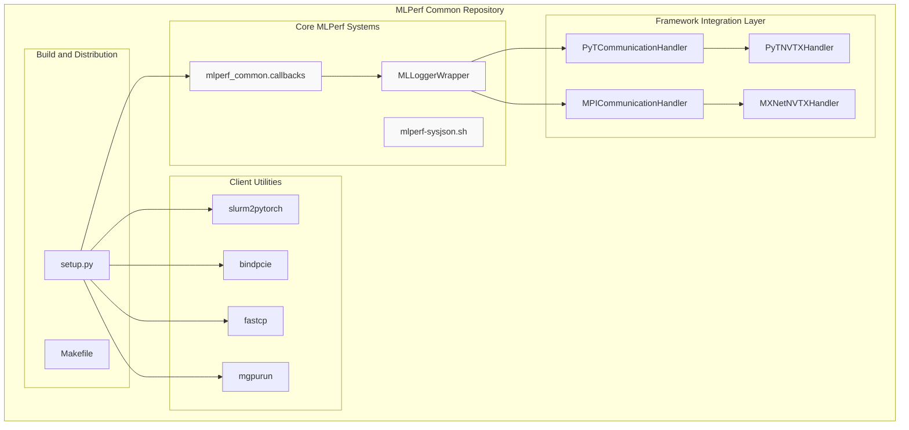
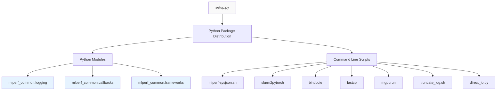
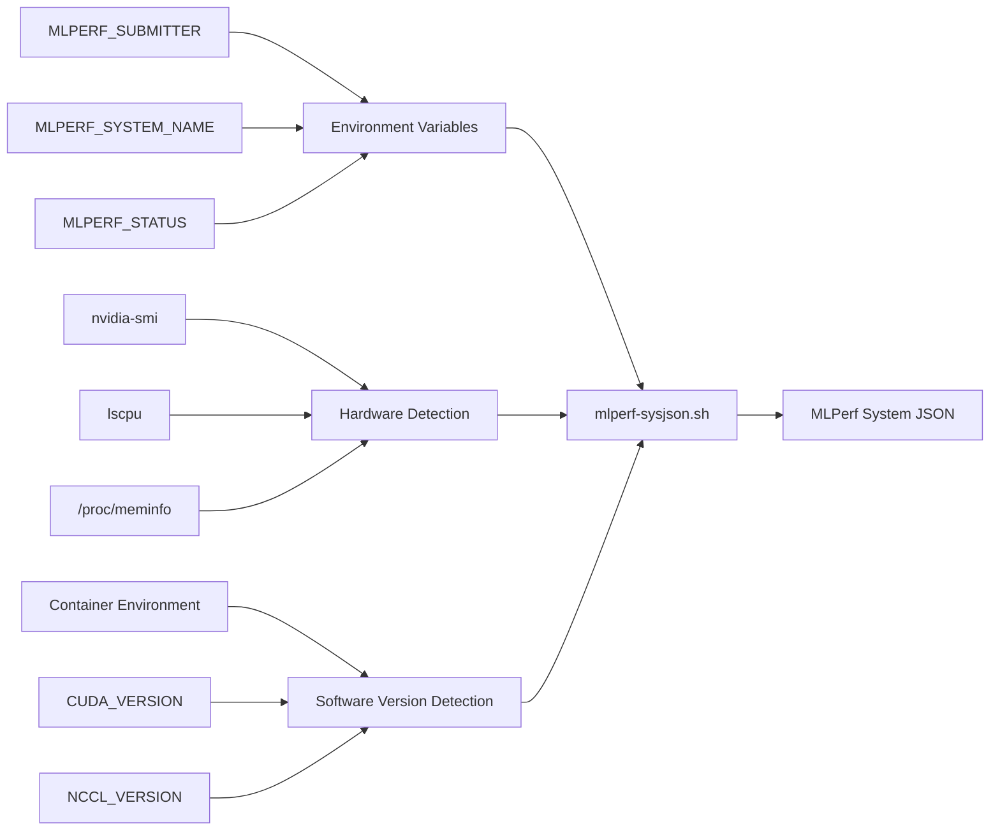

<!-- source: DeepWiki mcp.deepwiki.com · repo NVIDIA/mlperf-common · page 1 MLPerf Common Overview · fetched 2026-10-26 -->

# MLPerf Common Overview

<details>
<summary>Relevant source files</summary>

The following files were used as context for generating this wiki page:

- [README.md](README.md)
- [client/mlperf-sysjson.sh](client/mlperf-sysjson.sh)
- [setup.py](setup.py)

</details>


## Purpose and Scope

MLPerf Common is a collection of utilities and infrastructure components designed to support MLPerf benchmark submissions, particularly for NVIDIA hardware configurations. This repository provides standardized logging infrastructure, framework integration abstractions, distributed training utilities, and system management tools that ensure MLPerf compliance while optimizing performance across different ML frameworks and hardware setups.

The repository serves as a foundational toolkit for implementing MLPerf benchmarks with proper logging, distributed coordination, and system configuration management. For detailed information about specific subsystems, see [Core MLPerf Systems](#2) for logging and compliance infrastructure, [Framework Integration](#2.3) for multi-framework support, and [Client Utilities](#3) for operational tools.

## Repository Architecture

The MLPerf Common repository is organized into several interconnected layers that provide comprehensive support for MLPerf benchmark implementations:



**Sources:** [setup.py:23-36](), [README.md:4-120](), [client/mlperf-sysjson.sh:1-260]()

## Core Components Overview

### MLPerf Logging Infrastructure

The repository's primary functionality centers around the `MLLoggerWrapper` class, which provides standardized MLPerf event logging with support for multiple communication backends. This system ensures compliance with MLPerf logging requirements while abstracting framework-specific communication mechanisms.

### Framework Integration Layer

The framework integration layer uses abstract base classes to support multiple ML frameworks through pluggable handlers:

| Framework | Communication Handler | Profiling Handler |
|-----------|----------------------|-------------------|
| PyTorch | `PyTCommunicationHandler` | `PyTNVTXHandler` |
| MXNet/Horovod | `MPICommunicationHandler` | `MXNetNVTXHandler` |
| HugeCTR | `MPICommunicationHandler` | Custom handlers |

### Client Utilities

The repository provides numerous command-line utilities for operational tasks, distributed as executable scripts through the package installation system.

**Sources:** [README.md:11-39](), [setup.py:33]()

## Package Distribution and Entry Points

The package distribution is managed through `setup.py` and provides both Python modules and command-line scripts:



**Sources:** [setup.py:32-33]()

## Key Integration Patterns

### PyTorch Integration

For PyTorch-based MLPerf benchmarks using `torch.distributed`:

```python
from mlperf_common.logging import MLLoggerWrapper
from mlperf_common.frameworks.pyt import PyTCommunicationHandler

mllogger = MLLoggerWrapper(PyTCommunicationHandler(), value=None)
```

### MPI-Based Integration

For frameworks using MPI communication (Horovod, MXNet, HugeCTR):

```python
from mlperf_common.logging import MLLoggerWrapper  
from mlperf_common.frameworks.mxnet import MPICommunicationHandler

mllogger = MLLoggerWrapper(MPICommunicationHandler(), value=None)
```

**Sources:** [README.md:14-38]()

## System Description Generation

The `mlperf-sysjson.sh` script automatically generates MLPerf-compliant system description JSON files by detecting hardware configuration, software versions, and system characteristics. This script is essential for MLPerf submission compliance:



The script requires specific environment variables and automatically detects system characteristics to generate compliant metadata for MLPerf submissions.

**Sources:** [client/mlperf-sysjson.sh:27-61](), [client/mlperf-sysjson.sh:183-204](), [client/mlperf-sysjson.sh:207-259]()

## Component Relationships

The repository's components work together to provide a complete MLPerf benchmark infrastructure:

1. **Logging Infrastructure**: `MLLoggerWrapper` coordinates with framework-specific handlers to ensure compliant event logging
2. **Framework Abstraction**: Base handler classes enable consistent interfaces across different ML frameworks  
3. **System Management**: Client utilities handle environment setup, resource binding, and system configuration
4. **Compliance Tools**: System description generation ensures submission metadata requirements are met

This architecture allows MLPerf benchmark implementations to focus on model training logic while delegating infrastructure concerns to the common utilities, ensuring both performance optimization and submission compliance.

**Sources:** [setup.py:23-36](), [README.md:47-71](), [client/mlperf-sysjson.sh:1-20]()

---

