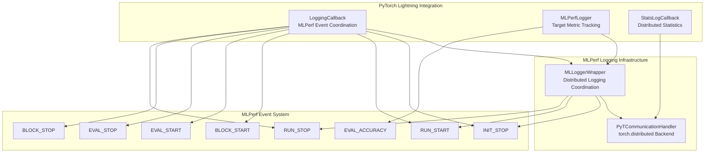
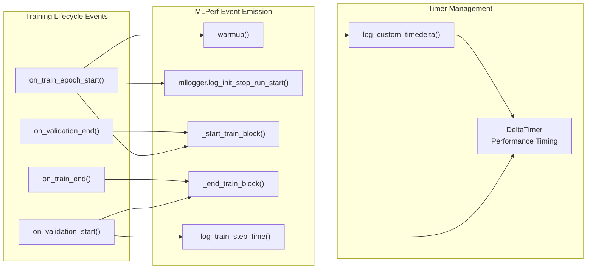
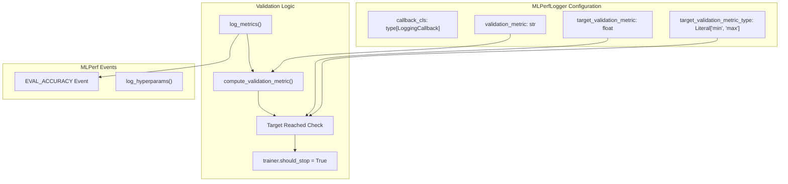
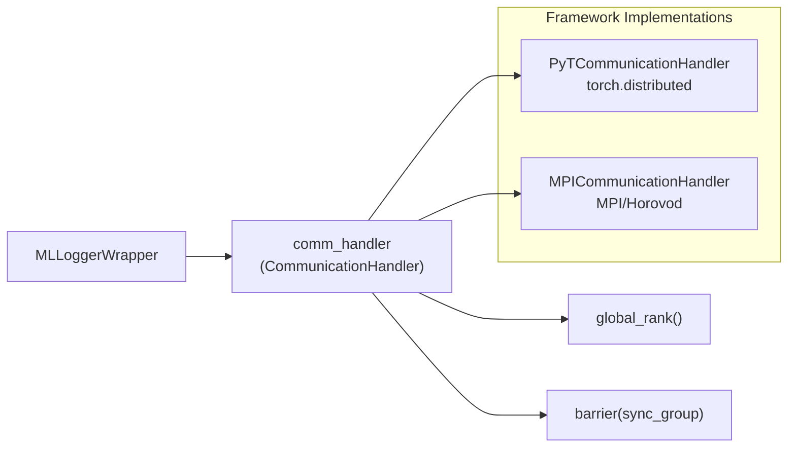
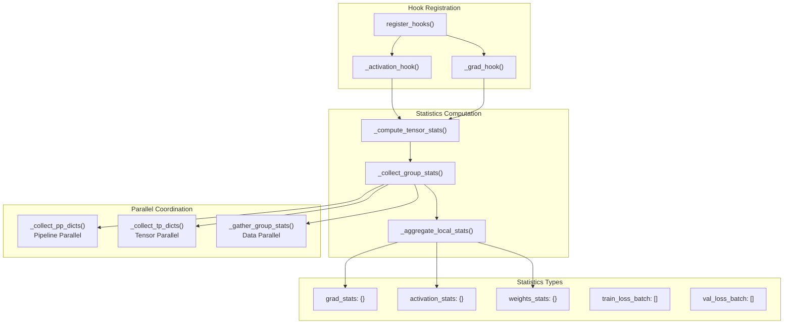
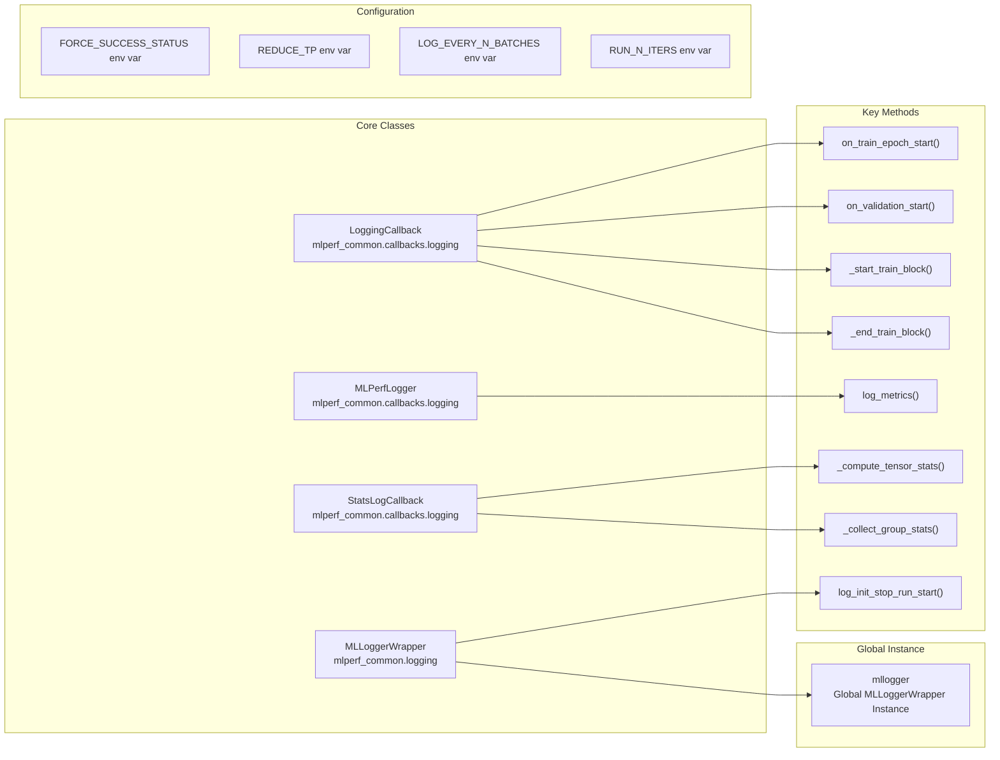

<!-- source: DeepWiki mcp.deepwiki.com · repo NVIDIA/mlperf-common · page 2 Core MLPerf Systems · fetched 2026-10-26 -->

# Core MLPerf Systems

Relevant source files

The following files were used as context for generating this wiki page:

- [mlperf_common/callbacks/__init__.py](mlperf_common/callbacks/__init__.py)
- [mlperf_common/callbacks/logging.py](mlperf_common/callbacks/logging.py)
- [mlperf_common/logging.py](mlperf_common/logging.py)

## Purpose and Scope

This document covers the most critical systems in the MLPerf Common repository that enable MLPerf benchmark compliance, distributed training coordination, and performance logging. These systems provide the foundational infrastructure for running MLPerf benchmarks across different machine learning frameworks with standardized logging and metric tracking.

The core systems include PyTorch Lightning integration callbacks, the MLPerf logging wrapper infrastructure, and distributed training statistics collection. For framework-specific implementations and handlers, see [Framework Integration](#2.3). For command-line utilities and operational tools, see [Client Utilities](#3).

## System Architecture Overview

The core MLPerf systems form a layered architecture where PyTorch Lightning callbacks coordinate with the MLPerf logging infrastructure to ensure benchmark compliance across distributed training environments.

Sources: [mlperf_common/callbacks/logging.py:41-42](), [mlperf_common/logging.py:21-43]()

## PyTorch Lightning Callback System

The callback system provides MLPerf-compliant event logging throughout the training lifecycle. The `LoggingCallback` class integrates with PyTorch Lightning's training loop to emit required MLPerf events at precise timing points.

### LoggingCallback Core Functionality

The `LoggingCallback` manages training blocks and validation cycles with precise timing measurements. Key responsibilities include:

- **Warmup Handling**: Executes one-time initialization logging via `warmup()` method
- **Block Management**: Coordinates `BLOCK_START` and `BLOCK_STOP` events around training intervals
- **Timing Measurement**: Uses `DeltaTimer` class for precise performance timing
- **Status Tracking**: Maintains `train_block_started` and `train_current_block` state

Sources: [mlperf_common/callbacks/logging.py:57-219]()

### MLPerfLogger Target Validation

The `MLPerfLogger` extends PyTorch Lightning's `Logger` interface to provide target metric tracking and early stopping functionality.

The logger automatically stops training when validation metrics reach target thresholds, ensuring MLPerf compliance for convergence criteria.

Sources: [mlperf_common/callbacks/logging.py:221-327]()

## MLPerf Logging Infrastructure

The `MLLoggerWrapper` provides distributed logging coordination with communication handlers for different frameworks. It wraps the official MLPerf logger with additional synchronization and distributed coordination capabilities.

### MLLoggerWrapper Core Methods

| Method | Purpose | Synchronization |
|--------|---------|----------------|
| `start()` | Log time interval start | Configurable via `sync` parameter |
| `end()` | Log time interval end | Configurable via `sync` parameter |
| `event()` | Log point-in-time event | Configurable via `sync` parameter |
| `log_init_stop_run_start()` | Log INIT_STOP and RUN_START | Full barrier synchronization |
| `log_run_stop()` | Log RUN_STOP with status | Configurable synchronization |

The wrapper supports several key distributed coordination features:

- **Unique Logging**: Only `unique_log_rank` process logs when `unique=True`
- **Barrier Synchronization**: Calls `comm_handler.barrier()` before logging when `sync=True`
- **Stack Trace Offset**: Maintains proper call stack attribution with `default_stack_offset`

Sources: [mlperf_common/logging.py:44-90]()

### Communication Handler Integration

The communication handler abstraction allows the same logging infrastructure to work across different distributed training frameworks.

Sources: [mlperf_common/logging.py:75-85]()

## Distributed Statistics Collection

The `StatsLogCallback` provides comprehensive statistics collection for distributed training environments, supporting tensor parallel, pipeline parallel, and data parallel configurations.

### Statistics Collection Architecture

### Key Statistics Features

The `StatsLogCallback` supports advanced distributed training configurations:

- **Virtual Pipeline Parallelism**: Handles multi-chunk models with `use_vp` and `set_layer_vp_chunk()`
- **Tensor Parallelism**: Configurable reduction via `REDUCE_TP` environment variable
- **Selective Logging**: Controlled via `LOG_EVERY_N_BATCHES` and `RUN_N_ITERS` environment variables
- **Hook Management**: Automatic registration/removal of forward and backward hooks

Statistics collected include tensor mean, variance, min, max, and L2 norm across all parallel dimensions.

Sources: [mlperf_common/callbacks/logging.py:329-741]()

## Code Entity Mapping

The following diagram maps the natural language system concepts to specific code entities that developers can search for in the codebase:

Sources: [mlperf_common/callbacks/__init__.py:16](), [mlperf_common/callbacks/logging.py:41](), [mlperf_common/callbacks/logging.py:348-351]()

---

