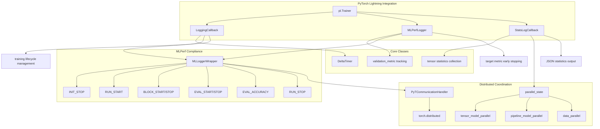
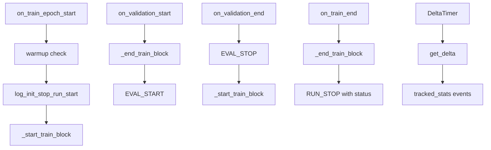
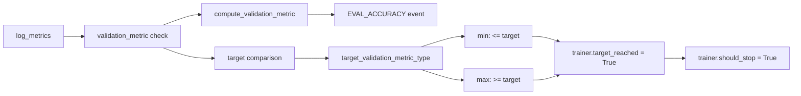
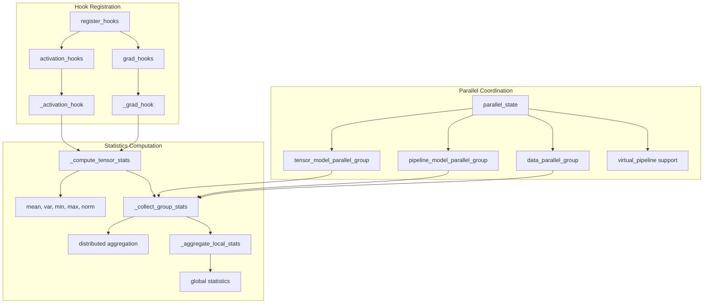
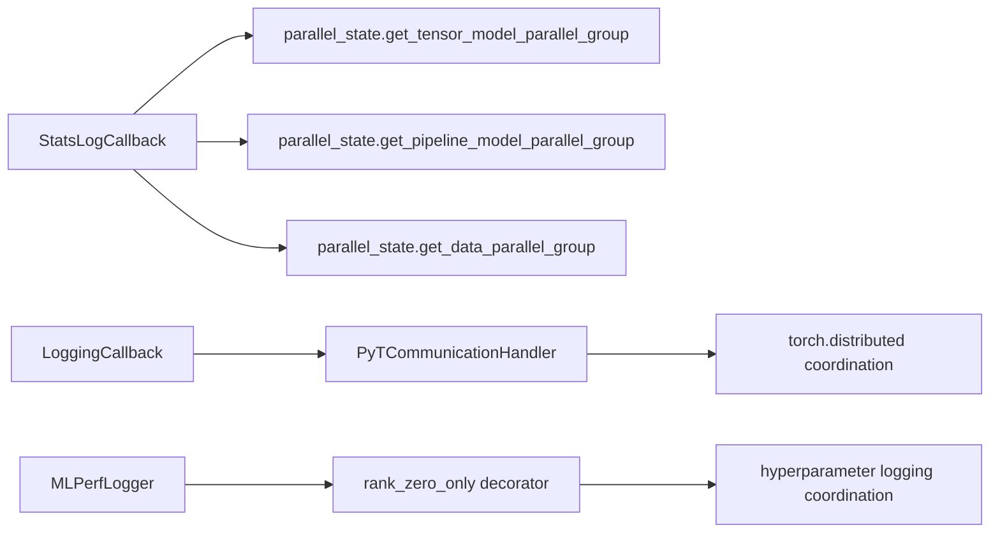

<!-- source: DeepWiki mcp.deepwiki.com · repo NVIDIA/mlperf-common · page 2.1 PyTorch Lightning Callbacks · fetched 2026-10-26 -->

# PyTorch Lightning Callbacks

<details>
<summary>Relevant source files</summary>

The following files were used as context for generating this wiki page:

- [mlperf_common/callbacks/__init__.py](mlperf_common/callbacks/__init__.py)
- [mlperf_common/callbacks/logging.py](mlperf_common/callbacks/logging.py)

</details>


This document covers the PyTorch Lightning callback system provided by MLPerf Common, which implements MLPerf-compliant logging, performance tracking, and distributed training statistics collection. These callbacks integrate with PyTorch Lightning trainers to automatically handle MLPerf benchmark requirements including timing, validation metric tracking, and early stopping criteria.

For information about the underlying MLPerf logging infrastructure, see [MLPerf Logging Infrastructure](#2.2). For framework integration details, see [Framework Integration](#2.3).

## Architecture Overview

The PyTorch Lightning callbacks system consists of three main components that work together to provide comprehensive MLPerf compliance and performance monitoring:



Sources: [mlperf_common/callbacks/logging.py:1-741](), [mlperf_common/callbacks/__init__.py:1-17]()

## LoggingCallback Class

The `LoggingCallback` class is the primary callback for MLPerf compliance, handling training lifecycle events and logging required MLPerf timing markers.

### Core Functionality



The `LoggingCallback` manages several key responsibilities:

- **Training Block Management**: Tracks training blocks between validation phases using `_start_train_block()` and `_end_train_block()` methods [mlperf_common/callbacks/logging.py:182-201]()
- **Timing Measurements**: Uses `DeltaTimer` to measure elapsed time for warmup, initialization, validation, and training steps [mlperf_common/callbacks/logging.py:44-54]()
- **MLPerf Event Logging**: Emits required MLPerf events through the `mllogger` instance [mlperf_common/callbacks/logging.py:83-113]()

### Key Methods

| Method | Purpose | MLPerf Events |
|--------|---------|---------------|
| `on_train_epoch_start` | Initialize warmup and first training block | `INIT_STOP`, `RUN_START`, `BLOCK_START` |
| `on_validation_start` | End training block, start evaluation | `BLOCK_STOP`, `EVAL_START` |
| `on_validation_end` | End evaluation, restart training | `EVAL_STOP`, `BLOCK_START` |
| `on_train_end` | Final training block end and run completion | `BLOCK_STOP`, `RUN_STOP` |

Sources: [mlperf_common/callbacks/logging.py:71-113](), [mlperf_common/callbacks/logging.py:115-160]()

## MLPerfLogger Class

The `MLPerfLogger` extends PyTorch Lightning's `Logger` interface to provide MLPerf-specific validation metric tracking and early stopping functionality.

### Validation Metric Tracking



The logger implements automatic target detection and early stopping:

- **Metric Computation**: Processes validation metrics and logs `EVAL_ACCURACY` events [mlperf_common/callbacks/logging.py:265-281]()
- **Target Detection**: Compares computed metrics against target values with configurable comparison type [mlperf_common/callbacks/logging.py:283-292]()
- **Early Stopping**: Sets trainer flags to stop training when target is reached [mlperf_common/callbacks/logging.py:290-292]()

### Constructor Parameters

| Parameter | Type | Purpose |
|-----------|------|---------|
| `callback_cls` | `type[LoggingCallback]` | Callback class to instantiate |
| `validation_metric` | `str` | Name of metric to track |
| `target_validation_metric` | `float` | Target value for early stopping |
| `target_validation_metric_type` | `"min"` or `"max"` | Whether target is minimum or maximum |

Sources: [mlperf_common/callbacks/logging.py:221-260](), [mlperf_common/callbacks/logging.py:299-325]()

## StatsLogCallback Class

The `StatsLogCallback` provides comprehensive statistics collection for distributed training debugging and analysis, particularly for large-scale models using tensor parallelism and pipeline parallelism.

### Statistics Collection Architecture



### Key Features

- **Multi-Level Parallelism Support**: Handles tensor parallelism, pipeline parallelism, data parallelism, and virtual pipeline parallelism [mlperf_common/callbacks/logging.py:588-614]()
- **Comprehensive Statistics**: Collects mean, variance, min, max, and norm for tensors [mlperf_common/callbacks/logging.py:356-382]()
- **Distributed Aggregation**: Coordinates statistics across parallel groups using `torch.distributed` [mlperf_common/callbacks/logging.py:388-444]()
- **Configurable Logging**: Supports environment variables for logging frequency and iteration limits [mlperf_common/callbacks/logging.py:348-354]()

### Statistics Categories

| Category | Hook Type | Scope |
|----------|-----------|-------|
| `activation_stats` | Forward hook | Per-module activations during forward pass |
| `grad_stats` | Backward hook | Per-module gradients during backward pass |
| `weights_stats` | Parameter iteration | Model weights at epoch start and batch end |
| `train_loss_batch` | Output extraction | Training loss per batch |
| `val_loss_batch` | Output extraction | Validation loss per batch |

### Environment Configuration

| Variable | Default | Purpose |
|----------|---------|---------|
| `REDUCE_TP` | `"True"` | Whether to reduce across tensor parallel groups |
| `LOG_EVERY_N_BATCHES` | `"1"` | Frequency of statistics collection |
| `RUN_N_ITERS` | `"0"` | Maximum iterations before disabling (0 = unlimited) |
| `SEED` | `"1"` | Seed value for output file naming |

Sources: [mlperf_common/callbacks/logging.py:329-354](), [mlperf_common/callbacks/logging.py:571-617](), [mlperf_common/callbacks/logging.py:732-740]()

## Integration Patterns

### Basic Usage Pattern

The callbacks are designed to integrate seamlessly with PyTorch Lightning trainers:

```python
# Typical integration pattern referenced in the code
trainer = pl.Trainer(
    logger=MLPerfLogger(
        callback_cls=LoggingCallback,
        model=model,
        validation_metric="accuracy",
        target_validation_metric=0.95,
        target_validation_metric_type="max"
    ),
    callbacks=[
        trainer.logger.callback,  # LoggingCallback instance
        StatsLogCallback(save_path="/results/stats.json")
    ]
)
```

### Distributed Training Coordination

The callbacks coordinate across distributed training setups through the `parallel_state` module from Megatron-LM and PyTorch's distributed communication:



Sources: [mlperf_common/callbacks/logging.py:38-41](), [mlperf_common/callbacks/logging.py:332-333](), [mlperf_common/callbacks/logging.py:294-297]()

---

