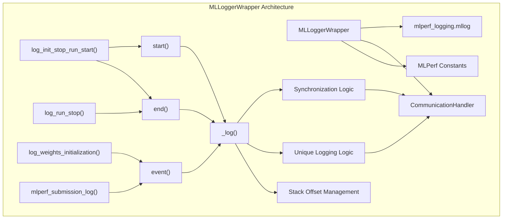
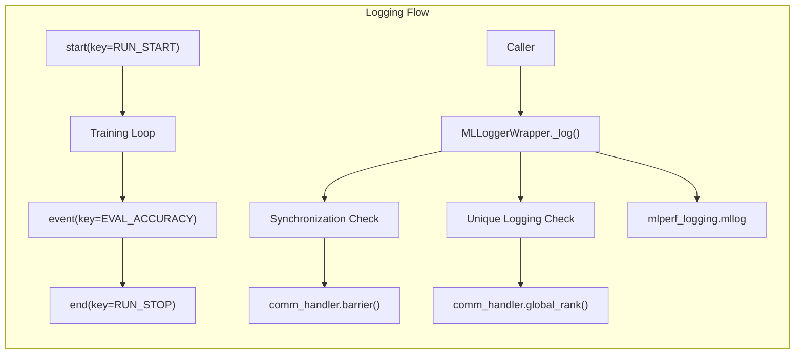
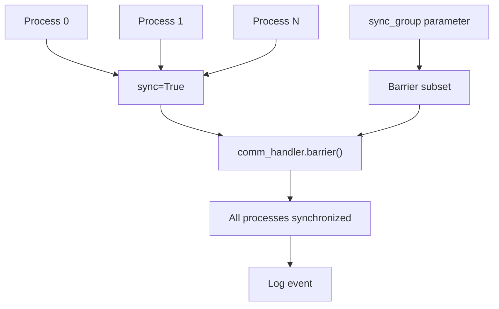
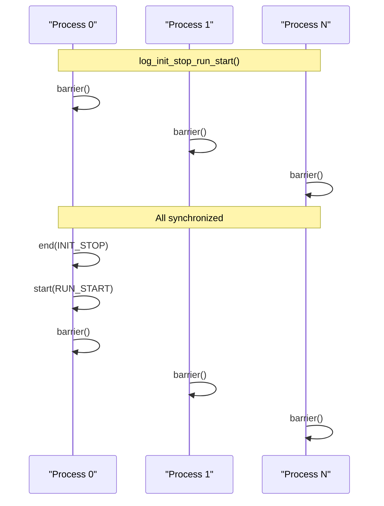
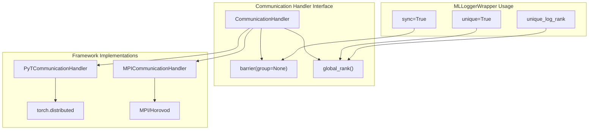

<!-- source: DeepWiki mcp.deepwiki.com · repo NVIDIA/mlperf-common · page 2.2 MLPerf Logging Infrastructure · fetched 2026-10-26 -->

# MLPerf Logging Infrastructure

Relevant source files

The following files were used as context for generating this wiki page:

- [mlperf_common/logging.py](mlperf_common/logging.py)

## Purpose and Scope

This document covers the core MLPerf logging infrastructure provided by the `MLLoggerWrapper` class, which serves as the central component for MLPerf-compliant logging across distributed training workloads. The system provides a standardized interface for timing events, synchronization across distributed processes, and automated compliance with MLPerf logging requirements.

For information about PyTorch Lightning integration and callback-based logging, see [PyTorch Lightning Callbacks](#2.1). For framework-specific communication handlers used by this logging system, see [Framework Integration](#2.3).

## MLLoggerWrapper Overview

The `MLLoggerWrapper` class in [mlperf_common/logging.py:21-135]() serves as the primary interface for all MLPerf logging operations. It wraps the official MLPerf logger (`mlperf_logging.mllog`) and adds distributed coordination, synchronization, and convenience methods for common logging patterns.

**Core MLLoggerWrapper Class Structure**

Sources: [mlperf_common/logging.py:21-40]()

## Core Logging Primitives

The wrapper provides three fundamental logging primitives that correspond directly to MLPerf logging requirements:

| Method | Purpose | MLPerf Usage |
|--------|---------|--------------|
| `start()` | Log time interval start | Beginning of training phases, evaluation phases |
| `end()` | Log time interval end | End of training phases, evaluation phases |
| `event()` | Log point-in-time event | Configuration settings, metrics, status updates |

**MLPerf Logging Primitive Flow**

All primitives delegate to the internal `_log()` method at [mlperf_common/logging.py:56-79](), which handles distributed coordination and filtering.

Sources: [mlperf_common/logging.py:44-54]()

## Distributed Coordination Features

The logging infrastructure includes sophisticated distributed coordination to ensure consistent logging across multi-node, multi-GPU training runs:

### Synchronization Control

The `sync` parameter in `_log()` triggers a barrier operation before logging, ensuring all processes reach the logging point simultaneously:

**Distributed Synchronization Flow**

### Unique Logging

The `unique` parameter controls which processes actually write log entries, preventing duplicate logs in distributed settings:

- `unique=True`: Only the process with rank `unique_log_rank` logs
- `unique=False`: All processes log (used for process-specific metrics)
- Default `unique_log_rank=0`: Primary process handles unique logs

Sources: [mlperf_common/logging.py:56-79]()

## Helper Methods for Common Patterns

The wrapper provides several helper methods that implement common MLPerf logging patterns with correct synchronization:

### Training Lifecycle Events

The `log_init_stop_run_start()` method at [mlperf_common/logging.py:81-85]() handles the critical transition from initialization to training:

**Training Lifecycle Synchronization**

### Submission Metadata Logging

The `mlperf_submission_log()` method at [mlperf_common/logging.py:97-134]() automatically logs required submission metadata:

| Constant | Source | Default |
|----------|--------|---------|
| `SUBMISSION_BENCHMARK` | Parameter | Required |
| `SUBMISSION_ORG` | `MLPERF_SUBMISSION_ORG` env var | Placeholder |
| `SUBMISSION_PLATFORM` | `MLPERF_SUBMISSION_PLATFORM` env var | Placeholder |
| `SUBMISSION_DIVISION` | Hard-coded | `CLOSED` |
| `SUBMISSION_STATUS` | Hard-coded | `ONPREM` |

Sources: [mlperf_common/logging.py:81-95](), [mlperf_common/logging.py:97-134]()

## Integration with Communication Handlers

The logging infrastructure depends on framework-specific communication handlers that provide distributed coordination primitives:

**Communication Handler Integration**

The communication handler is passed to the `MLLoggerWrapper` constructor at [mlperf_common/logging.py:22-26]() and enables the logging system to work across different distributed training frameworks.

## Stack Offset Management

The logging infrastructure includes automatic stack offset management to ensure accurate source location tracking in logs. The `default_stack_offset` parameter accounts for the additional call stack depth introduced by the wrapper methods.

Internal calls (like helper methods) automatically increment the stack offset by 1 via the `internal_call=True` parameter at [mlperf_common/logging.py:72-73]().

Sources: [mlperf_common/logging.py:21-40](), [mlperf_common/logging.py:56-79]()

---

