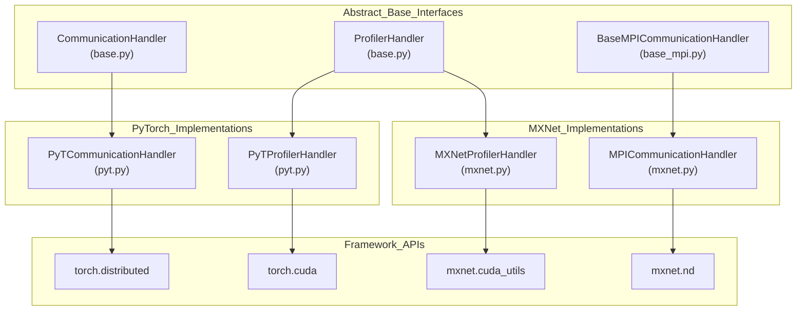
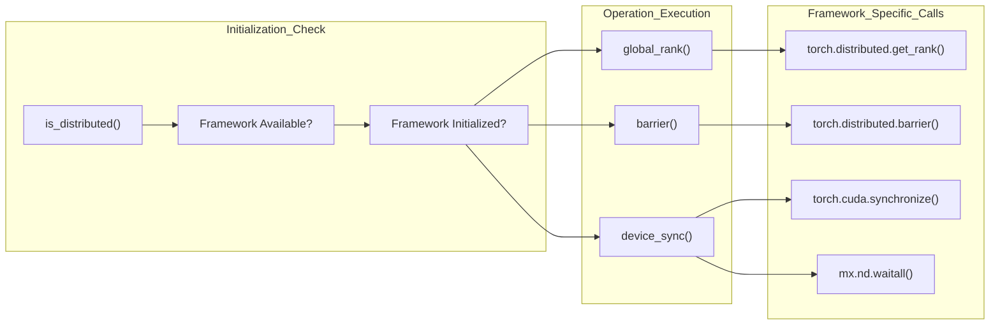

<!-- source: DeepWiki mcp.deepwiki.com · repo NVIDIA/mlperf-common · page 2.3 Framework Integration · fetched 2026-10-26 -->

# Framework Integration

Relevant source files

The following files were used as context for generating this wiki page:

- [mlperf_common/frameworks/base.py](mlperf_common/frameworks/base.py)
- [mlperf_common/frameworks/mxnet.py](mlperf_common/frameworks/mxnet.py)
- [mlperf_common/frameworks/pyt.py](mlperf_common/frameworks/pyt.py)

## Purpose and Scope

The Framework Integration system provides a unified abstraction layer for integrating different machine learning frameworks with MLPerf common utilities. This system enables framework-agnostic implementations of distributed communication, profiling, and synchronization operations essential for MLPerf benchmarks.

The integration layer consists of abstract base interfaces and framework-specific implementations that handle communication coordination and performance profiling across PyTorch, MXNet, HugeCTR, and other supported frameworks. For specific framework implementations, see [PyTorch Integration](#2.3.2) and [MXNet and Other Frameworks](#2.3.3). For the logging systems that utilize these handlers, see [MLPerf Logging Infrastructure](#2.2).

## Architecture Overview

The framework integration system follows a plugin architecture where abstract base classes define common interfaces, and framework-specific handlers implement the required functionality for each supported ML framework.

### Framework Handler Architecture

Sources: [mlperf_common/frameworks/base.py:15-36](), [mlperf_common/frameworks/pyt.py:19-46](), [mlperf_common/frameworks/mxnet.py:21-36]()

## Base Interface Definitions

The framework integration system defines two primary abstract base classes that establish the contract for framework-specific implementations.

### CommunicationHandler Interface

The `CommunicationHandler` class defines the interface for distributed training coordination and synchronization operations:

| Method | Purpose | Parameters |
|--------|---------|------------|
| `global_rank()` | Returns the global rank of the current process | None |
| `barrier(sync_group=None)` | Synchronizes processes across the distributed group | Optional synchronization group |
| `device_sync()` | Synchronizes device operations (GPU kernels) | None |

### ProfilerHandler Interface

The `ProfilerHandler` class defines the interface for performance profiling and NVTX integration:

| Method | Purpose | Parameters |
|--------|---------|------------|
| `profiler_start()` | Initiates CUDA profiler collection | None |
| `profiler_stop()` | Stops CUDA profiler collection | None |
| `push_nvtx(tag)` | Pushes NVTX range marker | Tag string for identification |
| `pop_nvtx()` | Pops NVTX range marker | None |

All methods in both base classes raise `NotImplementedError` and must be overridden by framework-specific implementations.

Sources: [mlperf_common/frameworks/base.py:15-36]()

## Framework Implementation Pattern

### Communication Handler Implementation Flow

Sources: [mlperf_common/frameworks/pyt.py:19-33](), [mlperf_common/frameworks/mxnet.py:21-23]()

## PyTorch Integration Implementation

The PyTorch integration provides concrete implementations for both communication and profiling handlers using PyTorch's native distributed and CUDA APIs.

### PyTCommunicationHandler

The `PyTCommunicationHandler` class implements distributed communication using `torch.distributed`:

- **Distributed Detection**: Uses `torch.distributed.is_available()` and `torch.distributed.is_initialized()` to determine if distributed training is active [mlperf_common/frameworks/pyt.py:29-30]()
- **Rank Management**: Returns `torch.distributed.get_rank()` for global rank identification [mlperf_common/frameworks/pyt.py:20-23]()
- **Synchronization**: Implements barrier synchronization with optional sync groups [mlperf_common/frameworks/pyt.py:25-27]()
- **Device Coordination**: Uses `torch.cuda.synchronize()` for GPU kernel completion [mlperf_common/frameworks/pyt.py:32-33]()

### PyTProfilerHandler

The `PyTProfilerHandler` class implements profiling using PyTorch's CUDA and NVTX integration:

- **CUDA Profiler Control**: Uses `torch.cuda.cudart().cudaProfilerStart()` and `cudaProfilerStop()` [mlperf_common/frameworks/pyt.py:36-40]()
- **NVTX Integration**: Implements `torch.cuda.nvtx.range_push()` and `range_pop()` for performance annotation [mlperf_common/frameworks/pyt.py:42-46]()

Sources: [mlperf_common/frameworks/pyt.py:19-46]()

## MXNet Integration Implementation

The MXNet integration follows a similar pattern but uses MXNet-specific APIs and extends the MPI-based communication handler for distributed coordination.

### MPICommunicationHandler

The `MPICommunicationHandler` extends `BaseMPICommunicationHandler` and implements MXNet-specific device synchronization:

- **MPI Foundation**: Inherits distributed communication capabilities from the base MPI handler [mlperf_common/frameworks/mxnet.py:21]()
- **Device Synchronization**: Uses `mx.nd.waitall()` to ensure all MXNet NDArray operations complete [mlperf_common/frameworks/mxnet.py:22-23]()

### MXNetProfilerHandler

The `MXNetProfilerHandler` implements profiling using MXNet's CUDA utilities:

- **CUDA Profiler**: Uses `cu.cuda_profiler_start()` and `cuda_profiler_stop()` from `mxnet.cuda_utils` [mlperf_common/frameworks/mxnet.py:26-30]()
- **NVTX Support**: Implements `cu.nvtx_range_push()` and `nvtx_range_pop()` for performance tracking [mlperf_common/frameworks/mxnet.py:32-36]()

Sources: [mlperf_common/frameworks/mxnet.py:21-36](), [mlperf_common/frameworks/base_mpi.py:19]()

## Integration Usage Patterns

The framework handlers are designed to be instantiated and used by higher-level MLPerf systems, particularly the logging infrastructure. The abstraction allows the same logging and coordination code to work across different frameworks by swapping the appropriate handler implementation.

### Handler Selection Pattern

Framework-specific handlers are typically selected at runtime based on the detected framework environment, enabling the MLPerf common utilities to operate transparently across different machine learning frameworks while maintaining consistent behavior for distributed coordination and performance profiling.

Sources: [mlperf_common/frameworks/base.py:15-36](), [mlperf_common/frameworks/pyt.py:19-46](), [mlperf_common/frameworks/mxnet.py:21-36]()

---

