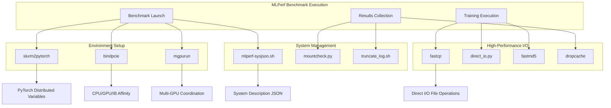
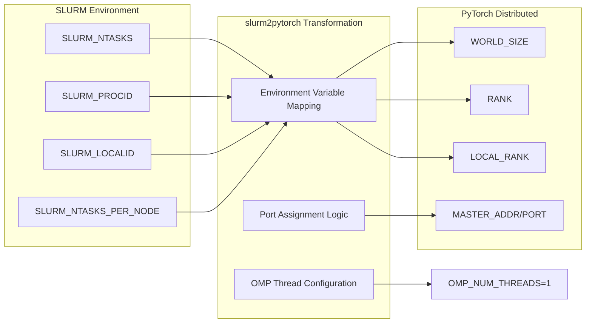
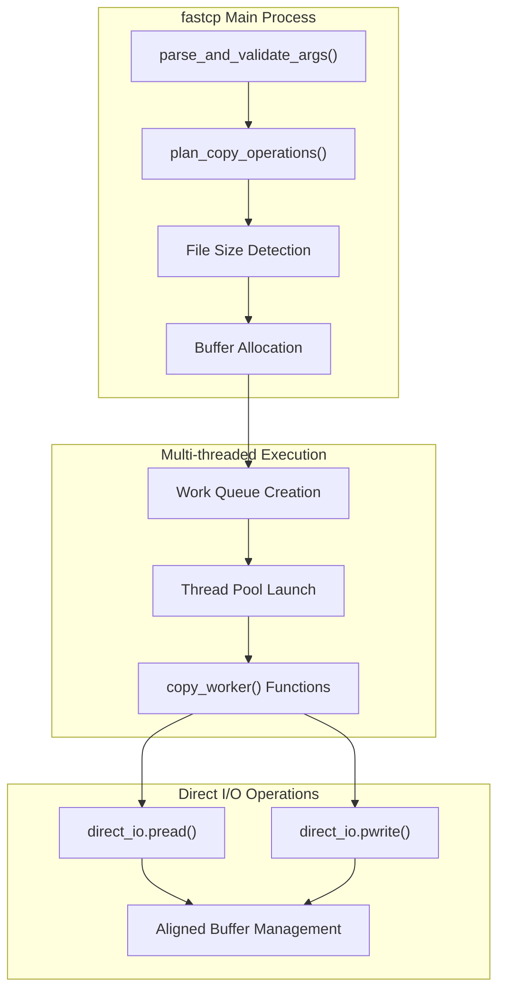
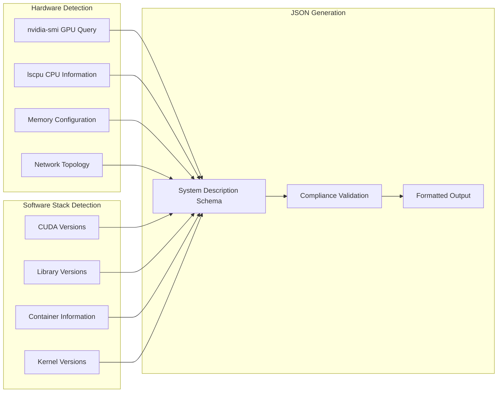
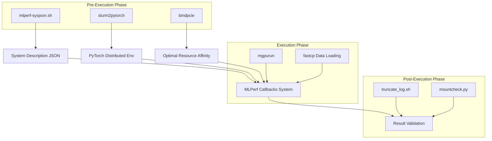

<!-- source: DeepWiki mcp.deepwiki.com · repo NVIDIA/mlperf-common · page 3 Client Utilities · fetched 2026-10-26 -->

# Client Utilities

Relevant source files

The following files were used as context for generating this wiki page:

- [client/fastcp](client/fastcp)
- [client/mlperf-sysjson.sh](client/mlperf-sysjson.sh)
- [client/slurm2pytorch](client/slurm2pytorch)
- [setup.py](setup.py)

This page documents the command-line utilities and scripts provided by the MLPerf Common package for operational tasks in MLPerf benchmark environments. These utilities handle environment setup, high-performance I/O operations, system management, and multi-GPU execution coordination.

For information about the core MLPerf logging and compliance systems, see [Core MLPerf Systems](#2). For details about framework integration layers, see [Framework Integration](#2.3).

## Overview

The client utilities form a comprehensive toolkit for managing MLPerf benchmark execution across diverse hardware configurations and cluster environments. These tools are distributed as executable scripts through the package's [setup.py:33]() and are designed to work seamlessly with SLURM, containerized environments, and high-performance computing clusters.

### Client Utilities Architecture

Sources: [setup.py:33](), [client/slurm2pytorch](), [client/fastcp](), [client/mlperf-sysjson.sh]()

## Environment Configuration

Environment configuration utilities prepare distributed training environments and manage resource allocation across nodes and accelerators.

### slurm2pytorch

The `slurm2pytorch` script translates SLURM job environment variables into PyTorch distributed training variables required for multi-node execution.

#### Key Environment Variables Set

| Variable | Purpose | Default Source |
|----------|---------|----------------|
| `MASTER_ADDR` | Primary node address | `MLPERF_SLURM_FIRSTNODE` or `127.0.0.1` |
| `MASTER_PORT` | Communication port | `29500` |
| `WORLD_SIZE` | Total processes | `SLURM_NTASKS` or `OMPI_COMM_WORLD_SIZE` |
| `RANK` | Process rank | `SLURM_PROCID` or `OMPI_COMM_WORLD_RANK` |
| `LOCAL_RANK` | Local GPU ID | `SLURM_LOCALID` or `OMPI_COMM_WORLD_LOCAL_RANK` |

The script automatically configures `OMP_NUM_THREADS=1` for multi-GPU scenarios to prevent threading conflicts [client/slurm2pytorch:73-75]().

Sources: [client/slurm2pytorch:64-69](), [client/slurm2pytorch:73-75]()

### Resource Affinity Management

The `bindpcie` utility manages CPU, GPU, and InfiniBand affinity to optimize performance in multi-accelerator systems. Additional GPU affinity management is handled through Python modules in the `mlperf_common.affinity` package.

Sources: [setup.py:33]()

## High-Performance I/O Utilities

High-performance I/O utilities provide optimized file operations critical for dataset management and checkpoint handling in benchmark environments.

### fastcp Multi-threaded File Copy

The `fastcp` utility implements high-performance file copying using multiple threads and direct I/O operations to bypass system caches and maximize throughput.

#### Implementation Architecture

Sources: [client/fastcp:46-107](), [client/fastcp:28-44]()

#### Key Features

- **Direct I/O**: Uses `O_DIRECT` flags to bypass system caches [client/fastcp:54,59]()
- **Thread Pool**: Configurable number of worker threads (default: 16) [client/fastcp:126-127]()
- **Aligned Buffers**: 2MB-aligned buffers for optimal performance [client/fastcp:74-77]()
- **Work Queue**: Lock-free work distribution using `queue.Queue` [client/fastcp:81-83]()

The copy operation divides files into chunks distributed across worker threads, each using aligned buffers for direct I/O operations [client/fastcp:28-44]().

### Direct I/O Module

The `direct_io.py` module provides low-level direct I/O operations and aligned memory management used by `fastcp` and other performance-critical utilities.

Sources: [setup.py:33](), [client/fastcp:25-26]()

## System Management Tools

System management utilities handle MLPerf compliance requirements and operational management tasks.

### mlperf-sysjson.sh System Description Generator

The `mlperf-sysjson.sh` script automatically generates system description JSON files required for MLPerf submissions by collecting hardware and software configuration information.

#### Required Environment Variables

| Variable | Purpose | Example |
|----------|---------|---------|
| `MLPERF_SUBMITTER` | Organization name | "NVIDIA" |
| `MLPERF_SYSTEM_NAME` | System identifier | "DGX-H100x8" |
| `MLPERF_STATUS` | Availability status | "Available on-premise" |

#### Automatic Detection Capabilities

Sources: [client/mlperf-sysjson.sh:193-203](), [client/mlperf-sysjson.sh:207-259]()

The script performs automatic hardware detection including GPU models, CPU specifications, and memory configurations [client/mlperf-sysjson.sh:193-203](), then generates compliant JSON output [client/mlperf-sysjson.sh:207-259]().

#### Status Validation

The script validates MLPerf status categories and provides backward compatibility for legacy status strings [client/mlperf-sysjson.sh:109-134]():

- "Available on-premise"
- "Available cloud" 
- "Preview"
- "Research, Development, or Internal (RDI)"

### Additional Management Utilities

- **mountcheck.py**: Filesystem verification and validation
- **truncate_log.sh**: Log file management and rotation
- **dropcache**: System cache eviction for consistent performance measurements

Sources: [setup.py:33]()

## Multi-GPU Execution

### mgpurun Multi-GPU Launcher

The `mgpurun` utility provides standardized multi-GPU job launching with proper environment setup and resource coordination across multiple accelerators.

Sources: [setup.py:33]()

## Integration with MLPerf Workflows

Client utilities integrate seamlessly with the broader MLPerf ecosystem:

Sources: [client/mlperf-sysjson.sh](), [client/slurm2pytorch](), [setup.py:33]()

The utilities work together to provide a complete operational environment for MLPerf benchmark execution, from initial system characterization through final result collection and validation.

---

