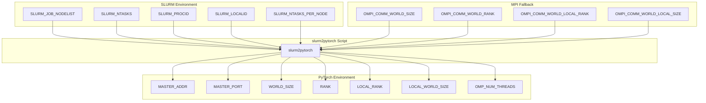
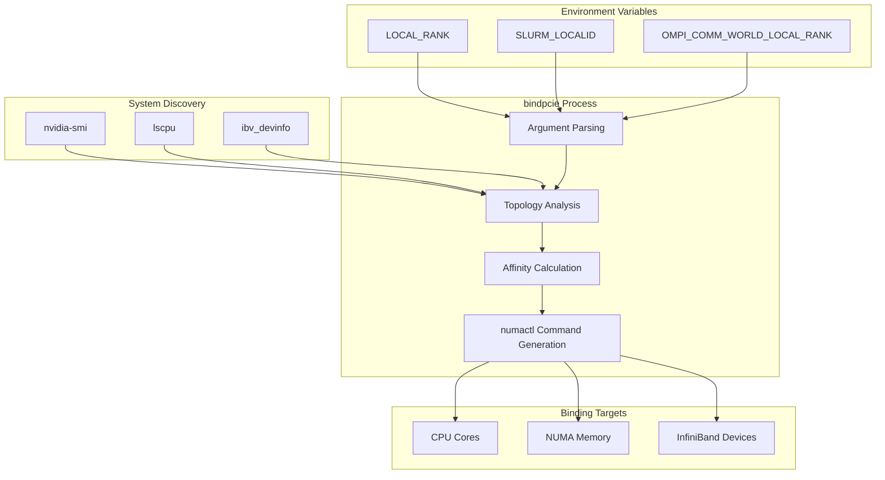
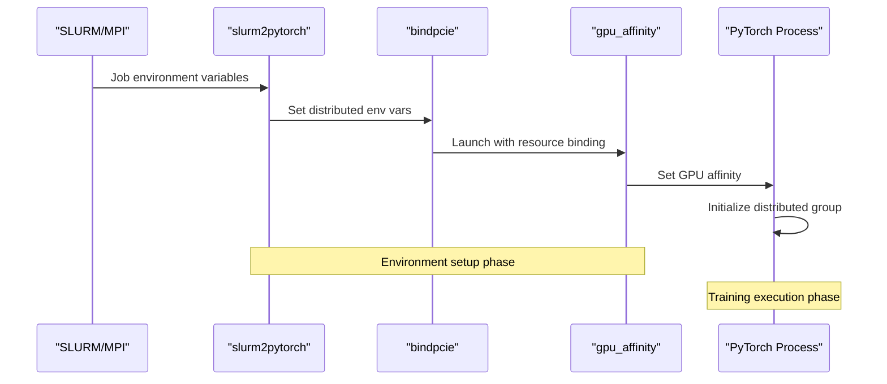

<!-- source: DeepWiki mcp.deepwiki.com · repo NVIDIA/mlperf-common · page 3.1 Environment Configuration · fetched 2026-10-26 -->

# Environment Configuration

<details>
<summary>Relevant source files</summary>

The following files were used as context for generating this wiki page:

- [client/bindpcie](client/bindpcie)
- [client/slurm2pytorch](client/slurm2pytorch)
- [mlperf_common/affinity/gpu_affinity.py](mlperf_common/affinity/gpu_affinity.py)

</details>


This document covers the tools and utilities for setting up distributed training environments in MLPerf Common. The focus is on SLURM integration, resource affinity management, and environment variable configuration needed for distributed PyTorch training across multiple nodes and GPUs.

For information about multi-GPU execution utilities, see [Multi-GPU Execution](#3.4). For system description and hardware detection tools, see [System Management Tools](#3.3).

## Purpose and Scope

Environment configuration tools handle the complex setup required for distributed machine learning training, particularly in HPC environments using SLURM workload managers. These utilities manage:

- Environment variable derivation from SLURM job parameters
- CPU, memory, and network device affinity binding
- Process-to-resource mapping for optimal performance
- Cross-framework compatibility (PyTorch, MXNet, MPI-based frameworks)

## SLURM to PyTorch Environment Translation

The primary environment configuration tool is `slurm2pytorch`, which translates SLURM job parameters into the environment variables required by PyTorch's distributed training system.

### Environment Variable Mapping



Sources: [client/slurm2pytorch:1-87]()

### Key Environment Variables

| PyTorch Variable | SLURM Source | MPI Fallback | Default | Purpose |
|-----------------|--------------|--------------|---------|---------|
| `MASTER_ADDR` | `MLPERF_SLURM_FIRSTNODE` | - | `127.0.0.1` | Coordinator node address |
| `MASTER_PORT` | - | - | `29500` | Coordinator port |
| `WORLD_SIZE` | `SLURM_NTASKS` | `OMPI_COMM_WORLD_SIZE` | `1` | Total number of processes |
| `RANK` | `SLURM_PROCID` | `OMPI_COMM_WORLD_RANK` | `0` | Global process rank |
| `LOCAL_RANK` | `SLURM_LOCALID` | `OMPI_COMM_WORLD_LOCAL_RANK` | `0` | Local process rank |
| `LOCAL_WORLD_SIZE` | `SLURM_NTASKS_PER_NODE` | `OMPI_COMM_WORLD_LOCAL_SIZE` | `1` | Processes per node |

The script automatically sets `OMP_NUM_THREADS=1` when `LOCAL_WORLD_SIZE > 1` to prevent CPU oversubscription in multi-GPU setups, following PyTorch distributed best practices [client/slurm2pytorch:73-75]().

Sources: [client/slurm2pytorch:28-80]()

## Resource Affinity Management

The `bindpcie` utility provides comprehensive resource binding capabilities for optimal distributed training performance. It assumes one rank per GPU and supports multiple binding strategies.

### Binding Architecture



Sources: [client/bindpcie:1-213]()

### CPU Binding Modes

The `bindpcie` script supports several CPU affinity strategies:

| Mode | Description | Use Case |
|------|-------------|----------|
| `exclusive` | Bind to exclusive cores with hyperthreading | Maximum isolation |
| `exclusive,nosmt` | Bind to exclusive cores without hyperthreading | Avoid SMT interference |
| `node` | Bind to all cores in NUMA node | Balanced performance (default) |
| `*.sh` | Custom binding from configuration file | Complex topologies |
| `off` | No CPU binding | Debugging or special cases |

The exclusive modes calculate core assignments based on system topology [client/bindpcie:119-133]():

```bash
# exclusive mode calculation
cores_per_gpu = cores_per_node / gpus_per_node
start_core = local_rank * cores_per_gpu
end_core = (local_rank + 1) * cores_per_gpu - 1
```

Sources: [client/bindpcie:119-156]()

### Memory and Network Binding

Memory binding follows NUMA topology for optimal memory bandwidth [client/bindpcie:158-178]():

- `node`: Bind to nearest NUMA node (default)
- `*.sh`: Custom memory binding from configuration file
- `off`: No memory binding

InfiniBand device binding ensures optimal network performance [client/bindpcie:180-201]():

- `single`: Bind each rank to one IB device near its GPU
- `off`: No IB binding (default)

The script validates that the number of GPUs can be evenly mapped to IB devices and sets appropriate UCX and OpenMPI environment variables.

Sources: [client/bindpcie:158-201]()

## GPU Affinity Management

The `gpu_affinity.py` module provides programmatic GPU affinity management using NVIDIA's NVML library.

### GPU Affinity Architecture

```mermaid
classDiagram
    class pynvml {
        +nvmlInit()
        +nvmlDeviceGetCount()
        +nvmlDeviceGetHandleByIndex()
        +nvmlDeviceGetCpuAffinity()
    }
    
    class device {
        -handle: nvmlDeviceHandle
        -_nvml_affinity_elements: int
        +__init__(device_idx)
        +getName()
        +getCpuAffinity()
    }
    
    class "Affinity Functions" {
        +set_affinity(gpu_id)
        +systemGetDriverVersion()
        +deviceGetCount()
    }
    
    pynvml --> device
    device --> "Affinity Functions"
    "Affinity Functions" --> os_sched_setaffinity
```

Sources: [mlperf_common/affinity/gpu_affinity.py:1-87]()

### Affinity Setting Process

The `set_affinity()` function performs the following steps [mlperf_common/affinity/gpu_affinity.py:72-86]():

1. Gets GPU ID from `LOCAL_RANK` environment variable
2. Queries GPU CPU affinity using NVML
3. Converts NVML affinity bitmask to CPU core list
4. Sets process CPU affinity using `os.sched_setaffinity()`

The module handles the conversion from NVML's 64-bit integer affinity representation to a list of CPU core indices [mlperf_common/affinity/gpu_affinity.py:60-70]().

Sources: [mlperf_common/affinity/gpu_affinity.py:41-87]()

## Integration with Distributed Training

These environment configuration tools work together to provide optimal resource allocation for distributed training:



Sources: [client/slurm2pytorch:1-87](), [client/bindpcie:1-213](), [mlperf_common/affinity/gpu_affinity.py:1-87]()

## Usage Patterns

### Basic SLURM Integration

```bash
# Typical usage in SLURM job script
srun --ntasks-per-node=8 \
     slurm2pytorch \
     bindpcie --cpu=exclusive --mem=node \
     python train.py
```

### Custom Affinity Configuration

```bash
# Using custom affinity files
bindpcie --cpu=custom_cpu.sh --mem=custom_mem.sh -- \
         python -c "import mlperf_common.affinity.gpu_affinity; \
                    mlperf_common.affinity.gpu_affinity.set_affinity()"
```

The tools are designed to be composable and work with various HPC schedulers and container runtimes, particularly with NVIDIA's Enroot/Pyxis container system.

Sources: [client/slurm2pytorch:25-34](), [client/bindpcie:18-39](), [mlperf_common/affinity/gpu_affinity.py:8-39]()

---

