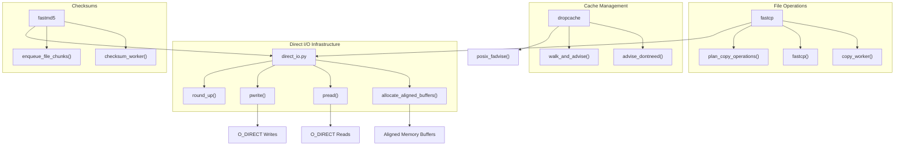
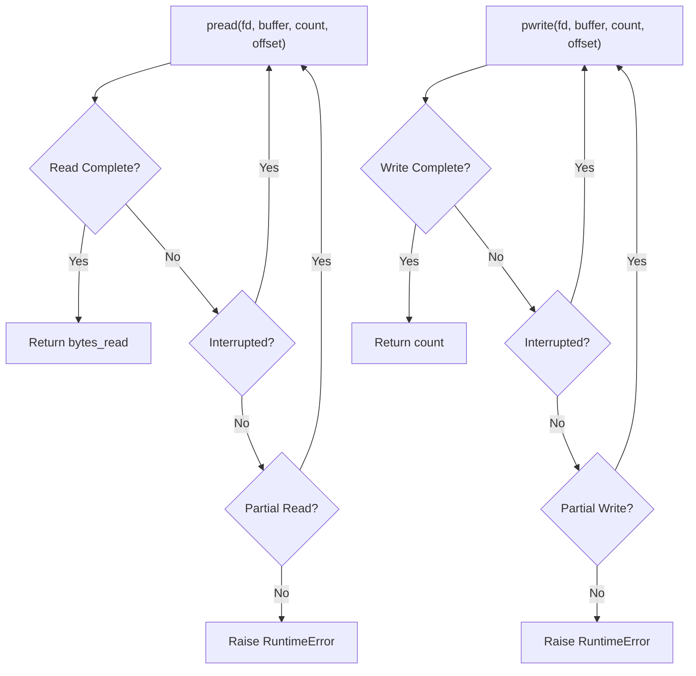
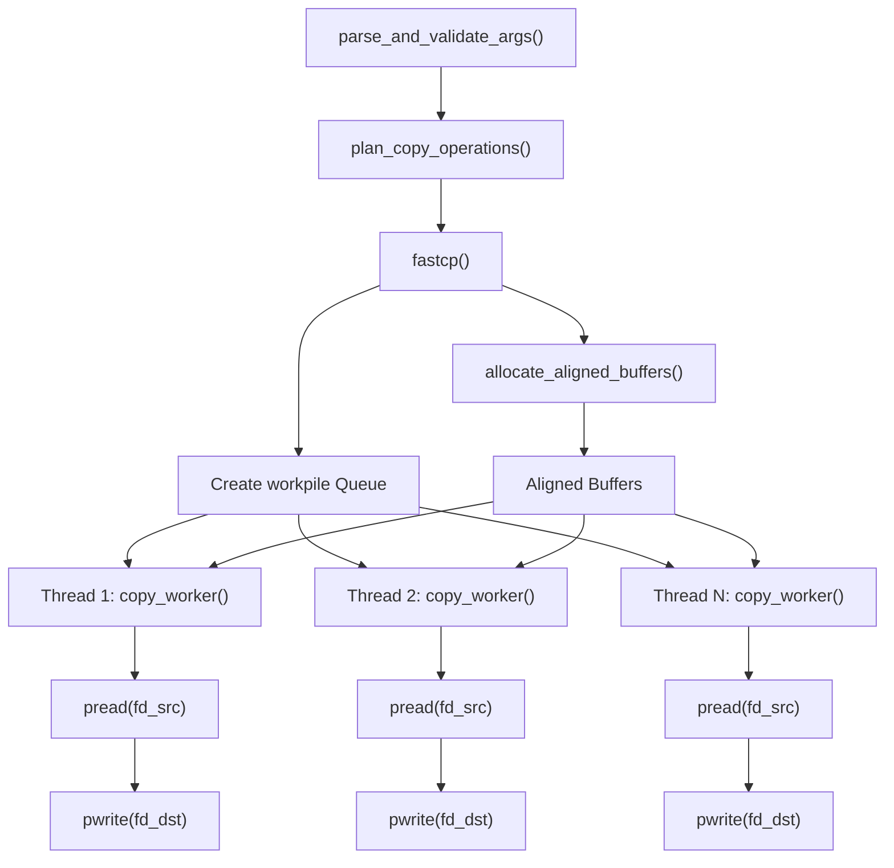
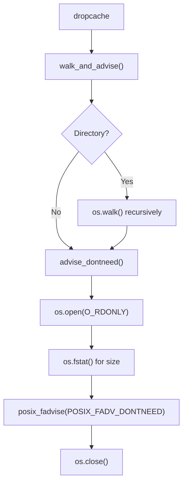
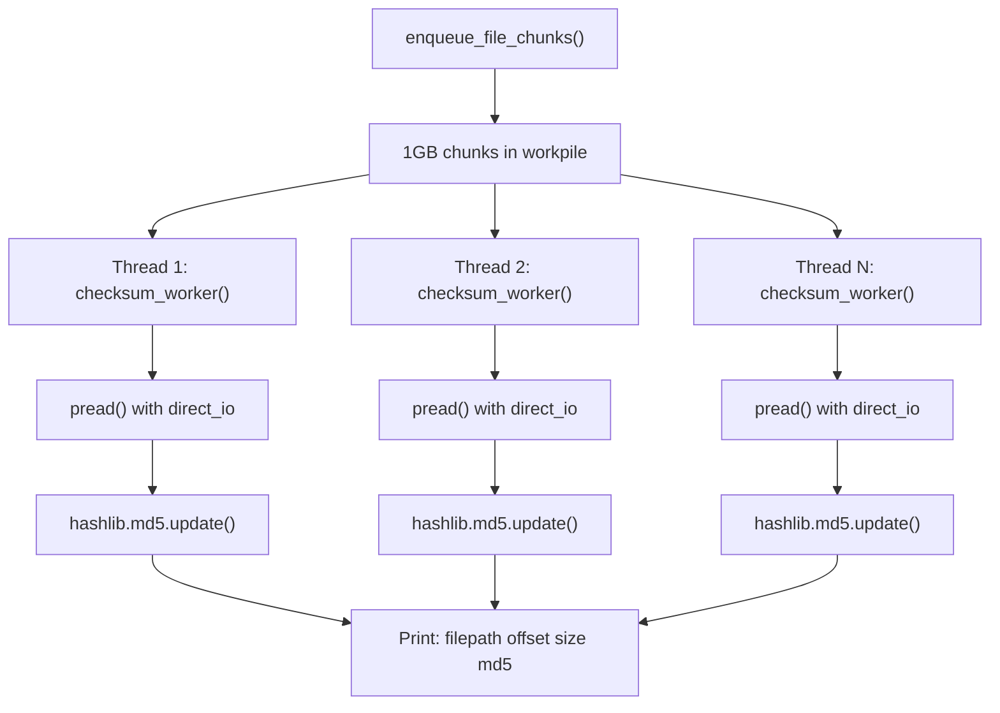

<!-- source: DeepWiki mcp.deepwiki.com · repo NVIDIA/mlperf-common · page 3.2 High-Performance I/O Utilities · fetched 2026-10-26 -->

# High-Performance I/O Utilities

Relevant source files

The following files were used as context for generating this wiki page:

- [client/direct_io.py](client/direct_io.py)
- [client/dropcache](client/dropcache)
- [client/fastcp](client/fastcp)
- [client/fastmd5](client/fastmd5)

This section documents the high-performance file system utilities provided by the MLPerf Common repository. These utilities are designed to maximize I/O throughput and minimize filesystem cache interference during benchmark operations, which is critical for reproducible performance measurements.

The utilities focus on direct I/O operations, multi-threaded processing, and cache management to achieve optimal performance when handling large datasets typical in MLPerf benchmarks. For environment configuration tools like SLURM integration, see [Environment Configuration](#3.1). For system monitoring utilities, see [System Management Tools](#3.3).

## Architecture Overview

The high-performance I/O utilities are built around a shared direct I/O infrastructure with specialized tools for different operations:

**I/O Utilities Architecture**

Sources: [client/direct_io.py:1-151](), [client/fastcp:1-233](), [client/dropcache:1-59](), [client/fastmd5:1-114]()

## Core Direct I/O Infrastructure

The `direct_io.py` module provides the foundation for all high-performance I/O operations through direct I/O operations that bypass the operating system's page cache.

### Aligned Buffer Management

Direct I/O requires memory-aligned buffers to function efficiently. The `allocate_aligned_buffers()` function creates multiple aligned memory regions for multi-threaded operations:

| Function | Purpose | Key Parameters |
|----------|---------|----------------|
| `allocate_aligned_buffers()` | Creates aligned memory buffers | `buffer_size`, `alignment`, `num_bufs` |
| `round_up()` | Rounds values to alignment boundaries | `value`, `multiple` |

The alignment is typically set to 2MB (Linux huge page size) to ensure optimal performance with filesystem block sizes [client/direct_io.py:26-58]().

### Direct I/O Operations

The module provides retry-capable direct I/O operations that handle interrupts and partial reads/writes:

**Direct I/O Operation Flow**

Sources: [client/direct_io.py:66-107](), [client/direct_io.py:108-151]()

Both `pread()` and `pwrite()` automatically handle filesystem block size alignment by padding operations to the next block boundary [client/direct_io.py:76-77](), [client/direct_io.py:119-120]().

## Multi-threaded File Copy (`fastcp`)

The `fastcp` utility implements high-performance file copying using a workpile algorithm with multiple threads performing direct I/O operations.

### Copy Architecture

**fastcp Threading Model**

Sources: [client/fastcp:46-107](), [client/fastcp:28-44]()

### Command Line Interface

The `fastcp` utility supports cp-like command line syntax with performance optimizations:

| Parameter | Default | Purpose |
|-----------|---------|---------|
| `--num-threads` | 16 | Number of worker threads |
| `--buffer-size` | 256MB | Buffer size (must be 2MB multiple) |
| `--recursive` | - | Copy directories recursively |
| `--force` | - | Overwrite existing files |

The utility automatically opens files with `O_DIRECT` flags and aligns operations to filesystem block boundaries [client/fastcp:52-61]().

### Copy Planning

The `plan_copy_operations()` function determines the complete set of file operations needed, handling both single file copies and recursive directory operations [client/fastcp:185-210]().

## Cache Management (`dropcache`)

The `dropcache` utility provides cache eviction capabilities to ensure clean filesystem cache state for benchmark measurements.

### Cache Eviction Process

The utility uses the POSIX `posix_fadvise()` system call with `POSIX_FADV_DONTNEED` to hint the kernel to evict specific files from the page cache:

**Cache Eviction Flow**

Sources: [client/dropcache:31-42](), [client/dropcache:43-52]()

The utility loads `libc.so.6` directly using ctypes to access the `posix_fadvise()` system call [client/dropcache:22-29]().

## Parallel Checksum Computation (`fastmd5`)

The `fastmd5` utility computes MD5 checksums using multi-threaded direct I/O for optimal performance on large files.

### Checksum Architecture

Files are processed in 1GB chunks with each chunk handled by worker threads using aligned buffers:

**fastmd5 Processing Model**

Sources: [client/fastmd5:42-48](), [client/fastmd5:50-74]()

### Output Format

The utility outputs tab-separated values for each 1GB chunk:
- Filepath
- Offset within file
- Chunk size
- MD5 hexdigest

This format enables verification of large files by comparing checksums of individual chunks [client/fastmd5:73]().

## Common Design Patterns

### Buffer Size Requirements

All utilities enforce specific buffer size constraints:
- Must be multiples of 2MB for alignment with Linux huge pages
- For `fastmd5`, must evenly divide 1GB for consistent chunk processing
- Default buffer size is 256MB across utilities

### Error Handling

The utilities implement consistent error handling patterns:
- Retry loops for interrupted system calls
- Validation of return values from direct I/O operations
- Graceful handling of filesystem-specific constraints

### Threading Model

All multi-threaded utilities use a producer-consumer pattern with:
- Main thread populating a work queue
- Worker threads consuming from the queue
- Thread-local aligned buffers to avoid contention
- Synchronization through queue operations rather than explicit locks

Sources: [client/fastcp:79-96](), [client/fastmd5:101-110]()

---

