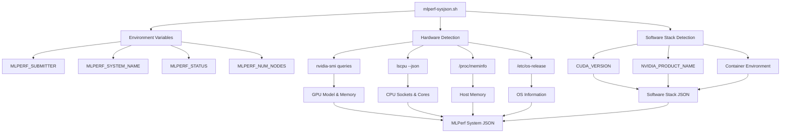
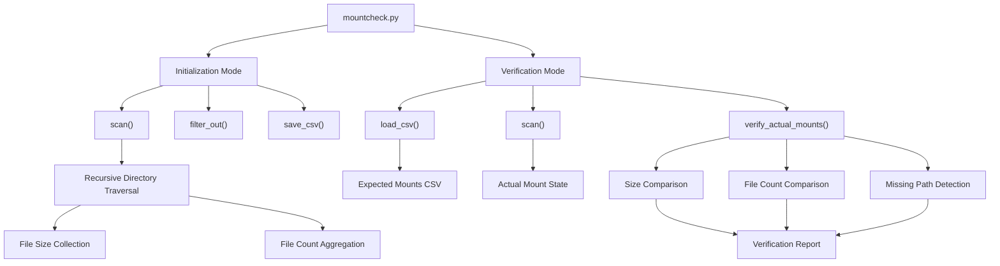
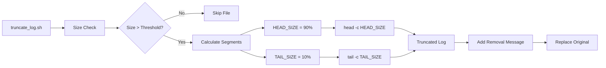

<!-- source: DeepWiki mcp.deepwiki.com · repo NVIDIA/mlperf-common · page 3.3 System Management Tools · fetched 2026-10-26 -->

# System Management Tools

<details>
<summary>Relevant source files</summary>

The following files were used as context for generating this wiki page:

- [client/mlperf-sysjson.sh](client/mlperf-sysjson.sh)
- [client/truncate_log.sh](client/truncate_log.sh)
- [mlperf_common/mountcheck.py](mlperf_common/mountcheck.py)
- [setup.py](setup.py)

</details>


This document covers the system management utilities provided by the MLPerf Common package for operational tasks including system description generation, file system verification, and log management. These tools are primarily focused on ensuring proper system configuration and monitoring for MLPerf benchmark submissions.

For environment configuration and distributed training setup, see [Environment Configuration](#3.1). For high-performance I/O operations, see [High-Performance I/O Utilities](#3.2).

## Purpose and Scope

The system management tools provide essential operational capabilities for MLPerf benchmarking environments:

- **System Description Generation**: Automated collection of hardware and software specifications for MLPerf compliance
- **File System Verification**: Validation of mount points, data integrity, and expected file structures
- **Log Management**: Utilities for managing large log files in long-running benchmark scenarios

## System Description Generation

The primary system management tool is `mlperf-sysjson.sh`, which automatically generates standardized JSON system descriptions required for MLPerf submissions.

### MLPerf System JSON Generator Architecture



Sources: [client/mlperf-sysjson.sh:1-260](), [setup.py:33]()

### Key Components

The system description generator operates through several distinct phases:

**Environment Variable Processing**: The script requires specific environment variables for MLPerf compliance and provides defaults where possible. Required variables include `MLPERF_SUBMITTER`, `MLPERF_SYSTEM_NAME`, and `MLPERF_STATUS`.

**Hardware Detection**: Automated collection of system specifications using standard Linux utilities:
- GPU information via `nvidia-smi` queries [client/mlperf-sysjson.sh:193-196]()
- CPU details through `lscpu --json` parsing [client/mlperf-sysjson.sh:183-191]()
- Memory capacity from `/proc/meminfo` [client/mlperf-sysjson.sh:201]()

**Software Stack Detection**: Collection of framework and library versions from container environment variables [client/mlperf-sysjson.sh:163-173]().

### Usage Pattern

The tool is designed to be invoked in containerized MLPerf environments where NVIDIA container environment variables are available:

```bash
export MLPERF_SUBMITTER="My Organization"
export MLPERF_SYSTEM_NAME="DGX-H100x8"
export MLPERF_STATUS="Available on-premise"
mlperf-sysjson.sh > system_description.json
```

The script validates status values against MLPerf rules and supports backward compatibility with shortened status strings [client/mlperf-sysjson.sh:107-134]().

Sources: [client/mlperf-sysjson.sh:21-61](), [client/mlperf-sysjson.sh:85-98]()

## File System Verification

The `mountcheck.py` module provides comprehensive file system verification capabilities for ensuring data integrity across distributed training environments.

### Mount Check Architecture



Sources: [mlperf_common/mountcheck.py:1-273]()

### Core Functionality

**Baseline Creation**: The `initialize_expected_mounts()` function creates a baseline CSV file containing expected file system structure, sizes, and counts [mlperf_common/mountcheck.py:120-130]().

**Verification Process**: The `verify_actual_mounts()` function compares current file system state against the baseline, detecting mismatches in file sizes, counts, or missing paths [mlperf_common/mountcheck.py:132-199]().

**Filtering Support**: The tool supports filtering specific file extensions to manage large datasets while maintaining verification integrity [mlperf_common/mountcheck.py:100-113]().

### Mount Check Data Model

The verification system uses a structured data model for tracking file system state:

| Field | Type | Description |
|-------|------|-------------|
| `key` | string | Mount identifier |
| `type` | string | "file" or "dir" |
| `relative_path` | string | Path relative to mount root |
| `full_path` | string | Absolute path |
| `num_files` | int | File count (for directories) |
| `num_bytes` | int | Total size in bytes |

Sources: [mlperf_common/mountcheck.py:64-91](), [mlperf_common/mountcheck.py:21-31]()

## Log Management

The `truncate_log.sh` utility provides intelligent log file size management for long-running MLPerf benchmarks.

### Log Truncation Process



Sources: [client/truncate_log.sh:1-40]()

### Implementation Details

The log truncation utility preserves both the beginning and end of log files while removing the middle portion:

**Size Calculation**: The script calculates preservation segments as 90% from the beginning and 10% from the end of the original file [client/truncate_log.sh:16-17]().

**Safe Replacement**: Original files are preserved with `.original` extension before replacement [client/truncate_log.sh:28]().

**Usage Pattern**:
```bash
truncate_log.sh 100 /results/training.log /results/validation.log
```

This truncates any log files larger than 100MB while preserving critical information from both ends of the execution.

Sources: [client/truncate_log.sh:19-39](), [setup.py:33]()

## Integration with MLPerf Workflow

These system management tools integrate into the broader MLPerf benchmark execution pipeline:

1. **Pre-execution**: `mlperf-sysjson.sh` generates system descriptions for submission compliance
2. **Runtime**: `mountcheck.py` verifies data integrity before training begins
3. **Post-execution**: `truncate_log.sh` manages log file sizes for storage efficiency

The tools are distributed as executable scripts via the package setup configuration, making them available system-wide after installation.

Sources: [setup.py:33]()

---

