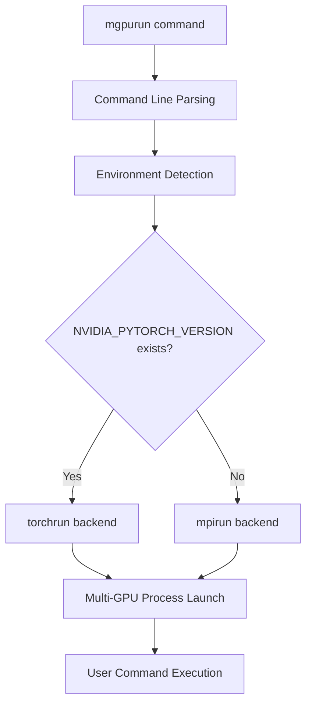
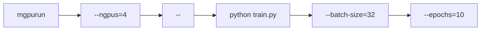
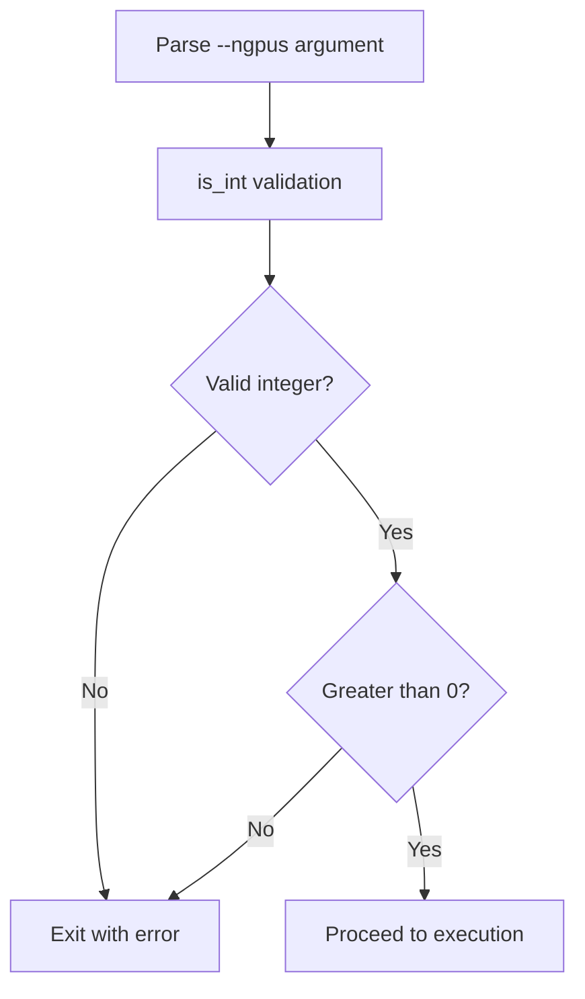
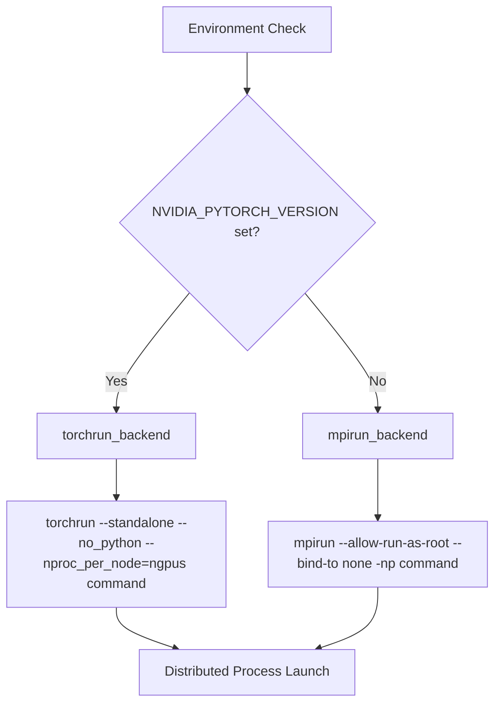

<!-- source: DeepWiki mcp.deepwiki.com · repo NVIDIA/mlperf-common · page 3.4 Multi-GPU Execution · fetched 2026-10-26 -->

# Multi-GPU Execution

<details>
<summary>Relevant source files</summary>

The following files were used as context for generating this wiki page:

- [client/mgpurun](client/mgpurun)

</details>


This document covers the multi-GPU execution utilities provided by the MLPerf Common repository. These tools enable launching and coordinating workloads across multiple GPUs, which is essential for distributed MLPerf benchmarks.

For information about distributed training coordination and logging across multiple GPUs, see [PyTorch Lightning Callbacks](#2.1). For environment configuration and resource affinity settings, see [Environment Configuration](#3.1).

## Overview

The multi-GPU execution system provides a unified interface for launching distributed workloads across different execution backends. The primary component is the `mgpurun` utility, which automatically selects the appropriate backend based on the execution environment.



**Execution Backend Selection**
The system automatically chooses between two execution backends based on environment detection.

Sources: [client/mgpurun:109-113]()

## Command Line Interface

The `mgpurun` utility provides a simple command-line interface for specifying the number of GPU processes and the command to execute.

| Option | Description | Default |
|--------|-------------|---------|
| `-n, --ngpus=n` | Number of processes to execute | 1 |
| `-h, --help` | Display help message | - |
| `-v, --version` | Output version information | - |
| `--usage` | Display brief usage message | - |

### Command Structure

```
mgpurun --ngpus=<n> [--] command [args]
```

The `--` separator is optional and allows clear separation between `mgpurun` options and the user command with its arguments.



**Command Line Parsing Flow**
The utility uses enhanced getopt for robust argument parsing.

Sources: [client/mgpurun:42-51](), [client/mgpurun:64-99]()

## Argument Processing

The utility implements robust command-line argument processing with validation and error handling.

### Helper Functions

The script defines several utility functions for input validation:

- `is_int()`: Validates decimal integer arguments [client/mgpurun:22-26]()
- `have_command()`: Checks if a command is available [client/mgpurun:31-33]()
- `have_enhanced_getopt()`: Verifies enhanced getopt availability [client/mgpurun:38-40]()

### Validation Logic



**Argument Validation Process**
Input validation ensures the ngpus parameter is a positive integer before proceeding.

Sources: [client/mgpurun:101-105]()

## Execution Backends

The system supports two execution backends, automatically selected based on the runtime environment.

### PyTorch Backend (torchrun)

When the `NVIDIA_PYTORCH_VERSION` environment variable is present, indicating execution within an NVIDIA PyTorch container, the system uses `torchrun`:

```bash
torchrun --standalone --no_python --nproc_per_node="${ngpus}" "${@}"
```

**torchrun Parameters:**
- `--standalone`: Run in standalone mode without requiring a master process
- `--no_python`: Execute the command directly without Python wrapper
- `--nproc_per_node`: Number of processes per node (set to ngpus value)

### MPI Backend (mpirun)

For non-PyTorch container environments, the system falls back to MPI execution:

```bash
mpirun --allow-run-as-root --bind-to none -np "${@}"
```

**mpirun Parameters:**
- `--allow-run-as-root`: Allow execution as root user
- `--bind-to none`: Disable automatic process binding
- `-np`: Number of processes parameter



**Backend Selection Logic**
Environment-based automatic selection between PyTorch and MPI execution backends.

Sources: [client/mgpurun:109-113]()

## Integration with MLPerf Workflows

The `mgpurun` utility integrates with the broader MLPerf ecosystem by providing a consistent interface for launching distributed training workloads that utilize other MLPerf Common components.

### Typical Usage Pattern

```bash
# Launch distributed training with 8 GPUs
mgpurun --ngpus=8 python train_resnet.py --data=/path/to/data
```

This command would:
1. Parse the `--ngpus=8` parameter
2. Detect the execution environment 
3. Launch 8 processes using the appropriate backend
4. Execute the training script with MLPerf logging and callbacks

The launched processes would typically utilize:
- MLPerf logging callbacks for compliance tracking
- Distributed communication handlers for coordination
- Performance monitoring and statistics collection

Sources: [client/mgpurun:1-114]()

## Debug and Development Support

The utility includes debugging support through environment variables:

- `DEBUG=1`: Enable verbose execution tracing with `set -x`

When debugging is enabled, the script outputs the parsed ngpus value and remaining command arguments before execution.

Sources: [client/mgpurun:59](), [client/mgpurun:107]()

---

