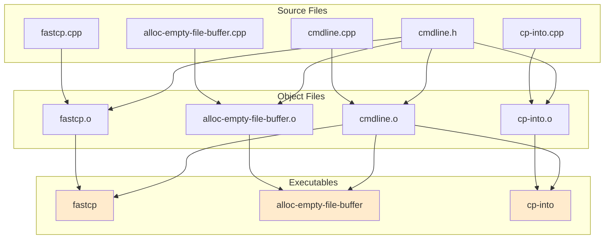
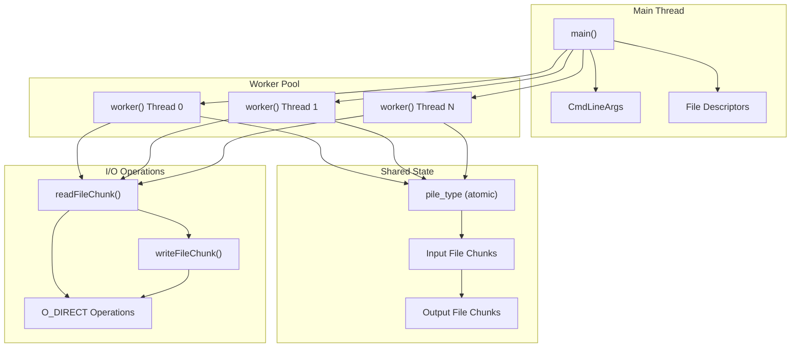
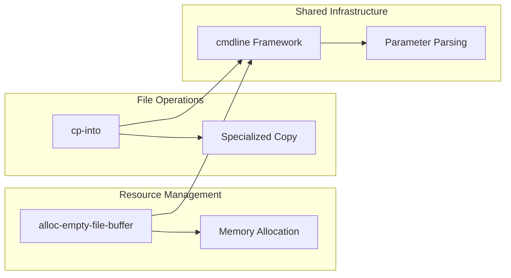
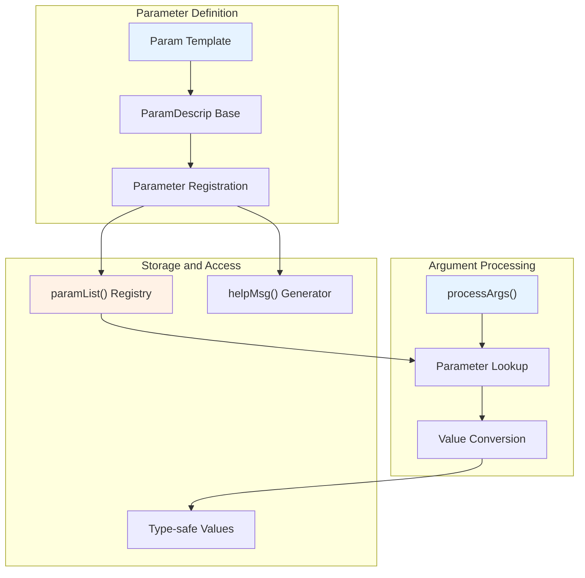

<!-- source: DeepWiki mcp.deepwiki.com · repo NVIDIA/mlperf-common · page 4 Build System and C++ Components · fetched 2026-10-26 -->

# Build System and C++ Components

<details>
<summary>Relevant source files</summary>

The following files were used as context for generating this wiki page:

- [src/Makefile](src/Makefile)
- [src/cmdline.cpp](src/cmdline.cpp)
- [src/fastcp.cpp](src/fastcp.cpp)

</details>


This document covers the native C++ components of the MLPerf Common repository, including the build system, compiled utilities, and supporting libraries. These components provide performance-critical functionality that cannot be efficiently implemented in Python, particularly for high-throughput I/O operations and system-level utilities.

For information about Python-based client utilities, see [Client Utilities](#3). For details about the package distribution system, see [MLPerf Common Overview](#1).

## Purpose and Scope

The C++ components serve three primary functions:
- **High-performance I/O utilities** for large-scale data movement operations
- **System-level tools** for resource allocation and management  
- **Shared infrastructure** for command-line argument parsing across native utilities

The build system uses a traditional Makefile approach optimized for HPC environments where performance and minimal dependencies are critical.

## Build Configuration

The build system is implemented through a single Makefile that compiles three main utilities sharing common infrastructure.

### Build Architecture



**Sources:** [src/Makefile:1-53]()

### Build Targets and Configuration

The Makefile defines three main programs with shared dependencies:

| Program | Object Files | Purpose |
|---------|-------------|---------|
| `fastcp` | `fastcp.o`, `cmdline.o` | Multi-threaded file copy utility |
| `alloc-empty-file-buffer` | `alloc-empty-file-buffer.o`, `cmdline.o` | Memory buffer allocation tool |
| `cp-into` | `cp-into.o`, `cmdline.o` | Specialized copy utility |

**Build Configuration:**
- **Compiler flags:** `-O3 -Wall` for optimized release builds [src/Makefile:28]()
- **Linker flags:** `-s` for stripped binaries [src/Makefile:27]()
- **Libraries:** `-lpthread` for multi-threading support [src/Makefile:29]()
- **Installation prefix:** Configurable via `prefix` variable, defaults to `/usr/local` [src/Makefile:17-19]()

**Sources:** [src/Makefile:21-29](), [src/Makefile:42-49]()

## C++ Utilities

### FastCP Multi-threaded File Copy

The `fastcp` utility implements a high-performance, multi-threaded file copy operation optimized for large files and high-throughput storage systems.

#### FastCP Architecture



**Core Components:**

- **Work Distribution:** Uses `std::atomic<int>` pile for lock-free work stealing [src/fastcp.cpp:102]()
- **Buffer Management:** `UniqueBuffer` with aligned memory allocation via `posix_memalign()` [src/fastcp.cpp:70-93]()
- **Direct I/O:** Supports `O_DIRECT` operations with filesystem block size alignment [src/fastcp.cpp:387-395](), [src/fastcp.cpp:417-419]()
- **Error Handling:** Robust retry logic for partial reads/writes and `EINTR` signals [src/fastcp.cpp:208-240](), [src/fastcp.cpp:277-302]()

**Configuration Parameters:**
- `--buffer-size` (`-b`): Buffer size per thread, default 16MB [src/fastcp.cpp:46-47]()
- `--num-threads` (`-n`): Thread count, defaults to `hardware_concurrency()` [src/fastcp.cpp:48-50]()

**Sources:** [src/fastcp.cpp:43-51](), [src/fastcp.cpp:305-353](), [src/fastcp.cpp:355-467]()

### Memory and System Utilities

The build system also produces specialized utilities for system resource management:

#### Utility Programs



Both utilities leverage the shared `cmdline` framework for consistent argument processing across the native tool suite.

**Sources:** [src/Makefile:21](), [src/Makefile:23-25]()

## Command Line Parsing Framework

The `cmdline` module provides a template-based parameter parsing system used by all C++ utilities.

### Parameter Framework Architecture



**Core Classes and Functions:**

- **`Param<T>`:** Template class for type-safe parameter definitions [src/cmdline.cpp:196-199]()
- **`ParamDescrip`:** Base class managing parameter metadata and help text [src/cmdline.cpp:156-183]()
- **`processArgs()`:** Main argument parsing function with robust error handling [src/cmdline.cpp:112-152]()
- **`paramList()`:** Global registry using singleton pattern for parameter storage [src/cmdline.cpp:93-99]()

**Advanced Features:**
- **Glob matching:** Pattern-based parameter matching with `*` and `?` wildcards [src/cmdline.cpp:30-57]()
- **Flexible syntax:** Supports both `--param=value` and `--param value` formats [src/cmdline.cpp:127-141]()
- **Automatic help generation:** Dynamic help text construction from parameter definitions [src/cmdline.cpp:168-182]()

**Example Usage Pattern:**
```cpp
struct CmdLineArgs {
    cmdline::Param<bool>    help       {"-?", "--help", "this message"};
    cmdline::Param<ssize_t> bufSize    {"-b", "--buffer-size", "buffer size", 16*MiB};
    cmdline::Param<int>     numThreads {"-n", "--num-threads", "number of threads", 
                                        static_cast<int>(std::thread::hardware_concurrency())};
};
```

**Sources:** [src/cmdline.cpp:26-86](), [src/cmdline.cpp:112-152](), [src/cmdline.cpp:156-183](), [src/fastcp.cpp:43-51]()

---

