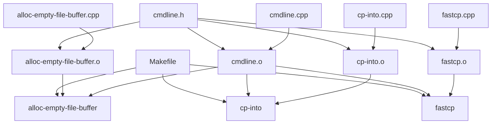
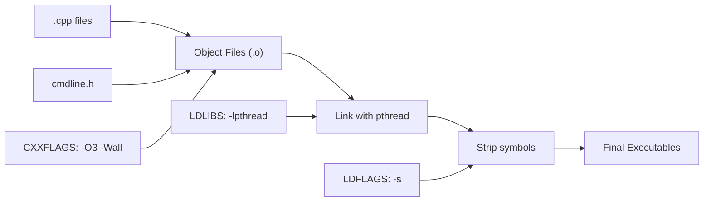
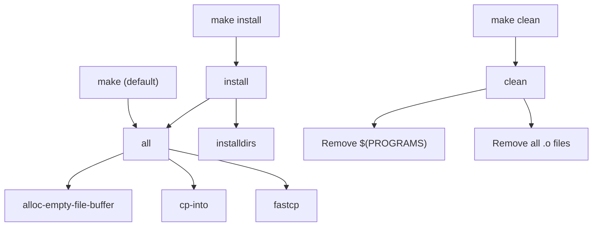

<!-- source: DeepWiki mcp.deepwiki.com · repo NVIDIA/mlperf-common · page 4.1 Build Configuration · fetched 2026-10-26 -->

# Build Configuration

Relevant source files

The following files were used as context for generating this wiki page:

- [src/Makefile](src/Makefile)

## Purpose and Scope

This document covers the build configuration system for the C++ utilities in the MLPerf Common repository. The build system is implemented using a GNU Makefile that compiles native performance-critical utilities from C++ source code. These utilities are primarily focused on high-performance I/O operations and file system management.

For information about the actual C++ utility implementations, see [C++ Utilities](#4.2). For details about the command line parsing framework used by these utilities, see [Command Line Parsing](#4.3). For information about how these utilities are used in practice, see [High-Performance I/O Utilities](#3.2).

## Build Targets and Programs

The build system produces three main executable programs, each serving specific performance-critical functions:

| Program | Purpose | Object Files |
|---------|---------|--------------|
| `alloc-empty-file-buffer` | Allocates empty file buffers for optimized I/O operations | `alloc-empty-file-buffer.o`, `cmdline.o` |
| `cp-into` | Specialized copy utility for moving files into directories | `cp-into.o`, `cmdline.o` |
| `fastcp` | Multi-threaded file copy utility for high-performance data transfer | `fastcp.o`, `cmdline.o` |

All programs share the `cmdline` module which provides standardized command-line argument parsing functionality.

**Build System Architecture**

Sources: [src/Makefile:21-25](), [src/Makefile:40](), [src/Makefile:42-49]()

## Build Configuration Details

### Compiler and Linker Settings

The build system uses specific compiler and linker flags optimized for performance:

| Setting | Value | Purpose |
|---------|-------|---------|
| `CXXFLAGS` | `-O3 -Wall` | Maximum optimization with all warnings enabled |
| `LDFLAGS` | `-s` | Strip symbol table for smaller binaries |
| `LDLIBS` | `-lpthread` | Link pthread library for multi-threading support |

**Build Process Flow**

Sources: [src/Makefile:27-29]()

### Installation Configuration

The build system supports configurable installation paths using standard GNU conventions:

- **prefix**: Base installation directory (default: `/usr/local`)
- **exec_prefix**: Executable installation root (default: `$(prefix)`)
- **bindir**: Binary installation directory (default: `$(exec_prefix)/bin`)

The installation process creates necessary directories and installs all built programs with appropriate permissions.

Sources: [src/Makefile:17-19](), [src/Makefile:34-38]()

## Make Targets

The Makefile provides several targets for different build and maintenance operations:

| Target | Description | Dependencies |
|--------|-------------|--------------|
| `all` | Build all programs (default target) | `$(PROGRAMS)` |
| `install` | Install programs to system directories | `all`, `installdirs` |
| `installdirs` | Create installation directories | None |
| `clean` | Remove all built files and objects | None |

**Target Dependency Graph**

Sources: [src/Makefile:31-32](), [src/Makefile:34-38](), [src/Makefile:51-52]()

## Shared Dependencies

All C++ programs depend on the shared command-line parsing infrastructure:

- **Header**: `cmdline.h` provides interface definitions
- **Implementation**: `cmdline.o` compiled from `cmdline.cpp`
- **Dependency**: All object files explicitly depend on `cmdline.h`

This shared dependency ensures consistent command-line argument handling across all utilities and simplifies maintenance of the parsing logic.

Sources: [src/Makefile:40]()

## Integration with Package Distribution

The build system integrates with the broader MLPerf Common package distribution through the Python `setup.py` system. The compiled C++ utilities are distributed as executable scripts that can be installed system-wide alongside the Python components, providing a complete toolkit for high-performance MLPerf benchmark operations.

Sources: [src/Makefile:37-38]()

---

